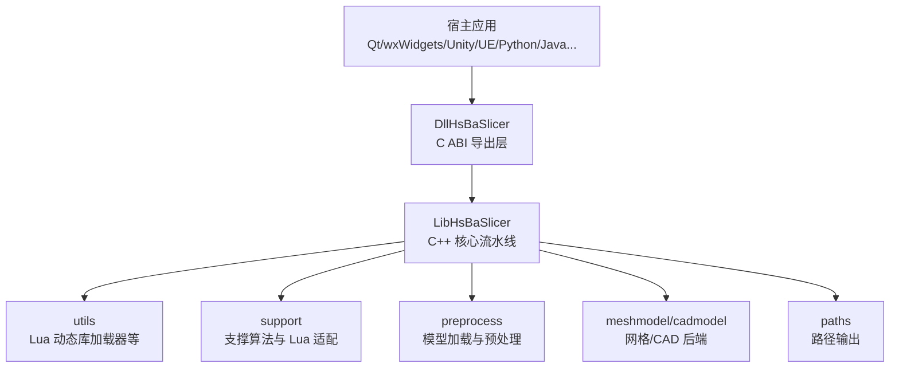
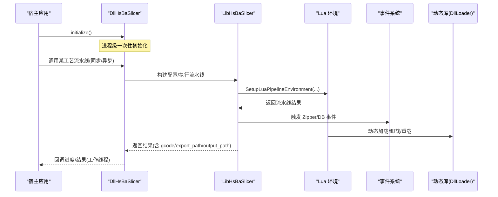
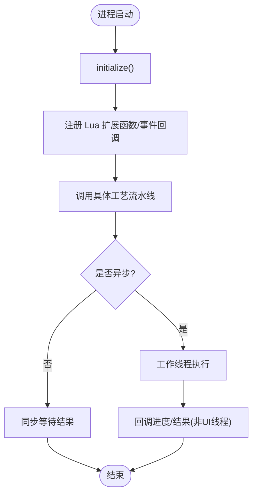
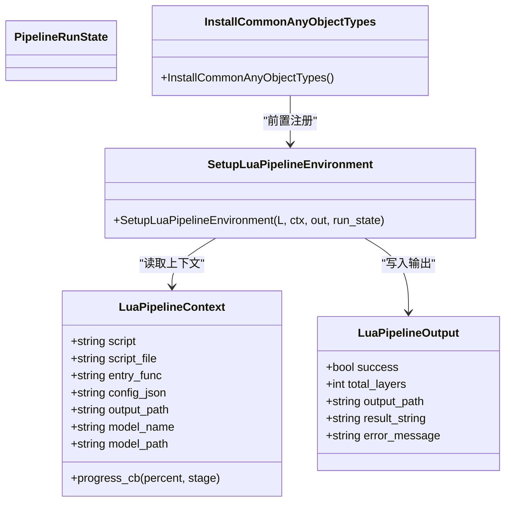
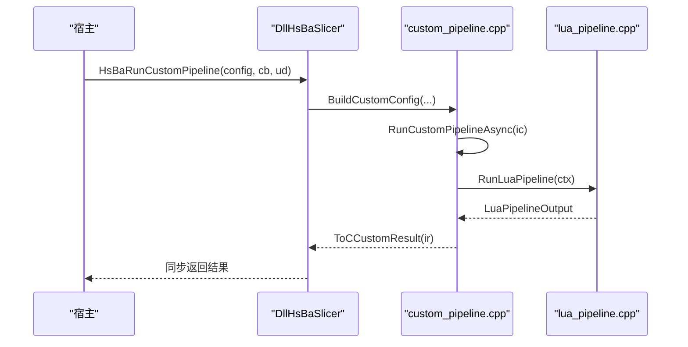
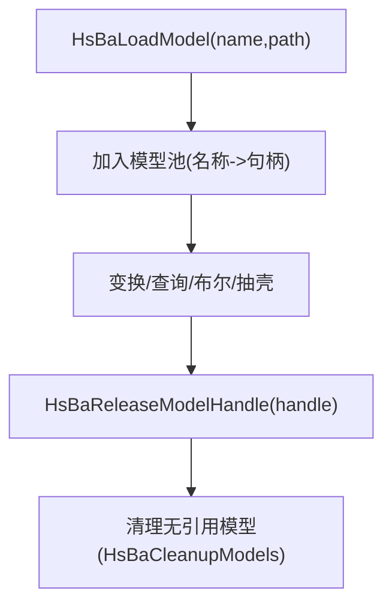
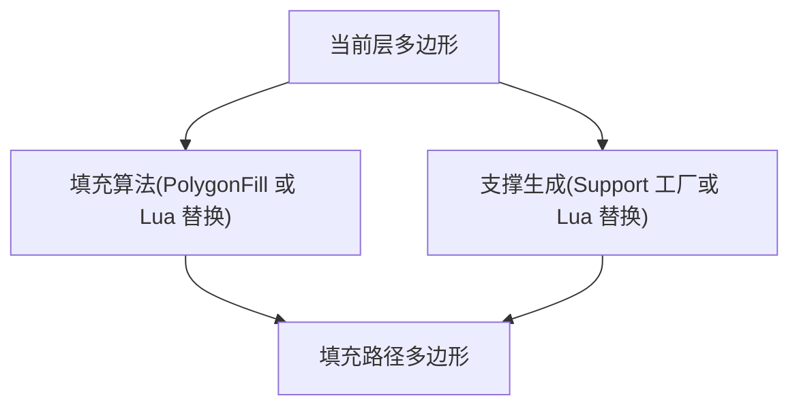
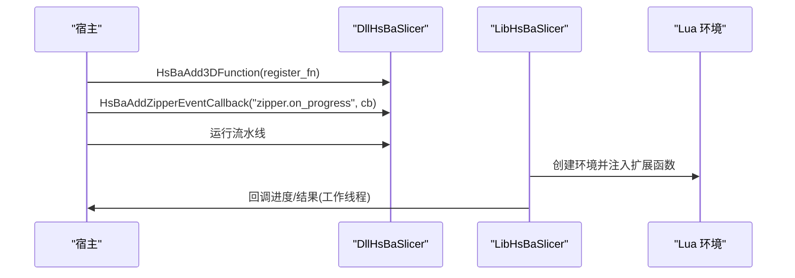
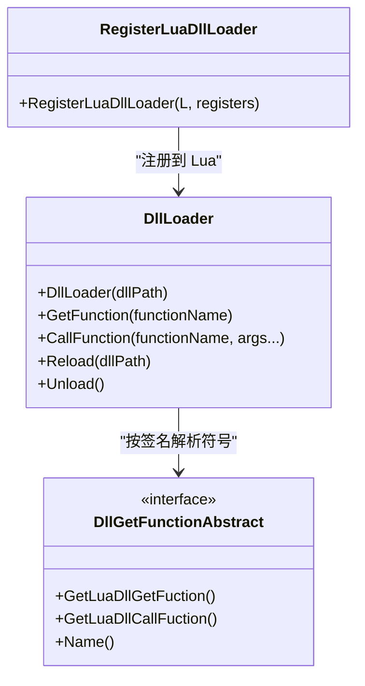
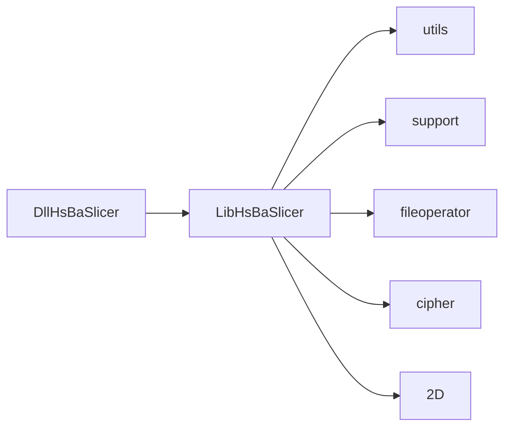

# 插件架构设计

<cite>
**本文引用的文件**   
- [README.md](file://README.md)
- [CMakeLists.txt](file://CMakeLists.txt)
- [DllHsBaSlicer/initialize.cpp](file://DllHsBaSlicer/initialize.cpp)
- [DllHsBaSlicer/custom_pipeline.cpp](file://DllHsBaSlicer/custom_pipeline.cpp)
- [DllHsBaSlicer/lua_register.h](file://DllHsBaSlicer/lua_register.h)
- [LibHsBaSlicer/Extends/LuaAddFunction.hpp](file://LibHsBaSlicer/Extends/LuaAddFunction.hpp)
- [LibHsBaSlicer/Extends/lua_pipeline.cpp](file://LibHsBaSlicer/Extends/lua_pipeline.cpp)
- [LibHsBaSlicer/Extends/LuaCommonTypes.cpp](file://LibHsBaSlicer/Extends/LuaCommonTypes.cpp)
- [utils/LuaDllLoader.hpp](file://utils/LuaDllLoader.hpp)
- [utils/LuaDllLoader.cpp](file://utils/LuaDllLoader.cpp)
- [utils/CMakeLists.txt](file://utils/CMakeLists.txt)
- [support/CMakeLists.txt](file://support/CMakeLists.txt)
- [docs/zh/DllHsBaSlicer/README.md](file://docs/zh/DllHsBaSlicer/README.md)
- [docs/zh/lua_pipeline_api.md](file://docs/zh/lua_pipeline_api.md)
</cite>

## 目录
1. [引言](#引言)
2. [项目结构](#项目结构)
3. [核心组件](#核心组件)
4. [架构总览](#架构总览)
5. [详细组件分析](#详细组件分析)
6. [依赖关系分析](#依赖关系分析)
7. [性能与并发特性](#性能与并发特性)
8. [故障排查指南](#故障排查指南)
9. [结论](#结论)
10. [附录：插件开发流程与最佳实践](#附录插件开发流程与最佳实践)

## 引言
本设计文档面向希望深度定制 HsBaSlicer 功能的开发者，系统性阐述其“插件化”能力与扩展点。HsBaSlicer 以 C++ 静态库 LibHsBaSlicer 为核心算法层，通过上层 C ABI 动态库 DllHsBaSlicer 暴露给宿主语言；同时提供 Lua 脚本环境、事件回调、以及运行时动态库加载机制，形成“C++ 核心 + Lua 脚本 + 可选动态库”的三层可插拔体系。

- 模型加载器：通过预处理接口与模型池管理（名称句柄 + 引用计数）实现跨阶段复用。
- 填充算法：通过 PolygonFill 与自定义填充脚本替换。
- 支撑生成器：通过 Support 工厂与 Lua 自定义支撑生成器替换。
- 流水线调度：基于协程的同步/异步 API，支持 FDM/SLA/SLS/SLM/LOM/TDP/WAAM 等工艺。
- 插件边界：Lua 扩展函数注册、C++ 事件源注册、Lua 动态库加载器。

## 项目结构
从插件视角，仓库关键模块如下：
- DllHsBaSlicer：对外 C ABI 导出层，封装各工艺流水线入口、初始化、Lua 扩展注册、事件源注册、版本信息等。
- LibHsBaSlicer：C++ 核心切片能力（预处理、切片、支撑、填充、路径生成），并提供 Extends 扩展点（Lua 环境搭建、通用类型注册、流水线运行）。
- utils：工具集，包含 Lua 动态库加载器（基于 Boost.DLL）、配置、序列化等。
- support：支撑算法与 Lua 支撑适配器。
- 其他几何、CAD、路径、参数存储、加密、日志等子模块为底层能力。

图表来源
- [README.md:25-39](file://README.md#L25-L39)
- [docs/zh/DllHsBaSlicer/README.md:7-19](file://docs/zh/DllHsBaSlicer/README.md#L7-L19)

章节来源
- [README.md:25-39](file://README.md#L25-L39)
- [docs/zh/DllHsBaSlicer/README.md:7-19](file://docs/zh/DllHsBaSlicer/README.md#L7-L19)

## 核心组件
- 动态库导出层（DllHsBaSlicer）
  - 统一初始化 initialize()
  - 各工艺流水线同步/异步 API（FDM/SLA/SLS/SLM/LOM/TDP/WAAM/FileTransfer/Custom）
  - Lua 扩展函数注册（2D/3D/File/Event）
  - C++ 事件源注册（Zipper/DB）
  - Proto 序列化转换与版本信息
- 核心流水线（LibHsBaSlicer）
  - 预处理、切片、支撑、填充、路径生成
  - Extends：Lua 环境 Setup、通用 AnyObject 类型注册、流水线运行 RunLuaPipeline
- 插件扩展点
  - Lua 扩展函数注册（C ABI 与 C++ 双入口）
  - 事件系统（Zipper 进度、数据库事件）
  - 运行时动态库加载（Lua 可见的 DllLoader）
- 模型与数据
  - 模型池（名称到句柄映射，引用计数）
  - 参数持久化（ParamStore）
  - 多格式输入（IGL/OCCT 等）

章节来源
- [docs/zh/DllHsBaSlicer/README.md:33-54](file://docs/zh/DllHsBaSlicer/README.md#L33-L54)
- [docs/zh/DllHsBaSlicer/README.md:56-110](file://docs/zh/DllHsBaSlicer/README.md#L56-L110)
- [docs/zh/DllHsBaSlicer/README.md:147-355](file://docs/zh/DllHsBaSlicer/README.md#L147-L355)
- [docs/zh/DllHsBaSlicer/README.md:357-454](file://docs/zh/DllHsBaSlicer/README.md#L357-L454)
- [docs/zh/DllHsBaSlicer/README.md:456-603](file://docs/zh/DllHsBaSlicer/README.md#L456-L603)
- [docs/zh/DllHsBaSlicer/README.md:604-703](file://docs/zh/DllHsBaSlicer/README.md#L604-L703)

## 架构总览
下图展示“宿主 → DllHsBaSlicer → LibHsBaSlicer → 扩展点（Lua/事件/动态库）”的整体调用链与职责边界。

图表来源
- [docs/zh/DllHsBaSlicer/README.md:56-110](file://docs/zh/DllHsBaSlicer/README.md#L56-L110)
- [docs/zh/DllHsBaSlicer/README.md:684-703](file://docs/zh/DllHsBaSlicer/README.md#L684-L703)
- [LibHsBaSlicer/Extends/lua_pipeline.cpp:857-894](file://LibHsBaSlicer/Extends/lua_pipeline.cpp#L857-L894)
- [utils/LuaDllLoader.hpp:27-79](file://utils/LuaDllLoader.hpp#L27-L79)

## 详细组件分析

### 1) 动态库导出层（DllHsBaSlicer）
- 初始化
  - 提供 initialize() 作为进程启动后唯一一次调用的入口，用于全局资源准备（当前为空壳，预留扩展点）。
- 流水线 API
  - 每个工艺提供 CreateDefaultConfig / Run*Pipeline / Run*PipelineAsync / Free*Result。
  - 异步回调在内部工作线程触发，宿主需自行切回 UI/游戏线程更新界面。
- Lua 扩展函数注册
  - 通过 HsBaAdd2DFunction/HsBaAdd3DFunction/HsBaAddFileFunction/HsBaAddEventCallback 将 C 风格的注册函数注入到各阶段 Lua 环境。
- C++ 事件源注册
  - 通过 HsBaAddZipperEventCallback/HsBaAddDBEventCallback 监听压缩进度与数据库事件。
- 内存与生命周期
  - 结果结构体中的字符串由库分配，必须使用对应 Free* 释放。
  - 模型句柄通过 HsBaReleaseModelHandle 释放引用。

图表来源
- [DllHsBaSlicer/initialize.cpp:7-9](file://DllHsBaSlicer/initialize.cpp#L7-L9)
- [DllHsBaSlicer/lua_register.h:21-31](file://DllHsBaSlicer/lua_register.h#L21-L31)
- [docs/zh/DllHsBaSlicer/README.md:684-703](file://docs/zh/DllHsBaSlicer/README.md#L684-L703)

章节来源
- [DllHsBaSlicer/initialize.cpp:1-10](file://DllHsBaSlicer/initialize.cpp#L1-L10)
- [DllHsBaSlicer/lua_register.h:1-37](file://DllHsBaSlicer/lua_register.h#L1-L37)
- [docs/zh/DllHsBaSlicer/README.md:56-110](file://docs/zh/DllHsBaSlicer/README.md#L56-L110)
- [docs/zh/DllHsBaSlicer/README.md:612-682](file://docs/zh/DllHsBaSlicer/README.md#L612-L682)
- [docs/zh/DllHsBaSlicer/README.md:684-703](file://docs/zh/DllHsBaSlicer/README.md#L684-L703)

### 2) 核心流水线与 Lua 环境（LibHsBaSlicer）
- 流水线运行
  - Custom 流水线完全由 Lua 脚本驱动：C++ 侧仅负责构造环境、挂载算子表 HsBa、调用入口函数。
  - 内置流水线（FDM/SLA/SLS/SLM/LOM/TDP/WAAM）阶段顺序固定，但允许通过 Lua 脚本替换特定阶段（支撑/填充/地板/导出）。
- Lua 环境搭建
  - SetupLuaPipelineEnvironment 中依次注册：通用 AnyObject 类型、2D/3D/File 扩展函数、PolygonOperations、Support、PolygonFill、PathOptimize、Zipper、Cipher、SQLiteAdapter、ParamStore，以及可选 Bit7zZipper/MySQL/PostgreSQL 适配器。
- 通用类型注册
  - InstallCommonAnyObjectTypes 确保 ParamStore 与各阶段消费 GetFileFunctions() 时能立即遍历字段反射。

图表来源
- [LibHsBaSlicer/Extends/lua_pipeline.cpp:857-894](file://LibHsBaSlicer/Extends/lua_pipeline.cpp#L857-L894)
- [LibHsBaSlicer/Extends/LuaCommonTypes.cpp:478-494](file://LibHsBaSlicer/Extends/LuaCommonTypes.cpp#L478-L494)

章节来源
- [LibHsBaSlicer/Extends/lua_pipeline.cpp:857-894](file://LibHsBaSlicer/Extends/lua_pipeline.cpp#L857-L894)
- [LibHsBaSlicer/Extends/LuaCommonTypes.cpp:478-494](file://LibHsBaSlicer/Extends/LuaCommonTypes.cpp#L478-L494)
- [docs/zh/lua_pipeline_api.md:19-29](file://docs/zh/lua_pipeline_api.md#L19-L29)
- [docs/zh/lua_pipeline_api.md:48-133](file://docs/zh/lua_pipeline_api.md#L48-L133)

### 3) 自定义流水线（Custom Pipeline）
- 入口与配置
  - 通过 HsBaCreateDefaultCustomConfig/HsBaRunCustomPipeline/HsBaRunCustomPipelineAsync 调用。
  - 至少设置 pipeline_lua_script 或 pipeline_lua_source；entry_func 默认 run_pipeline。
- 执行流程
  - 构建 InternalCustomConfig -> RunCustomPipelineAsync -> RunLuaPipeline(ctx) -> 转换为 C 结果结构。
  - 进度回调通过 progress_cb 桥接到 C 回调。

图表来源
- [DllHsBaSlicer/custom_pipeline.cpp:85-158](file://DllHsBaSlicer/custom_pipeline.cpp#L85-L158)
- [DllHsBaSlicer/custom_pipeline.cpp:164-204](file://DllHsBaSlicer/custom_pipeline.cpp#L164-L204)

章节来源
- [DllHsBaSlicer/custom_pipeline.cpp:1-204](file://DllHsBaSlicer/custom_pipeline.cpp#L1-L204)
- [docs/zh/DllHsBaSlicer/README.md:456-525](file://docs/zh/DllHsBaSlicer/README.md#L456-L525)

### 4) 模型加载器与模型池
- 模型管理
  - 通过 HsBaLoadModel/HsBaGetModel/HsBaRemoveModel/HsBaContainsModel/HsBaModelCount/HsBaCleanupModels 管理模型池。
  - 高级操作（布尔运算/抽壳）优先 OCCT BRep，网格回退 IGL/CGAL；不可用时返回 NULL。
- 生命周期
  - 模型通过不透明句柄引用，内部引用计数管理；外部通过 HsBaReleaseModelHandle 释放引用。

图表来源
- [docs/zh/DllHsBaSlicer/README.md:64-110](file://docs/zh/DllHsBaSlicer/README.md#L64-L110)

章节来源
- [docs/zh/DllHsBaSlicer/README.md:64-110](file://docs/zh/DllHsBaSlicer/README.md#L64-L110)

### 5) 填充算法与支撑生成器的插件化
- 填充算法
  - 内置 PolygonFill 提供 offsetFill/lineFill/simpleZigzagFill/zigzagFill/compositeOffsetFill/hybridFill/offsetOnly。
  - 可通过 Fill 阶段的 Lua 脚本替换 generate_fill(current_layer)。
- 支撑生成器
  - 内置 Support 工厂支持 plane/tree/honeycomb/sla 及 Lua 自定义 new_lua/new_lua_file。
  - 通过 Support.generate(obj, current_layer, prev_layer, layer_height, cfg) 生成支撑多边形。
  - 支撑阶段可用 Lua 脚本替换 generate_support()。

图表来源
- [docs/zh/lua_pipeline_api.md:157-177](file://docs/zh/lua_pipeline_api.md#L157-L177)
- [docs/zh/lua_pipeline_api.md:219-239](file://docs/zh/lua_pipeline_api.md#L219-L239)

章节来源
- [docs/zh/lua_pipeline_api.md:157-177](file://docs/zh/lua_pipeline_api.md#L157-L177)
- [docs/zh/lua_pipeline_api.md:219-239](file://docs/zh/lua_pipeline_api.md#L219-L239)

### 6) 事件系统与回调机制
- Lua 扩展函数注册
  - 通过 HsBaAdd2DFunction/HsBaAdd3DFunction/HsBaAddFileFunction/HsBaAddEventCallback 将 C 风格注册函数注入到各阶段 Lua 环境。
- C++ 事件源注册
  - 通过 HsBaAddZipperEventCallback/HsBaAddDBEventCallback 监听 Zipper 压缩进度与数据库事件。
- 线程模型
  - 进度与结果回调在库内部工作线程触发，宿主需自行切回 UI/游戏线程更新界面。

图表来源
- [DllHsBaSlicer/lua_register.h:21-31](file://DllHsBaSlicer/lua_register.h#L21-L31)
- [docs/zh/DllHsBaSlicer/README.md:612-682](file://docs/zh/DllHsBaSlicer/README.md#L612-L682)
- [docs/zh/DllHsBaSlicer/README.md:684-694](file://docs/zh/DllHsBaSlicer/README.md#L684-L694)

章节来源
- [DllHsBaSlicer/lua_register.h:1-37](file://DllHsBaSlicer/lua_register.h#L1-L37)
- [docs/zh/DllHsBaSlicer/README.md:612-682](file://docs/zh/DllHsBaSlicer/README.md#L612-L682)
- [docs/zh/DllHsBaSlicer/README.md:684-694](file://docs/zh/DllHsBaSlicer/README.md#L684-L694)

### 7) 动态库加载机制（Lua 可见）
- 目标
  - 在 Lua 环境中提供 DllLoader 对象，支持 get_function/call_function/unload/reload，便于从外部动态库解析并调用符号。
- 实现要点
  - 基于 Boost.DLL 的 shared_library，模板化函数签名解析。
  - 通过 RegisterLuaDllLoader 向 Lua 注册元方法与全局方法。
  - 编译期开关 HSBA_USE_DLL_LOADER 控制启用与否（桌面平台默认开启，移动端关闭）。

图表来源
- [utils/LuaDllLoader.hpp:27-79](file://utils/LuaDllLoader.hpp#L27-L79)
- [utils/LuaDllLoader.hpp:81-111](file://utils/LuaDllLoader.hpp#L81-L111)
- [utils/LuaDllLoader.cpp:55-103](file://utils/LuaDllLoader.cpp#L55-L103)

章节来源
- [utils/LuaDllLoader.hpp:1-268](file://utils/LuaDllLoader.hpp#L1-L268)
- [utils/LuaDllLoader.cpp:1-108](file://utils/LuaDllLoader.cpp#L1-L108)
- [CMakeLists.txt:228-240](file://CMakeLists.txt#L228-L240)

## 依赖关系分析
- 构建选项
  - HSBA_USE_DLL_LOADER：控制动态库加载器启用（桌面默认 ON，非桌面 OFF）。
  - HSBA_HSBA_USE_BIT7Z：控制 Bit7zZipper 启用（桌面默认 ON，非桌面 OFF）。
  - HSBA_USE_MYSQL/HSBA_USE_PGSQL：控制 MySQL/PostgreSQL 适配器启用。
- 模块耦合
  - DllHsBaSlicer 仅依赖 LibHsBaSlicer 的导出接口，保持 ABI 边界清晰。
  - LibHsBaSlicer 依赖 utils（Lua 绑定、动态库加载）、support（支撑算法）、2D（多边形处理）、cipher（编解码）、fileoperator（文件/数据库/参数存储）等。

图表来源
- [CMakeLists.txt:228-250](file://CMakeLists.txt#L228-L250)
- [utils/CMakeLists.txt:1-33](file://utils/CMakeLists.txt#L1-L33)
- [support/CMakeLists.txt:1-22](file://support/CMakeLists.txt#L1-L22)

章节来源
- [CMakeLists.txt:228-250](file://CMakeLists.txt#L228-L250)
- [utils/CMakeLists.txt:1-33](file://utils/CMakeLists.txt#L1-L33)
- [support/CMakeLists.txt:1-22](file://support/CMakeLists.txt#L1-L22)

## 性能与并发特性
- 协程调度
  - 流水线内部基于 C++20 协程实现同步/异步调用，避免阻塞主线程。
- 回调线程模型
  - 进度与结果回调在库内部工作线程触发，宿主需自行切回 UI/游戏线程更新界面。
- 资源复用
  - 模型池复用模型句柄，减少重复加载开销。
  - ParamStore 按工艺类型宽表存储，避免频繁建表。

章节来源
- [docs/zh/DllHsBaSlicer/README.md:684-694](file://docs/zh/DllHsBaSlicer/README.md#L684-L694)
- [docs/zh/DllHsBaSlicer/README.md:386-454](file://docs/zh/DllHsBaSlicer/README.md#L386-L454)

## 故障排查指南
- 常见问题
  - 未调用 initialize()：可能导致全局状态未就绪。
  - 忘记释放结果字符串：导致内存泄漏。
  - 回调中直接更新 UI：可能引发跨线程问题。
  - 动态库加载失败：检查 HSBA_USE_DLL_LOADER 编译开关与路径。
  - 导出脚本返回值错误：导致 zip 被覆盖或写空。
- 定位建议
  - 使用 HsBaGetVersionJson/XML 确认版本与许可信息。
  - 通过事件回调监听 Zipper/DB 事件，辅助定位 IO 与压缩问题。
  - 检查 Lua 扩展函数注册是否在流水线运行前完成。

章节来源
- [docs/zh/DllHsBaSlicer/README.md:604-610](file://docs/zh/DllHsBaSlicer/README.md#L604-L610)
- [docs/zh/DllHsBaSlicer/README.md:684-703](file://docs/zh/DllHsBaSlicer/README.md#L684-L703)
- [docs/zh/lua_pipeline_api.md:246-261](file://docs/zh/lua_pipeline_api.md#L246-L261)

## 结论
HsBaSlicer 的插件架构以“C++ 核心 + Lua 脚本 + 可选动态库”为核心范式：
- 通过 DllHsBaSlicer 提供稳定 C ABI，屏蔽内部复杂性；
- 通过 LibHsBaSlicer 的 Extends 提供可扩展的流水线与 Lua 环境；
- 通过事件系统与动态库加载器，实现运行时扩展与可观测性；
- 通过模型池与参数持久化，提升复用性与工程效率。

该架构既满足生产级切片流水线的稳定性需求，也为研究与定制化提供了充分的扩展空间。

## 附录：插件开发流程与最佳实践

### A. 开发 Lua 扩展函数（C++ 侧）
- 步骤
  - 实现 C 风格的注册函数（接收 lua_State*）。
  - 在 initialize() 之后、流水线运行之前，调用 HsBaAdd2DFunction/HsBaAdd3DFunction/HsBaAddFileFunction 注册。
  - 如需事件回调，使用 HsBaAddEventCallback 注册。
- 注意事项
  - 注册函数指针需在进程生命周期内有效（使用 static/global）。
  - 根据阶段选择正确的注册类别（Slice=3D，Support=2D+3D，Fill=2D，SLS/SLA Output=File）。

章节来源
- [DllHsBaSlicer/lua_register.h:21-31](file://DllHsBaSlicer/lua_register.h#L21-L31)
- [docs/zh/DllHsBaSlicer/README.md:612-647](file://docs/zh/DllHsBaSlicer/README.md#L612-L647)

### B. 开发 Lua 脚本（自定义流水线或阶段替换）
- 自定义流水线
  - 定义入口函数（默认 run_pipeline），通过 HsBa.* 算子组织流程（loadModel/slice/fill/support/toGcode/saveSlsPackage 等）。
  - 通过 HsBa.progress/setLayers/setOutputPath 回报进度与结果。
- 阶段替换
  - 支撑阶段：实现 generate_support()。
  - 填充阶段：实现 generate_fill(current_layer)。
  - SLA 地板阶段：自定义 floor 逻辑。
  - 导出阶段：实现 export_sls/export_waam 等约定函数，返回 {success, export_path}。

章节来源
- [docs/zh/lua_pipeline_api.md:48-133](file://docs/zh/lua_pipeline_api.md#L48-L133)
- [docs/zh/lua_pipeline_api.md:219-261](file://docs/zh/lua_pipeline_api.md#L219-L261)

### C. 使用动态库加载器（Lua 可见）
- 步骤
  - 在 Lua 中 DllLoader.new(path) 创建对象。
  - 使用 get_<name>/call_<name> 解析并调用外部符号。
  - 使用 unload/reload 管理生命周期。
- 注意事项
  - 仅在桌面平台启用 HSBA_USE_DLL_LOADER。
  - 注意函数签名匹配与异常处理。

章节来源
- [utils/LuaDllLoader.hpp:27-79](file://utils/LuaDllLoader.hpp#L27-L79)
- [utils/LuaDllLoader.cpp:55-103](file://utils/LuaDllLoader.cpp#L55-L103)
- [CMakeLists.txt:228-240](file://CMakeLists.txt#L228-L240)

### D. 打包、分发与版本管理
- 安装与导出
  - 通过 cmake --install 安装所有目标，下游 find_package(HsBaSlicer) 引用。
  - 头文件布局与 CMake 配置文件随安装树导出。
- 版本信息
  - 使用 HsBaGetVersionJson/XML 获取版本与许可信息。
- 许可证
  - 条件双许可：不包含 GPL/LGPL 组件时为 MIT；包含时为 GPL-3.0-or-later。

章节来源
- [README.md:100-185](file://README.md#L100-L185)
- [README.md:192-210](file://README.md#L192-L210)
- [docs/zh/DllHsBaSlicer/README.md:604-610](file://docs/zh/DllHsBaSlicer/README.md#L604-L610)