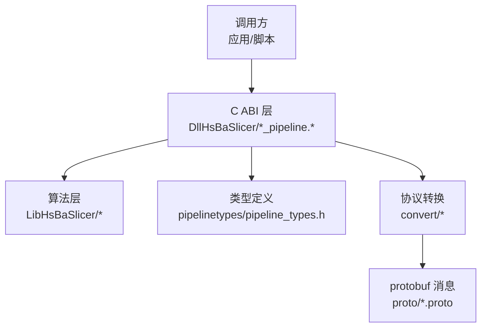
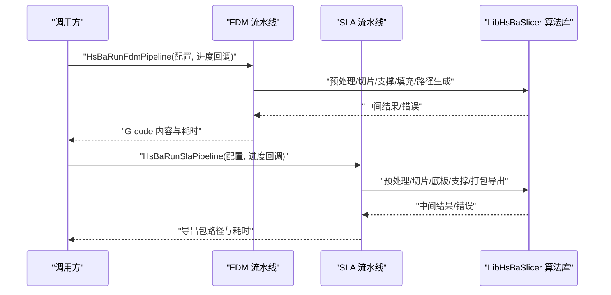
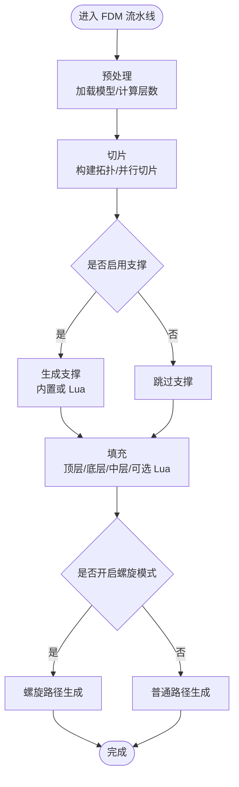
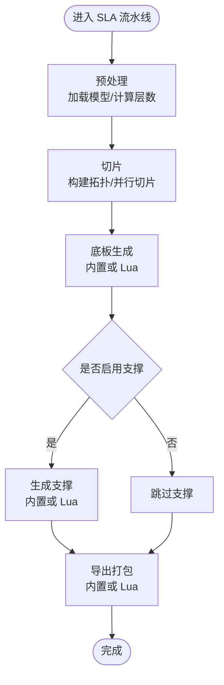
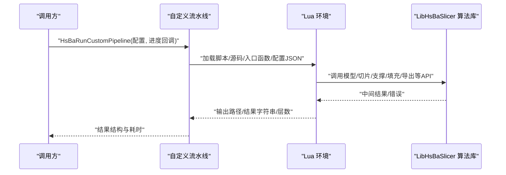
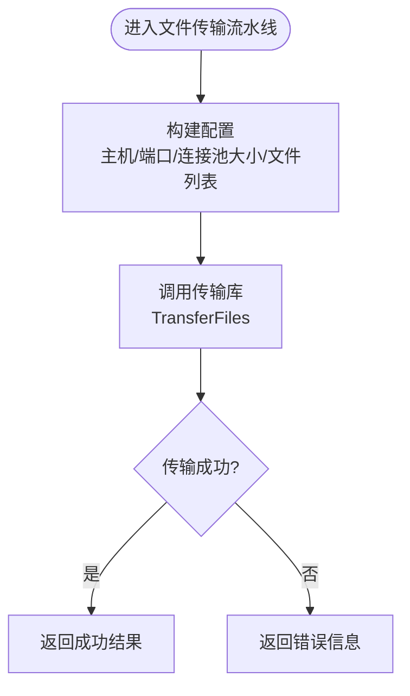
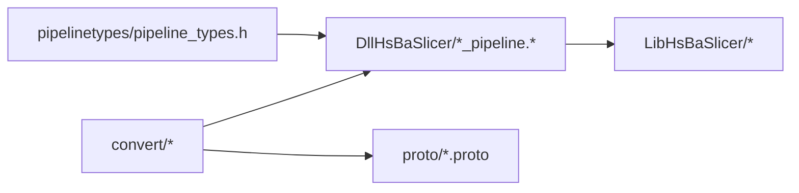
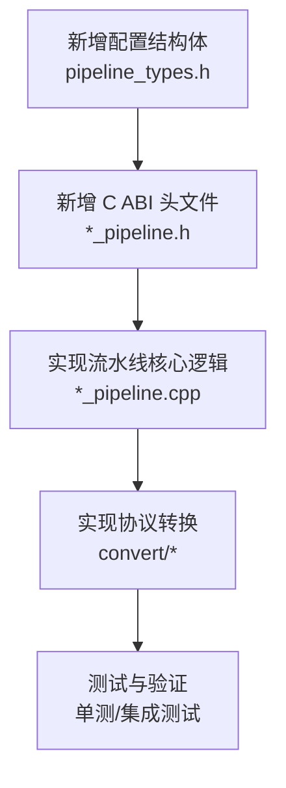

# 新流水线开发

<cite>
**本文引用的文件**   
- [pipeline_types.h](file://pipelinetypes/pipeline_types.h)
- [fdm_pipeline.h](file://DllHsBaSlicer/fdm_pipeline.h)
- [fdm_pipeline.cpp](file://DllHsBaSlicer/fdm_pipeline.cpp)
- [sla_pipeline.h](file://DllHsBaSlicer/sla_pipeline.h)
- [sla_pipeline.cpp](file://DllHsBaSlicer/sla_pipeline.cpp)
- [custom_pipeline.h](file://DllHsBaSlicer/custom_pipeline.h)
- [custom_pipeline.cpp](file://DllHsBaSlicer/custom_pipeline.cpp)
- [file_transfer_pipeline.h](file://DllHsBaSlicer/file_transfer_pipeline.h)
- [file_transfer_pipeline.cpp](file://DllHsBaSlicer/file_transfer_pipeline.cpp)
- [Msg2PipelineConfig.hpp](file://convert/Msg2PipelineConfig.hpp)
- [Msg2PipelineConfig.cpp](file://convert/Msg2PipelineConfig.cpp)
- [PipelineConfig2Msg.hpp](file://convert/PipelineConfig2Msg.hpp)
- [PipelineConfig2Msg.cpp](file://convert/PipelineConfig2Msg.cpp)
</cite>

## 目录
1. [引言](#引言)
2. [项目结构](#项目结构)
3. [核心概念](#核心概念)
4. [架构总览](#架构总览)
5. [详细组件分析](#详细组件分析)
6. [依赖关系分析](#依赖关系分析)
7. [性能与并发特性](#性能与并发特性)
8. [配置系统与参数扩展](#配置系统与参数扩展)
9. [注册机制与动态加载](#注册机制与动态加载)
10. [从零开始开发新流水线](#从零开始开发新流水线)
11. [故障排除指南](#故障排除指南)
12. [结论](#结论)

## 引言
本指南面向需要基于 HsBaSlicer 框架开发新切片或制造流水线的工程师。文档围绕“阶段定义、数据传递机制、错误处理策略、Lua 扩展点、配置系统扩展、注册与动态加载”展开，并以 FDM、SLA、自定义 Lua 流水线、文件传输流水线为典型示例，给出从现有基类/接口继承到完整实现的步骤说明。

## 项目结构
HsBaSlicer 的流水线体系由三层组成：
- C ABI 对外接口层：位于 DllHsBaSlicer，提供各工艺流水线的创建、运行、异步执行和结果释放 API。
- 类型与协议转换层：位于 pipelinetypes 与 convert，定义跨语言共享的 POD 配置/结果结构，以及 protobuf 消息与原生结构的互转。
- 算法实现层：LibHsBaSlicer 提供模型预处理、切片、支撑、填充、路径生成、打包等能力；各流水线组合这些能力形成阶段化流程。

**图示来源**
- [fdm_pipeline.cpp:219-447](file://DllHsBaSlicer/fdm_pipeline.cpp#L219-L447)
- [sla_pipeline.cpp:299-483](file://DllHsBaSlicer/sla_pipeline.cpp#L299-L483)
- [pipeline_types.h:56-127](file://pipelinetypes/pipeline_types.h#L56-L127)
- [Msg2PipelineConfig.hpp:24-73](file://convert/Msg2PipelineConfig.hpp#L24-L73)

**章节来源**
- [fdm_pipeline.h:1-68](file://DllHsBaSlicer/fdm_pipeline.h#L1-L68)
- [sla_pipeline.h:1-63](file://DllHsBaSlicer/sla_pipeline.h#L1-L63)
- [pipeline_types.h:56-127](file://pipelinetypes/pipeline_types.h#L56-L127)
- [Msg2PipelineConfig.hpp:24-73](file://convert/Msg2PipelineConfig.hpp#L24-L73)

## 核心概念
- 流水线阶段：每个流水线由若干阶段构成，例如 FDM 包含“预处理→切片→支撑→填充→路径生成”，SLA 包含“预处理→切片→底板→支撑→导出”。
- 配置对象：每种流水线都有对应的 C 兼容配置结构体，包含模型、切片、工艺、输出、Lua 扩展等字段，并提供默认值初始化函数。
- 结果对象：每种流水线都有对应的 C 兼容结果结构体，包含成功标志、层数、输出内容/路径、错误信息、耗时等。
- 进度回调：所有流水线支持进度回调，用于 UI 或上层状态更新。
- 异步执行：所有流水线同时提供同步与异步接口，内部使用协程封装任务。

关键要点：
- 配置结构体中的字符串指针由调用方负责生命周期管理，或由运行函数内部拷贝后交由结果释放函数统一释放。
- 错误通过统一的 RuntimeError 捕获并转为错误消息返回。
- Lua 扩展点以“脚本路径 + 函数名”形式注入，允许替换支撑、填充、底板、导出等逻辑。

**章节来源**
- [pipeline_types.h:56-127](file://pipelinetypes/pipeline_types.h#L56-L127)
- [pipeline_types.h:170-232](file://pipelinetypes/pipeline_types.h#L170-L232)
- [pipeline_types.h:689-732](file://pipelinetypes/pipeline_types.h#L689-L732)
- [pipeline_types.h:738-783](file://pipelinetypes/pipeline_types.h#L738-L783)
- [pipeline_types.h:789-825](file://pipelinetypes/pipeline_types.h#L789-L825)
- [pipeline_types.h:972-983](file://pipelinetypes/pipeline_types.h#L789-L825)

## 架构总览
下图展示 FDM 与 SLA 两个典型流水线的阶段序列，以及它们如何复用 LibHsBaSlicer 的能力。

**图示来源**
- [fdm_pipeline.cpp:219-447](file://DllHsBaSlicer/fdm_pipeline.cpp#L219-L447)
- [sla_pipeline.cpp:299-483](file://DllHsBaSlicer/sla_pipeline.cpp#L299-L483)

## 详细组件分析

### FDM 流水线
FDM 流水线是典型的挤出式增材制造切片流程，其阶段包括：
- 预处理：加载模型、计算包围盒与层数。
- 切片：构建拓扑并按层并行切片。
- 支撑：根据悬垂角度、间距、密度等参数生成支撑，或通过 Lua 脚本替换。
- 填充：按顶层/底层/中层不同策略进行填充，支持 Zigzag 等模式，也可用 Lua 替换。
- 路径生成：生成 G-code 路径，支持螺旋花瓶模式与普通多层模式。

**图示来源**
- [fdm_pipeline.cpp:219-447](file://DllHsBaSlicer/fdm_pipeline.cpp#L219-L447)

关键点：
- 层数计算基于首层高度与常规层高，空模型或无效高度会直接失败。
- 切片阶段使用并行循环提升吞吐，每层独立且只读共享拓扑。
- 支撑与填充可分别通过 Lua 脚本替换，但 Lua 填充需串行以避免解释器竞争。
- 螺旋模式下跳过支撑与填充，仅生成连续上升的外壁路径。

**章节来源**
- [fdm_pipeline.h:17-61](file://DllHsBaSlicer/fdm_pipeline.h#L17-L61)
- [fdm_pipeline.cpp:110-140](file://DllHsBaSlicer/fdm_pipeline.cpp#L110-L140)
- [fdm_pipeline.cpp:142-197](file://DllHsBaSlicer/fdm_pipeline.cpp#L142-L197)
- [fdm_pipeline.cpp:219-447](file://DllHsBaSlicer/fdm_pipeline.cpp#L219-L447)

### SLA 流水线
SLA 流水线针对光固化打印，阶段包括：
- 预处理：加载模型、计算层数。
- 切片：构建拓扑并按层并行切片。
- 底板：根据轮廓生成底板/垫板，支持凸包、边框、填充间距与角度，可通过 Lua 替换。
- 支撑：根据悬垂角度、间距、密度等生成支撑，支持 Lua 替换。
- 导出：将层轮廓、支撑、底板与曝光参数打包为 zip，支持 Lua 自定义导出。

**图示来源**
- [sla_pipeline.cpp:299-483](file://DllHsBaSlicer/sla_pipeline.cpp#L299-L483)

关键点：
- 导出阶段会构建 JSON 配置，包含切片、曝光、抬升、底板、支撑、图像格式与尺寸等信息。
- 若未指定输出路径，则自动生成带模型名的 zip 文件名。
- 支持 PNG/JPG/SVG 三种图像格式，并在导出时写入对应扩展名。

**章节来源**
- [sla_pipeline.h:17-56](file://DllHsBaSlicer/sla_pipeline.h#L17-L56)
- [sla_pipeline.cpp:181-242](file://DllHsBaSlicer/sla_pipeline.cpp#L181-L242)
- [sla_pipeline.cpp:244-282](file://DllHsBaSlicer/sla_pipeline.cpp#L244-L282)
- [sla_pipeline.cpp:299-483](file://DllHsBaSlicer/sla_pipeline.cpp#L299-L483)

### 自定义 Lua 流水线
完全由 Lua 驱动的流水线，整个工作流（阶段顺序与内容）由 Lua 入口函数定义。C++ 侧仅提供构建块（模型加载、切片、支撑、填充、底板、G-code 路径输出、SLA/SLS 打包）并通过全局表暴露给 Lua。

**图示来源**
- [custom_pipeline.cpp:117-163](file://DllHsBaSlicer/custom_pipeline.cpp#L117-L163)
- [custom_pipeline.h:17-62](file://DllHsBaSlicer/custom_pipeline.h#L17-L62)

关键点：
- 必须设置 pipeline_lua_script 或 pipeline_lua_source，否则直接报错。
- 默认入口函数名为 run_pipeline，可通过 entry_func 覆盖。
- config_json 作为自由格式 JSON 传入 Lua，便于传递任意业务参数。

**章节来源**
- [custom_pipeline.h:17-62](file://DllHsBaSlicer/custom_pipeline.h#L17-L62)
- [custom_pipeline.cpp:86-99](file://DllHsBaSlicer/custom_pipeline.cpp#L86-L99)
- [custom_pipeline.cpp:117-163](file://DllHsBaSlicer/custom_pipeline.cpp#L117-L163)
- [custom_pipeline.cpp:171-213](file://DllHsBaSlicer/custom_pipeline.cpp#L171-L213)

### 文件传输流水线
该流水线用于将文件列表发送到远程服务，内部使用连接池与进度回调。

**图示来源**
- [file_transfer_pipeline.cpp:115-149](file://DllHsBaSlicer/file_transfer_pipeline.cpp#L115-L149)

关键点：
- 如果 file_paths 为空或 file_count 为 0，则不会发送任何文件。
- 进度回调通过包装函数转发到 C 回调。

**章节来源**
- [file_transfer_pipeline.h:17-60](file://DllHsBaSlicer/file_transfer_pipeline.h#L17-L60)
- [file_transfer_pipeline.cpp:77-100](file://DllHsBaSlicer/file_transfer_pipeline.cpp#L77-L100)
- [file_transfer_pipeline.cpp:115-149](file://DllHsBaSlicer/file_transfer_pipeline.cpp#L115-L149)

## 依赖关系分析
- C ABI 层依赖 pipelinetypes 提供的配置/结果结构体，确保跨语言稳定。
- 协议转换层在 convert 中提供双向映射，使外部系统可通过 protobuf 下发配置并接收结果。
- 各流水线实现依赖 LibHsBaSlicer 的模型、切片、支撑、填充、路径与打包能力。

**图示来源**
- [Msg2PipelineConfig.hpp:24-73](file://convert/Msg2PipelineConfig.hpp#L24-L73)
- [PipelineConfig2Msg.hpp:24-76](file://convert/PipelineConfig2Msg.hpp#L24-L76)
- [pipeline_types.h:56-127](file://pipelinetypes/pipeline_types.h#L56-L127)

**章节来源**
- [Msg2PipelineConfig.hpp:24-73](file://convert/Msg2PipelineConfig.hpp#L24-L73)
- [PipelineConfig2Msg.hpp:24-76](file://convert/PipelineConfig2Msg.hpp#L24-L76)
- [pipeline_types.h:56-127](file://pipelinetypes/pipeline_types.h#L56-L127)

## 性能与并发特性
- 切片阶段采用并行循环，每层独立切片，显著提升吞吐。
- 填充阶段在纯 C++ 实现下也并行执行；当使用 Lua 填充时为保证解释器安全改为串行。
- 螺旋模式跳过支撑与填充，减少计算量，适合花瓶类模型。
- 所有流水线均记录 elapsed_seconds，便于性能分析与调优。

建议：
- 对大规模模型优先启用并行切片与填充。
- 避免在 Lua 填充中使用全局可变状态，必要时拆分脚本或使用线程安全的 Lua 实例。
- 合理设置层数与层高，避免过细层导致内存与时间开销过大。

**章节来源**
- [fdm_pipeline.cpp:264-279](file://DllHsBaSlicer/fdm_pipeline.cpp#L264-L279)
- [fdm_pipeline.cpp:312-383](file://DllHsBaSlicer/fdm_pipeline.cpp#L312-L383)
- [fdm_pipeline.cpp:385-433](file://DllHsBaSlicer/fdm_pipeline.cpp#L385-L433)

## 配置系统与参数扩展
新增流水线或扩展现有流水线时，应遵循以下规则：
- 在 pipelinetypes/pipeline_types.h 中新增或修改配置结构体，并为每个字段添加注释说明默认值与单位。
- 提供默认值初始化函数（如 HsBaFdmConfigDefault），确保未设置字段有合理默认值。
- 在 convert 层实现 MsgToXxxConfig 与 XxxConfigToMsg，保证 protobuf 与原生结构的双向一致。
- 在对应 *_pipeline.cpp 中解析配置为内部结构，并校验必要字段（如模型路径、层高等）。
- 如需新增参数类型，先在枚举或结构体中声明，再在转换层与默认值初始化函数中补齐。

示例扩展点：
- FDM 新增“填充角度范围”参数：在 HsBaFdmPipelineConfig_t 中添加字段，在 HsBaFdmConfigDefault 中赋默认值，在 MsgToFdmConfig 与 FdmConfigToMsg 中映射。
- SLA 新增“底板凸包阈值”参数：在 HsBaSlaPipelineConfig_t 中添加字段，在 HsBaSlaConfigDefault 中赋默认值，在 MsgToSlaConfig 与 SlaConfigToMsg 中映射。

**章节来源**
- [pipeline_types.h:56-127](file://pipelinetypes/pipeline_types.h#L56-L127)
- [pipeline_types.h:738-783](file://pipelinetypes/pipeline_types.h#L738-L783)
- [Msg2PipelineConfig.cpp:35-83](file://convert/Msg2PipelineConfig.cpp#L35-L83)
- [PipelineConfig2Msg.cpp:10-77](file://convert/PipelineConfig2Msg.cpp#L10-L77)

## 注册机制与动态加载
- 流水线本身通过 C ABI 暴露函数，调用方直接调用 HsBaRunXxxPipeline 系列函数即可，无需额外注册。
- 对于 Lua 驱动流水线，通过 pipeline_lua_script 或 pipeline_lua_source 动态加载脚本，entry_func 决定入口函数名。
- ParamStore 在 Lua 环境中通过静态注册守卫确保只初始化一次，反射注册后暴露 ParamStore.new 等方法。

注意：
- 自定义流水线必须确保脚本存在且入口函数可用，否则会返回错误。
- ParamStore 的注册是幂等的，重复初始化不会重复挂载方法。

**章节来源**
- [custom_pipeline.cpp:117-163](file://DllHsBaSlicer/custom_pipeline.cpp#L117-L163)
- [LuaAdapter.cpp:1716-1762](file://fileoperator/LuaAdapter.cpp#L1716-L1762)

## 从零开始开发新流水线
以下步骤以“新增一种工艺流水线”为例，结合现有 FDM/SLA 的实现模式：

1. 定义配置与结果结构体
   - 在 pipelinetypes/pipeline_types.h 中新增结构体，包含模型、切片、工艺、输出、Lua 扩展等字段。
   - 提供默认值初始化函数，确保所有字段有合理默认值。

2. 实现 C ABI 头文件
   - 在 DllHsBaSlicer 下新增 *_pipeline.h，声明创建默认配置、同步运行、异步运行与释放结果的函数。

3. 实现流水线核心逻辑
   - 在 *_pipeline.cpp 中实现内部配置构建、阶段执行、进度回调、错误捕获与结果转换。
   - 复用 LibHsBaSlicer 的模型、切片、支撑、填充、路径或打包能力。

4. 实现协议转换
   - 在 convert/Msg2PipelineConfig.cpp 与 PipelineConfig2Msg.cpp 中新增映射函数，确保 protobuf 与原生结构一致。

5. 测试与验证
   - 编写单元测试或集成测试，验证配置解析、阶段执行、Lua 扩展、错误处理与资源释放。

**图示来源**
- [pipeline_types.h:56-127](file://pipelinetypes/pipeline_types.h#L56-L127)
- [fdm_pipeline.h:17-61](file://DllHsBaSlicer/fdm_pipeline.h#L17-L61)
- [fdm_pipeline.cpp:219-447](file://DllHsBaSlicer/fdm_pipeline.cpp#L219-L447)
- [Msg2PipelineConfig.cpp:35-83](file://convert/Msg2PipelineConfig.cpp#L35-L83)
- [PipelineConfig2Msg.cpp:10-77](file://convert/PipelineConfig2Msg.cpp#L10-L77)

## 故障排除指南
常见问题与排查建议：
- 模型加载失败：检查 model_name 与 model_path 是否正确，确认模型文件存在且可读。
- 层数为零或负数：检查 layer_height 与 first_layer_height 是否合理，模型高度是否为正。
- Lua 脚本未找到或函数不存在：检查 script 路径与 func 名称，确保脚本可读取且函数存在。
- 导出失败：检查输出路径权限与磁盘空间，确认图像格式与尺寸参数有效。
- 内存泄漏：确保调用 HsBaFreeXxxPipelineResult 释放结果中的字符串字段。

错误处理模式：
- 所有流水线内部捕获 RuntimeError，将其转换为错误消息返回。
- 进度回调仅在回调非空时触发，避免空指针异常。
- 异步接口的结果回调负责释放结果字符串，调用方不应再次释放。

**章节来源**
- [fdm_pipeline.cpp:437-446](file://DllHsBaSlicer/fdm_pipeline.cpp#L437-L446)
- [sla_pipeline.cpp:473-482](file://DllHsBaSlicer/sla_pipeline.cpp#L473-L482)
- [file_transfer_pipeline.cpp:139-148](file://DllHsBaSlicer/file_transfer_pipeline.cpp#L139-L148)
- [custom_pipeline.cpp:127-133](file://DllHsBaSlicer/custom_pipeline.cpp#L127-L133)

## 结论
HsBaSlicer 的流水线体系通过清晰的 C ABI、稳定的类型定义与协议转换层，提供了可扩展、高性能且易于集成的切片与制造流程。开发者可以基于现有 FDM/SLA 的模式快速实现新流水线，并通过 Lua 扩展点灵活替换关键阶段。配置系统的默认值管理与双向协议映射确保了易用性与兼容性。在实际工程中，建议严格遵循配置字段注释、默认值初始化与错误处理规范，以保证稳定性与可维护性。