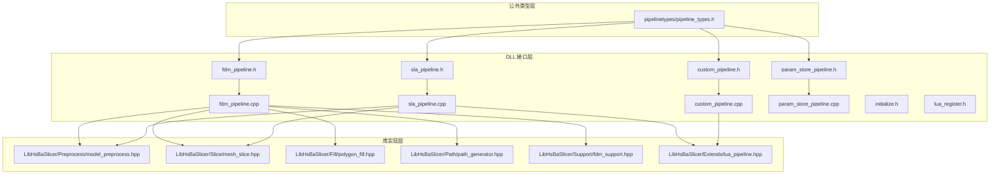
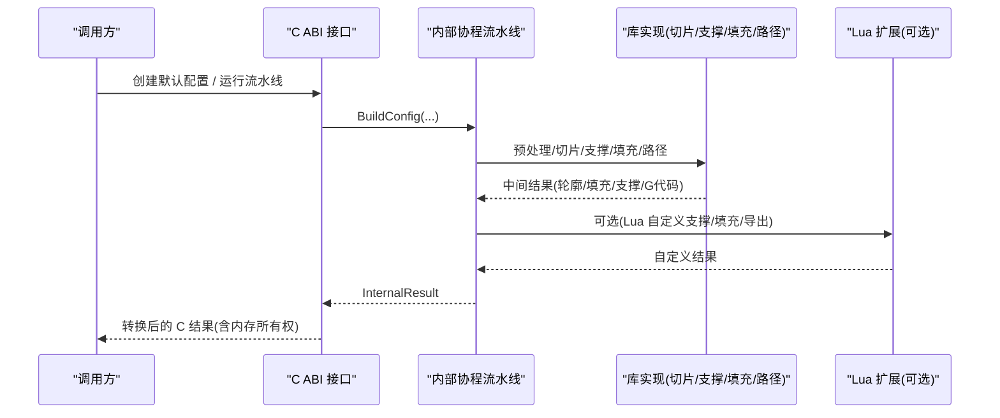
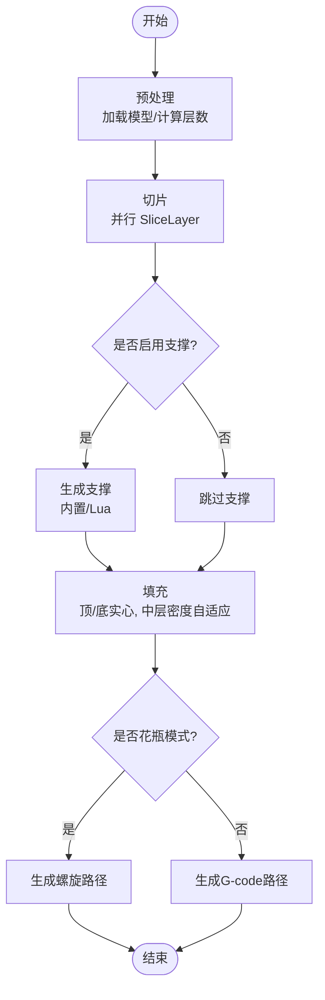
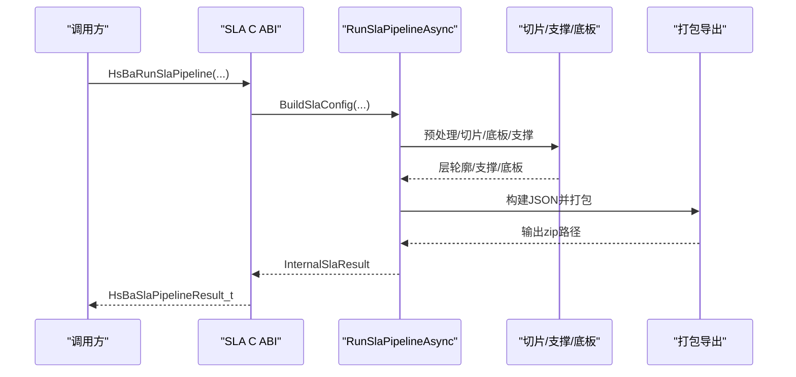
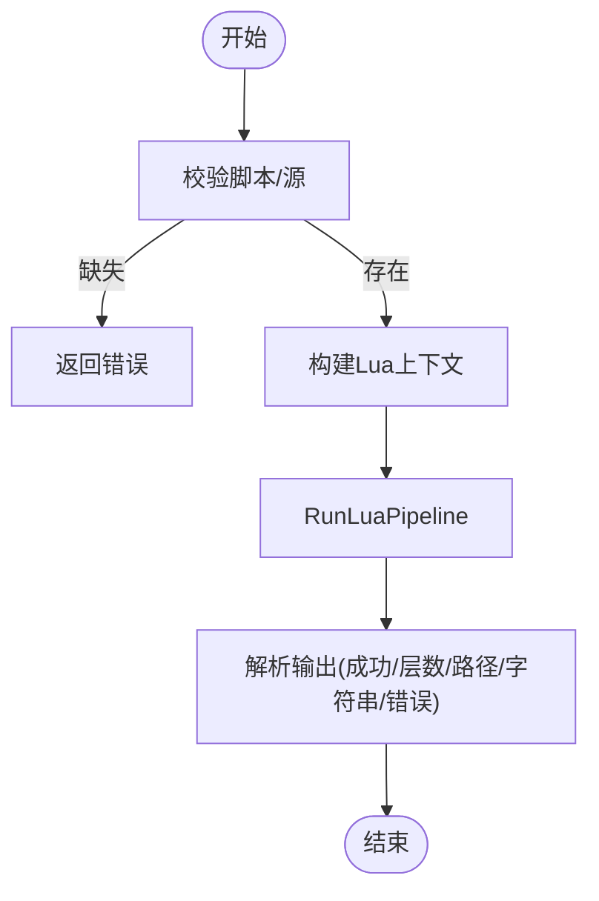
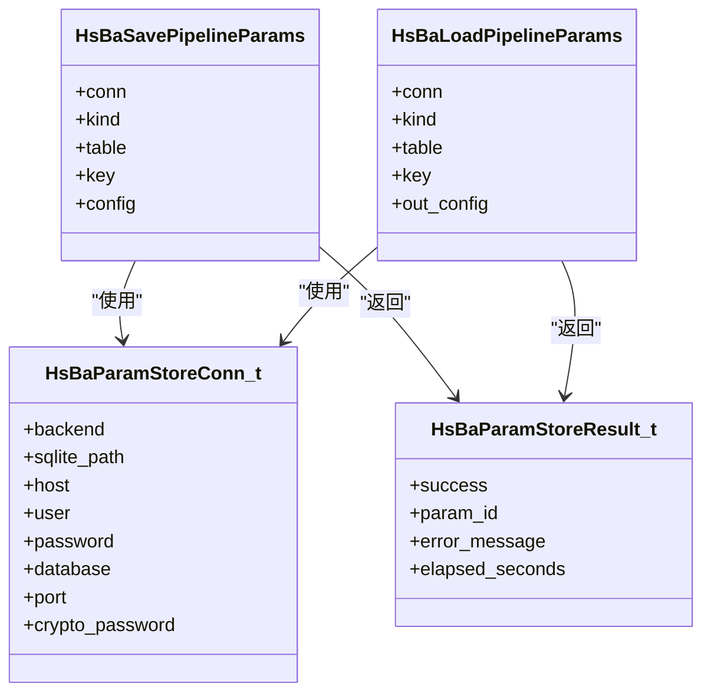
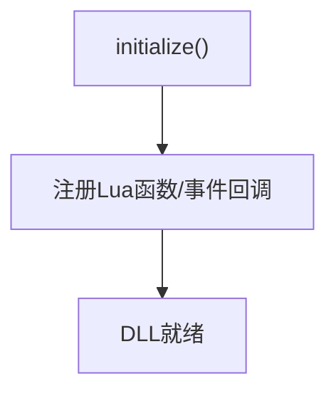
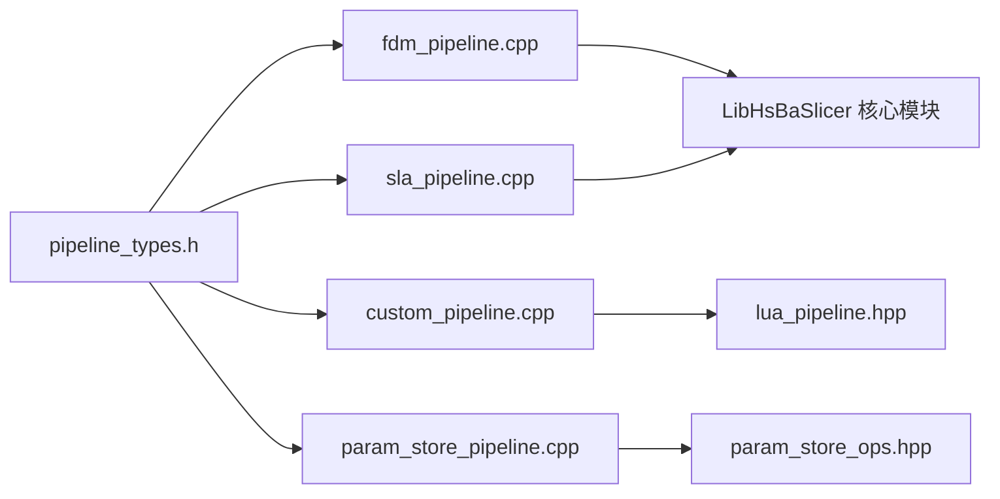
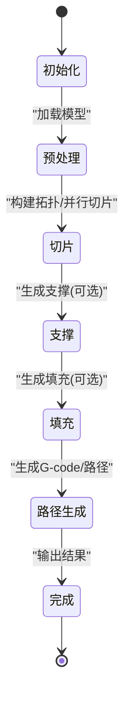

# 流水线架构基础

<cite>
**本文引用的文件**   
- [pipeline_types.h](file://pipelinetypes/pipeline_types.h)
- [fdm_pipeline.h](file://DllHsBaSlicer/fdm_pipeline.h)
- [fdm_pipeline.cpp](file://DllHsBaSlicer/fdm_pipeline.cpp)
- [sla_pipeline.h](file://DllHsBaSlicer/sla_pipeline.h)
- [sla_pipeline.cpp](file://DllHsBaSlicer/sla_pipeline.cpp)
- [custom_pipeline.h](file://DllHsBaSlicer/custom_pipeline.h)
- [custom_pipeline.cpp](file://DllHsBaSlicer/custom_pipeline.cpp)
- [param_store_pipeline.h](file://DllHsBaSlicer/param_store_pipeline.h)
- [param_store_pipeline.cpp](file://DllHsBaSlicer/param_store_pipeline.cpp)
- [initialize.h](file://DllHsBaSlicer/initialize.h)
- [lua_register.h](file://DllHsBaSlicer/lua_register.h)
</cite>

## 目录
1. [引言](#引言)
2. [项目结构](#项目结构)
3. [核心组件](#核心组件)
4. [架构总览](#架构总览)
5. [详细组件分析](#详细组件分析)
6. [依赖关系分析](#依赖关系分析)
7. [性能考虑](#性能考虑)
8. [故障排除指南](#故障排除指南)
9. [结论](#结论)
10. [附录](#附录)

## 引言
本文件面向 HsBaSlicer 的流水线架构基础，聚焦以下目标：
- 解释阶段化处理模型、数据传递机制与错误处理策略。
- 说明流水线类型定义（如 HsBaFdmPipeline_t、HsBaSlaPipeline_t 等）的结构与生命周期管理。
- 阐述配置对象的设计原理：默认值设置、参数验证与序列化机制。
- 描述流水线的注册系统与动态加载机制，以及 C ABI 接口设计考量。
- 提供流水线执行流程的时序图与状态转换图。

该文档以源码为依据，避免臆造 API 或默认值；所有关键实现路径均通过“章节来源”标注具体文件与行号。

## 项目结构
HsBaSlicer 将流水线相关能力划分为三层：
- 公共类型层：pipelinetypes/pipeline_types.h 暴露纯 C 兼容的类型、枚举、回调与默认初始化函数。
- DLL 接口层：DllHsBaSlicer 下各 *_pipeline.* 文件提供 C ABI 入口，封装内部协程实现与资源管理。
- 库实现层：LibHsBaSlicer 提供切片、支撑、填充、路径生成、Lua 扩展等可复用算法与工具。

**图表来源**
- [pipeline_types.h:1-1050](file://pipelinetypes/pipeline_types.h#L1-L1050)
- [fdm_pipeline.h:1-68](file://DllHsBaSlicer/fdm_pipeline.h#L1-L68)
- [fdm_pipeline.cpp:1-497](file://DllHsBaSlicer/fdm_pipeline.cpp#L1-L497)
- [sla_pipeline.h:1-63](file://DllHsBaSlicer/sla_pipeline.h#L1-L63)
- [sla_pipeline.cpp:1-532](file://DllHsBaSlicer/sla_pipeline.cpp#L1-L532)
- [custom_pipeline.h:1-69](file://DllHsBaSlicer/custom_pipeline.h#L1-L69)
- [custom_pipeline.cpp:1-213](file://DllHsBaSlicer/custom_pipeline.cpp#L1-L213)
- [param_store_pipeline.h:1-76](file://DllHsBaSlicer/param_store_pipeline.h#L1-L76)
- [param_store_pipeline.cpp:1-183](file://DllHsBaSlicer/param_store_pipeline.cpp#L1-L183)

**章节来源**
- [pipeline_types.h:1-1050](file://pipelinetypes/pipeline_types.h#L1-L1050)
- [fdm_pipeline.h:1-68](file://DllHsBaSlicer/fdm_pipeline.h#L1-L68)
- [sla_pipeline.h:1-63](file://DllHsBaSlicer/sla_pipeline.h#L1-L63)
- [custom_pipeline.h:1-69](file://DllHsBaSlicer/custom_pipeline.h#L1-L69)
- [param_store_pipeline.h:1-76](file://DllHsBaSlicer/param_store_pipeline.h#L1-L76)

## 核心组件
- 公共类型与默认初始化：在 pipelinetypes/pipeline_types.h 中定义所有流水线配置与结果结构体、回调类型、枚举，并提供 HsBa*ConfigDefault() 内联函数用于零依赖地创建默认配置。
- FDM 流水线：C ABI 头 fdm_pipeline.h 声明创建配置、同步/异步运行与释放结果的接口；实现 fdm_pipeline.cpp 使用协程分阶段执行预处理、切片、支撑、填充、路径生成。
- SLA 流水线：C ABI 头 sla_pipeline.h 声明对应接口；实现 sla_pipeline.cpp 包含预处理、切片、底板/底床、支撑、导出打包。
- 自定义 Lua 流水线：C ABI 头 custom_pipeline.h 声明完全由 Lua 驱动的流水线接口；实现 custom_pipeline.cpp 构建 Lua 上下文并调用 RunLuaPipeline。
- 参数存储流水线：C ABI 头 param_store_pipeline.h 提供保存/加载流水线配置的接口；实现 param_store_pipeline.cpp 完成 C 枚举到库枚举的映射与结果转换。
- 初始化与注册：initialize.h 提供 DLL 初始化入口；lua_register.h 提供向 Lua 环境注册外部函数与事件回调的接口。

**章节来源**
- [pipeline_types.h:1-1050](file://pipelinetypes/pipeline_types.h#L1-L1050)
- [fdm_pipeline.h:1-68](file://DllHsBaSlicer/fdm_pipeline.h#L1-L68)
- [fdm_pipeline.cpp:1-497](file://DllHsBaSlicer/fdm_pipeline.cpp#L1-L497)
- [sla_pipeline.h:1-63](file://DllHsBaSlicer/sla_pipeline.h#L1-L63)
- [sla_pipeline.cpp:1-532](file://DllHsBaSlicer/sla_pipeline.cpp#L1-L532)
- [custom_pipeline.h:1-69](file://DllHsBaSlicer/custom_pipeline.h#L1-L69)
- [custom_pipeline.cpp:1-213](file://DllHsBaSlicer/custom_pipeline.cpp#L1-L213)
- [param_store_pipeline.h:1-76](file://DllHsBaSlicer/param_store_pipeline.h#L1-L76)
- [param_store_pipeline.cpp:1-183](file://DllHsBaSlicer/param_store_pipeline.cpp#L1-L183)
- [initialize.h:1-22](file://DllHsBaSlicer/initialize.h#L1-L22)
- [lua_register.h:1-38](file://DllHsBaSlicer/lua_register.h#L1-L38)

## 架构总览
HsBaSlicer 采用“C ABI + 内部协程 + 阶段化流水线”的架构：
- 对外仅暴露 C ABI，便于跨语言调用与动态加载。
- 内部使用 C++20 协程进行非阻塞执行，并通过进度回调与结果回调反馈状态。
- 每个流水线按阶段组织：预处理 → 切片 → 支撑/底板 → 填充/导出 → 输出。
- 配置对象统一通过默认初始化函数创建，字段语义清晰，字符串指针可为空表示使用内置逻辑。

**图表来源**
- [fdm_pipeline.cpp:219-447](file://DllHsBaSlicer/fdm_pipeline.cpp#L219-L447)
- [sla_pipeline.cpp:298-483](file://DllHsBaSlicer/sla_pipeline.cpp#L298-L483)
- [custom_pipeline.cpp:117-163](file://DllHsBaSlicer/custom_pipeline.cpp#L117-L163)

## 详细组件分析

### FDM 流水线
- 阶段划分：
  - 预处理：加载模型、计算层数。
  - 切片：并行 SliceLayer 生成每层轮廓。
  - 支撑：支持内置与 Lua 自定义两种模式；花瓶模式禁用支撑。
  - 填充：顶层/底层实心填充，中层密度自适应间距；Lua 填充串行执行。
  - 路径生成：花瓶模式生成连续螺旋路径；常规模式生成 G-code 路径。
- 数据传递：
  - 层轮廓 PolygonsD、支撑 PolygonsD、填充 PolygonsD 在各阶段间传递。
  - 最终转换为 GCodePath 并序列化为 G-code 文本。
- 错误处理：
  - 捕获 RuntimeError，记录 error_message，success=false。
  - OwnedCString RAII 包装 malloc 字符串，确保异常安全释放。
- 生命周期：
  - 结果中的 gcode_content 与 error_message 由调用方通过 HsBaFreePipelineResult 释放。

**图表来源**
- [fdm_pipeline.cpp:219-447](file://DllHsBaSlicer/fdm_pipeline.cpp#L219-L447)

**章节来源**
- [fdm_pipeline.cpp:110-140](file://DllHsBaSlicer/fdm_pipeline.cpp#L110-L140)
- [fdm_pipeline.cpp:142-197](file://DllHsBaSlicer/fdm_pipeline.cpp#L142-L197)
- [fdm_pipeline.cpp:219-447](file://DllHsBaSlicer/fdm_pipeline.cpp#L219-L447)
- [fdm_pipeline.cpp:455-497](file://DllHsBaSlicer/fdm_pipeline.cpp#L455-L497)

### SLA 流水线
- 阶段划分：
  - 预处理：加载模型、计算层数。
  - 切片：并行 SliceLayer 生成每层轮廓。
  - 底板/底床：支持 Lua 自定义底板生成。
  - 支撑：支持内置与 Lua 自定义支撑。
  - 导出：构建配置 JSON，调用 SaveSlaPackage 或 SaveSlaPackageLua 打包输出。
- 数据传递：
  - 层轮廓、支撑、底板多边形集合传入打包器。
  - 图像格式与尺寸通过 image_type/image_width/image_height 控制。
- 错误处理：
  - 读取 Lua 脚本失败时返回错误信息。
  - 导出失败时 success=false 并记录错误消息。

**图表来源**
- [sla_pipeline.cpp:244-282](file://DllHsBaSlicer/sla_pipeline.cpp#L244-L282)
- [sla_pipeline.cpp:298-483](file://DllHsBaSlicer/sla_pipeline.cpp#L298-L483)
- [sla_pipeline.cpp:491-532](file://DllHsBaSlicer/sla_pipeline.cpp#L491-L532)

**章节来源**
- [sla_pipeline.cpp:123-180](file://DllHsBaSlicer/sla_pipeline.cpp#L123-L180)
- [sla_pipeline.cpp:181-242](file://DllHsBaSlicer/sla_pipeline.cpp#L181-L242)
- [sla_pipeline.cpp:244-282](file://DllHsBaSlicer/sla_pipeline.cpp#L244-L282)
- [sla_pipeline.cpp:298-483](file://DllHsBaSlicer/sla_pipeline.cpp#L298-L483)
- [sla_pipeline.cpp:491-532](file://DllHsBaSlicer/sla_pipeline.cpp#L491-L532)

### 自定义 Lua 流水线
- 设计要点：
  - 完全由 Lua 脚本定义工作流，C++ 侧仅提供构建块（模型加载、切片、支撑、填充、底板、G-code 路径输出、SLA/SLS 打包）。
  - 支持 pipeline_lua_script 或 pipeline_lua_source 二选一。
  - 通过 entry_func 指定入口函数，config_json 作为自由格式 JSON 传入。
- 执行流程：
  - 构建 LuaPipelineContext，注入进度回调。
  - 调用 RunLuaPipeline 获取输出结果。
- 错误处理：
  - 未提供脚本或源时报错。
  - 返回 result_string 与 output_path，均由调用方释放。

**图表来源**
- [custom_pipeline.cpp:86-99](file://DllHsBaSlicer/custom_pipeline.cpp#L86-L99)
- [custom_pipeline.cpp:117-163](file://DllHsBaSlicer/custom_pipeline.cpp#L117-L163)
- [custom_pipeline.cpp:171-213](file://DllHsBaSlicer/custom_pipeline.cpp#L171-L213)

**章节来源**
- [custom_pipeline.h:1-69](file://DllHsBaSlicer/custom_pipeline.h#L1-L69)
- [custom_pipeline.cpp:23-44](file://DllHsBaSlicer/custom_pipeline.cpp#L23-L44)
- [custom_pipeline.cpp:86-99](file://DllHsBaSlicer/custom_pipeline.cpp#L86-L99)
- [custom_pipeline.cpp:117-163](file://DllHsBaSlicer/custom_pipeline.cpp#L117-L163)
- [custom_pipeline.cpp:171-213](file://DllHsBaSlicer/custom_pipeline.cpp#L171-L213)

### 参数存储流水线
- 功能概述：
  - 保存/加载流水线配置结构体到数据库后端（SQLite/MySQL/PostgreSQL）。
  - 支持业务键 key 与表名 table（为空时使用类型默认表）。
- 类型映射：
  - HsBaPipelineKind 与 ParamPipelineKind 显式映射。
  - HsBaParamStoreBackend 与 ParamBackend 显式映射。
- 生命周期：
  - 加载结果中的 const char* 字段由 HsBaFreeLoadedPipelineConfig 释放。
  - 错误消息通过 HsBaFreeParamStoreResult 释放。

**图表来源**
- [param_store_pipeline.h:17-76](file://DllHsBaSlicer/param_store_pipeline.h#L17-L76)
- [param_store_pipeline.cpp:44-97](file://DllHsBaSlicer/param_store_pipeline.cpp#L44-L97)
- [param_store_pipeline.cpp:131-183](file://DllHsBaSlicer/param_store_pipeline.cpp#L131-L183)

**章节来源**
- [param_store_pipeline.h:1-76](file://DllHsBaSlicer/param_store_pipeline.h#L1-L76)
- [param_store_pipeline.cpp:19-42](file://DllHsBaSlicer/param_store_pipeline.cpp#L19-L42)
- [param_store_pipeline.cpp:44-97](file://DllHsBaSlicer/param_store_pipeline.cpp#L44-L97)
- [param_store_pipeline.cpp:131-183](file://DllHsBaSlicer/param_store_pipeline.cpp#L131-L183)

### 初始化与注册系统
- initialize：DLL 初始化入口，当前实现为空占位，预留 Lua/流水线注册与一次性运行时设置。
- lua_register：提供向 Lua 环境注册外部函数与事件回调的接口，支持 2D/3D/File 三类函数与通用事件回调。

**图表来源**
- [initialize.h:1-22](file://DllHsBaSlicer/initialize.h#L1-L22)
- [lua_register.h:1-38](file://DllHsBaSlicer/lua_register.h#L1-L38)

**章节来源**
- [initialize.h:1-22](file://DllHsBaSlicer/initialize.h#L1-L22)
- [lua_register.h:1-38](file://DllHsBaSlicer/lua_register.h#L1-L38)

## 依赖关系分析
- 耦合性：
  - C ABI 头仅依赖公共类型头，保持低耦合。
  - 实现文件依赖 LibHsBaSlicer 的算法模块与 base/coroutine.hpp、base/error.hpp。
- 循环依赖：
  - 未见明显循环依赖；C ABI 与实现解耦，通过命名空间与匿名命名空间隔离内部细节。
- 外部依赖：
  - Lua 扩展通过 LibHsBaSlicer/Extends 暴露给流水线阶段。
  - 参数存储依赖 fileoperator/param_reflect.hpp 的 PipelineConfigTag 对齐。

**图表来源**
- [pipeline_types.h:1-1050](file://pipelinetypes/pipeline_types.h#L1-L1050)
- [fdm_pipeline.cpp:1-497](file://DllHsBaSlicer/fdm_pipeline.cpp#L1-L497)
- [sla_pipeline.cpp:1-532](file://DllHsBaSlicer/sla_pipeline.cpp#L1-L532)
- [custom_pipeline.cpp:1-213](file://DllHsBaSlicer/custom_pipeline.cpp#L1-L213)
- [param_store_pipeline.cpp:1-183](file://DllHsBaSlicer/param_store_pipeline.cpp#L1-L183)

**章节来源**
- [pipeline_types.h:1-1050](file://pipelinetypes/pipeline_types.h#L1-L1050)
- [fdm_pipeline.cpp:1-497](file://DllHsBaSlicer/fdm_pipeline.cpp#L1-L497)
- [sla_pipeline.cpp:1-532](file://DllHsBaSlicer/sla_pipeline.cpp#L1-L532)
- [custom_pipeline.cpp:1-213](file://DllHsBaSlicer/custom_pipeline.cpp#L1-L213)
- [param_store_pipeline.cpp:1-183](file://DllHsBaSlicer/param_store_pipeline.cpp#L1-L183)

## 性能考虑
- 并行切片：SliceLayer 对每层独立计算，使用 ParallelForLayers 提升吞吐。
- 并行填充：纯 C++ 填充算法可并行执行；Lua 填充因解释器状态需串行。
- 进度回调：各阶段通过 ReportProgress 上报进度，避免 UI 卡顿。
- 协程异步：C ABI 的异步接口通过 then 回调返回结果，避免阻塞调用线程。

[本节为通用指导，不直接分析具体文件]

## 故障排除指南
- 常见错误：
  - 模型加载失败：检查 model_name 与 model_path 是否正确。
  - 无效模型高度：层数计算结果为 0 或负数时返回错误。
  - Lua 脚本读取失败：确认脚本路径有效且可读。
  - 导出失败：检查输出路径权限与磁盘空间。
- 内存管理：
  - 所有 C ABI 结果中的 char* 字段必须由对应的 HsBaFree*Result 释放。
  - 参数存储加载的配置字段需通过 HsBaFreeLoadedPipelineConfig 释放。

**章节来源**
- [fdm_pipeline.cpp:437-447](file://DllHsBaSlicer/fdm_pipeline.cpp#L437-L447)
- [fdm_pipeline.cpp:488-497](file://DllHsBaSlicer/fdm_pipeline.cpp#L488-L497)
- [sla_pipeline.cpp:473-483](file://DllHsBaSlicer/sla_pipeline.cpp#L473-L483)
- [sla_pipeline.cpp:523-532](file://DllHsBaSlicer/sla_pipeline.cpp#L523-L532)
- [custom_pipeline.cpp:127-133](file://DllHsBaSlicer/custom_pipeline.cpp#L127-L133)
- [custom_pipeline.cpp:203-213](file://DllHsBaSlicer/custom_pipeline.cpp#L203-L213)
- [param_store_pipeline.cpp:165-183](file://DllHsBaSlicer/param_store_pipeline.cpp#L165-L183)

## 结论
HsBaSlicer 的流水线架构以 C ABI 为边界，内部采用协程与阶段化模型，兼顾可扩展性与性能。公共类型层提供稳定的默认配置与类型定义；DLL 接口层封装执行细节与资源管理；库实现层提供可复用的算法模块。Lua 扩展机制允许用户自定义支撑、填充与导出逻辑，满足多样化制造需求。参数存储流水线为配置持久化提供了统一接口。整体设计清晰、职责分离，便于维护与扩展。

[本节为总结性内容，不直接分析具体文件]

## 附录

### 流水线类型与生命周期速查
- HsBaFdmPipelineConfig_t / HsBaFdmPipelineResult_t：FDM 配置与结果，gcode_content 与 error_message 需 HsBaFreePipelineResult 释放。
- HsBaSlaPipelineConfig_t / HsBaSlaPipelineResult_t：SLA 配置与结果，export_path 与 error_message 需 HsBaFreeSlaPipelineResult 释放。
- HsBaCustomPipelineConfig_t / HsBaCustomPipelineResult_t：自定义 Lua 流水线配置与结果，output_path/result_string/error_message 需 HsBaFreeCustomPipelineResult 释放。
- HsBaParamStoreConn_t / HsBaParamStoreResult_t：参数存储连接与结果，error_message 需 HsBaFreeParamStoreResult 释放；加载的配置字段需 HsBaFreeLoadedPipelineConfig 释放。

**章节来源**
- [pipeline_types.h:56-127](file://pipelinetypes/pipeline_types.h#L56-L127)
- [pipeline_types.h:170-232](file://pipelinetypes/pipeline_types.h#L170-L232)
- [pipeline_types.h:689-732](file://pipelinetypes/pipeline_types.h#L689-L732)
- [pipeline_types.h:1021-1043](file://pipelinetypes/pipeline_types.h#L1021-L1043)
- [fdm_pipeline.h:53-61](file://DllHsBaSlicer/fdm_pipeline.h#L53-L61)
- [sla_pipeline.h:49-56](file://DllHsBaSlicer/sla_pipeline.h#L49-L56)
- [custom_pipeline.h:57-62](file://DllHsBaSlicer/custom_pipeline.h#L57-L62)
- [param_store_pipeline.h:52-69](file://DllHsBaSlicer/param_store_pipeline.h#L52-L69)

### 流水线执行状态转换图

[本图为概念性流程图，不直接映射具体源码文件]