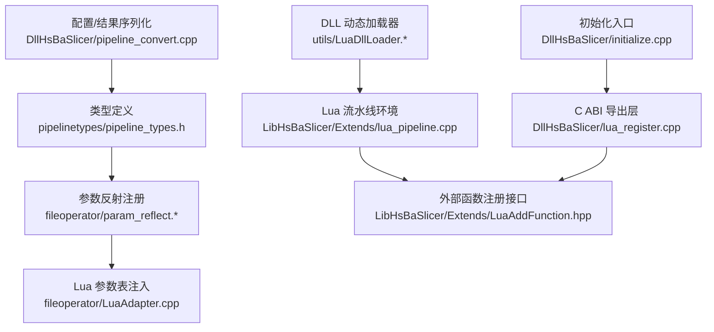
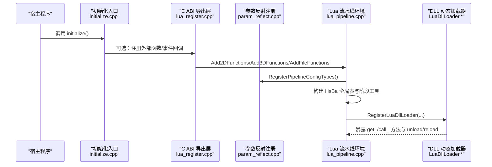
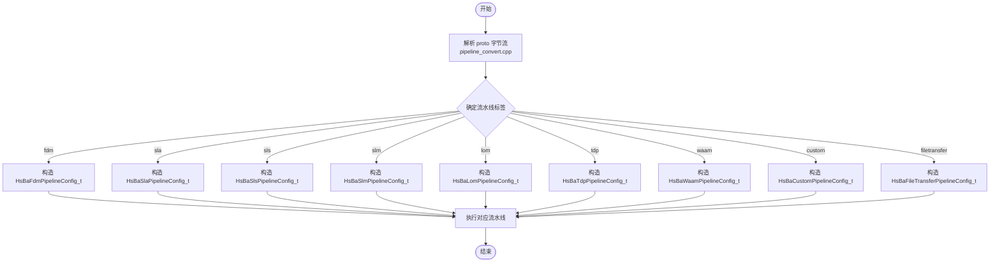
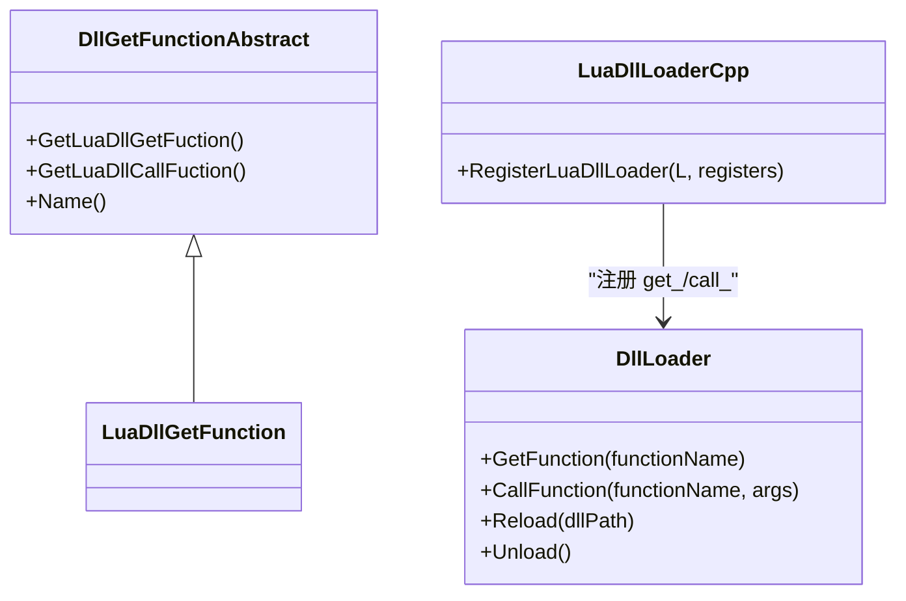
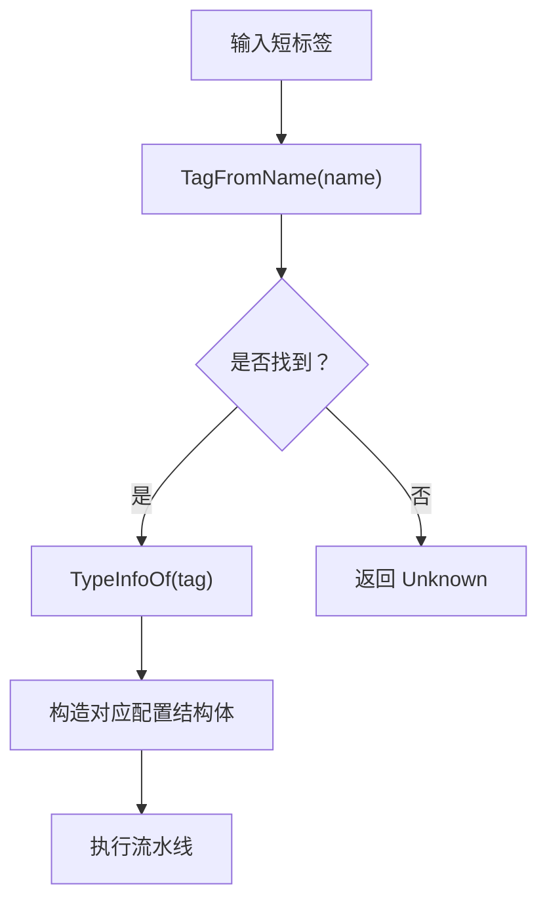
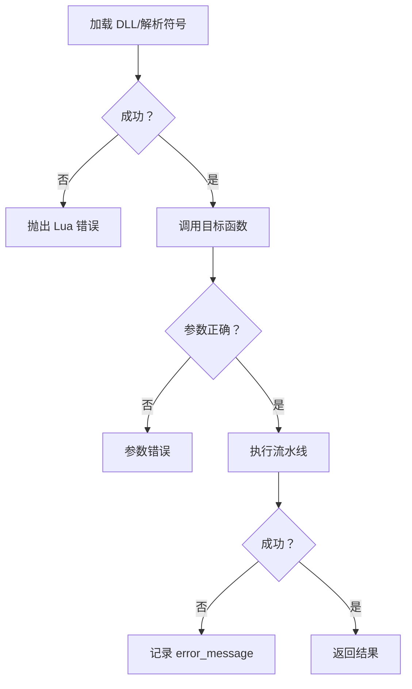
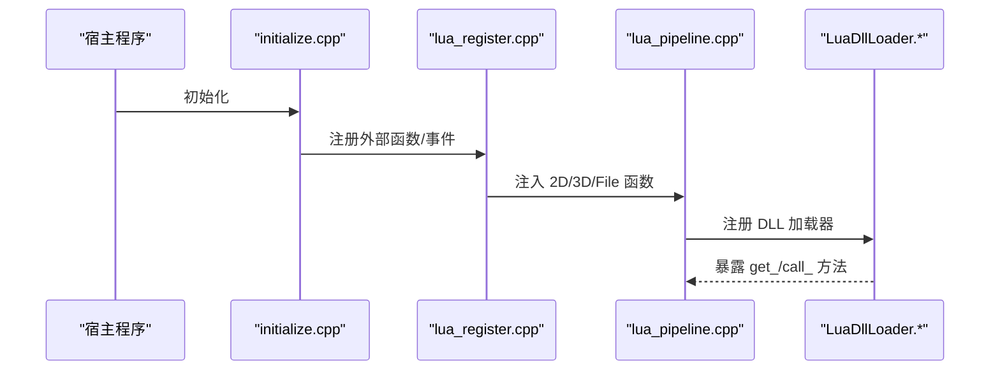
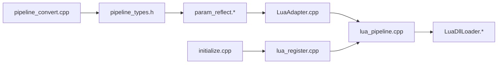

# 流水线注册与加载

<cite>
**本文引用的文件**   
- [pipeline_types.h](file://pipelinetypes/pipeline_types.h)
- [param_reflect.hpp](file://fileoperator/param_reflect.hpp)
- [param_reflect.cpp](file://fileoperator\param_reflect.cpp)
- [LuaAdapter.cpp](file://fileoperator\LuaAdapter.cpp)
- [lua_pipeline.cpp](file://LibHsBaSlicer\Extends\lua_pipeline.cpp)
- [LuaAddFunction.hpp](file://LibHsBaSlicer\Extends\LuaAddFunction.hpp)
- [lua_register.cpp](file://DllHsBaSlicer\lua_register.cpp)
- [initialize.cpp](file://DllHsBaSlicer\initialize.cpp)
- [LuaDllLoader.hpp](file://utils\LuaDllLoader.hpp)
- [LuaDllLoader.cpp](file://utils\LuaDllLoader.cpp)
- [pipeline_convert.cpp](file://DllHsBaSlicer\pipeline_convert.cpp)
</cite>

## 目录
1. [引言](#引言)
2. [项目结构](#项目结构)
3. [核心组件](#核心组件)
4. [架构总览](#架构总览)
5. [详细组件分析](#详细组件分析)
6. [依赖关系分析](#依赖关系分析)
7. [性能考虑](#性能考虑)
8. [故障排除指南](#故障排除指南)
9. [结论](#结论)
10. [附录](#附录)

## 引言
本文聚焦 HsBaSlicer 的“流水线注册与加载”机制，覆盖以下关键主题：
- 静态注册与动态加载两种流水线发现方式。
- Lua 脚本的动态加载过程：DLL 发现、符号解析、函数绑定。
- 流水线工厂模式：类型识别与实例创建流程。
- 错误处理与异常恢复：加载失败时的回退策略。
- 自定义流水线插件的开发与部署方法。

本说明以源码为依据，面向不同技术背景的读者，提供从高层架构到代码级实现的完整视图。

## 项目结构
围绕流水线注册与加载，仓库中相关模块分布在以下位置：
- 类型定义与反射注册：pipelinetypes/pipeline_types.h、fileoperator/param_reflect.*、fileoperator/LuaAdapter.cpp。
- Lua 流水线运行环境：LibHsBaSlicer/Extends/lua_pipeline.cpp、LibHsBaSlicer/Extends/LuaAddFunction.hpp。
- DLL 动态加载与符号调用：utils/LuaDllLoader.*。
- C ABI 导出与初始化：DllHsBaSlicer/lua_register.cpp、DllHsBaSlicer/initialize.cpp、DllHsBaSlicer/pipeline_convert.cpp。

**图表来源**
- [pipeline_types.h:1-120](file://pipelinetypes/pipeline_types.h#L1-L120)
- [param_reflect.hpp:1-40](file://fileoperator/param_reflect.hpp#L1-L40)
- [param_reflect.cpp:28-90](file://fileoperator\param_reflect.cpp#L28-L90)
- [LuaAdapter.cpp:1716-1762](file://fileoperator\LuaAdapter.cpp#L1716-L1762)
- [lua_pipeline.cpp:1-40](file://LibHsBaSlicer\Extends\lua_pipeline.cpp#L1-L40)
- [LuaAddFunction.hpp:1-78](file://LibHsBaSlicer\Extends\LuaAddFunction.hpp#L1-L78)
- [LuaDllLoader.hpp:24-79](file://utils\LuaDllLoader.hpp#L24-L79)
- [LuaDllLoader.cpp:55-103](file://utils\LuaDllLoader.cpp#L55-L103)
- [lua_register.cpp:1-43](file://DllHsBaSlicer\lua_register.cpp#L1-L43)
- [initialize.cpp:1-10](file://DllHsBaSlicer\initialize.cpp#L1-L10)
- [pipeline_convert.cpp:25-41](file://DllHsBaSlicer\pipeline_convert.cpp#L25-L41)

**章节来源**
- [pipeline_types.h:1-120](file://pipelinetypes/pipeline_types.h#L1-L120)
- [param_reflect.hpp:1-40](file://fileoperator/param_reflect.hpp#L1-L40)
- [param_reflect.cpp:28-90](file://fileoperator\param_reflect.cpp#L28-L90)
- [LuaAdapter.cpp:1716-1762](file://fileoperator\LuaAdapter.cpp#L1716-L1762)
- [lua_pipeline.cpp:1-40](file://LibHsBaSlicer\Extends\lua_pipeline.cpp#L1-L40)
- [LuaAddFunction.hpp:1-78](file://LibHsBaSlicer\Extends\LuaAddFunction.hpp#L1-L78)
- [LuaDllLoader.hpp:24-79](file://utils\LuaDllLoader.hpp#L24-L79)
- [LuaDllLoader.cpp:55-103](file://utils\LuaDllLoader.cpp#L55-L103)
- [lua_register.cpp:1-43](file://DllHsBaSlicer\lua_register.cpp#L1-L43)
- [initialize.cpp:1-10](file://DllHsBaSlicer\initialize.cpp#L1-L10)
- [pipeline_convert.cpp:25-41](file://DllHsBaSlicer\pipeline_convert.cpp#L25-L41)

## 核心组件
- 流水线类型与配置：通过 C 兼容结构体定义所有流水线（FDM、SLA、SLS、SLM、LOM、TDP、WAAM、文件传输、自定义 Lua 流水线），并提供默认值初始化函数。
- 参数反射系统：为每个配置结构生成 TypeInfo，支持字段遍历、持久化与 Lua 表映射。
- Lua 流水线环境：提供模型加载、切片、填充、支撑、路径生成、打包导出等能力，并通过全局 HsBa 表暴露给脚本。
- DLL 动态加载器：在运行时加载外部 DLL，按签名解析符号并桥接至 Lua。
- C ABI 导出层：对外暴露添加 2D/3D/文件类 Lua 函数与事件回调的接口，供宿主或插件调用。
- 初始化入口：DLL 启动时执行一次性初始化（当前为空壳，预留扩展点）。
- 配置/结果序列化：将 C 结构体与 protobuf 消息互转，便于跨进程/跨语言传递。

**章节来源**
- [pipeline_types.h:23-127](file://pipelinetypes/pipeline_types.h#L23-L127)
- [param_reflect.hpp:28-40](file://fileoperator/param_reflect.hpp#L28-L40)
- [lua_pipeline.cpp:224-288](file://LibHsBaSlicer\Extends\lua_pipeline.cpp#L224-L288)
- [LuaDllLoader.hpp:24-79](file://utils\LuaDllLoader.hpp#L24-L79)
- [lua_register.cpp:9-43](file://DllHsBaSlicer\lua_register.cpp#L9-L43)
- [initialize.cpp:7-9](file://DllHsBaSlicer\initialize.cpp#L7-L9)
- [pipeline_convert.cpp:25-41](file://DllHsBaSlicer\pipeline_convert.cpp#L25-L41)

## 架构总览
下图展示流水线注册与加载的整体流程：从类型定义出发，经反射注册进入 Lua 环境；同时通过 DLL 动态加载器在运行时发现并绑定外部符号；C ABI 层提供统一入口，初始化阶段可注入额外函数与事件回调。

**图表来源**
- [initialize.cpp:7-9](file://DllHsBaSlicer\initialize.cpp#L7-L9)
- [lua_register.cpp:9-43](file://DllHsBaSlicer\lua_register.cpp#L9-L43)
- [param_reflect.cpp:72-90](file://fileoperator\param_reflect.cpp#L72-L90)
- [lua_pipeline.cpp:224-288](file://LibHsBaSlicer\Extends\lua_pipeline.cpp#L224-L288)
- [LuaDllLoader.cpp:55-103](file://utils\LuaDllLoader.cpp#L55-L103)

## 详细组件分析

### 流水线类型与工厂模式
- 类型识别：通过 PipelineConfigTag 枚举与 Entries() 映射表，将短标签（如 "fdm"）与具体配置结构 TypeInfo 关联。
- 实例创建：外部通过 proto 字节流反序列化为 C 结构体，再由上层根据 tag 选择对应流水线实现进行执行。
- 默认值：各配置结构提供默认初始化函数，确保未显式设置的字段具有稳定行为。

**图表来源**
- [pipeline_convert.cpp:25-41](file://DllHsBaSlicer\pipeline_convert.cpp#L25-L41)
- [param_reflect.cpp:28-68](file://fileoperator\param_reflect.cpp#L28-L68)
- [pipeline_types.h:23-127](file://pipelinetypes/pipeline_types.h#L23-L127)

**章节来源**
- [pipeline_convert.cpp:25-41](file://DllHsBaSlicer\pipeline_convert.cpp#L25-L41)
- [param_reflect.cpp:28-68](file://fileoperator\param_reflect.cpp#L28-L68)
- [pipeline_types.h:23-127](file://pipelinetypes/pipeline_types.h#L23-L127)

### Lua 脚本动态加载：DLL 发现、符号解析与函数绑定
- DLL 发现：Lua 侧通过 DllLoader.new(path) 指定目标 DLL 路径。
- 符号解析：使用 boost::dll 按函数签名精确解析导出符号，避免数据指针误读。
- 函数绑定：RegisterLuaDllLoader 为每种目标函数签名注册 get_<name>/call_<name> 方法，并在 Lua 全局表暴露 unload/reload。
- 参数转换：Lua 栈参数按类型转换为原生参数，返回值按标量、字符串或 AnyObject 返回。

**图表来源**
- [LuaDllLoader.hpp:24-79](file://utils\LuaDllLoader.hpp#L24-L79)
- [LuaDllLoader.hpp:81-111](file://utils\LuaDllLoader.hpp#L81-L111)
- [LuaDllLoader.hpp:247-263](file://utils\LuaDllLoader.hpp#L247-L263)
- [LuaDllLoader.cpp:55-103](file://utils\LuaDllLoader.cpp#L55-L103)

**章节来源**
- [LuaDllLoader.hpp:24-79](file://utils\LuaDllLoader.hpp#L24-L79)
- [LuaDllLoader.hpp:81-111](file://utils\LuaDllLoader.hpp#L81-L111)
- [LuaDllLoader.hpp:122-150](file://utils\LuaDllLoader.hpp#L122-L150)
- [LuaDllLoader.hpp:159-245](file://utils\LuaDllLoader.hpp#L159-L245)
- [LuaDllLoader.hpp:247-263](file://utils\LuaDllLoader.hpp#L247-L263)
- [LuaDllLoader.cpp:55-103](file://utils\LuaDllLoader.cpp#L55-L103)

### 流水线工厂模式：类型识别与实例创建
- 类型识别：Entries() 维护 tag→TypeInfo 映射，TagFromName/TypeInfoOf 提供名称到类型的双向查找。
- 实例创建：上层根据 tag 选择对应的流水线实现，传入已反序列化的配置结构体执行。
- 可扩展性：新增流水线类型需扩展 Entries() 与 pipeline_convert 中的序列化逻辑。

**图表来源**
- [param_reflect.cpp:28-68](file://fileoperator\param_reflect.cpp#L28-L68)
- [param_reflect.hpp:383-415](file://fileoperator/param_reflect.hpp#L383-L415)

**章节来源**
- [param_reflect.cpp:28-68](file://fileoperator\param_reflect.cpp#L28-L68)
- [param_reflect.hpp:383-415](file://fileoperator/param_reflect.hpp#L383-L415)

### 错误处理与异常恢复
- DLL 加载与符号解析异常：LuaDllLoader 捕获 std::exception 并转为 Lua 错误消息，避免崩溃。
- 参数校验：get_/call_ 对空对象、参数数量进行严格检查，失败时抛出 Lua 错误。
- 流水线执行异常：Lua 流水线函数内部通过 luaL_error 返回错误信息，由上层包装为 result.error_message。
- 回退策略：当 Lua 脚本或外部 DLL 不可用时，可通过内置算法或默认配置继续执行（例如 FDM/SLA 的内置填充/支撑/地板算法）。

**图表来源**
- [LuaDllLoader.hpp:159-245](file://utils\LuaDllLoader.hpp#L159-L245)
- [lua_pipeline.cpp:258-288](file://LibHsBaSlicer\Extends\lua_pipeline.cpp#L258-L288)
- [pipeline_types.h:120-127](file://pipelinetypes/pipeline_types.h#L120-L127)

**章节来源**
- [LuaDllLoader.hpp:159-245](file://utils\LuaDllLoader.hpp#L159-L245)
- [lua_pipeline.cpp:258-288](file://LibHsBaSlicer\Extends\lua_pipeline.cpp#L258-L288)
- [pipeline_types.h:120-127](file://pipelinetypes/pipeline_types.h#L120-L127)

### 静态注册与动态加载两种方式
- 静态注册：通过 C ABI 导出层 lua_register.cpp 暴露 Add2DFunctions/Add3DFunctions/AddFileFunctions/AddEventCallback，在初始化阶段注入到 Lua 环境。
- 动态加载：通过 utils/LuaDllLoader 在运行时加载外部 DLL，按签名解析符号并绑定到 Lua。

**图表来源**
- [initialize.cpp:7-9](file://DllHsBaSlicer\initialize.cpp#L7-L9)
- [lua_register.cpp:9-43](file://DllHsBaSlicer\lua_register.cpp#L9-L43)
- [lua_pipeline.cpp:224-288](file://LibHsBaSlicer\Extends\lua_pipeline.cpp#L224-L288)
- [LuaDllLoader.cpp:55-103](file://utils\LuaDllLoader.cpp#L55-L103)

**章节来源**
- [lua_register.cpp:9-43](file://DllHsBaSlicer\lua_register.cpp#L9-L43)
- [LuaDllLoader.cpp:55-103](file://utils\LuaDllLoader.cpp#L55-L103)

### 自定义流水线插件开发与部署
- 开发步骤：
  - 编写 Lua 流水线脚本，使用 HsBa 全局表提供的模型、切片、填充、支撑、路径生成与打包导出能力。
  - 如需扩展底层能力，可在 C++ 侧通过 LuaAddFunction.hpp 注册新的 2D/3D/File 函数或事件回调。
  - 若需要外部库能力，编译为 DLL 并按约定导出目标函数签名。
- 部署步骤：
  - 将 Lua 脚本放置于应用可访问路径，并在 HsBaCustomPipelineConfig 中指定 entry_func 与 config_json。
  - 将 DLL 放置于可被 boost::dll 发现的路径，并通过 DllLoader.new(path) 加载。
  - 在初始化阶段调用 initialize() 与 lua_register.cpp 的导出函数完成静态注册。

**章节来源**
- [lua_pipeline.cpp:224-288](file://LibHsBaSlicer\Extends\lua_pipeline.cpp#L224-L288)
- [LuaAddFunction.hpp:21-78](file://LibHsBaSlicer\Extends\LuaAddFunction.hpp#L21-L78)
- [LuaDllLoader.hpp:24-79](file://utils\LuaDllLoader.hpp#L24-L79)
- [pipeline_types.h:680-719](file://pipelinetypes/pipeline_types.h#L680-L719)

## 依赖关系分析
- 类型定义与反射：pipeline_types.h 提供 C 兼容结构体；param_reflect.* 为其生成 TypeInfo 并维护 tag 映射。
- Lua 环境与参数表：LuaAdapter.cpp 在首次使用时触发 RegisterPipelineConfigTypes，并将 ParamStore 表注入 Lua。
- 流水线执行：lua_pipeline.cpp 提供 HsBa 全局表，封装模型、切片、填充、支撑、路径与打包导出。
- 动态加载：LuaDllLoader.* 提供运行时 DLL 加载与符号解析，向 Lua 暴露 get_/call_ 方法。
- C ABI 与初始化：lua_register.cpp 暴露 Add* 函数；initialize.cpp 作为 DLL 初始化入口。
- 序列化：pipeline_convert.cpp 负责 C 结构与 protobuf 消息之间的互转。

**图表来源**
- [pipeline_types.h:1-120](file://pipelinetypes/pipeline_types.h#L1-L120)
- [param_reflect.cpp:28-90](file://fileoperator\param_reflect.cpp#L28-L90)
- [LuaAdapter.cpp:1716-1762](file://fileoperator\LuaAdapter.cpp#L1716-L1762)
- [lua_pipeline.cpp:224-288](file://LibHsBaSlicer\Extends\lua_pipeline.cpp#L224-L288)
- [LuaDllLoader.cpp:55-103](file://utils\LuaDllLoader.cpp#L55-L103)
- [lua_register.cpp:9-43](file://DllHsBaSlicer\lua_register.cpp#L9-L43)
- [initialize.cpp:7-9](file://DllHsBaSlicer\initialize.cpp#L7-L9)
- [pipeline_convert.cpp:25-41](file://DllHsBaSlicer\pipeline_convert.cpp#L25-L41)

**章节来源**
- [pipeline_types.h:1-120](file://pipelinetypes/pipeline_types.h#L1-L120)
- [param_reflect.cpp:28-90](file://fileoperator\param_reflect.cpp#L28-L90)
- [LuaAdapter.cpp:1716-1762](file://fileoperator\LuaAdapter.cpp#L1716-L1762)
- [lua_pipeline.cpp:224-288](file://LibHsBaSlicer\Extends\lua_pipeline.cpp#L224-L288)
- [LuaDllLoader.cpp:55-103](file://utils\LuaDllLoader.cpp#L55-L103)
- [lua_register.cpp:9-43](file://DllHsBaSlicer\lua_register.cpp#L9-L43)
- [initialize.cpp:7-9](file://DllHsBaSlicer\initialize.cpp#L7-L9)
- [pipeline_convert.cpp:25-41](file://DllHsBaSlicer\pipeline_convert.cpp#L25-L41)

## 性能考虑
- 反射注册惰性初始化：RegisterPipelineConfigTypes 使用 once_flag 保证仅一次初始化，避免重复开销。
- Lua 参数表惰性注入：ParamStore 仅在首次使用时注册，减少启动成本。
- DLL 加载按需进行：仅在 Lua 脚本需要时才加载外部 DLL，避免不必要的资源占用。
- 序列化效率：protobuf 序列化用于跨进程/跨语言传递，注意控制消息大小与频率。

[本节为通用指导，不直接分析具体文件]

## 故障排除指南
- 无法加载 DLL：
  - 检查 DLL 路径是否正确，boost::dll 是否能定位到目标文件。
  - 确认导出的函数签名与 get_/call_ 模板参数一致。
- 符号解析失败：
  - 确认 DLL 确实导出目标符号，且命名规范符合预期。
  - 查看 Lua 错误消息，通常包含异常详情。
- 参数不匹配：
  - 检查 call_<name> 的参数数量与类型是否与目标函数签名一致。
- 流水线执行失败：
  - 检查 Lua 脚本中的 HsBa 调用链，确认模型已加载、切片参数有效。
  - 查看 result.error_message 获取详细错误信息。

**章节来源**
- [LuaDllLoader.hpp:159-245](file://utils\LuaDllLoader.hpp#L159-L245)
- [lua_pipeline.cpp:258-288](file://LibHsBaSlicer\Extends\lua_pipeline.cpp#L258-L288)
- [pipeline_types.h:120-127](file://pipelinetypes/pipeline_types.h#L120-L127)

## 结论
HsBaSlicer 的流水线注册与加载机制通过类型定义、反射注册、Lua 环境与 DLL 动态加载的组合，实现了灵活可扩展的流水线体系。静态注册提供稳定的基础能力，动态加载支持运行时扩展；工厂模式简化了类型识别与实例创建；完善的错误处理与回退策略保障了系统的健壮性。开发者可基于此框架快速实现自定义流水线插件，满足多样化制造场景需求。

[本节为总结性内容，不直接分析具体文件]

## 附录
- 常用流水线配置字段参考：见 pipeline_types.h 中各结构体定义。
- Lua 流水线 API 参考：见 lua_pipeline.cpp 中 HsBa 全局表方法。
- DLL 加载器 API 参考：见 LuaDllLoader.hpp/.cpp 中 DllLoader 与 RegisterLuaDllLoader。

[本节为补充信息，不直接分析具体文件]