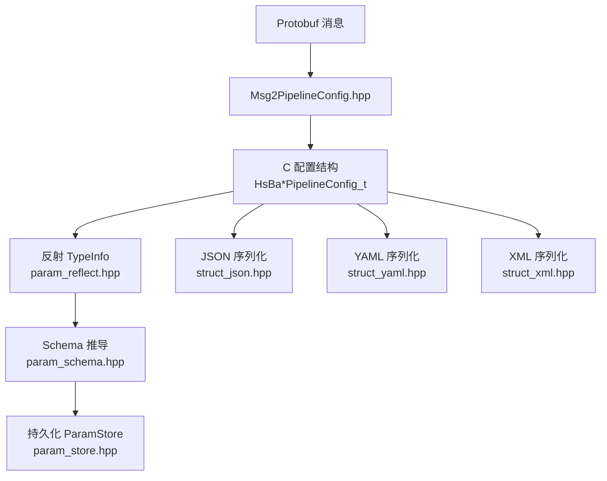
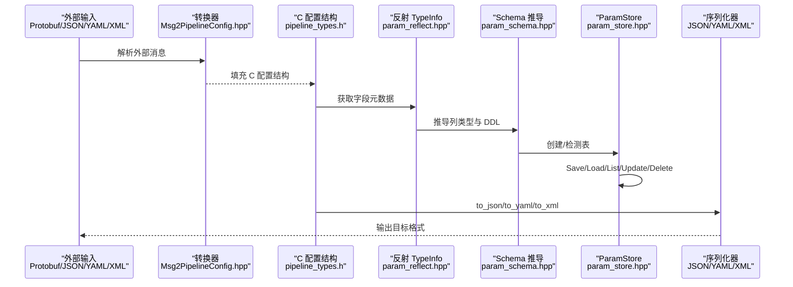
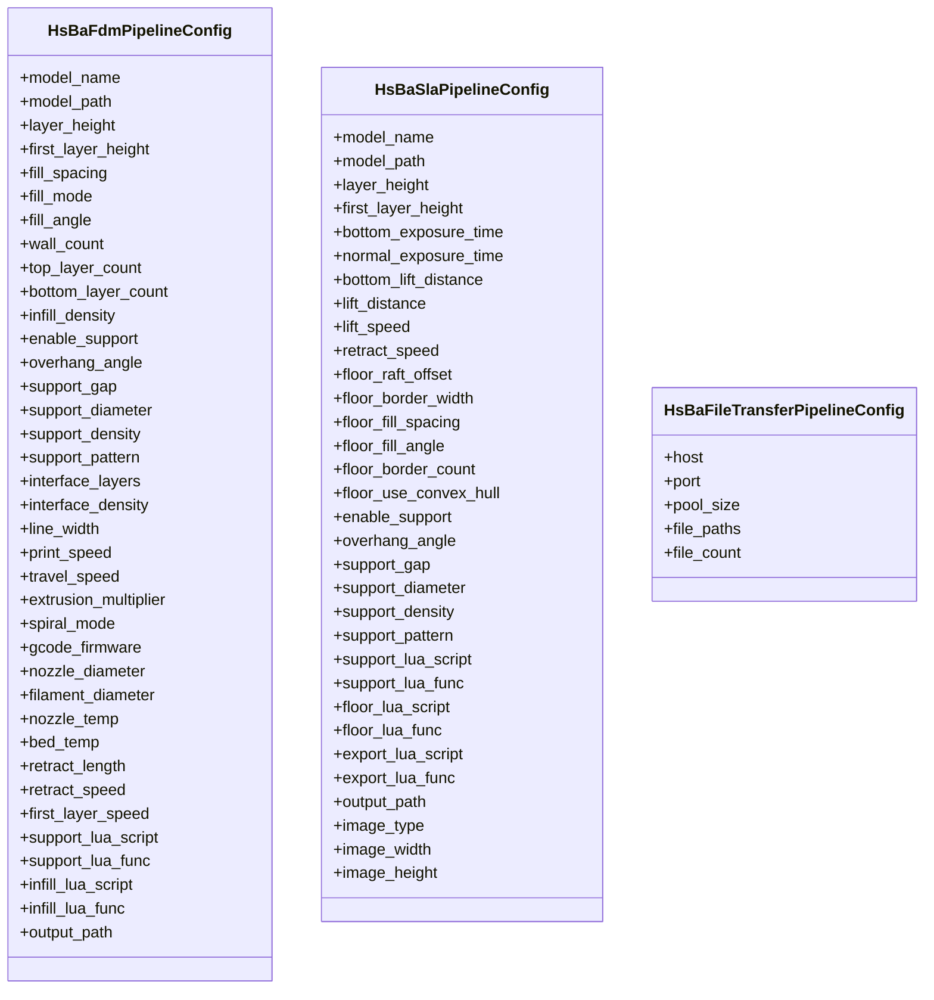
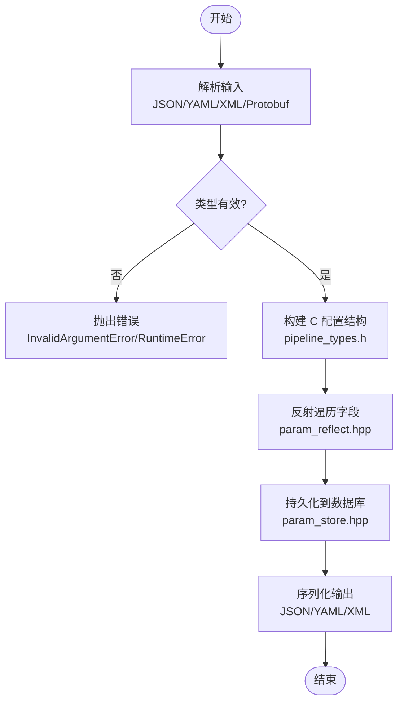
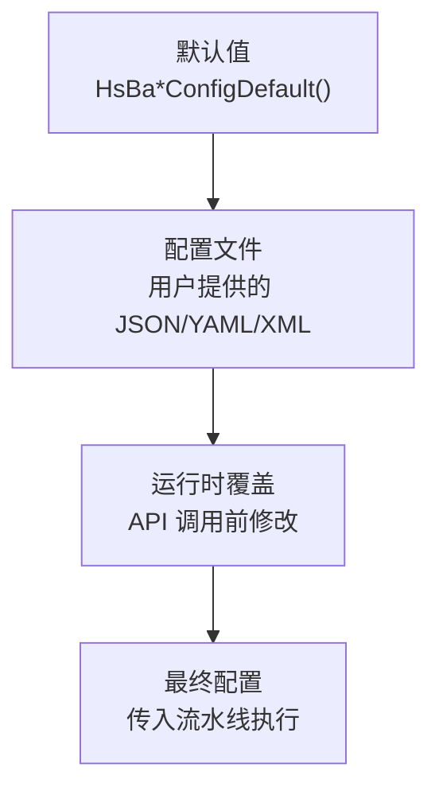
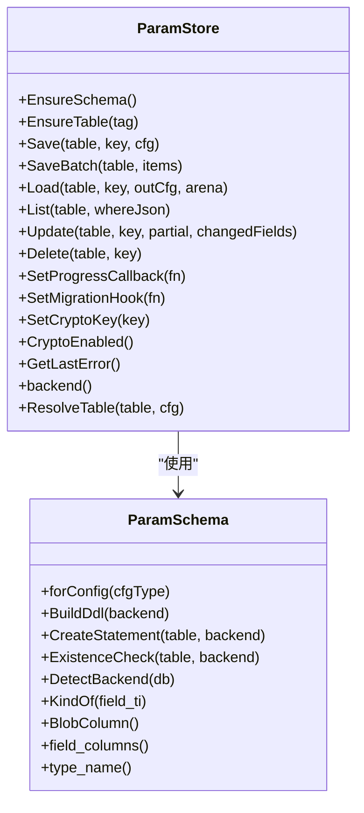
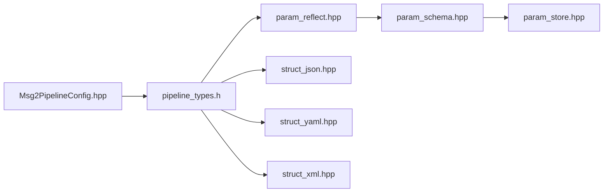

# 流水线配置系统

<cite>
**本文引用的文件**   
- [pipeline_types.h](file://pipelinetypes/pipeline_types.h)
- [param_reflect.hpp](file://fileoperator\param_reflect.hpp)
- [param_schema.hpp](file://fileoperator\param_schema.hpp)
- [param_store.hpp](file://fileoperator\param_store.hpp)
- [Msg2PipelineConfig.hpp](file://convert\Msg2PipelineConfig.hpp)
- [struct_json.hpp](file://utils\struct_json.hpp)
- [struct_yaml.hpp](file://utils\struct_yaml.hpp)
- [struct_xml.hpp](file://utils\struct_xml.hpp)
- [app_config.hpp](file://utils\app_config.hpp)
</cite>

## 目录
1. [引言](#引言)
2. [项目结构](#项目结构)
3. [核心组件](#核心组件)
4. [架构总览](#架构总览)
5. [详细组件分析](#详细组件分析)
6. [依赖关系分析](#依赖关系分析)
7. [性能与扩展性](#性能与扩展性)
8. [故障排除指南](#故障排除指南)
9. [结论](#结论)
10. [附录：新增配置参数步骤与最佳实践](#附录新增配置参数步骤与最佳实践)

## 引言
本文件面向 HsBaSlicer 的“流水线配置系统”，系统性说明以下主题：
- 配置对象的设计架构：基本类型、枚举、嵌套结构与数组支持。
- 配置的序列化与反序列化机制：JSON、YAML、XML，以及 Protocol Buffers 到原生 C 配置结构的转换。
- 参数验证规则的定义方式：类型检查、范围校验与业务规则校验在系统中的落点。
- 默认值管理系统：各流水线配置默认值初始化函数、配置文件优先级与运行时覆盖机制。
- 新增配置参数的完整步骤与最佳实践：从类型定义到反射注册、持久化、序列化与测试的全链路方法。

该系统以一组 C 兼容的结构体作为所有流水线（FDM、SLA、SLS、SLM、LOM、3DP/WAAM、文件传输、自定义 Lua 流水线）的配置载体，并通过反射、Schema 与存储层实现统一的持久化、序列化和跨格式转换能力。

## 项目结构
围绕流水线配置的核心代码分布在如下模块：
- 类型定义层：`pipelinetypes/pipeline_types.h` 提供所有流水线配置的 C 结构体、枚举与默认值初始化函数。
- 反射与 Schema 层：`fileoperator/param_reflect.hpp` 为每个配置结构生成 `TypeInfo`；`fileoperator/param_schema.hpp` 根据字段推导数据库列类型与 DDL。
- 持久化层：`fileoperator/param_store.hpp` 提供 Save/Load/List/Update/Delete 等统一接口，并支持加密与迁移钩子。
- 协议转换层：`convert/Msg2PipelineConfig.hpp` 将 protobuf 消息转换为原生配置结构。
- 序列化层：`utils/struct_json.hpp`、`utils/struct_yaml.hpp`、`utils/struct_xml.hpp` 提供 JSON/YAML/XML 的通用序列化与反序列化模板。
- 应用级配置单例：`utils/app_config.hpp` 提供线程安全的应用级共享设置访问入口。

**图表来源**
- [pipeline_types.h:56-113](file://pipelinetypes/pipeline_types.h#L56-L113)
- [param_reflect.hpp:55-105](file://fileoperator\param_reflect.hpp#L55-L105)
- [param_schema.hpp:60-100](file://fileoperator\param_schema.hpp#L60-L100)
- [param_store.hpp:33-121](file://fileoperator\param_store.hpp#L33-L121)
- [struct_json.hpp:473-504](file://utils\struct_json.hpp#L473-L504)
- [struct_yaml.hpp:455-484](file://utils\struct_yaml.hpp#L455-L484)
- [struct_xml.hpp:541-576](file://utils\struct_xml.hpp#L541-L576)
- [Msg2PipelineConfig.hpp:24-99](file://convert\Msg2PipelineConfig.hpp#L24-L99)

**章节来源**
- [pipeline_types.h:56-113](file://pipelinetypes/pipeline_types.h#L56-L113)
- [param_reflect.hpp:55-105](file://fileoperator\param_reflect.hpp#L55-L105)
- [param_schema.hpp:60-100](file://fileoperator\param_schema.hpp#L60-L100)
- [param_store.hpp:33-121](file://fileoperator\param_store.hpp#L33-L121)
- [struct_json.hpp:473-504](file://utils\struct_json.hpp#L473-L504)
- [struct_yaml.hpp:455-484](file://utils\struct_yaml.hpp#L455-L484)
- [struct_xml.hpp:541-576](file://utils\struct_xml.hpp#L541-L576)
- [Msg2PipelineConfig.hpp:24-99](file://convert\Msg2PipelineConfig.hpp#L24-L99)

## 核心组件
本节聚焦配置系统的核心构件及其职责：
- 配置结构体与枚举：定义 FDM、SLA、SLS、SLM、LOM、TDP、WAAM、文件传输、自定义 Lua 流水线的输入参数与输出结果。
- 反射 TypeInfo：为每个配置结构生成字段元数据，驱动遍历、持久化与 Schema 推导。
- Schema 与数据库映射：根据字段类型推导列类型（Double/Int64/Text），生成 DDL 与存在性检查语句。
- ParamStore：统一 CRUD 接口，支持批量保存、事务回滚、进度回调、迁移钩子、列图加密。
- 多格式序列化：JSON/YAML/XML 通过概念约束与模板特化，自动处理枚举、字符串、算术类型、可选值与容器。
- Protobuf 转换：将外部消息转换为内部配置结构，便于跨语言或跨进程调用。

**章节来源**
- [pipeline_types.h:56-113](file://pipelinetypes/pipeline_types.h#L56-L113)
- [param_reflect.hpp:55-105](file://fileoperator\param_reflect.hpp#L55-L105)
- [param_schema.hpp:60-100](file://fileoperator\param_schema.hpp#L60-L100)
- [param_store.hpp:33-121](file://fileoperator\param_store.hpp#L33-L121)
- [struct_json.hpp:473-504](file://utils\struct_json.hpp#L473-L504)
- [struct_yaml.hpp:455-484](file://utils\struct_yaml.hpp#L455-L484)
- [struct_xml.hpp:541-576](file://utils\struct_xml.hpp#L541-L576)
- [Msg2PipelineConfig.hpp:24-99](file://convert\Msg2PipelineConfig.hpp#L24-L99)

## 架构总览
下图展示配置从外部输入到内部使用的主要路径：外部消息或配置文件经解析后转换为 C 配置结构，随后由反射与 Schema 层进行持久化，同时可通过 JSON/YAML/XML 进行互转。

**图表来源**
- [Msg2PipelineConfig.hpp:24-99](file://convert\Msg2PipelineConfig.hpp#L24-L99)
- [pipeline_types.h:56-113](file://pipelinetypes/pipeline_types.h#L56-L113)
- [param_reflect.hpp:55-105](file://fileoperator\param_reflect.hpp#L55-L105)
- [param_schema.hpp:60-100](file://fileoperator\param_schema.hpp#L60-L100)
- [param_store.hpp:33-121](file://fileoperator\param_store.hpp#L33-L121)
- [struct_json.hpp:473-504](file://utils\struct_json.hpp#L473-L504)
- [struct_yaml.hpp:455-484](file://utils\struct_yaml.hpp#L455-L484)
- [struct_xml.hpp:541-576](file://utils\struct_xml.hpp#L541-L576)

## 详细组件分析

### 配置对象设计：基本类型、嵌套结构与数组支持
- 基本类型：配置结构体广泛使用浮点、整数、布尔标志与 `const char*` 字符串。例如 FDM 配置包含层厚、填充间距、壁厚、打印速度、喷嘴温度等数值型参数。
- 枚举类型：如填充模式、支撑图案、固件目标、材料、光源、保护气体、机器人类型等，均以 C 兼容枚举表达，便于跨语言与脚本层使用。
- 嵌套结构：部分配置通过内嵌结构组织相关参数，例如 SLA 的图像类型、SLM 的材料与光源组合、WAAM 的材料与焊接工艺组合等。
- 数组与指针数组：文件传输配置使用 `const char** file_paths` 与 `int file_count` 表示文件列表；其他配置通常以标量为主，复杂集合通过 Lua 脚本或 JSON 传递。

**图表来源**
- [pipeline_types.h:56-113](file://pipelinetypes/pipeline_types.h#L56-L113)
- [pipeline_types.h:170-218](file://pipelinetypes/pipeline_types.h#L170-L218)
- [pipeline_types.h:636-647](file://pipelinetypes/pipeline_types.h#L636-L647)

**章节来源**
- [pipeline_types.h:56-113](file://pipelinetypes/pipeline_types.h#L56-L113)
- [pipeline_types.h:170-218](file://pipelinetypes/pipeline_types.h#L170-L218)
- [pipeline_types.h:636-647](file://pipelinetypes/pipeline_types.h#L636-L647)

### 序列化与反序列化机制：JSON、YAML、XML 与 Protobuf
- JSON：基于 RapidJSON，提供 `to_json`/`from_json` 模板，支持聚合类型、可反射类型、枚举、字符串、算术类型、可选值与容器。
- YAML：基于 yaml-cpp，提供 `to_yaml`/`from_yaml` 模板，行为与 JSON 类似，支持 Map/Sequence 与可选值。
- XML：基于 TinyXML2，提供 `to_xml`/`from_xml` 模板，支持元素嵌套、枚举文本、算术文本、可选标记与数组元素。
- Protobuf：通过 `Msg2PipelineConfig.hpp` 中的转换函数，将 protobuf 消息映射到 C 配置结构，字符串字段由分配器管理并由调用方释放。

**图表来源**
- [struct_json.hpp:473-504](file://utils\struct_json.hpp#L473-L504)
- [struct_yaml.hpp:455-484](file://utils\struct_yaml.hpp#L455-L484)
- [struct_xml.hpp:541-576](file://utils\struct_xml.hpp#L541-L576)
- [Msg2PipelineConfig.hpp:24-99](file://convert\Msg2PipelineConfig.hpp#L24-L99)
- [param_reflect.hpp:55-105](file://fileoperator\param_reflect.hpp#L55-L105)
- [param_store.hpp:33-121](file://fileoperator\param_store.hpp#L33-L121)

**章节来源**
- [struct_json.hpp:473-504](file://utils\struct_json.hpp#L473-L504)
- [struct_yaml.hpp:455-484](file://utils\struct_yaml.hpp#L455-L484)
- [struct_xml.hpp:541-576](file://utils\struct_xml.hpp#L541-L576)
- [Msg2PipelineConfig.hpp:24-99](file://convert\Msg2PipelineConfig.hpp#L24-L99)
- [param_reflect.hpp:55-105](file://fileoperator\param_reflect.hpp#L55-L105)
- [param_store.hpp:33-121](file://fileoperator\param_store.hpp#L33-L121)

### 参数验证规则：类型检查、范围验证与业务规则校验
- 类型检查：序列化层对字段类型进行严格分支处理，遇到不支持的类型会抛出运行时错误；JSON/YAML/XML 的反序列化在类型不匹配时抛出异常。
- 范围验证：当前仓库未提供通用的范围校验框架；典型做法是在业务层（Lua 脚本或上层调用方）对关键参数（如层厚、功率、速度）进行范围检查。
- 业务规则校验：例如 SLS/SLM/LOM/TDP/WAAM 等流水线要求必须提供导出 Lua 脚本与函数名；文件传输配置要求 host/port 非空且文件数组有效。这些约束在配置结构注释与反射注册中体现。

建议的最佳实践：
- 在 Lua 脚本入口处对关键参数做范围与业务规则校验，返回明确的错误信息。
- 在上层 API 调用前对必填字段进行预检查，避免进入流水线后失败。
- 对于数值范围，结合单位与物理意义设定合理上下界，并在日志中记录越界警告。

**章节来源**
- [struct_json.hpp:318-347](file://utils\struct_json.hpp#L318-L347)
- [struct_yaml.hpp:288-324](file://utils\struct_yaml.hpp#L288-L324)
- [struct_xml.hpp:324-391](file://utils\struct_xml.hpp#L324-L391)
- [pipeline_types.h:259-283](file://pipelinetypes/pipeline_types.h#L259-L283)
- [pipeline_types.h:636-647](file://pipelinetypes/pipeline_types.h#L636-L647)

### 默认值管理系统：配置文件优先级与运行时覆盖
- 默认值初始化：每个流水线配置均提供 `*ConfigDefault()` 内联函数，用于初始化默认值（如 FDM 的层厚、填充密度、支撑参数；SLA 的曝光时间、提升距离；SLM/LOM/TDP/WAAM 的相应默认值）。
- 配置文件优先级：仓库未提供统一的配置文件加载器；常见模式是“默认值 -> 配置文件 -> 运行时覆盖”。建议在应用层实现该优先级合并逻辑。
- 运行时覆盖：上层调用方可在构造流水线对象或运行前修改配置结构字段，从而覆盖默认值或配置文件中的值。

**图表来源**
- [pipeline_types.h:742-783](file://pipelinetypes/pipeline_types.h#L742-L783)
- [pipeline_types.h:789-825](file://pipelinetypes/pipeline_types.h#L789-L825)
- [pipeline_types.h:878-897](file://pipelinetypes/pipeline_types.h#L878-L897)
- [pipeline_types.h:903-921](file://pipelinetypes/pipeline_types.h#L903-L921)
- [pipeline_types.h:927-942](file://pipelinetypes/pipeline_types.h#L927-L942)

**章节来源**
- [pipeline_types.h:742-783](file://pipelinetypes/pipeline_types.h#L742-L783)
- [pipeline_types.h:789-825](file://pipelinetypes/pipeline_types.h#L789-L825)
- [pipeline_types.h:878-897](file://pipelinetypes/pipeline_types.h#L878-L897)
- [pipeline_types.h:903-921](file://pipelinetypes/pipeline_types.h#L903-L921)
- [pipeline_types.h:927-942](file://pipelinetypes/pipeline_types.h#L927-L942)

### 持久化与存储：ParamStore 与 Schema
- ParamStore 提供 EnsureSchema/EnsureTable、Save/SaveBatch、Load/List/Update/Delete 等接口，支持批量事务、进度回调、迁移钩子与列图加密。
- Schema 根据 TypeInfo 推导列类型（Double/Int64/Text），生成 CREATE TABLE 语句与存在性检查 SQL，支持 SQLite/MySQL/PostgreSQL。
- 加密模式：当启用 at-rest 加密时，列图被序列化为二进制并加密存储在 `param_blob` 列，其余元数据保持明文以便查询。

**图表来源**
- [param_store.hpp:33-121](file://fileoperator\param_store.hpp#L33-L121)
- [param_schema.hpp:60-100](file://fileoperator\param_schema.hpp#L60-L100)

**章节来源**
- [param_store.hpp:33-121](file://fileoperator\param_store.hpp#L33-L121)
- [param_schema.hpp:60-100](file://fileoperator\param_schema.hpp#L60-L100)

### 应用级配置单例：AppConfigSingletone
- AppConfigSingletone 提供线程安全的应用级配置访问，例如外部工具路径（如 7-Zip 可执行文件路径）。
- 该单例与流水线配置不同：它用于全局应用设置，而非具体流水线参数。

**章节来源**
- [app_config.hpp:19-46](file://utils\app_config.hpp#L19-L46)

## 依赖关系分析
- 类型定义与反射：`pipeline_types.h` 定义配置结构，`param_reflect.hpp` 为其生成 `TypeInfo`，二者强耦合。
- 反射与 Schema：`param_reflect.hpp` 提供字段元数据，`param_schema.hpp` 据此推导列类型与 DDL。
- Schema 与持久化：`param_store.hpp` 依赖 `param_schema.hpp` 与 `sql_adapter.hpp` 完成表创建与数据存取。
- 序列化与类型：`struct_json.hpp`/`struct_yaml.hpp`/`struct_xml.hpp` 依赖基础概念与静态反射，对配置结构进行通用序列化。
- 协议转换：`Msg2PipelineConfig.hpp` 依赖 protobuf 生成的头文件与 `pipeline_types.h`，负责消息到配置的映射。

**图表来源**
- [pipeline_types.h:56-113](file://pipelinetypes/pipeline_types.h#L56-L113)
- [param_reflect.hpp:55-105](file://fileoperator\param_reflect.hpp#L55-L105)
- [param_schema.hpp:60-100](file://fileoperator\param_schema.hpp#L60-L100)
- [param_store.hpp:33-121](file://fileoperator\param_store.hpp#L33-L121)
- [struct_json.hpp:473-504](file://utils\struct_json.hpp#L473-L504)
- [struct_yaml.hpp:455-484](file://utils\struct_yaml.hpp#L455-L484)
- [struct_xml.hpp:541-576](file://utils\struct_xml.hpp#L541-L576)
- [Msg2PipelineConfig.hpp:24-99](file://convert\Msg2PipelineConfig.hpp#L24-L99)

**章节来源**
- [pipeline_types.h:56-113](file://pipelinetypes/pipeline_types.h#L56-L113)
- [param_reflect.hpp:55-105](file://fileoperator\param_reflect.hpp#L55-L105)
- [param_schema.hpp:60-100](file://fileoperator\param_schema.hpp#L60-L100)
- [param_store.hpp:33-121](file://fileoperator\param_store.hpp#L33-L121)
- [struct_json.hpp:473-504](file://utils\struct_json.hpp#L473-L504)
- [struct_yaml.hpp:455-484](file://utils\struct_yaml.hpp#L455-L484)
- [struct_xml.hpp:541-576](file://utils\struct_xml.hpp#L541-L576)
- [Msg2PipelineConfig.hpp:24-99](file://convert\Msg2PipelineConfig.hpp#L24-L99)

## 性能与扩展性
- 序列化性能：JSON/YAML/XML 序列化采用模板递归与编译期展开，减少运行时分支开销；RapidJSON/yaml-cpp/TinyXML2 均为成熟库，性能稳定。
- 持久化性能：ParamStore 支持批量保存与事务，适合高吞吐场景；加密模式会增加 CPU 开销，但保障数据安全。
- 扩展性：新增配置字段只需在结构体中添加成员，并在反射注册中补充字段映射；Schema 会自动推导新列类型；序列化层自动支持新字段。

[本节为一般性指导，无需特定文件引用]

## 故障排除指南
- JSON 反序列化失败：检查 JSON 是否为对象类型，字段名称是否与结构体一致，枚举字符串是否合法。
- YAML 反序列化失败：检查节点是否为 Map，字段是否存在且类型匹配。
- XML 反序列化失败：检查根元素与子元素是否存在，文本内容是否能解析为整数或浮点数。
- 持久化失败：检查数据库连接、表是否存在、列类型是否匹配；查看 `GetLastError()` 获取最近错误信息。
- 加密问题：确认加密密钥一致，`param_blob` 列可读；若密钥变更，旧数据不可读。

**章节来源**
- [struct_json.hpp:580-610](file://utils\struct_json.hpp#L580-L610)
- [struct_yaml.hpp:509-540](file://utils\struct_yaml.hpp#L509-L540)
- [struct_xml.hpp:660-720](file://utils\struct_xml.hpp#L660-L720)
- [param_store.hpp:101-102](file://fileoperator\param_store.hpp#L101-L102)

## 结论
HsBaSlicer 的流水线配置系统以 C 兼容结构体为核心，结合反射、Schema 与持久化层，实现了统一的配置管理、序列化与跨格式转换能力。通过默认值初始化函数与应用级单例，系统在易用性与安全性之间取得平衡。未来可在业务层增强参数验证与配置优先级合并逻辑，进一步提升系统的健壮性与可维护性。

[本节为总结性内容，无需特定文件引用]

## 附录：新增配置参数步骤与最佳实践
- 步骤一：在 `pipeline_types.h` 中为新流水线或现有流水线添加配置字段，明确类型与默认值。
- 步骤二：在 `param_reflect.hpp` 中为该配置结构注册新字段，确保 `TypeInfo` 包含新字段。
- 步骤三：如需持久化，Schema 会自动推导新列类型；必要时调整业务规则与默认表名。
- 步骤四：在 `param_store.hpp` 的使用处验证 Save/Load/Update 流程对新字段的兼容性。
- 步骤五：在 `struct_json.hpp`/`struct_yaml.hpp`/`struct_xml.hpp` 中验证新字段的序列化与反序列化行为。
- 步骤六：在 `Msg2PipelineConfig.hpp` 中补充 Protobuf 到新配置的映射（如适用）。
- 步骤七：编写单元测试，覆盖默认值、边界值、非法输入与加密场景。

最佳实践：
- 字段命名清晰，单位与物理意义明确。
- 对关键参数提供范围校验与业务规则校验。
- 使用 `*ConfigDefault()` 初始化默认值，避免未初始化字段。
- 在 Lua 脚本中对外部输入进行二次校验，返回明确错误信息。
- 对敏感字段考虑加密存储与最小权限访问。

**章节来源**
- [pipeline_types.h:56-113](file://pipelinetypes/pipeline_types.h#L56-L113)
- [param_reflect.hpp:55-105](file://fileoperator\param_reflect.hpp#L55-L105)
- [param_schema.hpp:60-100](file://fileoperator\param_schema.hpp#L60-L100)
- [param_store.hpp:33-121](file://fileoperator\param_store.hpp#L33-L121)
- [struct_json.hpp:473-504](file://utils\struct_json.hpp#L473-L504)
- [struct_yaml.hpp:455-484](file://utils\struct_yaml.hpp#L455-L484)
- [struct_xml.hpp:541-576](file://utils\struct_xml.hpp#L541-L576)
- [Msg2PipelineConfig.hpp:24-99](file://convert\Msg2PipelineConfig.hpp#L24-L99)