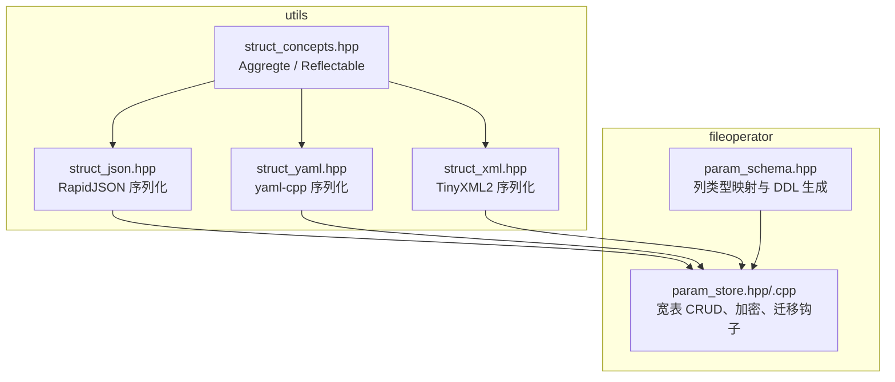
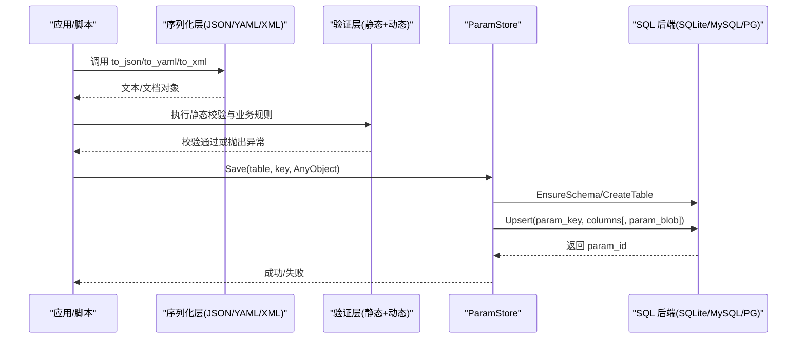
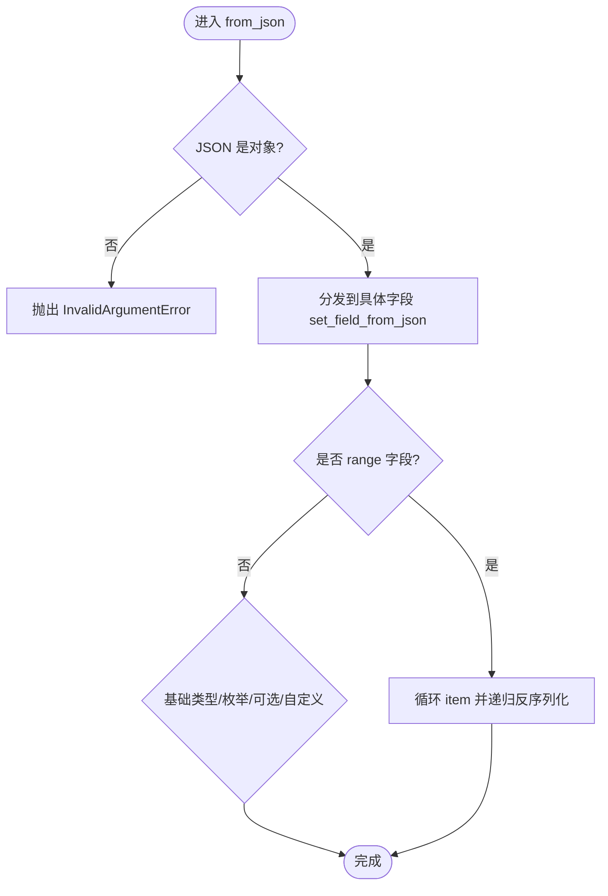
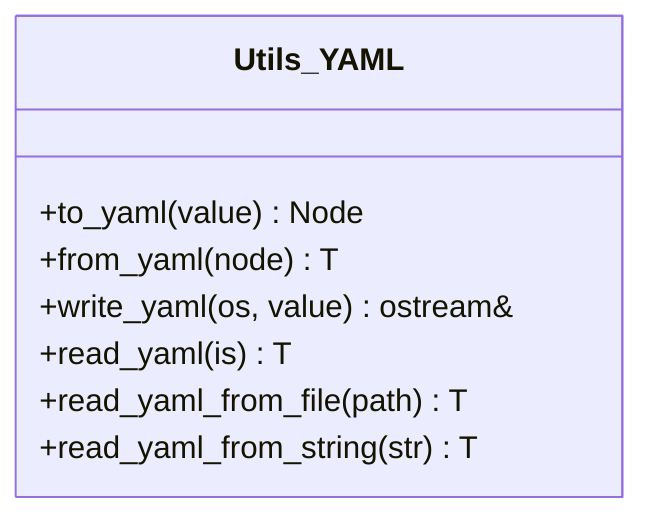
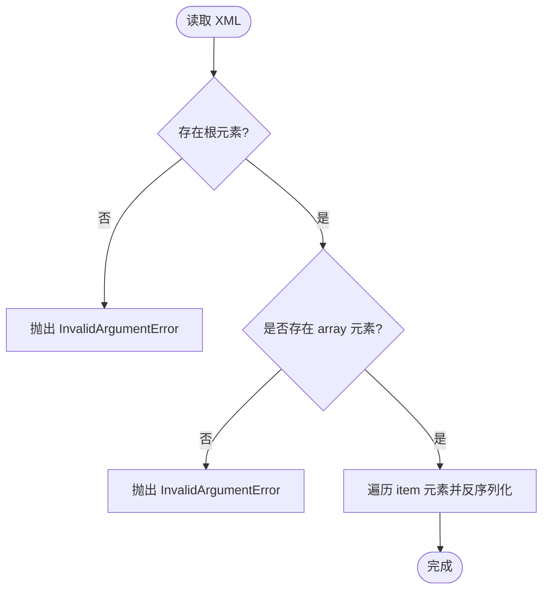
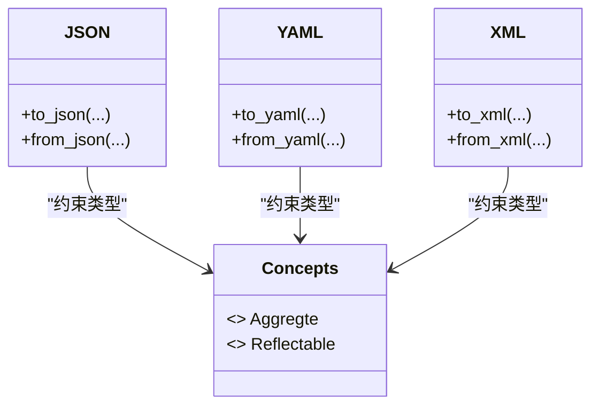
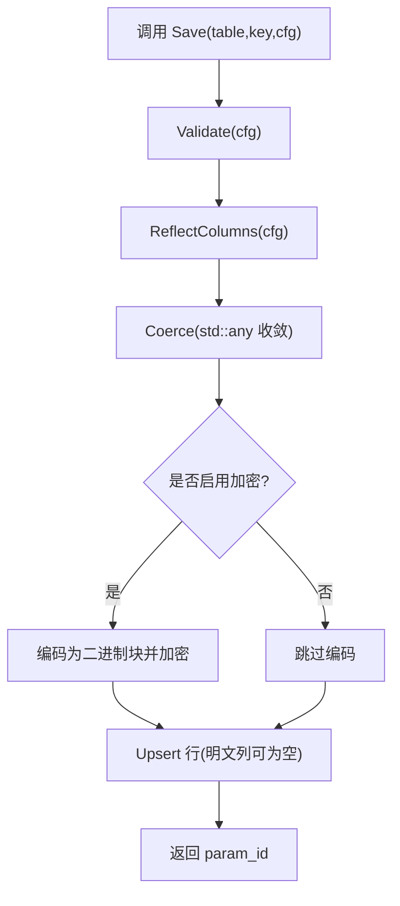
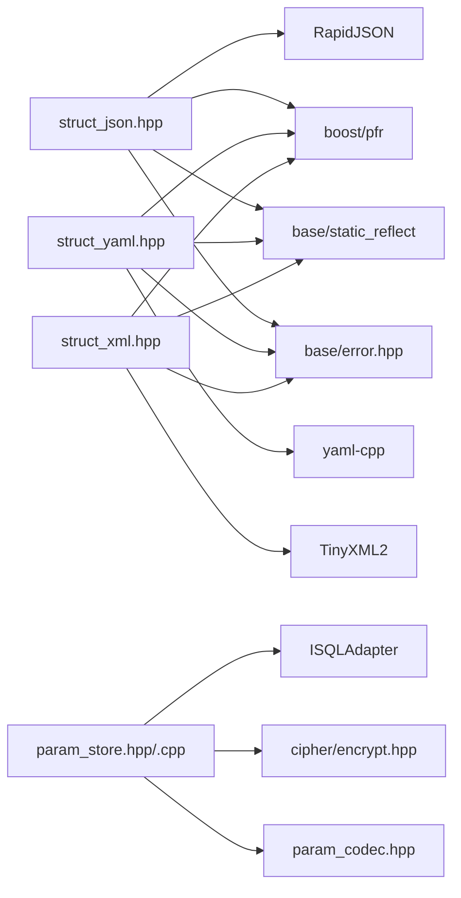

# 配置序列化与验证

<cite>
**本文引用的文件**   
- [struct_json.hpp](file://utils/struct_json.hpp)
- [struct_yaml.hpp](file://utils/struct_yaml.hpp)
- [struct_xml.hpp](file://utils/struct_xml.hpp)
- [struct_concepts.hpp](file://utils/struct_concepts.hpp)
- [param_schema.hpp](file://fileoperator/param_schema.hpp)
- [param_store.hpp](file://fileoperator/param_store.hpp)
- [param_store.cpp](file://fileoperator/param_store.cpp)
- [error.hpp](file://base/error.hpp)
- [struct_yaml_test.cpp](file://tests/ConfigMap/struct_yaml_test.cpp)
- [utils_static_tests.cpp](file://static_tests/utils_static_tests/utils_static_tests.cpp)
</cite>

## 目录
1. [引言](#引言)
2. [项目结构](#项目结构)
3. [核心组件](#核心组件)
4. [架构总览](#架构总览)
5. [详细组件分析](#详细组件分析)
6. [依赖关系分析](#依赖关系分析)
7. [性能与优化](#性能与优化)
8. [故障排除指南](#故障排除指南)
9. [结论](#结论)
10. [附录：自定义验证器与错误处理实践](#附录自定义验证器与错误处理实践)

## 引言
本指南聚焦于 HsBaSlicer 中的“配置序列化与验证”能力，覆盖以下主题：
- JSON/YAML/XML 三种格式的反射驱动序列化与反序列化机制。
- 参数验证系统：静态类型/枚举校验与动态业务规则检查。
- 配置文件存储格式、版本管理与向后兼容策略。
- 自定义验证器的实现方法与错误处理最佳实践。
- 常见序列化错误场景及排查方法。

该体系以 C++20 Concepts + 静态反射为核心，配合 RapidJSON、yaml-cpp、TinyXML2 等第三方库，提供统一、可扩展且高性能的配置读写能力；并通过 ParamStore 将配置持久化到关系型数据库，支持加密、迁移钩子与多后端（SQLite/MySQL/PostgreSQL）。

## 项目结构
与配置序列化与验证直接相关的代码主要分布在 utils 与 fileoperator 两个模块：
- utils：通用序列化基础设施（JSON/YAML/XML），以及聚合/可反射类型的概念定义。
- fileoperator：参数模式（Schema）推导、参数存储（ParamStore）、SQL 适配与二进制编解码。

图表来源
- [struct_json.hpp:1-852](file://utils/struct_json.hpp#L1-L852)
- [struct_yaml.hpp:1-672](file://utils/struct_yaml.hpp#L1-L672)
- [struct_xml.hpp:1-946](file://utils/struct_xml.hpp#L1-L946)
- [struct_concepts.hpp:1-53](file://utils/struct_concepts.hpp#L1-L53)
- [param_schema.hpp:1-104](file://fileoperator/param_schema.hpp#L1-L104)
- [param_store.hpp:1-125](file://fileoperator/param_store.hpp#L1-L125)
- [param_store.cpp:1-452](file://fileoperator/param_store.cpp#L1-L452)

章节来源
- [struct_json.hpp:1-852](file://utils/struct_json.hpp#L1-L852)
- [struct_yaml.hpp:1-672](file://utils/struct_yaml.hpp#L1-L672)
- [struct_xml.hpp:1-946](file://utils/struct_xml.hpp#L1-L946)
- [struct_concepts.hpp:1-53](file://utils/struct_concepts.hpp#L1-L53)
- [param_schema.hpp:1-104](file://fileoperator/param_schema.hpp#L1-L104)
- [param_store.hpp:1-125](file://fileoperator/param_store.hpp#L1-L125)
- [param_store.cpp:1-452](file://fileoperator/param_store.cpp#L1-L452)

## 核心组件
- 序列化基础设施
  - JSON：基于 RapidJSON，提供 to_json/from_json、write_json/read_json 等模板接口，支持聚合类型、可反射类型、枚举、字符串、数值、可选值与范围容器。
  - YAML：基于 yaml-cpp，提供 to_yaml/from_yaml、write_yaml/read_yaml 等模板接口，语义与 JSON 一致。
  - XML：基于 TinyXML2，提供 to_xml/from_xml、write_xml/read_xml 等模板接口，支持数组元素 <array>/<item> 约定。
- 类型概念
  - Aggregte：聚合类型（无用户声明构造、无私有/受保护成员、无虚函数/基类）。
  - Reflectable：已注册静态反射的类型，可通过 StaticReflect::Reflector 遍历字段。
- 参数存储
  - ParamSchema：根据配置的 TypeInfo 推导列名、列类型（Double/Int64/Text），并生成各后端 DDL。
  - ParamStore：宽表 CRUD、事务批量保存、按 param_key upsert、可选的 at-rest 加密（AES-256-CBC）、迁移钩子、进度回调。

章节来源
- [struct_json.hpp:1-852](file://utils/struct_json.hpp#L1-L852)
- [struct_yaml.hpp:1-672](file://utils/struct_yaml.hpp#L1-L672)
- [struct_xml.hpp:1-946](file://utils/struct_xml.hpp#L1-L946)
- [struct_concepts.hpp:1-53](file://utils/struct_concepts.hpp#L1-L53)
- [param_schema.hpp:1-104](file://fileoperator/param_schema.hpp#L1-L104)
- [param_store.hpp:1-125](file://fileoperator/param_store.hpp#L1-L125)

## 架构总览
配置从内存对象到持久化的完整链路如下：

图表来源
- [struct_json.hpp:473-852](file://utils/struct_json.hpp#L473-L852)
- [struct_yaml.hpp:455-672](file://utils/struct_yaml.hpp#L455-L672)
- [struct_xml.hpp:541-946](file://utils/struct_xml.hpp#L541-L946)
- [param_store.hpp:33-125](file://fileoperator/param_store.hpp#L33-L125)
- [param_store.cpp:1-452](file://fileoperator/param_store.cpp#L1-L452)

## 详细组件分析

### JSON 序列化与反序列化
- 关键特性
  - 支持聚合类型（Boost.PFR 遍历字段）与可反射类型（StaticReflect::Reflector）。
  - 自动处理枚举（名称序列化/反序列化）、std::string/string_view、算术类型、std::optional 风格可选值、任意 range 容器。
  - 提供紧凑/美化输出、流式读写、文件读写、字符串读写。
- 典型 API
  - to_json/from_json：文档/值级别转换。
  - write_json/write_pretty_json/read_json/read_json_from_file/read_json_from_string。
- 错误处理
  - 解析失败抛 RuntimeError（含解析码）。
  - 不支持的字段类型抛 RuntimeError。
  - 文件 IO 失败抛 IOError。

图表来源
- [struct_json.hpp:318-470](file://utils/struct_json.hpp#L318-L470)
- [struct_json.hpp:573-679](file://utils/struct_json.hpp#L573-L679)
- [struct_json.hpp:801-852](file://utils/struct_json.hpp#L801-L852)

章节来源
- [struct_json.hpp:1-852](file://utils/struct_json.hpp#L1-L852)

### YAML 序列化与反序列化
- 关键特性
  - 与 JSON 一致的类型分发逻辑：YAMLValueConvertible、Reflectable、Aggregte、枚举、字符串、数值、可选值、range。
  - 提供 to_yaml/from_yaml、write_yaml/read_yaml/read_yaml_from_file/read_yaml_from_string。
- 典型用法
  - 使用 write_yaml 输出 YAML 字符串或写入文件。
  - 使用 read_yaml_from_string 从字符串反序列化为目标结构体。
- 测试用例参考
  - 流往返测试：write_yaml -> read_yaml 保持字段一致。

图表来源
- [struct_yaml.hpp:455-672](file://utils/struct_yaml.hpp#L455-L672)

章节来源
- [struct_yaml.hpp:1-672](file://utils/struct_yaml.hpp#L1-L672)
- [struct_yaml_test.cpp:122-133](file://tests/ConfigMap/struct_yaml_test.cpp#L122-L133)

### XML 序列化与反序列化
- 关键特性
  - 基于 TinyXML2，支持自定义 TinyXmlConvertible、Reflectable、Aggregte、枚举、字符串、数值、可选值、range。
  - 数组约定：<root><array><item>...</item></array></root>。
  - 提供 to_xml/from_xml、write_xml/read_xml/read_xml_from_file/read_xml_from_string。
- 典型用法
  - 使用 write_xml 输出 XML 字符串或写入文件。
  - 使用 read_xml_from_string 从字符串反序列化为目标结构体。

图表来源
- [struct_xml.hpp:653-829](file://utils/struct_xml.hpp#L653-L829)
- [struct_xml.hpp:831-946](file://utils/struct_xml.hpp#L831-L946)

章节来源
- [struct_xml.hpp:1-946](file://utils/struct_xml.hpp#L1-L946)

### 类型概念与反射
- Aggregte：用于 Boost.PFR 遍历字段的聚合类型约束。
- Reflectable：用于 StaticReflect::Reflector 访问字段元数据。
- 这些概念在 JSON/YAML/XML 三个序列化模块中复用，确保统一的类型分发与扩展点。

图表来源
- [struct_concepts.hpp:24-51](file://utils/struct_concepts.hpp#L24-L51)
- [struct_json.hpp:41-47](file://utils/struct_json.hpp#L41-L47)
- [struct_yaml.hpp:46-51](file://utils/struct_yaml.hpp#L46-L51)
- [struct_xml.hpp:37-42](file://utils/struct_xml.hpp#L37-L42)

章节来源
- [struct_concepts.hpp:1-53](file://utils/struct_concepts.hpp#L1-L53)

### 参数模式（Schema）与存储（ParamStore）
- ParamSchema
  - 根据配置的 TypeInfo 推导每列的 ColumnKind（Double/Int64/Text）。
  - 为 SQLite/MySQL/PostgreSQL 生成 CREATE TABLE 语句，包含固定元数据列：param_id、param_key、schema_version、created_at、updated_at、param_blob。
  - 提供 ExistenceCheck 与 DetectBackend。
- ParamStore
  - EnsureSchema/EnsureTable：建表（IF NOT EXISTS 或存在性检查）。
  - Save/SaveBatch：Validate -> Reflect -> Coerce -> Upsert，批量操作包裹事务。
  - Load/List/Update/Delete：标准 CRUD。
  - SetCryptoKey：启用 AES-256-CBC 加密，将列映射序列化为自描述二进制块存入 param_blob；List 不读取 param_blob，无需口令。
  - SetMigrationHook：迁移钩子，用于 schema 演进时的数据迁移。
  - ProgressFn：进度回调（百分比、阶段描述）。

图表来源
- [param_store.cpp:38-120](file://fileoperator/param_store.cpp#L38-L120)
- [param_store.hpp:45-96](file://fileoperator/param_store.hpp#L45-L96)

章节来源
- [param_schema.hpp:1-104](file://fileoperator/param_schema.hpp#L1-L104)
- [param_store.hpp:1-125](file://fileoperator/param_store.hpp#L1-L125)
- [param_store.cpp:1-452](file://fileoperator/param_store.cpp#L1-L452)

## 依赖关系分析
- 序列化层依赖
  - RapidJSON（JSON）、yaml-cpp（YAML）、TinyXML2（XML）。
  - boost/pfr（聚合类型字段遍历）。
  - base/static_reflect（反射元数据）。
  - base/error（统一异常类型）。
- 存储层依赖
  - SQL 适配器抽象（ISQLAdapter）。
  - cipher/encrypt（AES-256-CBC 加解密）。
  - param_codec（二进制编解码，用于 param_blob）。

图表来源
- [struct_json.hpp:1-30](file://utils/struct_json.hpp#L1-L30)
- [struct_yaml.hpp:1-27](file://utils/struct_yaml.hpp#L1-L27)
- [struct_xml.hpp:1-25](file://utils/struct_xml.hpp#L1-L25)
- [param_store.hpp:1-27](file://fileoperator/param_store.hpp#L1-L27)
- [param_store.cpp:1-18](file://fileoperator/param_store.cpp#L1-L18)

章节来源
- [struct_json.hpp:1-852](file://utils/struct_json.hpp#L1-L852)
- [struct_yaml.hpp:1-672](file://utils/struct_yaml.hpp#L1-L672)
- [struct_xml.hpp:1-946](file://utils/struct_xml.hpp#L1-L946)
- [param_store.hpp:1-125](file://fileoperator/param_store.hpp#L1-L125)
- [param_store.cpp:1-452](file://fileoperator/param_store.cpp#L1-L452)

## 性能与优化
- 序列化性能
  - JSON：RapidJSON 的 Writer/StringBuffer 路径适合紧凑输出；PrettyWriter 用于可读性输出，但会增加 CPU 与内存开销。
  - YAML：yaml-cpp Emitter 在发射前构建 Node 树，适合中等规模配置；大对象建议分块或流式处理。
  - XML：TinyXML2 创建 DOM 节点，内存占用较高；对大型列表建议减少嵌套层级或使用流式打印。
- I/O 优化
  - 优先使用 write_json/write_yaml/write_xml 的文件重载，避免中间字符串分配。
  - 批量保存使用 SaveBatch，利用数据库事务减少提交次数。
- 反射与类型分发
  - 尽量使用 Reflectable 类型以获得编译期字段展开，减少运行时分支。
  - 对频繁序列化的热点类型，可实现 RapidJsonValueConvertible/YAMLValueConvertible/TinyXmlConvertible 以定制高效路径。
- 存储优化
  - 启用加密时，仅对 param_blob 进行加解密，元数据列保持明文，便于查询与列出。
  - 合理选择后端：SQLite 适合单机/移动端；MySQL/PG 适合服务端并发与分布式部署。

[本节为通用指导，不直接分析具体文件]

## 故障排除指南
- JSON 解析错误
  - 现象：抛出 RuntimeError，提示解析错误码。
  - 排查：检查输入 JSON 语法、字符集、转义是否正确；确认目标类型字段名与 JSON 键一致。
  - 参考位置：[struct_json.hpp:801-852](file://utils/struct_json.hpp#L801-L852)
- YAML 发射错误
  - 现象：抛出 RuntimeError，提示 emitter 错误信息。
  - 排查：检查字段类型是否受支持；确认未使用不支持的复杂类型。
  - 参考位置：[struct_yaml.hpp:568-599](file://utils/struct_yaml.hpp#L568-L599)
- XML 解析错误
  - 现象：抛出 RuntimeError，提示 XML 解析失败或缺少根/数组元素。
  - 排查：检查 XML 结构是否符合 <root><array><item>...</item></array></root> 约定；确认根元素存在。
  - 参考位置：[struct_xml.hpp:895-946](file://utils/struct_xml.hpp#L895-L946)
- 文件 IO 错误
  - 现象：抛出 IOError，提示无法打开文件。
  - 排查：检查路径权限、磁盘空间、路径有效性。
  - 参考位置：[struct_json.hpp:760-789](file://utils/struct_json.hpp#L760-L789)、[struct_yaml.hpp:609-619](file://utils/struct_yaml.hpp#L609-L619)、[struct_xml.hpp:876-886](file://utils/struct_xml.hpp#L876-L886)
- 参数存储错误
  - 现象：Save/Load/Update 抛出 SQL 相关异常或 last_error 非空。
  - 排查：确认 EnsureSchema 已执行；检查 param_key 唯一性；若启用加密，确认 crypto_key 正确；查看 List 是否因缺少 param_blob 而失败。
  - 参考位置：[param_store.hpp:86-102](file://fileoperator/param_store.hpp#L86-L102)、[param_store.cpp:436-452](file://fileoperator/param_store.cpp#L436-L452)

章节来源
- [struct_json.hpp:801-852](file://utils/struct_json.hpp#L801-L852)
- [struct_yaml.hpp:568-599](file://utils/struct_yaml.hpp#L568-L599)
- [struct_xml.hpp:895-946](file://utils/struct_xml.hpp#L895-L946)
- [param_store.hpp:86-102](file://fileoperator/param_store.hpp#L86-L102)
- [param_store.cpp:436-452](file://fileoperator/param_store.cpp#L436-L452)

## 结论
HsBaSlicer 的配置序列化与验证体系以反射为核心，统一了 JSON/YAML/XML 三类格式的序列化与反序列化流程，并通过 ParamStore 将配置持久化到关系型数据库，支持加密、迁移钩子与多后端。开发者可通过实现自定义转换接口或扩展验证逻辑，灵活扩展配置处理能力；同时应关注性能优化与错误处理，确保系统在大规模配置与高并发场景下的稳定性。

[本节为总结，不直接分析具体文件]

## 附录：自定义验证器与错误处理实践

### 静态验证规则
- 类型与枚举校验
  - JSON/YAML/XML 在反序列化时会自动处理枚举名称到枚举值的映射；若名称无效，可能触发运行时错误或默认行为。
  - 建议在 Config 结构中为枚举提供明确的命名规范，并在业务层增加额外校验。
- 必填字段与范围校验
  - 可在 Save 之前调用业务验证函数，对字段范围、依赖关系进行检查；失败则抛出 InvalidArgumentError 或 OutOfRangeError。

章节来源
- [struct_json.hpp:318-470](file://utils/struct_json.hpp#L318-L470)
- [struct_yaml.hpp:287-402](file://utils/struct_yaml.hpp#L287-L402)
- [struct_xml.hpp:324-508](file://utils/struct_xml.hpp#L324-L508)
- [error.hpp:17-111](file://base/error.hpp#L17-L111)

### 动态业务规则检查
- 在 ParamStore::Save 之前，应用层可执行业务规则检查（如参数组合合法性、设备能力限制等）。
- 建议使用 ProgressFn 上报校验阶段，便于前端或脚本展示进度。
- 校验失败应抛出明确异常，并由上层捕获后给出友好提示。

章节来源
- [param_store.hpp:36-40](file://fileoperator/param_store.hpp#L36-L40)
- [param_store.cpp:1-120](file://fileoperator/param_store.cpp#L1-L120)

### 自定义验证器实现方法
- 步骤
  - 定义验证函数，接收 AnyObject 或具体 Config 类型。
  - 在 Save 前调用验证函数，必要时结合 ParamSchema 获取列类型信息进行一致性检查。
  - 失败时抛出 InvalidArgumentError/OutOfRangeError，并附带上下文信息。
- 示例思路
  - 校验枚举值是否在白名单内。
  - 校验数值范围（如层厚、功率、速度等）。
  - 校验字段间依赖（如材料类型决定可用工艺参数）。

[本节为通用指导，不直接分析具体文件]

### 常见序列化错误场景与处理
- JSON 字段缺失或类型不匹配
  - 现象：反序列化后字段为空或默认值。
  - 处理：在业务层补充默认值或抛出 InvalidArgumentError。
- YAML 节点类型不符
  - 现象：from_yaml 抛出 InvalidArgumentError（非 Map）。
  - 处理：检查 YAML 顶层是否为 Map，或调整目标类型。
- XML 缺少根或数组元素
  - 现象：from_xml 抛出 InvalidArgumentError。
  - 处理：确保 XML 结构符合约定。

章节来源
- [struct_yaml.hpp:509-558](file://utils/struct_yaml.hpp#L509-L558)
- [struct_xml.hpp:692-752](file://utils/struct_xml.hpp#L692-L752)

### 配置文件存储格式与版本管理
- 宽表模型
  - 每流水线类型一张表，字段展开为列，param_key 作为业务主键。
  - 元数据列：param_id、param_key、schema_version、created_at、updated_at、param_blob。
- 版本管理
  - schema_version 记录保存时的布局版本；EnsureSchema 不会向已有表补加列，需手动迁移或重建。
  - 通过 MigrationFn 钩子在升级时执行数据迁移。
- 向后兼容
  - 加密功能通过 param_blob 引入，旧行仍可读取明文列；新行优先使用加密块。
  - List 不读取 param_blob，无需口令即可列出。

章节来源
- [param_schema.hpp:1-104](file://fileoperator/param_schema.hpp#L1-L104)
- [param_store.hpp:45-96](file://fileoperator/param_store.hpp#L45-L96)
- [param_store.cpp:23-36](file://fileoperator/param_store.cpp#L23-L36)

### 迁移工具使用
- 使用 ParamStore::SetMigrationHook 注册迁移函数，在 Save/EnsureSchema 时按需执行。
- 迁移函数签名：void(ISQLAdapter&, Backend, table, schema_version)。
- 典型用途：字段重命名、默认值填充、历史数据清洗。

章节来源
- [param_store.hpp:39-40](file://fileoperator/param_store.hpp#L39-L40)
- [param_store.cpp:1-120](file://fileoperator/param_store.cpp#L1-L120)