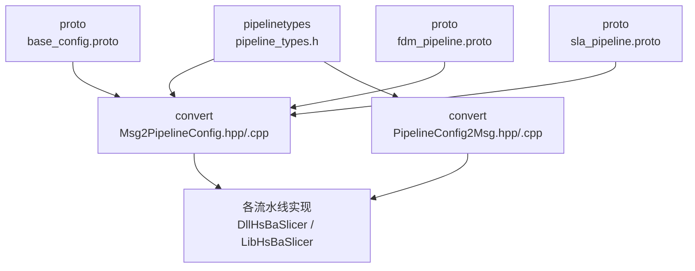
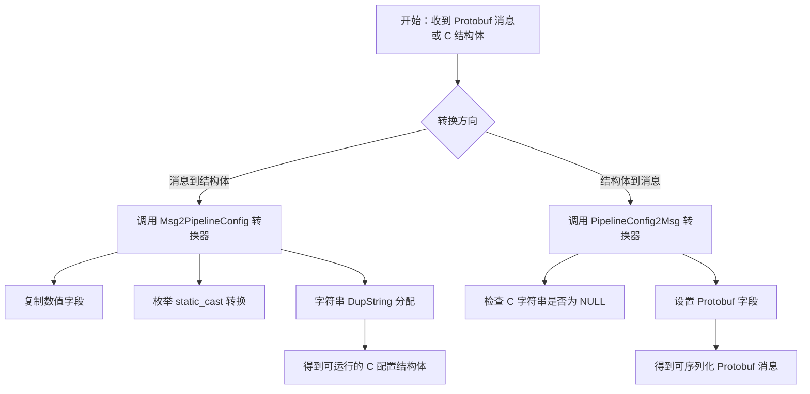
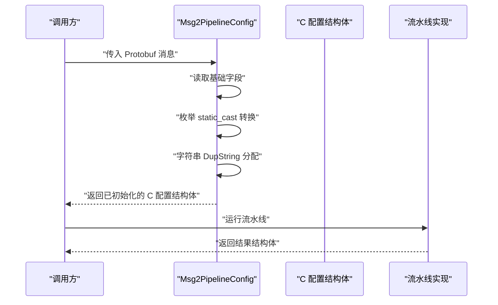
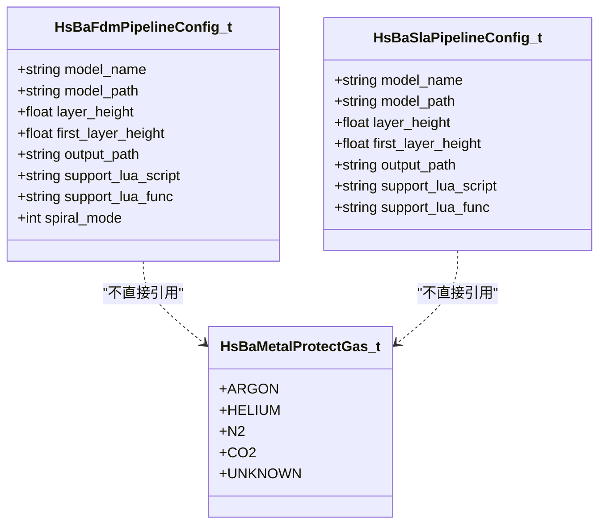
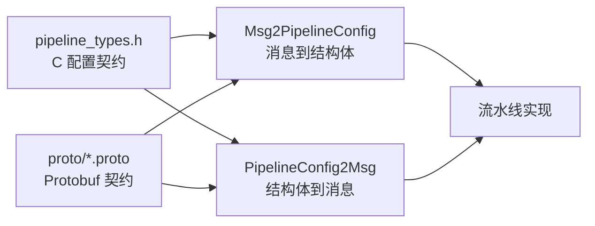

# 配置类型定义

<cite>
**本文引用的文件**   
- [pipeline_types.h](file://pipelinetypes/pipeline_types.h)
- [base_config.proto](file://proto/base_config.proto)
- [fdm_pipeline.proto](file://proto/fdm_pipeline.proto)
- [sla_pipeline.proto](file://proto/sla_pipeline.proto)
- [Msg2PipelineConfig.hpp](file://convert/Msg2PipelineConfig.hpp)
- [Msg2PipelineConfig.cpp](file://convert/Msg2PipelineConfig.cpp)
- [PipelineConfig2Msg.hpp](file://convert/PipelineConfig2Msg.hpp)
- [PipelineConfig2Msg.cpp](file://convert/PipelineConfig2Msg.cpp)
</cite>

## 目录
1. [引言](#引言)
2. [项目结构与定位](#项目结构与定位)
3. [核心配置结构体总览](#核心配置结构体总览)
4. [枚举类型与工艺参数选项](#枚举类型与工艺参数选项)
5. [Protobuf 消息与 C++ 结构体映射关系](#protobuf-消息与-c-结构体映射关系)
6. [数据类型转换与版本兼容性处理](#数据类型转换与版本兼容性处理)
7. [关键流水线配置详解](#关键流水线配置详解)
8. [新增配置类型的完整步骤与命名规范](#新增配置类型的完整步骤与命名规范)
9. [跨流水线共享通用参数的实践](#跨流水线共享通用参数的实践)
10. [依赖关系与架构视图](#依赖关系与架构视图)
11. [性能与内存管理注意事项](#性能与内存管理注意事项)
12. [故障排除指南](#故障排除指南)
13. [结论](#结论)

## 引言
本文聚焦于 HsBaSlicer 仓库中的“配置类型定义”，目标是帮助开发者准确理解并扩展以下能力：
- 核心配置结构体，例如 `HsBaFdmPipelineConfig_t`、`HsBaSlaPipelineConfig_t` 等。
- Protobuf 消息定义与 C/C++ 结构体之间的双向映射。
- 枚举类型在工艺参数和设备特定设置中的作用。
- 新增配置类型的标准流程、字段命名约定和默认值策略。
- 如何在不同流水线之间复用通用参数，例如层厚、模型路径、输出路径、Lua 脚本入口等。

该文档既适合初次接触配置系统的维护者，也适合作为扩展新设备或新工艺的权威参考。

## 项目结构与定位
配置类型定义位于独立头文件中，目的是让下游模块（例如 convert 层）在不依赖 DllHsBaSlicer 动态库的情况下直接使用这些结构体。Protobuf 定义位于 proto 目录，而实际的消息到结构体的双向转换逻辑位于 convert 目录。

**图表来源**
- [pipeline_types.h:5-12](file://pipelinetypes/pipeline_types.h#L5-L12)
- [Msg2PipelineConfig.hpp:1-20](file://convert/Msg2PipelineConfig.hpp#L1-L20)
- [PipelineConfig2Msg.hpp:1-20](file://convert/PipelineConfig2Msg.hpp#L1-L20)

**章节来源**
- [pipeline_types.h:5-12](file://pipelinetypes/pipeline_types.h#L5-L12)
- [Msg2PipelineConfig.hpp:1-20](file://convert/Msg2PipelineConfig.hpp#L1-L20)
- [PipelineConfig2Msg.hpp:1-20](file://convert/PipelineConfig2Msg.hpp#L1-L20)

## 核心配置结构体总览
所有流水线配置都遵循统一模式：
- 每个流水线都有对应的配置结构体，例如 FDM、SLA、SLS、SLM、LOM、TDP、WAAM、自定义 Lua 流水线、文件传输流水线。
- 每个配置结构体通常包含模型信息、切片参数、工艺参数、Lua 扩展点、输出路径等。
- 每个配置结构体都有对应的默认初始化函数，例如 `HsBaFdmConfigDefault()`、`HsBaSlaConfigDefault()`。
- 每个配置结构体都有对应的结果结构体，用于返回成功标志、层数、输出内容或错误信息。

| 流水线 | 配置结构体 | 主要用途 | 默认初始化函数 |
|---|---|---|---|
| FDM | `HsBaFdmPipelineConfig_t` | FFF/FDM 挤出填充、支撑、GCode 输出 | `HsBaFdmConfigDefault()` |
| SLA | `HsBaSlaPipelineConfig_t` | 光固化切片、底片曝光、支撑、层图像导出 | `HsBaSlaConfigDefault()` |
| SLS | `HsBaSlsPipelineConfig_t` | 粉末激光烧结，无支撑，由 Lua 决定输出格式 | `HsBaSlsConfigDefault()` |
| SLM | `HsBaSlmPipelineConfig_t` | 金属粉末床激光/电子束熔化 | `HsBaSlmConfigDefault()` |
| LOM | `HsBaLomPipelineConfig_t` | 分层实体制造，板材粘接切割 | `HsBaLomConfigDefault()` |
| TDP | `HsBaTdpPipelineConfig_t` | 粘结剂喷射 3DP | `HsBaTdpConfigDefault()` |
| WAAM | `HsBaWaamPipelineConfig_t` | 电弧/激光丝材增材，机器人程序输出 | `HsBaWaamConfigDefault()` |
| 自定义 Lua | `HsBaCustomPipelineConfig_t` | 完全由 Lua 控制流水线阶段 | `HsBaCustomConfigDefault()` |
| 文件传输 | `HsBaFileTransferPipelineConfig_t` | 通过远程执行器发送文件 | `HsBaFileTransferConfigDefault()` |

**章节来源**
- [pipeline_types.h:53-113](file://pipelinetypes/pipeline_types.h#L53-L113)
- [pipeline_types.h:165-218](file://pipelinetypes/pipeline_types.h#L165-L218)
- [pipeline_types.h:251-283](file://pipelinetypes/pipeline_types.h#L251-L283)
- [pipeline_types.h:353-376](file://pipelinetypes/pipeline_types.h#L353-L376)
- [pipeline_types.h:416-436](file://pipelinetypes/pipeline_types.h#L416-L436)
- [pipeline_types.h:477-496](file://pipelinetypes/pipeline_types.h#L477-L496)
- [pipeline_types.h:573-600](file://pipelinetypes/pipeline_types.h#L573-L600)
- [pipeline_types.h:680-704](file://pipelinetypes/pipeline_types.h#L680-L704)
- [pipeline_types.h:631-647](file://pipelinetypes/pipeline_types.h#L631-L647)
- [pipeline_types.h:738-783](file://pipelinetypes/pipeline_types.h#L738-L783)
- [pipeline_types.h:785-825](file://pipelinetypes/pipeline_types.h#L785-L825)
- [pipeline_types.h:827-847](file://pipelinetypes/pipeline_types.h#L827-L847)
- [pipeline_types.h:849-872](file://pipelinetypes/pipeline_types.h#L849-L872)
- [pipeline_types.h:874-897](file://pipelinetypes/pipeline_types.h#L874-L897)
- [pipeline_types.h:899-921](file://pipelinetypes/pipeline_types.h#L899-L921)
- [pipeline_types.h:923-951](file://pipelinetypes/pipeline_types.h#L923-L951)
- [pipeline_types.h:953-966](file://pipelinetypes/pipeline_types.h#L953-L966)
- [pipeline_types.h:968-983](file://pipelinetypes/pipeline_types.h#L968-L983)

## 枚举类型与工艺参数选项
枚举类型用于表达工艺选择、材料类型、光源类型、保护气体、机器人控制器、填充模式、支撑模式等离散选项。它们同时出现在 C 结构体和 Protobuf 消息中，并通过显式类型转换完成映射。

### FDM 相关枚举
| 枚举名称 | 含义 | 典型用途 |
|---|---|---|
| `HsBaFillMode_t` | FDM 填充模式 | 直线、简单折线、高级折线填充 |
| `HsBaSupportPattern_t` | FDM 支撑模式 | 平面、树形、蜂窝支撑 |
| `HsBaGCodeFirmware_t` | GCode 目标固件 | Marlin、RepRap/Klipper |

### SLA 相关枚举
| 枚举名称 | 含义 | 典型用途 |
|---|---|---|
| `HsBaSlaSupportPattern_t` | SLA 支撑模式 | 牺牲型薄柱、锥形支撑 |
| `HsBaSlaImageType_t` | 层图像格式 | PNG、JPEG、SVG |

### 金属与增材相关枚举
| 枚举名称 | 含义 | 典型用途 |
|---|---|---|
| `HsBaSlmMaterial_t` | SLM 金属材料 | 铁基、铝基、钛基 |
| `HsBaSlmLight_t` | SLM 能量源 | 激光、电子束 |
| `HsBaMetalProtectGas_t` | 金属保护气体 | 氩气、氦气、氮气、二氧化碳 |
| `HsBaWaamMaterial_t` | WAAM 焊丝材料 | 钢、铝、钛、铜 |
| `HsBaWaamWeldProcess_t` | WAAM 焊接工艺 | 电弧焊、激光焊 |
| `HsBaWaamProtection_t` | WAAM 保护方式 | 保护气体、真空 |
| `HsBaWaamRobotType_t` | WAAM 机器人控制器 | ABB、KUKA、FANUC |

### 其他工艺枚举
| 枚举名称 | 含义 | 典型用途 |
|---|---|---|
| `HsBaLomCutMode_t` | LOM 切割模式 | 轮廓切割、半色调切割 |
| `HsBaTdpBinderMode_t` | 3DP 粘结剂模式 | 全彩、单通道、烧结后处理 |

**章节来源**
- [pipeline_types.h:23-51](file://pipelinetypes/pipeline_types.h#L23-L51)
- [pipeline_types.h:146-163](file://pipelinetypes/pipeline_types.h#L146-L163)
- [pipeline_types.h:320-351](file://pipelinetypes/pipeline_types.h#L320-L351)
- [pipeline_types.h:407-414](file://pipelinetypes/pipeline_types.h#L407-L414)
- [pipeline_types.h:467-475](file://pipelinetypes/pipeline_types.h#L467-L475)
- [pipeline_types.h:530-571](file://pipelinetypes/pipeline_types.h#L530-L571)

## Protobuf 消息与 C++ 结构体映射关系
Protobuf 消息负责跨进程、跨语言或持久化存储时的数据交换；C/C++ 结构体负责运行时流水线内部使用。两者通过 convert 层的两个方向转换器建立映射：
- `Msg2PipelineConfig`：从 Protobuf 消息转换为 C 结构体。
- `PipelineConfig2Msg`：从 C 结构体转换为 Protobuf 消息。

### 映射基本原则
1. **字段语义对齐**：例如层厚、首层层厚、填充间距、支撑密度、输出路径等字段在两边保持相同物理含义。
2. **枚举值按序号映射**：C 枚举与 Protobuf 枚举通过 `static_cast` 直接转换，因此枚举值的顺序必须保持一致。
3. **字符串字段分配策略**：从 Protobuf 到 C 结构体时，字符串字段通过 `malloc` 分配；调用方需要按照对应释放接口释放。
4. **布尔值与整型兼容**：C 结构体常用 `int` 表示开关，Protobuf 用 `bool`，转换时会进行 `0/非零` 与 `true/false` 的互转。
5. **可选字段处理**：C 结构体中字符串指针可能为 `NULL`，Protobuf 侧则通过空字符串或缺省值表达；转换器会跳过空指针写入 Protobuf。

**图表来源**
- [Msg2PipelineConfig.cpp:17-31](file://convert/Msg2PipelineConfig.cpp#L17-L31)
- [Msg2PipelineConfig.cpp:35-83](file://convert/Msg2PipelineConfig.cpp#L35-L83)
- [PipelineConfig2Msg.cpp:10-77](file://convert/PipelineConfig2Msg.cpp#L10-L77)

**章节来源**
- [Msg2PipelineConfig.hpp:1-104](file://convert/Msg2PipelineConfig.hpp#L1-L104)
- [PipelineConfig2Msg.hpp:1-81](file://convert/PipelineConfig2Msg.hpp#L1-L81)
- [Msg2PipelineConfig.cpp:17-31](file://convert/Msg2PipelineConfig.cpp#L17-L31)
- [Msg2PipelineConfig.cpp:35-83](file://convert/Msg2PipelineConfig.cpp#L35-L83)
- [PipelineConfig2Msg.cpp:10-77](file://convert/PipelineConfig2Msg.cpp#L10-L77)

## 数据类型转换与版本兼容性处理
### 基本类型转换
- 浮点数、整数、布尔值直接赋值或条件转换。
- 枚举类型通过 `static_cast` 在 C 枚举与 Protobuf 枚举之间转换。
- 字符串字段在 `MsgTo*` 系列函数中使用 `DupString` 分配内存，避免悬空指针。

### 版本兼容性策略
- Protobuf 消息中包含 `msg_base_config.version`，可用于识别协议版本。
- 当新增字段时，应优先在 Protobuf 中增加新字段，而不是修改已有字段语义。
- 如果旧客户端无法识别新枚举值，应在接收端做安全回退，例如使用未知枚举值对应的默认行为。
- C 结构体默认初始化函数提供稳定默认值，即使 Protobuf 消息缺失某些字段，也能获得合理初始状态。

**图表来源**
- [Msg2PipelineConfig.cpp:35-83](file://convert/Msg2PipelineConfig.cpp#L35-L83)
- [pipeline_types.h:738-783](file://pipelinetypes/pipeline_types.h#L738-L783)

**章节来源**
- [base_config.proto:125-132](file://proto/base_config.proto#L125-L132)
- [Msg2PipelineConfig.cpp:35-83](file://convert/Msg2PipelineConfig.cpp#L35-L83)
- [pipeline_types.h:738-783](file://pipelinetypes/pipeline_types.h#L738-L783)

## 关键流水线配置详解

### FDM 配置：`HsBaFdmPipelineConfig_t`
FDM 配置覆盖模型输入、切片参数、填充参数、支撑参数、路径参数、GCode 输出参数、Lua 扩展点和输出路径。

| 字段类别 | 关键字段 | 说明 |
|---|---|---|
| 模型 | `model_name`、`model_path` | 模型名称与路径 |
| 切片 | `layer_height`、`first_layer_height` | 层厚与首层层厚 |
| 填充 | `fill_spacing`、`fill_mode`、`fill_angle`、`wall_count`、`top_layer_count`、`bottom_layer_count`、`infill_density` | 填充间距、模式、角度、壁厚、顶底层数量、填充密度 |
| 支撑 | `enable_support`、`overhang_angle`、`support_gap`、`support_diameter`、`support_density`、`support_pattern`、`interface_layers`、`interface_density` | 是否启用支撑、悬垂角度、间隙、直径、密度、图案、界面层数和密度 |
| 路径 | `line_width`、`print_speed`、`travel_speed`、`extrusion_multiplier`、`spiral_mode` | 线宽、打印速度、移动速度、挤出倍率、螺旋外壁模式 |
| GCode | `gcode_firmware`、`nozzle_diameter`、`filament_diameter`、`nozzle_temp`、`bed_temp`、`retract_length`、`retract_speed`、`first_layer_speed` | 固件类型、喷嘴直径、线材直径、温度、回抽长度和速度、首层速度 |
| Lua | `support_lua_script`、`support_lua_func`、`infill_lua_script`、`infill_lua_func` | 自定义支撑和填充脚本及函数名 |
| 输出 | `output_path` | GCode 输出路径 |

**章节来源**
- [pipeline_types.h:53-113](file://pipelinetypes/pipeline_types.h#L53-L113)
- [pipeline_types.h:738-783](file://pipelinetypes/pipeline_types.h#L738-L783)
- [fdm_pipeline.proto:26-72](file://proto/fdm_pipeline.proto#L26-L72)
- [Msg2PipelineConfig.cpp:35-83](file://convert/Msg2PipelineConfig.cpp#L35-L83)
- [PipelineConfig2Msg.cpp:10-77](file://convert/PipelineConfig2Msg.cpp#L10-L77)

### SLA 配置：`HsBaSlaPipelineConfig_t`
SLA 配置覆盖模型、切片、曝光参数、底板/垫板、支撑、Lua 扩展点、图像输出格式和尺寸。

| 字段类别 | 关键字段 | 说明 |
|---|---|---|
| 模型 | `model_name`、`model_path` | 模型名称与路径 |
| 切片 | `layer_height`、`first_layer_height` | 层厚与首层层厚 |
| 曝光 | `bottom_exposure_time`、`normal_exposure_time`、`bottom_lift_distance`、`lift_distance`、`lift_speed`、`retract_speed` | 底片曝光时间、正常层曝光时间、抬升距离和速度、回抽速度 |
| 底板 | `floor_raft_offset`、`floor_border_width`、`floor_fill_spacing`、`floor_fill_angle`、`floor_border_count`、`floor_use_convex_hull` | 底板偏移、边框宽度、填充间距、角度、边框数量、凸包 |
| 支撑 | `enable_support`、`overhang_angle`、`support_gap`、`support_diameter`、`support_density`、`support_pattern` | 支撑开关、悬垂角度、间隙、直径、密度、图案 |
| Lua | `support_lua_script`、`support_lua_func`、`floor_lua_script`、`floor_lua_func`、`export_lua_script`、`export_lua_func` | 支撑、底板、导出脚本和函数名 |
| 输出 | `output_path`、`image_type`、`image_width`、`image_height` | 输出路径、图像格式、宽高 |

**章节来源**
- [pipeline_types.h:165-218](file://pipelinetypes/pipeline_types.h#L165-L218)
- [pipeline_types.h:785-825](file://pipelinetypes/pipeline_types.h#L785-L825)
- [sla_pipeline.proto:18-58](file://proto/sla_pipeline.proto#L18-L58)
- [Msg2PipelineConfig.cpp:94-136](file://convert/Msg2PipelineConfig.cpp#L94-L136)
- [PipelineConfig2Msg.cpp:94-161](file://convert/PipelineConfig2Msg.cpp#L94-L161)

### 其他流水线配置要点
- **SLS**：无需支撑，输出格式由 Lua 导出脚本决定。
- **SLM**：强调金属材料、能量源和保护气体。
- **LOM**：强调切割速度、功率、粘接温度和压力。
- **TDP**：强调喷头数量、粘结剂饱和度和固化时间。
- **WAAM**：强调焊丝材料、焊接工艺、保护方式和机器人控制器。
- **自定义 Lua**：允许完全由 Lua 控制流水线阶段，C++ 只暴露构建块。
- **文件传输**：强调远程主机、端口、连接池大小和文件列表。

**章节来源**
- [pipeline_types.h:251-283](file://pipelinetypes/pipeline_types.h#L251-L283)
- [pipeline_types.h:353-376](file://pipelinetypes/pipeline_types.h#L353-L376)
- [pipeline_types.h:416-436](file://pipelinetypes/pipeline_types.h#L416-L436)
- [pipeline_types.h:477-496](file://pipelinetypes/pipeline_types.h#L477-L496)
- [pipeline_types.h:573-600](file://pipelinetypes/pipeline_types.h#L573-L600)
- [pipeline_types.h:680-704](file://pipelinetypes/pipeline_types.h#L680-L704)
- [pipeline_types.h:631-647](file://pipelinetypes/pipeline_types.h#L631-L647)

## 新增配置类型的完整步骤与命名规范

### 步骤一：定义 Protobuf 消息
1. 在 `proto` 目录下新增或扩展现有 `.proto` 文件。
2. 为新配置定义消息，字段命名建议采用流水线前缀，例如 `xxx_pipe_config_field_name`。
3. 如需新增枚举，放在合适位置并保持序号稳定。
4. 若属于通用元数据，可在 `base_config.proto` 中扩展技术类型、输出类型或配置文件格式。

### 步骤二：定义 C 结构体与枚举
1. 在 `pipelinetypes/pipeline_types.h` 中新增 C 兼容枚举和结构体。
2. 结构体字段命名尽量与业务语义一致，例如 `layer_height`、`support_density`。
3. 为结构体提供默认初始化函数，例如 `HsBaXxxConfigDefault()`。
4. 如果需要与其他子系统共享，将枚举放在公共区域，例如金属保护气体枚举。

### 步骤三：实现双向转换器
1. 在 `convert/Msg2PipelineConfig.hpp` 中声明 `MsgToXxxConfig` 和 `MsgToXxxResult`。
2. 在 `convert/Msg2PipelineConfig.cpp` 中实现：
   - 先调用默认初始化函数。
   - 复制数值字段。
   - 对枚举进行 `static_cast`。
   - 对字符串字段使用 `DupString`。
3. 在 `convert/PipelineConfig2Msg.hpp` 中声明 `XxxConfigToMsg` 和 `XxxResultToMsg`。
4. 在 `convert/PipelineConfig2Msg.cpp` 中实现：
   - 对非空字符串进行判断后再设置。
   - 对枚举进行 `static_cast`。
   - 对布尔值进行 `!= 0` 转换。

### 步骤四：注册流水线类型
1. 如果新增流水线类型，需要在 `HsBaPipelineKind` 中增加枚举值。
2. 确保 ParamStore 或其他反射系统能识别新的配置种类。

### 命名规范
| 层级 | 命名规则 | 示例 |
|---|---|---|
| Protobuf 消息 | `xxx_pipe_config`、`xxx_pipe_result` | `fdm_pipeline_config`、`sla_pipe_result` |
| Protobuf 字段 | 小写下划线 + 业务语义 | `fdm_pipe_config_layer_height` |
| C 结构体 | `HsBaXxxPipelineConfig_t` | `HsBaFdmPipelineConfig_t` |
| C 结果结构体 | `HsBaXxxPipelineResult_t` | `HsBaSlaPipelineResult_t` |
| 默认初始化函数 | `HsBaXxxConfigDefault` | `HsBaSlsConfigDefault` |
| 转换器函数 | `MsgToXxxConfig`、`XxxConfigToMsg` | `MsgToSlaConfig`、`SlaConfigToMsg` |
| 枚举 | `HsBaXxxEnumName_t` 或 Protobuf 内 `msg_xxx_enum` | `HsBaFillMode_t`、`msg_fdm_filltype` |

**章节来源**
- [base_config.proto:5-132](file://proto/base_config.proto#L5-L132)
- [pipeline_types.h:985-1005](file://pipelinetypes/pipeline_types.h#L985-L1005)
- [Msg2PipelineConfig.hpp:24-99](file://convert/Msg2PipelineConfig.hpp#L24-L99)
- [PipelineConfig2Msg.hpp:24-76](file://convert/PipelineConfig2Msg.hpp#L24-L76)

## 跨流水线共享通用参数的实践
多个流水线共享以下通用概念：
- 模型名称与路径。
- 层厚与首层层厚。
- 输出路径。
- Lua 脚本路径与函数名。
- 螺旋模式（部分流水线支持）。

共享策略包括：
1. **结构体字段复用**：在各自流水线结构体中保留相同语义字段，便于 UI 和配置导入导出统一处理。
2. **枚举复用**：例如 `HsBaMetalProtectGas_t` 被 SLM 和 WAAM 共用。
3. **ParamStore 分类复用**：通过 `HsBaPipelineKind` 区分流水线类型，但保存/加载逻辑可以复用。
4. **Protobuf 通用元数据复用**：通过 `msg_base_config` 表达技术类型、输出类型、配置文件格式等。

**图表来源**
- [pipeline_types.h:53-113](file://pipelinetypes/pipeline_types.h#L53-L113)
- [pipeline_types.h:165-218](file://pipelinetypes/pipeline_types.h#L165-L218)
- [pipeline_types.h:341-351](file://pipelinetypes/pipeline_types.h#L341-L351)

**章节来源**
- [pipeline_types.h:53-113](file://pipelinetypes/pipeline_types.h#L53-L113)
- [pipeline_types.h:165-218](file://pipelinetypes/pipeline_types.h#L165-L218)
- [pipeline_types.h:341-351](file://pipelinetypes/pipeline_types.h#L341-L351)
- [base_config.proto:125-132](file://proto/base_config.proto#L125-L132)

## 依赖关系与架构视图
配置类型定义是整个流水线系统的“契约层”：
- `pipeline_types.h` 是 C ABI 契约，供外部模块使用。
- `proto/*.proto` 是序列化契约，供跨进程或跨语言通信。
- `convert/*` 是适配层，负责两种契约之间的转换。
- 上层流水线实现依赖 C 结构体，但不一定直接依赖 Protobuf。

**图表来源**
- [pipeline_types.h:5-12](file://pipelinetypes/pipeline_types.h#L5-L12)
- [Msg2PipelineConfig.hpp:1-20](file://convert/Msg2PipelineConfig.hpp#L1-L20)
- [PipelineConfig2Msg.hpp:1-20](file://convert/PipelineConfig2Msg.hpp#L1-L20)

**章节来源**
- [pipeline_types.h:5-12](file://pipelinetypes/pipeline_types.h#L5-L12)
- [Msg2PipelineConfig.hpp:1-20](file://convert/Msg2PipelineConfig.hpp#L1-L20)
- [PipelineConfig2Msg.hpp:1-20](file://convert/PipelineConfig2Msg.hpp#L1-L20)

## 性能与内存管理注意事项
- **字符串分配**：`MsgTo*` 系列函数会为字符串字段分配内存，调用方必须正确释放，否则会造成内存泄漏。
- **数组字段**：文件传输流水线的 `file_paths` 是字符串指针数组，转换时会逐个分配。
- **默认初始化优先**：所有 `MsgTo*Config` 都会先调用默认初始化函数，保证未传字段有合理默认值。
- **枚举越界风险**：由于枚举通过 `static_cast` 转换，如果 Protobuf 枚举新增值而 C 枚举未同步，可能出现未定义行为。
- **布尔值语义**：C 结构体使用 `int` 表示开关，Protobuf 使用 `bool`，转换时必须注意 `0/非零` 与 `true/false` 的关系。

**章节来源**
- [Msg2PipelineConfig.cpp:17-31](file://convert/Msg2PipelineConfig.cpp#L17-L31)
- [Msg2PipelineConfig.cpp:178-199](file://convert/Msg2PipelineConfig.cpp#L178-L199)
- [Msg2PipelineConfig.cpp:35-83](file://convert/Msg2PipelineConfig.cpp#L35-L83)
- [PipelineConfig2Msg.cpp:10-77](file://convert/PipelineConfig2Msg.cpp#L10-L77)

## 故障排除指南
### 问题一：Protobuf 消息中有字段，但 C 结构体中没有
**现象**：配置导入后某些参数丢失。  
**原因**：缺少对应的 `MsgToXxxConfig` 转换逻辑。  
**解决**：在 `Msg2PipelineConfig.cpp` 中补充字段复制逻辑。

### 问题二：C 结构体中有字段，但 Protobuf 消息中没有
**现象**：导出配置后某些参数丢失。  
**原因**：缺少对应的 `XxxConfigToMsg` 转换逻辑。  
**解决**：在 `PipelineConfig2Msg.cpp` 中补充字段设置逻辑。

### 问题三：枚举值不一致导致行为异常
**现象**：某个工艺选项未按预期生效。  
**原因**：C 枚举与 Protobuf 枚举序号不一致。  
**解决**：同步枚举值，必要时增加未知值分支并提供安全回退。

### 问题四：内存泄漏或崩溃
**现象**：程序退出时报内存错误或崩溃。  
**原因**：未释放 `MsgTo*` 分配的字符串或结果结构体中的字符串字段。  
**解决**：严格遵循每条转换函数的注释要求，调用对应释放接口。

**章节来源**
- [Msg2PipelineConfig.hpp:24-99](file://convert/Msg2PipelineConfig.hpp#L24-L99)
- [PipelineConfig2Msg.hpp:24-76](file://convert/PipelineConfig2Msg.hpp#L24-L76)
- [Msg2PipelineConfig.cpp:35-83](file://convert/Msg2PipelineConfig.cpp#L35-L83)
- [PipelineConfig2Msg.cpp:10-77](file://convert/PipelineConfig2Msg.cpp#L10-L77)

## 结论
HsBaSlicer 的配置类型定义以 `pipeline_types.h` 为核心契约，配合 Protobuf 消息和 convert 层的双向转换器，形成清晰、可扩展、可复用的配置体系。对于 FDM、SLA 等主流流水线，配置字段已经覆盖模型、切片、工艺、支撑、Lua 扩展和输出；对于 SLM、LOM、TDP、WAAM 等专用设备，配置进一步体现材料、能量源、保护方式和机器人控制器等差异。

新增配置类型时，应遵循“Proto 契约 → C 契约 → 双向转换器 → 流水线实现”的顺序，并保持枚举序号稳定、默认值合理、内存管理明确。这样既能保证现有系统稳定运行，又能平滑扩展新的设备和工艺。