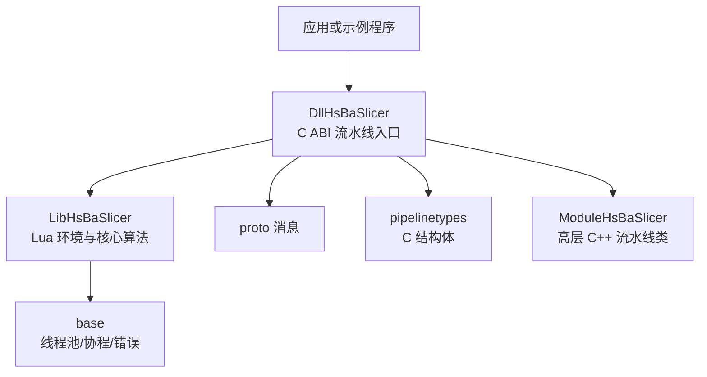
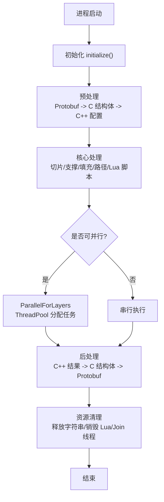
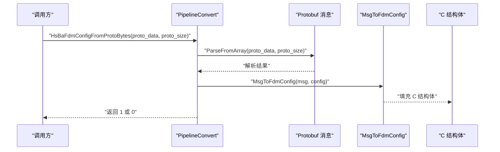
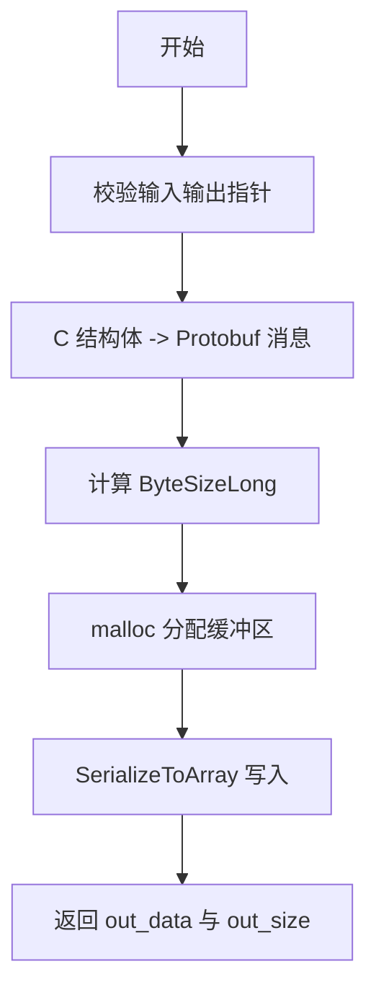
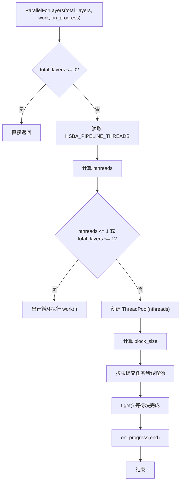
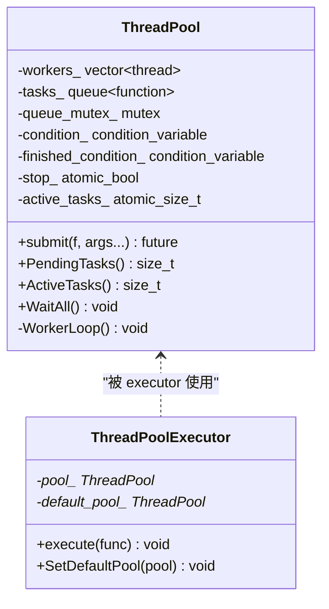
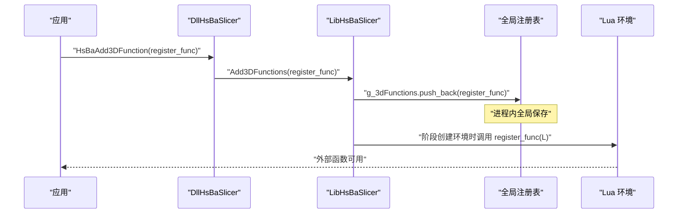
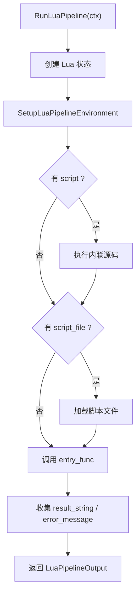
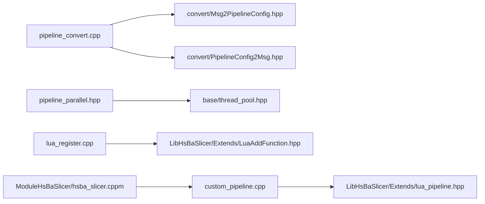

# 流水线生命周期管理

<cite>
**本文引用的文件**   
- [pipeline_convert.h](file://DllHsBaSlicer/pipeline_convert.h)
- [pipeline_convert.cpp](file://DllHsBaSlicer/pipeline_convert.cpp)
- [pipeline_parallel.hpp](file://DllHsBaSlicer/pipeline_parallel.hpp)
- [thread_pool.hpp](file://base/thread_pool.hpp)
- [lua_register.h](file://DllHsBaSlicer/lua_register.h)
- [lua_register.cpp](file://DllHsBaSlicer/lua_register.cpp)
- [LuaAddFunction.hpp](file://LibHsBaSlicer/Extends/LuaAddFunction.hpp)
- [LuaAddFunction.cpp](file://LibHsBaSlicer/Extends/LuaAddFunction.cpp)
- [lua_pipeline.hpp](file://LibHsBaSlicer/Extends/lua_pipeline.hpp)
- [lua_pipeline.cpp](file://LibHsBaSlicer/Extends/lua_pipeline.cpp)
- [custom_pipeline.h](file://DllHsBaSlicer/custom_pipeline.h)
- [custom_pipeline.cpp](file://DllHsBaSlicer/custom_pipeline.cpp)
- [hsba_slicer.cppm](file://ModuleHsBaSlicer/hsba_slicer.cppm)
- [pipeline_types.h](file://pipelinetypes/pipeline_types.h)
- [custom_pipeline.proto](file://proto/custom_pipeline.proto)
- [initialize.cpp](file://DllHsBaSlicer/initialize.cpp)
- [HsBaSlicer.cpp](file://HsBaSlicer/HsBaSlicer.cpp)
</cite>

## 目录
1. [引言](#引言)
2. [项目结构与定位](#项目结构与定位)
3. [核心组件总览](#核心组件总览)
4. [流水线生命周期总览](#流水线生命周期总览)
5. [PipelineConvert 数据转换机制](#pipelineconvert-数据转换机制)
6. [并行处理框架与线程池](#并行处理框架与线程池)
7. [Lua 流水线接口与调用机制](#lua-流水线接口与调用机制)
8. [生命周期钩子与最佳实践](#生命周期钩子与最佳实践)
9. [依赖关系分析](#依赖关系分析)
10. [性能与资源管理](#性能与资源管理)
11. [故障排除](#故障排除)
12. [结论](#结论)

## 引言
本文围绕 HsBaSlicer 的流水线生命周期展开，重点说明以下目标：
- 完整生命周期阶段：初始化、预处理、核心处理、后处理、资源清理。
- PipelineConvert 的数据转换机制：C++ 对象与 Protobuf 消息之间的序列化与反序列化。
- 并行处理框架：基于 ThreadPool 的层级并行执行策略。
- Lua 流水线接口：函数注册、参数传递、结果返回与生命周期钩子。
- 生命周期钩子的使用方式与最佳实践。

该文档既面向 C++ 集成者，也面向编写 Lua 流水线的扩展开发者。

## 项目结构与定位
HsBaSlicer 在仓库中按模块划分：
- `DllHsBaSlicer`：对外暴露的 C ABI 流水线入口、Proto 转换、Lua 注册、具体流水线实现。
- `LibHsBaSlicer`：内部库，提供 Lua 环境构建、通用算法、路径生成、支撑填充等能力。
- `ModuleHsBaSlicer`：C++ Module 封装，提供更高层的 pipeline 类（如 FDM、SLA、SLS、CustomLuaPipeline 等）。
- `base`：基础工具，包括线程池、协程、错误类型、内存工具等。
- `proto`：所有流水线配置与结果的 Protobuf 定义。
- `pipelinetypes`：C 结构体定义，供 C ABI 使用。

**图表来源**
- [initialize.cpp:7-9](file://DllHsBaSlicer/initialize.cpp#L7-L9)
- [pipeline_convert.h:1-22](file://DllHsBaSlicer/pipeline_convert.h#L1-L22)
- [lua_pipeline.hpp:19-28](file://LibHsBaSlicer/Extends/lua_pipeline.hpp#L19-L28)
- [thread_pool.hpp:27-30](file://base/thread_pool.hpp#L27-L30)

**章节来源**
- [initialize.cpp:7-9](file://DllHsBaSlicer/initialize.cpp#L7-L9)
- [HsBaSlicer.cpp:283-303](file://HsBaSlicer/HsBaSlicer.cpp#L283-L303)

## 核心组件总览
| 组件 | 职责 | 关键文件 |
|---|---|---|
| PipelineConvert | C 结构体与 Protobuf 消息之间的序列化/反序列化 | [pipeline_convert.h](file://DllHsBaSlicer/pipeline_convert.h), [pipeline_convert.cpp](file://DllHsBaSlicer/pipeline_convert.cpp) |
| 并行执行器 | 层级别并行调度，控制线程数与进度回调 | [pipeline_parallel.hpp](file://DllHsBaSlicer/pipeline_parallel.hpp) |
| 线程池 | 任务队列、工作线程、协程执行器 | [thread_pool.hpp](file://base/thread_pool.hpp) |
| Lua 注册系统 | 将外部 C/C++ 函数注入到各阶段 Lua 环境 | [lua_register.h](file://DllHsBaSlicer/lua_register.h), [lua_register.cpp](file://DllHsBaSlicer/lua_register.cpp), [LuaAddFunction.hpp](file://LibHsBaSlicer/Extends/LuaAddFunction.hpp), [LuaAddFunction.cpp](file://LibHsBaSlicer/Extends/LuaAddFunction.cpp) |
| Lua 流水线上下文 | 构建 Lua 环境、执行脚本、收集结果 | [lua_pipeline.hpp](file://LibHsBaSlicer/Extends/lua_pipeline.hpp), [lua_pipeline.cpp](file://LibHsBaSlicer/Extends/lua_pipeline.cpp) |
| 自定义流水线 | 完全由 Lua 驱动的流程入口 | [custom_pipeline.h](file://DllHsBaSlicer/custom_pipeline.h), [custom_pipeline.cpp](file://DllHsBaSlicer/custom_pipeline.cpp) |
| 高层流水线类 | 封装 FDM/SLA/SLS/LOM/TDP/WAAM/FileTransfer/CustomLuaPipeline | [hsba_slicer.cppm](file://ModuleHsBaSlicer/hsba_slicer.cppm) |
| C 结构体定义 | 所有流水线配置与结果的 C ABI 类型 | [pipeline_types.h](file://pipelinetypes/pipeline_types.h) |
| Protobuf 定义 | 自定义流水线配置与结果的消息定义 | [custom_pipeline.proto](file://proto/custom_pipeline.proto) |

**章节来源**
- [pipeline_convert.h:17-22](file://DllHsBaSlicer/pipeline_convert.h#L17-L22)
- [pipeline_parallel.hpp:22-42](file://DllHsBaSlicer/pipeline_parallel.hpp#L22-L42)
- [thread_pool.hpp:27-46](file://base/thread_pool.hpp#L27-L46)
- [lua_register.h:21-31](file://DllHsBaSlicer/lua_register.h#L21-L31)
- [lua_pipeline.hpp:19-83](file://LibHsBaSlicer/Extends/lua_pipeline.hpp#L19-L83)
- [custom_pipeline.h:17-55](file://DllHsBaSlicer/custom_pipeline.h#L17-L55)
- [hsba_slicer.cppm:290-373](file://ModuleHsBaSlicer/hsba_slicer.cppm#L290-L373)
- [pipeline_types.h:698-726](file://pipelinetypes/pipeline_types.h#L698-L726)
- [custom_pipeline.proto:5-18](file://proto/custom_pipeline.proto#L5-L18)

## 流水线生命周期总览
HsBaSlicer 的流水线生命周期可以抽象为五个阶段：

1. **初始化阶段**
   - 进程启动后调用全局初始化函数。
   - 日志、Lua 扩展注册表、事件回调注册表准备就绪。
   - 典型入口：`initialize()`。

2. **预处理阶段**
   - 解析输入模型、加载配置。
   - 将外部传入的 Protobuf 字节流转换为 C 结构体。
   - 将 C 结构体转换为内部 C++ 流水线配置。

3. **核心处理阶段**
   - 固定流水线：FDM/SLA/SLS 等按阶段执行切片、支撑、填充、路径生成。
   - 并行阶段：对独立层进行并行计算。
   - Lua 流水线：根据脚本动态决定阶段顺序与内容。

4. **后处理阶段**
   - 将内部结果转换为 C 结构体。
   - 将 C 结构体序列化为 Protobuf 字节流。
   - 输出文件、报告层数、输出路径、耗时等信息。

5. **资源清理阶段**
   - 释放由 C ABI 分配的字符串和数组。
   - 销毁 Lua 状态。
   - 等待线程池任务完成并关闭工作线程。

**图表来源**
- [initialize.cpp:7-9](file://DllHsBaSlicer/initialize.cpp#L7-L9)
- [pipeline_convert.cpp:27-41](file://DllHsBaSlicer/pipeline_convert.cpp#L27-L41)
- [pipeline_parallel.hpp:41-117](file://DllHsBaSlicer/pipeline_parallel.hpp#L41-L117)
- [thread_pool.hpp:67-90](file://base/thread_pool.hpp#L67-L90)

**章节来源**
- [initialize.cpp:7-9](file://DllHsBaSlicer/initialize.cpp#L7-L9)
- [pipeline_convert.cpp:27-41](file://DllHsBaSlicer/pipeline_convert.cpp#L27-L41)
- [pipeline_parallel.hpp:41-117](file://DllHsBaSlicer/pipeline_parallel.hpp#L41-L117)

## PipelineConvert 数据转换机制
PipelineConvert 是 C ABI 与内部 C++ 流水线之间的“边界转换器”。它负责：
- 将 Protobuf 字节流反序列化为 C 结构体。
- 将 C 结构体序列化为 Protobuf 字节流。
- 提供每类配置的字符串字段释放函数。

### 转换流程
以 FDM 配置为例：
1. 调用 `HsBaFdmConfigFromProtoBytes`。
2. 校验输入指针与长度。
3. 使用 Protobuf 的 `ParseFromArray` 解析为 `msg_fdm_pipeline_config`。
4. 调用 `MsgToFdmConfig` 将 Protobuf 消息映射到 C 结构体。
5. 成功返回 1，失败返回 0。

**图表来源**
- [pipeline_convert.cpp:27-41](file://DllHsBaSlicer/pipeline_convert.cpp#L27-L41)

### 序列化流程
以 FDM 结果为例：
1. 调用 `HsBaFdmResultToProtoBytes`。
2. 校验输入指针与输出指针。
3. 调用 `FdmResultToMsg` 将 C 结构体映射为 Protobuf 消息。
4. 计算消息大小并分配内存。
5. 调用 `SerializeToArray` 写入缓冲区。
6. 返回分配的缓冲区和大小。

**图表来源**
- [pipeline_convert.cpp:89-114](file://DllHsBaSlicer/pipeline_convert.cpp#L89-L114)

### 支持的流水线类型
PipelineConvert 覆盖以下流水线：
- FDM
- SLA
- SLS
- File Transfer
- Custom Lua Pipeline
- SLM
- LOM
- 3DP
- WAAM

每种类型均提供 Config 与 Result 的双向转换，以及 Config 字符串字段的释放函数。

**章节来源**
- [pipeline_convert.h:24-32](file://DllHsBaSlicer/pipeline_convert.h#L24-L32)
- [pipeline_convert.h:44-62](file://DllHsBaSlicer/pipeline_convert.h#L44-L62)
- [pipeline_convert.h:64-102](file://DllHsBaSlicer/pipeline_convert.h#L64-L102)
- [pipeline_convert.h:104-142](file://DllHsBaSlicer/pipeline_convert.h#L104-L142)
- [pipeline_convert.h:148-186](file://DllHsBaSlicer/pipeline_convert.h#L148-L186)
- [pipeline_convert.h:196-234](file://DllHsBaSlicer/pipeline_convert.h#L196-L234)
- [pipeline_convert.h:240-334](file://DllHsBaSlicer/pipeline_convert.h#L240-L334)
- [pipeline_convert.h:342-390](file://DllHsBaSlicer/pipeline_convert.h#L342-L390)
- [pipeline_convert.cpp:27-41](file://DllHsBaSlicer/pipeline_convert.cpp#L27-L41)
- [pipeline_convert.cpp:89-114](file://DllHsBaSlicer/pipeline_convert.cpp#L89-L114)

## 并行处理框架与线程池
### 层级别并行执行
`ParallelForLayers` 是切片与填充热路径的并行执行器。其核心行为如下：
- 如果层数为 0，直接返回。
- 支持通过环境变量 `HSBA_PIPELINE_THREADS` 强制设置线程数。
- 默认线程数为硬件并发数，但不超过层数。
- 如果线程数为 1 或层数为 1，退化为串行循环。
- 否则创建 ThreadPool，按块提交任务，并在每个块完成后调用进度回调。
- 工作函数只能写入自身层索引对应的输出槽。
- 异常会通过 future 重新抛出给调用方。

**图表来源**
- [pipeline_parallel.hpp:41-117](file://DllHsBaSlicer/pipeline_parallel.hpp#L41-L117)

### 线程池实现
ThreadPool 是一个通用的任务执行池：
- 构造时创建指定数量的工作线程。
- 析构时标记停止、通知所有条件变量、join 所有工作线程。
- submit 方法将任务包装为 packaged_task 并提交到队列。
- WorkerLoop 从队列取任务执行，捕获异常并更新活跃任务计数。
- WaitAll 等待队列为空且无活跃任务。
- 可选协程执行器 ThreadPoolExecutor 用于 C++20 coroutine 集成。

**图表来源**
- [thread_pool.hpp:29-162](file://base/thread_pool.hpp#L29-L162)
- [thread_pool.hpp:164-207](file://base/thread_pool.hpp#L164-L207)

**章节来源**
- [pipeline_parallel.hpp:22-42](file://DllHsBaSlicer/pipeline_parallel.hpp#L22-L42)
- [pipeline_parallel.hpp:41-117](file://DllHsBaSlicer/pipeline_parallel.hpp#L41-L117)
- [thread_pool.hpp:27-46](file://base/thread_pool.hpp#L27-L46)
- [thread_pool.hpp:67-90](file://base/thread_pool.hpp#L67-L90)
- [thread_pool.hpp:118-162](file://base/thread_pool.hpp#L118-L162)
- [thread_pool.hpp:164-207](file://base/thread_pool.hpp#L164-L207)

## Lua 流水线接口与调用机制
### 函数注册机制
Lua 流水线允许外部 C/C++ 函数在运行时注入到特定阶段的 Lua 环境中。注册分为三类：
- 2D 函数：适用于 Support、Fill、SLA Output。
- 3D 函数：适用于 Slice、Support。
- File 函数：适用于 SLS Output、SLA Output。
- 事件回调：例如 Zipper 压缩事件、数据库查询事件。

注册流程：
1. 调用 `HsBaAdd2DFunction` / `HsBaAdd3DFunction` / `HsBaAddFileFunction`。
2. DLL 层转发到 Lib 层的 AddXxxFunctions。
3. Lib 层将注册回调存入全局向量。
4. 当某个阶段创建 Lua 环境时，遍历对应向量并调用注册函数。

**图表来源**
- [lua_register.h:21-31](file://DllHsBaSlicer/lua_register.h#L21-L31)
- [lua_register.cpp:11-41](file://DllHsBaSlicer/lua_register.cpp#L11-L41)
- [LuaAddFunction.hpp:24-74](file://LibHsBaSlicer/Extends/LuaAddFunction.hpp#L24-L74)
- [LuaAddFunction.cpp:21-67](file://LibHsBaSlicer/Extends/LuaAddFunction.cpp#L21-L67)

### 参数传递与结果返回
Lua 流水线通过 `LuaPipelineContext` 传递参数：
- `script`：内联 Lua 源码，作为前置脚本执行。
- `script_file`：Lua 脚本文件路径。
- `entry_func`：入口函数名，默认为 `run_pipeline`。
- `config_json`：自由格式 JSON，暴露为 `pipeline_config`。
- `model_name` / `model_path`：模型名称与路径。
- `output_path`：默认输出路径。
- `progress_cb`：进度回调。

结果通过 `LuaPipelineOutput` 返回：
- `success`：是否成功。
- `total_layers`：层数。
- `output_path`：输出路径。
- `result_string`：入口函数返回值。
- `error_message`：错误信息。

**图表来源**
- [lua_pipeline.hpp:19-83](file://LibHsBaSlicer/Extends/lua_pipeline.hpp#L19-L83)
- [lua_pipeline.cpp:960-994](file://LibHsBaSlicer/Extends/lua_pipeline.cpp#L960-L994)

### 自定义流水线入口
自定义流水线完全由 Lua 脚本驱动，C++ 只负责构建环境和执行入口函数。典型流程：
1. 用户设置 `pipeline_lua_script` 或 `pipeline_lua_source`。
2. C++ 构造 `LuaPipelineContext`。
3. 调用 `RunLuaPipeline`。
4. 脚本通过 `HsBa.progress()` 上报进度。
5. 脚本可通过 `HsBa.setLayers()` 和 `HsBa.setOutputPath()` 设置结果。
6. 入口函数可返回字符串，作为 `result_string`。

**章节来源**
- [lua_register.h:21-31](file://DllHsBaSlicer/lua_register.h#L21-L31)
- [lua_register.cpp:11-41](file://DllHsBaSlicer/lua_register.cpp#L11-L41)
- [LuaAddFunction.hpp:24-74](file://LibHsBaSlicer/Extends/LuaAddFunction.hpp#L24-L74)
- [LuaAddFunction.cpp:21-67](file://LibHsBaSlicer/Extends/LuaAddFunction.cpp#L21-L67)
- [lua_pipeline.hpp:19-83](file://LibHsBaSlicer/Extends/lua_pipeline.hpp#L19-L83)
- [lua_pipeline.cpp:960-994](file://LibHsBaSlicer/Extends/lua_pipeline.cpp#L960-L994)
- [custom_pipeline.cpp:123-159](file://DllHsBaSlicer/custom_pipeline.cpp#L123-L159)

## 生命周期钩子与最佳实践
### 生命周期钩子位置
| 阶段 | 钩子或扩展点 | 说明 |
|---|---|---|
| 初始化 | `initialize()` | 进程启动后调用一次 |
| 预处理 | PipelineConvert | Protobuf 与 C 结构体转换 |
| 核心处理 | `ParallelForLayers` | 层级别并行执行 |
| 核心处理 | Lua 注册函数 | 注入 2D/3D/File 函数 |
| 核心处理 | Lua 脚本入口 | 自定义流水线逻辑 |
| 后处理 | PipelineConvert | C 结构体与 Protobuf 转换 |
| 资源清理 | 释放函数 | `HsBaFree*ConfigStrings` / `HsBaFreeCustomPipelineResult` |

### 最佳实践
1. **初始化优先**：在任何流水线调用前调用 `initialize()`。
2. **避免 UI 线程阻塞**：同步流水线 API 会阻塞，应在后台线程执行。
3. **回调线程安全**：进度回调不在 UI 线程，需 marshal 回 UI 线程。
4. **字符串生命周期**：C 结构体中的 `const char*` 必须在流水线运行期间保持有效。
5. **结果释放**：C ABI 返回的动态字符串必须由调用方释放。
6. **并行参数调优**：通过 `HSBA_PIPELINE_THREADS` 控制线程数，便于性能对比。
7. **Lua 脚本规范**：脚本应仅定义函数，不应在顶层自执行；进度通过 `HsBa.progress()` 上报。
8. **错误处理**：Lua 流水线失败时检查 `error_message`；C++ 流水线抛出 `SlicerError`。

**章节来源**
- [initialize.cpp:7-9](file://DllHsBaSlicer/initialize.cpp#L7-L9)
- [pipeline_convert.h:342-390](file://DllHsBaSlicer/pipeline_convert.h#L342-L390)
- [pipeline_parallel.hpp:49-72](file://DllHsBaSlicer/pipeline_parallel.hpp#L49-L72)
- [lua_pipeline.hpp:19-83](file://LibHsBaSlicer/Extends/lua_pipeline.hpp#L19-L83)
- [hsba_slicer.cppm:1154-1180](file://ModuleHsBaSlicer/hsba_slicer.cppm#L1154-L1180)

## 依赖关系分析

**图表来源**
- [pipeline_convert.cpp:12-13](file://DllHsBaSlicer/pipeline_convert.cpp#L12-L13)
- [pipeline_parallel.hpp:17-18](file://DllHsBaSlicer/pipeline_parallel.hpp#L17-L18)
- [lua_register.cpp:7-8](file://DllHsBaSlicer/lua_register.cpp#L7-L8)
- [custom_pipeline.cpp:135-151](file://DllHsBaSlicer/custom_pipeline.cpp#L135-L151)
- [hsba_slicer.cppm:1154-1180](file://ModuleHsBaSlicer/hsba_slicer.cppm#L1154-L1180)

**章节来源**
- [pipeline_convert.cpp:12-13](file://DllHsBaSlicer/pipeline_convert.cpp#L12-L13)
- [pipeline_parallel.hpp:17-18](file://DllHsBaSlicer/pipeline_parallel.hpp#L17-L18)
- [lua_register.cpp:7-8](file://DllHsBaSlicer/lua_register.cpp#L7-L8)
- [custom_pipeline.cpp:135-151](file://DllHsBaSlicer/custom_pipeline.cpp#L135-L151)
- [hsba_slicer.cppm:1154-1180](file://ModuleHsBaSlicer/hsba_slicer.cppm#L1154-L1180)

## 性能与资源管理
### 性能特性
- **层级别并行**：切片与填充阶段天然适合并行，因为层之间相互独立。
- **线程数控制**：默认使用硬件并发数，可通过环境变量强制调整。
- **块调度**：按块提交任务，减少进度回调频率，避免频繁跨线程通信。
- **串行降级**：单核或单层时自动退化串行，保证行为一致性。

### 资源管理
- **内存分配**：PipelineConvert 使用 `malloc` 分配输出缓冲区，调用方必须释放。
- **字符串释放**：每类配置提供 `HsBaFree*ConfigStrings` 释放字符串字段。
- **Lua 状态**：每次 Lua 流水线创建新的 Lua 状态，结束后销毁。
- **线程池生命周期**：ThreadPool 析构时 join 所有工作线程，避免悬垂线程。

**章节来源**
- [pipeline_parallel.hpp:49-72](file://DllHsBaSlicer/pipeline_parallel.hpp#L49-L72)
- [pipeline_parallel.hpp:88-117](file://DllHsBaSlicer/pipeline_parallel.hpp#L88-L117)
- [pipeline_convert.h:342-390](file://DllHsBaSlicer/pipeline_convert.h#L342-L390)
- [thread_pool.hpp:47-61](file://base/thread_pool.hpp#L47-L61)

## 故障排除
| 问题 | 可能原因 | 排查建议 |
|---|---|---|
| Protobuf 解析失败 | 输入数据为空、长度无效、消息不匹配 | 检查 `proto_data` 与 `proto_size`，确认消息类型一致 |
| 序列化失败 | 内存分配失败、序列化失败 | 检查返回值是否为 0，确认 `out_data` 非空 |
| 并行性能差 | 线程数过多或过少 | 调整 `HSBA_PIPELINE_THREADS`，观察性能变化 |
| Lua 函数未找到 | 未注册或注册阶段错误 | 确认在正确阶段调用 `HsBaAddXxxFunction` |
| Lua 脚本报错 | 脚本语法错误或入口函数不存在 | 检查 `entry_func` 是否存在，查看 `error_message` |
| 内存泄漏 | 未释放 C ABI 返回的字符串 | 调用 `HsBaFree*ConfigStrings` 或 `HsBaFreeCustomPipelineResult` |
| 线程未退出 | 线程池未正确析构 | 确保 ThreadPool 作用域结束或被显式销毁 |

**章节来源**
- [pipeline_convert.cpp:27-41](file://DllHsBaSlicer/pipeline_convert.cpp#L27-L41)
- [pipeline_convert.cpp:89-114](file://DllHsBaSlicer/pipeline_convert.cpp#L89-L114)
- [pipeline_parallel.hpp:49-72](file://DllHsBaSlicer/pipeline_parallel.hpp#L49-L72)
- [lua_pipeline.cpp:960-994](file://LibHsBaSlicer/Extends/lua_pipeline.cpp#L960-L994)
- [pipeline_convert.h:342-390](file://DllHsBaSlicer/pipeline_convert.h#L342-L390)

## 结论
HsBaSlicer 的流水线生命周期设计清晰分层：
- PipelineConvert 提供稳定的 C ABI 与 Protobuf 转换边界。
- 并行框架基于 ThreadPool 实现高效层级别并行。
- Lua 流水线系统提供灵活的扩展点，支持函数注册、参数传递与结果返回。
- 生命周期钩子贯穿初始化、预处理、核心处理、后处理和资源清理。

对于集成者，建议优先关注：
- 正确调用 `initialize()`。
- 正确使用 PipelineConvert 进行数据转换。
- 合理配置并行线程数。
- 正确注册和使用 Lua 扩展函数。
- 严格管理 C ABI 返回的内存资源。