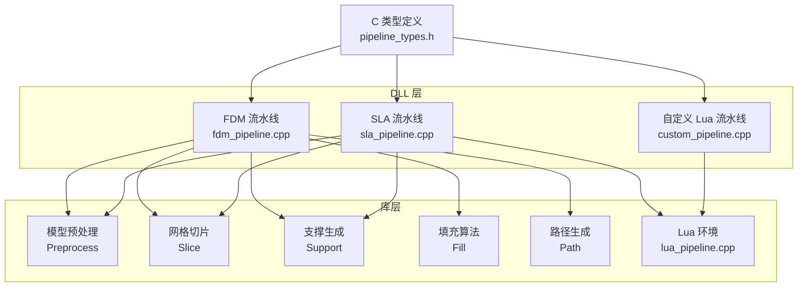
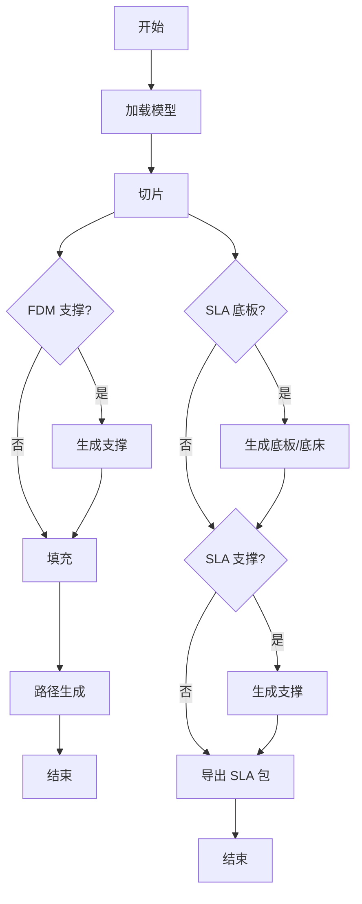
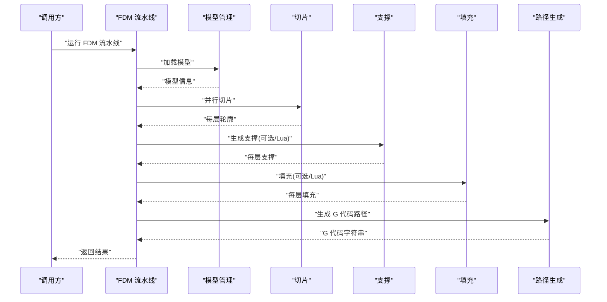
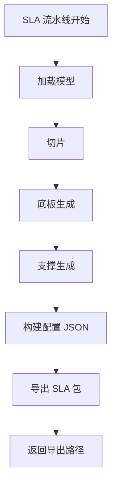
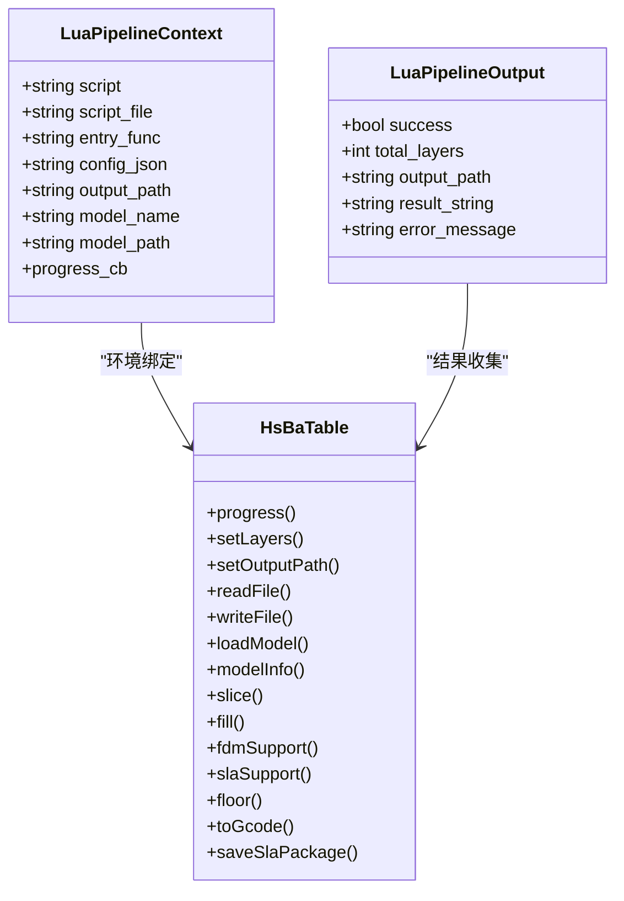
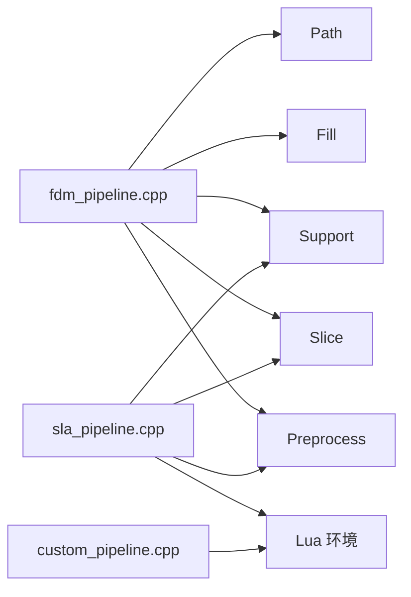

# 自定义流水线实现

<cite>
**本文引用的文件**   
- [pipeline_types.h](file://pipelinetypes/pipeline_types.h)
- [fdm_pipeline.h](file://DllHsBaSlicer/fdm_pipeline.h)
- [fdm_pipeline.cpp](file://DllHsBaSlicer/fdm_pipeline.cpp)
- [sla_pipeline.h](file://DllHsBaSlicer/sla_pipeline.h)
- [sla_pipeline.cpp](file://DllHsBaSlicer/sla_pipeline.cpp)
- [custom_pipeline.h](file://DllHsBaSlicer/custom_pipeline.h)
- [custom_pipeline.cpp](file://DllHsBaSlicer/custom_pipeline.cpp)
- [lua_pipeline.hpp](file://LibHsBaSlicer/Extends/lua_pipeline.hpp)
- [lua_pipeline.cpp](file://LibHsBaSlicer/Extends/lua_pipeline.cpp)
- [hsba_slicer.cppm](file://ModuleHsBaSlicer/hsba_slicer.cppm)
- [lua_pipeline_api.md](file://docs/en/lua_pipeline_api.md)
- [hsba_pipeline.d.lua](file://types/hsba_pipeline.d.lua)
</cite>

## 目录
1. [引言](#引言)
2. [项目结构](#项目结构)
3. [核心组件](#核心组件)
4. [架构总览](#架构总览)
5. [详细组件分析](#详细组件分析)
6. [依赖关系分析](#依赖关系分析)
7. [性能与扩展性](#性能与扩展性)
8. [从零开发新流水线指南](#从零开发新流水线指南)
9. [故障排除](#故障排除)
10. [结论](#结论)

## 引言
本文面向需要基于 HsBaSlicer 构建或扩展切片流水线的开发者，目标是说明如何继承现有流水线基类、实现特定工艺处理逻辑，并给出 FDM 与 SLA 流水线的完整阶段说明、Lua 脚本扩展点集成方式，以及从零开始开发新流水线的头文件定义、实现细节和测试方法。

HsBaSlicer 的流水线体系分为三类：
- 固定阶段 C++ 流水线：FDM、SLA、SLS、SLM、LOM、TDP、WAAM 等，通过 `DllHsBaSlicer` 暴露 C ABI。
- 完全由 Lua 驱动的自定义流水线：通过 `HsBaCustomPipelineConfig_t` 指定 Lua 入口函数，C++ 仅负责搭建环境。
- LibHsBaSlicer 内部模块：模型预处理、切片、支撑、填充、路径生成、打包导出等可复用能力。

## 项目结构
与自定义流水线直接相关的代码主要分布在以下位置：
- `pipelinetypes/pipeline_types.h`：所有流水线的 C 兼容配置与结果类型。
- `DllHsBaSlicer/*_pipeline.{h,cpp}`：各工艺的 C ABI 入口与协程驱动的主流程。
- `LibHsBaSlicer/Extends/lua_pipeline.{hpp,cpp}`：Lua 驱动流水线的环境搭建与全局 `HsBa` 表。
- `ModuleHsBaSlicer/hsba_slicer.cppm`：C++ 风格封装（如 `FdmPipeline`）。
- `samples/*`：示例工程，用于验证流水线调用方式。
- `docs/en/lua_pipeline_api.md`、`types/hsba_pipeline.d.lua`：Lua API 文档与类型声明。

**图表来源**
- [fdm_pipeline.cpp:218-446](file://DllHsBaSlicer/fdm_pipeline.cpp#L218-L446)
- [sla_pipeline.cpp:298-483](file://DllHsBaSlicer/sla_pipeline.cpp#L298-L483)
- [custom_pipeline.cpp:117-126](file://DllHsBaSlicer/custom_pipeline.cpp#L117-L126)
- [lua_pipeline.cpp:224-800](file://LibHsBaSlicer/Extends/lua_pipeline.cpp#L224-L800)
- [pipeline_types.h:56-113](file://pipelinetypes/pipeline_types.h#L56-L113)

**章节来源**
- [pipeline_types.h:56-113](file://pipelinetypes/pipeline_types.h#L56-L113)
- [fdm_pipeline.h:17-61](file://DllHsBaSlicer/fdm_pipeline.h#L17-L61)
- [sla_pipeline.h:17-56](file://DllHsBaSlicer/sla_pipeline.h#L17-L56)
- [custom_pipeline.h:17-62](file://DllHsBaSlicer/custom_pipeline.h#L17-L62)

## 核心组件
本节聚焦三类核心组件：C ABI 流水线接口、Lua 驱动流水线上下文、以及 C++ 风格封装。

### C ABI 流水线接口
FDM、SLA、自定义 Lua 流水线均提供统一的三件套：
- 创建默认配置：`HsBaCreateDefaultConfig` / `HsBaCreateDefaultSlaConfig` / `HsBaCreateDefaultCustomConfig`。
- 同步运行：`HsBaRunFdmPipeline` / `HsBaRunSlaPipeline` / `HsBaRunCustomPipeline`。
- 异步运行：`HsBaRunFdmPipelineAsync` / `HsBaRunSlaPipelineAsync` / `HsBaRunCustomPipelineAsync`。
- 释放结果：`HsBaFreePipelineResult` / `HsBaFreeSlaPipelineResult` / `HsBaFreeCustomPipelineResult`。

这些接口的参数与返回值均由 `pipeline_types.h` 中的结构体描述，例如：
- FDM：`HsBaFdmPipelineConfig_t`、`HsBaFdmPipelineResult_t`。
- SLA：`HsBaSlaPipelineConfig_t`、`HsBaSlaPipelineResult_t`。
- 自定义 Lua：`HsBaCustomPipelineConfig_t`、`HsBaCustomPipelineResult_t`。

**章节来源**
- [fdm_pipeline.h:17-61](file://DllHsBaSlicer/fdm_pipeline.h#L17-L61)
- [sla_pipeline.h:17-56](file://DllHsBaSlicer/sla_pipeline.h#L17-L56)
- [custom_pipeline.h:17-62](file://DllHsBaSlicer/custom_pipeline.h#L17-L62)
- [pipeline_types.h:56-113](file://pipelinetypes/pipeline_types.h#L56-L113)
- [pipeline_types.h:170-232](file://pipelinetypes/pipeline_types.h#L170-L232)
- [pipeline_types.h:689-732](file://pipelinetypes/pipeline_types.h#L689-L732)

### Lua 驱动流水线上下文
Lua 驱动流水线通过 `LuaPipelineContext` 描述脚本来源、入口函数、JSON 配置、模型信息、输出路径和进度回调；执行后返回 `LuaPipelineOutput`，包含成功标志、层数、输出路径、Lua 返回值和错误消息。

关键行为：
- `SetupLuaPipelineEnvironment` 会初始化 Lua 状态、注册通用 AnyObject 类型、注入 2D/3D/File 相关函数，并创建全局 `HsBa` 操作表。
- `RunLuaPipeline` 创建 Lua 状态、设置环境、执行脚本或脚本文件、调用入口函数，并将结果写入输出对象。

**章节来源**
- [lua_pipeline.hpp:19-83](file://LibHsBaSlicer/Extends/lua_pipeline.hpp#L19-L83)
- [lua_pipeline.cpp:50-70](file://LibHsBaSlicer/Extends/lua_pipeline.cpp#L50-L70)
- [lua_pipeline.cpp:224-288](file://LibHsBaSlicer/Extends/lua_pipeline.cpp#L224-L288)

### C++ 风格封装
`ModuleHsBaSlicer/hsba_slicer.cppm` 中提供了 C++ 风格的 `FdmPipeline` 类，其注释明确说明完整流水线顺序为“切片 → 支撑 → 填充 → 路径”，并提供 `run`、`sliceAll`、`generateSupports`、`fill` 等方法。该封装适合在 C++ 工程中直接使用，而 DLL 层则对外暴露 C ABI。

**章节来源**
- [hsba_slicer.cppm:193-219](file://ModuleHsBaSlicer/hsba_slicer.cppm#L193-L219)

## 架构总览
下图展示 FDM 与 SLA 流水线在 C++ 层的阶段划分，以及 Lua 扩展点的位置。

**图表来源**
- [fdm_pipeline.cpp:231-435](file://DllHsBaSlicer/fdm_pipeline.cpp#L231-L435)
- [sla_pipeline.cpp:310-471](file://DllHsBaSlicer/sla_pipeline.cpp#L310-L471)

## 详细组件分析

### FDM 流水线完整实现
FDM 流水线的核心协程实现位于 `fdm_pipeline.cpp`，主流程按以下阶段组织：

1. **预处理**
   - 使用 LibHsBaSlicer 的模型管理接口获取或加载模型。
   - 通过 `GetModelInfo` 获取包围盒与体积，计算总层数。
   - 若模型高度无效，直接返回失败。

2. **切片**
   - 构建切片拓扑一次，然后并行切片每一层。
   - 每层 Z 坐标由首层层高与普通层高计算得到。
   - 切片结果保存为每层轮廓多边形数组。

3. **支撑生成**
   - 支持螺旋花瓶模式：此时跳过支撑与填充。
   - 支持 Lua 自定义支撑：读取脚本内容并通过 `GenerateAllLuaSupport` 调用。
   - 否则使用内置 FDM 支撑算法。

4. **填充**
   - 顶层与底层使用实心填充，中间层根据密度调整间距。
   - 支持 Lua 自定义填充：串行执行，因为 Lua 解释器状态不跨线程共享。
   - 否则使用 `FillWithBorder` 并行填充。

5. **路径生成**
   - 螺旋模式：将每层外轮廓合并为连续上升螺旋路径。
   - 普通模式：组装 `LayerPathData` 后调用 `GenerateGCodePathV2` 生成 G 代码。

**图表来源**
- [fdm_pipeline.cpp:218-446](file://DllHsBaSlicer/fdm_pipeline.cpp#L218-L446)

**章节来源**
- [fdm_pipeline.cpp:142-197](file://DllHsBaSlicer/fdm_pipeline.cpp#L142-L197)
- [fdm_pipeline.cpp:218-446](file://DllHsBaSlicer/fdm_pipeline.cpp#L218-L446)
- [pipeline_types.h:56-113](file://pipelinetypes/pipeline_types.h#L56-L113)

### SLA 流水线特殊处理逻辑
SLA 流水线与 FDM 的主要差异在于：
- 增加**底板/底床生成**阶段。
- 支撑使用 SLA 专用配置。
- 最终导出为 SLA 包（ZIP），包含层图像、支撑图像与配置文件。

阶段说明：
1. **预处理**：同 FDM，加载模型并计算层数。
2. **切片**：同 FDM，并行切片。
3. **底板生成**：
   - 使用首层轮廓生成底板。
   - 支持 Lua 自定义底板：通过 `LuaCustomFloorByFile` 调用。
   - 否则使用 `GenerateFloorRaft`。
4. **支撑生成**：
   - 支持 Lua 自定义支撑：读取脚本并调用 `GenerateAllLuaSupport`。
   - 否则使用 `GenerateAllSlaSupport`。
5. **导出**：
   - 构建 JSON 配置，包含切片、曝光、提升、底板、支撑、图像格式等信息。
   - 使用 `SaveSlaPackage` 或 `SaveSlaPackageLua` 导出 ZIP。

**图表来源**
- [sla_pipeline.cpp:298-483](file://DllHsBaSlicer/sla_pipeline.cpp#L298-L483)

**章节来源**
- [sla_pipeline.cpp:181-242](file://DllHsBaSlicer/sla_pipeline.cpp#L181-L242)
- [sla_pipeline.cpp:298-483](file://DllHsBaSlicer/sla_pipeline.cpp#L298-L483)
- [pipeline_types.h:170-232](file://pipelinetypes/pipeline_types.h#L170-L232)

### Lua 脚本扩展点集成
Lua 扩展点在 FDM 与 SLA 流水线中均有体现：
- FDM 支撑：`support_lua_script` + `support_lua_func`。
- FDM 填充：`infill_lua_script` + `infill_lua_func`。
- SLA 底板：`floor_lua_script` + `floor_lua_func`。
- SLA 支撑：`support_lua_script` + `support_lua_func`。
- SLA 导出：`export_lua_script` + `export_lua_func`。

对于完全由 Lua 驱动的自定义流水线，`HsBaCustomPipelineConfig_t` 允许指定：
- `pipeline_lua_script` 或 `pipeline_lua_source`。
- `entry_func`（默认 `run_pipeline`）。
- `config_json`（自由 JSON，作为 `pipeline_config` 传入 Lua）。
- `model_name`、`model_path`、`output_path`。

Lua 环境中全局 `HsBa` 表提供：
- 进度回调：`HsBa.progress(percent, stage)`。
- 层数与输出路径设置：`HsBa.setLayers(n)`、`HsBa.setOutputPath(path)`。
- 文件读写：`HsBa.readFile`、`HsBa.writeFile`。
- 模型管理：`loadModel`、`modelInfo`、`translateModel`、`rotateModel`、`scaleModel`、`removeModel`、`modelNames`。
- 切片：`layerCount`、`layerZ`、`slice`、`sliceUnsafe`。
- 坐标转换：`toInt`、`toDouble`。
- 填充：`fill`。
- 支撑：`fdmSupport`、`slaSupport`。
- SLA 底板：`floor`。
- 路径与 G 代码：`spiralize`、`toGcode`。
- 打包导出：`saveSlsPackage`、`saveWaamPackage`、`saveSlaPackage`。

**图表来源**
- [lua_pipeline.hpp:19-83](file://LibHsBaSlicer/Extends/lua_pipeline.hpp#L19-L83)
- [lua_pipeline.cpp:224-800](file://LibHsBaSlicer/Extends/lua_pipeline.cpp#L224-L800)

**章节来源**
- [custom_pipeline.h:23-55](file://DllHsBaSlicer/custom_pipeline.h#L23-L55)
- [custom_pipeline.cpp:117-126](file://DllHsBaSlicer/custom_pipeline.cpp#L117-L126)
- [lua_pipeline.cpp:224-800](file://LibHsBaSlicer/Extends/lua_pipeline.cpp#L224-L800)
- [lua_pipeline_api.md:241-265](file://docs/en/lua_pipeline_api.md#L241-L265)
- [hsba_pipeline.d.lua:504-552](file://types/hsba_pipeline.d.lua#L504-L552)

## 依赖关系分析
FDM 与 SLA 流水线对 LibHsBaSlicer 模块的依赖如下：

**图表来源**
- [fdm_pipeline.cpp:17-26](file://DllHsBaSlicer/fdm_pipeline.cpp#L17-L26)
- [sla_pipeline.cpp:19-26](file://DllHsBaSlicer/sla_pipeline.cpp#L19-L26)
- [custom_pipeline.cpp:14-16](file://DllHsBaSlicer/custom_pipeline.cpp#L14-L16)

**章节来源**
- [fdm_pipeline.cpp:17-26](file://DllHsBaSlicer/fdm_pipeline.cpp#L17-L26)
- [sla_pipeline.cpp:19-26](file://DllHsBaSlicer/sla_pipeline.cpp#L19-L26)
- [custom_pipeline.cpp:14-16](file://DllHsBaSlicer/custom_pipeline.cpp#L14-L16)

## 性能与扩展性
- **并行切片**：FDM 与 SLA 均使用 `ParallelForLayers` 并行切片，提升多层模型的处理速度。
- **并行填充**：C++ 填充算法可并行执行；Lua 填充因解释器状态限制需串行。
- **螺旋模式优化**：FDM 螺旋模式跳过支撑与填充，直接生成连续路径，减少计算量。
- **Lua 扩展点**：通过脚本替换支撑、填充、底板、导出逻辑，避免修改 C++ 核心代码。

建议：
- 对大型模型优先启用并行切片。
- 对复杂填充逻辑使用 Lua 自定义填充，但注意串行开销。
- 对仅需外壁打印的场景启用螺旋模式。

[本节为一般性指导，无需源码引用]

## 从零开发新流水线指南

### 第一步：确定流水线类型
- 如果工艺逻辑固定且可复用现有阶段，选择继承现有 C++ 流水线（如 FDM/SLA）。
- 如果整个工作流由脚本定义，选择自定义 Lua 流水线。

### 第二步：定义配置与结果类型
参考 `pipeline_types.h` 中的结构体设计：
- 配置结构体包含模型、切片、工艺参数、Lua 扩展点、输出路径。
- 结果结构体包含成功标志、层数、输出内容、错误消息、耗时。

示例参考：
- FDM 配置：`HsBaFdmPipelineConfig_t`。
- SLA 配置：`HsBaSlaPipelineConfig_t`。
- 自定义 Lua 配置：`HsBaCustomPipelineConfig_t`。

**章节来源**
- [pipeline_types.h:56-113](file://pipelinetypes/pipeline_types.h#L56-L113)
- [pipeline_types.h:170-232](file://pipelinetypes/pipeline_types.h#L170-L232)
- [pipeline_types.h:689-732](file://pipelinetypes/pipeline_types.h#L689-L732)

### 第三步：实现 C ABI 头文件
新建头文件，例如 `my_pipeline.h`，暴露：
- 默认配置创建函数。
- 同步运行函数。
- 异步运行函数。
- 结果释放函数。

参考 `fdm_pipeline.h` 与 `sla_pipeline.h` 的结构。

**章节来源**
- [fdm_pipeline.h:17-61](file://DllHsBaSlicer/fdm_pipeline.h#L17-L61)
- [sla_pipeline.h:17-56](file://DllHsBaSlicer/sla_pipeline.h#L17-L56)

### 第四步：实现流水线主流程
新建源文件，例如 `my_pipeline.cpp`，实现：
- 配置解析：将 C 配置转换为内部结构。
- 阶段调度：按工艺顺序调用预处理、切片、支撑、填充、路径生成。
- 错误处理：捕获 `RuntimeError` 并返回错误消息。
- 进度回调：在各阶段调用进度回调。

参考 `fdm_pipeline.cpp` 与 `sla_pipeline.cpp` 的协程实现。

**章节来源**
- [fdm_pipeline.cpp:142-197](file://DllHsBaSlicer/fdm_pipeline.cpp#L142-L197)
- [fdm_pipeline.cpp:218-446](file://DllHsBaSlicer/fdm_pipeline.cpp#L218-L446)
- [sla_pipeline.cpp:244-282](file://DllHsBaSlicer/sla_pipeline.cpp#L244-L282)
- [sla_pipeline.cpp:298-483](file://DllHsBaSlicer/sla_pipeline.cpp#L298-L483)

### 第五步：集成 Lua 扩展点
如需支持 Lua 扩展：
- 在配置中添加 Lua 脚本路径与函数名。
- 在对应阶段调用 Lua 自定义逻辑。
- 确保 Lua 环境已初始化并注册所需函数。

参考：
- FDM 支撑与填充的 Lua 调用。
- SLA 底板、支撑、导出的 Lua 调用。
- 自定义 Lua 流水线的 `SetupLuaPipelineEnvironment`。

**章节来源**
- [fdm_pipeline.cpp:291-304](file://DllHsBaSlicer/fdm_pipeline.cpp#L291-L304)
- [fdm_pipeline.cpp:350-372](file://DllHsBaSlicer/fdm_pipeline.cpp#L350-L372)
- [sla_pipeline.cpp:373-419](file://DllHsBaSlicer/sla_pipeline.cpp#L373-L419)
- [lua_pipeline.cpp:224-288](file://LibHsBaSlicer/Extends/lua_pipeline.cpp#L224-L288)

### 第六步：编写测试
- 单元测试：验证配置解析、阶段输出、错误处理。
- 集成测试：运行完整流水线，检查 G 代码或导出文件。
- Lua 脚本测试：验证自定义支撑、填充、底板、导出逻辑。

参考示例工程：
- `samples/FDM/main.cpp`
- `samples/SLA/main.cpp`
- `samples/Custom/main.cpp`

[本节为一般性指导，无需源码引用]

## 故障排除
常见问题与解决思路：
- **模型加载失败**：检查模型路径与名称是否正确。
- **切片结果为空**：确认层高与首层层高设置合理。
- **支撑生成失败**：检查支撑角度阈值与间隙参数。
- **填充异常**：确认填充模式与间距设置。
- **路径生成失败**：检查路径配置与打印机参数。
- **Lua 脚本错误**：检查脚本语法与函数名是否匹配。

调试建议：
- 启用日志输出。
- 逐步打印各阶段输出。
- 使用最小化 Lua 脚本验证基础功能。

**章节来源**
- [fdm_pipeline.cpp:437-446](file://DllHsBaSlicer/fdm_pipeline.cpp#L437-L446)
- [sla_pipeline.cpp:473-483](file://DllHsBaSlicer/sla_pipeline.cpp#L473-L483)

## 结论
HsBaSlicer 提供了灵活的流水线架构，既支持固定阶段的 C++ 流水线，也支持完全由 Lua 驱动的自定义流水线。开发者可根据工艺需求选择合适的扩展方式，利用现有的模型预处理、切片、支撑、填充、路径生成模块快速实现新功能。通过合理的配置与 Lua 扩展点，可以在不修改核心代码的情况下定制复杂的工艺逻辑。

[本节为总结性内容，无需源码引用]