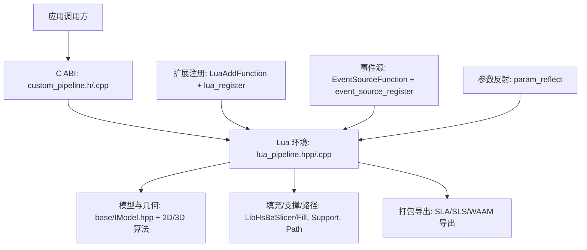
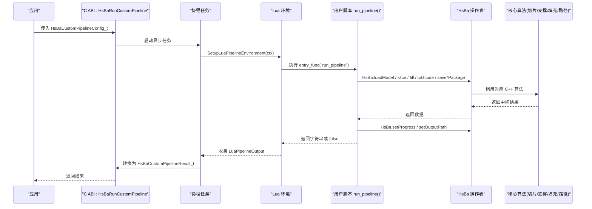
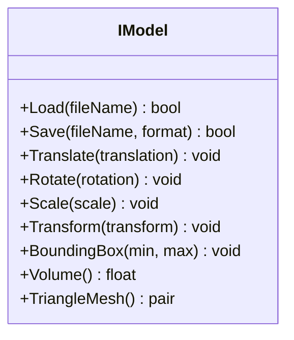
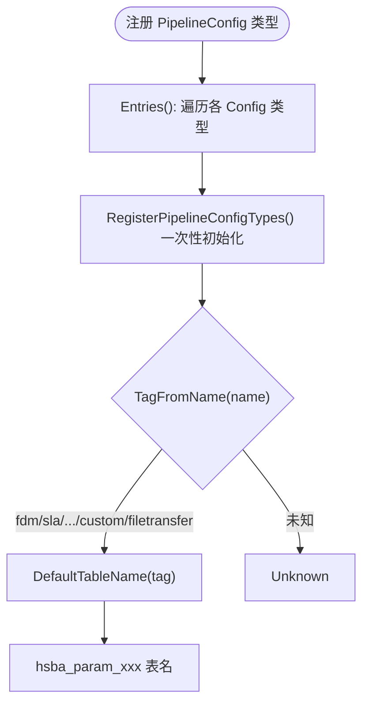
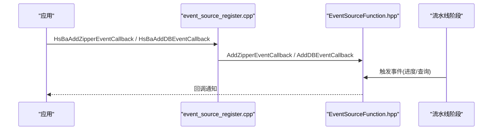
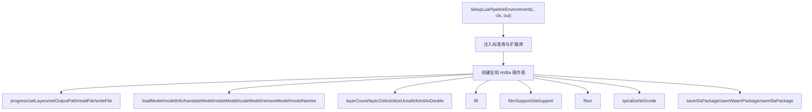
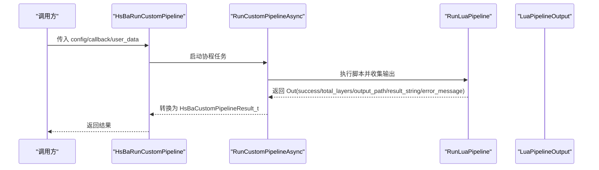
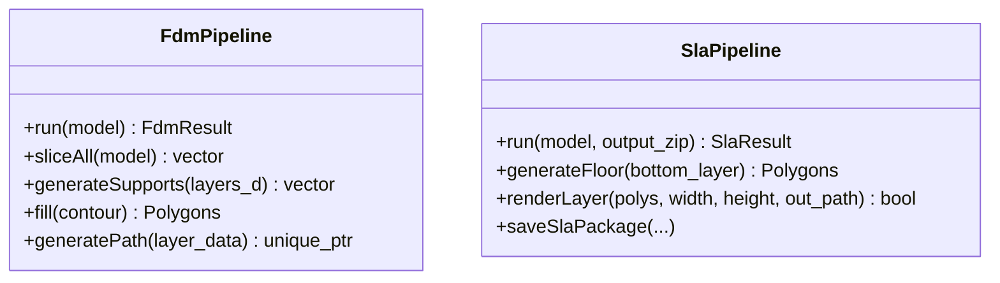
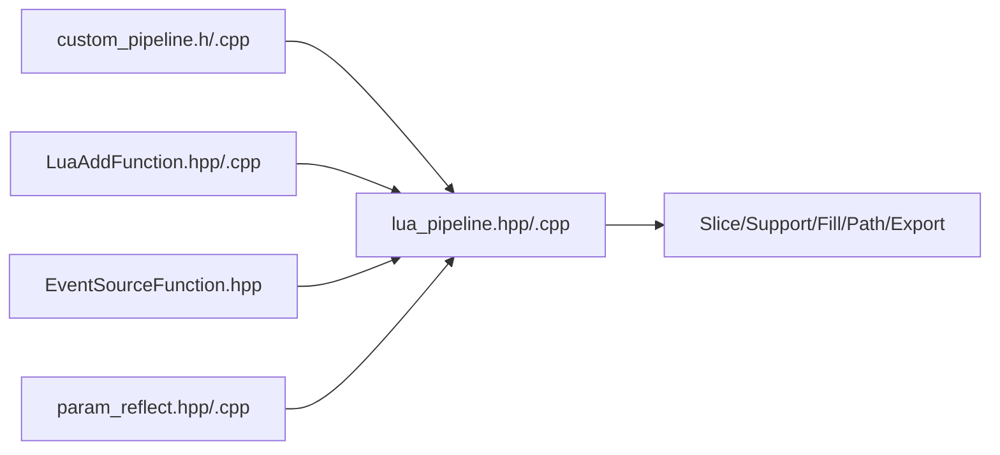

# 自定义流水线开发指南

<cite>
**本文引用的文件**   
- [IModel.hpp](file://base/IModel.hpp)
- [pipeline_types.h](file://pipelinetypes/pipeline_types.h)
- [custom_pipeline.h](file://DllHsBaSlicer/custom_pipeline.h)
- [custom_pipeline.cpp](file://DllHsBaSlicer/custom_pipeline.cpp)
- [lua_pipeline.hpp](file://LibHsBaSlicer/Extends/lua_pipeline.hpp)
- [lua_pipeline.cpp](file://LibHsBaSlicer/Extends/lua_pipeline.cpp)
- [LuaAddFunction.hpp](file://LibHsBaSlicer/Extends/LuaAddFunction.hpp)
- [LuaAddFunction.cpp](file://LibHsBaSlicer/Extends/LuaAddFunction.cpp)
- [lua_register.h](file://DllHsBaSlicer/lua_register.h)
- [lua_register.cpp](file://DllHsBaSlicer/lua_register.cpp)
- [event_source_register.cpp](file://DllHsBaSlicer/event_source_register.cpp)
- [EventSourceFunction.hpp](file://LibHsBaSlicer/Extends/EventSourceFunction.hpp)
- [param_reflect.hpp](file://fileoperator\param_reflect.hpp)
- [param_reflect.cpp](file://fileoperator\param_reflect.cpp)
- [fdm_pipeline.h](file://DllHsBaSlicer/fdm_pipeline.h)
- [sla_pipeline.h](file://DllHsBaSlicer/sla_pipeline.h)
- [hsba_slicer.cppm](file://ModuleHsBaSlicer/hsba_slicer.cppm)
- [my_fdm_pipeline.lua](file://samples/Custom/scripts/my_fdm_pipeline.lua)
- [my_slm_pipeline.lua](file://samples/Custom/scripts/my_slm_pipeline.lua)
</cite>

## 目录
1. [引言](#引言)
2. [项目结构与定位](#项目结构与定位)
3. [核心概念](#核心概念)
4. [架构总览](#架构总览)
5. [详细组件分析](#详细组件分析)
6. [依赖关系分析](#依赖关系分析)
7. [性能与优化建议](#性能与优化建议)
8. [调试与故障排除](#调试与故障排除)
9. [结论](#结论)
10. [附录：快速上手清单](#附录快速上手清单)

## 引言
本指南面向希望在 HsBaSlicer 框架上开发全新 3D 打印工艺流水线的工程师。文档围绕“完全由 Lua 驱动的自定义流水线”展开，同时解释如何基于现有 C++ 流水线基类扩展或替换关键阶段。你将了解：
- IModel 模型抽象接口
- PipelineConfig 配置系统与反射注册
- 事件回调机制（Zipper、数据库等）
- Lua 脚本扩展点与全局 HsBa 操作表
- 从模型加载到最终路径输出的完整生命周期
- 继承现有流水线或从头实现处理逻辑的方法
- 代码示例、测试方法与性能优化建议

## 项目结构与定位
HsBaSlicer 的自定义流水线能力横跨多个模块：
- 类型定义层：所有流水线配置与结果结构体集中在 pipelinetypes/pipeline_types.h
- C ABI 暴露层：DllHsBaSlicer 提供同步/异步运行入口与内存管理
- Lua 执行环境层：LibHsBaSlicer/Extends 提供 SetupLuaPipelineEnvironment 与 RunLuaPipeline
- 扩展注册层：LuaAddFunction 与 lua_register 提供按维度注入函数与事件回调
- 参数反射层：param_reflect 将各 PipelineConfig 类型注册为可序列化/反序列化的参数对象
- 内置流水线参考：FDM/SLA 等通过 ModuleHsBaSlicer 暴露 C++ API，作为扩展基线

图表来源
- [custom_pipeline.h:17-62](file://DllHsBaSlicer/custom_pipeline.h#L17-L62)
- [custom_pipeline.cpp:117-213](file://DllHsBaSlicer/custom_pipeline.cpp#L117-L213)
- [lua_pipeline.hpp:19-83](file://LibHsBaSlicer/Extends/lua_pipeline.hpp#L19-L83)
- [lua_pipeline.cpp:224-800](file://LibHsBaSlicer/Extends/lua_pipeline.cpp#L224-L800)
- [LuaAddFunction.hpp:21-74](file://LibHsBaSlicer/Extends/LuaAddFunction.hpp#L21-L74)
- [lua_register.h:21-31](file://DllHsBaSlicer/lua_register.h#L21-L31)
- [event_source_register.cpp:9-34](file://DllHsBaSlicer/event_source_register.cpp#L9-L34)
- [param_reflect.hpp:380-415](file://fileoperator\param_reflect.hpp#L380-L415)

章节来源
- [pipeline_types.h:676-732](file://pipelinetypes/pipeline_types.h#L676-L732)
- [custom_pipeline.h:17-62](file://DllHsBaSlicer/custom_pipeline.h#L17-L62)
- [lua_pipeline.hpp:19-83](file://LibHsBaSlicer/Extends/lua_pipeline.hpp#L19-L83)

## 核心概念
- IModel 接口：统一 3D 模型抽象，支持加载/保存、变换、包围盒与体积查询、三角网格导出。它是所有模型实现的契约。
- PipelineConfig 配置系统：每种工艺（FDM/SLA/SLS/SLM/LOM/TDP/WAAM/Custom/FileTransfer）都有对应的 C 兼容结构体；通过反射系统注册字段与方法，便于 Lua 与 ParamStore 使用。
- 事件回调机制：Zipper 压缩进度、数据库查询等事件可通过 C/C++ 注册回调，供流水线监控与日志记录。
- Lua 扩展点：每个流水线阶段创建 Lua 环境时，会注入 PolygonOperations、Support、PolygonFill、PathOptimize、Zipper、Cipher、SQLite/MySQL/PostgreSQL 适配器等库；自定义流水线通过全局 HsBa 表驱动模型加载、切片、支撑、填充、路径生成与打包导出。
- 生命周期：从模型加载 -> 切片 -> 支撑/地板 -> 填充 -> 路径生成 -> 输出（G-code/zip/机器人程序），可由 Lua 完全编排。

章节来源
- [IModel.hpp:110-139](file://base/IModel.hpp#L110-L139)
- [param_reflect.hpp:380-415](file://fileoperator\param_reflect.hpp#L380-L415)
- [lua_pipeline.cpp:224-800](file://LibHsBaSlicer/Extends/lua_pipeline.cpp#L224-L800)

## 架构总览
下图展示从 C ABI 到 Lua 环境的调用链，以及 Lua 侧可调用的流水线构建块。

图表来源
- [custom_pipeline.cpp:117-213](file://DllHsBaSlicer/custom_pipeline.cpp#L117-L213)
- [lua_pipeline.hpp:19-83](file://LibHsBaSlicer/Extends/lua_pipeline.hpp#L19-L83)
- [lua_pipeline.cpp:224-800](file://LibHsBaSlicer/Extends/lua_pipeline.cpp#L224-L800)

## 详细组件分析

### IModel 接口与模型生命周期
IModel 是 HsBaSlicer 中 3D 模型的统一抽象，定义了加载、保存、变换、包围盒、体积与三角网格访问方法。所有模型实现（如 CAD/网格/点云）均需遵循该接口。在自定义流水线中，Lua 侧通过 HsBa.loadModel 间接使用模型池与预处理管线，而底层仍依赖 IModel 提供的几何能力。

图表来源
- [IModel.hpp:110-139](file://base/IModel.hpp#L110-L139)

章节来源
- [IModel.hpp:110-139](file://base/IModel.hpp#L110-L139)

### PipelineConfig 配置系统与反射
每种工艺的流水线配置都以 C 兼容结构体定义，并提供默认初始化函数。例如 FDM/SLA/SLS/SLM/LOM/TDP/WAAM/Custom/FileTransfer。反射系统将 TypeInfo 与字段映射注册，使 Lua 与 ParamStore 能动态读写配置。

图表来源
- [param_reflect.cpp:59-100](file://fileoperator\param_reflect.cpp#L59-L100)
- [param_reflect.hpp:380-415](file://fileoperator\param_reflect.hpp#L380-L415)

章节来源
- [pipeline_types.h:54-127](file://pipelinetypes/pipeline_types.h#L54-L127)
- [pipeline_types.h:166-232](file://pipelinetypes/pipeline_types.h#L166-L232)
- [pipeline_types.h:259-297](file://pipelinetypes/pipeline_types.h#L259-L297)
- [pipeline_types.h:359-388](file://pipelinetypes/pipeline_types.h#L359-L388)
- [pipeline_types.h:419-448](file://pipelinetypes/pipeline_types.h#L419-L448)
- [pipeline_types.h:480-508](file://pipelinetypes/pipeline_types.h#L480-L508)
- [pipeline_types.h:578-612](file://pipelinetypes/pipeline_types.h#L578-L612)
- [pipeline_types.h:636-661](file://pipelinetypes/pipeline_types.h#L636-L661)
- [pipeline_types.h:689-732](file://pipelinetypes/pipeline_types.h#L689-L732)
- [param_reflect.hpp:380-415](file://fileoperator\param_reflect.hpp#L380-L415)
- [param_reflect.cpp:59-100](file://fileoperator\param_reflect.cpp#L59-L100)

### 事件回调机制
系统提供 Zipper 与数据库两类事件回调注册接口，既支持 C 风格回调，也支持 Lua 事件回调注入。这些回调可用于监控压缩进度、数据库查询等。

图表来源
- [event_source_register.cpp:9-34](file://DllHsBaSlicer/event_source_register.cpp#L9-L34)
- [EventSourceFunction.hpp:18-41](file://LibHsBaSlicer/Extends/EventSourceFunction.hpp#L18-L41)

章节来源
- [event_source_register.cpp:9-34](file://DllHsBaSlicer/event_source_register.cpp#L9-L34)
- [EventSourceFunction.hpp:18-41](file://LibHsBaSlicer/Extends/EventSourceFunction.hpp#L18-L41)

### Lua 脚本扩展点与 HsBa 操作表
Lua 环境通过 SetupLuaPipelineEnvironment 注入标准库与流水线构建块，并在运行时维护一个全局 HsBa 表。脚本通过 HsBa.progress/setLayers/setOutputPath 报告进度与结果，并通过 HsBa.loadModel/slice/fill/toGcode/save*Package 完成核心流程。

图表来源
- [lua_pipeline.hpp:53-83](file://LibHsBaSlicer/Extends/lua_pipeline.hpp#L53-L83)
- [lua_pipeline.cpp:224-800](file://LibHsBaSlicer/Extends/lua_pipeline.cpp#L224-L800)

章节来源
- [lua_pipeline.hpp:53-83](file://LibHsBaSlicer/Extends/lua_pipeline.hpp#L53-L83)
- [lua_pipeline.cpp:224-800](file://LibHsBaSlicer/Extends/lua_pipeline.cpp#L224-L800)

### 自定义流水线 C ABI 与生命周期
C ABI 提供 HsBaCreateDefaultCustomConfig/HsBaRunCustomPipeline/HsBaRunCustomPipelineAsync/HsBaFreeCustomPipelineResult。内部通过协程任务封装 RunLuaPipeline，并将 LuaPipelineOutput 转换为 C 结构体。

图表来源
- [custom_pipeline.h:17-62](file://DllHsBaSlicer/custom_pipeline.h#L17-L62)
- [custom_pipeline.cpp:117-213](file://DllHsBaSlicer/custom_pipeline.cpp#L117-L213)

章节来源
- [custom_pipeline.h:17-62](file://DllHsBaSlicer/custom_pipeline.h#L17-L62)
- [custom_pipeline.cpp:117-213](file://DllHsBaSlicer/custom_pipeline.cpp#L117-L213)

### 继承现有流水线与从头实现
- 继承现有流水线：以 FDM/SLA 为例，ModuleHsBaSlicer 暴露了 FdmPipeline/SlaPipeline 等 C++ 类，包含 sliceAll/generateSupports/fill/generatePath 等方法，可作为扩展基线。
- 从头实现：通过完全 Lua 驱动的自定义流水线，自行编排模型加载、切片、支撑、填充、路径生成与打包导出，C++ 仅负责环境与资源管理。

图表来源
- [hsba_slicer.cppm:179-253](file://ModuleHsBaSlicer/hsba_slicer.cppm#L179-L253)

章节来源
- [hsba_slicer.cppm:179-253](file://ModuleHsBaSlicer/hsba_slicer.cppm#L179-L253)
- [fdm_pipeline.h:17-61](file://DllHsBaSlicer/fdm_pipeline.h#L17-L61)
- [sla_pipeline.h:17-56](file://DllHsBaSlicer/sla_pipeline.h#L17-L56)

### 完整代码示例与测试方法
- 头文件定义：参考 pipeline_types.h 中的 HsBaCustomPipelineConfig_t/HsBaCustomPipelineResult_t 与默认初始化函数。
- 核心算法实现：参考 lua_pipeline.cpp 中 HsBa.* 方法的实现，包括模型管理、切片、填充、支撑、路径生成与打包导出。
- Lua 脚本集成：参考 samples/Custom/scripts/my_fdm_pipeline.lua 与 my_slm_pipeline.lua，展示 run_pipeline 的完整流程。
- 测试方法：可使用 samples/Custom/main.cpp 作为入口，结合单元测试框架对 Lua 脚本与 C ABI 进行验证。

章节来源
- [pipeline_types.h:689-732](file://pipelinetypes/pipeline_types.h#L689-L732)
- [lua_pipeline.cpp:224-800](file://LibHsBaSlicer/Extends/lua_pipeline.cpp#L224-L800)
- [my_fdm_pipeline.lua:1-172](file://samples/Custom/scripts/my_fdm_pipeline.lua#L1-L172)
- [my_slm_pipeline.lua:1-34](file://samples/Custom/scripts/my_slm_pipeline.lua#L1-L34)

## 依赖关系分析
- 组件耦合：
  - C ABI 层依赖 Lua 环境层（RunLuaPipeline）
  - Lua 环境层依赖核心算法（Slice/Support/Fill/Path/Export）
  - 扩展注册层（LuaAddFunction）与事件源层（EventSourceFunction）被 Lua 环境层在初始化时注入
  - 参数反射层（param_reflect）为 Lua 与 ParamStore 提供类型信息
- 外部依赖：
  - Eigen 用于向量/矩阵运算
  - Lua 虚拟机用于脚本执行
  - 第三方库（如 Zipper、Cipher、SQL 适配器）通过扩展注册注入

图表来源
- [custom_pipeline.cpp:117-213](file://DllHsBaSlicer/custom_pipeline.cpp#L117-L213)
- [lua_pipeline.cpp:224-800](file://LibHsBaSlicer/Extends/lua_pipeline.cpp#L224-L800)
- [LuaAddFunction.cpp:1-54](file://LibHsBaSlicer/Extends/LuaAddFunction.cpp#L1-L54)
- [EventSourceFunction.hpp:18-41](file://LibHsBaSlicer/Extends/EventSourceFunction.hpp#L18-L41)
- [param_reflect.cpp:59-100](file://fileoperator\param_reflect.cpp#L59-L100)

章节来源
- [custom_pipeline.cpp:117-213](file://DllHsBaSlicer/custom_pipeline.cpp#L117-L213)
- [lua_pipeline.cpp:224-800](file://LibHsBaSlicer/Extends/lua_pipeline.cpp#L224-L800)
- [LuaAddFunction.cpp:1-54](file://LibHsBaSlicer/Extends/LuaAddFunction.cpp#L1-L54)
- [EventSourceFunction.hpp:18-41](file://LibHsBaSlicer/Extends/EventSourceFunction.hpp#L18-L41)
- [param_reflect.cpp:59-100](file://fileoperator\param_reflect.cpp#L59-L100)

## 性能与优化建议
- 批量切片与填充：在 Lua 脚本中尽量合并循环，减少跨语言调用开销；参考 my_fdm_pipeline.lua 中对每层轮廓与填充的交错处理。
- 坐标转换优化：优先使用整数多边形进行计算，仅在必要时转换为双精度；参考 HsBa.toInt/HsBa.toDouble。
- 路径生成优化：使用 HsBa.spiralize 生成连续螺旋路径以减少回抽与空走；参考 HsBa.toGcode 的参数配置。
- 并行与协程：C ABI 层已使用 C++20 协程进行异步执行，避免阻塞主线程；建议在 UI 线程中调用异步接口并通过进度回调更新界面。
- 内存管理：确保调用 HsBaFreeCustomPipelineResult 释放结果字符串；避免在 Lua 中持有过大的中间数据结构。

[本节为通用指导，不直接分析具体文件]

## 调试与故障排除
- 进度与错误信息：在 Lua 中使用 HsBa.progress 报告阶段；失败时检查 error_message 字段。
- 模型加载失败：确认 model_name 与 model_path 正确；使用 HsBa.modelNames 检查模型池。
- 切片结果为空：检查 layer_height 与 first_layer_height；使用 HsBa.layerCount 与 HsBa.layerZ 验证 Z 坐标。
- 路径生成失败：检查 LayerPathData 结构是否包含 outlines/fills/supports/zHeight；确认固件参数与喷嘴/线材直径设置。
- 打包导出失败：检查 saveSlsPackage/saveWaamPackage/saveSlaPackage 的必填字段（output/script/config）。

章节来源
- [lua_pipeline.cpp:224-800](file://LibHsBaSlicer/Extends/lua_pipeline.cpp#L224-L800)
- [custom_pipeline.cpp:117-213](file://DllHsBaSlicer/custom_pipeline.cpp#L117-L213)

## 结论
HsBaSlicer 提供了从 C ABI 到 Lua 环境的完整自定义流水线能力。通过 IModel 抽象、PipelineConfig 反射、事件回调与 Lua 扩展点，开发者可以灵活编排从模型加载到路径输出的全流程。对于需要深度定制的场景，推荐使用完全 Lua 驱动的自定义流水线；对于仅需替换部分阶段的场景，可基于 FDM/SLA 等内置流水线进行扩展。

[本节为总结性内容，不直接分析具体文件]

## 附录快速上手清单
- 准备 Lua 脚本：参考 my_fdm_pipeline.lua，实现 run_pipeline 函数，使用 HsBa.* 操作表完成模型加载、切片、支撑、填充、路径生成与输出。
- 配置 CustomPipelineConfig：设置 pipeline_lua_script 或 pipeline_lua_source，可选 entry_func、config_json、model_name/path、output_path。
- 调用 C ABI：使用 HsBaRunCustomPipeline 或 HsBaRunCustomPipelineAsync，处理进度回调与结果释放。
- 扩展函数与事件：通过 HsBaAdd2DFunction/HsBaAdd3DFunction/HsBaAddFileFunction 注入自定义 Lua 函数；通过 HsBaAddZipperEventCallback/HsBaAddDBEventCallback 注册事件回调。
- 测试与验证：结合 samples/Custom/main.cpp 与单元测试框架，验证脚本行为与 C ABI 返回值。

章节来源
- [my_fdm_pipeline.lua:1-172](file://samples/Custom/scripts/my_fdm_pipeline.lua#L1-L172)
- [pipeline_types.h:689-732](file://pipelinetypes/pipeline_types.h#L689-L732)
- [custom_pipeline.h:17-62](file://DllHsBaSlicer/custom_pipeline.h#L17-L62)
- [lua_register.h:21-31](file://DllHsBaSlicer/lua_register.h#L21-L31)
- [event_source_register.cpp:9-34](file://DllHsBaSlicer/event_source_register.cpp#L9-L34)