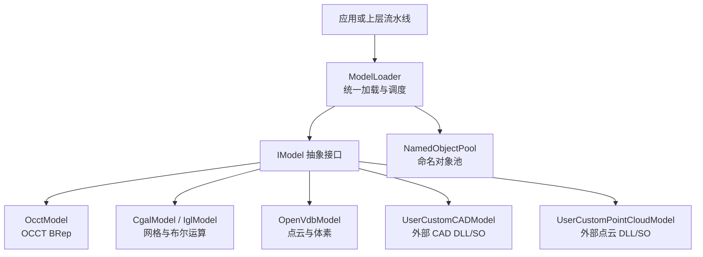
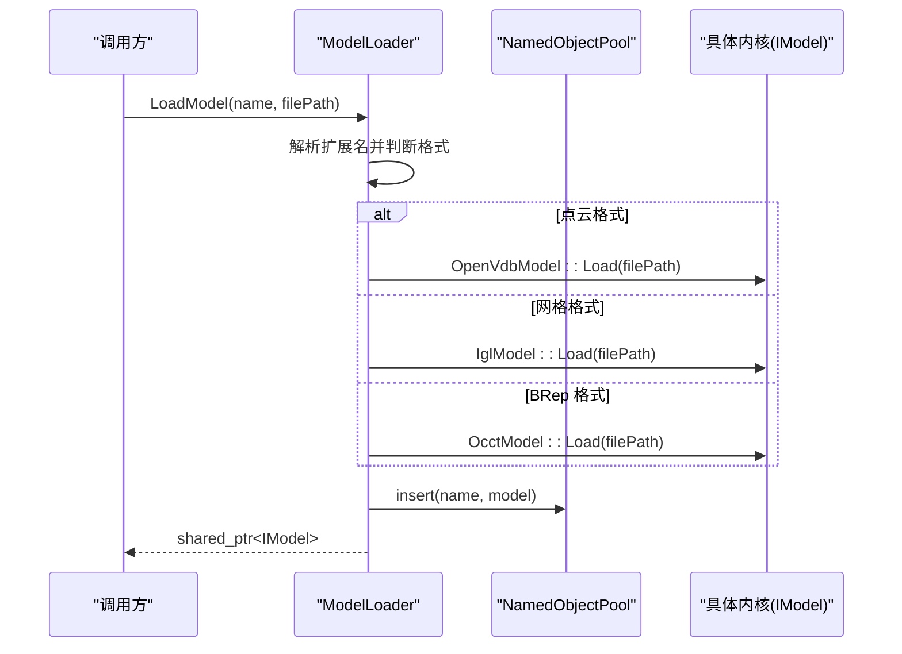
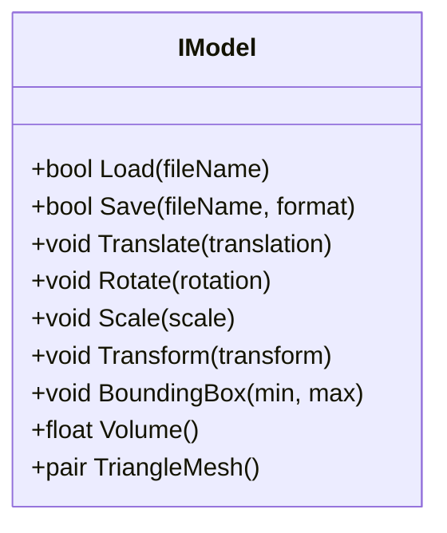
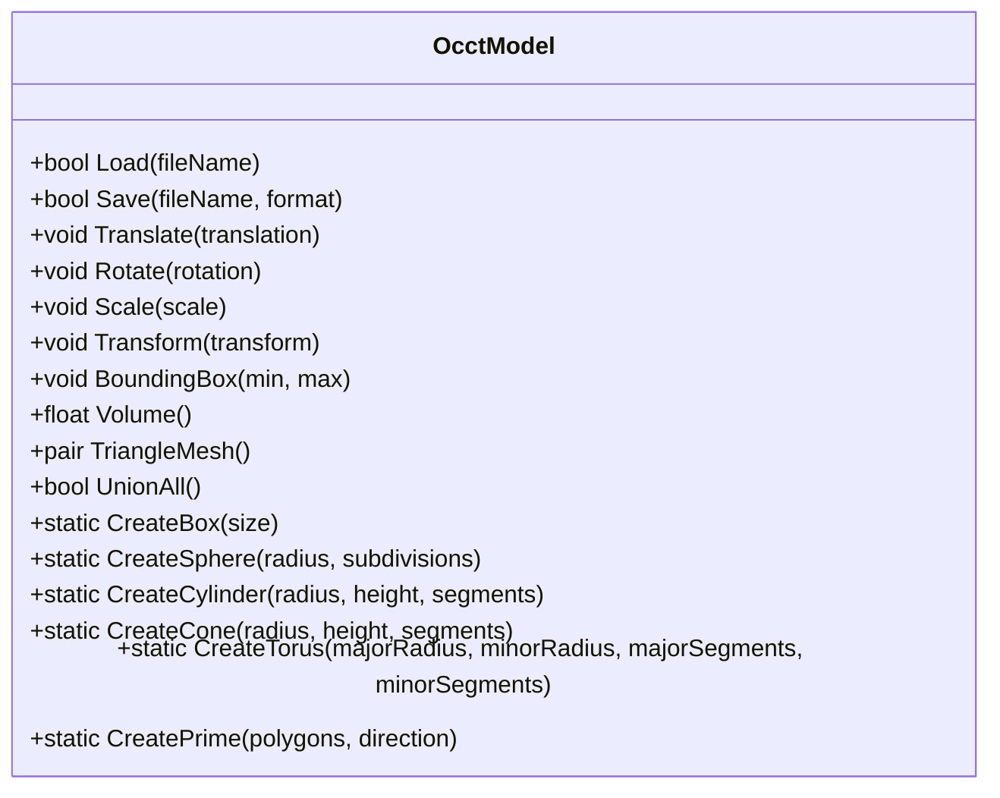
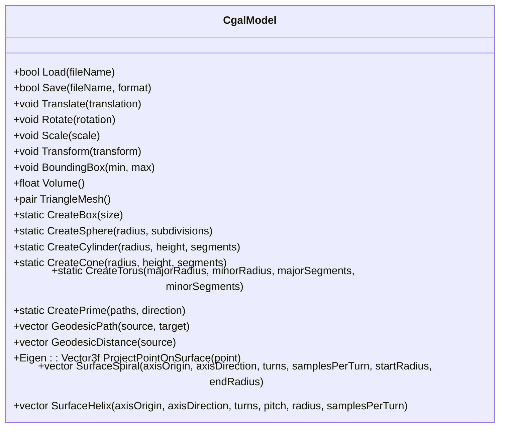
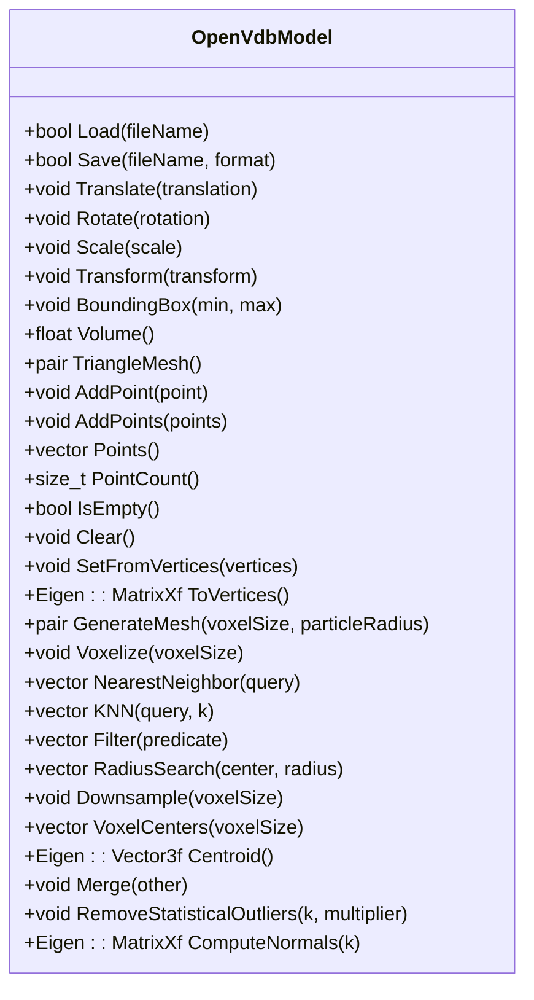
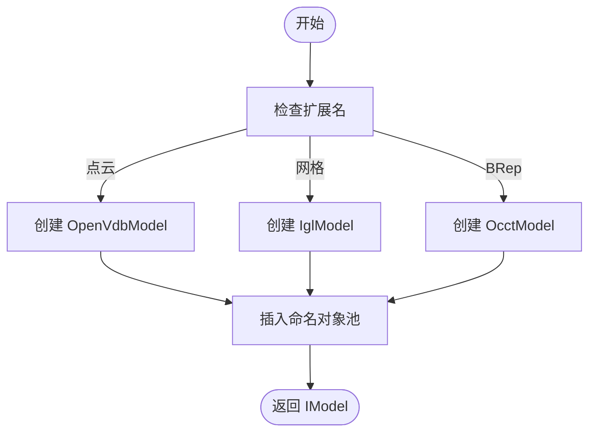
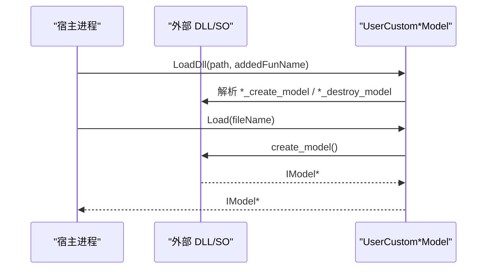

# 第三方库集成

<cite>
**本文引用的文件**   
- [base/IModel.hpp](file://base/IModel.hpp)
- [cadmodel/OcctModel.hpp](file://cadmodel/OcctModel.hpp)
- [meshmodel/CgalModel.hpp](file://meshmodel/CgalModel.hpp)
- [pointcloud/OpenVdbModel.hpp](file://pointcloud/OpenVdbModel.hpp)
- [cadmodel/UserCustomCADModel.hpp](file://cadmodel/UserCustomCADModel.hpp)
- [pointcloud/UserCustomPointCloudModel.hpp](file://pointcloud/UserCustomPointCloudModel.hpp)
- [preprocess/ModelLoader.hpp](file://preprocess/ModelLoader.hpp)
- [preprocess/ModelLoader.cpp](file://preprocess/ModelLoader.cpp)
- [base/object_pool.hpp](file://base/object_pool.hpp)
- [base/eigen_translator.hpp](file://base/eigen_translator.hpp)
- [base/units.hpp](file://base/units.hpp)
- [CMakeLists.txt](file://CMakeLists.txt)
</cite>

## 目录
1. [引言](#引言)
2. [项目结构](#项目结构)
3. [核心概念](#核心概念)
4. [架构总览](#架构总览)
5. [核心模块详解](#核心模块详解)
6. [高级主题](#高级主题)
7. [集成指南](#集成指南)
8. [API 参考文档](#api-参考文档)
9. [开发·测试与贡献](#开发·测试与贡献)
10. [扩展开发指南](#扩展开发指南)
11. [示例与教程](#示例与教程)
12. [部署·故障排除与FAQ](#部署·故障排除与faq)
13. [附录](#附录)

## 引言
本指南面向希望将新的几何计算库、CAD 内核和点云处理库集成到 HsBaSlicer 的开发者。文档围绕 IModel 抽象接口展开，说明如何通过统一接口接入 OCCT、CGAL、OpenVDB 等内核，并通过 ModelLoader 完成格式分发、对象池管理与高级布尔运算。同时提供自定义 CAD 模型、自定义点云模型的插件化实现方案，以及坐标系统、精度策略、性能优化、线程安全与常见问题排查建议。

## 项目结构
HsBaSlicer 采用分层模块化组织：
- base：基础类型、IModel 抽象、数值单位、对象池、Eigen 转换器
- cadmodel：OCCT BRep CAD 模型与用户自定义 CAD 插件
- meshmodel：网格模型（IGL、CGAL）与拓扑重建切片模型
- pointcloud：OpenVDB 点云模型与用户自定义点云插件
- preprocess：统一模型加载器与命名对象池管理
- CMakeLists：全局构建配置、可选内核启用与依赖发现

图表来源
- [preprocess/ModelLoader.hpp:23-59](file://preprocess/ModelLoader.hpp#L23-L59)
- [base/IModel.hpp:111-139](file://base/IModel.hpp#L111-L139)
- [cadmodel/OcctModel.hpp:30-81](file://cadmodel/OcctModel.hpp#L30-L81)
- [meshmodel/CgalModel.hpp:34-82](file://meshmodel/CgalModel.hpp#L34-L82)
- [pointcloud/OpenVdbModel.hpp:28-58](file://pointcloud/OpenVdbModel.hpp#L28-L58)
- [cadmodel/UserCustomCADModel.hpp:79-121](file://cadmodel/UserCustomCADModel.hpp#L79-L121)
- [pointcloud/UserCustomPointCloudModel.hpp:96-131](file://pointcloud/UserCustomPointCloudModel.hpp#L96-L131)
- [preprocess/ModelLoader.cpp:45-84](file://preprocess/ModelLoader.cpp#L45-L84)

章节来源
- [CMakeLists.txt:170-327](file://CMakeLists.txt#L170-L327)
- [preprocess/ModelLoader.hpp:23-59](file://preprocess/ModelLoader.hpp#L23-L59)

## 核心概念
- IModel 抽象接口：定义统一的 3D 模型能力，包括加载/保存、变换、包围盒、体积与三角网格导出。所有具体内核（OCCT、CGAL、OpenVDB、用户插件）均实现该接口，从而被上层算法与流水线无差别使用。
- ModelFormat 枚举：描述支持的模型格式（STL/OBJ/PLY/OFF、STEP/IGES/VRML/BREP、XYZ/VDB 等），由 ModelLoader 根据扩展名选择对应内核。
- NamedObjectPool：命名对象池，用于按名称缓存 IModel 实例，支持插入、查找、清理与容量控制；ModelLoader 内部使用该池统一管理模型生命周期。
- 坐标系统与单位：项目以米为 SI 基准，通过 units.hpp 提供 _m/_mm/_cm/_kg/_g/_J/_s 等单位字面量；数值转换与序列化通过 eigen_translator.hpp 对 Eigen 向量进行字符串化。

章节来源
- [base/IModel.hpp:65-139](file://base/IModel.hpp#L65-L139)
- [preprocess/ModelLoader.hpp:23-59](file://preprocess/ModelLoader.hpp#L23-L59)
- [base/object_pool.hpp:18-46](file://base/object_pool.hpp#L18-L46)
- [base/units.hpp:126-240](file://base/units.hpp#L126-L240)
- [base/eigen_translator.hpp:18-108](file://base/eigen_translator.hpp#L18-L108)

## 架构总览
下图展示从文件到具体内核的分发流程，以及布尔运算与点云处理的分支路径。

图表来源
- [preprocess/ModelLoader.cpp:45-84](file://preprocess/ModelLoader.cpp#L45-L84)
- [preprocess/ModelLoader.hpp:47-59](file://preprocess/ModelLoader.hpp#L47-L59)
- [pointcloud/OpenVdbModel.hpp:46-58](file://pointcloud/OpenVdbModel.hpp#L46-L58)
- [cadmodel/OcctModel.hpp:54-81](file://cadmodel/OcctModel.hpp#L54-L81)

## 核心模块详解

### IModel 抽象接口设计
IModel 定义了跨内核的统一能力：
- 文件 IO：Load/Save
- 几何变换：Translate/Rotate/Scale/Transform（支持 Isometry3f、Matrix4f、Affine）
- 查询：BoundingBox、Volume、TriangleMesh（返回 libigl 风格的顶点与面片矩阵）

图表来源
- [base/IModel.hpp:111-139](file://base/IModel.hpp#L111-L139)

章节来源
- [base/IModel.hpp:111-139](file://base/IModel.hpp#L111-L139)

### CAD 内核：OcctModel
OcctModel 基于 OpenCASCADE TopoDS_Shape，提供 STEP/IGES/VRML/BREP 读写、仿射变换、包围盒、体积与三角剖分，并支持布尔运算与实体加厚。

图表来源
- [cadmodel/OcctModel.hpp:30-124](file://cadmodel/OcctModel.hpp#L30-L124)

章节来源
- [cadmodel/OcctModel.hpp:30-124](file://cadmodel/OcctModel.hpp#L30-L124)

### 网格内核：CgalModel 与 FullTopoModel
- CgalModel：基于 CGAL Polyhedron_3/Nef_polyhedron_3，提供布尔运算、基本实体构造、表面测地线/螺旋/螺线等几何分析。
- FullTopoModel：面向切片的全拓扑重建模型，维护顶点/边/面关系，支持安全/不安全切片与 Lua 脚本扩展。

图表来源
- [meshmodel/CgalModel.hpp:34-155](file://meshmodel/CgalModel.hpp#L34-L155)

章节来源
- [meshmodel/CgalModel.hpp:34-155](file://meshmodel/CgalModel.hpp#L34-L155)

### 点云内核：OpenVdbModel
OpenVdbModel 基于 OpenVDB 体素网格，提供点云增删、KNN/半径搜索、体素化、下采样、质心、合并、统计离群点剔除、法向量估计与体素重建网格。

图表来源
- [pointcloud/OpenVdbModel.hpp:28-116](file://pointcloud/OpenVdbModel.hpp#L28-L116)

章节来源
- [pointcloud/OpenVdbModel.hpp:28-116](file://pointcloud/OpenVdbModel.hpp#L28-L116)

### 统一加载器：ModelLoader
ModelLoader 根据文件扩展名自动选择内核：
- 点云格式 -> OpenVdbModel
- 网格格式 -> IglModel
- BRep 格式 -> OcctModel（需启用 USE_OCCT）

并提供布尔运算、实体加厚、点云转网格、合并、下采样、去噪、质心与法向量等高级操作。

图表来源
- [preprocess/ModelLoader.cpp:45-84](file://preprocess/ModelLoader.cpp#L45-L84)
- [preprocess/ModelLoader.hpp:47-59](file://preprocess/ModelLoader.hpp#L47-L59)

章节来源
- [preprocess/ModelLoader.cpp:45-84](file://preprocess/ModelLoader.cpp#L45-L84)
- [preprocess/ModelLoader.hpp:47-59](file://preprocess/ModelLoader.hpp#L47-L59)

## 高级主题

### 数据转换机制与 ABI 约定
- 外部插件通过 C 函数指针暴露工厂与操作，ABI 使用 HsBaVector2f/HsBaVector3f/HsBaQuaternionf/HsBaMatrix4f/HsBaPoly2D/HsBaPolys2D 等结构体。
- UserCustomCADModel 与 UserCustomPointCloudModel 分别封装 DLL/SO 加载、符号解析与 IModel 委托。

图表来源
- [cadmodel/UserCustomCADModel.cpp:31-44](file://cadmodel/UserCustomCADModel.cpp#L31-L44)
- [pointcloud/UserCustomPointCloudModel.cpp:33-42](file://pointcloud/UserCustomPointCloudModel.cpp#L33-L42)
- [base/IModel.hpp:19-61](file://base/IModel.hpp#L19-L61)

章节来源
- [cadmodel/UserCustomCADModel.hpp:27-48](file://cadmodel/UserCustomCADModel.hpp#L27-L48)
- [pointcloud/UserCustomPointCloudModel.hpp:26-57](file://pointcloud/UserCustomPointCloudModel.hpp#L26-L57)
- [base/IModel.hpp:19-61](file://base/IModel.hpp#L19-L61)

### 坐标系统统一与精度处理
- 坐标系统：以米为 SI 基准，单位字面量 _m/_mm/_cm 等确保输入输出一致。
- 精度策略：FullTopoModel 在切片时使用整数化键与容差合并邻近点，避免浮点误差导致的拓扑错误。

章节来源
- [base/units.hpp:126-240](file://base/units.hpp#L126-L240)
- [meshmodel/FullTopoModel.cpp:328-600](file://meshmodel/FullTopoModel.cpp#L328-L600)

### 内存池与对象生命周期
- NamedObjectPool 提供线程安全的命名对象池，支持 emplace/insert/get/remove/cleanup，并在满池时清理非活跃对象。
- ModelLoader 使用 HSBA_MODEL_POOL_SIZE 控制池大小，启用 CGAL/OCCT 时为 10，否则为 1。

章节来源
- [base/object_pool.hpp:18-46](file://base/object_pool.hpp#L18-L46)
- [base/object_pool.hpp:66-92](file://base/object_pool.hpp#L66-L92)
- [base/object_pool.hpp:238-279](file://base/object_pool.hpp#L238-L279)
- [CMakeLists.txt:300-306](file://CMakeLists.txt#L300-L306)

### 线程安全考虑
- NamedObjectPool 使用 std::shared_mutex 保护并发访问，读多写少场景下提升性能。
- 插件加载与销毁应遵循单例式 DLL 池（UserCustom*Dll 内部使用 NamedObjectPool<UserCustom*Dll, 10>）。

章节来源
- [base/object_pool.hpp:281-283](file://base/object_pool.hpp#L281-L283)
- [cadmodel/UserCustomCADModel.cpp:22-23](file://cadmodel/UserCustomCADModel.cpp#L22-L23)
- [pointcloud/UserCustomPointCloudModel.cpp:18-20](file://pointcloud/UserCustomPointCloudModel.cpp#L18-L20)

## 集成指南

### 集成新的几何计算库（网格）
步骤：
1. 实现一个继承自 IModel 的类，实现 Load/Save/Transform/BoundingBox/Volume/TriangleMesh。
2. 在 ModelLoader 中增加格式识别与内核选择逻辑（若需要）。
3. 在 CMakeLists 中添加 find_package 与编译定义（如 USE_CGAL）。
4. 如需布尔运算，确保启用 USE_CGAL 且链接 igl/CGAL。

关键参考：
- IModel 接口定义
- CgalModel 作为参考实现
- ModelLoader 的网格加载分支

章节来源
- [base/IModel.hpp:111-139](file://base/IModel.hpp#L111-L139)
- [meshmodel/CgalModel.hpp:34-82](file://meshmodel/CgalModel.hpp#L34-L82)
- [preprocess/ModelLoader.cpp:58-66](file://preprocess/ModelLoader.cpp#L58-L66)
- [CMakeLists.txt:284-292](file://CMakeLists.txt#L284-L292)

### 集成新的 CAD 内核（BRep）
步骤：
1. 实现一个继承自 IModel 的 CAD 模型类（参考 OcctModel）。
2. 在 CMakeLists 中启用 USE_OCCT 并链接 OpenCASCADE。
3. 在 ModelLoader 的 BRep 分支中使用新内核。
4. 如需布尔运算，确保启用 USE_CGAL 并使用 IglModel 回退路径。

关键参考：
- OcctModel 接口与工厂方法
- ModelLoader 的 BRep 加载分支
- CMakeLists 中的 OCCT 检测与定义

章节来源
- [cadmodel/OcctModel.hpp:30-124](file://cadmodel/OcctModel.hpp#L30-L124)
- [preprocess/ModelLoader.cpp:68-81](file://preprocess/ModelLoader.cpp#L68-L81)
- [CMakeLists.txt:308-318](file://CMakeLists.txt#L308-L318)

### 集成新的点云处理库
步骤：
1. 实现一个继承自 IModel 的点云模型类（参考 OpenVdbModel）。
2. 在 CMakeLists 中启用 USE_OPENVDB 并链接 OpenVDB。
3. 在 ModelLoader 的点云分支中使用新内核。
4. 如需体素化、下采样、法向量估计等，参考 OpenVdbModel API。

关键参考：
- OpenVdbModel 接口
- ModelLoader 的点云加载分支
- CMakeLists 中的 OpenVDB 检测与定义

章节来源
- [pointcloud/OpenVdbModel.hpp:28-116](file://pointcloud/OpenVdbModel.hpp#L28-L116)
- [preprocess/ModelLoader.cpp:29-42](file://preprocess/ModelLoader.cpp#L29-L42)
- [CMakeLists.txt:320-327](file://CMakeLists.txt#L320-L327)

### 自定义 CAD 模型插件（DLL/SO）
要求：
- 导出符号：*_create_model、*_destroy_model、*_boolean_operation、*_create_box/sphere/cylinder、*_set_thickness、*_create_prism[_ex]。
- 使用 HsBaVector3f_t 与 HsBaPoly2D_t/HsBaPolys2D_t 作为 ABI 参数。
- 宿主通过 UserCustomCADModel::LoadDll 加载并调用。

关键参考：
- IUserCustomCAD 接口
- UserCustomCADModel 委托实现
- CMakeLists 中 HSBA_USE_DLL_LOADER 控制

章节来源
- [cadmodel/UserCustomCADModel.hpp:27-48](file://cadmodel/UserCustomCADModel.hpp#L27-L48)
- [cadmodel/UserCustomCADModel.cpp:134-173](file://cadmodel/UserCustomCADModel.cpp#L134-L173)
- [CMakeLists.txt:228-240](file://CMakeLists.txt#L228-L240)

### 自定义点云模型插件（DLL/SO）
要求：
- 导出符号：*_create_model、*_destroy_model、*_add_point[_s]、*_get_points、*_point_count、*_is_empty、*_clear、*_centroid、*_merge、*_remove_statistical_outliers、*_compute_normals、*_downsample、*_voxelize。
- 使用 HsBaVector3f_t 作为点 ABI。
- 宿主通过 UserCustomPointCloudModel::LoadDll 加载并调用。

关键参考：
- IUserCustomPointCloud 接口
- UserCustomPointCloudModel 委托实现
- CMakeLists 中 HSBA_USE_DLL_LOADER 控制

章节来源
- [pointcloud/UserCustomPointCloudModel.hpp:26-57](file://pointcloud/UserCustomPointCloudModel.hpp#L26-L57)
- [pointcloud/UserCustomPointCloudModel.cpp:175-209](file://pointcloud/UserCustomPointCloudModel.cpp#L175-L209)
- [CMakeLists.txt:228-240](file://CMakeLists.txt#L228-L240)

## API 参考文档

### IModel 公共方法摘要
- Load/Save：模型文件读写
- Translate/Rotate/Scale/Transform：几何变换
- BoundingBox/Volume：几何查询
- TriangleMesh：导出顶点与面片矩阵（libigl 风格）

章节来源
- [base/IModel.hpp:111-139](file://base/IModel.hpp#L111-L139)

### ModelLoader 主要方法摘要
- LoadModel/InsertModel/GetModel/RemoveModel/ContainsModel/ModelCount/GetModelNames/Cleanup
- ThickSolidModel/BooleanUnion/BooleanIntersection/BooleanDifference/BooleanXor（USE_CGAL）
- PointCloudToMesh/MergePointClouds/DownsamplePointCloud/RemovePointCloudOutliers/PointCloudCentroid/PointCloudNormals/PointCloudCount（USE_OPENVDB）

章节来源
- [preprocess/ModelLoader.hpp:47-198](file://preprocess/ModelLoader.hpp#L47-L198)
- [preprocess/ModelLoader.cpp:172-321](file://preprocess/ModelLoader.cpp#L172-L321)
- [preprocess/ModelLoader.cpp:343-451](file://preprocess/ModelLoader.cpp#L343-L451)

### 单位与数值转换
- 单位字面量：_m/_mm/_cm/_km/_g/_kg/_J/_kJ/_kWh/_s/_min/_h/_C/_F/_K 等
- Eigen 向量序列化：EigenVector2f/3f/4f/...Translator

章节来源
- [base/units.hpp:126-566](file://base/units.hpp#L126-L566)
- [base/eigen_translator.hpp:18-108](file://base/eigen_translator.hpp#L18-L108)

## 开发·测试与贡献
- 构建选项：HSBA_COPL（启用 CGAL/OpenCASCADE）、HSBA_USE_DLL_LOADER（动态加载）、HSBA_SLICER_MODULE（C++20 模块包装）、HSBA_SLICER_BUILD_SAMPLES（示例构建）。
- 平台特性：桌面/移动/游戏主机条件编译，日志与 bit7z 等平台相关开关。
- 测试：顶层 enable_testing() 与 tests 子目录；静态测试 static_tests。

章节来源
- [CMakeLists.txt:170-327](file://CMakeLists.txt#L170-L327)
- [CMakeLists.txt:392-407](file://CMakeLists.txt#L392-L407)
- [CMakeLists.txt:667-680](file://CMakeLists.txt#L667-L680)

## 扩展开发指南

### 自定义 CAD 模型实现模板
- 继承 IModel，实现 Load/Save/Transform/BoundingBox/Volume/TriangleMesh。
- 提供工厂函数（CreateBox/CreateSphere/CreateCylinder 等）与布尔运算接口（可选）。
- 通过 UserCustomCADModel 暴露给宿主。

章节来源
- [cadmodel/UserCustomCADModel.hpp:79-121](file://cadmodel/UserCustomCADModel.hpp#L79-L121)
- [cadmodel/UserCustomCADModel.cpp:151-173](file://cadmodel/UserCustomCADModel.cpp#L151-L173)

### 自定义点云模型实现模板
- 继承 IModel，实现 Load/Save/Transform/BoundingBox/Volume/TriangleMesh。
- 提供点云专属 API（AddPoint/AddPoints/Points/PointCount/IsEmpty/Clear/SetFromVertices/ToVertices/Voxelize/Downsample/Centroid/Merge/RemoveStatisticalOutliers/ComputeNormals）。
- 通过 UserCustomPointCloudModel 暴露给宿主。

章节来源
- [pointcloud/UserCustomPointCloudModel.hpp:96-171](file://pointcloud/UserCustomPointCloudModel.hpp#L96-L171)
- [pointcloud/UserCustomPointCloudModel.cpp:211-224](file://pointcloud/UserCustomPointCloudModel.cpp#L211-L224)

### 网格模型与拓扑切片
- CgalModel 提供布尔运算与几何分析。
- FullTopoModel 提供全拓扑重建与切片（Safe/Unsafe/Lua）。

章节来源
- [meshmodel/CgalModel.hpp:34-155](file://meshmodel/CgalModel.hpp#L34-L155)
- [meshmodel/FullTopoModel.hpp:53-146](file://meshmodel/FullTopoModel.hpp#L53-L146)
- [meshmodel/FullTopoModel.cpp:328-600](file://meshmodel/FullTopoModel.cpp#L328-L600)

## 示例与教程
- 示例工程位于 samples/ 目录，包含 FDM/SLA/SLS/SLM/LOM/TDP/WAAM/Custom/LibHsBaSlicer 等示例。
- 可参考 Custom 示例了解如何编写自定义流水线与脚本。

章节来源
- [CMakeLists.txt:442-454](file://CMakeLists.txt#L442-L454)

## 部署·故障排除与FAQ

### 常见集成问题
- 未启用 USE_OCCT/USE_CGAL/USE_OPENVDB：导致相应格式或功能不可用。
  - 解决：在 CMakeLists 中启用对应选项并安装依赖。
- 动态加载失败：HSBA_USE_DLL_LOADER 在非桌面平台默认关闭。
  - 解决：在桌面平台启用，或在目标平台重新评估 HSBA_USE_DLL_LOADER。
- 布尔运算慢或内存高：Debug 模式禁用布尔运算以避免性能问题。
  - 解决：Release 模式构建或使用更小的模型。
- 点云转网格失败：GenerateMesh 返回空面片。
  - 解决：调整 voxelSize/particleRadius 参数或预处理点云。

章节来源
- [CMakeLists.txt:284-327](file://CMakeLists.txt#L284-L327)
- [CMakeLists.txt:294-298](file://CMakeLists.txt#L294-L298)
- [preprocess/ModelLoader.cpp:343-361](file://preprocess/ModelLoader.cpp#L343-L361)

### 最佳实践
- 使用 ModelLoader 管理模型生命周期，避免手动释放。
- 使用 NamedObjectPool 的 Cleanup 定期回收非活跃对象。
- 在插件中严格遵循 ABI 约定，避免跨编译器/平台布局差异。
- 使用单位字面量 _mm/_m 等明确物理尺度，避免单位混淆。

章节来源
- [base/object_pool.hpp:238-279](file://base/object_pool.hpp#L238-L279)
- [base/units.hpp:126-240](file://base/units.hpp#L126-L240)

## 附录

### 构建与依赖管理要点
- 依赖发现：Boost、Clipper2、miniz/bit7z、Protobuf、RapidJSON、Eigen3、OpenSSL、OpenCV、libigl、CGAL、OpenCASCADE、OpenVDB、Lua、tinyxml2、yaml-cpp、magic_enum。
- 安装与导出：生成 HsBaSlicerTargets.cmake 与 Config/Version 文件，便于下游项目引用。

章节来源
- [CMakeLists.txt:206-349](file://CMakeLists.txt#L206-L349)
- [CMakeLists.txt:641-665](file://CMakeLists.txt#L641-L665)