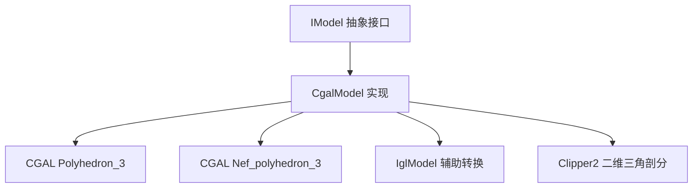
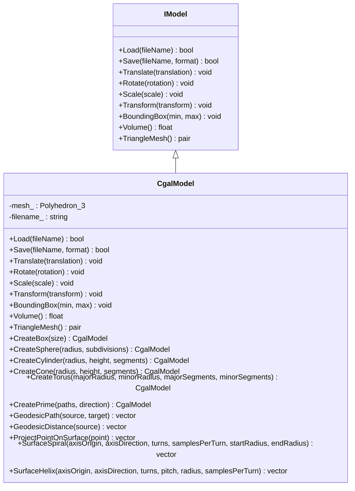
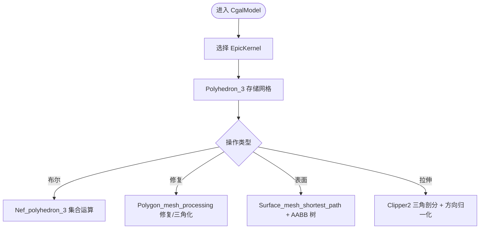
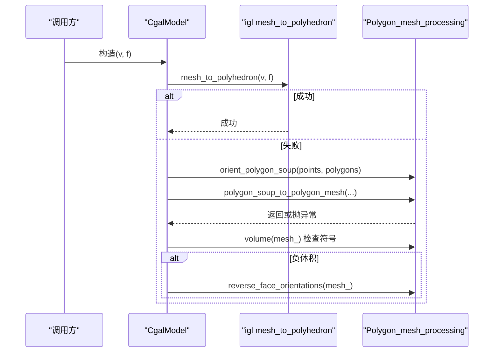
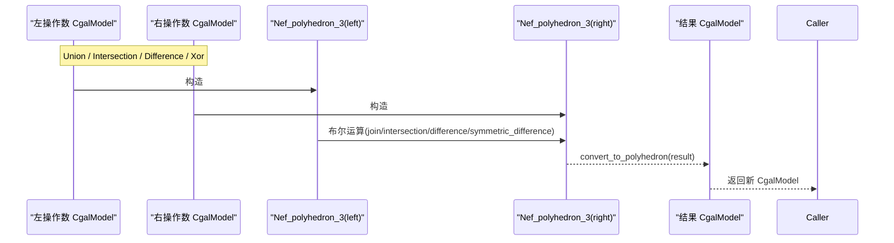
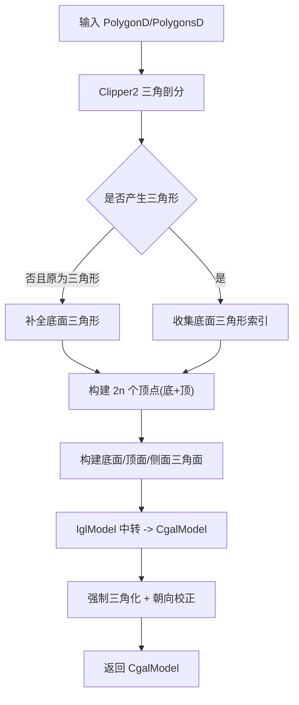
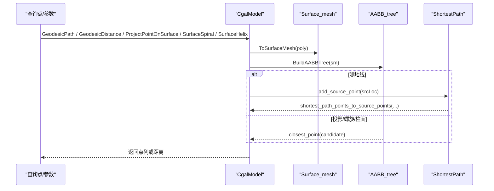
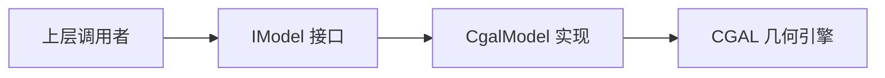
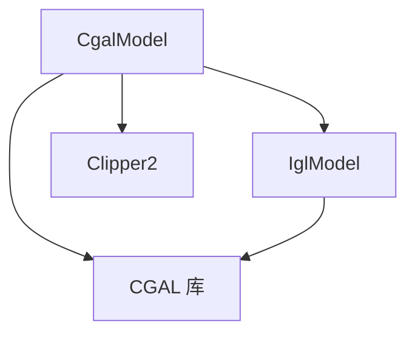

# CGAL 后端实现

<cite>
**本文引用的文件**   
- [CgalModel.hpp](file://meshmodel/CgalModel.hpp)
- [CgalModel.cpp](file://meshmodel/CgalModel.cpp)
- [IModel.hpp](file://base/IModel.hpp)
- [IglModel.cpp](file://meshmodel/IglModel.cpp)
- [cgal_model_test.cpp](file://tests/Models/cgal_model_test.cpp)
</cite>

## 目录
1. [引言](#引言)
2. [项目结构定位](#项目结构定位)
3. [核心组件总览](#核心组件总览)
4. [架构总览](#架构总览)
5. [详细组件分析](#详细组件分析)
6. [依赖关系分析](#依赖关系分析)
7. [性能与优化](#性能与优化)
8. [常见问题排查](#常见问题排查)
9. [结论](#结论)

## 引言
本文件面向 HsBaSlicer 中的 CGAL 后端实现，重点说明 `CgalModel` 类的设计、CGAL 集成方式、三角网格处理、布尔运算、拉伸建模、表面测地线/螺旋/柱面路径等高级几何能力，以及与 `IModel` 抽象接口的适配策略。文档同时给出代码级流程图、调用序列图和依赖图，帮助读者从接口到实现逐层理解。

## 项目结构定位
`CgalModel` 位于 `meshmodel` 模块中，是 `IModel` 接口的一个具体实现，内部以 CGAL 的 `Polyhedron_3` 作为核心数据结构，并通过 Nef 多面体完成三维布尔运算。它还提供一组静态工厂方法用于创建基础几何体，以及基于 CGAL Surface Mesh Shortest Path 的表面几何算法。

**图示来源**
- [CgalModel.hpp:34-155](file://meshmodel/CgalModel.hpp#L34-L155)
- [CgalModel.cpp:12-33](file://meshmodel/CgalModel.cpp#L12-L33)

**章节来源**
- [CgalModel.hpp:1-166](file://meshmodel/CgalModel.hpp#L1-L166)
- [CgalModel.cpp:1-34](file://meshmodel/CgalModel.cpp#L1-L34)

## 核心组件总览
- `CgalModel`：继承自 `IModel`，封装 CGAL 多面体网格，提供加载/保存、变换、包围盒、体积、三角网格导出、布尔运算、基础几何体构造、拉伸建模和表面几何算法。
- `IModel`：定义模型统一接口，包括 IO、变换、查询和网格导出。
- `IglModel`：在部分路径中作为中间表示，用于将顶点/面片转换为 CGAL 可接受的拓扑。
- 测试用例：验证布尔运算、体积、包围盒、拉伸建模等关键行为。

**章节来源**
- [IModel.hpp:110-139](file://base/IModel.hpp#L110-L139)
- [CgalModel.hpp:34-155](file://meshmodel/CgalModel.hpp#L34-L155)
- [cgal_model_test.cpp:11-62](file://tests/Models/cgal_model_test.cpp#L11-L62)

## 架构总览
`CgalModel` 的核心数据是 `CGAL::Polyhedron_3<EpicKernel>`，所有几何操作都围绕该类型展开。对外暴露的 API 通过 `IModel` 统一，内部则根据场景选择不同 CGAL 子库：
- 布尔运算：使用 `Nef_polyhedron_3` 进行精确集合运算。
- 网格修复与三角化：使用 `Polygon_mesh_processing`。
- 表面几何：使用 `Surface_mesh_shortest_path` 与 AABB 树加速最近点查询。
- 二维拉伸：结合 `Clipper2Lib` 做三角剖分和方向归一化，再构建 3D 棱柱。

**图示来源**
- [IModel.hpp:110-139](file://base/IModel.hpp#L110-L139)
- [CgalModel.hpp:34-155](file://meshmodel/CgalModel.hpp#L34-L155)

## 详细组件分析

### 1. 数据结构与 CGAL 集成
- 内核类型：`EpicKernel = Exact_predicates_inexact_constructions_kernel`，保证谓词精确、构造近似，兼顾稳定性与性能。
- 网格类型：`Polyhedron_3<EpicKernel>` 存储三角网格；`Nef_polyhedron_3<EpicKernel>` 用于布尔运算。
- 外部依赖：
  - CGAL：IO、AABB 树、Surface Mesh、Polygon Mesh Processing、Boolean set operations（2D）、Boost Graph IO。
  - igl：`mesh_to_polyhedron` 与 `polyhedron_to_mesh` 用于 Eigen 矩阵与 CGAL 拓扑之间的双向转换。
  - Clipper2：二维多边形三角剖分与面积计算，用于拉伸建模。

**图示来源**
- [CgalModel.hpp:37-42](file://meshmodel/CgalModel.hpp#L37-L42)
- [CgalModel.cpp:12-33](file://meshmodel/CgalModel.cpp#L12-L33)

**章节来源**
- [CgalModel.hpp:37-42](file://meshmodel/CgalModel.hpp#L37-L42)
- [CgalModel.cpp:12-33](file://meshmodel/CgalModel.cpp#L12-L33)

### 2. 三角网格处理与数据映射
- 从 Eigen 矩阵构造：优先尝试 `igl::copyleft::cgal::mesh_to_polyhedron`；失败时回退为“多边形汤”修复流程，包括方向归一化、重复顶点合并、有效性检查与朝向修正。
- 导出三角网格：先确保三角化，再通过 `polyhedron_to_mesh` 输出 libigl 风格的 (vertices, faces)。

**图示来源**
- [CgalModel.cpp:42-118](file://meshmodel/CgalModel.cpp#L42-L118)

**章节来源**
- [CgalModel.cpp:42-118](file://meshmodel/CgalModel.cpp#L42-L118)
- [CgalModel.cpp:228-237](file://meshmodel/CgalModel.cpp#L228-L237)

### 3. 布尔运算（并集、交集、差集、异或）
- 实现策略：将左右操作数分别包装为 `Nef_polyhedron_3`，执行 join/intersection/difference/symmetric_difference，再将结果转回 `Polyhedron_3`。
- 这些函数声明为 `friend`，以便直接访问内部 `mesh_`。

**图示来源**
- [CgalModel.cpp:238-276](file://meshmodel/CgalModel.cpp#L238-L276)

**章节来源**
- [CgalModel.hpp:84-87](file://meshmodel/CgalModel.hpp#L84-L87)
- [CgalModel.cpp:238-276](file://meshmodel/CgalModel.cpp#L238-L276)
- [cgal_model_test.cpp:40-62](file://tests/Models/cgal_model_test.cpp#L40-L62)

### 4. 基础几何体与拉伸建模
- 基础几何体：立方体、球体、圆柱、圆锥、环面，均生成三角网格并保证面法向一致。
- 拉伸建模 `CreatePrime`：
  - 单多边形：使用 Clipper2 三角剖分，构建底面三角形索引，再通过 IglModel 中转生成 3D 棱柱，最后强制三角化并校正朝向。
  - 多边形集合：按嵌套深度判定孔洞，归一化外轮廓 CCW、孔 CW，再进行三角剖分与顶点去重，构建顶/底面与侧壁三角面，同样进行三角化与朝向校正。

**图示来源**
- [CgalModel.cpp:625-733](file://meshmodel/CgalModel.cpp#L625-L733)
- [CgalModel.cpp:735-955](file://meshmodel/CgalModel.cpp#L735-L955)

**章节来源**
- [CgalModel.cpp:278-445](file://meshmodel/CgalModel.cpp#L278-L445)
- [CgalModel.cpp:625-955](file://meshmodel/CgalModel.cpp#L625-L955)
- [cgal_model_test.cpp:64-179](file://tests/Models/cgal_model_test.cpp#L64-L179)

### 5. 表面几何算法（测地线、投影、螺旋、柱面）
- 测地线路径：将 `Polyhedron_3` 转为 `Surface_mesh`，构建 AABB 树加速最近点查询，使用 `Surface_mesh_shortest_path` 计算源点到目标点的最短路径点列。
- 测地距离：从源点出发，遍历所有顶点获取最短距离。
- 表面投影：利用 AABB 树的 `closest_point` 将空间点投影到网格表面。
- 表面螺旋/柱面：沿给定轴采样候选点，再用 AABB 树最近点投影到表面，得到贴合表面的曲线。

**图示来源**
- [CgalModel.cpp:959-1073](file://meshmodel/CgalModel.cpp#L959-L1073)
- [CgalModel.cpp:1075-1210](file://meshmodel/CgalModel.cpp#L1075-L1210)

**章节来源**
- [CgalModel.cpp:959-1210](file://meshmodel/CgalModel.cpp#L959-L1210)

### 6. 与 IModel 接口的适配层设计
- `CgalModel` 完整实现 `IModel` 的所有虚函数，包括：
  - 加载/保存：支持 STL、PLY、OBJ、OFF 等格式。
  - 变换：平移、旋转、缩放、仿射变换，统一通过 CGAL 的 `Affine_3` 与 `transform` 应用。
  - 查询：包围盒、体积、三角网格导出。
- 这种设计使上层管线可以以统一接口调用不同后端（如 OCCT、IGL），而 CGAL 后端专注于网格几何精度与高级算法。

**图示来源**
- [IModel.hpp:110-139](file://base/IModel.hpp#L110-L139)
- [CgalModel.cpp:121-237](file://meshmodel/CgalModel.cpp#L121-L237)

**章节来源**
- [IModel.hpp:110-139](file://base/IModel.hpp#L110-L139)
- [CgalModel.cpp:121-237](file://meshmodel/CgalModel.cpp#L121-L237)

## 依赖关系分析
- 内部耦合：
  - `CgalModel` 强依赖 CGAL 的多面体与 Nef 类型。
  - 在构造与导出路径中与 `IglModel` 存在间接耦合，用于 Eigen 矩阵与 CGAL 拓扑之间的桥接。
- 外部依赖：
  - CGAL：IO、AABB、Surface Mesh、Polygon Mesh Processing、Boolean set operations。
  - igl：mesh/polyhedron 互转。
  - Clipper2：二维三角剖分与面积计算。
- 可能的循环依赖：无直接循环；`CgalModel` 包含 `IglModel` 头文件仅用于转换路径。

**图示来源**
- [CgalModel.cpp:12-33](file://meshmodel/CgalModel.cpp#L12-L33)
- [CgalModel.cpp:27-33](file://meshmodel/CgalModel.cpp#L27-L33)

**章节来源**
- [CgalModel.cpp:12-33](file://meshmodel/CgalModel.cpp#L12-L33)

## 性能与优化
- 内存与对象生命周期：
  - `CgalModel` 默认拷贝/移动语义由编译器生成，适合轻量传递；但大型网格复制开销较大，建议在批量处理中使用引用或智能指针管理。
  - 哈希特化对点与边进行组合，适用于需要缓存或去重的场景，但哈希计算复杂度与网格规模线性相关。
- 并行计算：
  - 当前实现未显式使用多线程；布尔运算与表面几何算法均为串行。若需并行，可在上层对多个独立模型操作进行任务拆分。
- 缓存机制：
  - 未见全局缓存；每次调用可能重建 AABB 树与 Surface Mesh。对于多次查询同一模型的场景，建议在上层缓存已构建的 AABB 树或 Surface Mesh。
- 数值稳定性：
  - 使用 `Exact_predicates_inexact_constructions_kernel` 提升布尔运算与几何判断的稳定性。
  - 在拉伸建模中对方向与朝向进行显式校验与修正，避免体积符号错误。

[本节为通用性能讨论，不直接分析具体文件]

## 常见问题排查
- 布尔运算结果为空或体积异常：
  - 检查输入网格是否闭合、法向是否一致；必要时先进行三角化与朝向校正。
  - 参考布尔运算测试用例，确认两个单位立方体的重叠体积是否符合预期。
- 拉伸建模体积不正确：
  - 检查多边形方向：外轮廓应为 CCW，孔洞为 CW；代码中已通过嵌套深度与面积符号进行归一化。
  - 若三角剖分失败，检查输入多边形是否退化或自相交。
- 表面几何查询失败或结果异常：
  - 确保查询点在合理范围内；螺旋/柱面参数需满足 `turns > 0` 与 `samplesPerTurn >= 3`。
  - 若网格非流形或存在退化面，可能导致最近点查询不稳定。

**章节来源**
- [cgal_model_test.cpp:40-62](file://tests/Models/cgal_model_test.cpp#L40-L62)
- [cgal_model_test.cpp:64-179](file://tests/Models/cgal_model_test.cpp#L64-L179)
- [CgalModel.cpp:1130-1186](file://meshmodel/CgalModel.cpp#L1130-L1186)

## 结论
`CgalModel` 以 CGAL 为核心，提供了稳定可靠的三角网格处理、精确布尔运算、基础几何体构造、拉伸建模与表面几何算法。其通过 `IModel` 接口与上层解耦，便于在不同后端之间切换。在实际使用中，应关注网格质量、方向一致性以及参数合法性，并结合测试用例验证关键几何属性。对于大规模模型，建议在上层引入缓存与并行策略，以提升整体吞吐与响应速度。