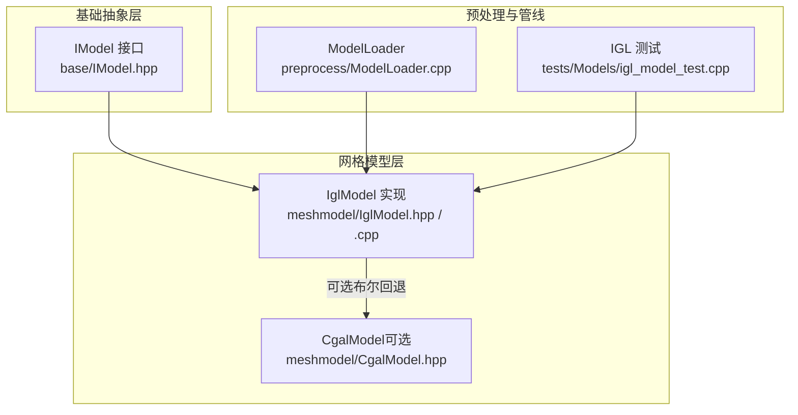
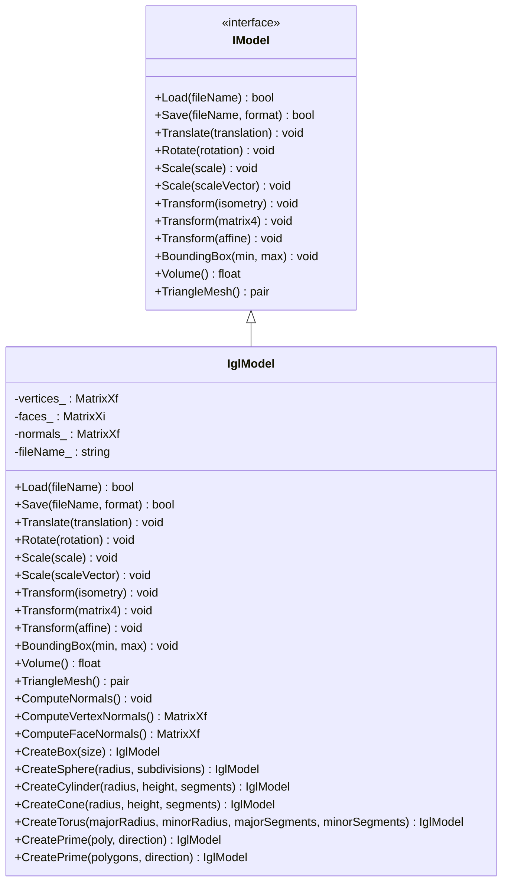
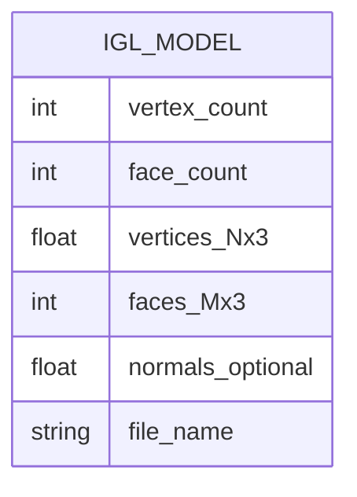
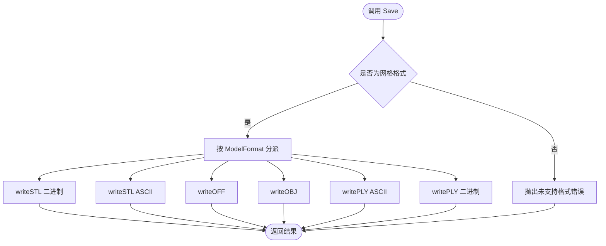
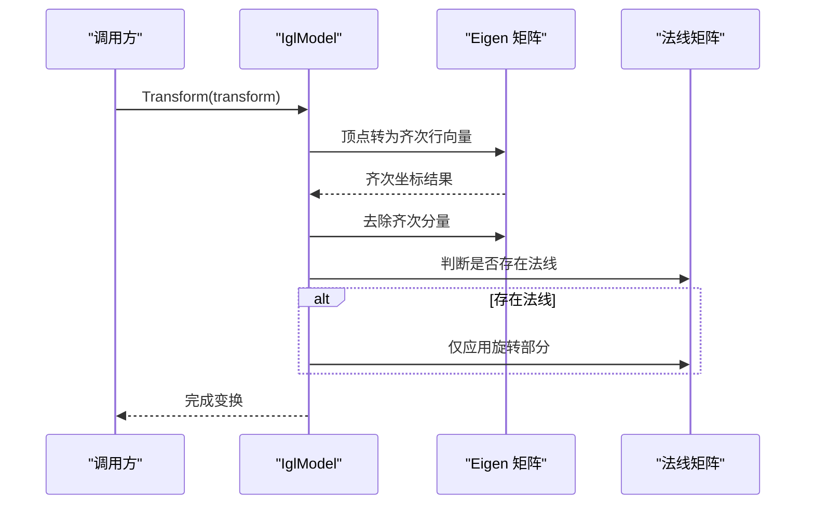
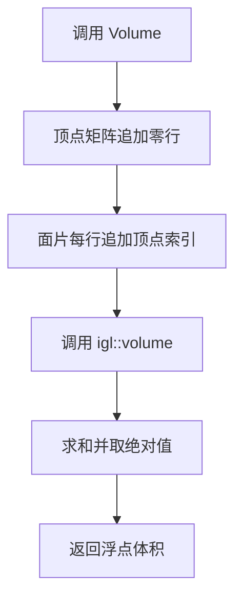
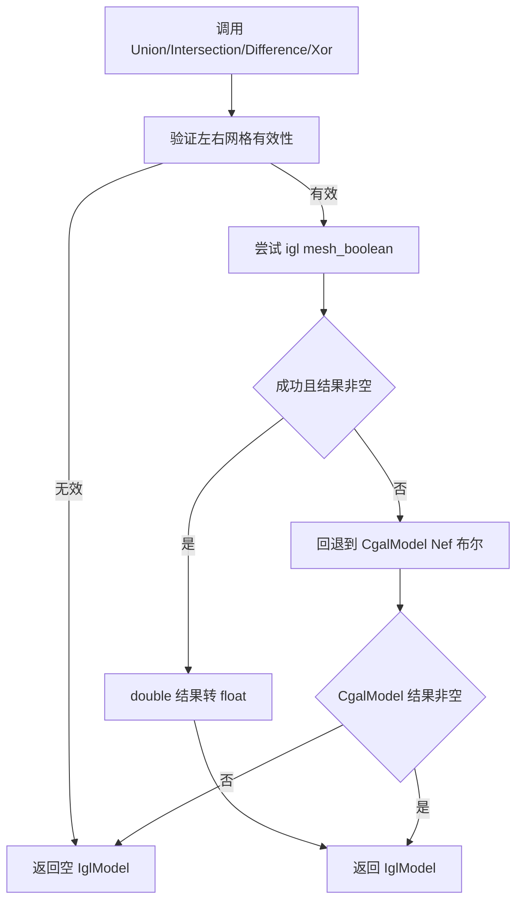
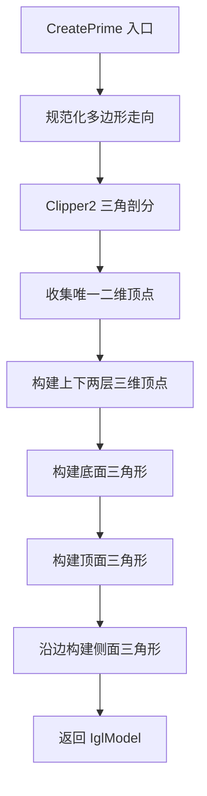
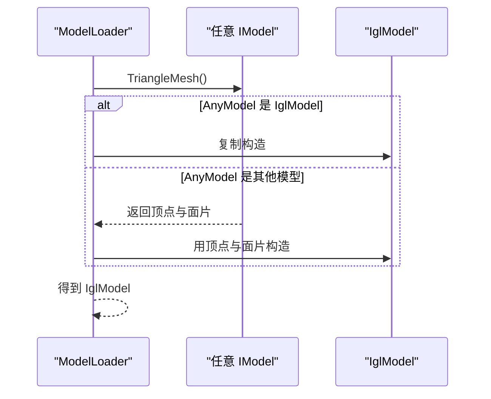
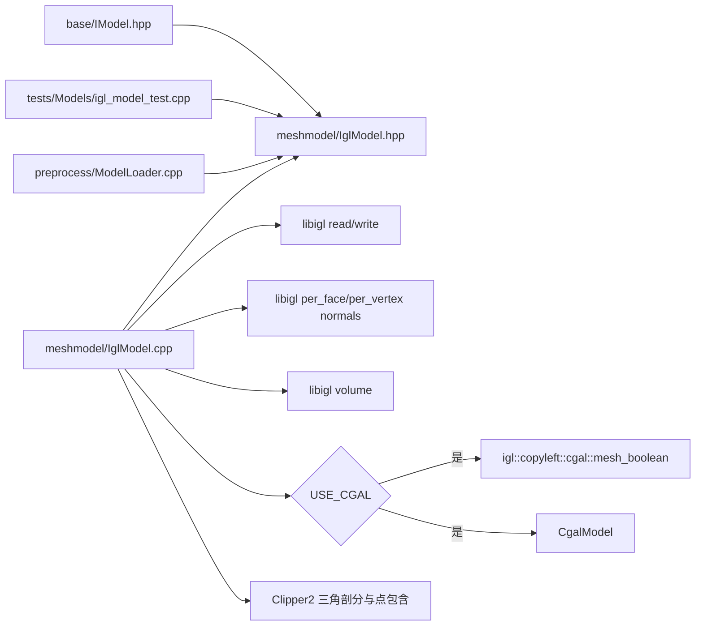

# IGL 后端实现

<cite>
**本文引用的文件**   
- [IglModel.hpp](file://meshmodel/IglModel.hpp)
- [IglModel.cpp](file://meshmodel/IglModel.cpp)
- [IModel.hpp](file://base/IModel.hpp)
- [eigen_translator.hpp](file://base/eigen_translator.hpp)
- [igl_model_test.cpp](file://tests/Models/igl_model_test.cpp)
- [ModelLoader.cpp](file://preprocess/ModelLoader.cpp)
</cite>

## 目录
1. [引言](#引言)
2. [项目结构定位](#项目结构定位)
3. [核心组件总览](#核心组件总览)
4. [架构与接口兼容性](#架构与接口兼容性)
5. [IglModel 类设计与数据模型](#iglmodel-类设计与数据模型)
6. [基于 libigl 的网格处理与几何算法](#基于-libigl-的网格处理与几何算法)
7. [Eigen 矩阵与 IGL 数据结构转换机制](#eigen-矩阵与-igl-数据结构转换机制)
8. [布尔运算、CGAL 回退与健壮性设计](#布尔运算cgal-回退与健壮性设计)
9. [二维多边形拉伸为三维实体](#二维多边形拉伸为三维实体)
10. [标准 IModel 接口兼容与扩展点](#标准-imodel-接口兼容与扩展点)
11. [性能特征与选择建议](#性能特征与选择建议)
12. [使用示例与测试用例映射](#使用示例与测试用例映射)
13. [依赖关系分析](#依赖关系分析)
14. [故障排除与常见问题](#故障排除与常见问题)
15. [结论](#结论)

## 引言
本文件面向 HsBaSlicer 中的 IGL 后端实现，重点说明 `IglModel` 类的设计模式、核心算法、与 `IModel` 抽象接口的兼容性、以及 Eigen 矩阵和 libigl 数据结构之间的转换机制。文档同时给出布尔运算、网格生成、法线计算、体积计算、包围盒查询等关键流程的结构化说明，并结合测试代码提供可追溯的使用示例。

IGL 后端在项目中承担三角网格模型的通用承载角色：它既可以直接加载 STL/OBJ/PLY/OFF 等网格格式，也可以作为其他 CAD/BRep/点云模型到三角网格的统一出口，并为切片、填充、路径生成等后续流水线提供稳定的网格输入。

## 项目结构定位
IGL 后端位于 `meshmodel` 模块中，核心文件为 `IglModel.hpp` 与 `IglModel.cpp`；其对外契约由 `base/IModel.hpp` 定义；相关测试位于 `tests/Models/igl_model_test.cpp`；预处理阶段对 `IglModel` 的使用则体现在 `preprocess/ModelLoader.cpp` 的类型转换逻辑中。

**图表来源** 
- [IModel.hpp:110-139](file://base/IModel.hpp#L110-L139)
- [IglModel.hpp:16-121](file://meshmodel/IglModel.hpp#L16-L121)
- [ModelLoader.cpp:136-146](file://preprocess/ModelLoader.cpp#L136-L146)
- [igl_model_test.cpp:11-26](file://tests/Models/igl_model_test.cpp#L11-L26)

**章节来源**
- [IModel.hpp:110-139](file://base/IModel.hpp#L110-L139)
- [IglModel.hpp:16-121](file://meshmodel/IglModel.hpp#L16-L121)
- [ModelLoader.cpp:136-146](file://preprocess/ModelLoader.cpp#L136-L146)
- [igl_model_test.cpp:11-26](file://tests/Models/igl_model_test.cpp#L11-L26)

## 核心组件总览
`IglModel` 是 `IModel` 的一个具体实现，内部以 Eigen 矩阵存储顶点、面片和可选的法向量，并封装了以下能力：

| 能力类别 | 主要方法或功能 | 说明 |
|---|---|---|
| 构造与移动语义 | 多种构造函数、移动构造 | 支持从 `Eigen::MatrixXf` 与 `Eigen::MatrixXi` 直接构造，可选择是否立即计算法线 |
| 文件读写 | `Load`、`Save` | 通过 libigl 读取三角网格，保存为 STL/OBJ/PLY/OFF 等格式 |
| 几何变换 | `Translate`、`Rotate`、`Scale`、`Transform` | 支持平移、旋转、缩放、齐次变换、仿射变换，并同步更新法线 |
| 几何查询 | `BoundingBox`、`Volume` | AABB 包围盒与基于顶点的体积近似 |
| 法线计算 | `ComputeNormals`、`ComputeVertexNormals`、`ComputeFaceNormals` | 基于 libigl 的面法线与顶点法线 |
| 网格导出 | `TriangleMesh` | 返回 libigl 风格的 `(顶点, 面)` 对 |
| 布尔运算 | `Union`、`Intersection`、`Difference`、`Xor` | 可选 CGAL 内核，失败时回退或抛出未支持异常 |
| 原始体创建 | `CreateBox`、`CreateSphere`、`CreateCylinder`、`CreateCone`、`CreateTorus` | 生成带外向法线的标准几何体 |
| 拉伸建模 | `CreatePrime` | 将二维多边形或多边形集合沿方向拉伸为三维实体 |

**章节来源**
- [IglModel.hpp:26-121](file://meshmodel/IglModel.hpp#L26-L121)
- [IglModel.cpp:37-193](file://meshmodel/IglModel.cpp#L37-L193)

## 架构与接口兼容性
`IglModel` 继承自 `IModel`，从而可以无缝替换到其他期望 `IModel` 的位置。`IModel` 定义了统一的模型抽象：加载、保存、变换、包围盒、体积、三角网格导出。

**图表来源**
- [IModel.hpp:110-139](file://base/IModel.hpp#L110-L139)
- [IglModel.hpp:26-121](file://meshmodel/IglModel.hpp#L26-L121)

`IModel` 还暴露了一组 C ABI 类型，例如 `HsBaVector3f_t`、`HsBaQuaternionf_t`、`HsBaMatrix4f_t`、`HsBaPoly2D_t`、`HsBaPolys2D_t`，用于跨语言或 C 接口场景。这些类型与 C++ 侧的 Eigen 类型、libigl 数据类型之间通常通过转换器或显式转换函数衔接；`base/eigen_translator.hpp` 提供了部分 Eigen 向量类型的序列化/反序列化翻译器，便于配置系统、JSON/YAML/XML 等中间表示与数值类型之间的互操作。

**章节来源**
- [IModel.hpp:19-61](file://base/IModel.hpp#L19-L61)
- [IModel.hpp:110-139](file://base/IModel.hpp#L110-L139)
- [eigen_translator.hpp:16-108](file://base/eigen_translator.hpp#L16-L108)

## IglModel 类设计与数据模型
`IglModel` 的核心数据成员包括：

| 成员 | 类型 | 含义 |
|---|---|---|
| `vertices_` | `Eigen::MatrixXf` | N×3 顶点坐标，行主序存储 |
| `faces_` | `Eigen::MatrixXi` | M×3 三角形面片索引 |
| `normals_` | `Eigen::MatrixXf` | 可选法向量，通常为面法线或顶点法线 |
| `fileName_` | `std::string` | 最近一次加载的文件名 |

这种设计使 `IglModel` 天然适配 libigl 的数据约定：libigl 常用 `V` 表示 N×3 顶点矩阵，`F` 表示 M×3 面片矩阵。`IglModel::TriangleMesh()` 直接返回 `(vertices_, faces_)`，从而让上层调用者无需关心底层实现即可获取 libigl 风格网格。

**图表来源**
- [IglModel.hpp:115-121](file://meshmodel/IglModel.hpp#L115-L121)

### 构造与移动语义
`IglModel` 提供多种构造方式：

- 从常量引用构造顶点与面片，可选择是否立即计算法线。
- 从常量引用构造顶点、面片与显式法线。
- 从右值构造顶点与面片，支持移动语义以减少拷贝。
- 从右值构造顶点、面片与显式法线。

当 `calcNormals` 为真时，构造函数会调用 `ComputeNormals()`，即使用 libigl 计算面法线。

**章节来源**
- [IglModel.hpp:29-53](file://meshmodel/IglModel.hpp#L29-L53)
- [IglModel.cpp:37-62](file://meshmodel/IglModel.cpp#L37-L62)

## 基于 libigl 的网格处理与几何算法

### 文件加载与保存
`Load` 使用 libigl 的三角网格读取接口，并将文件名转换为本地编码后再传入底层库。`Save` 根据 `ModelFormat` 分派到不同的 libigl 写入函数，支持二进制 STL、ASCII STL、OFF、OBJ、ASCII PLY、Binary PLY。若格式不属于网格格式，则抛出未支持错误。

**图表来源**
- [IglModel.cpp:72-99](file://meshmodel/IglModel.cpp#L72-L99)

**章节来源**
- [IglModel.cpp:64-99](file://meshmodel/IglModel.cpp#L64-L99)

### 几何变换
`IglModel` 的变换实现特别注意 Eigen 的行主序存储特性：

- `Translate` 使用 `rowwise()` 广播加法，避免直接对 `MatrixXf` 加 `Vector3f` 导致的尺寸不匹配。
- `Rotate` 将四元数转为旋转矩阵后，对行主序顶点右乘旋转矩阵的转置；若存在法线，也按相同规则更新。
- `Scale(float)` 对所有顶点统一缩放。
- `Scale(Vector3f)` 按轴分别缩放。
- `Transform(Isometry3f)`、`Transform(Matrix4f)`、`Transform(Affine)` 均使用齐次坐标进行变换，并对法线仅应用旋转部分。

**图表来源**
- [IglModel.cpp:126-150](file://meshmodel/IglModel.cpp#L126-L150)

**章节来源**
- [IglModel.cpp:101-150](file://meshmodel/IglModel.cpp#L101-L150)

### 包围盒与体积
- `BoundingBox` 通过列方向的最小值和最大值计算 AABB。
- `Volume` 通过将顶点矩阵追加一行零向量、将面片每行补一个顶点索引，调用 libigl 的体积计算接口，再取绝对值之和。

**图表来源**
- [IglModel.cpp:152-168](file://meshmodel/IglModel.cpp#L152-L168)

**章节来源**
- [IglModel.cpp:152-168](file://meshmodel/IglModel.cpp#L152-L168)

### 法线计算
`ComputeNormals` 使用 libigl 的面法线计算接口；`ComputeVertexNormals` 与 `ComputeFaceNormals` 分别返回顶点法线和面法线矩阵。

**章节来源**
- [IglModel.cpp:170-185](file://meshmodel/IglModel.cpp#L170-L185)

## Eigen 矩阵与 IGL 数据结构转换机制
`IglModel` 本身并不引入新的网格容器，而是直接使用 Eigen 矩阵作为网格存储。因此，“转换”更多体现在两个层面：

1. **与 libigl 函数的数据约定对齐**  
   libigl 的多数网格函数接受 `Eigen::MatrixXf` 作为顶点矩阵、`Eigen::MatrixXi` 作为面片矩阵。`IglModel` 的 `vertices_` 与 `faces_` 正好满足这一约定，因此调用 `igl::read_triangle_mesh`、`igl::per_face_normals`、`igl::volume` 等函数时无需额外转换。

2. **与项目内其他 Eigen 类型系统的衔接**  
   `base/eigen_translator.hpp` 提供了一系列 `ITranslator<Eigen::...>` 实现，用于将 Eigen 向量类型序列化为字符串、再从字符串恢复。这类工具常用于配置、日志、属性系统等非网格数据场景，但体现了项目对 Eigen 类型的一贯处理方式：以统一接口桥接外部表示。

需要注意，`IglModel` 的布尔运算实现中，当启用 CGAL 时，会将 `Eigen::MatrixXf` 提升为 `Eigen::MatrixXd`，再传给 `igl::copyleft::cgal::mesh_boolean`，最后将结果降回 `float`。这是为了避免浮点精度导致 winding-number 场不一致。

**章节来源**
- [IglModel.cpp:202-215](file://meshmodel/IglModel.cpp#L202-L215)
- [eigen_translator.hpp:16-108](file://base/eigen_translator.hpp#L16-L108)

## 布尔运算、CGAL 回退与健壮性设计
布尔运算分为两种编译期分支：

- 当定义 `USE_CGAL` 时，优先尝试 `igl::copyleft::cgal::mesh_boolean`。该实现先将 float 顶点提升到 double，执行布尔运算，成功后再将结果降回 float。如果结果为空或失败，则回退到 `CgalModel` 的 Nef 多面体布尔运算。
- 当未定义 `USE_CGAL` 时，`Union`、`Intersection`、`Difference`、`Xor` 直接抛出 `NotSupportedError`。

**图表来源**
- [IglModel.cpp:195-245](file://meshmodel/IglModel.cpp#L195-L245)
- [IglModel.cpp:248-391](file://meshmodel/IglModel.cpp#L248-L391)

布尔运算前还会检查顶点数量、面片数量、维度、有限值和索引范围，以避免非法网格进入布尔引擎。

**章节来源**
- [IglModel.cpp:195-409](file://meshmodel/IglModel.cpp#L195-L409)

## 二维多边形拉伸为三维实体
`CreatePrime` 支持两种输入：

1. 单个二维多边形 `PolygonD`。
2. 多个二维多边形 `PolygonsD`，可用于表达外轮廓与孔洞。

核心流程如下：

**图表来源**
- [IglModel.cpp:598-713](file://meshmodel/IglModel.cpp#L598-L713)
- [IglModel.cpp:715-929](file://meshmodel/IglModel.cpp#L715-L929)

关键点包括：

- 单多边形版本先检查至少三个点，然后使用 Clipper2 进行三角剖分，并将结果映射回原始顶点索引。
- 多边形版本通过嵌套深度奇偶性判断孔洞，并使用整数化路径调用 Clipper2 的点在多边形内测试，以避免 double 路径下的精度问题。
- 底面法线朝下，顶面法线朝上，侧面按原多边形边的顺序生成，保证外轮廓与孔洞的法线方向一致。
- 对于已经是三角形的路径，Clipper2 可能不产生新三角形，实现会补充原始三角形以保证顶盖完整。

**章节来源**
- [IglModel.cpp:598-929](file://meshmodel/IglModel.cpp#L598-L929)

## 标准 IModel 接口兼容与扩展点
`IglModel` 完全实现了 `IModel` 的虚函数接口，因此可以被任何依赖 `IModel` 的代码直接使用。典型用法包括：

- 作为 `ModelLoader` 中的网格模型类型之一。
- 作为其他模型类型到三角网格的中间表示。
- 作为布尔运算、体积计算、包围盒查询、法线计算的通用网格载体。

`ModelLoader` 中的 `ToIglModel` 展示了兼容策略：如果是 `IglModel`，则复制一份；否则调用 `TriangleMesh()` 提取顶点与面片，再构造新的 `IglModel`。

**图表来源**
- [ModelLoader.cpp:136-146](file://preprocess/ModelLoader.cpp#L136-L146)

**章节来源**
- [ModelLoader.cpp:136-146](file://preprocess/ModelLoader.cpp#L136-L146)
- [IModel.hpp:110-139](file://base/IModel.hpp#L110-L139)

## 性能特征与选择建议

### 时间复杂度与内存行为
- 网格加载/保存：取决于文件格式和 libigl 实现，通常为 O(V+F)。
- 变换：`Translate`、`Rotate`、`Scale`、`Transform` 主要遍历顶点，时间复杂度 O(V)；法线更新仅在存在法线时进行。
- 包围盒：O(V)。
- 体积：O(F)，因为需要对每个三角形参与体积计算。
- 法线计算：O(F)。
- 布尔运算：取决于 CGAL/libigl 实现，最坏情况下可能显著高于 O(V+F)，且受网格质量影响较大。
- 拉伸建模：包含 Clipper2 三角剖分、顶点去重、面片构建，整体复杂度与多边形点数、三角剖分结果规模相关。

### 适用场景
- 适合使用 `IglModel` 的场景：
  - 已有三角网格数据，需要快速加载、保存、变换、查询体积和法线。
  - 需要将其他模型类型统一为三角网格以便切片或可视化。
  - 需要标准几何体工厂或二维多边形拉伸建模。
  - 已启用 CGAL 且需要布尔运算。
- 不适合或需谨慎使用的场景：
  - 高精度 BRep 建模：应优先考虑 OCCT 或 CGAL 的 BRep/Nef 表示。
  - 大规模布尔运算且网格质量较差：可能需要预处理、修复法线、清理重复顶点。
  - 不需要布尔运算的轻量部署：应避免启用 CGAL，减少依赖体积。

### 选择建议
| 需求 | 推荐方案 | 理由 |
|---|---|---|
| 快速三角网格 IO 与基本几何操作 | `IglModel` | 直接基于 libigl，API 简洁 |
| 布尔运算 | 启用 `USE_CGAL` 的 `IglModel` | 有 mesh_boolean 与 Nef 回退 |
| 精确 CAD 建模 | `OcctModel` 或 `CgalModel` | BRep/Nef 更合适拓扑复杂模型 |
| 二维多边形拉伸 | `IglModel::CreatePrime` | 结合 Clipper2，支持孔洞与复杂轮廓 |
| 最小依赖部署 | 不使用 CGAL 的 `IglModel` | 避免布尔运算依赖 |

[本节为通用性能讨论，不直接分析具体代码片段]

## 使用示例与测试用例映射

### 单位立方体与面法线
测试用例创建单位立方体，验证顶点数为 8、面片数为 12、体积接近 1.0，并检查面法线为单位向量。

对应实现路径：
- 立方体构造：`IglModel::CreateBox`
- 网格导出：`TriangleMesh`
- 体积计算：`Volume`
- 面法线计算：`ComputeFaceNormals`

**章节来源**
- [igl_model_test.cpp:11-26](file://tests/Models/igl_model_test.cpp#L11-L26)
- [IglModel.cpp:411-435](file://meshmodel/IglModel.cpp#L411-L435)

### 圆柱体体积与包围盒
测试用例创建半径 0.5、高 1.0、分段数 16 的圆柱体，验证体积与包围盒边界。

对应实现路径：
- 圆柱体构造：`IglModel::CreateCylinder`
- 包围盒：`BoundingBox`
- 体积：`Volume`

**章节来源**
- [igl_model_test.cpp:28-42](file://tests/Models/igl_model_test.cpp#L28-L42)
- [IglModel.cpp:481-520](file://meshmodel/IglModel.cpp#L481-L520)

### 布尔运算
测试用例创建两个单位立方体，将一个沿对角线平移，验证并集、交集、差集、异或的体积。

对应实现路径：
- 布尔运算：`Union`、`Intersection`、`Difference`、`Xor`
- 条件编译：`USE_CGAL`

**章节来源**
- [igl_model_test.cpp:44-72](file://tests/Models/igl_model_test.cpp#L44-L72)
- [IglModel.cpp:195-409](file://meshmodel/IglModel.cpp#L195-L409)

### 单多边形拉伸
测试用例创建三角形多边形，沿 Z 轴拉伸高度 2.0，验证顶点数、面片数、体积、包围盒与法线。

对应实现路径：
- 拉伸建模：`IglModel::CreatePrime(PolygonD, Vector3f)`
- 网格导出、体积、包围盒、法线

**章节来源**
- [igl_model_test.cpp:74-107](file://tests/Models/igl_model_test.cpp#L74-L107)
- [IglModel.cpp:598-713](file://meshmodel/IglModel.cpp#L598-L713)

### 带孔多边形拉伸
测试用例创建外正方形和内正方形孔，验证体积与包围盒。

对应实现路径：
- 多边形拉伸：`IglModel::CreatePrime(PolygonsD, Vector3f)`
- 孔洞判断与走向规范化

**章节来源**
- [igl_model_test.cpp:109-145](file://tests/Models/igl_model_test.cpp#L109-L145)
- [IglModel.cpp:715-929](file://meshmodel/IglModel.cpp#L715-L929)

### L 形多边形与非平面方向拉伸
测试用例覆盖 L 形多边形与斜方向拉伸，验证体积与包围盒扩展。

对应实现路径：
- 多边形拉伸：`CreatePrime`
- 体积计算：`Volume`
- 包围盒：`BoundingBox`

**章节来源**
- [igl_model_test.cpp:147-203](file://tests/Models/igl_model_test.cpp#L147-L203)
- [IglModel.cpp:598-929](file://meshmodel/IglModel.cpp#L598-L929)

## 依赖关系分析

**图表来源**
- [IModel.hpp:110-139](file://base/IModel.hpp#L110-L139)
- [IglModel.hpp:9-14](file://meshmodel/IglModel.hpp#L9-L14)
- [IglModel.cpp:12-32](file://meshmodel/IglModel.cpp#L12-L32)
- [IglModel.cpp:195-245](file://meshmodel/IglModel.cpp#L195-L245)
- [IglModel.cpp:598-929](file://meshmodel/IglModel.cpp#L598-L929)
- [igl_model_test.cpp:1-10](file://tests/Models/igl_model_test.cpp#L1-L10)
- [ModelLoader.cpp:136-146](file://preprocess/ModelLoader.cpp#L136-L146)

**章节来源**
- [IglModel.cpp:12-32](file://meshmodel/IglModel.cpp#L12-L32)
- [IglModel.cpp:195-245](file://meshmodel/IglModel.cpp#L195-L245)
- [IglModel.cpp:598-929](file://meshmodel/IglModel.cpp#L598-L929)
- [ModelLoader.cpp:136-146](file://preprocess/ModelLoader.cpp#L136-L146)

## 故障排除与常见问题

| 问题 | 可能原因 | 处理建议 |
|---|---|---|
| 布尔运算返回空网格 | 输入网格为空、维度不足、索引越界、共面或 winding 不一致 | 检查 `is_valid_mesh` 前置条件；避免共面；确保法线向外；必要时启用 CGAL 回退 |
| 未启用 CGAL 时布尔运算报错 | 编译时未定义 `USE_CGAL` | 启用 CGAL 或使用其他布尔实现 |
| 布尔运算静默失败 | float 精度导致 winding-number 场不一致 | 确认实现已将 float 提升到 double；如仍失败，依赖 CgalModel 回退 |
| 拉伸模型体积异常 | 多边形走向错误或孔洞判断错误 | 检查外轮廓与孔洞的走向；确认 Clipper2 三角剖分成功 |
| 法线方向不正确 | 面片 winding 不符合外向约定 | 检查几何体构造时的 winding；对拉伸模型检查底面与顶面反转逻辑 |
| 文件保存失败 | 不支持的 `ModelFormat` | 使用支持的网格格式；检查 `IsMeshFormat` 分支 |

**章节来源**
- [IglModel.cpp:72-99](file://meshmodel/IglModel.cpp#L72-L99)
- [IglModel.cpp:195-409](file://meshmodel/IglModel.cpp#L195-L409)
- [IglModel.cpp:598-929](file://meshmodel/IglModel.cpp#L598-L929)

## 结论
`IglModel` 是 HsBaSlicer 中基于 libigl 的三角网格后端实现，它以 Eigen 矩阵为核心数据载体，提供加载保存、几何变换、包围盒、体积、法线、布尔运算、标准几何体生成和多边形拉伸等能力。其设计优势在于：

- 与 libigl 数据约定天然契合，减少不必要的数据拷贝与转换。
- 通过 `IModel` 接口实现与其他模型类型的解耦。
- 在布尔运算中提供 mesh_boolean 与 CgalModel Nef 回退，增强鲁棒性。
- 通过 Clipper2 支持复杂二维多边形拉伸，包括孔洞与多轮廓组合。

在实际工程中，若只需要三角网格的快速处理与可视化，`IglModel` 是首选；若需要高精度 BRep 或复杂拓扑布尔运算，应结合 `OcctModel` 或 `CgalModel`；若部署环境不允许 CGAL，则应避免依赖布尔运算，或提前将网格质量提升到可稳定计算的水平。

[本节为总结性内容，不直接分析具体代码片段]