# OpenCascade CAD 后端

<cite>
**本文引用的文件**   
- [OcctModel.hpp](file://cadmodel/OcctModel.hpp)
- [OcctModel.cpp](file://cadmodel/OcctModel.cpp)
- [UserCustomCADModel.hpp](file://cadmodel/UserCustomCADModel.hpp)
- [UserCustomCADModel.cpp](file://cadmodel/UserCustomCADModel.cpp)
- [IModel.hpp](file://base/IModel.hpp)
- [IglModel.hpp](file://meshmodel/IglModel.hpp)
- [CMakeLists.txt](file://CMakeLists.txt)
- [occt_model_test.cpp](file://tests/Models/occt_model_test.cpp)
- [model_loader_test.cpp](file://tests/Preprocess/model_loader_test.cpp)
- [model_preprocess.hpp](file://LibHsBaSlicer/Preprocess/model_preprocess.hpp)
- [model_preprocess.h](file://DllHsBaSlicer/model_preprocess.h)
- [ModelLoader.cpp](file://preprocess/ModelLoader.cpp)
</cite>

## 目录
1. [项目概述与快速开始](#项目概述与快速开始)
2. [架构总览](#架构总览)
3. [核心概念](#核心概念)
4. [核心模块详解](#核心模块详解)
5. [高级主题](#高级主题)
6. [Lua 脚本系统](#lua-脚本系统)
7. [API 参考文档](#api-参考文档)
8. [集成指南](#集成指南)
9. [开发测试与贡献](#开发测试与贡献)
10. [扩展开发指南](#扩展开发指南)
11. [示例与教程](#示例与教程)
12. [部署故障排除与FAQ](#部署故障排除与faq)
13. [附录](#附录)

## 项目概述与快速开始
本页面聚焦 HsBaSlicer 中的 OpenCascade CAD 后端，围绕 `OcctModel` 类展开。它基于 OpenCASCADE 的 B-Rep 拓扑实现 CAD 建模、布尔运算、实体偏移、参数化几何创建、CAD 数据导入导出，以及 CAD 模型到网格模型的转换。同时说明如何通过 `UserCustomCADModel` 接入用户自定义 CAD 动态库，并给出布尔运算、偏移等典型使用路径。

OpenCASCADE 在构建系统中通过 `USE_OCCT` 和 `USE_CAD_KERNEL` 编译宏启用；当平台允许且启用开源内核时，才会链接 OCCT 并提供 B-Rep 能力。

**章节来源**
- [CMakeLists.txt:308-318](file://CMakeLists.txt#L308-L318)
- [OcctModel.hpp:1-29](file://cadmodel/OcctModel.hpp#L1-L29)

## 架构总览
下图展示 CAD 后端在整体系统中的位置：上层流水线通过统一的 `IModel` 接口操作模型；`OcctModel` 提供 B-Rep 语义，`IglModel` 提供三角网格语义；两者都实现相同接口，便于在布尔运算、偏移、切片等流程中按需切换或组合。

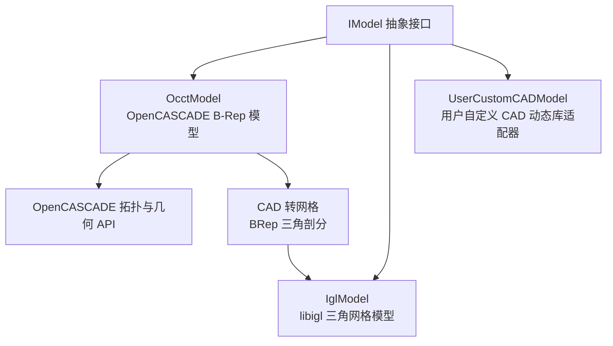

**图表来源**
- [IModel.hpp:110-139](file://base/IModel.hpp#L110-L139)
- [OcctModel.hpp:22-124](file://cadmodel/OcctModel.hpp#L22-L124)
- [IglModel.hpp:18-121](file://meshmodel/IglModel.hpp#L18-L121)
- [UserCustomCADModel.hpp:20-121](file://cadmodel/UserCustomCADModel.hpp#L20-L121)

**章节来源**
- [IModel.hpp:110-139](file://base/IModel.hpp#L110-L139)
- [OcctModel.hpp:22-124](file://cadmodel/OcctModel.hpp#L22-L124)
- [IglModel.hpp:18-121](file://meshmodel/IglModel.hpp#L18-L121)
- [UserCustomCADModel.hpp:20-121](file://cadmodel/UserCustomCADModel.hpp#L20-L121)

## 核心概念
- `IModel`：所有 3D 模型的统一抽象，定义加载、保存、变换、包围盒、体积、三角网格等通用能力。
- `OcctModel`：基于 OpenCASCADE `TopoDS_Shape` 的 B-Rep 模型实现，支持 STEP/IGES/VRML/BRep 读写、布尔运算、实体偏移、基础几何体创建、CAD 到网格转换。
- `IglModel`：基于 libigl 的三角网格模型，适合网格级算法；也实现 `IModel`，可与 `OcctModel` 在同一管线中使用。
- `UserCustomCADModel`：通过动态库加载用户实现的 CAD 后端，暴露工厂函数、布尔运算、厚度设置、拉伸等 C ABI 接口。

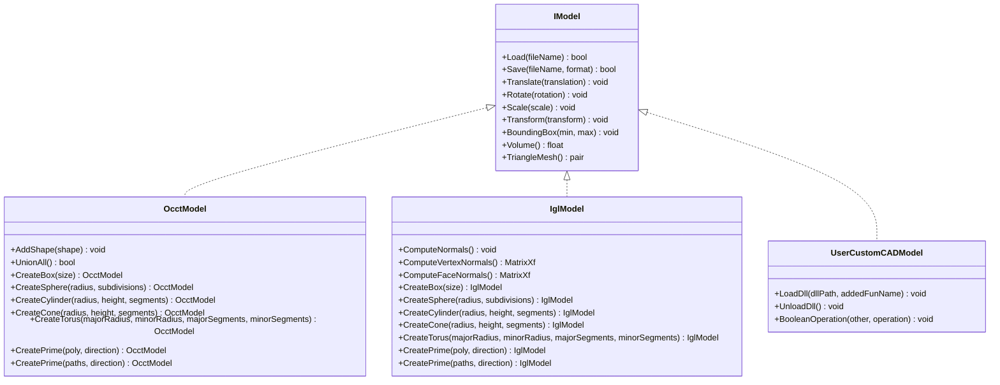

**图表来源**
- [IModel.hpp:110-139](file://base/IModel.hpp#L110-L139)
- [OcctModel.hpp:22-124](file://cadmodel/OcctModel.hpp#L22-L124)
- [IglModel.hpp:18-121](file://meshmodel/IglModel.hpp#L18-L121)
- [UserCustomCADModel.hpp:20-121](file://cadmodel/UserCustomCADModel.hpp#L20-L121)

**章节来源**
- [IModel.hpp:110-139](file://base/IModel.hpp#L110-L139)
- [OcctModel.hpp:22-124](file://cadmodel/OcctModel.hpp#L22-L124)
- [IglModel.hpp:18-121](file://meshmodel/IglModel.hpp#L18-L121)
- [UserCustomCADModel.hpp:20-121](file://cadmodel/UserCustomCADModel.hpp#L20-L121)

## 核心模块详解

### OcctModel：B-Rep 建模与 CAD 数据处理
`OcctModel` 封装一个 `TopoDS_Shape`，对外暴露 CAD 常用能力：
- 文件 IO：STEP、IGES、VRML、BRep 读取与写入。
- 变换：平移、旋转、缩放、仿射变换。
- 查询：包围盒、体积、三角网格。
- 布尔运算：并、交、差、异或。
- 实体偏移：薄壳偏移。
- 参数化建模：立方体、球体、圆柱、圆锥、圆环、多边形拉伸。

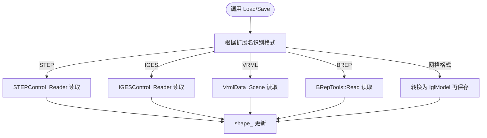

**图表来源**
- [OcctModel.cpp:76-147](file://cadmodel/OcctModel.cpp#L76-L147)
- [OcctModel.cpp:213-270](file://cadmodel/OcctModel.cpp#L213-L270)

#### 拓扑结构与几何实体操作
- 布尔运算通过 `BRepAlgoAPI_Fuse`、`BRepAlgoAPI_Common`、`BRepAlgoAPI_Cut` 实现，并以自由函数形式暴露 `Union`、`Intersection`、`Difference`、`Xor`。
- 实体偏移通过 `BRepOffsetAPI_MakeThickSolid` 实现，支持对全部面或指定面集合进行偏移。
- 基础几何体通过 `BRepPrimAPI_*` 系列构造器生成。
- 多边形拉伸通过 `BRepBuilderAPI_MakePolygon`、`BRepBuilderAPI_MakeWire`、`BRepBuilderAPI_MakeFace`、`BRepPrimAPI_MakePrism` 完成。

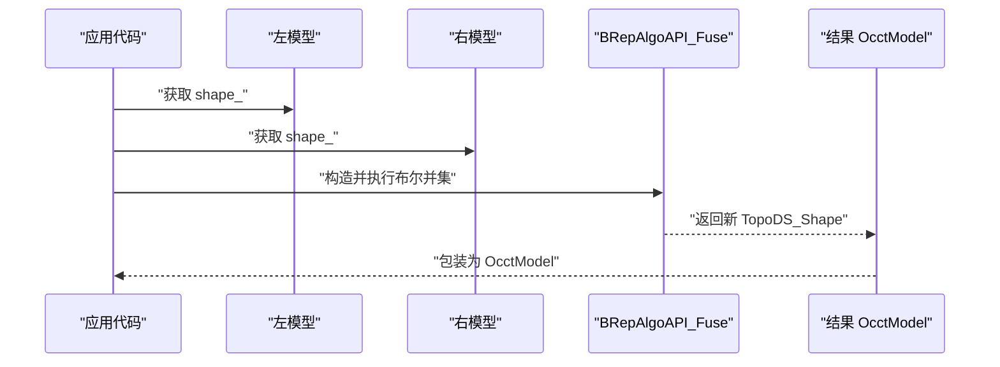

**图表来源**
- [OcctModel.cpp:451-469](file://cadmodel/OcctModel.cpp#L451-L469)

**章节来源**
- [OcctModel.cpp:18-53](file://cadmodel/OcctModel.cpp#L18-L53)
- [OcctModel.cpp:451-469](file://cadmodel/OcctModel.cpp#L451-L469)
- [OcctModel.cpp:471-540](file://cadmodel/OcctModel.cpp#L471-L540)
- [OcctModel.cpp:422-449](file://cadmodel/OcctModel.cpp#L422-L449)
- [OcctModel.cpp:542-663](file://cadmodel/OcctModel.cpp#L542-L663)

#### CAD 模型与网格模型的转换机制
`TriangleMesh` 遍历每个面，提取 `Poly_Triangulation`，将顶点坐标经局部变换后写入顶点数组，并按面方向调整三角形索引顺序，最终返回 libigl 风格的 `(vertices, faces)`。若目标保存格式是网格格式（如 STL/OBJ/PLY），`Save` 会先调用 `TriangleMesh`，再用 `IglModel` 保存。

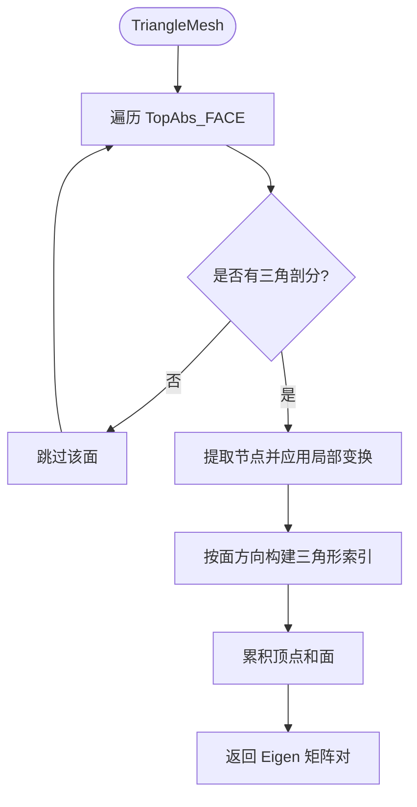

**图表来源**
- [OcctModel.cpp:353-400](file://cadmodel/OcctModel.cpp#L353-L400)

**章节来源**
- [OcctModel.cpp:353-400](file://cadmodel/OcctModel.cpp#L353-L400)
- [OcctModel.cpp:238-270](file://cadmodel/OcctModel.cpp#L238-L270)
- [IglModel.hpp:18-121](file://meshmodel/IglModel.hpp#L18-L121)

### UserCustomCADModel：用户自定义 CAD 扩展点
`UserCustomCADModel` 通过 `UserCustomCADDll` 加载外部 DLL/SO，解析一组约定命名的导出函数，包括：
- 模型生命周期：`create_model`、`destroy_model`
- 布尔运算：`boolean_operation`
- 基础几何：`create_box`、`create_sphere`、`create_cylinder`
- 厚度设置：`set_thickness`
- 拉伸：`create_prism`、`create_prism_ex`

这些函数以 C ABI 暴露，并通过 `boost::dll` 动态解析。`UserCustomCADModel` 将所有 `IModel` 方法转发给底层模型对象。

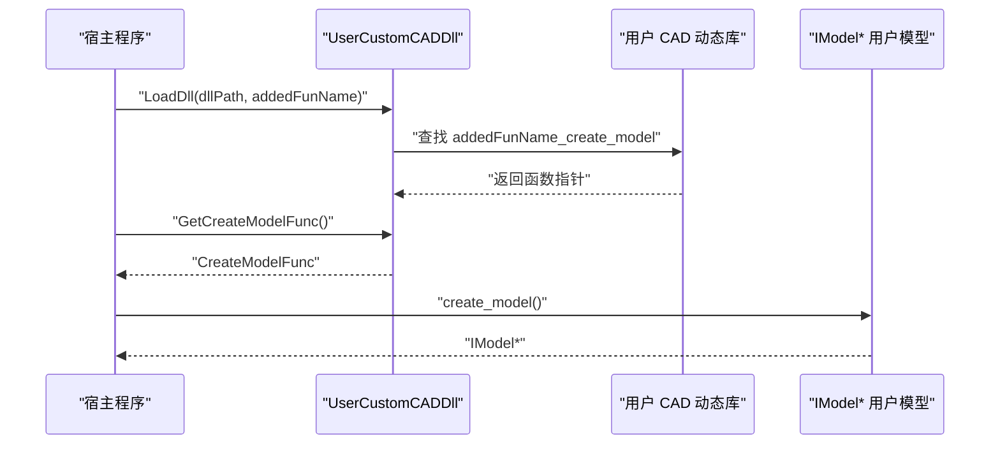

**图表来源**
- [UserCustomCADModel.cpp:31-44](file://cadmodel/UserCustomCADModel.cpp#L31-L44)
- [UserCustomCADModel.cpp:134-172](file://cadmodel/UserCustomCADModel.cpp#L134-L172)

**章节来源**
- [UserCustomCADModel.hpp:20-121](file://cadmodel/UserCustomCADModel.hpp#L20-L121)
- [UserCustomCADModel.cpp:24-115](file://cadmodel/UserCustomCADModel.cpp#L24-L115)
- [UserCustomCADModel.cpp:134-325](file://cadmodel/UserCustomCADModel.cpp#L134-L325)

## 高级主题

### 布尔运算与实体偏移
- 布尔运算：`Union`、`Intersection`、`Difference`、`Xor` 直接作用于 `TopoDS_Shape`，适用于两个 `OcctModel`。
- 实体偏移：`ThickSolid(model, thickness)` 对所有面偏移；`ThickSolid(model, closingFaces, thickness)` 可排除指定面集合，常用于开孔壳体。

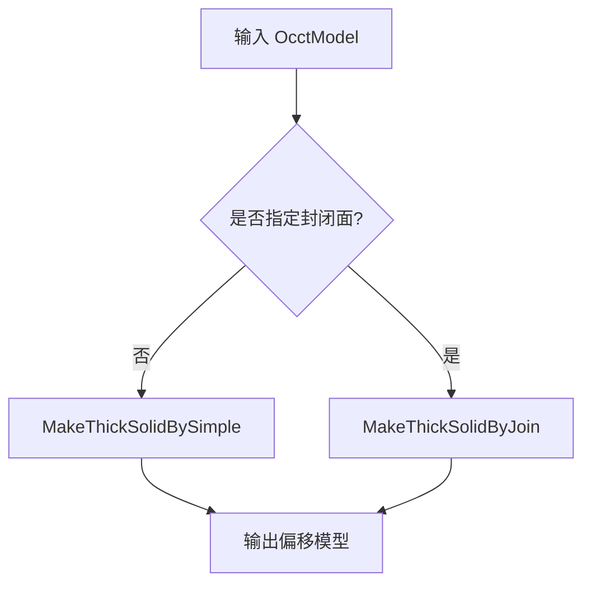

**图表来源**
- [OcctModel.cpp:471-540](file://cadmodel/OcctModel.cpp#L471-L540)

**章节来源**
- [OcctModel.cpp:451-469](file://cadmodel/OcctModel.cpp#L451-L469)
- [OcctModel.cpp:471-540](file://cadmodel/OcctModel.cpp#L471-L540)

### 参数化建模与多边形拉伸
- 基础几何体：`CreateBox`、`CreateSphere`、`CreateCylinder`、`CreateCone`、`CreateTorus`。
- 单多边形拉伸：`CreatePrime(poly, direction)` 将闭合多边形沿方向拉伸成实体。
- 多轮廓拉伸：`CreatePrime(paths, direction)` 第一个轮廓为外轮廓，后续为孔洞，最终拉伸成实体。

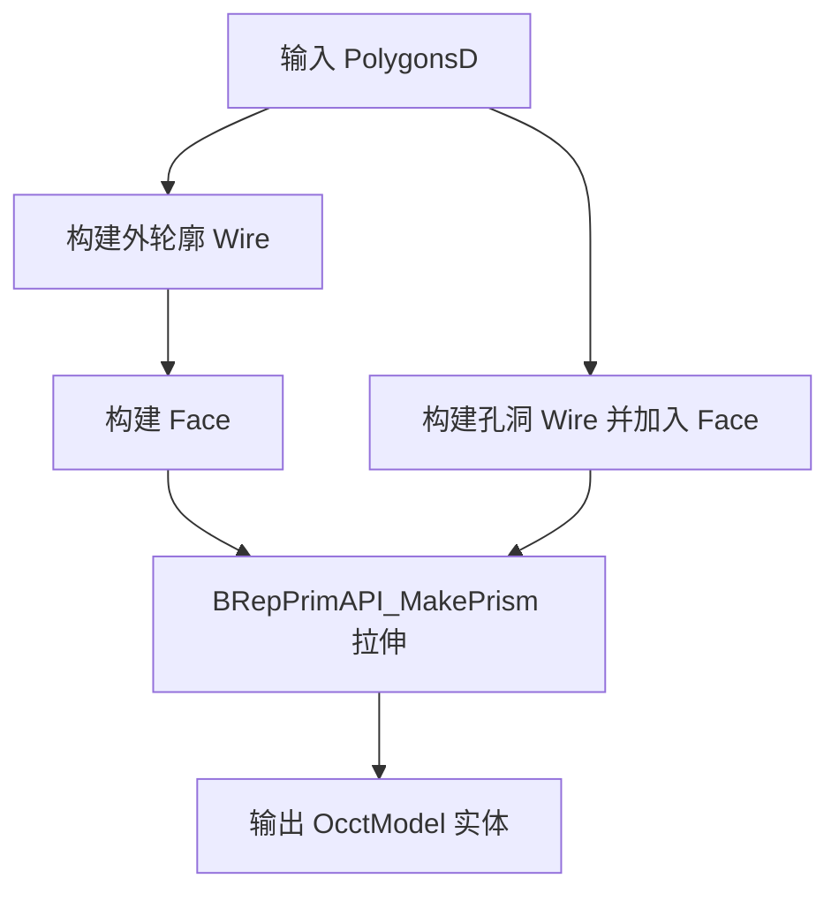

**图表来源**
- [OcctModel.cpp:586-663](file://cadmodel/OcctModel.cpp#L586-L663)

**章节来源**
- [OcctModel.cpp:422-449](file://cadmodel/OcctModel.cpp#L422-L449)
- [OcctModel.cpp:542-663](file://cadmodel/OcctModel.cpp#L542-L663)

### 变换与几何属性
- 变换：`Translate`、`Rotate`、`Scale`、`Transform` 均通过 `gp_Trsf` 与 `BRepBuilderAPI_Transform` 应用到内部 `shape_`。
- 包围盒：遍历顶点计算 AABB。
- 体积：使用 `GProp_GProps` 计算实体质量即体积。

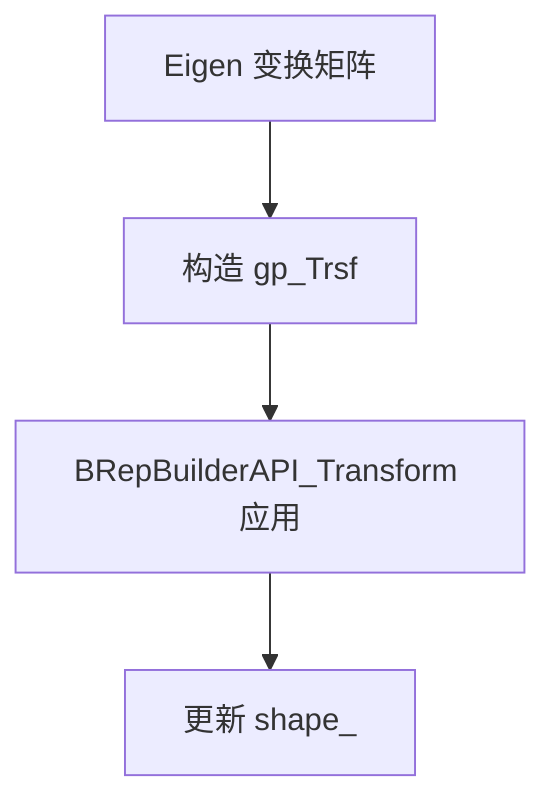

**图表来源**
- [OcctModel.cpp:272-329](file://cadmodel/OcctModel.cpp#L272-L329)
- [OcctModel.cpp:331-351](file://cadmodel/OcctModel.cpp#L331-L351)
- [OcctModel.cpp:402-407](file://cadmodel/OcctModel.cpp#L402-L407)

**章节来源**
- [OcctModel.cpp:272-329](file://cadmodel/OcctModel.cpp#L272-L329)
- [OcctModel.cpp:331-351](file://cadmodel/OcctModel.cpp#L331-L351)
- [OcctModel.cpp:402-407](file://cadmodel/OcctModel.cpp#L402-L407)

## Lua 脚本系统
当前仓库未在本节分析范围内直接提供 Lua 层 CAD 绑定细节；如需在 Lua 中调用 CAD 功能，应优先通过 LibHsBaSlicer 或 DllHsBaSlicer 提供的 C/C++ 接口，再由 Lua 适配层封装。具体 Lua API 请参考对应模块文档。

[本节不直接分析具体源码文件]

## API 参考文档

### IModel 接口摘要
- 加载/保存：`Load`、`Save`
- 变换：`Translate`、`Rotate`、`Scale`、`Transform`
- 查询：`BoundingBox`、`Volume`、`TriangleMesh`

**章节来源**
- [IModel.hpp:110-139](file://base/IModel.hpp#L110-L139)

### OcctModel 关键 API
- 文件 IO：`Load`、`Save`
- 形状组合：`AddShape`、`UnionAll`
- 布尔运算：`Union`、`Intersection`、`Difference`、`Xor`
- 实体偏移：`ThickSolid`
- 基础几何：`CreateBox`、`CreateSphere`、`CreateCylinder`、`CreateCone`、`CreateTorus`
- 拉伸：`CreatePrime`

**章节来源**
- [OcctModel.hpp:45-110](file://cadmodel/OcctModel.hpp#L45-L110)
- [OcctModel.cpp:213-270](file://cadmodel/OcctModel.cpp#L213-L270)
- [OcctModel.cpp:451-540](file://cadmodel/OcctModel.cpp#L451-L540)
- [OcctModel.cpp:422-449](file://cadmodel/OcctModel.cpp#L422-L449)
- [OcctModel.cpp:542-663](file://cadmodel/OcctModel.cpp#L542-L663)

### UserCustomCADModel 关键 API
- 动态库管理：`LoadDll`、`UnloadDll`
- 布尔运算：`BooleanOperation`
- 其他 `IModel` 方法转发

**章节来源**
- [UserCustomCADModel.hpp:82-116](file://cadmodel/UserCustomCADModel.hpp#L82-L116)
- [UserCustomCADModel.cpp:134-325](file://cadmodel/UserCustomCADModel.cpp#L134-L325)

## 集成指南

### OpenCASCADE 集成与构建开关
- 启用条件：非 Android/iOS/游戏控制台，且启用 `HSBA_COPL`。
- 构建宏：`USE_OCCT`、`USE_CAD_KERNEL`。
- 模型池大小：启用 OCCT/CGAL 时为 10，否则为 1。

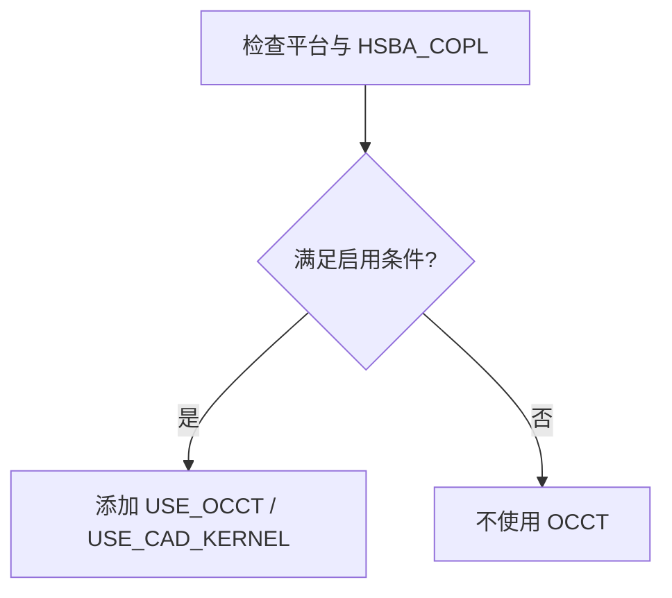

**图表来源**
- [CMakeLists.txt:308-318](file://CMakeLists.txt#L308-L318)

**章节来源**
- [CMakeLists.txt:297-318](file://CMakeLists.txt#L297-L318)

### CAD 与网格互转最佳实践
- 从 CAD 到网格：优先使用 `OcctModel::TriangleMesh` 获取顶点与面，再交给 `IglModel` 处理网格算法。
- 从网格到 CAD：当前 `ModelLoader` 中直接将网格转为 `OcctModel` 尚未支持，需保持源模型为 `OcctModel` 以执行布尔运算。
- 保存为网格格式：`OcctModel::Save` 会自动检测网格格式并调用 `IglModel::Save`。

**章节来源**
- [OcctModel.cpp:238-270](file://cadmodel/OcctModel.cpp#L238-L270)
- [ModelLoader.cpp:136-167](file://preprocess/ModelLoader.cpp#L136-L167)

## 开发测试与贡献

### 单元测试覆盖要点
- 基础几何体积与包围盒：立方体、球体。
- 布尔运算体积验证：并、交、差、异或。
- 多边形拉伸体积与包围盒验证。
- 通过 `ModelLoader` 对 `OcctModel` 执行布尔运算与偏移，并检查结果类型与体积。

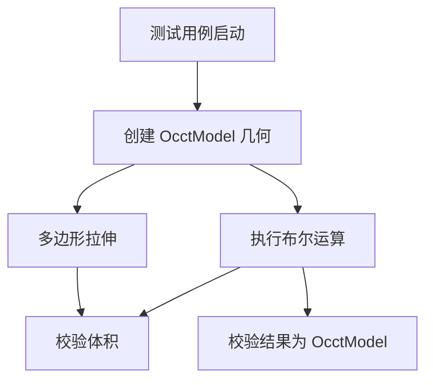

**图表来源**
- [occt_model_test.cpp:8-70](file://tests/Models/occt_model_test.cpp#L8-L70)
- [model_loader_test.cpp:327-381](file://tests/Preprocess/model_loader_test.cpp#L327-L381)

**章节来源**
- [occt_model_test.cpp:8-70](file://tests/Models/occt_model_test.cpp#L8-L70)
- [model_loader_test.cpp:327-381](file://tests/Preprocess/model_loader_test.cpp#L327-L381)

## 扩展开发指南

### 用户自定义 CAD 动态库契约
要实现用户自定义 CAD 后端，需提供以下命名导出函数（前缀由 `addedFunName` 决定）：
- `{name}_create_model`：创建空模型
- `{name}_destroy_model`：销毁模型
- `{name}_boolean_operation`：执行布尔运算
- `{name}_create_box`、`{name}_create_sphere`、`{name}_create_cylinder`：基础几何
- `{name}_set_thickness`：设置偏移厚度
- `{name}_create_prism`、`{name}_create_prism_ex`：多边形拉伸

注意：
- 函数签名必须与 `IUserCustomCAD` 中定义的函数指针类型一致。
- 模型生命周期由宿主通过 `create_model`/`destroy_model` 管理。
- 布尔运算字符串参数通常为 `"union"`、`"intersection"`、`"difference"`。

**章节来源**
- [UserCustomCADModel.hpp:20-48](file://cadmodel/UserCustomCADModel.hpp#L20-L48)
- [UserCustomCADModel.cpp:35-115](file://cadmodel/UserCustomCADModel.cpp#L35-L115)

## 示例与教程

### 示例一：布尔运算
1. 创建两个单位立方体。
2. 将一个立方体沿 X 轴平移。
3. 调用 `Union`、`Intersection`、`Difference`、`Xor`。
4. 校验结果体积是否符合预期。

参考测试用例路径：
- [occt_model_test.cpp:34-48](file://tests/Models/occt_model_test.cpp#L34-L48)

**章节来源**
- [occt_model_test.cpp:34-48](file://tests/Models/occt_model_test.cpp#L34-L48)

### 示例二：多边形拉伸
1. 构造三角形或多边形轮廓。
2. 调用 `CreatePrime(poly, direction)` 或 `CreatePrime(paths, direction)`。
3. 校验体积与包围盒。

参考测试用例路径：
- [occt_model_test.cpp:50-70](file://tests/Models/occt_model_test.cpp#L50-L70)

**章节来源**
- [occt_model_test.cpp:50-70](file://tests/Models/occt_model_test.cpp#L50-L70)

### 示例三：实体偏移
1. 准备一个 `OcctModel`。
2. 调用 `ThickSolid(model, thickness)` 或带封闭面的重载。
3. 通过 `ModelLoader` 注册并获取结果模型。

参考接口路径：
- [model_preprocess.hpp:124-146](file://LibHsBaSlicer/Preprocess/model_preprocess.hpp#L124-L146)
- [ModelLoader.cpp:172-190](file://preprocess/ModelLoader.cpp#L172-L190)

**章节来源**
- [model_preprocess.hpp:124-146](file://LibHsBaSlicer/Preprocess/model_preprocess.hpp#L124-L146)
- [ModelLoader.cpp:172-190](file://preprocess/ModelLoader.cpp#L172-L190)

## 部署故障排除与FAQ

### 常见问题
- **布尔运算慢或内存占用高**：Debug 模式下布尔运算可能较慢，构建系统已提示相关警告。
- **无法找到 OpenCASCADE**：确保平台允许且启用 `HSBA_COPL`，CMake 会查找 `OpenCASCADE CONFIG`。
- **网格转 CAD 失败**：当前不支持直接将网格模型转为 `OcctModel`，请保持源模型为 `OcctModel`。
- **用户自定义 CAD 动态库找不到函数**：确认导出函数名称符合 `{addedFunName}_xxx` 约定，且 ABI 签名匹配。

**章节来源**
- [CMakeLists.txt:297-318](file://CMakeLists.txt#L297-L318)
- [ModelLoader.cpp:152-167](file://preprocess/ModelLoader.cpp#L152-L167)
- [UserCustomCADModel.cpp:35-115](file://cadmodel/UserCustomCADModel.cpp#L35-L115)

## 附录

### CAD 数据导入导出与格式转换建议
- 推荐在 CAD 阶段使用 STEP/IGES/BRep 进行精确建模与交换。
- 需要网格算法时使用 `TriangleMesh` 转换为三角网格，再交由 `IglModel` 处理。
- 保存为网格格式时，`OcctModel::Save` 会自动走 `IglModel::Save` 路径。
- 对于复杂布尔运算，建议在 CAD 层完成后再进行网格化处理，以减少数值误差。

**章节来源**
- [OcctModel.cpp:213-270](file://cadmodel/OcctModel.cpp#L213-L270)
- [OcctModel.cpp:353-400](file://cadmodel/OcctModel.cpp#L353-L400)