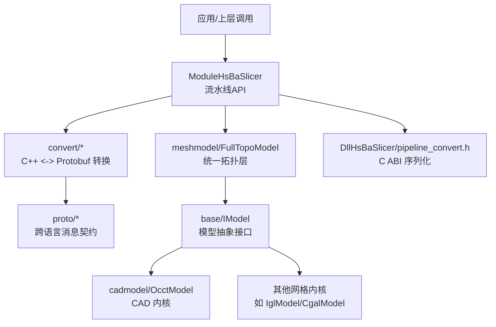
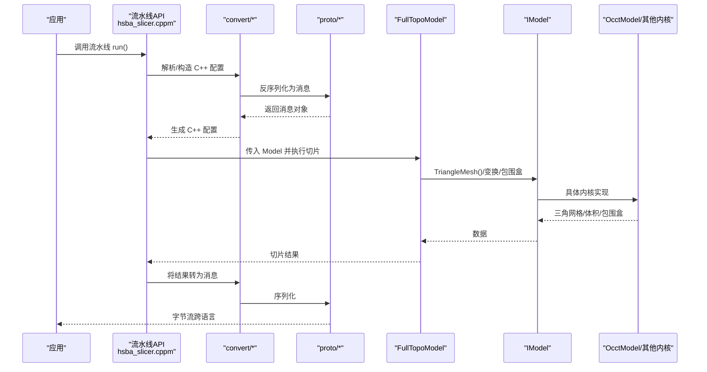
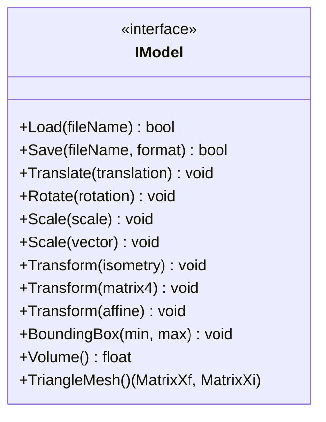
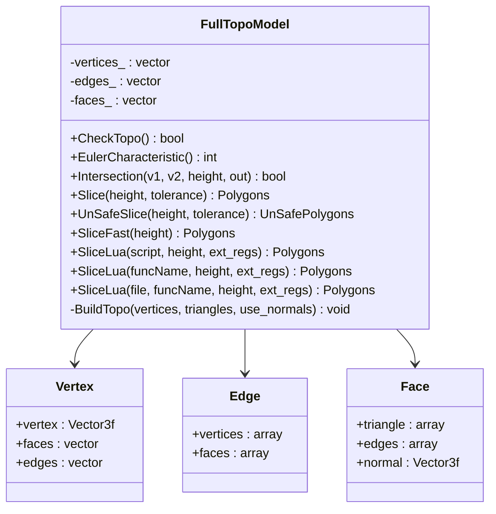
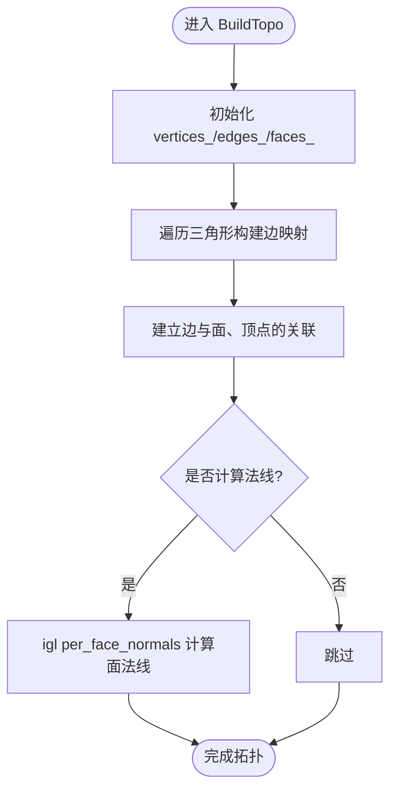
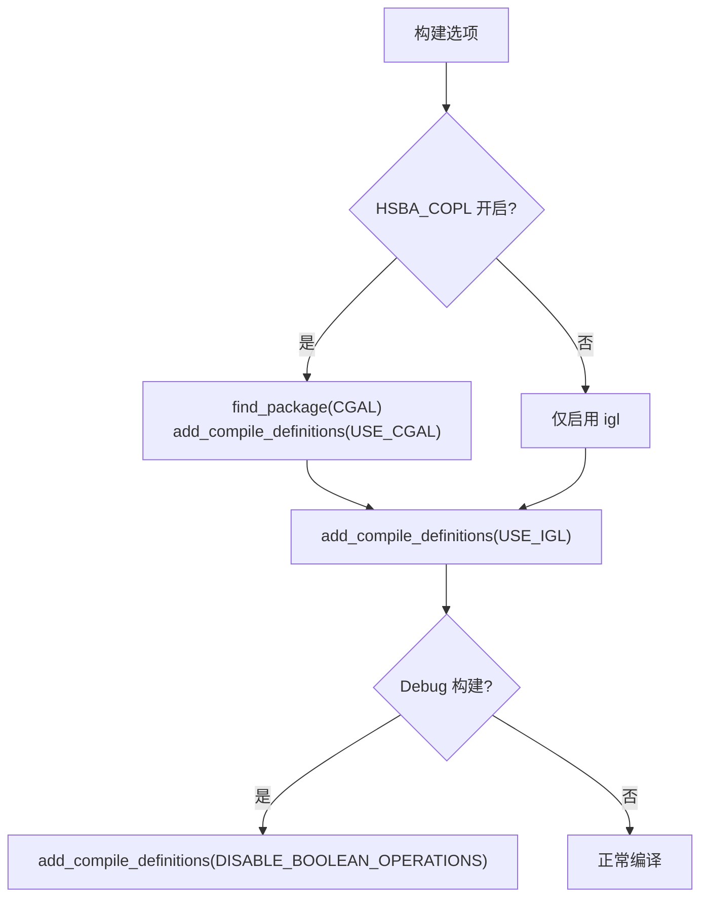
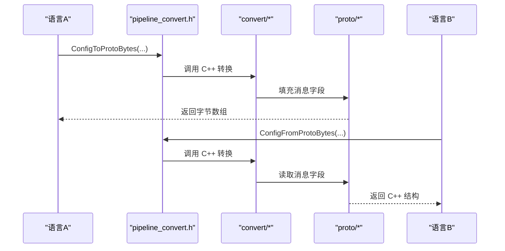
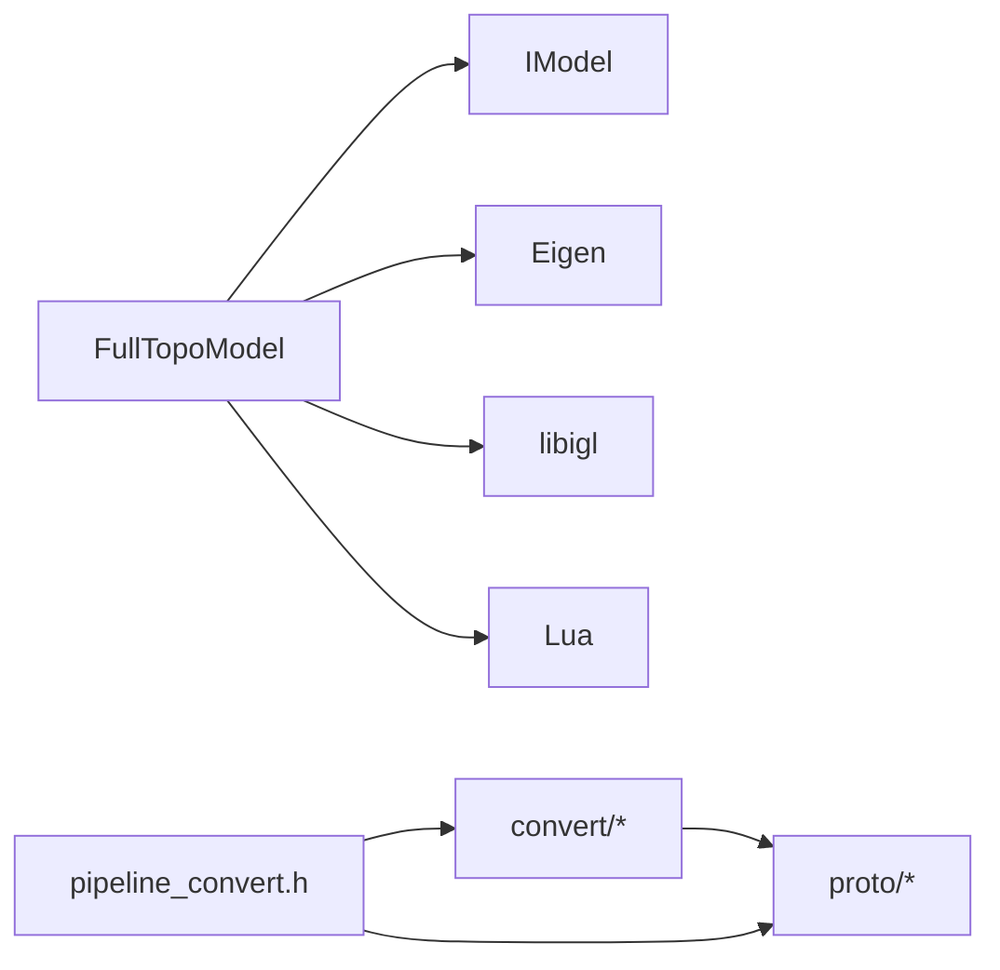
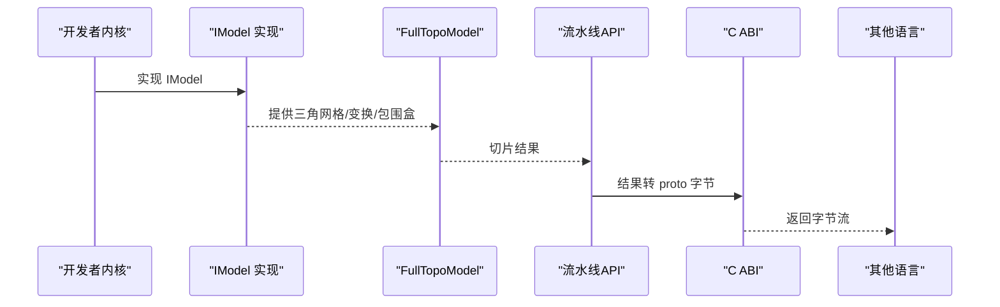

# 内核集成与注册

<cite>
**本文引用的文件**   
- [IModel.hpp](file://base/IModel.hpp)
- [FullTopoModel.hpp](file://meshmodel/FullTopoModel.hpp)
- [FullTopoModel.cpp](file://meshmodel/FullTopoModel.cpp)
- [CMakeLists.txt（meshmodel）](file://meshmodel/CMakeLists.txt)
- [CMakeLists.txt（根）](file://CMakeLists.txt)
- [OcctModel.hpp](file://cadmodel/OcctModel.hpp)
- [pipeline_convert.h](file://DllHsBaSlicer/pipeline_convert.h)
- [PipelineConfig2Msg.hpp](file://convert/PipelineConfig2Msg.hpp)
- [PipelineConfig2Msg.cpp](file://convert/PipelineConfig2Msg.cpp)
- [Msg2PipelineConfig.hpp](file://convert/Msg2PipelineConfig.hpp)
- [Msg2PipelineConfig.cpp](file://convert/Msg2PipelineConfig.cpp)
- [base_config.proto](file://proto/base_config.proto)
- [mesh.proto](file://proto/mesh.proto)
- [vector.proto](file://proto/vector.proto)
- [transform.proto](file://proto/transform.proto)
- [boolean_operation.proto](file://proto/boolean_operation.proto)
- [hsba_slicer.cppm](file://ModuleHsBaSlicer/hsba_slicer.cppm)
</cite>

## 目录
1. [引言](#引言)
2. [项目结构](#项目结构)
3. [核心组件](#核心组件)
4. [架构总览](#架构总览)
5. [详细组件分析](#详细组件分析)
6. [依赖关系分析](#依赖关系分析)
7. [性能考虑](#性能考虑)
8. [故障排除指南](#故障排除指南)
9. [结论](#结论)
10. [附录](#附录)

## 引言
本指南面向需要将自定义几何内核集成到 HsBaSlicer 的开发者，重点说明：
- 内核抽象接口与统一建模层设计
- FullTopoModel 拓扑重建与切片抽象
- 通过 Protobuf 消息协议进行跨语言通信
- 内核选择策略、动态加载与生命周期管理
- 序列化机制与数据传输优化
- 从内核实现到系统集成的完整流程
- 调试技巧与性能监控方法

## 项目结构
本项目围绕“模型抽象接口 + 多内核实现 + 统一拓扑层 + 流水线配置/结果序列化”组织代码。关键路径如下：
- base/IModel.hpp：定义统一的 3D 模型抽象接口
- meshmodel/FullTopoModel.*：基于 IModel 构建的拓扑重建与切片统一层
- cadmodel/OcctModel.hpp：OCCT BRep CAD 内核实现
- convert/* 与 proto/*：C++ 结构与 Protobuf 消息的双向转换
- DllHsBaSlicer/pipeline_convert.h：对外暴露的 C ABI 序列化接口
- ModuleHsBaSlicer/hsba_slicer.cppm：流水线 API 与运行入口
- CMakeLists.txt（根与 meshmodel）：内核编译开关与依赖

图表来源
- [hsba_slicer.cppm:331-373](file://ModuleHsBaSlicer/hsba_slicer.cppm#L331-L373)
- [pipeline_convert.h:33-193](file://DllHsBaSlicer/pipeline_convert.h#L33-L193)
- [PipelineConfig2Msg.hpp:35-80](file://convert/PipelineConfig2Msg.hpp#L35-L80)
- [Msg2PipelineConfig.hpp:33-103](file://convert/Msg2PipelineConfig.hpp#L33-L103)
- [base_config.proto:1-132](file://proto/base_config.proto#L1-L132)
- [mesh.proto:1-31](file://proto/mesh.proto#L1-L31)
- [vector.proto:1-24](file://proto/vector.proto#L1-L24)
- [transform.proto:1-21](file://proto/transform.proto#L1-L21)
- [boolean_operation.proto:1-12](file://proto/boolean_operation.proto#L1-L12)

章节来源
- [CMakeLists.txt（根）:282-299](file://CMakeLists.txt#L282-L299)
- [CMakeLists.txt（meshmodel）:1-42](file://meshmodel/CMakeLists.txt#L1-L42)

## 核心组件
- IModel 接口：统一描述 3D 模型的加载、保存、变换、包围盒、体积与三角网格导出能力，是所有几何内核必须实现的契约。
- FullTopoModel：在 IModel 之上提供拓扑重建、欧拉特征检查、Z 向切片（安全/不安全/快速）、以及 Lua 脚本扩展切片能力。
- OcctModel：基于 OpenCASCADE 的 BRep CAD 内核实现，支持 STEP/IGES/VRML/BRep 等格式与布尔运算、实体加厚、基础体创建等。
- 序列化层：convert/* 将 C++ 流水线配置/结果与 proto/* 消息双向转换；DllHsBaSlicer/pipeline_convert.h 暴露 C ABI 供跨进程/跨语言使用。

章节来源
- [IModel.hpp:110-139](file://base/IModel.hpp#L110-L139)
- [FullTopoModel.hpp:43-146](file://meshmodel/FullTopoModel.hpp#L43-L146)
- [OcctModel.hpp:22-124](file://cadmodel/OcctModel.hpp#L22-L124)
- [PipelineConfig2Msg.hpp:35-80](file://convert/PipelineConfig2Msg.hpp#L35-L80)
- [Msg2PipelineConfig.hpp:33-103](file://convert/Msg2PipelineConfig.hpp#L33-L103)

## 架构总览
下图展示从上层流水线到内核与序列化层的整体交互。

图表来源
- [hsba_slicer.cppm:331-373](file://ModuleHsBaSlicer/hsba_slicer.cppm#L331-L373)
- [PipelineConfig2Msg.cpp:247-300](file://convert/PipelineConfig2Msg.cpp#L247-L300)
- [Msg2PipelineConfig.cpp:247-300](file://convert/Msg2PipelineConfig.cpp#L247-L300)
- [FullTopoModel.cpp:27-48](file://meshmodel/FullTopoModel.cpp#L27-L48)
- [IModel.hpp:110-139](file://base/IModel.hpp#L110-L139)

## 详细组件分析

### IModel 抽象接口
IModel 定义了所有几何内核的统一能力边界，包括：
- 模型 IO：Load/Save
- 几何变换：Translate/Rotate/Scale/Transform
- 查询：BoundingBox/Volume/TriangleMesh

该接口是 FullTopoModel 与上层流水线解耦的关键。

图表来源
- [IModel.hpp:110-139](file://base/IModel.hpp#L110-L139)

章节来源
- [IModel.hpp:110-139](file://base/IModel.hpp#L110-L139)

### FullTopoModel 统一拓扑层
FullTopoModel 在 IModel 提供的三角网格基础上，完成顶点/边/面的拓扑重建，并提供：
- CheckTopo：拓扑完整性校验
- EulerCharacteristic：欧拉特征数
- Intersection：线段与水平面求交
- Slice/UnSafeSlice/SliceFast：多种切片策略
- SliceLua/UnSafeSliceLua：通过 Lua 脚本对 V/E/F 数据进行自定义切片

图表来源
- [FullTopoModel.hpp:53-146](file://meshmodel/FullTopoModel.hpp#L53-L146)
- [FullTopoModel.cpp:50-158](file://meshmodel/FullTopoModel.cpp#L50-L158)

#### 拓扑重建与切片算法流程

图表来源
- [FullTopoModel.cpp:50-158](file://meshmodel/FullTopoModel.cpp#L50-L158)

章节来源
- [FullTopoModel.hpp:43-146](file://meshmodel/FullTopoModel.hpp#L43-L146)
- [FullTopoModel.cpp:27-48](file://meshmodel/FullTopoModel.cpp#L27-L48)
- [FullTopoModel.cpp:50-158](file://meshmodel/FullTopoModel.cpp#L50-L158)
- [FullTopoModel.cpp:160-244](file://meshmodel/FullTopoModel.cpp#L160-L244)
- [FullTopoModel.cpp:274-324](file://meshmodel/FullTopoModel.cpp#L274-L324)
- [FullTopoModel.cpp:328-600](file://meshmodel/FullTopoModel.cpp#L328-L600)
- [FullTopoModel.cpp:604-800](file://meshmodel/FullTopoModel.cpp#L604-L800)

### 内核实现与选择策略
- OCCT 内核：OcctModel 实现 IModel，支持 BRep 操作、布尔运算、实体加厚、基础体创建等。
- 内核选择：
  - 编译期：根 CMakeLists.txt 启用 USE_IGL，并在 HSBA_COPL 开启时引入 CGAL；Debug 下禁用布尔运算以降低内存占用。
  - 运行时：通过流水线配置与消息协议切换不同技术类型（FFF/SLA/SLM/SLS/LOM/WAAM），从而间接决定使用的处理路径与后端。

图表来源
- [CMakeLists.txt（根）:282-299](file://CMakeLists.txt#L282-L299)

章节来源
- [OcctModel.hpp:22-124](file://cadmodel/OcctModel.hpp#L22-L124)
- [CMakeLists.txt（根）:282-299](file://CMakeLists.txt#L282-L299)

### 消息协议与跨语言通信
- 消息契约：proto/* 定义技术类型、材料、输出类型、向量/点/变换、布尔运算、网格等。
- 转换层：convert/* 提供 C++ 结构与 proto 消息的双向转换；DllHsBaSlicer/pipeline_convert.h 暴露 C ABI 函数用于跨进程/跨语言传输。
- 典型流程：上游语言发送 proto 字节 -> 目标端反序列化为 C++ 配置 -> 执行流水线 -> 结果转回 proto 字节 -> 返回给上游。

图表来源
- [pipeline_convert.h:33-193](file://DllHsBaSlicer/pipeline_convert.h#L33-L193)
- [PipelineConfig2Msg.cpp:247-300](file://convert/PipelineConfig2Msg.cpp#L247-L300)
- [Msg2PipelineConfig.cpp:247-300](file://convert/Msg2PipelineConfig.cpp#L247-L300)
- [base_config.proto:1-132](file://proto/base_config.proto#L1-L132)
- [mesh.proto:1-31](file://proto/mesh.proto#L1-L31)
- [vector.proto:1-24](file://proto/vector.proto#L1-L24)
- [transform.proto:1-21](file://proto/transform.proto#L1-L21)
- [boolean_operation.proto:1-12](file://proto/boolean_operation.proto#L1-L12)

章节来源
- [pipeline_convert.h:33-193](file://DllHsBaSlicer/pipeline_convert.h#L33-L193)
- [PipelineConfig2Msg.hpp:35-80](file://convert/PipelineConfig2Msg.hpp#L35-L80)
- [Msg2PipelineConfig.hpp:33-103](file://convert/Msg2PipelineConfig.hpp#L33-L103)
- [base_config.proto:1-132](file://proto/base_config.proto#L1-L132)

### 生命周期管理与动态加载
- 内核实例化：由上层流水线根据配置创建 IModel 子类（如 OcctModel），并通过 FullTopoModel 包装为统一拓扑层。
- 资源释放：C ABI 序列化接口明确标注输出缓冲区由 malloc 分配，调用方负责 free；C++ 侧遵循 RAII 与析构语义。
- 动态加载：项目包含 Lua 脚本扩展能力（例如 FullTopoModel::SliceLua），可在运行时加载脚本以定制切片逻辑；同时存在 Lua 适配器与参数存储注册机制，保证 Lua 环境可复用。

章节来源
- [FullTopoModel.hpp:116-132](file://meshmodel/FullTopoModel.hpp#L116-L132)
- [pipeline_convert.h:33-193](file://DllHsBaSlicer/pipeline_convert.h#L33-L193)

## 依赖关系分析
- 模块耦合：
  - FullTopoModel 依赖 IModel 与 Eigen/igl/Lua 工具链。
  - convert/* 依赖 proto/* 生成的消息类型与 C++ 流水线配置结构。
  - DllHsBaSlicer 暴露 C ABI，作为跨语言边界。
- 外部依赖：
  - libigl、CGAL（可选）、Protobuf、Eigen、OpenSSL、OpenCV（桌面平台）。

图表来源
- [FullTopoModel.hpp:11-16](file://meshmodel/FullTopoModel.hpp#L11-L16)
- [CMakeLists.txt（meshmodel）:1-42](file://meshmodel/CMakeLists.txt#L1-L42)
- [CMakeLists.txt（根）:264-299](file://CMakeLists.txt#L264-L299)

章节来源
- [CMakeLists.txt（meshmodel）:1-42](file://meshmodel/CMakeLists.txt#L1-L42)
- [CMakeLists.txt（根）:264-299](file://CMakeLists.txt#L264-L299)

## 性能考虑
- 拓扑重建开销：FullTopoModel 构造函数会重建拓扑，后续切片避免重复重建，适合多次切片场景。
- 布尔运算限制：Debug 构建默认禁用布尔运算以避免高内存与慢速；Release 且启用 CGAL 才可用。
- 序列化优化：
  - 使用 Protobuf 二进制消息减少跨语言传输成本。
  - 注意 C ABI 输出的 malloc 缓冲区需及时释放，避免内存泄漏。
- 数值稳定性：切片算法使用整数化坐标与并查集合并邻近节点，提升鲁棒性；合理设置 tolerance 平衡精度与速度。

章节来源
- [FullTopoModel.cpp:328-600](file://meshmodel/FullTopoModel.cpp#L328-L600)
- [CMakeLists.txt（根）:282-299](file://CMakeLists.txt#L282-L299)
- [pipeline_convert.h:33-193](file://DllHsBaSlicer/pipeline_convert.h#L33-L193)

## 故障排除指南
- 拓扑不完整：
  - 现象：切片结果异常或出现空洞。
  - 排查：调用 CheckTopo 与 EulerCharacteristic 检查拓扑完整性与欧拉特征。
- 布尔运算失败：
  - 现象：Debug 模式下布尔运算不可用或崩溃。
  - 排查：确认未启用 DISABLE_BOOLEAN_OPERATIONS；Release 构建且启用 HSBA_COPL。
- 序列化错误：
  - 现象：跨语言传参失败或内存泄漏。
  - 排查：确保调用对应 Free*ConfigStrings 释放字符串字段；检查 proto 版本兼容。
- Lua 脚本问题：
  - 现象：SliceLua 无法访问 V/E/F 或 height。
  - 排查：确认 PushFullTopoModelToLua 已正确设置全局变量；检查脚本返回值表结构。

章节来源
- [FullTopoModel.cpp:160-244](file://meshmodel/FullTopoModel.cpp#L160-L244)
- [CMakeLists.txt（根）:282-299](file://CMakeLists.txt#L282-L299)
- [pipeline_convert.h:33-193](file://DllHsBaSlicer/pipeline_convert.h#L33-L193)
- [FullTopoModel.cpp:274-324](file://meshmodel/FullTopoModel.cpp#L274-L324)

## 结论
通过将 IModel 抽象、FullTopoModel 统一拓扑层与 Protobuf 消息协议结合，HsBaSlicer 实现了可扩展的几何内核集成与跨语言通信。开发者只需实现 IModel，即可接入系统；通过编译选项与运行时配置灵活选择内核；借助 C ABI 与 proto 消息完成高效的数据交换。

## 附录

### 集成示例：从内核实现到系统集成的完整流程
- 步骤一：实现 IModel
  - 提供 Load/Save、变换、BoundingBox/Volume/TriangleMesh 等方法。
- 步骤二：封装为 FullTopoModel
  - 将 IModel 实例传入 FullTopoModel 构造函数，获得拓扑重建后的切片能力。
- 步骤三：流水线调用
  - 通过 hsba_slicer.cppm 中的流水线 API 调用 run(model)，内部自动使用 FullTopoModel 进行切片。
- 步骤四：跨语言通信
  - 使用 pipeline_convert.h 暴露的 C ABI 将配置/结果转换为 proto 字节，供其他语言调用。

图表来源
- [IModel.hpp:110-139](file://base/IModel.hpp#L110-L139)
- [FullTopoModel.cpp:27-48](file://meshmodel/FullTopoModel.cpp#L27-L48)
- [hsba_slicer.cppm:331-373](file://ModuleHsBaSlicer/hsba_slicer.cppm#L331-L373)
- [pipeline_convert.h:33-193](file://DllHsBaSlicer/pipeline_convert.h#L33-L193)