# 几何内核接口规范

<cite>
**本文引用的文件**   
- [base/IModel.hpp](file://base/IModel.hpp)
- [meshmodel/IglModel.hpp](file://meshmodel/IglModel.hpp)
- [meshmodel/CgalModel.hpp](file://meshmodel/CgalModel.hpp)
- [cadmodel/OcctModel.hpp](file://cadmodel/OcctModel.hpp)
- [pointcloud/OpenVdbModel.hpp](file://pointcloud/OpenVdbModel.hpp)
- [pointcloud/UserCustomPointCloudModel.hpp](file://pointcloud/UserCustomPointCloudModel.hpp)
- [cadmodel/UserCustomCADModel.hpp](file://cadmodel/UserCustomCADModel.hpp)
- [meshmodel/FullTopoModel.hpp](file://meshmodel/FullTopoModel.hpp)
- [preprocess/ModelLoader.hpp](file://preprocess/ModelLoader.hpp)
- [preprocess/ModelLoader.cpp](file://preprocess/ModelLoader.cpp)
</cite>

## 目录
1. [引言](#引言)
2. [项目结构](#项目结构)
3. [核心概念：IModel 抽象接口](#核心概念imodel-抽象接口)
4. [架构总览](#架构总览)
5. [详细组件分析](#详细组件分析)
6. [依赖关系分析](#依赖关系分析)
7. [坐标系统、精度与内存管理](#坐标系统精度与内存管理)
8. [布尔运算与拓扑分析](#布尔运算与拓扑分析)
9. [接口实现示例与最佳实践](#接口实现示例与最佳实践)
10. [版本兼容性与扩展机制](#版本兼容性与扩展机制)
11. [性能考虑](#性能考虑)
12. [故障排除指南](#故障排除指南)
13. [结论](#结论)

## 引言
本文件面向需要理解或扩展 HsBaSlicer 几何内核的开发者，系统性说明 IModel 抽象接口的设计理念、方法语义、参数约定、返回值类型、使用约束，以及常见实现类在网格加载、变换操作、布尔运算、拓扑分析等方面的行为差异。文档同时给出坐标系统约定、精度控制机制、内存管理要求、接口版本兼容性与扩展机制，并提供常见错误的诊断思路与解决方案。

## 项目结构
HsBaSlicer 将“模型抽象”与“具体几何内核实现”解耦：
- base 层定义 IModel 抽象接口与公共基础类型。
- meshmodel 提供基于 libigl 和 CGAL 的三角网格模型实现。
- cadmodel 提供基于 OpenCASCADE 的 B-Rep CAD 模型实现，以及用户自定义 CAD DLL 适配。
- pointcloud 提供基于 OpenVDB 的点云模型实现，以及用户自定义点云插件适配。
- preprocess 提供模型加载器、布尔运算封装、点云转网格等高层工具。

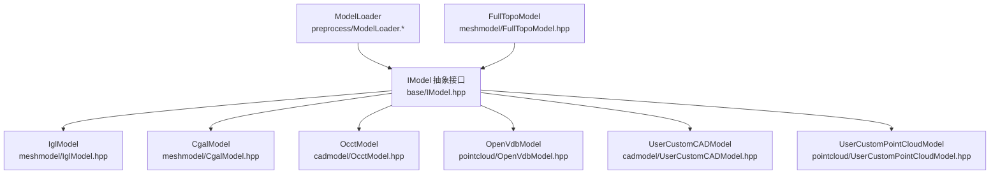

**图表来源**
- [base/IModel.hpp:110-139](file://base/IModel.hpp#L110-L139)
- [meshmodel/IglModel.hpp:26-82](file://meshmodel/IglModel.hpp#L26-L82)
- [meshmodel/CgalModel.hpp:34-82](file://meshmodel/CgalModel.hpp#L34-L82)
- [cadmodel/OcctModel.hpp:30-81](file://cadmodel/OcctModel.hpp#L30-L81)
- [pointcloud/OpenVdbModel.hpp:28-58](file://pointcloud/OpenVdbModel.hpp#L28-L58)
- [cadmodel/UserCustomCADModel.hpp:79-116](file://cadmodel/UserCustomCADModel.hpp#L79-L116)
- [pointcloud/UserCustomPointCloudModel.hpp:96-131](file://pointcloud/UserCustomPointCloudModel.hpp#L96-L131)
- [preprocess/ModelLoader.hpp:47-99](file://preprocess/ModelLoader.hpp#L47-L99)
- [meshmodel/FullTopoModel.hpp:53-142](file://meshmodel/FullTopoModel.hpp#L53-L142)

**章节来源**
- [base/IModel.hpp:1-151](file://base/IModel.hpp#L1-L151)
- [preprocess/ModelLoader.hpp:47-99](file://preprocess/ModelLoader.hpp#L47-L99)

## 核心概念：IModel 抽象接口
IModel 是 HsBaSlicer 中所有三维模型的统一抽象，它定义了跨格式、跨内核的最小能力集：
- 模型 IO：Load、Save。
- 几何变换：Translate、Rotate、Scale（均匀与非均匀）、Transform（Isometry/Matrix4/Affine）。
- 几何查询：BoundingBox、Volume。
- 网格导出：TriangleMesh，返回 libigl 风格的顶点矩阵与面片索引矩阵。

此外，IModel 还通过 extern "C" 暴露一组轻量 C ABI 数据结构（二维/三维向量、四元数、4x4 矩阵、多边形），用于与外部 DLL/SO 插件进行互操作。

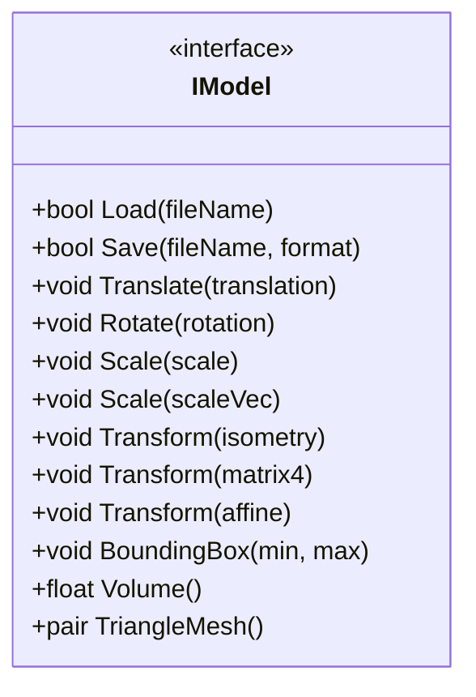

**图表来源**
- [base/IModel.hpp:110-139](file://base/IModel.hpp#L110-L139)

### 接口方法与约束
- Load(fileName)
  - 参数：文件名路径。
  - 返回：是否成功加载。
  - 约束：不同实现支持的文件格式由各自实现决定；上层可通过 ModelFormat 枚举判断期望格式。
- Save(fileName, format)
  - 参数：输出路径与目标格式。
  - 返回：是否成功保存。
  - 约束：并非所有实现都支持全部格式；调用方需根据实现能力选择格式。
- Translate/ Rotate / Scale / Transform
  - 参数：平移向量、旋转四元数、缩放因子或向量、仿射变换。
  - 行为：原地修改模型几何数据。
  - 约束：旋转应使用单位四元数；缩放为零或负值可能产生退化网格。
- BoundingBox(min, max)
  - 参数：引用传入的 AABB 最小/最大点。
  - 返回：无返回值，结果写入 min/max。
  - 约束：空模型或未初始化模型的行为由实现定义。
- Volume()
  - 返回：有符号体积。
  - 约束：对非封闭网格或自相交网格，结果可能不可解释。
- TriangleMesh()
  - 返回：(顶点矩阵 N×3，面片索引 M×3)。
  - 约束：不同实现可能返回不同的法线策略、细分程度或拓扑修复结果。

**章节来源**
- [base/IModel.hpp:110-139](file://base/IModel.hpp#L110-L139)

## 架构总览
IModel 作为稳定契约，允许上层算法（切片、填充、路径生成）以统一方式处理 CAD、网格、点云等不同内核。ModelLoader 负责按文件格式选择合适实现并放入共享池；FullTopoModel 则从任意 IModel 构建面向切片的完整拓扑结构。

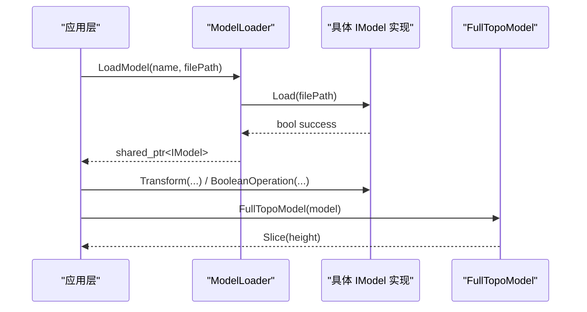

**图表来源**
- [preprocess/ModelLoader.cpp:45-85](file://preprocess/ModelLoader.cpp#L45-L85)
- [meshmodel/FullTopoModel.hpp:74-127](file://meshmodel/FullTopoModel.hpp#L74-L127)

**章节来源**
- [preprocess/ModelLoader.cpp:45-85](file://preprocess/ModelLoader.cpp#L45-L85)
- [meshmodel/FullTopoModel.hpp:74-127](file://meshmodel/FullTopoModel.hpp#L74-L127)

## 详细组件分析

### IglModel：libigl 三角网格模型
- 职责：存储顶点、面片与可选法线，提供通用网格 IO、变换、包围盒、体积、法线计算、布尔运算与基本体工厂。
- 关键方法：
  - Load/Save：支持 STL/OBJ/PLY/OFF 等网格格式。
  - ComputeNormals / ComputeVertexNormals / ComputeFaceNormals：按需计算法线。
  - CreateBox / CreateSphere / CreateCylinder / CreateCone / CreateTorus / CreatePrime：构造基本体或拉伸实体。
- 复杂度与性能：
  - 网格操作通常为 O(N+M)，N 为顶点数，M 为面片数。
  - 布尔运算依赖底层库，复杂度高且可能失败。

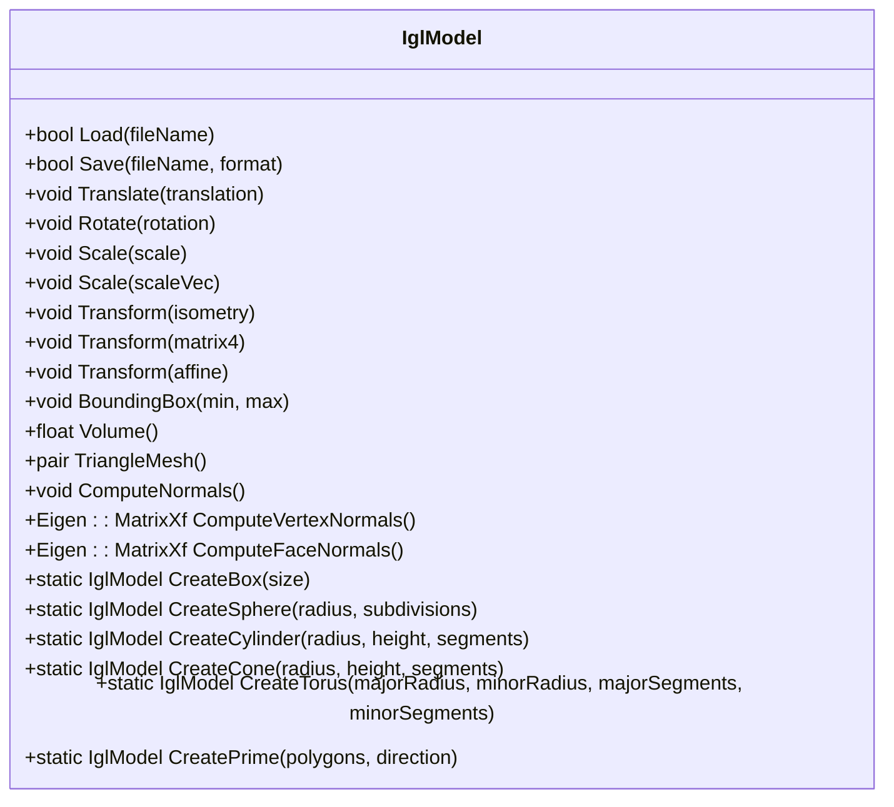

**图表来源**
- [meshmodel/IglModel.hpp:26-120](file://meshmodel/IglModel.hpp#L26-L120)

**章节来源**
- [meshmodel/IglModel.hpp:1-124](file://meshmodel/IglModel.hpp#L1-L124)

### CgalModel：CGAL 多面体网格模型
- 职责：基于 CGAL Polyhedron_3 与 Nef_polyhedron_3，提供布尔运算、表面测地线、螺旋/螺旋线等高级几何功能。
- 关键方法：
  - Load/Save：支持 STL/OFF 等网格格式。
  - GeodesicPath / GeodesicDistance：表面最短路径与距离。
  - ProjectPointOnSurface：点到表面最近投影。
  - SurfaceSpiral / SurfaceHelix：在表面上生成螺旋/螺线路径。
- 精度与稳定性：
  - 使用精确谓词内核提升布尔运算鲁棒性，但构造与布尔运算仍可能因退化输入失败。

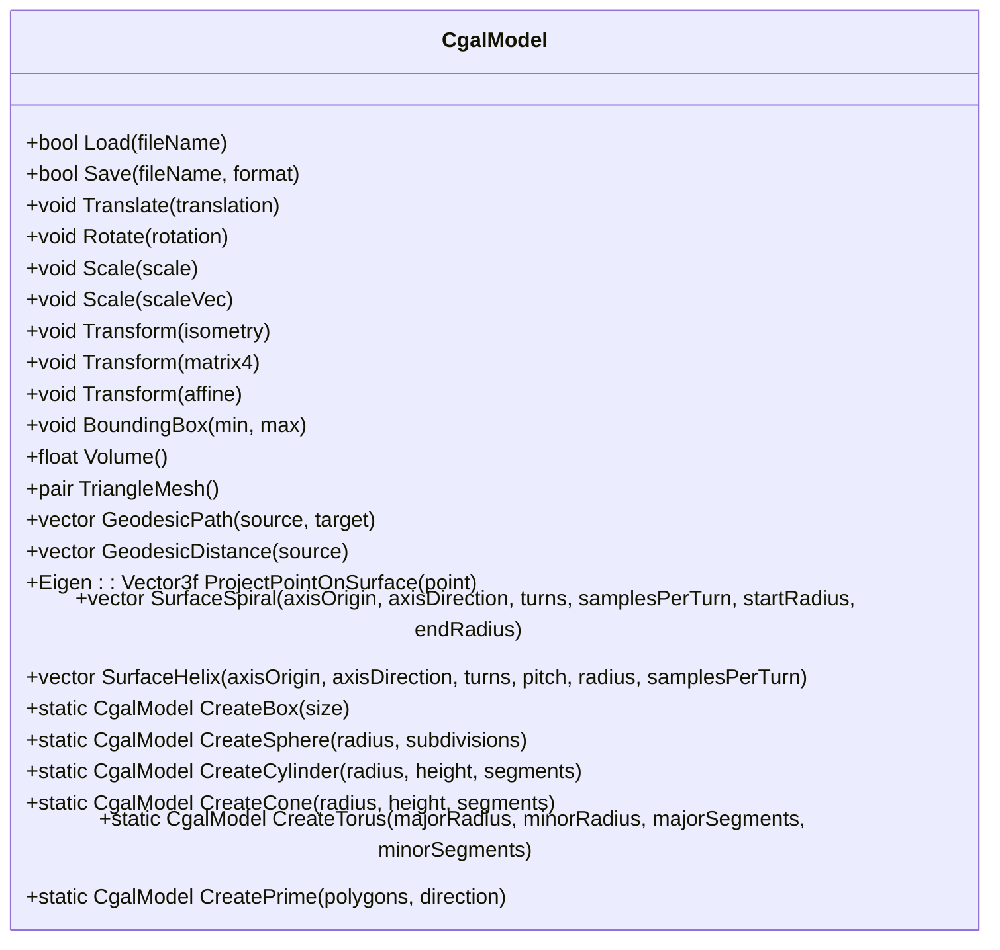

**图表来源**
- [meshmodel/CgalModel.hpp:34-154](file://meshmodel/CgalModel.hpp#L34-L154)

**章节来源**
- [meshmodel/CgalModel.hpp:1-166](file://meshmodel/CgalModel.hpp#L1-L166)

### OcctModel：OpenCASCADE B-Rep CAD 模型
- 职责：封装 TopoDS_Shape，支持 STEP/IGES/VRML/BREP 等 CAD 格式读写、仿射变换、布尔运算、壳厚度操作与基本体/拉伸工厂。
- 关键方法：
  - AddShape：合并多个子形状到复合体。
  - UnionAll：融合复合体内所有子形状。
  - ThickSolid：生成壳厚度实体。
  - CreateBox / CreateSphere / CreateCylinder / CreateCone / CreateTorus / CreatePrime：构造基本体或拉伸实体。
- 适用场景：高精度 CAD 建模与布尔运算。

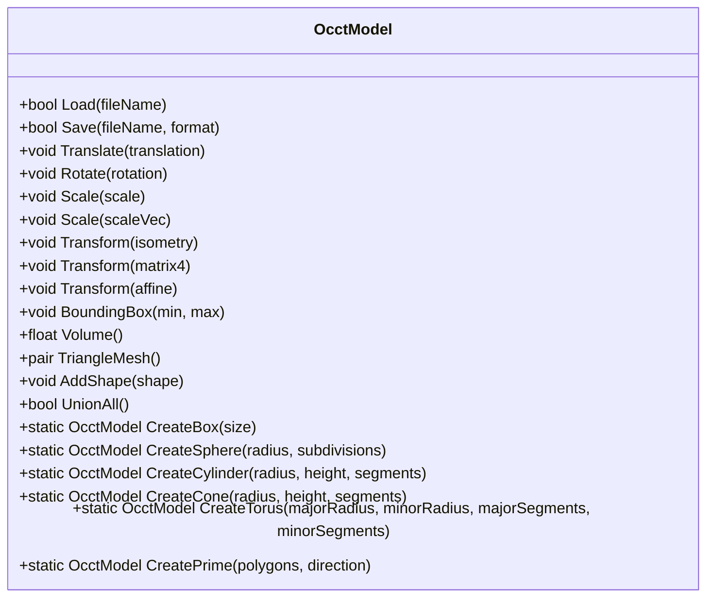

**图表来源**
- [cadmodel/OcctModel.hpp:30-124](file://cadmodel/OcctModel.hpp#L30-L124)

**章节来源**
- [cadmodel/OcctModel.hpp:1-132](file://cadmodel/OcctModel.hpp#L1-L132)

### OpenVdbModel：OpenVDB 点云模型
- 职责：基于体素网格存储点云，提供插入、查询（KNN/半径搜索）、体素化、下采样、统计去噪、法线估计、水平集重建网格等。
- 关键方法：
  - AddPoint / AddPoints / Points / PointCount / IsEmpty / Clear。
  - SetFromVertices / ToVertices / ToVerticesFaces。
  - GenerateMesh：体素大小与粒子半径可自动估计。
  - Voxelize / Downsample / VoxelCenters。
  - NearestNeighbor / KNN / RadiusSearch / Filter。
  - Centroid / Merge / RemoveStatisticalOutliers / ComputeNormals。

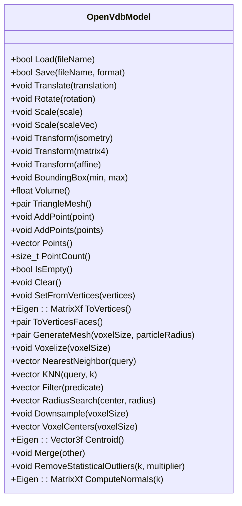

**图表来源**
- [pointcloud/OpenVdbModel.hpp:28-116](file://pointcloud/OpenVdbModel.hpp#L28-L116)

**章节来源**
- [pointcloud/OpenVdbModel.hpp:1-119](file://pointcloud/OpenVdbModel.hpp#L1-L119)

### UserCustomCADModel 与 UserCustomPointCloudModel：插件适配
- UserCustomCADModel：通过 IUserCustomCAD 接口动态加载用户 CAD DLL/SO，委托创建模型、销毁模型、布尔运算、基本体工厂、拉伸等操作。
- UserCustomPointCloudModel：通过 IUserCustomPointCloud 接口动态加载用户点云插件 DLL/SO，提供与 OpenVdbModel 一致的点云 API。

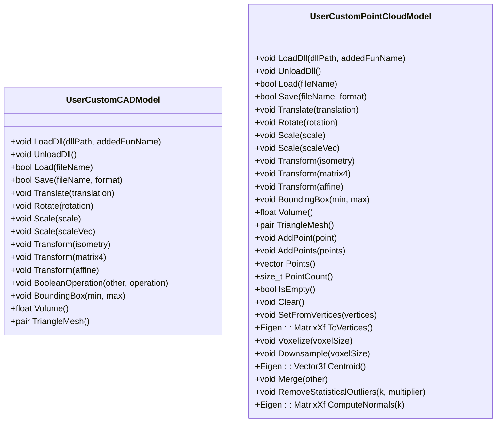

**图表来源**
- [cadmodel/UserCustomCADModel.hpp:79-121](file://cadmodel/UserCustomCADModel.hpp#L79-L121)
- [pointcloud/UserCustomPointCloudModel.hpp:96-171](file://pointcloud/UserCustomPointCloudModel.hpp#L96-L171)

**章节来源**
- [cadmodel/UserCustomCADModel.hpp:1-126](file://cadmodel/UserCustomCADModel.hpp#L1-L126)
- [pointcloud/UserCustomPointCloudModel.hpp:1-177](file://pointcloud/UserCustomPointCloudModel.hpp#L1-L177)

### FullTopoModel：面向切片的完整拓扑模型
- 职责：从任意 IModel 构建包含顶点、边、面的完整拓扑结构，提供欧拉特征检查、安全/不安全切片、快速切片与 Lua 脚本切片。
- 关键方法：
  - CheckTopo：检查拓扑完整性。
  - EulerCharacteristic：计算欧拉示性数，辅助检测孔洞或非流形。
  - Slice / UnSafeSlice / SliceFast：Z 向切片，返回闭合轮廓集合。
  - SliceLua / UnSafeSliceLua：通过 Lua 脚本自定义切片逻辑。

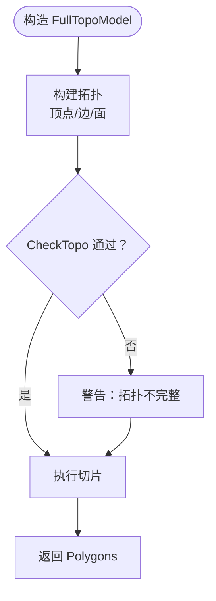

**图表来源**
- [meshmodel/FullTopoModel.hpp:74-127](file://meshmodel/FullTopoModel.hpp#L74-L127)

**章节来源**
- [meshmodel/FullTopoModel.hpp:1-150](file://meshmodel/FullTopoModel.hpp#L1-L150)

## 依赖关系分析
- IModel 是所有实现的共同基类，确保上层代码仅依赖稳定接口。
- ModelLoader 根据文件格式选择具体实现，并将模型存入共享池，便于后续布尔运算、厚壳操作、点云转网格等流程。
- FullTopoModel 不继承 IModel，而是消费 IModel 的数据来构建面向切片的拓扑结构。

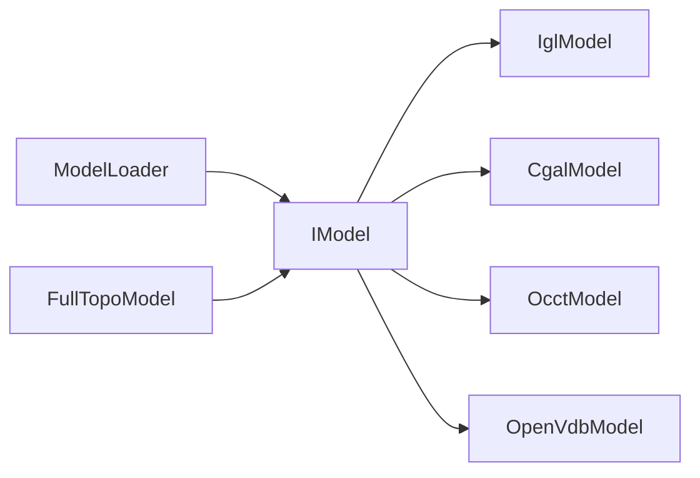

**图表来源**
- [preprocess/ModelLoader.hpp:47-99](file://preprocess/ModelLoader.hpp#L47-L99)
- [meshmodel/FullTopoModel.hpp:74-127](file://meshmodel/FullTopoModel.hpp#L74-L127)

**章节来源**
- [preprocess/ModelLoader.hpp:47-99](file://preprocess/ModelLoader.hpp#L47-L99)
- [preprocess/ModelLoader.cpp:137-164](file://preprocess/ModelLoader.cpp#L137-L164)

## 坐标系统、精度与内存管理

### 坐标系统约定
- 坐标系：右手系，Z 轴通常表示层高方向（切片沿 Z 向）。
- 单位：默认毫米（mm），与工程 CAD 与切片软件一致。
- 原点：模型原点在导入时保持原始位置，建议在上层预处理阶段进行归一化或对齐。

### 精度控制机制
- 浮点精度：IModel 接口普遍使用 float（Eigen::Vector3f、MatrixXf），适用于工程尺度下的数值稳定性。
- CGAL 内核：CgalModel 使用精确谓词内核提升布尔运算鲁棒性，但仍需注意退化输入（共面、零面积面片）。
- 体素精度：OpenVdbModel 的体素化与下采样通过 voxelSize 控制精度，越小越精细但内存与时间开销越大。

### 内存管理要求
- 所有权：上层通常通过 std::shared_ptr<IModel> 持有模型，ModelLoader 将模型放入池中统一管理生命周期。
- 插件模型：UserCustomCADModel 与 UserCustomPointCloudModel 通过 DLL/SO 动态加载，需在 UnloadDll 或析构时释放底层资源。
- 网格导出：TriangleMesh 返回 Eigen 矩阵副本，调用方需自行管理其生命周期。

**章节来源**
- [base/IModel.hpp:110-139](file://base/IModel.hpp#L110-L139)
- [pointcloud/OpenVdbModel.hpp:77-96](file://pointcloud/OpenVdbModel.hpp#L77-L96)
- [preprocess/ModelLoader.hpp:47-99](file://preprocess/ModelLoader.hpp#L47-L99)
- [cadmodel/UserCustomCADModel.hpp:79-121](file://cadmodel/UserCustomCADModel.hpp#L79-L121)
- [pointcloud/UserCustomPointCloudModel.hpp:96-171](file://pointcloud/UserCustomPointCloudModel.hpp#L96-L171)

## 布尔运算与拓扑分析

### 布尔运算
- 各实现均提供布尔运算友元函数或方法：
  - IglModel：Union / Intersection / Difference / Xor。
  - CgalModel：Union / Intersection / Difference / Xor。
  - OcctModel：Union / Intersection / Difference / Xor。
  - UserCustomCADModel：BooleanOperation(operationName)。
- ModelLoader 提供高层封装：BooleanUnion / BooleanIntersection / BooleanDifference / BooleanXor。

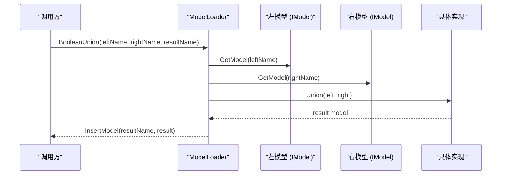

**图表来源**
- [preprocess/ModelLoader.cpp:218-244](file://preprocess/ModelLoader.cpp#L218-L244)
- [meshmodel/IglModel.hpp:91-94](file://meshmodel/IglModel.hpp#L91-L94)
- [meshmodel/CgalModel.hpp:84-87](file://meshmodel/CgalModel.hpp#L84-L87)
- [cadmodel/OcctModel.hpp:86-89](file://cadmodel/OcctModel.hpp#L86-L89)
- [cadmodel/UserCustomCADModel.hpp:107-109](file://cadmodel/UserCustomCADModel.hpp#L107-L109)

**章节来源**
- [preprocess/ModelLoader.cpp:218-244](file://preprocess/ModelLoader.cpp#L218-L244)
- [meshmodel/IglModel.hpp:91-94](file://meshmodel/IglModel.hpp#L91-L94)
- [meshmodel/CgalModel.hpp:84-87](file://meshmodel/CgalModel.hpp#L84-L87)
- [cadmodel/OcctModel.hpp:86-89](file://cadmodel/OcctModel.hpp#L86-L89)
- [cadmodel/UserCustomCADModel.hpp:107-109](file://cadmodel/UserCustomCADModel.hpp#L107-L109)

### 拓扑分析
- FullTopoModel：
  - CheckTopo：检查拓扑完整性，非流形可能导致切片异常。
  - EulerCharacteristic：奇数或大于 2 可能表明存在孔洞或非流形。
  - SliceFast：先检查拓扑完整性，失败立即抛出异常。
- 建议：在进行布尔运算后，优先使用 FullTopoModel.CheckTopo 验证结果。

**章节来源**
- [meshmodel/FullTopoModel.hpp:80-114](file://meshmodel/FullTopoModel.hpp#L80-L114)

## 接口实现示例与最佳实践

### 正确继承与实现 IModel 的步骤
- 定义类继承 IModel，并实现所有纯虚方法。
- 在 Load/Save 中处理文件格式解析与序列化。
- 在 Translate/Rotate/Scale/Transform 中更新内部几何数据。
- 在 BoundingBox/Volume/TriangleMesh 中提供稳定的几何查询。
- 若支持布尔运算，提供友元函数或方法，并确保输入合法性检查。

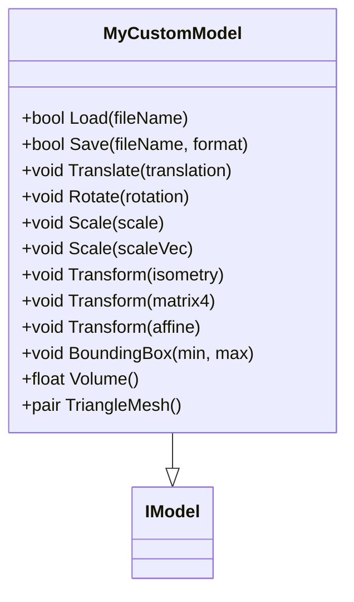

**图表来源**
- [base/IModel.hpp:110-139](file://base/IModel.hpp#L110-L139)

### 使用 ModelLoader 管理模型生命周期
- 使用 LoadModel 将模型加入池，并通过名称获取。
- 使用 InsertModel 插入已构造的模型。
- 使用 Cleanup 清理不再被引用的模型。

**章节来源**
- [preprocess/ModelLoader.hpp:47-99](file://preprocess/ModelLoader.hpp#L47-L99)
- [preprocess/ModelLoader.cpp:98-136](file://preprocess/ModelLoader.cpp#L98-L136)

### 常见实现错误与解决方案
- 未实现所有纯虚方法：编译器报错，需补齐所有方法。
- 旋转四元数未归一化：导致缩放或倾斜，应在 Rotate 前归一化。
- 缩放因子为零或负值：产生退化网格，应在 Scale 前校验。
- 布尔运算输入非法：如开放网格、自相交，应先进行拓扑修复或使用 FullTopoModel.CheckTopo。
- 插件 DLL 未正确卸载：导致内存泄漏，需在 UnloadDll 或析构时释放。

**章节来源**
- [base/IModel.hpp:110-139](file://base/IModel.hpp#L110-L139)
- [meshmodel/FullTopoModel.hpp:80-114](file://meshmodel/FullTopoModel.hpp#L80-L114)
- [cadmodel/UserCustomCADModel.hpp:79-121](file://cadmodel/UserCustomCADModel.hpp#L79-L121)
- [pointcloud/UserCustomPointCloudModel.hpp:96-171](file://pointcloud/UserCustomPointCloudModel.hpp#L96-L171)

## 版本兼容性与扩展机制

### 接口版本兼容性
- IModel 接口保持稳定，新增功能通过派生类或友元函数扩展，避免破坏现有调用。
- ModelFormat 枚举扩展新格式时，应保持向后兼容，未知格式返回 Unknown。

### 扩展机制
- 用户自定义 CAD：通过 IUserCustomCAD 与 UserCustomCADModel 加载外部 DLL/SO，实现自定义布尔运算与基本体工厂。
- 用户自定义点云：通过 IUserCustomPointCloud 与 UserCustomPointCloudModel 加载外部插件，实现点云专用操作。
- 插件 ABI：extern "C" 数据结构（HsBaVector2f_t、HsBaVector3f_t、HsBaQuaternionf_t、HsBaMatrix4f_t、HsBaPoly2D_t、HsBaPolys2D_t）保证 C ABI 兼容。

**章节来源**
- [base/IModel.hpp:19-60](file://base/IModel.hpp#L19-L60)
- [cadmodel/UserCustomCADModel.hpp:27-73](file://cadmodel/UserCustomCADModel.hpp#L27-L73)
- [pointcloud/UserCustomPointCloudModel.hpp:26-88](file://pointcloud/UserCustomPointCloudModel.hpp#L26-L88)

## 性能考虑
- 网格规模：TriangleMesh 返回的顶点与面片数量直接影响后续算法性能，建议在布尔运算后进行网格简化或重拓扑。
- 布尔运算：CGAL 与 OCCT 的布尔运算复杂度高，应避免对超大网格直接进行布尔运算。
- 点云处理：OpenVdbModel 的体素化与下采样需权衡精度与性能，合理设置 voxelSize 与 particleRadius。
- 内存占用：频繁创建临时模型时应及时释放或复用，避免内存峰值过高。

[本节为通用指导，不直接分析具体文件]

## 故障排除指南
- 加载失败：检查文件格式与实现支持范围，确认 Load 返回值。
- 布尔运算失败：检查输入网格是否封闭、法线方向是否一致，必要时使用 FullTopoModel.CheckTopo。
- 切片异常：检查拓扑完整性，优先使用 SliceFast 并在失败时回退到 SafeSlice。
- 插件崩溃：确认 DLL/SO 导出的函数签名与 ABI 一致，确保 DestroyModelFunc 被正确调用。

**章节来源**
- [meshmodel/FullTopoModel.hpp:80-114](file://meshmodel/FullTopoModel.hpp#L80-L114)
- [preprocess/ModelLoader.cpp:218-244](file://preprocess/ModelLoader.cpp#L218-L244)
- [cadmodel/UserCustomCADModel.hpp:79-121](file://cadmodel/UserCustomCADModel.hpp#L79-L121)
- [pointcloud/UserCustomPointCloudModel.hpp:96-171](file://pointcloud/UserCustomPointCloudModel.hpp#L96-L171)

## 结论
IModel 抽象接口为 HsBaSlicer 提供了统一的几何内核契约，使 CAD、网格、点云等不同实现能够被上层算法以一致方式处理。通过 ModelLoader 的生命周期管理与 FullTopoModel 的拓扑分析，系统能够在保证精度的同时提升鲁棒性。扩展机制允许用户通过插件引入自定义 CAD 与点云内核，满足多样化工程需求。在实际使用中，应关注坐标系统、精度控制与内存管理，遵循布尔运算与拓扑分析的约束，以获得稳定高效的几何处理能力。