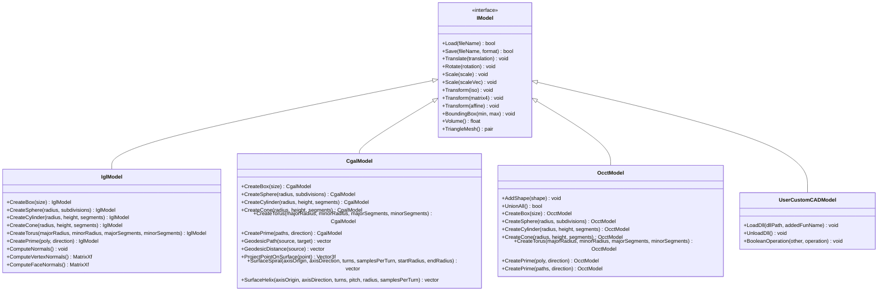
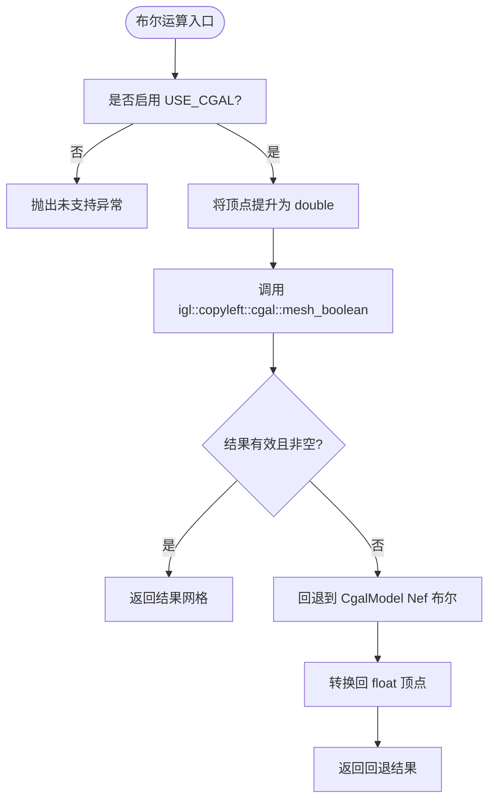
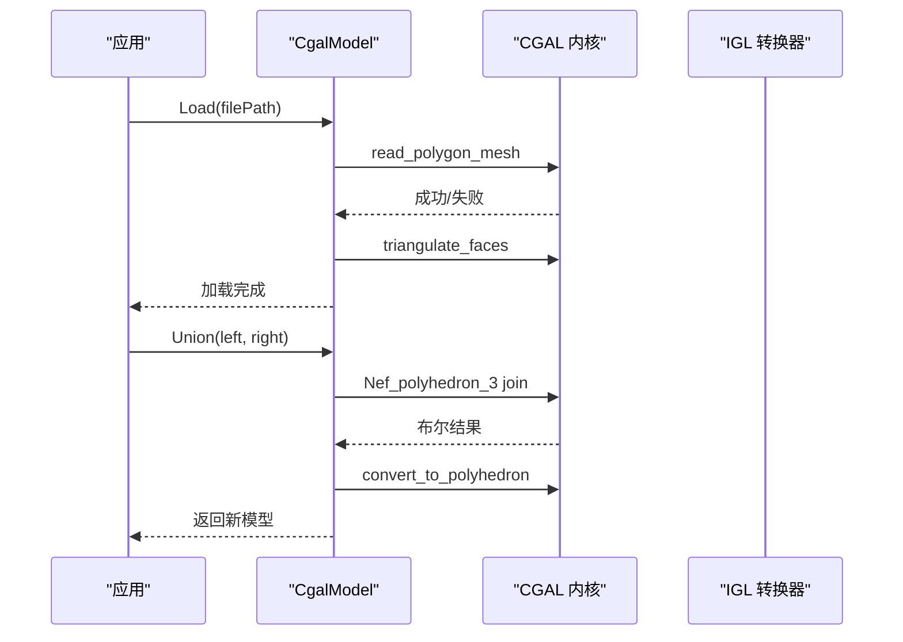
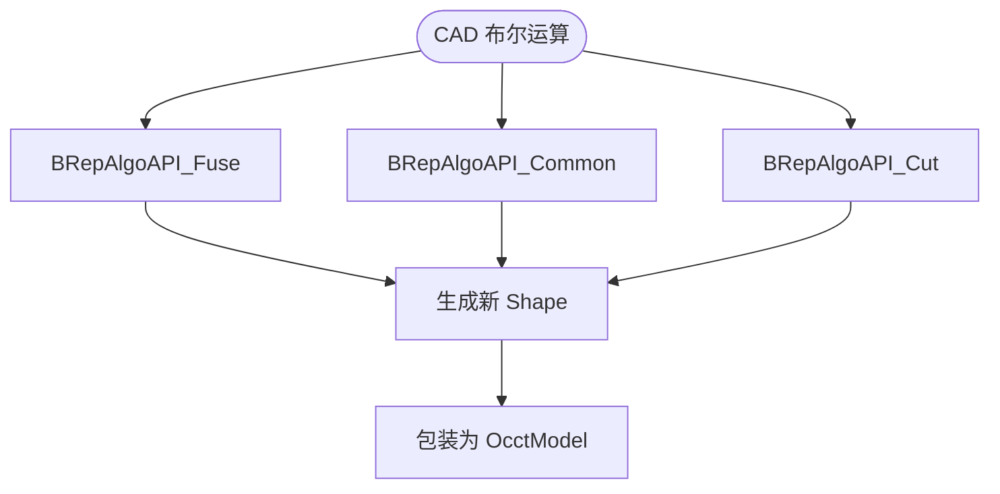
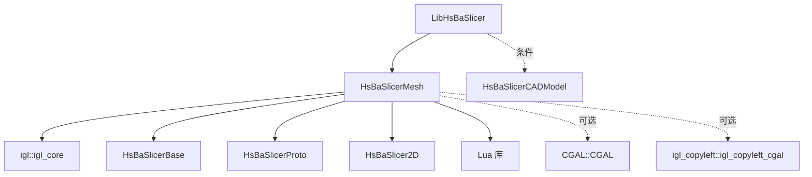
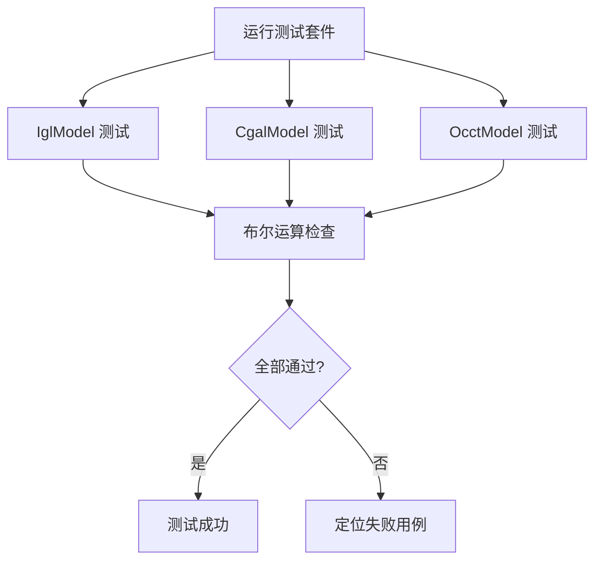

# 自定义几何内核开发

<cite>
**本文引用的文件**   
- [base/IModel.hpp](file://base/IModel.hpp)
- [meshmodel/IglModel.hpp](file://meshmodel/IglModel.hpp)
- [meshmodel/IglModel.cpp](file://meshmodel/IglModel.cpp)
- [meshmodel/CgalModel.hpp](file://meshmodel/CgalModel.hpp)
- [meshmodel/CgalModel.cpp](file://meshmodel/CgalModel.cpp)
- [cadmodel/OcctModel.hpp](file://cadmodel/OcctModel.hpp)
- [cadmodel/OcctModel.cpp](file://cadmodel/OcctModel.cpp)
- [cadmodel/UserCustomCADModel.hpp](file://cadmodel/UserCustomCADModel.hpp)
- [meshmodel/CMakeLists.txt](file://meshmodel/CMakeLists.txt)
- [LibHsBaSlicer/CMakeLists.txt](file://LibHsBaSlicer/CMakeLists.txt)
- [tests/Models/igl_model_test.cpp](file://tests/Models/igl_model_test.cpp)
- [tests/Models/cgal_model_test.cpp](file://tests/Models/cgal_model_test.cpp)
- [tests/Models/occt_model_test.cpp](file://tests/Models/occt_model_test.cpp)
</cite>

## 目录
1. [项目概述与快速开始](#项目概述与快速开始)
2. [架构总览](#架构总览)
3. [核心概念](#核心概念)
4. [核心模块详解](#核心模块详解)
5. [高级主题](#高级主题)
6. [API 参考文档](#api-参考文档)
7. [集成指南](#集成指南)
8. [开发测试与贡献](#开发测试与贡献)
9. [扩展开发指南](#扩展开发指南)
10. [示例与教程](#示例与教程)
11. [部署故障排除与FAQ](#部署故障排除与faq)
12. [附录](#附录)

## 项目概述与快速开始
本仓库为 HsBaSlicer 三维切片系统，提供可插拔的几何内核抽象层 IModel，以及三种后端实现：基于 libigl 的三角网格模型、基于 CGAL 的多面体网格模型、基于 OpenCASCADE 的 BRep CAD 模型。IModel 统一了加载保存、变换、包围盒、体积和三角网格导出等能力；布尔运算、拉伸、实体工厂等能力由各后端以友元函数或静态方法暴露。

快速开始建议：
- 若只需要轻量三角网格操作与布尔运算，优先使用 IglModel；启用 USE_CGAL 后可获得稳定的布尔回退路径。
- 若需要更严格的拓扑与布尔运算质量，使用 CgalModel；其 Nef 多面体布尔在复杂输入下更可靠。
- 若需要 STEP/IGES/BREP 等 CAD 格式读写与精确实体建模，使用 OcctModel；它支持布尔、抽壳、拉伸等 CAD 原语。
- 若需通过外部 DLL/SO 接入第三方几何库，使用 UserCustomCADModel + IUserCustomCAD 契约。

本节不直接分析具体源码文件，因此不提供“章节来源”。

## 架构总览
IModel 是几何内核的统一接口，所有后端均继承该接口并实现 Load/Save/Transform/BoundingBox/Volume/TriangleMesh 等核心方法。不同后端在布尔运算、文件格式、精度策略上存在差异：

**图表来源**
- [base/IModel.hpp:111-139](file://base/IModel.hpp#L111-L139)
- [meshmodel/IglModel.hpp:26-121](file://meshmodel/IglModel.hpp#L26-L121)
- [meshmodel/CgalModel.hpp:34-155](file://meshmodel/CgalModel.hpp#L34-L155)
- [cadmodel/OcctModel.hpp:30-124](file://cadmodel/OcctModel.hpp#L30-L124)
- [cadmodel/UserCustomCADModel.hpp:79-121](file://cadmodel/UserCustomCADModel.hpp#L79-L121)

**章节来源**
- [base/IModel.hpp:111-139](file://base/IModel.hpp#L111-L139)
- [meshmodel/IglModel.hpp:26-121](file://meshmodel/IglModel.hpp#L26-L121)
- [meshmodel/CgalModel.hpp:34-155](file://meshmodel/CgalModel.hpp#L34-L155)
- [cadmodel/OcctModel.hpp:30-124](file://cadmodel/OcctModel.hpp#L30-L124)
- [cadmodel/UserCustomCADModel.hpp:79-121](file://cadmodel/UserCustomCADModel.hpp#L79-L121)

## 核心概念
- IModel 接口定义了统一的几何对象契约，包括文件 IO、仿射变换、包围盒、体积、三角网格导出。
- ModelFormat 枚举区分网格（STL/OBJ/PLY/OFF）与 CAD（STEP/IGES/VRML/BREP）等格式。
- 各后端实现遵循相同接口，但内部数据结构不同：IglModel 使用 Eigen 矩阵存储顶点与面片；CgalModel 使用 CGAL Polyhedron_3；OcctModel 使用 TopoDS_Shape。
- 布尔运算在各后端以友元函数形式提供：Union/Intersection/Difference/Xor。
- 用户自定义几何库通过 IUserCustomCAD 契约与 UserCustomCADModel 适配器进行动态加载与调用。

本节不直接分析具体源码文件，因此不提供“章节来源”。

## 核心模块详解

### IModel 接口设计与实现要求
IModel 是所有几何内核的统一抽象，要求实现者提供：
- 文件加载与保存：Load/Save，按 ModelFormat 分支处理。
- 几何变换：Translate/Rotate/Scale/Transform，支持多种 Eigen 变换类型。
- 几何查询：BoundingBox/Volume/TriangleMesh，返回 AABB、有符号体积与 (vertices, faces)。

实现要点：
- 坐标存储约定：IglModel 使用行主序 N×3 顶点矩阵，变换时注意右乘转置；CgalModel 与 OcctModel 分别使用 CGAL 与 OCCT 的变换 API。
- 法线计算：IglModel 提供 ComputeNormals/ComputeVertexNormals/ComputeFaceNormals；CgalModel 与 OcctModel 在导出网格前确保三角化与朝向正确。
- 布尔运算：IglModel 在启用 USE_CGAL 时使用 igl::copyleft::cgal::mesh_boolean，失败则回退到 CgalModel 的 Nef 布尔；CgalModel 直接使用 Nef_polyhedron_3；OcctModel 使用 BRepAlgoAPI_*。

**章节来源**
- [base/IModel.hpp:111-139](file://base/IModel.hpp#L111-L139)
- [meshmodel/IglModel.cpp:101-150](file://meshmodel/IglModel.cpp#L101-L150)
- [meshmodel/CgalModel.cpp:158-204](file://meshmodel/CgalModel.cpp#L158-L204)
- [cadmodel/OcctModel.cpp:272-329](file://cadmodel/OcctModel.cpp#L272-L329)

### IglModel：libigl 三角网格后端
IglModel 以 Eigen 矩阵存储顶点与面片，并提供：
- 基础网格构造与法线计算。
- 布尔运算：USE_CGAL 时优先 igl mesh_boolean，失败回退 CgalModel Nef 布尔。
- 拉伸 CreatePrime：单多边形与多轮廓（外环+孔）两种重载，使用 Clipper2 三角化与方向归一化。
- 标准实体工厂：CreateBox/CreateSphere/CreateCylinder/CreateCone/CreateTorus。

性能与精度注意事项：
- 布尔运算对浮点顶点敏感，先提升到 double；若仍失败，回退到 CGAL Nef 布尔。
- 拉伸算法保证底面与侧面法线朝外，避免 winding-number 布尔分类错误。

**图表来源**
- [meshmodel/IglModel.cpp:195-245](file://meshmodel/IglModel.cpp#L195-L245)
- [meshmodel/IglModel.cpp:248-391](file://meshmodel/IglModel.cpp#L248-L391)

**章节来源**
- [meshmodel/IglModel.hpp:26-121](file://meshmodel/IglModel.hpp#L26-L121)
- [meshmodel/IglModel.cpp:64-99](file://meshmodel/IglModel.cpp#L64-L99)
- [meshmodel/IglModel.cpp:101-150](file://meshmodel/IglModel.cpp#L101-L150)
- [meshmodel/IglModel.cpp:152-193](file://meshmodel/IglModel.cpp#L152-L193)
- [meshmodel/IglModel.cpp:195-391](file://meshmodel/IglModel.cpp#L195-L391)
- [meshmodel/IglModel.cpp:411-596](file://meshmodel/IglModel.cpp#L411-L596)
- [meshmodel/IglModel.cpp:598-800](file://meshmodel/IglModel.cpp#L598-L800)

### CgalModel：CGAL 多面体网格后端
CgalModel 基于 CGAL Polyhedron_3 与 Nef_polyhedron_3，提供：
- 网格加载/保存（STL/OFF/PLY/OBJ）。
- 变换与包围盒、体积计算。
- 布尔运算：Union/Intersection/Difference/Xor 基于 Nef 布尔。
- 拉伸 CreatePrime：单多边形与多轮廓，结合 Clipper2 三角化与方向修正。
- 表面测地线、螺旋、螺旋线等高级几何操作。

数据修复与健壮性：
- 从 Eigen 网格构造时，若 mesh_to_polyhedron 失败，尝试 Polygon_mesh_processing 修复（定向、合并重复顶点、检查体积符号）。
- 导出 TriangleMesh 前强制三角化，确保下游代码安全。

**图表来源**
- [meshmodel/CgalModel.cpp:121-157](file://meshmodel/CgalModel.cpp#L121-L157)
- [meshmodel/CgalModel.cpp:228-276](file://meshmodel/CgalModel.cpp#L228-L276)

**章节来源**
- [meshmodel/CgalModel.hpp:34-155](file://meshmodel/CgalModel.hpp#L34-L155)
- [meshmodel/CgalModel.cpp:38-119](file://meshmodel/CgalModel.cpp#L38-L119)
- [meshmodel/CgalModel.cpp:121-204](file://meshmodel/CgalModel.cpp#L121-L204)
- [meshmodel/CgalModel.cpp:206-237](file://meshmodel/CgalModel.cpp#L206-L237)
- [meshmodel/CgalModel.cpp:238-276](file://meshmodel/CgalModel.cpp#L238-L276)
- [meshmodel/CgalModel.cpp:278-445](file://meshmodel/CgalModel.cpp#L278-L445)
- [meshmodel/CgalModel.cpp:447-733](file://meshmodel/CgalModel.cpp#L447-L733)
- [meshmodel/CgalModel.cpp:735-800](file://meshmodel/CgalModel.cpp#L735-L800)

### OcctModel：OpenCASCADE BRep CAD 后端
OcctModel 封装 TopoDS_Shape，提供：
- CAD 文件读写：STEP/IGES/VRML/BREP。
- 变换与包围盒、体积计算。
- 布尔运算：Fuse/Common/Cut/Xor。
- 实体工厂与拉伸：CreateBox/CreateSphere/CreateCylinder/CreateCone/CreateTorus/CreatePrime。
- 抽壳 ThickSolid：整体厚度或指定面集合。

网格导出：
- TriangleMesh 遍历每个面的三角剖分，考虑位置变换与面朝向，输出 (vertices, faces)。

**图表来源**
- [cadmodel/OcctModel.cpp:451-469](file://cadmodel/OcctModel.cpp#L451-L469)

**章节来源**
- [cadmodel/OcctModel.hpp:30-124](file://cadmodel/OcctModel.hpp#L30-L124)
- [cadmodel/OcctModel.cpp:63-74](file://cadmodel/OcctModel.cpp#L63-L74)
- [cadmodel/OcctModel.cpp:76-147](file://cadmodel/OcctModel.cpp#L76-L147)
- [cadmodel/OcctModel.cpp:148-190](file://cadmodel/OcctModel.cpp#L148-L190)
- [cadmodel/OcctModel.cpp:192-237](file://cadmodel/OcctModel.cpp#L192-L237)
- [cadmodel/OcctModel.cpp:238-329](file://cadmodel/OcctModel.cpp#L238-L329)
- [cadmodel/OcctModel.cpp:331-407](file://cadmodel/OcctModel.cpp#L331-L407)
- [cadmodel/OcctModel.cpp:409-476](file://cadmodel/OcctModel.cpp#L409-L476)
- [cadmodel/OcctModel.cpp:477-540](file://cadmodel/OcctModel.cpp#L477-L540)
- [cadmodel/OcctModel.cpp:542-663](file://cadmodel/OcctModel.cpp#L542-L663)

### 用户自定义几何内核：UserCustomCADModel 与 IUserCustomCAD
UserCustomCADModel 通过 UserCustomCADDll 动态加载外部 DLL/SO，并按 IUserCustomCAD 契约调用工厂函数与布尔运算。对外暴露 IModel 接口，使上层无需感知后端差异。

关键契约：
- CreateModelFunc/DestroyModelFunc：创建与销毁自定义模型。
- BooleanOperationFunc：按名称执行布尔运算。
- CreateBox/CreateSphere/CreateCylinder/SetThicknessFunc/CreatePrismFunc/CreatePrismExFunc：几何原语与拉伸工厂。

```mermaid
sequenceDiagram
participant App as "应用"
participant Adapter as "UserCustomCADModel"
participant DLL as "UserCustomCADDll"
participant Lib as "外部几何库"
App->>Adapter : LoadDll(dllPath, addedFunName)
Adapter->>DLL : 解析导出函数
DLL->>Lib : 加载库并获取函数指针
App->>Adapter : Load(fileName)
Adapter->>Lib : 调用 Load/Save/Transform 等
Lib-->>Adapter : 返回 IModel*
Adapter-->>App : 统一接口响应
```

**图表来源**
- [cadmodel/UserCustomCADModel.hpp:27-48](file://cadmodel/UserCustomCADModel.hpp#L27-L48)
- [cadmodel/UserCustomCADModel.hpp:53-73](file://cadmodel/UserCustomCADModel.hpp#L53-L73)
- [cadmodel/UserCustomCADModel.hpp:79-121](file://cadmodel/UserCustomCADModel.hpp#L79-L121)

**章节来源**
- [cadmodel/UserCustomCADModel.hpp:27-48](file://cadmodel/UserCustomCADModel.hpp#L27-L48)
- [cadmodel/UserCustomCADModel.hpp:53-73](file://cadmodel/UserCustomCADModel.hpp#L53-L73)
- [cadmodel/UserCustomCADModel.hpp:79-121](file://cadmodel/UserCustomCADModel.hpp#L79-L121)

## 高级主题

### 坐标系统与变换一致性
- IglModel 使用行主序顶点矩阵，旋转与齐次变换需右乘转置矩阵；法线同步更新。
- CgalModel 与 OcctModel 分别使用 CGAL Affine_3 与 gp_Trsf 进行变换，保持 CAD/网格拓扑一致。
- 建议在跨后端传递变换前统一为 Eigen Isometry3f/Matrix4f/Affine，并在后端内部转换为各自原生类型。

**章节来源**
- [meshmodel/IglModel.cpp:101-150](file://meshmodel/IglModel.cpp#L101-L150)
- [meshmodel/CgalModel.cpp:158-204](file://meshmodel/CgalModel.cpp#L158-L204)
- [cadmodel/OcctModel.cpp:272-329](file://cadmodel/OcctModel.cpp#L272-L329)

### 精度控制与数值稳定性
- IglModel 布尔运算先将 float 提升到 double，再调用 CGAL exact predicates；失败时回退到 CgalModel Nef 布尔。
- CgalModel 构造时尝试修复网格（定向、合并重复顶点、体积符号校正），确保后续布尔与体积计算稳定。
- OcctModel 布尔与抽壳使用容差参数，避免微小缝隙导致拓扑失败。

**章节来源**
- [meshmodel/IglModel.cpp:195-245](file://meshmodel/IglModel.cpp#L195-L245)
- [meshmodel/CgalModel.cpp:42-119](file://meshmodel/CgalModel.cpp#L42-L119)
- [cadmodel/OcctModel.cpp:477-540](file://cadmodel/OcctModel.cpp#L477-L540)

### 内存管理与性能优化
- IglModel 使用 Eigen 矩阵连续存储，适合大规模网格的快速访问与向量化计算。
- CgalModel 使用 CGAL Polyhedron_3，布尔运算可能产生大量中间结构，建议复用模型对象并避免频繁复制。
- OcctModel 的 TopoDS_Shape 管理较复杂，应避免不必要的 AddShape 组合，必要时调用 UnionAll 合并子形状。
- 在构建拉伸体时，优先使用 Clipper2 三角化与增量构建器，减少临时对象分配。

**章节来源**
- [meshmodel/IglModel.cpp:411-596](file://meshmodel/IglModel.cpp#L411-L596)
- [meshmodel/CgalModel.cpp:447-733](file://meshmodel/CgalModel.cpp#L447-L733)
- [cadmodel/OcctModel.cpp:192-237](file://cadmodel/OcctModel.cpp#L192-L237)

## API 参考文档

### IModel 接口摘要
- Load/Save：文件 IO，按 ModelFormat 分支。
- Translate/Rotate/Scale/Transform：几何变换。
- BoundingBox/Volume/TriangleMesh：几何查询与网格导出。

**章节来源**
- [base/IModel.hpp:111-139](file://base/IModel.hpp#L111-L139)

### IglModel API
- 构造：从顶点/面片或带法线的网格构造。
- 布尔：Union/Intersection/Difference/Xor（USE_CGAL）。
- 拉伸：CreatePrime 单多边形与多轮廓。
- 实体工厂：CreateBox/CreateSphere/CreateCylinder/CreateCone/CreateTorus。
- 法线：ComputeNormals/ComputeVertexNormals/ComputeFaceNormals。

**章节来源**
- [meshmodel/IglModel.hpp:26-121](file://meshmodel/IglModel.hpp#L26-L121)
- [meshmodel/IglModel.cpp:64-99](file://meshmodel/IglModel.cpp#L64-L99)
- [meshmodel/IglModel.cpp:101-150](file://meshmodel/IglModel.cpp#L101-L150)
- [meshmodel/IglModel.cpp:152-193](file://meshmodel/IglModel.cpp#L152-L193)
- [meshmodel/IglModel.cpp:195-391](file://meshmodel/IglModel.cpp#L195-L391)
- [meshmodel/IglModel.cpp:411-596](file://meshmodel/IglModel.cpp#L411-L596)
- [meshmodel/IglModel.cpp:598-800](file://meshmodel/IglModel.cpp#L598-L800)

### CgalModel API
- 构造：从 Polyhedron_3 或 Eigen 网格构造。
- 布尔：Union/Intersection/Difference/Xor（Nef 布尔）。
- 拉伸：CreatePrime 单多边形与多轮廓。
- 实体工厂：CreateBox/CreateSphere/CreateCylinder/CreateCone/CreateTorus。
- 高级几何：GeodesicPath/GeodesicDistance/ProjectPointOnSurface/SurfaceSpiral/SurfaceHelix。

**章节来源**
- [meshmodel/CgalModel.hpp:34-155](file://meshmodel/CgalModel.hpp#L34-L155)
- [meshmodel/CgalModel.cpp:38-119](file://meshmodel/CgalModel.cpp#L38-L119)
- [meshmodel/CgalModel.cpp:121-204](file://meshmodel/CgalModel.cpp#L121-L204)
- [meshmodel/CgalModel.cpp:206-237](file://meshmodel/CgalModel.cpp#L206-L237)
- [meshmodel/CgalModel.cpp:238-276](file://meshmodel/CgalModel.cpp#L238-L276)
- [meshmodel/CgalModel.cpp:278-445](file://meshmodel/CgalModel.cpp#L278-L445)
- [meshmodel/CgalModel.cpp:447-733](file://meshmodel/CgalModel.cpp#L447-L733)
- [meshmodel/CgalModel.cpp:735-800](file://meshmodel/CgalModel.cpp#L735-L800)

### OcctModel API
- 构造：从 TopoDS_Shape 构造。
- 布尔：Union/Intersection/Difference/Xor。
- 拉伸：CreatePrime 单多边形与多轮廓。
- 实体工厂：CreateBox/CreateSphere/CreateCylinder/CreateCone/CreateTorus。
- 抽壳：ThickSolid 整体厚度或指定面集合。
- 网格导出：TriangleMesh 遍历三角剖分。

**章节来源**
- [cadmodel/OcctModel.hpp:30-124](file://cadmodel/OcctModel.hpp#L30-L124)
- [cadmodel/OcctModel.cpp:63-74](file://cadmodel/OcctModel.cpp#L63-L74)
- [cadmodel/OcctModel.cpp:76-147](file://cadmodel/OcctModel.cpp#L76-L147)
- [cadmodel/OcctModel.cpp:148-190](file://cadmodel/OcctModel.cpp#L148-L190)
- [cadmodel/OcctModel.cpp:192-237](file://cadmodel/OcctModel.cpp#L192-L237)
- [cadmodel/OcctModel.cpp:238-329](file://cadmodel/OcctModel.cpp#L238-L329)
- [cadmodel/OcctModel.cpp:331-407](file://cadmodel/OcctModel.cpp#L331-L407)
- [cadmodel/OcctModel.cpp:409-476](file://cadmodel/OcctModel.cpp#L409-L476)
- [cadmodel/OcctModel.cpp:477-540](file://cadmodel/OcctModel.cpp#L477-L540)
- [cadmodel/OcctModel.cpp:542-663](file://cadmodel/OcctModel.cpp#L542-L663)

### UserCustomCADModel API
- LoadDll/UnloadDll：动态加载与卸载外部几何库。
- BooleanOperation：按名称执行布尔运算。
- 其他 IModel 方法委托给外部库。

**章节来源**
- [cadmodel/UserCustomCADModel.hpp:79-121](file://cadmodel/UserCustomCADModel.hpp#L79-L121)

## 集成指南

### 编译与依赖配置
- meshmodel 模块默认包含 IglModel 与 FullTopoModel；当 HSBA_COPL 启用时，额外编译 CgalModel 并链接 CGAL 与 igl_copyleft。
- LibHsBaSlicer 仅在非移动端且 HSBA_COPL 启用时链接 HsBaSlicerCADModel（OcctModel）。

**图表来源**
- [meshmodel/CMakeLists.txt:1-42](file://meshmodel/CMakeLists.txt#L1-L42)
- [LibHsBaSlicer/CMakeLists.txt:87-105](file://LibHsBaSlicer/CMakeLists.txt#L87-L105)

**章节来源**
- [meshmodel/CMakeLists.txt:1-42](file://meshmodel/CMakeLists.txt#L1-L42)
- [LibHsBaSlicer/CMakeLists.txt:87-105](file://LibHsBaSlicer/CMakeLists.txt#L87-L105)

### 后端选择与动态切换
- 运行时可根据需求选择 IglModel/CgalModel/OcctModel；若需外部库，使用 UserCustomCADModel。
- 布尔运算失败时，IglModel 自动回退到 CgalModel Nef 布尔；OcctModel 提供 UnionAll 合并子形状以提升稳定性。
- 建议在高层管线中根据模型复杂度与布尔频率选择后端：简单网格用 IglModel，复杂布尔用 CgalModel，CAD 流程用 OcctModel。

**章节来源**
- [meshmodel/IglModel.cpp:195-245](file://meshmodel/IglModel.cpp#L195-L245)
- [cadmodel/OcctModel.cpp:409-420](file://cadmodel/OcctModel.cpp#L409-L420)

## 开发测试与贡献

### 单元测试覆盖
- IglModel 测试验证单位立方体网格、体积、法线、布尔运算（USE_CGAL）、拉伸（含孔与复杂多边形）。
- CgalModel 测试验证单位立方体、环面体积、布尔运算、拉伸（含孔与 L 形）。
- OcctModel 测试验证长方体体积、球体体积、布尔运算、拉伸（含孔与非平面方向）。

**图表来源**
- [tests/Models/igl_model_test.cpp:11-72](file://tests/Models/igl_model_test.cpp#L11-L72)
- [tests/Models/cgal_model_test.cpp:11-62](file://tests/Models/cgal_model_test.cpp#L11-L62)
- [tests/Models/occt_model_test.cpp:8-48](file://tests/Models/occt_model_test.cpp#L8-L48)

**章节来源**
- [tests/Models/igl_model_test.cpp:11-72](file://tests/Models/igl_model_test.cpp#L11-L72)
- [tests/Models/cgal_model_test.cpp:11-62](file://tests/Models/cgal_model_test.cpp#L11-L62)
- [tests/Models/occt_model_test.cpp:8-48](file://tests/Models/occt_model_test.cpp#L8-L48)

## 扩展开发指南

### 实现自定义 IModel 后端
步骤：
1. 新建类继承 IModel，实现 Load/Save/Translate/Rotate/Scale/Transform/BoundingBox/Volume/TriangleMesh。
2. 若需布尔运算，提供 Union/Intersection/Difference/Xor 友元函数。
3. 若需拉伸，实现 CreatePrime 单多边形与多轮廓重载。
4. 若需实体工厂，实现 CreateBox/CreateSphere/CreateCylinder/CreateCone/CreateTorus。
5. 在 CMakeLists 中添加源文件与依赖，确保与 IModel 接口一致。

最佳实践：
- 保持坐标与法线一致性，确保 TriangleMesh 输出合法三角网格。
- 对布尔运算进行输入校验（顶点有限、索引越界检查），失败返回空网格或抛出明确异常。
- 对拉伸算法进行方向归一化与孔洞检测，避免法线反转导致体积错误。

**章节来源**
- [base/IModel.hpp:111-139](file://base/IModel.hpp#L111-L139)
- [meshmodel/IglModel.cpp:248-391](file://meshmodel/IglModel.cpp#L248-L391)
- [meshmodel/CgalModel.cpp:238-276](file://meshmodel/CgalModel.cpp#L238-L276)
- [cadmodel/OcctModel.cpp:451-469](file://cadmodel/OcctModel.cpp#L451-L469)

### 通过 IUserCustomCAD 接入外部几何库
步骤：
1. 在外部库中导出 IUserCustomCAD 契约定义的函数指针。
2. 使用 UserCustomCADDll 加载库并解析函数。
3. 通过 UserCustomCADModel 调用 Load/Save/Transform/BooleanOperation 等方法。
4. 在应用中统一管理 DLL 生命周期，避免悬垂指针。

注意事项：
- 确保外部库与宿主进程 ABI 兼容（编译器、运行时、平台）。
- 对布尔运算名称进行严格校验，避免非法操作。
- 在 DestroyModelFunc 中释放外部库分配的 IModel 对象。

**章节来源**
- [cadmodel/UserCustomCADModel.hpp:27-48](file://cadmodel/UserCustomCADModel.hpp#L27-L48)
- [cadmodel/UserCustomCADModel.hpp:53-73](file://cadmodel/UserCustomCADModel.hpp#L53-L73)
- [cadmodel/UserCustomCADModel.hpp:79-121](file://cadmodel/UserCustomCADModel.hpp#L79-L121)

## 示例与教程

### 完整自定义几何内核实现流程
以下示例展示从接口实现到集成测试的完整流程：

1. 定义自定义后端类 CustomModel，继承 IModel。
2. 实现 Load/Save/Transform/BoundingBox/Volume/TriangleMesh。
3. 提供布尔运算友元函数，内部调用自定义几何引擎。
4. 实现 CreatePrime 与实体工厂，确保网格闭合与法线朝外。
5. 在 CMakeLists 中注册源文件与依赖。
6. 编写单元测试，验证体积、包围盒、布尔运算与拉伸。

参考实现模式：
- IglModel 的布尔回退与法线计算。
- CgalModel 的网格修复与 Nef 布尔。
- OcctModel 的 CAD 布尔与抽壳。

**章节来源**
- [meshmodel/IglModel.cpp:195-391](file://meshmodel/IglModel.cpp#L195-L391)
- [meshmodel/CgalModel.cpp:42-119](file://meshmodel/CgalModel.cpp#L42-L119)
- [cadmodel/OcctModel.cpp:477-540](file://cadmodel/OcctModel.cpp#L477-L540)

### 测试用例设计
- 单位立方体：验证顶点数、面数、体积、包围盒。
- 布尔运算：两个偏移立方体的并集/交集/差集/异或体积。
- 拉伸：三角形、正方形带孔、L 形、非平面方向。
- 法线：单位向量检查与面法线数量匹配。

**章节来源**
- [tests/Models/igl_model_test.cpp:11-72](file://tests/Models/igl_model_test.cpp#L11-L72)
- [tests/Models/cgal_model_test.cpp:11-62](file://tests/Models/cgal_model_test.cpp#L11-L62)
- [tests/Models/occt_model_test.cpp:8-48](file://tests/Models/occt_model_test.cpp#L8-L48)

## 部署故障排除与FAQ

### 常见问题
- 布尔运算返回空网格：检查输入网格是否闭合、法线是否朝外；IglModel 会回退到 CgalModel Nef 布尔。
- 体积为负或零：检查面朝向与三角化；CgalModel 会在构造后强制三角化并校正体积符号。
- CAD 布尔失败：检查容差设置与拓扑完整性；OcctModel 提供 UnionAll 合并子形状。
- 外部库加载失败：确认 DLL/SO 路径与函数名正确，ABI 兼容。

### 调试建议
- 打印中间网格的顶点数与面数，确认布尔运算前后变化。
- 对拉伸体进行包围盒与体积断言，确保方向与孔洞正确。
- 使用单元测试逐步验证各后端能力，定位问题后端。

**章节来源**
- [meshmodel/IglModel.cpp:195-245](file://meshmodel/IglModel.cpp#L195-L245)
- [meshmodel/CgalModel.cpp:121-157](file://meshmodel/CgalModel.cpp#L121-L157)
- [cadmodel/OcctModel.cpp:409-420](file://cadmodel/OcctModel.cpp#L409-L420)

## 附录

### 后端能力对比表
| 后端 | 主要数据结构 | 布尔运算 | 拉伸 | 实体工厂 | CAD 格式 | 备注 |
| --- | --- | --- | --- | --- | --- | --- |
| IglModel | Eigen 矩阵 | USE_CGAL 时 igl mesh_boolean，失败回退 CgalModel | 支持 | 支持 | 不支持 | 轻量，适合快速网格操作 |
| CgalModel | CGAL Polyhedron_3/Nef | Nef 布尔 | 支持 | 支持 | 不支持 | 布尔稳健，支持高级几何 |
| OcctModel | TopoDS_Shape | BRepAlgoAPI_* | 支持 | 支持 | STEP/IGES/VRML/BREP | CAD 流程首选 |
| UserCustomCADModel | 外部 IModel* | 外部库实现 | 外部库实现 | 外部库实现 | 外部库实现 | 动态加载，灵活扩展 |

**章节来源**
- [meshmodel/IglModel.hpp:26-121](file://meshmodel/IglModel.hpp#L26-L121)
- [meshmodel/CgalModel.hpp:34-155](file://meshmodel/CgalModel.hpp#L34-L155)
- [cadmodel/OcctModel.hpp:30-124](file://cadmodel/OcctModel.hpp#L30-L124)
- [cadmodel/UserCustomCADModel.hpp:79-121](file://cadmodel/UserCustomCADModel.hpp#L79-L121)