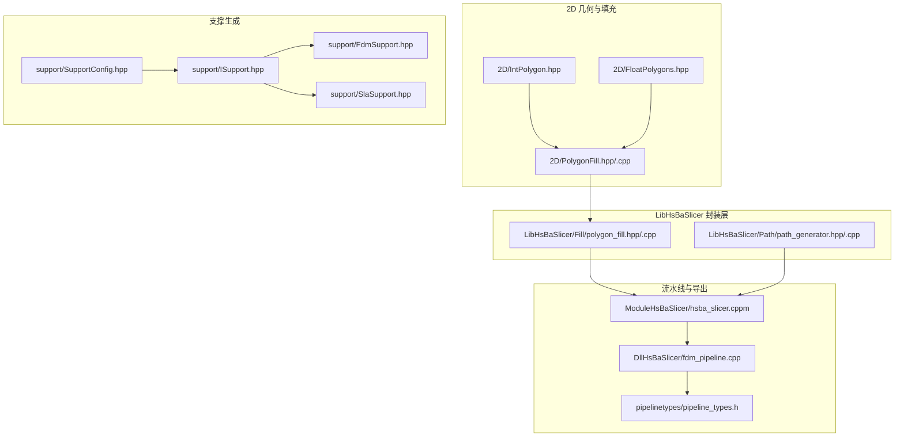
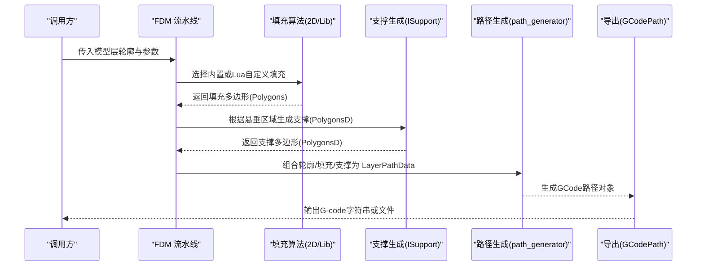
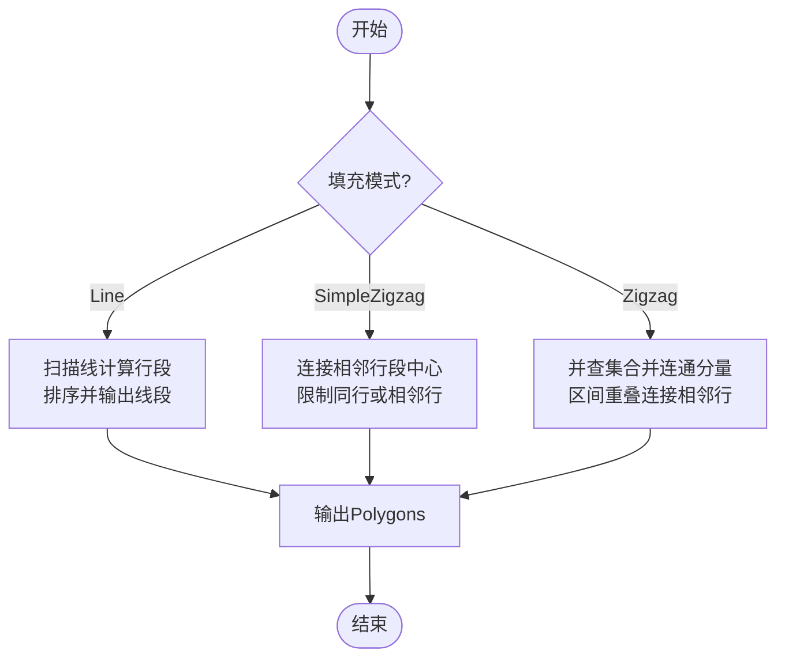
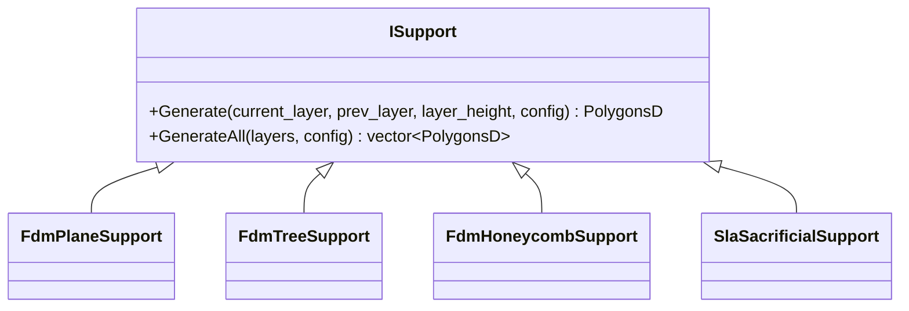
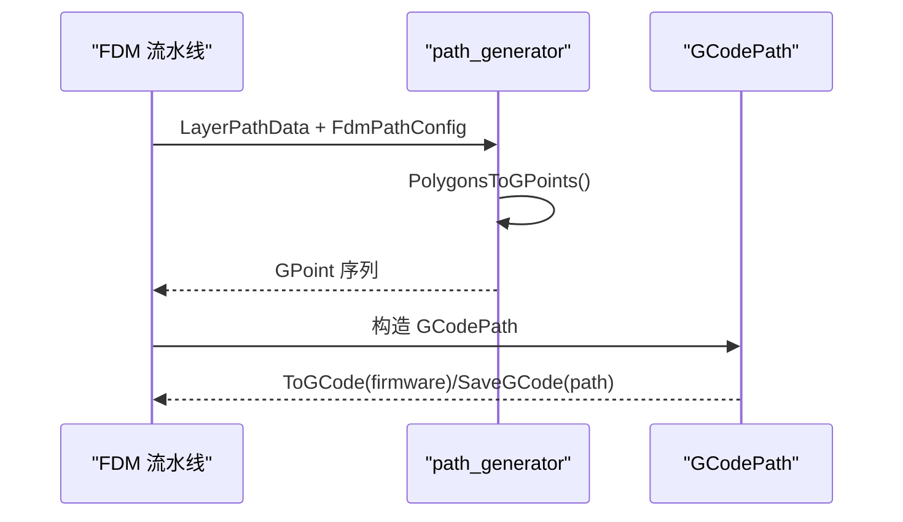
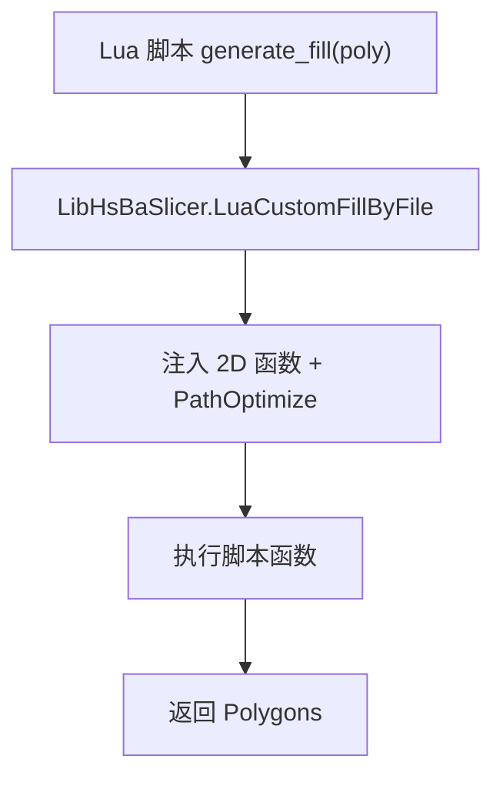
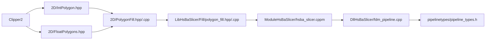

# 自定义算法开发

<cite>
**本文引用的文件**   
- [README.md](file://README.md)
- [2D/PolygonFill.hpp](file://2D/PolygonFill.hpp)
- [2D/PolygonFill.cpp](file://2D/PolygonFill.cpp)
- [2D/IntPolygon.hpp](file://2D/IntPolygon.hpp)
- [2D/FloatPolygons.hpp](file://2D/FloatPolygons.hpp)
- [LibHsBaSlicer/Fill/polygon_fill.hpp](file://LibHsBaSlicer/Fill/polygon_fill.hpp)
- [LibHsBaSlicer/Fill/polygon_fill.cpp](file://LibHsBaSlicer/Fill/polygon_fill.cpp)
- [support/ISupport.hpp](file://support/ISupport.hpp)
- [support/FdmSupport.hpp](file://support/FdmSupport.hpp)
- [support/SlaSupport.hpp](file://support/SlaSupport.hpp)
- [support/SupportConfig.hpp](file://support/SupportConfig.hpp)
- [LibHsBaSlicer/Path/path_generator.hpp](file://LibHsBaSlicer/Path/path_generator.hpp)
- [LibHsBaSlicer/Path/path_generator.cpp](file://LibHsBaSlicer/Path/path_generator.cpp)
- [ModuleHsBaSlicer/hsba_slicer.cppm](file://ModuleHsBaSlicer/hsba_slicer.cppm)
- [DllHsBaSlicer/fdm_pipeline.cpp](file://DllHsBaSlicer/fdm_pipeline.cpp)
- [pipelinetypes/pipeline_types.h](file://pipelinetypes/pipeline_types.h)
- [tests/PolygonFill/polygon_fill_test.cpp](file://tests/PolygonFill/polygon_fill_test.cpp)
</cite>

## 目录
1. [简介](#简介)
2. [项目结构](#项目结构)
3. [核心组件](#核心组件)
4. [架构总览](#架构总览)
5. [详细组件分析](#详细组件分析)
6. [依赖关系分析](#依赖关系分析)
7. [性能与内存优化](#性能与内存优化)
8. [测试与验证](#测试与验证)
9. [常见问题与排错](#常见问题与排错)
10. [结论](#结论)

## 简介
本指南面向需要在 HsBaSlicer 中实现“自定义填充算法、支撑生成算法和导出格式处理器”的开发者。文档围绕以下目标展开：
- 明确算法接口的实现要求、输入输出数据结构与处理流程
- 提供从简单到复杂的实现路径，并给出代码片段路径（不直接粘贴源码）
- 解释性能考虑、内存优化与并行策略
- 说明单元测试与集成测试方法
- 总结常见算法模式与最佳实践

HsBaSlicer 是一个面向 3D 打印切片的高性能 C++ 框架，模块化且跨平台，支持 FDM/SLA/SLM/SLS/TDP/WAAM 等工艺管线，并提供 Lua 扩展能力用于自定义算法。

**章节来源**
- [README.md:21-39](file://README.md#L21-L39)

## 项目结构
与自定义算法相关的核心目录与职责：
- 2D：多边形几何与填充算法（偏移、直线、锯齿形、复合/混合填充、Lua 自定义）
- LibHsBaSlicer/Fill：对外暴露的填充 API（封装 2D 引擎）
- support：支撑生成抽象接口与具体实现（FDM/SLA）
- LibHsBaSlicer/Path：路径生成与 G-code 输出
- ModuleHsBaSlicer/DllHsBaSlicer：流水线编排与 C ABI 导出
- tests：单元测试覆盖填充、路径、支撑等模块

**图表来源**
- [2D/PolygonFill.hpp:1-141](file://2D/PolygonFill.hpp#L1-L141)
- [2D/IntPolygon.hpp:1-241](file://2D/IntPolygon.hpp#L1-L241)
- [2D/FloatPolygons.hpp:1-271](file://2D/FloatPolygons.hpp#L1-L271)
- [LibHsBaSlicer/Fill/polygon_fill.hpp:1-58](file://LibHsBaSlicer/Fill/polygon_fill.hpp#L1-L58)
- [LibHsBaSlicer/Path/path_generator.hpp:1-48](file://LibHsBaSlicer/Path/path_generator.hpp#L1-L48)
- [support/ISupport.hpp:1-49](file://support/ISupport.hpp#L1-L49)
- [support/FdmSupport.hpp:1-67](file://support/FdmSupport.hpp#L1-L67)
- [support/SlaSupport.hpp:1-46](file://support/SlaSupport.hpp#L1-L46)
- [support/SupportConfig.hpp:1-46](file://support/SupportConfig.hpp#L1-L46)
- [ModuleHsBaSlicer/hsba_slicer.cppm:667-675](file://ModuleHsBaSlicer/hsba_slicer.cppm#L667-L675)
- [DllHsBaSlicer/fdm_pipeline.cpp:49-68](file://DllHsBaSlicer/fdm_pipeline.cpp#L49-L68)
- [pipelinetypes/pipeline_types.h:108-142](file://pipelinetypes/pipeline_types.h#L108-L142)

**章节来源**
- [README.md:25-39](file://README.md#L25-L39)

## 核心组件
- 填充算法（2D）
  - 提供 OffsetFill、LineFill、SimpleZigzagFill、ZigzagFill、CompositeOffsetFill、HybridFill 以及 Lua 自定义填充入口
  - 通过 Polygons/PolygonsD 作为输入输出，统一使用 Clipper2 进行布尔运算与偏移
- 支撑生成（Layer-wise）
  - ISupport 抽象接口定义 Generate/GenerateAll
  - FdmPlaneSupport/FdmTreeSupport/FdmHoneycombSupport 与 SlaSacrificialSupport 为具体实现
- 路径与导出
  - path_generator 将 PolygonsD 转换为 GPoint/GCodePath，支持多固件输出（Marlin/Klipper/RepRap）
- 流水线集成
  - ModuleHsBaSlicer 在 FDM 管线中选择 Lua 自定义填充或内置 FillWithBorder
  - DllHsBaSlicer 暴露 C ABI 配置与结果结构体

**章节来源**
- [2D/PolygonFill.hpp:20-136](file://2D/PolygonFill.hpp#L20-L136)
- [LibHsBaSlicer/Fill/polygon_fill.hpp:17-53](file://LibHsBaSlicer/Fill/polygon_fill.hpp#L17-L53)
- [support/ISupport.hpp:22-45](file://support/ISupport.hpp#L22-L45)
- [support/FdmSupport.hpp:13-63](file://support/FdmSupport.hpp#L13-L63)
- [support/SlaSupport.hpp:13-42](file://support/SlaSupport.hpp#L13-L42)
- [LibHsBaSlicer/Path/path_generator.hpp:20-48](file://LibHsBaSlicer/Path/path_generator.hpp#L20-L48)
- [ModuleHsBaSlicer/hsba_slicer.cppm:667-675](file://ModuleHsBaSlicer/hsba_slicer.cppm#L667-L675)

## 架构总览
下图展示从“层轮廓”到“G-code 输出”的关键数据流，以及自定义算法的接入点。

**图表来源**
- [ModuleHsBaSlicer/hsba_slicer.cppm:667-675](file://ModuleHsBaSlicer/hsba_slicer.cppm#L667-L675)
- [LibHsBaSlicer/Fill/polygon_fill.cpp:13-48](file://LibHsBaSlicer/Fill/polygon_fill.cpp#L13-L48)
- [support/ISupport.hpp:22-45](file://support/ISupport.hpp#L22-L45)
- [LibHsBaSlicer/Path/path_generator.cpp:14-41](file://LibHsBaSlicer/Path/path_generator.cpp#L14-L41)

## 详细组件分析

### 自定义填充算法（2D）
- 接口与模式
  - FillMode 枚举：Line、SimpleZigzag、Zigzag
  - 公共函数：OffsetFill、LineFill、SimpleZigzagFill、ZigzagFill、CompositeOffsetFill、HybridFill
  - Lua 自定义：LuaCustomFill / LuaCustomFillString，并通过 RegisterLuaPolygonFillFunctions 注册内置函数供脚本调用
- 数据结构
  - 整数坐标：Point2/Polygon/Polygons（基于 Clipper2::Point64/Path64/Paths64）
  - 浮点坐标：Point2D/PolygonD/PolygonsD（基于 Clipper2::PointD/PathD/PathsD）
  - 转换：Integerization/UnIntegerization
- 关键流程
  - LineFill：扫描线法计算行段，排序后输出独立线段
  - SimpleZigzagFill：连接相邻行段中心形成连续折线，限制仅同层或相邻层连接
  - ZigzagFill：对行段建立连通分量（并查集），按区间重叠连接相邻行，构建桥接路径
  - Composite/Hybrid：先做内外偏移，再对最内层区域应用内部填充模式

**图表来源**
- [2D/PolygonFill.cpp:39-137](file://2D/PolygonFill.cpp#L39-L137)
- [2D/PolygonFill.cpp:454-673](file://2D/PolygonFill.cpp#L454-L673)
- [2D/PolygonFill.cpp:676-799](file://2D/PolygonFill.cpp#L676-L799)

**章节来源**
- [2D/PolygonFill.hpp:20-136](file://2D/PolygonFill.hpp#L20-L136)
- [2D/PolygonFill.cpp:185-420](file://2D/PolygonFill.cpp#L185-L420)
- [2D/IntPolygon.hpp:16-27](file://2D/IntPolygon.hpp#L16-L27)
- [2D/FloatPolygons.hpp:18-25](file://2D/FloatPolygons.hpp#L18-L25)
- [2D/FloatPolygons.hpp:195-221](file://2D/FloatPolygons.hpp#L195-L221)

### 支撑生成算法（Layer-wise）
- 接口设计
  - ISupport::Generate(current_layer, prev_layer, layer_height, config) -> PolygonsD
  - ISupport::GenerateAll(layers, config) -> vector<PolygonsD>（默认迭代实现）
- 具体实现
  - FdmPlaneSupport：从悬垂区域膨胀得到柱状支撑
  - FdmTreeSupport：树状分支生长，2D截面表现为圆点向下连接
  - FdmHoneycombSupport：蜂窝填充悬垂区域
  - SlaSacrificialSupport：光固化牺牲支撑，锥度渐变直径
- 配置
  - SupportConfig/FdmSupportConfig/SlaSupportConfig 控制角度阈值、层高、间隙、密度、图案等

**图表来源**
- [support/ISupport.hpp:22-45](file://support/ISupport.hpp#L22-L45)
- [support/FdmSupport.hpp:13-63](file://support/FdmSupport.hpp#L13-L63)
- [support/SlaSupport.hpp:13-42](file://support/SlaSupport.hpp#L13-L42)

**章节来源**
- [support/ISupport.hpp:1-49](file://support/ISupport.hpp#L1-L49)
- [support/FdmSupport.hpp:1-67](file://support/FdmSupport.hpp#L1-L67)
- [support/SlaSupport.hpp:1-46](file://support/SlaSupport.hpp#L1-L46)
- [support/SupportConfig.hpp:1-46](file://support/SupportConfig.hpp#L1-L46)

### 导出格式处理器（G-code 路径生成）
- 输入
  - LayerPathData：包含 outlines/fills/supports 与 z_height
  - FdmPathConfig：层高、线宽、速度、挤出倍率、单位等
- 处理
  - PolygonsToGPoints：将 PolygonsD 转为 GPoint 序列（G0/G1）
  - 支持螺旋/vase 模式与多固件输出（Marlin/Klipper/RepRap）
- 输出
  - GCodePath：可序列化到不同固件格式的 G-code 文本或文件

**图表来源**
- [LibHsBaSlicer/Path/path_generator.hpp:20-48](file://LibHsBaSlicer/Path/path_generator.hpp#L20-L48)
- [LibHsBaSlicer/Path/path_generator.cpp:14-41](file://LibHsBaSlicer/Path/path_generator.cpp#L14-L41)

**章节来源**
- [LibHsBaSlicer/Path/path_generator.hpp:1-48](file://LibHsBaSlicer/Path/path_generator.hpp#L1-L48)
- [LibHsBaSlicer/Path/path_generator.cpp:1-41](file://LibHsBaSlicer/Path/path_generator.cpp#L1-L41)

### Lua 自定义填充与路径优化
- 通过 LibHsBaSlicer/Fill/polygon_fill.cpp 中的 LuaCustomFillByFile 包装 2D LuaCustomFill
- 自动注入 2D 几何函数与 PathOptimize 优化器，使脚本可在填充前对区域进行重排序/优化
- 测试用例验证 PathOptimize.optimizeRegions/optimizePolygons 可用

**图表来源**
- [LibHsBaSlicer/Fill/polygon_fill.cpp:36-48](file://LibHsBaSlicer/Fill/polygon_fill.cpp#L36-L48)
- [tests/PolygonFill/polygon_fill_test.cpp:522-539](file://tests/PolygonFill/polygon_fill_test.cpp#L522-L539)

**章节来源**
- [LibHsBaSlicer/Fill/polygon_fill.cpp:1-51](file://LibHsBaSlicer/Fill/polygon_fill.cpp#L1-L51)
- [tests/PolygonFill/polygon_fill_test.cpp:522-539](file://tests/PolygonFill/polygon_fill_test.cpp#L522-L539)

## 依赖关系分析
- 2D 几何库（Clipper2）被 IntPolygon/FloatPolygon 封装，供填充算法与支撑生成使用
- LibHsBaSlicer/Fill 封装 2D 填充能力，向上暴露给 ModuleHsBaSlicer 的 FDM 流水线
- ModuleHsBaSlicer 在 FDM 管线中根据配置选择 Lua 自定义填充或内置 FillWithBorder
- DllHsBaSlicer 暴露 C ABI 的配置与结果结构体，便于外部语言调用

**图表来源**
- [2D/IntPolygon.hpp:1-241](file://2D/IntPolygon.hpp#L1-L241)
- [2D/FloatPolygons.hpp:1-271](file://2D/FloatPolygons.hpp#L1-L271)
- [2D/PolygonFill.hpp:1-141](file://2D/PolygonFill.hpp#L1-L141)
- [LibHsBaSlicer/Fill/polygon_fill.hpp:1-58](file://LibHsBaSlicer/Fill/polygon_fill.hpp#L1-L58)
- [ModuleHsBaSlicer/hsba_slicer.cppm:667-675](file://ModuleHsBaSlicer/hsba_slicer.cppm#L667-L675)
- [DllHsBaSlicer/fdm_pipeline.cpp:49-68](file://DllHsBaSlicer/fdm_pipeline.cpp#L49-L68)
- [pipelinetypes/pipeline_types.h:108-142](file://pipelinetypes/pipeline_types.h#L108-L142)

**章节来源**
- [ModuleHsBaSlicer/hsba_slicer.cppm:667-675](file://ModuleHsBaSlicer/hsba_slicer.cppm#L667-L675)
- [DllHsBaSlicer/fdm_pipeline.cpp:49-68](file://DllHsBaSlicer/fdm_pipeline.cpp#L49-L68)
- [pipelinetypes/pipeline_types.h:108-142](file://pipelinetypes/pipeline_types.h#L108-L142)

## 性能与内存优化
- 数值精度与缩放
  - 使用 integerization=1e6 将浮点坐标缩放到整数域，减少 Clipper2 布尔运算误差
  - 在需要高精度时优先使用 PolygonsD，最终再 Integerization 输出
- 扫描线与排序
  - LineFilling 中对每行段按投影 s_min 排序，避免重复计算
  - ZigzagFill 使用并查集合并连通分量，降低复杂连接判断开销
- 边界与迭代保护
  - MAX_FILL_ITERATIONS/MAX_BINARY_SEARCH_ITERATIONS 防止无限循环与过度二分
- 内存分配
  - 批量 reserve 与 move 语义减少拷贝（如 polylines 转 Polygons）
- 并行化建议
  - 层间独立：GenerateAll 可按层并行（需线程安全的数据访问）
  - 行级并行：LineFilling 的行扫描可并行化（注意共享常量与只读数据）
  - 区域并行：对多个不相交 Polygons 可分片并行处理后再合并

[本节为通用指导，不直接分析具体文件]

## 测试与验证
- 单元测试
  - PolygonFill 测试覆盖 Lua 自定义填充、对角线路径、凹 U 形桥接逻辑等
  - 验证 PathOptimize 在 Lua 脚本中可用（optimizeRegions/optimizePolygons）
- 集成测试
  - 通过 ModuleHsBaSlicer 的 FDM 管线端到端验证：Lua 自定义填充 -> FillWithBorder 回退 -> G-code 输出
- 断言要点
  - 坐标整数化后的顶点值符合预期
  - 脚本返回空或多条线段均能正确解析
  - 凹形区域的桥接路径绕过缺口而非直穿

**章节来源**
- [tests/PolygonFill/polygon_fill_test.cpp:144-175](file://tests/PolygonFill/polygon_fill_test.cpp#L144-L175)
- [tests/PolygonFill/polygon_fill_test.cpp:522-539](file://tests/PolygonFill/polygon_fill_test.cpp#L522-L539)
- [tests/PolygonFill/polygon_fill_test.cpp:542-553](file://tests/PolygonFill/polygon_fill_test.cpp#L542-L553)

## 常见问题与排错
- Lua 脚本错误
  - l_report 统一格式化错误信息，确保函数名与消息清晰
  - 检查脚本函数名与参数表是否匹配（poly_table、thickness 等）
- 坐标精度问题
  - 确认使用 UnIntegerization 将结果转回浮点域再进行可视化或二次计算
  - 避免在整数域进行三角函数等浮点运算
- 填充模式选择
  - 若出现空洞或桥接失败，尝试切换 FillMode（Line/SimpleZigzag/Zigzag）
  - 对复杂凹形区域优先使用 ZigzagFill
- 支撑生成异常
  - 调整 overhang_angle_threshold、support_gap、support_diameter 等参数
  - 对于 SLA 工艺，检查 tip_diameter 与 raft_thickness 设置

**章节来源**
- [2D/PolygonFill.cpp:185-191](file://2D/PolygonFill.cpp#L185-L191)
- [support/SupportConfig.hpp:11-43](file://support/SupportConfig.hpp#L11-L43)

## 结论
通过 HsBaSlicer 提供的 2D 填充引擎、支撑生成抽象接口与路径导出能力，开发者可以：
- 快速实现自定义填充算法（C++ 或 Lua），并与现有 FDM/SLA 流水线无缝集成
- 复用 Clipper2 几何能力，保证布尔运算与偏移的稳定性
- 通过单元测试与集成测试保障算法正确性
- 在性能敏感场景下采用并行化与内存优化策略

建议在业务定制时优先使用 LibHsBaSlicer/Fill 的封装接口，并在必要时通过 Lua 脚本扩展复杂逻辑；同时结合 PathOptimize 对区域顺序进行优化，以获得更优的打印质量与效率。

[本节为总结性内容，不直接分析具体文件]