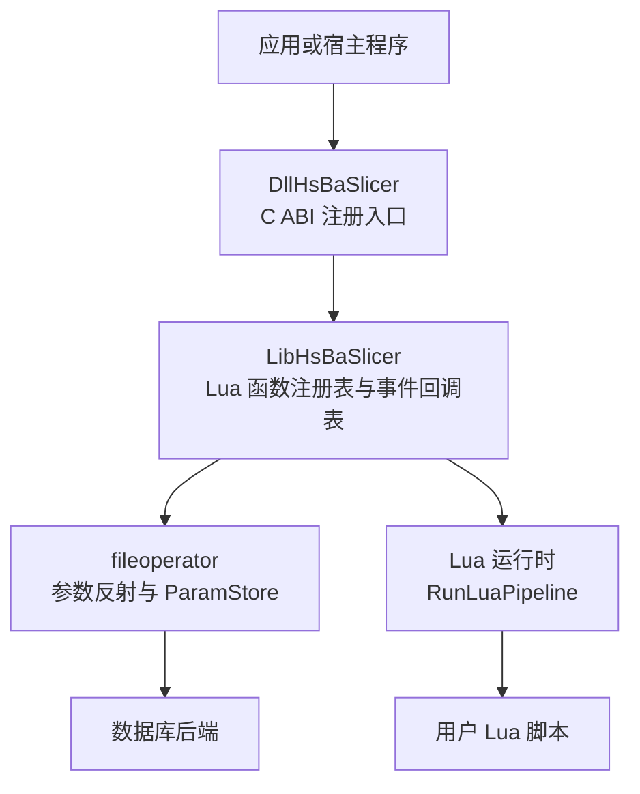
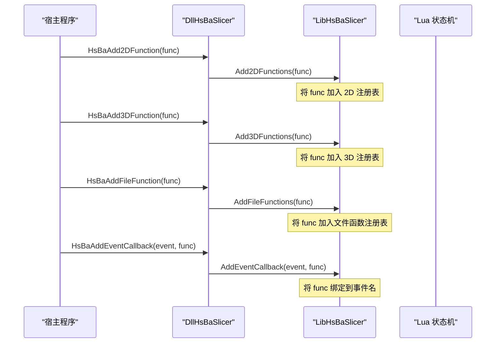
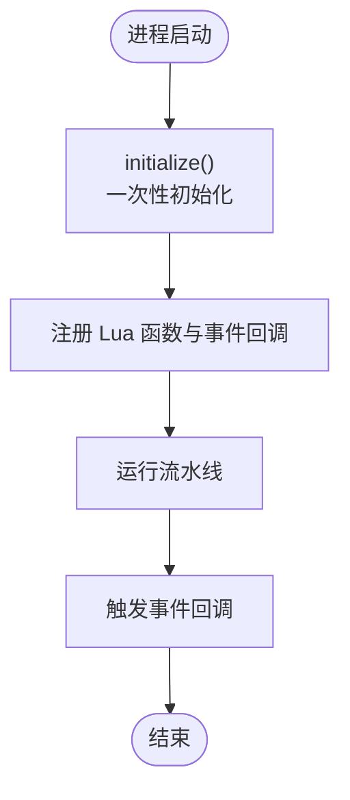
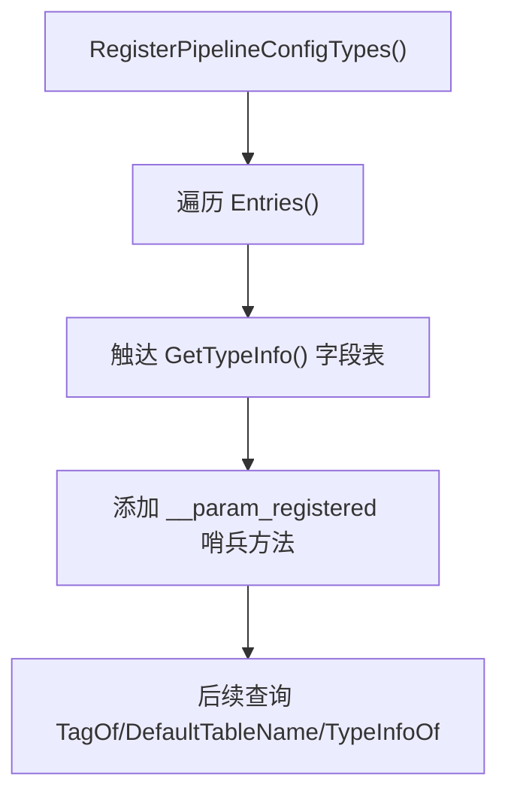
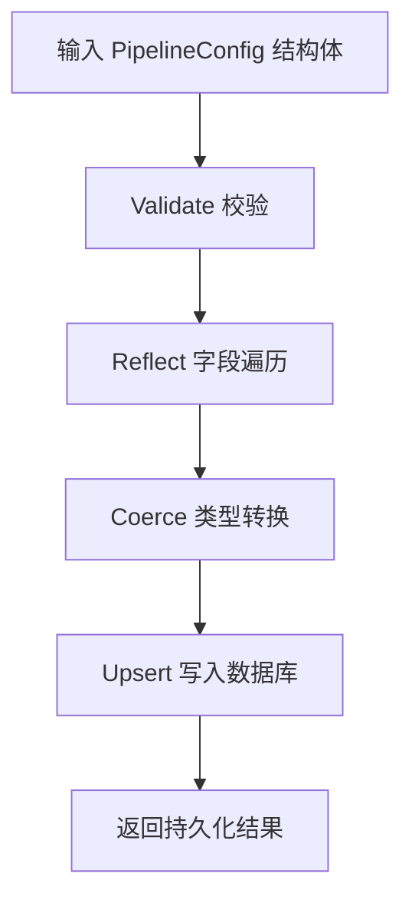
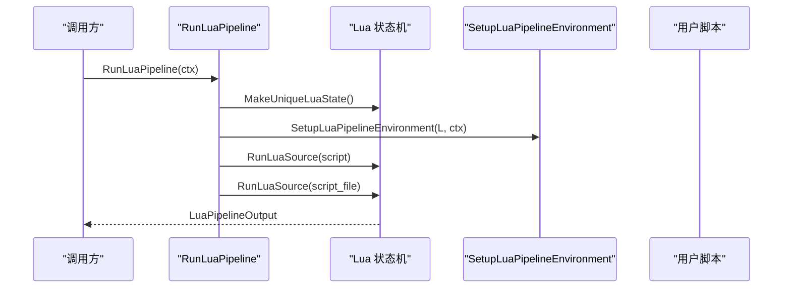
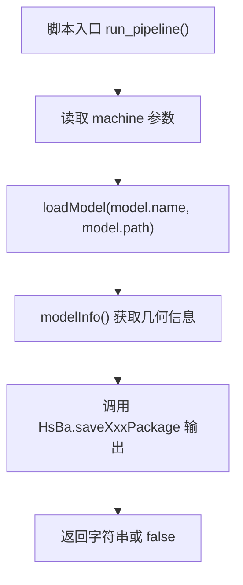

# 算法注册与发现系统

<cite>
**本文引用的文件**   
- [lua_register.cpp](file://DllHsBaSlicer/lua_register.cpp)
- [event_source_register.cpp](file://DllHsBaSlicer/event_source_register.cpp)
- [LuaAddFunction.hpp](file://LibHsBaSlicer/Extends/LuaAddFunction.hpp)
- [param_reflect.cpp](file://fileoperator/param_reflect.cpp)
- [param_store.hpp](file://fileoperator/param_store.hpp)
- [LuaCommonTypes.cpp](file://LibHsBaSlicer/Extends/LuaCommonTypes.cpp)
- [lua_pipeline.cpp](file://LibHsBaSlicer/Extends/lua_pipeline.cpp)
- [pipeline_types.h](file://pipelinetypes/pipeline_types.h)
- [param_store_pipeline.h](file://DllHsBaSlicer/param_store_pipeline.h)
- [waam_pipeline.h](file://DllHsBaSlicer/waam_pipeline.h)
- [initialize.cpp](file://DllHsBaSlicer/initialize.cpp)
- [my_sla_pipeline.lua](file://samples/Custom/scripts/my_sla_pipeline.lua)
- [my_tdp_pipeline.lua](file://samples/Custom/scripts/my_tdp_pipeline.lua)
</cite>

## 目录
1. [项目概述与快速开始](#项目概述与快速开始)
2. [架构总览](#架构总览)
3. [核心概念](#核心概念)
4. [核心模块详解](#核心模块详解)
5. [高级主题](#高级主题)
6. [Lua 脚本系统](#lua-脚本系统)
7. [API 参考文档](#api-参考文档)
8. [集成指南](#集成指南)
9. [开发·测试与贡献](#开发·测试与贡献)
10. [扩展开发指南](#扩展开发指南)
11. [示例与教程](#示例与教程)
12. [部署·故障排除与FAQ](#部署·故障排除与faq)
13. [附录](#附录)

## 项目概述与快速开始
本文件系统性地梳理 HsBaSlicer 的“算法注册与发现系统”，重点覆盖以下能力：
- 动态算法加载机制：通过 C++ 工厂式注册表、Lua 函数注册表和事件回调表，在运行时向不同维度（2D、3D、文件操作）注入算法。
- 插件架构设计：DLL 层暴露 C ABI 注册入口，Lib 层维护注册表；Lua 脚本作为可热插拔算法载体。
- 运行时扩展能力：参数反射系统驱动 ParamStore，实现 PipelineConfig 类型的统一元数据描述、持久化与校验。
- 第三方库动态链接：以 DLL 为边界，对外暴露稳定 C ABI，内部使用 C++ 对象模型。
- 算法元数据与版本管理：基于 TypeInfo 字段表、PipelineConfigTag 标签和默认表名映射，形成可扩展的类型注册中心。
- 依赖关系管理：通过事件回调（如 zip、数据库）将子系统解耦，由调用方按需订阅。

快速开始建议：
- 若需要新增 C++ 原生算法：在 Lib 层实现算法逻辑，并通过 LuaAddFunction 提供的 AddXxxFunctions 接口注册到目标维度。
- 若需要新增 Lua 算法：编写脚本并放入 samples/Custom/scripts 或自定义路径，通过 RunLuaPipeline 执行。
- 若需要新增 PipelineConfig 类型：定义结构体，并在 param_reflect.cpp 的 Entries 中登记 tag、short_name 与默认表名。

[本节不直接分析具体源码文件]

## 架构总览
HsBaSlicer 的算法注册与发现系统采用“DLL 注册桥 + Lib 注册表 + Lua 运行时”的分层架构：
- DllHsBaSlicer 提供 C ABI 注册入口，负责把外部注册的函数指针转发给 Lib 层。
- LibHsBaSlicer 维护按维度分类的 LuaRegFunc 列表，以及事件名称到回调列表的映射。
- fileoperator 提供参数反射与存储，将 PipelineConfig 类型映射到数据库表，并提供统一的 Save/Load 流程。
- Lua 脚本通过 RunLuaPipeline 创建独立环境，预置全局变量与算子表，支持完全由脚本编排的流水线。



**图表来源** 
- [lua_register.cpp:9-42](file://DllHsBaSlicer/lua_register.cpp#L9-L42)
- [LuaAddFunction.hpp:21-74](file://LibHsBaSlicer/Extends/LuaAddFunction.hpp#L21-L74)
- [param_reflect.cpp:28-89](file://fileoperator/param_reflect.cpp#L28-L89)
- [lua_pipeline.cpp:960-994](file://LibHsBaSlicer/Extends/lua_pipeline.cpp#L960-L994)

**章节来源**
- [lua_register.cpp:9-42](file://DllHsBaSlicer/lua_register.cpp#L9-L42)
- [LuaAddFunction.hpp:21-74](file://LibHsBaSlicer/Extends/LuaAddFunction.hpp#L21-L74)
- [param_reflect.cpp:28-89](file://fileoperator/param_reflect.cpp#L28-L89)
- [lua_pipeline.cpp:960-994](file://LibHsBaSlicer/Extends/lua_pipeline.cpp#L960-L994)

## 核心概念
- 算法工厂模式：通过 AddXxxFunctions 注册 LuaRegFunc，运行时由框架遍历注册表并安装到对应 Lua 状态机。
- 类型注册表：param_reflect.cpp 集中维护 PipelineConfigTag 到 Utils::TypeInfo 的映射，提供 TagOf、DefaultTableName、TypeInfoOf 等查询。
- 参数反射系统：Utils::AnyObject 与 TypeInfo 字段表驱动 ParamStore 的 Validate -> Reflect -> Coerce -> Upsert 流程。
- 事件回调系统：以事件名为键，注册多个 LuaRegFunc，用于 Zipper、DB 等子系统的事件通知。
- 动态加载机制：DLL 层导出 C ABI 函数，供外部宿主或第三方库调用；Lua 脚本通过 RunLuaPipeline 动态载入和执行。

```mermaid
classDiagram
class LuaRegFunc {
<<function>>
"接收 lua_State* 并安装函数"
}
class EventRegistry {
+AddEventCallback(name, func)
+GetEventCallbacks(name) vector~LuaRegFunc~
}
class TypeRegistry {
+RegisterPipelineConfigTypes()
+TagOf(info) PipelineConfigTag
+DefaultTableName(tag) string_view
+TypeInfoOf(tag) TypeInfo*
}
class ParamStore {
+Save(cfg, key)
+Load(key, outCfg)
+EnsureSchema()
}
EventRegistry --> LuaRegFunc : "注册回调"
TypeRegistry --> ParamStore : "提供类型元数据"
```

**图表来源** 
- [LuaAddFunction.hpp:21-74](file://LibHsBaSlicer/Extends/LuaAddFunction.hpp#L21-L74)
- [param_reflect.cpp:72-161](file://fileoperator/param_reflect.cpp#L72-L161)
- [param_store.hpp:1-39](file://fileoperator/param_store.hpp#L1-L39)

**章节来源**
- [LuaAddFunction.hpp:21-74](file://LibHsBaSlicer/Extends/LuaAddFunction.hpp#L21-L74)
- [param_reflect.cpp:72-161](file://fileoperator/param_reflect.cpp#L72-L161)
- [param_store.hpp:1-39](file://fileoperator/param_store.hpp#L1-L39)

## 核心模块详解

### 动态算法加载机制
- DLL 层导出 HsBaAdd2DFunction/HsBaAdd3DFunction/HsBaAddFileFunction/HsBaAddEventCallback，将外部传入的函数指针转发到 Lib 层的 AddXxxFunctions/AddEventCallback。
- Lib 层维护三个维度的 LuaRegFunc 列表和一个事件回调表，确保每个 Lua 状态机在创建时能安装所有已注册的函数。
- 该机制允许第三方库在初始化阶段调用这些 C ABI 函数，从而在不修改核心代码的情况下扩展算法。



**图表来源** 
- [lua_register.cpp:9-42](file://DllHsBaSlicer/lua_register.cpp#L9-L42)
- [LuaAddFunction.hpp:21-74](file://LibHsBaSlicer/Extends/LuaAddFunction.hpp#L21-L74)

**章节来源**
- [lua_register.cpp:9-42](file://DllHsBaSlicer/lua_register.cpp#L9-L42)
- [LuaAddFunction.hpp:21-74](file://LibHsBaSlicer/Extends/LuaAddFunction.hpp#L21-L74)

### 插件架构设计与运行时扩展
- 插件边界：DLL 层仅暴露稳定的 C ABI，避免 C++ ABI 不稳定带来的兼容问题。
- 运行时扩展：通过事件回调机制，Zipper 与 DB 子系统可以向外暴露进度与查询结果，Lua 脚本或宿主程序可订阅这些事件。
- 生命周期管理：initialize 函数预留一次初始化点，便于集中完成 Lua/pipeline 注册与一次性运行时设置。



**图表来源** 
- [initialize.cpp:7-9](file://DllHsBaSlicer/initialize.cpp#L7-L9)
- [event_source_register.cpp:9-33](file://DllHsBaSlicer/event_source_register.cpp#L9-L33)

**章节来源**
- [initialize.cpp:7-9](file://DllHsBaSlicer/initialize.cpp#L7-L9)
- [event_source_register.cpp:9-33](file://DllHsBaSlicer/event_source_register.cpp#L9-L33)

### 算法工厂模式与类型注册表
- 算法工厂：AddXxxFunctions 是工厂注册入口，LuaRegFunc 是工厂产物，被框架在合适时机调用以安装函数。
- 类型注册表：Entries 集中维护 9 种 PipelineConfig 类型的短名、默认表名与 TypeInfo 指针；RegisterPipelineConfigTypes 保证 TypeInfo 字段表被初始化。
- 查询 API：IsPipelineConfigType、TagOf、DefaultTableName、TypeInfoOf、TagFromName 提供类型识别与查找。



**图表来源** 
- [param_reflect.cpp:28-89](file://fileoperator/param_reflect.cpp#L28-L89)
- [param_reflect.cpp:92-161](file://fileoperator/param_reflect.cpp#L92-L161)

**章节来源**
- [param_reflect.cpp:28-89](file://fileoperator/param_reflect.cpp#L28-L89)
- [param_reflect.cpp:92-161](file://fileoperator/param_reflect.cpp#L92-L161)

### 参数反射系统与 ParamStore
- 参数反射：ParamStore 依赖 AnyObject::ForeachField 与 TypeInfo 字段表，对结构体进行 Validate -> Reflect -> Coerce -> Upsert。
- 表映射：每种 PipelineConfig 类型有默认表名（如 hsba_param_fdm），可通过 DefaultTableName 获取。
- Lua 绑定：RegisterLuaParamStore 在 Lua 侧暴露 EnsureSchema/Save/Load/List/Update/Delete 等方法，并复用反射注册。



**图表来源** 
- [param_store.hpp:1-39](file://fileoperator/param_store.hpp#L1-L39)
- [param_reflect.cpp:72-89](file://fileoperator/param_reflect.cpp#L72-L89)
- [LuaCommonTypes.cpp:514-530](file://LibHsBaSlicer/Extends/LuaCommonTypes.cpp#L514-L530)

**章节来源**
- [param_store.hpp:1-39](file://fileoperator/param_store.hpp#L1-L39)
- [param_reflect.cpp:72-89](file://fileoperator/param_reflect.cpp#L72-L89)
- [LuaCommonTypes.cpp:514-530](file://LibHsBaSlicer/Extends/LuaCommonTypes.cpp#L514-L530)

### C++ 原生算法的静态注册方法
- 在 Lib 层实现算法逻辑后，通过 Add2DFunctions/Add3DFunctions/AddFileFunctions 注册到对应维度。
- 在 DLL 层通过 HsBaAdd2DFunction/HsBaAdd3DFunction/HsBaAddFileFunction 暴露 C ABI，供外部调用。
- 建议在宿主程序初始化阶段调用这些注册函数，确保所有算法在流水线开始前可用。

**章节来源**
- [lua_register.cpp:9-42](file://DllHsBaSlicer/lua_register.cpp#L9-L42)
- [LuaAddFunction.hpp:21-74](file://LibHsBaSlicer/Extends/LuaAddFunction.hpp#L21-L74)

### Lua 脚本算法的动态加载机制
- RunLuaPipeline 创建独立 Lua 状态机，SetupLuaPipelineEnvironment 安装 HsBa 表与上下文全局变量。
- 支持内联脚本预演（script）与脚本文件（script_file）两种加载方式。
- 脚本可访问 model_name、model_path、output_path、pipeline_config、machine 等全局变量，并通过 HsBa 算子表调用底层能力。



**图表来源** 
- [lua_pipeline.cpp:960-994](file://LibHsBaSlicer/Extends/lua_pipeline.cpp#L960-L994)

**章节来源**
- [lua_pipeline.cpp:960-994](file://LibHsBaSlicer/Extends/lua_pipeline.cpp#L960-L994)

### 第三方库的动态链接技术
- 通过 DLL 层导出 C ABI，第三方库可在编译期链接头文件，在运行期动态加载符号。
- 推荐做法：在第三方库初始化时调用 HsBaAddXxxFunction/HsBaAddEventCallback，将自身算法或回调注入到 HsBaSlicer 运行时。
- 注意 ABI 稳定性：避免在 C ABI 中使用 C++ 复杂类型，优先使用基本类型与指针。

**章节来源**
- [lua_register.cpp:9-42](file://DllHsBaSlicer/lua_register.cpp#L9-L42)
- [event_source_register.cpp:9-33](file://DllHsBaSlicer/event_source_register.cpp#L9-L33)

## 高级主题
- 版本兼容性检查：通过 PipelineConfigTag 与 TypeInfo 字段表，可在保存/加载时校验字段是否匹配，必要时引入 schema 迁移钩子。
- 依赖关系管理：事件回调将子系统解耦，例如 Zipper 的 on_add 与 DB 的 on_query，便于扩展与调试。
- 性能优化：注册表使用 std::vector 与 std::unordered_map，查询复杂度低；ParamStore 批量 API 包裹事务，减少 IO 开销。

[本节不直接分析具体源码文件]

## Lua 脚本系统
- 全局变量：HsBa、model_name、model_path、output_path、pipeline_config、machine。
- 算子表：HsBa 提供 loadModel、progress、saveSlaPackage/saveSlsPackage/saveWaamPackage 等算子。
- 脚本模板：samples/Custom/scripts 下提供 SLA、SLM、SLS、LOM、TDP、WAAM 等完整流水线脚本示例。



**图表来源** 
- [my_sla_pipeline.lua:20-37](file://samples/Custom/scripts/my_sla_pipeline.lua#L20-L37)
- [my_tdp_pipeline.lua:13-34](file://samples/Custom/scripts/my_tdp_pipeline.lua#L13-L34)

**章节来源**
- [my_sla_pipeline.lua:20-37](file://samples/Custom/scripts/my_sla_pipeline.lua#L20-L37)
- [my_tdp_pipeline.lua:13-34](file://samples/Custom/scripts/my_tdp_pipeline.lua#L13-L34)

## API 参考文档

### C ABI 注册入口
- HsBaAdd2DFunction(HsBaLuaRegFn func)
- HsBaAdd3DFunction(HsBaLuaRegFn func)
- HsBaAddFileFunction(HsBaLuaRegFn func)
- HsBaAddEventCallback(const char* event_name, HsBaLuaRegFn func)

**章节来源**
- [lua_register.cpp:9-42](file://DllHsBaSlicer/lua_register.cpp#L9-L42)

### 事件回调注册
- HsBaAddZipperEventCallback(const char* event_name, void (*func)(double, const char*))
- HsBaAddDBEventCallback(const char* event_name, void (*func)(const char*, const char*))

**章节来源**
- [event_source_register.cpp:9-33](file://DllHsBaSlicer/event_source_register.cpp#L9-L33)

### 参数存储流水线
- HsBaSavePipelineParams(const HsBaParamStoreConn_t* conn, HsBaPipelineKind kind, const char* table, const char* key, const void* config)

**章节来源**
- [param_store_pipeline.h:17-31](file://DllHsBaSlicer/param_store_pipeline.h#L17-L31)

### 流水线配置与结果类型
- HsBaFdmPipelineConfig_t / HsBaFdmPipelineResult_t
- HsBaCustomPipelineConfig_t / HsBaCustomPipelineResult_t
- HsBaWaamPipelineConfig_t / HsBaWaamPipelineResult_t

**章节来源**
- [pipeline_types.h:108-140](file://pipelinetypes/pipeline_types.h#L108-L140)
- [pipeline_types.h:698-726](file://pipelinetypes/pipeline_types.h#L698-L726)

### WAAM 流水线 C ABI
- HsBaCreateDefaultWaamConfig()
- HsBaRunWaamPipeline(const HsBaWaamPipelineConfig_t* config, HsBaWaamProgressCallback callback, void* user_data)

**章节来源**
- [waam_pipeline.h:17-38](file://DllHsBaSlicer/waam_pipeline.h#L17-L38)

## 集成指南
- 在宿主程序初始化阶段调用 initialize()，然后依次调用 HsBaAdd2DFunction/HsBaAdd3DFunction/HsBaAddFileFunction/HsBaAddEventCallback 完成算法与事件注册。
- 对于第三方库：在库初始化时调用上述注册函数，确保算法在 HsBaSlicer 运行时可用。
- 对于 Lua 脚本：将脚本放入 samples/Custom/scripts 或自定义目录，通过 RunLuaPipeline 指定 script_file 执行。

[本节不直接分析具体源码文件]

## 开发·测试与贡献
- 单元测试：tests 目录下包含多项针对任意对象、图算法、路径生成等的测试用例，可作为扩展开发的参考。
- 静态检查：static_check 提供 clang-format 与 cpp_analyzer 批处理脚本，建议在新代码提交前运行。
- 文档维护：docs 目录包含中英文文档，遵循统一分类结构，新增功能需同步更新对应页面。

[本节不直接分析具体源码文件]

## 扩展开发指南
- 新增 C++ 算法：
  - 在 Lib 层实现算法逻辑。
  - 通过 Add2DFunctions/Add3DFunctions/AddFileFunctions 注册到对应维度。
  - 在 DLL 层通过 HsBaAddXxxFunction 暴露 C ABI。
- 新增 Lua 算法：
  - 编写脚本，遵循 samples/Custom/scripts 的结构。
  - 使用 HsBa 算子表调用底层能力，返回字符串或 false。
- 新增 PipelineConfig 类型：
  - 定义结构体并在 pipeline_types.h 中声明。
  - 在 param_reflect.cpp 的 Entries 中登记 tag、short_name 与默认表名。
  - 通过 ParamStore 的 Save/Load 进行持久化。

[本节不直接分析具体源码文件]

## 示例与教程
- SLA 流水线脚本：my_sla_pipeline.lua 展示模型加载、切片、支撑、地板与打包流程。
- TDP 流水线脚本：my_tdp_pipeline.lua 展示粉末床工艺的参数配置与打包流程。
- 其他脚本：SLM、SLS、LOM、WAAM 等脚本均遵循相同模式，便于快速上手。

**章节来源**
- [my_sla_pipeline.lua:20-37](file://samples/Custom/scripts/my_sla_pipeline.lua#L20-L37)
- [my_tdp_pipeline.lua:13-34](file://samples/Custom/scripts/my_tdp_pipeline.lua#L13-L34)

## 部署·故障排除与FAQ
- 常见问题：
  - 未注册的流水线类型：ParamStore 会返回“unregistered pipeline kind”，请检查 Entries 是否正确登记。
  - Lua 脚本加载失败：检查脚本路径与语法错误，RunLuaPipeline 会返回错误消息。
  - 事件回调未触发：确认事件名与回调注册一致，如 "zipper.on_add"、"db.on_query"。
- 调试建议：
  - 使用日志输出关键步骤，结合 ProgressCallback 观察流水线进度。
  - 在 ParamStore 的 EnsureSchema 后检查数据库表结构是否符合预期。

**章节来源**
- [param_reflect.cpp:62-67](file://fileoperator/param_reflect.cpp#L62-L67)
- [lua_pipeline.cpp:960-994](file://LibHsBaSlicer/Extends/lua_pipeline.cpp#L960-L994)
- [event_source_register.cpp:9-33](file://DllHsBaSlicer/event_source_register.cpp#L9-L33)

## 附录
- 术语表：
  - 流水线：一系列算法阶段的有序组合，如 FDM、SLA、SLM、SLS、LOM、TDP、WAAM、Custom。
  - 注册表：维护算法函数与事件回调的容器，支持运行时扩展。
  - 反射：通过 TypeInfo 字段表对结构体进行遍历与转换。
- 参考链接：
  - docs/en 与 docs/zh 下的相关文档页面，涵盖各模块使用说明与最佳实践。

[本节不直接分析具体源码文件]