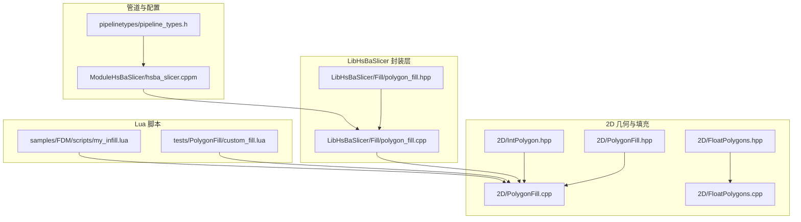
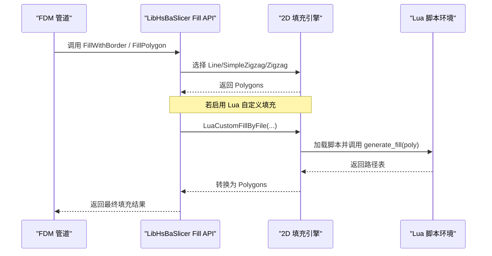
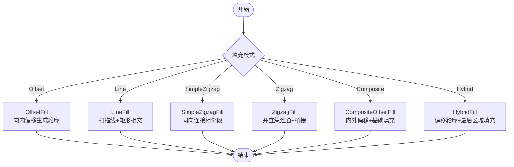
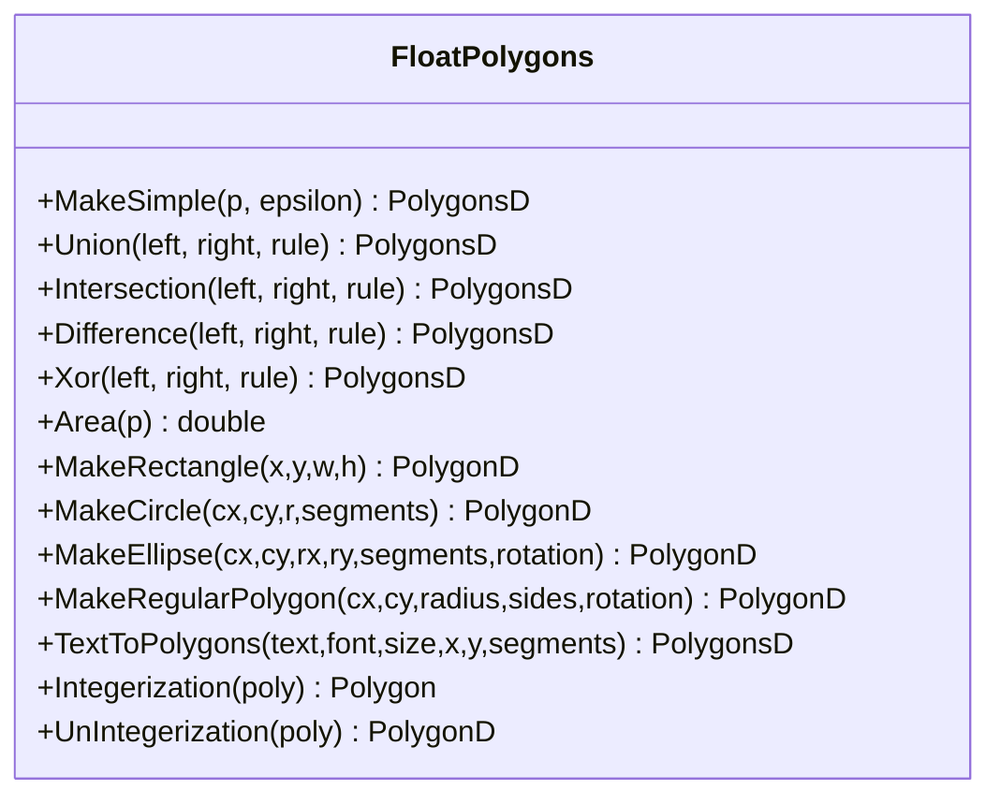
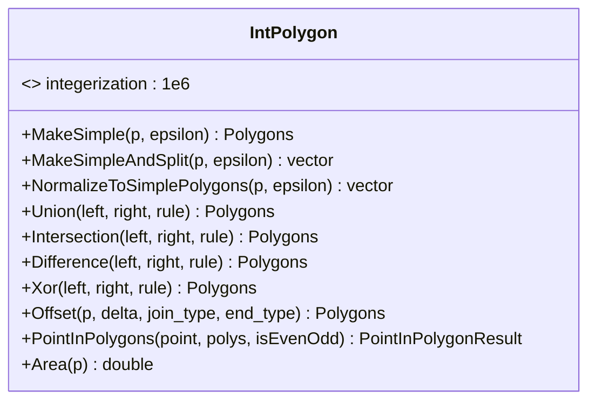
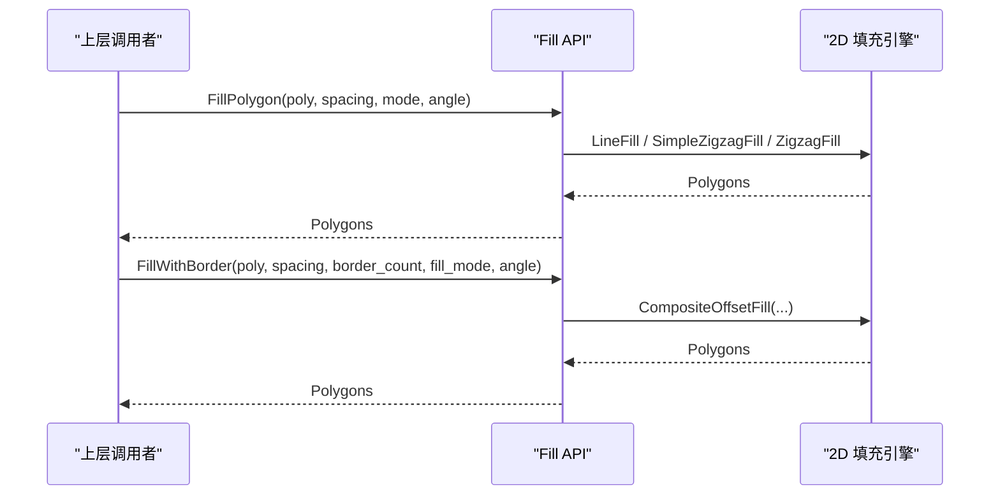
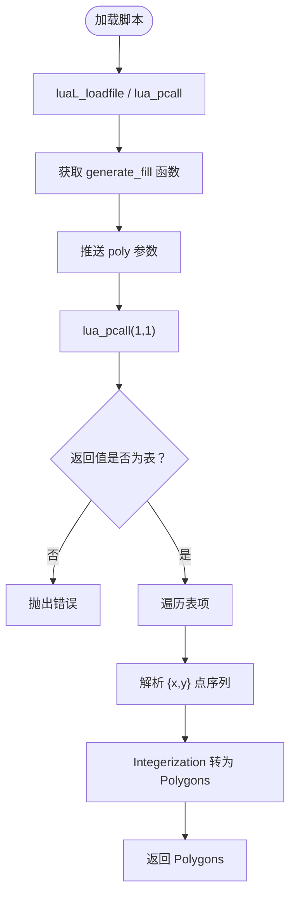
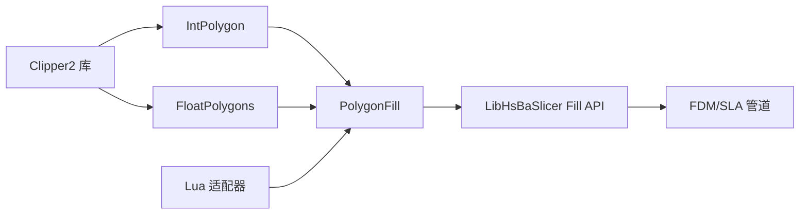

# 自定义填充算法开发

<cite>
**本文引用的文件**   
- [PolygonFill.hpp](file://2D/PolygonFill.hpp)
- [PolygonFill.cpp](file://2D/PolygonFill.cpp)
- [polygon_fill.hpp](file://LibHsBaSlicer/Fill/polygon_fill.hpp)
- [polygon_fill.cpp](file://LibHsBaSlicer/Fill/polygon_fill.cpp)
- [FloatPolygons.hpp](file://2D/FloatPolygons.hpp)
- [FloatPolygons.cpp](file://2D/FloatPolygons.cpp)
- [IntPolygon.hpp](file://2D/IntPolygon.hpp)
- [custom_fill.lua](file://tests/PolygonFill/custom_fill.lua)
- [my_infill.lua](file://samples/FDM/scripts/my_infill.lua)
- [hsba_slicer.cppm](file://ModuleHsBaSlicer/hsba_slicer.cppm)
- [pipeline_types.h](file://pipelinetypes/pipeline_types.h)
</cite>

## 目录
1. [引言](#引言)
2. [项目结构](#项目结构)
3. [核心概念](#核心概念)
4. [架构总览](#架构总览)
5. [核心组件详解](#核心组件详解)
6. [依赖关系分析](#依赖关系分析)
7. [性能与优化](#性能与优化)
8. [故障排除指南](#故障排除指南)
9. [结论](#结论)
10. [附录：API 参考与脚本约定](#附录api-参考与脚本约定)

## 引言
本文面向需要在 HsBaSlicer 中实现自定义填充算法的开发者，系统说明 PolygonFill 扩展点的设计、内置直线填充、锯齿形填充、混合填充的实现原理，以及基于 Lua 的自定义填充模式开发流程。文档同时梳理浮点数多边形数据结构 PolygonsD 的操作方法、几何变换函数、布尔运算工具等关键 API，并给出密度控制、路径优化、边界处理、并行化与内存优化的实践建议。

## 项目结构
与自定义填充直接相关的代码主要分布在以下模块：
- 2D 几何与填充引擎：`2D/PolygonFill.*`、`2D/FloatPolygons.*`、`2D/IntPolygon.hpp`
- LibHsBaSlicer 对外 C++ API：`LibHsBaSlicer/Fill/polygon_fill.*`
- 管道集成与配置：`ModuleHsBaSlicer/hsba_slicer.cppm`、`pipelinetypes/pipeline_types.h`
- Lua 脚本示例与测试：`tests/PolygonFill/custom_fill.lua`、`samples/FDM/scripts/my_infill.lua`

**图表来源**
- [PolygonFill.hpp:1-141](file://2D/PolygonFill.hpp#L1-L141)
- [PolygonFill.cpp:1-1669](file://2D/PolygonFill.cpp#L1-L1669)
- [FloatPolygons.hpp:1-271](file://2D/FloatPolygons.hpp#L1-L271)
- [FloatPolygons.cpp:1-453](file://2D/FloatPolygons.cpp#L1-L453)
- [IntPolygon.hpp:1-241](file://2D/IntPolygon.hpp#L1-L241)
- [polygon_fill.hpp:1-58](file://LibHsBaSlicer/Fill/polygon_fill.hpp#L1-L58)
- [polygon_fill.cpp:1-52](file://LibHsBaSlicer/Fill/polygon_fill.cpp#L1-L52)
- [hsba_slicer.cppm:479-696](file://ModuleHsBaSlicer/hsba_slicer.cppm#L479-L696)
- [pipeline_types.h:108-142](file://pipelinetypes/pipeline_types.h#L108-L142)
- [custom_fill.lua:1-16](file://tests/PolygonFill/custom_fill.lua#L1-L16)
- [my_infill.lua:1-89](file://samples/FDM/scripts/my_infill.lua#L1-L89)

**章节来源**
- [PolygonFill.hpp:1-141](file://2D/PolygonFill.hpp#L1-L141)
- [polygon_fill.hpp:1-58](file://LibHsBaSlicer/Fill/polygon_fill.hpp#L1-L58)
- [hsba_slicer.cppm:479-696](file://ModuleHsBaSlicer/hsba_slicer.cppm#L479-L696)

## 核心概念
- 整数坐标多边形与浮点坐标多边形：
  - `Point2`、`Polygon`、`Polygons` 表示 64 位整数坐标的多边形集合，用于 Clipper2 布尔运算与偏移。
  - `Point2D`、`PolygonD`、`PolygonsD` 表示双精度浮点坐标的多边形集合，便于高精度计算与 Lua 交互。
- 缩放因子 `integerization = 1e6`：在浮点与整数坐标之间转换，保证布尔运算精度。
- 填充模式枚举 `FillMode`：包含平行线填充、简单锯齿填充、高级锯齿填充三种模式。
- 填充生成器：
  - 偏移填充：通过向内偏移生成同心轮廓。
  - 直线填充：按角度扫描生成独立线段。
  - 锯齿填充：连接相邻扫描段形成连续折线。
  - 复合填充：对原始多边形及其内外偏移区域分别填充。
  - 混合填充：先输出若干偏移轮廓，再对最内层有效区域进行填充。
  - Lua 自定义填充：由脚本返回多段路径或闭合多边形。

**章节来源**
- [IntPolygon.hpp:16-26](file://2D/IntPolygon.hpp#L16-L26)
- [FloatPolygons.hpp:18-25](file://2D/FloatPolygons.hpp#L18-L25)
- [PolygonFill.hpp:63-68](file://2D/PolygonFill.hpp#L63-L68)

## 架构总览
HsBaSlicer 的填充系统采用“C++ 核心 + Lua 扩展”的双层架构：
- C++ 层提供高性能几何操作（布尔运算、偏移、面积、简化）和多种内置填充算法。
- Lua 层暴露 `PolygonOperations` 与 `PolygonFill` 接口，允许用户以脚本方式组合几何操作、调用内置填充函数，或直接返回自定义路径。
- LibHsBaSlicer 层将 C++ 填充能力封装为稳定 API，供上层管道使用。
- 管道层根据配置选择内置填充或 Lua 自定义填充。

**图表来源**
- [hsba_slicer.cppm:667-675](file://ModuleHsBaSlicer/hsba_slicer.cppm#L667-L675)
- [polygon_fill.cpp:13-49](file://LibHsBaSlicer/Fill/polygon_fill.cpp#L13-L49)
- [PolygonFill.cpp:1494-1585](file://2D/PolygonFill.cpp#L1494-L1585)

**章节来源**
- [hsba_slicer.cppm:667-675](file://ModuleHsBaSlicer/hsba_slicer.cppm#L667-L675)
- [polygon_fill.cpp:13-49](file://LibHsBaSlicer/Fill/polygon_fill.cpp#L13-L49)

## 核心组件详解

### 2D 填充引擎：PolygonFill
- 主要职责：
  - 提供 OffsetFill、LineFill、SimpleZigzagFill、ZigzagFill、CompositeOffsetFill、HybridFill。
  - 提供 Lua 注册函数与自定义填充入口。
- 关键设计：
  - 所有算法输入为整数坐标 `Polygons`，内部可转换为 `PolygonsD` 进行浮点计算。
  - 扫描线方向由角度决定，使用投影与矩形相交裁剪得到每行线段。
  - Zigzag 使用并查集连通相邻行区间，构建连续折线；必要时沿外环构造桥接路径。
  - Composite/Hybrid 通过多次 Offset 生成边框与内部区域，再递归应用基础填充模式。

**图表来源**
- [PolygonFill.cpp:504-541](file://2D/PolygonFill.cpp#L504-L541)
- [PolygonFill.cpp:544-564](file://2D/PolygonFill.cpp#L544-L564)
- [PolygonFill.cpp:568-800](file://2D/PolygonFill.cpp#L568-L800)
- [PolygonFill.cpp:803-1370](file://2D/PolygonFill.cpp#L803-L1370)
- [PolygonFill.cpp:1372-1428](file://2D/PolygonFill.cpp#L1372-L1428)
- [PolygonFill.cpp:1430-1491](file://2D/PolygonFill.cpp#L1430-L1491)

**章节来源**
- [PolygonFill.hpp:20-102](file://2D/PolygonFill.hpp#L20-L102)
- [PolygonFill.cpp:504-1491](file://2D/PolygonFill.cpp#L504-L1491)

### 浮点多边形 API：FloatPolygons
- 数据类型：
  - `Point2D`、`PolygonD`、`PolygonsD` 对应 Clipper2 的双精度类型。
- 几何操作：
  - 简化：`MakeSimple`
  - 布尔运算：`Union`、`Intersection`、`Difference`、`Xor`
  - 面积：`Area`
  - 形状生成：`MakeRectangle`、`MakeCircle`、`MakeEllipse`、`MakeRegularPolygon`
  - 文本转轮廓：`TextToPolygons`
- 坐标转换：
  - `Integerization`：浮点 → 整数
  - `UnIntegerization`：整数 → 浮点

**图表来源**
- [FloatPolygons.hpp:27-221](file://2D/FloatPolygons.hpp#L27-L221)
- [FloatPolygons.cpp:25-221](file://2D/FloatPolygons.cpp#L25-L221)

**章节来源**
- [FloatPolygons.hpp:18-221](file://2D/FloatPolygons.hpp#L18-L221)
- [FloatPolygons.cpp:18-221](file://2D/FloatPolygons.cpp#L18-L221)

### 整数多边形 API：IntPolygon
- 数据类型：
  - `Point2`、`Polygon`、`Polygons` 对应 Clipper2 的 64 位整数类型。
- 几何操作：
  - 简化与拆分：`MakeSimple`、`MakeSimpleAndSplit`、`NormalizeToSimplePolygons`
  - 布尔运算：`Union`、`Intersection`、`Difference`、`Xor`
  - 偏移：`Offset`
  - 点在内判断：`PointInPolygons`
  - 面积：`Area`
- 缩放常量：
  - `integerization = 1e6`

**图表来源**
- [IntPolygon.hpp:16-192](file://2D/IntPolygon.hpp#L16-L192)

**章节来源**
- [IntPolygon.hpp:16-192](file://2D/IntPolygon.hpp#L16-L192)

### LibHsBaSlicer 填充 API
- 对外暴露：
  - `FillPolygon`：根据 `FillMode` 选择具体填充算法。
  - `FillWithBorder`：使用 `CompositeOffsetFill` 生成边框与内部填充。
  - `LuaCustomFillByFile`：包装 `LuaCustomFill`，自动注入 2D 几何与路径优化函数。

**图表来源**
- [polygon_fill.cpp:13-33](file://LibHsBaSlicer/Fill/polygon_fill.cpp#L13-L33)
- [polygon_fill.hpp:17-37](file://LibHsBaSlicer/Fill/polygon_fill.hpp#L17-L37)

**章节来源**
- [polygon_fill.cpp:13-49](file://LibHsBaSlicer/Fill/polygon_fill.cpp#L13-L49)
- [polygon_fill.hpp:17-53](file://LibHsBaSlicer/Fill/polygon_fill.hpp#L17-L53)

### Lua 自定义填充
- 脚本约定：
  - 脚本必须导出一个函数，默认名为 `generate_fill`。
  - 参数为当前层多边形 `poly`（`PolygonsD`）。
  - 返回值应为路径表：每个元素是点表 `{x, y}`，可构成开放路径或闭合多边形。
- 可用库：
  - `PolygonOperations`：布尔运算、偏移、面积、形状生成、文本转轮廓。
  - `PolygonFill`：offsetFill、lineFill、simpleZigzagFill、zigzagFill、compositeOffsetFill、hybridFill、offsetOnly。
- 示例：
  - 测试脚本返回两条对角线。
  - FDM 示例脚本计算包围盒、生成平行线矩形，并与当前层做交集。

**图表来源**
- [PolygonFill.cpp:1494-1585](file://2D/PolygonFill.cpp#L1494-L1585)
- [custom_fill.lua:7-15](file://tests/PolygonFill/custom_fill.lua#L7-L15)
- [my_infill.lua:20-87](file://samples/FDM/scripts/my_infill.lua#L20-L87)

**章节来源**
- [PolygonFill.cpp:1494-1585](file://2D/PolygonFill.cpp#L1494-L1585)
- [custom_fill.lua:1-16](file://tests/PolygonFill/custom_fill.lua#L1-L16)
- [my_infill.lua:1-89](file://samples/FDM/scripts/my_infill.lua#L1-L89)

## 依赖关系分析
- 2D 填充引擎依赖：
  - Clipper2 库：布尔运算、偏移、面积、点在内判断。
  - Lua 适配器：Lua 状态管理、对象创建、表到多边形转换。
  - 基础工具：错误处理、模板辅助、线程池等。
- LibHsBaSlicer 封装层依赖：
  - 2D 填充引擎。
  - Lua 扩展函数注册（2D 几何与路径优化）。
- 管道层依赖：
  - LibHsBaSlicer 填充 API。
  - 配置结构体中的 Lua 脚本路径与函数名。

**图表来源**
- [IntPolygon.hpp:16-192](file://2D/IntPolygon.hpp#L16-L192)
- [FloatPolygons.hpp:27-221](file://2D/FloatPolygons.hpp#L27-L221)
- [PolygonFill.cpp:1-20](file://2D/PolygonFill.cpp#L1-L20)
- [polygon_fill.cpp:1-10](file://LibHsBaSlicer/Fill/polygon_fill.cpp#L1-L10)
- [hsba_slicer.cppm:667-675](file://ModuleHsBaSlicer/hsba_slicer.cppm#L667-L675)

**章节来源**
- [PolygonFill.cpp:1-20](file://2D/PolygonFill.cpp#L1-L20)
- [polygon_fill.cpp:1-10](file://LibHsBaSlicer/Fill/polygon_fill.cpp#L1-L10)

## 性能与优化
- 时间复杂度：
  - 直线填充：O(R·K)，R 为扫描行数，K 为每行片段数；矩形相交与排序为主要开销。
  - 锯齿填充：O(N²) 区间重叠检测（N 为片段总数），并查集近似 O(N α(N))；桥接路径计算与外环采样增加常数开销。
  - 复合/混合填充：多次 Offset 与基础填充叠加，复杂度随偏移层数线性增长。
- 空间复杂度：
  - 扫描行与片段列表占用 O(R·K)。
  - Zigzag 的并查集与组件映射占用 O(N)。
- 优化建议：
  - 调整 `spacing` 与 `angle_deg` 以减少扫描行数与片段数量。
  - 合理设置 `outwardCount`、`inwardCount`，避免过多偏移层。
  - 使用 `lineThickness` 控制最小面积阈值，提前终止无效偏移。
  - 在 Lua 脚本中使用 `PolygonOperations.intersection` 裁剪填充区域，减少后续路径长度。
  - 利用路径优化函数（如 `PathOptimize`）合并共线、缩短空走。
  - 对大规模层数据，考虑并行处理不同层或不同多边形区域。

[本节为通用性能讨论，不直接分析具体源码文件]

## 故障排除指南
- Lua 脚本错误：
  - 脚本加载失败：检查脚本路径与语法。
  - 函数未找到：确认导出函数名与 `functionName` 一致。
  - 返回值非表：确保 `generate_fill` 返回路径表。
- 几何运算异常：
  - 偏移结果为空：检查 `delta` 与 `join_type`，过小或过大可能导致退化。
  - 点在内判断不稳定：注意浮点误差，适当使用 `epsilon` 或缩放因子。
- 路径质量差：
  - 锯齿连接断裂：检查相邻行区间重叠条件与桥接逻辑。
  - 边界溢出：使用 `PolygonOperations.offsetOperation` 收缩或扩张边界。

**章节来源**
- [PolygonFill.cpp:1494-1585](file://2D/PolygonFill.cpp#L1494-L1585)
- [FloatPolygons.cpp:364-429](file://2D/FloatPolygons.cpp#L364-L429)

## 结论
HsBaSlicer 的填充系统通过 C++ 高性能几何内核与 Lua 灵活脚本扩展相结合，提供了从基础直线填充到复杂混合填充的完整能力。开发者可以基于现有 API 快速实现自定义填充模式，并通过密度控制、路径优化与边界处理提升打印质量与效率。理解 PolygonsD 与 Polygons 的数据模型、Clipper2 的布尔运算与偏移机制，是实现高效填充算法的关键。

[本节为总结性内容，不直接分析具体源码文件]

## 附录：API 参考与脚本约定

### C++ 填充 API
- `FillPolygon(poly, spacing, mode, angle_deg)`
- `FillWithBorder(poly, spacing, border_count, fill_mode, angle_deg)`
- `LuaCustomFillByFile(poly, scriptPath, functionName, lineThickness)`

**章节来源**
- [polygon_fill.hpp:17-53](file://LibHsBaSlicer/Fill/polygon_fill.hpp#L17-L53)
- [polygon_fill.cpp:13-49](file://LibHsBaSlicer/Fill/polygon_fill.cpp#L13-L49)

### 2D 几何 API
- 布尔运算：`Union`、`Intersection`、`Difference`、`Xor`
- 偏移：`Offset`
- 面积：`Area`
- 简化：`MakeSimple`、`MakeSimpleAndSplit`、`NormalizeToSimplePolygons`
- 形状生成：`MakeRectangle`、`MakeCircle`、`MakeEllipse`、`MakeRegularPolygon`
- 文本转轮廓：`TextToPolygons`

**章节来源**
- [FloatPolygons.hpp:27-221](file://2D/FloatPolygons.hpp#L27-L221)
- [IntPolygon.hpp:28-192](file://2D/IntPolygon.hpp#L28-L192)

### Lua 脚本约定
- 函数名：`generate_fill`
- 参数：`poly`（`PolygonsD`）
- 返回值：路径表（每个元素为 `{x, y}` 点序列）
- 可用库：`PolygonOperations`、`PolygonFill`

**章节来源**
- [custom_fill.lua:7-15](file://tests/PolygonFill/custom_fill.lua#L7-L15)
- [my_infill.lua:20-87](file://samples/FDM/scripts/my_infill.lua#L20-L87)

### 管道配置
- FDM 管道支持通过配置指定 Lua 填充脚本路径与函数名。
- 若未配置 Lua 脚本，则回退到内置 `FillWithBorder`。

**章节来源**
- [hsba_slicer.cppm:667-675](file://ModuleHsBaSlicer/hsba_slicer.cppm#L667-L675)
- [pipeline_types.h:108-142](file://pipelinetypes/pipeline_types.h#L108-L142)