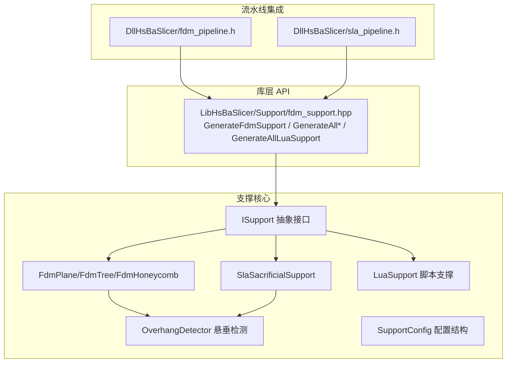
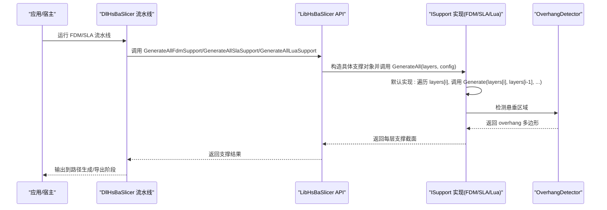
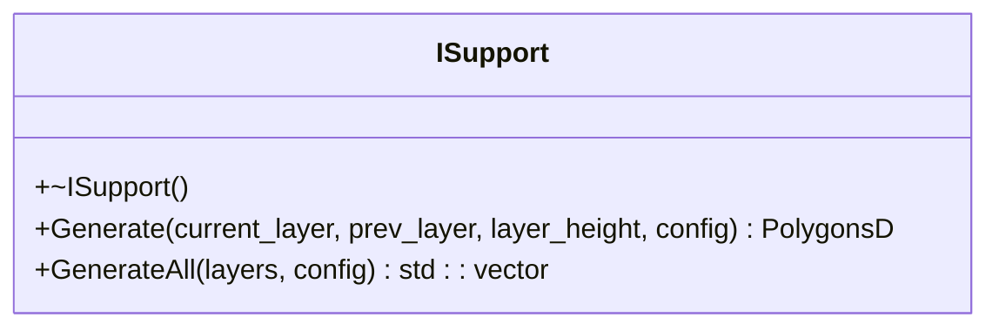
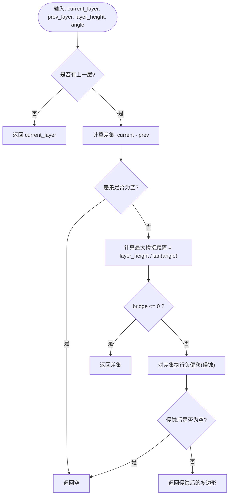
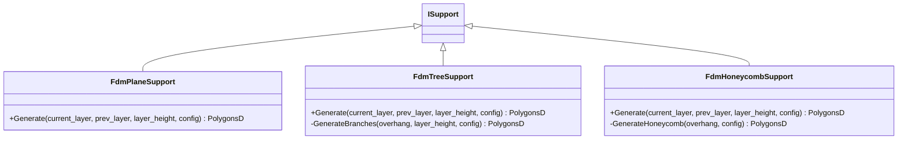
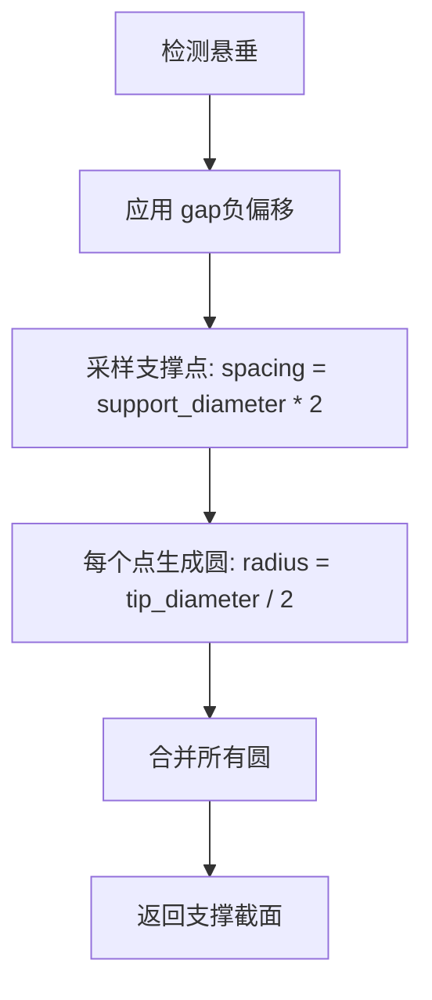
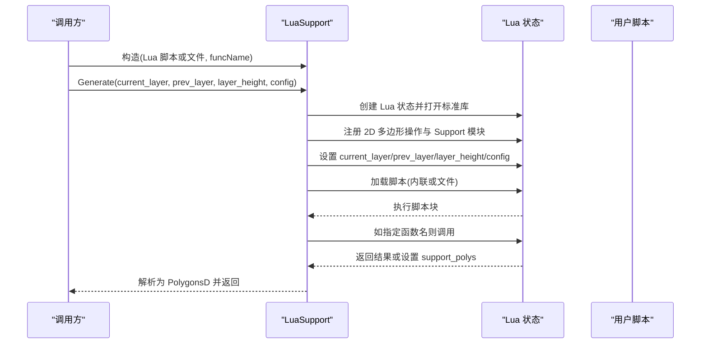
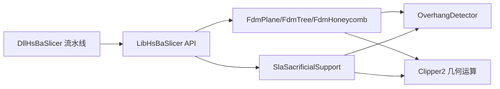
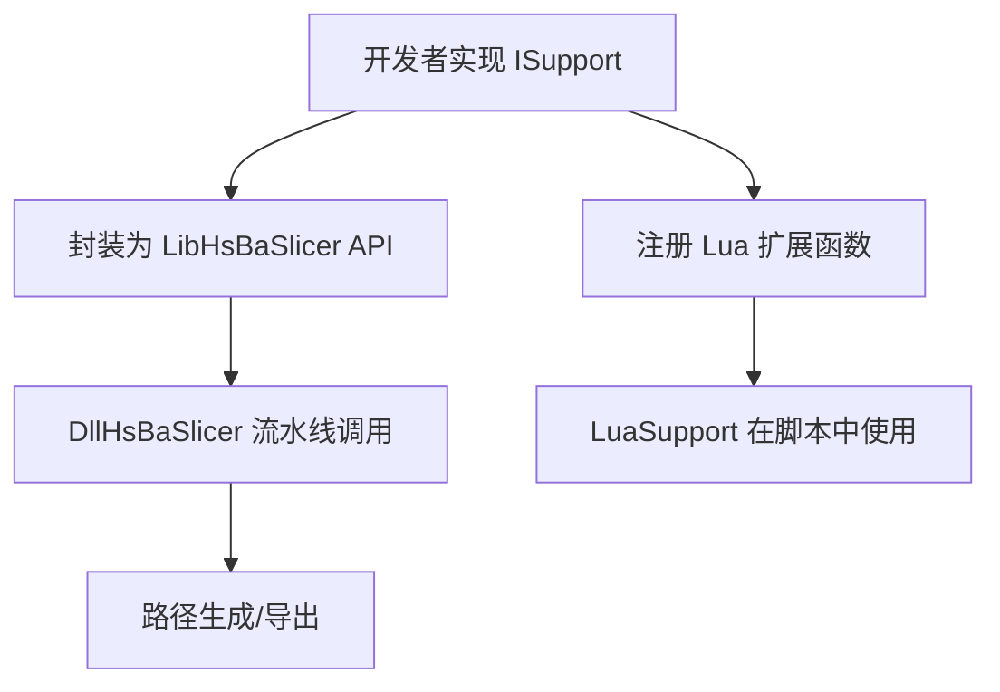

# 自定义支撑算法开发

<cite>
**本文引用的文件**   
- [ISupport.hpp](file://support/ISupport.hpp)
- [ISupport.cpp](file://support/ISupport.cpp)
- [FdmSupport.hpp](file://support/FdmSupport.hpp)
- [FdmSupport.cpp](file://support/FdmSupport.cpp)
- [SlaSupport.hpp](file://support/SlaSupport.hpp)
- [SlaSupport.cpp](file://support/SlaSupport.cpp)
- [LuaSupport.hpp](file://support/LuaSupport.hpp)
- [LuaSupport.cpp](file://support/LuaSupport.cpp)
- [OverhangDetector.hpp](file://support/OverhangDetector.hpp)
- [OverhangDetector.cpp](file://support/OverhangDetector.cpp)
- [SupportConfig.hpp](file://support/SupportConfig.hpp)
- [fdm_support.hpp](file://LibHsBaSlicer/Support/fdm_support.hpp)
- [fdm_pipeline.h](file://DllHsBaSlicer/fdm_pipeline.h)
- [sla_pipeline.h](file://DllHsBaSlicer/sla_pipeline.h)
- [support_test.cpp](file://tests\Support\support_test.cpp)
- [fdm_support_lib_test.cpp](file://tests\Support\fdm_support_lib_test.cpp)
</cite>

## 目录
1. [引言](#引言)
2. [项目结构](#项目结构)
3. [核心概念](#核心概念)
4. [核心模块详解](#核心模块详解)
5. [架构总览](#架构总览)
6. [详细组件分析](#详细组件分析)
7. [依赖关系分析](#依赖关系分析)
8. [性能与内存管理](#性能与内存管理)
9. [错误处理与调试](#错误处理与调试)
10. [测试与验证指南](#测试与验证指南)
11. [扩展开发与注册流程](#扩展开发与注册流程)
12. [结论](#结论)

## 引言
本指南面向需要在 HsBaSlicer 中实现“自定义支撑算法”的开发者。文档围绕 ISupport 抽象接口、悬垂检测、支撑区域计算、FDM/SLA 支撑策略、Lua 脚本扩展机制，以及参数配置、错误处理、性能优化和测试方法展开。读者可据此快速实现平面、树形、蜂窝等 FDM 支撑，或 SLA 牺牲型支撑，并通过 Lua 脚本完全替换内置算法。

## 项目结构
支撑相关代码集中在 support 目录，同时通过 LibHsBaSlicer 暴露高层 API，并在 DllHsBaSlicer 中接入 FDM/SLA 流水线。测试位于 tests\Support。

**图示来源**
- [ISupport.hpp:22-45](file://support/ISupport.hpp#L22-L45)
- [FdmSupport.hpp:19-63](file://support/FdmSupport.hpp#L19-L63)
- [SlaSupport.hpp:20-42](file://support/SlaSupport.hpp#L20-L42)
- [LuaSupport.hpp:40-81](file://support/LuaSupport.hpp#L40-L81)
- [OverhangDetector.hpp:20-50](file://support/OverhangDetector.hpp#L20-L50)
- [fdm_support.hpp:27-67](file://LibHsBaSlicer/Support/fdm_support.hpp#L27-L67)
- [fdm_pipeline.h:21-61](file://DllHsBaSlicer/fdm_pipeline.h#L21-L61)
- [sla_pipeline.h:17-56](file://DllHsBaSlicer/sla_pipeline.h#L17-L56)

**章节来源**
- [ISupport.hpp:1-49](file://support/ISupport.hpp#L1-L49)
- [FdmSupport.hpp:1-67](file://support/FdmSupport.hpp#L1-L67)
- [SlaSupport.hpp:1-46](file://support/SlaSupport.hpp#L1-L46)
- [LuaSupport.hpp:1-85](file://support/LuaSupport.hpp#L1-L85)
- [OverhangDetector.hpp:1-54](file://support/OverhangDetector.hpp#L1-L54)
- [fdm_support.hpp:1-72](file://LibHsBaSlicer/Support/fdm_support.hpp#L1-L72)
- [fdm_pipeline.h:1-68](file://DllHsBaSlicer/fdm_pipeline.h#L1-L68)
- [sla_pipeline.h:1-63](file://DllHsBaSlicer/sla_pipeline.h#L1-L63)

## 核心概念
- ISupport 抽象接口：定义单层的 Generate() 与全层 GenerateAll() 契约，所有支撑算法（FDM/SLA/Lua）均实现该接口。
- 悬垂检测 OverhangDetector：基于当前层与上一层轮廓差集，按角度阈值计算最大桥接距离并侵蚀过滤，得到需要支撑的区域。
- 支撑区域计算：在过悬垂区域上应用支撑间隙（gap），再根据具体策略生成截面多边形（柱体、树分支点、蜂窝单元）。
- 配置系统 SupportConfig：统一承载悬垂角度、层高、支撑直径、密度、图案选择、树形参数、蜂窝尺寸等；FdmSupportConfig 与 SlaSupportConfig 分别扩展工艺特定字段。
- 算法注册与调用：通过 LibHsBaSlicer 的 GenerateFdmSupport/GenerateAllFdmSupport/GenerateAllSlaSupport/GenerateAllLuaSupport 暴露给上层；DLL 层将支撑阶段嵌入 FDM/SLA 流水线。

**章节来源**
- [ISupport.hpp:22-45](file://support/ISupport.hpp#L22-L45)
- [OverhangDetector.hpp:20-50](file://support/OverhangDetector.hpp#L20-L50)
- [SupportConfig.hpp:14-43](file://support/SupportConfig.hpp#L14-L43)
- [fdm_support.hpp:27-67](file://LibHsBaSlicer/Support/fdm_support.hpp#L27-L67)

## 核心模块详解
- ISupport：提供默认 GenerateAll() 实现，逐层调用 Generate()。
- OverhangDetector：提供 Detect(current, prev, layer_height, angle) 与 MaxBridgeDistance(layer_height, angle)。
- FdmPlaneSupport/FdmTreeSupport/FdmHoneycombSupport：三种 FDM 支撑策略。
- SlaSacrificialSupport：SLA 牺牲型支撑，支持静态 Generate(current, prev, layer_height, SlaSupportConfig)。
- LuaSupport：从内联脚本或文件加载 Lua，注入 current_layer/prev_layer/layer_height/config 全局，并可选调用指定函数名返回支撑多边形。

**章节来源**
- [ISupport.cpp:9-21](file://support/ISupport.cpp#L9-L21)
- [OverhangDetector.cpp:23-87](file://support/OverhangDetector.cpp#L23-L87)
- [FdmSupport.cpp:48-76](file://support/FdmSupport.cpp#L48-L76)
- [FdmSupport.cpp:145-168](file://support/FdmSupport.cpp#L145-L168)
- [FdmSupport.cpp:244-267](file://support/FdmSupport.cpp#L244-L267)
- [SlaSupport.cpp:81-133](file://support/SlaSupport.cpp#L81-L133)
- [LuaSupport.cpp:113-178](file://support/LuaSupport.cpp#L113-L178)

## 架构总览
支撑子系统以 ISupport 为统一入口，向下复用 OverhangDetector 与几何布尔运算，向上由 LibHsBaSlicer 暴露高层 API，并由 DllHsBaSlicer 的 FDM/SLA 流水线编排调用。

**图示来源**
- [fdm_pipeline.h:21-61](file://DllHsBaSlicer/fdm_pipeline.h#L21-L61)
- [sla_pipeline.h:17-56](file://DllHsBaSlicer/sla_pipeline.h#L17-L56)
- [fdm_support.hpp:27-67](file://LibHsBaSlicer/Support/fdm_support.hpp#L27-L67)
- [ISupport.cpp:9-21](file://support/ISupport.cpp#L9-L21)
- [OverhangDetector.cpp:41-87](file://support/OverhangDetector.cpp#L41-L87)

## 详细组件分析

### ISupport 抽象接口与默认行为
- Generate(current_layer, prev_layer, layer_height, config)：纯虚函数，要求实现返回当前层支撑截面多边形集合。
- GenerateAll(layers, config)：默认实现按层迭代，首层 prev_layer 为空，直接调用 Generate。

**图示来源**
- [ISupport.hpp:22-45](file://support/ISupport.hpp#L22-L45)
- [ISupport.cpp:9-21](file://support/ISupport.cpp#L9-L21)

**章节来源**
- [ISupport.hpp:22-45](file://support/ISupport.hpp#L22-L45)
- [ISupport.cpp:9-21](file://support/ISupport.cpp#L9-L21)

### 悬垂检测算法 OverhangDetector
- Detect(current, prev, layer_height, angle_threshold_deg)：
  - 无上一层时，整个当前层视为悬垂。
  - 否则计算差集，并按角度阈值计算最大桥接距离，对差集进行负偏移（侵蚀）过滤小悬垂。
- MaxBridgeDistance(layer_height, angle_deg)：当角度≥90°时无悬垂；≤0°时视为无限悬垂；其余使用三角函数计算。

**图示来源**
- [OverhangDetector.cpp:23-87](file://support/OverhangDetector.cpp#L23-L87)

**章节来源**
- [OverhangDetector.hpp:20-50](file://support/OverhangDetector.hpp#L20-L50)
- [OverhangDetector.cpp:23-87](file://support/OverhangDetector.cpp#L23-L87)

### FDM 支撑算法（平面、树形、蜂窝）
- 平面支撑 FdmPlaneSupport：
  - 步骤：检测悬垂 → 应用 gap（负偏移）→ 按支撑直径膨胀形成柱截面。
- 树形支撑 FdmTreeSupport：
  - 步骤：检测悬垂 → 应用 gap → 在过悬垂区域内采样网格点，生成圆形分支端点并合并。
- 蜂窝支撑 FdmHoneycombSupport：
  - 步骤：检测悬垂 → 应用 gap → 生成平顶六边形网格并与过悬垂区域求交。

**图示来源**
- [FdmSupport.hpp:19-63](file://support/FdmSupport.hpp#L19-L63)
- [FdmSupport.cpp:48-76](file://support/FdmSupport.cpp#L48-L76)
- [FdmSupport.cpp:81-143](file://support/FdmSupport.cpp#L81-L143)
- [FdmSupport.cpp:173-242](file://support/FdmSupport.cpp#L173-L242)

**章节来源**
- [FdmSupport.hpp:19-63](file://support/FdmSupport.hpp#L19-L63)
- [FdmSupport.cpp:48-76](file://support/FdmSupport.cpp#L48-L76)
- [FdmSupport.cpp:145-168](file://support/FdmSupport.cpp#L145-L168)
- [FdmSupport.cpp:244-267](file://support/FdmSupport.cpp#L244-L267)

### SLA 支撑算法（牺牲型）
- SlaSacrificialSupport：
  - 在过悬垂区域采样支撑点（间距由 support_diameter 控制），每个点生成小半径圆（tip_radius），最后合并。
  - 提供静态 Generate(current, prev, layer_height, SlaSupportConfig)，也兼容 SupportConfig（内部转换为 SlaSupportConfig）。

**图示来源**
- [SlaSupport.cpp:38-79](file://support/SlaSupport.cpp#L38-L79)
- [SlaSupport.cpp:81-133](file://support/SlaSupport.cpp#L81-L133)

**章节来源**
- [SlaSupport.hpp:20-42](file://support/SlaSupport.hpp#L20-L42)
- [SlaSupport.cpp:38-133](file://support/SlaSupport.cpp#L38-L133)

### Lua 脚本扩展机制
- LuaSupport：
  - 支持内联脚本或外部文件，支持指定函数名（默认 generate_support）。
  - 初始化 Lua 环境：注册 2D 多边形操作、Support 模块、current_layer/prev_layer/layer_height/config 全局变量。
  - 执行脚本块，若指定函数名则调用该函数，最终从返回值或全局 support_polys 解析为 PolygonsD。
  - 支持 SetExternalRegs 注入额外 2D/3D 函数。

**图示来源**
- [LuaSupport.cpp:19-90](file://support/LuaSupport.cpp#L19-L90)
- [LuaSupport.cpp:113-178](file://support/LuaSupport.cpp#L113-L178)
- [LuaSupport.hpp:40-81](file://support/LuaSupport.hpp#L40-L81)

**章节来源**
- [LuaSupport.hpp:40-81](file://support/LuaSupport.hpp#L40-L81)
- [LuaSupport.cpp:19-90](file://support/LuaSupport.cpp#L19-L90)
- [LuaSupport.cpp:113-178](file://support/LuaSupport.cpp#L113-L178)

## 依赖关系分析
- 支撑算法依赖 OverhangDetector 提供悬垂区域。
- FDM/SLA 算法依赖 Clipper2 几何布尔运算（Union/Intersect/Difference/Offset）与整数化/反整数化工具。
- LibHsBaSlicer 的 fdm_support.hpp 暴露高层 API，封装 ISupport 实现。
- DllHsBaSlicer 的 FDM/SLA 流水线头文件定义了同步/异步接口，将支撑阶段纳入完整切片流程。

**图示来源**
- [FdmSupport.cpp:48-76](file://support/FdmSupport.cpp#L48-L76)
- [SlaSupport.cpp:81-133](file://support/SlaSupport.cpp#L81-L133)
- [fdm_support.hpp:27-67](file://LibHsBaSlicer/Support/fdm_support.hpp#L27-L67)
- [fdm_pipeline.h:21-61](file://DllHsBaSlicer/fdm_pipeline.h#L21-L61)
- [sla_pipeline.h:17-56](file://DllHsBaSlicer/sla_pipeline.h#L17-L56)

**章节来源**
- [FdmSupport.cpp:48-76](file://support/FdmSupport.cpp#L48-L76)
- [SlaSupport.cpp:81-133](file://support/SlaSupport.cpp#L81-L133)
- [fdm_support.hpp:27-67](file://LibHsBaSlicer/Support/fdm_support.hpp#L27-L67)
- [fdm_pipeline.h:21-61](file://DllHsBaSlicer/fdm_pipeline.h#L21-L61)
- [sla_pipeline.h:17-56](file://DllHsBaSlicer/sla_pipeline.h#L17-L56)

## 性能与内存管理
- 几何运算优化：
  - 使用整数化坐标进行布尔运算与偏移，减少浮点误差；必要时使用 Round Join 平滑角点。
  - 先对差集做负偏移过滤小悬垂，避免后续膨胀/填充产生过多碎片。
- 数据结构与复杂度：
  - 树形支撑采样网格 O(N×M)，其中 N/M 为包围盒在 x/y 方向的步数；可通过增大 spacing 降低点数。
  - 蜂窝支撑生成六边形网格 O(K)，K 为单元格数量；与过悬垂区域求交一次。
- 内存管理：
  - 优先使用局部容器与 move 语义减少拷贝；对大量中间多边形集合使用 reserve 预分配。
  - 在 Lua 侧，避免频繁创建大表；尽量在脚本中批量构建结果后一次性返回。
- 并行与流水线：
  - 上层流水线（FDM/SLA）支持异步接口，可在任务完成后回调；支撑阶段本身为逐层串行，但可结合上层线程池进行层间并行（需自行保证数据一致性）。

[本节为通用指导，不直接分析具体文件]

## 错误处理与调试
- Lua 脚本错误：
  - LuaSupport 在 load/pcall 失败时抛出 RuntimeError，包含 Lua 错误消息；建议捕获并记录脚本内容与行号。
- 参数校验：
  - LuaSupport 在读取 config 字段时具备默认值回退逻辑；确保传入 config 为 table，否则可能触发早期默认返回。
- 调试建议：
  - 在 Lua 环境中打印 current_layer/prev_layer/layer_height/config 的值，确认数据正确性。
  - 使用单元测试覆盖边界情况（无悬垂、极小悬垂、角度阈值极端值）。

**章节来源**
- [LuaSupport.cpp:141-178](file://support/LuaSupport.cpp#L141-L178)
- [LuaSupport.cpp:19-90](file://support/LuaSupport.cpp#L19-L90)

## 测试与验证指南
- 悬垂检测测试：
  - 无上一层时返回整个当前层；相同层无悬垂；小悬垂按角度阈值过滤。
- FDM 支撑测试：
  - 平面/树形/蜂窝在无悬垂时返回空；有悬垂时生成非空支撑截面。
- SLA 支撑测试：
  - 无悬垂返回空；有悬垂时生成牺牲型支撑点并合并。
- Lua 支撑测试：
  - 内联脚本返回空或多边形；支持指定函数名；可访问 config 字段；支持从文件加载脚本。
- 高层 API 测试：
  - GenerateFdmSupport 按 support_pattern 分派；GenerateAll* 返回与输入层数一致的结果；GenerateAllLuaSupport 逐层执行脚本。

**章节来源**
- [support_test.cpp:41-91](file://tests\Support\support_test.cpp#L41-L91)
- [support_test.cpp:98-192](file://tests\Support\support_test.cpp#L98-L192)
- [support_test.cpp:199-224](file://tests\Support\support_test.cpp#L199-L224)
- [support_test.cpp:231-308](file://tests\Support\support_test.cpp#L231-L308)
- [support_test.cpp:315-336](file://tests\Support\support_test.cpp#L315-L336)
- [fdm_support_lib_test.cpp:26-56](file://tests\Support\fdm_support_lib_test.cpp#L26-L56)
- [fdm_support_lib_test.cpp:58-102](file://tests\Support\fdm_support_lib_test.cpp#L58-L102)

## 扩展开发与注册流程
- 实现自定义 ISupport：
  - 继承 ISupport 并实现 Generate()；如需全层批处理，可直接使用默认 GenerateAll()。
- 参数配置：
  - 使用 SupportConfig 或其子类（FdmSupportConfig/SlaSupportConfig）传递参数；确保字段类型与单位符合约定。
- 在 LibHsBaSlicer 暴露 API：
  - 参考 fdm_support.hpp 中的 GenerateFdmSupport/GenerateAllFdmSupport/GenerateAllSlaSupport/GenerateAllLuaSupport，封装你的实现。
- 在 DllHsBaSlicer 流水线集成：
  - FDM/SLA 流水线头文件定义了同步/异步接口；在流水线中调用对应的高层 API 完成支撑阶段。
- Lua 扩展函数注册：
  - 通过 Add2DFunctions/Add3DFunctions/AddFileFunctions 注册自定义函数，在支撑阶段可用；LuaSupport 支持 SetExternalRegs 注入额外函数。

**图示来源**
- [fdm_support.hpp:27-67](file://LibHsBaSlicer/Support/fdm_support.hpp#L27-L67)
- [fdm_pipeline.h:21-61](file://DllHsBaSlicer/fdm_pipeline.h#L21-L61)
- [sla_pipeline.h:17-56](file://DllHsBaSlicer/sla_pipeline.h#L17-L56)
- [LuaSupport.cpp:108-111](file://support/LuaSupport.cpp#L108-L111)

**章节来源**
- [fdm_support.hpp:27-67](file://LibHsBaSlicer/Support/fdm_support.hpp#L27-L67)
- [fdm_pipeline.h:21-61](file://DllHsBaSlicer/fdm_pipeline.h#L21-L61)
- [sla_pipeline.h:17-56](file://DllHsBaSlicer/sla_pipeline.h#L17-L56)
- [LuaSupport.cpp:108-111](file://support/LuaSupport.cpp#L108-L111)

## 结论
通过 ISupport 抽象接口，HsBaSlicer 提供了统一的支撑算法扩展点。开发者可基于 OverhangDetector 的悬垂检测结果，实现平面、树形、蜂窝等 FDM 支撑，或 SLA 牺牲型支撑，并通过 Lua 脚本完全定制支撑生成逻辑。配合 SupportConfig 参数体系与 Lib/DLL 层 API，支撑算法可无缝集成到 FDM/SLA 流水线中。遵循本文的性能与内存管理建议、错误处理与调试方法，以及测试用例编写指南，可高效实现高度定制化的支撑生成解决方案。