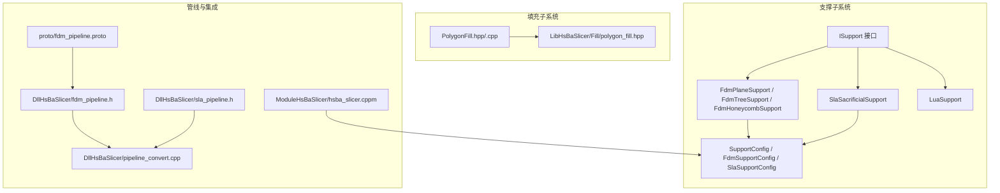
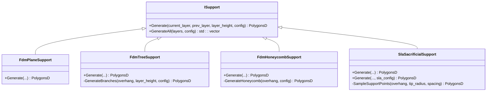
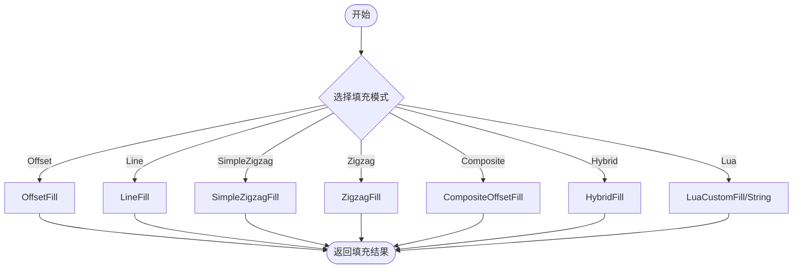
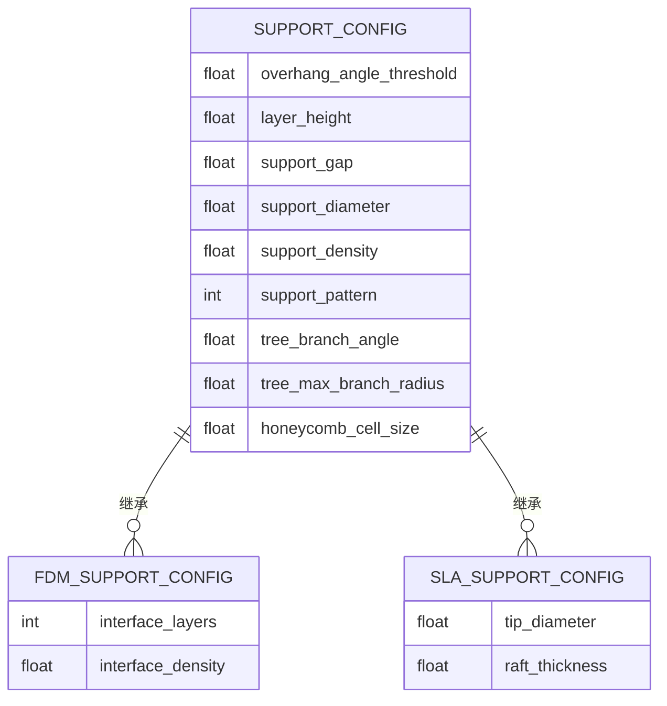
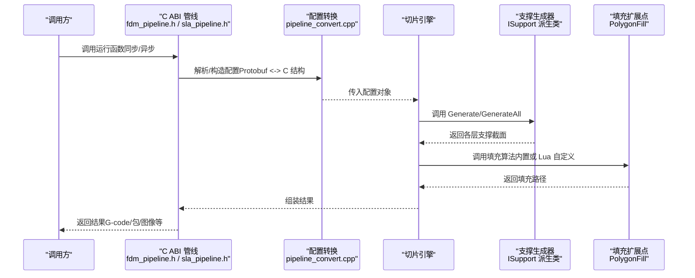
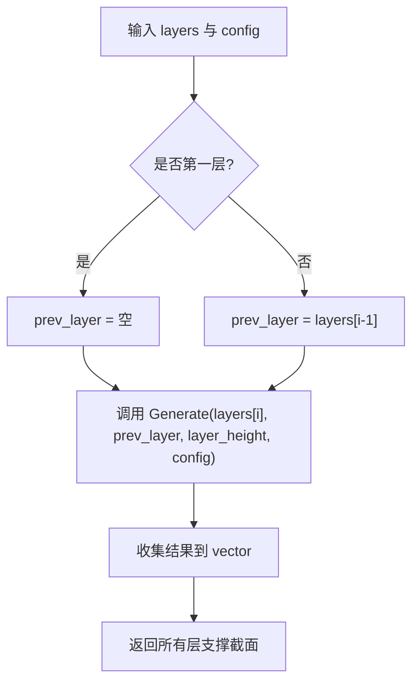
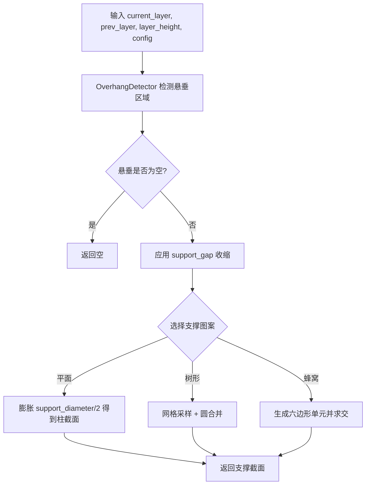
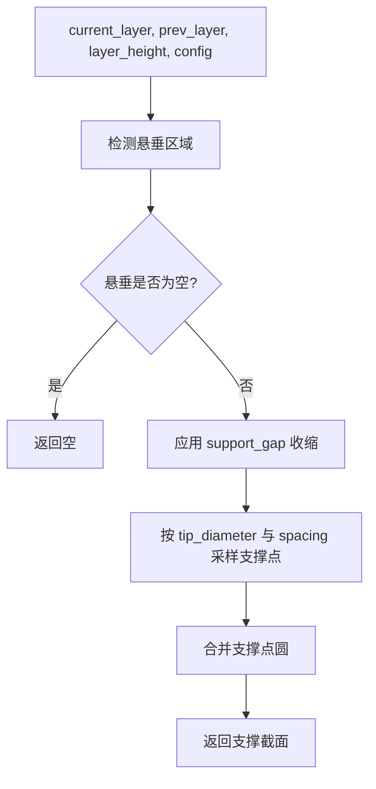
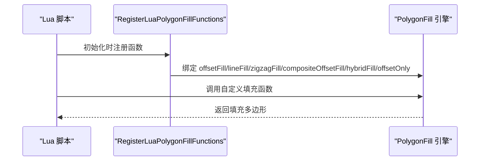
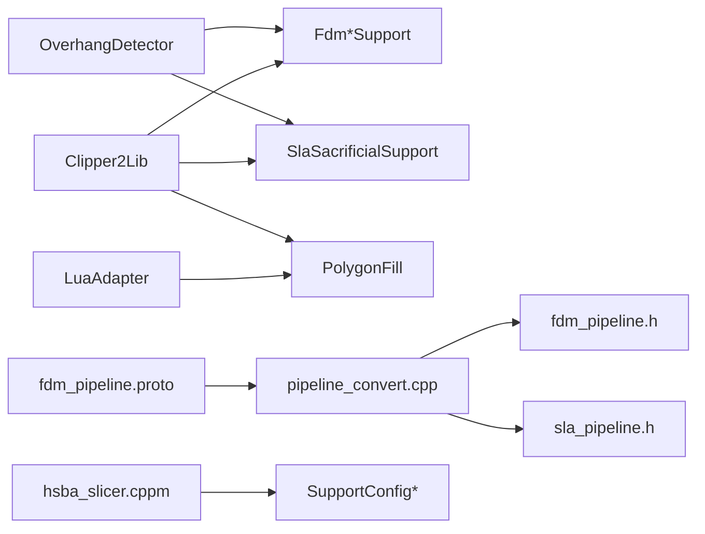

# 自定义算法开发

<cite>
**本文引用的文件**   
- [ISupport.hpp](file://support/ISupport.hpp)
- [ISupport.cpp](file://support/ISupport.cpp)
- [FdmSupport.hpp](file://support/FdmSupport.hpp)
- [FdmSupport.cpp](file://support/FdmSupport.cpp)
- [SlaSupport.hpp](file://support/SlaSupport.hpp)
- [SlaSupport.cpp](file://support/SlaSupport.cpp)
- [LuaSupport.hpp](file://support/LuaSupport.hpp)
- [LuaAdapter.cpp](file://support/LuaAdapter.cpp)
- [SupportConfig.hpp](file://support/SupportConfig.hpp)
- [PolygonFill.hpp](file://2D/PolygonFill.hpp)
- [PolygonFill.cpp](file://2D/PolygonFill.cpp)
- [polygon_fill.hpp](file://LibHsBaSlicer/Fill/polygon_fill.hpp)
- [fdm_pipeline.h](file://DllHsBaSlicer/fdm_pipeline.h)
- [sla_pipeline.h](file://DllHsBaSlicer/sla_pipeline.h)
- [pipeline_convert.cpp](file://DllHsBaSlicer/pipeline_convert.cpp)
- [fdm_pipeline.proto](file://proto/fdm_pipeline.proto)
- [hsba_slicer.cppm](file://ModuleHsBaSlicer/hsba_slicer.cppm)
</cite>

## 目录
1. [引言](#引言)
2. [项目结构](#项目结构)
3. [核心概念](#核心概念)
4. [核心模块详解](#核心模块详解)
5. [架构总览](#架构总览)
6. [详细组件分析](#详细组件分析)
7. [依赖关系分析](#依赖关系分析)
8. [性能与内存优化](#性能与内存优化)
9. [测试与调试指南](#测试与调试指南)
10. [扩展开发模板与最佳实践](#扩展开发模板与最佳实践)
11. [结论](#结论)
12. [附录](#附录)

## 引言
本指南面向希望为 HsBaSlicer 切片引擎扩展自定义支撑算法、填充算法和几何处理能力的开发者。文档围绕 ISupport 接口、PolygonFill 扩展点、FDM/SLA 支撑实现、参数配置系统、注册机制、性能优化与内存管理展开，并提供可复用的开发模板、测试方法与调试技巧，帮助你在不侵入核心代码的前提下，实现高度定制化的几何处理解决方案。

## 项目结构
围绕“自定义算法”主题，仓库中与支撑、填充、流水线集成相关的核心位置如下：
- support：支撑抽象接口、FDM/SLA 支撑实现、Lua 自定义支撑、支撑配置
- 2D：多边形填充算法（偏移、直线、锯齿、复合、混合、Lua 自定义）
- LibHsBaSlicer/Fill：对外 C++ API 封装的填充能力
- DllHsBaSlicer：C ABI 管线入口（FDM/SLA），负责配置转换与执行
- ModuleHsBaSlicer：模块导出，重新导出支撑配置类型等公共符号
- proto：管线配置的 Protobuf 定义（含 FDM 填充模式与支撑模式枚举）

**图示来源**
- [ISupport.hpp:14-45](file://support/ISupport.hpp#L14-L45)
- [FdmSupport.hpp:13-63](file://support/FdmSupport.hpp#L13-L63)
- [SlaSupport.hpp:13-42](file://support/SlaSupport.hpp#L13-L42)
- [SupportConfig.hpp:14-43](file://support/SupportConfig.hpp#L14-L43)
- [PolygonFill.hpp:20-136](file://2D/PolygonFill.hpp#L20-L136)
- [polygon_fill.hpp:17-53](file://LibHsBaSlicer/Fill/polygon_fill.hpp#L17-L53)
- [fdm_pipeline.h:17-39](file://DllHsBaSlicer/fdm_pipeline.h#L17-L39)
- [sla_pipeline.h:17-56](file://DllHsBaSlicer/sla_pipeline.h#L17-L56)
- [pipeline_convert.cpp:25-55](file://DllHsBaSlicer/pipeline_convert.cpp#L25-L55)
- [hsba_slicer.cppm:117-147](file://ModuleHsBaSlicer/hsba_slicer.cppm#L117-L147)
- [fdm_pipeline.proto:5-17](file://proto/fdm_pipeline.proto#L5-L17)

**章节来源**
- [ISupport.hpp:14-45](file://support/ISupport.hpp#L14-L45)
- [FdmSupport.hpp:13-63](file://support/FdmSupport.hpp#L13-L63)
- [SlaSupport.hpp:13-42](file://support/SlaSupport.hpp#L13-L42)
- [SupportConfig.hpp:14-43](file://support/SupportConfig.hpp#L14-L43)
- [PolygonFill.hpp:20-136](file://2D/PolygonFill.hpp#L20-L136)
- [polygon_fill.hpp:17-53](file://LibHsBaSlicer/Fill/polygon_fill.hpp#L17-L53)
- [fdm_pipeline.h:17-39](file://DllHsBaSlicer/fdm_pipeline.h#L17-L39)
- [sla_pipeline.h:17-56](file://DllHsBaSlicer/sla_pipeline.h#L17-L56)
- [pipeline_convert.cpp:25-55](file://DllHsBaSlicer/pipeline_convert.cpp#L25-L55)
- [hsba_slicer.cppm:117-147](file://ModuleHsBaSlicer/hsba_slicer.cppm#L117-L147)
- [fdm_pipeline.proto:5-17](file://proto/fdm_pipeline.proto#L5-L17)

## 核心概念
- ISupport 接口：定义逐层支撑生成器的统一契约，输入当前层与上一层轮廓、层高与配置，输出当前层支撑截面多边形；提供默认的全层迭代实现 GenerateAll。
- SupportConfig 系列：通用支撑配置（悬垂角度阈值、层高、间隙、直径、密度、图案选择、树形分支角度/半径、蜂窝单元尺寸），以及 FDM/SLA 专用扩展字段。
- PolygonFill 扩展点：提供偏移、直线、锯齿、复合、混合填充，以及 Lua 自定义填充函数注册与调用，支持通过 LibHsBaSlicer 暴露给上层 API。
- 管线集成：FDM/SLA 管线通过 C ABI 暴露，内部使用协程执行预处理、切片、支撑、填充、路径生成等阶段；配置通过 Protobuf 在进程间或跨语言传递。

**章节来源**
- [ISupport.hpp:14-45](file://support/ISupport.hpp#L14-L45)
- [ISupport.cpp:9-21](file://support/ISupport.cpp#L9-L21)
- [SupportConfig.hpp:14-43](file://support/SupportConfig.hpp#L14-L43)
- [PolygonFill.hpp:20-136](file://2D/PolygonFill.hpp#L20-L136)
- [polygon_fill.hpp:17-53](file://LibHsBaSlicer/Fill/polygon_fill.hpp#L17-L53)
- [fdm_pipeline.h:17-39](file://DllHsBaSlicer/fdm_pipeline.h#L17-L39)
- [sla_pipeline.h:17-56](file://DllHsBaSlicer/sla_pipeline.h#L17-L56)

## 核心模块详解
### 支撑抽象与实现
- ISupport：抽象类，声明 Generate 与 GenerateAll；GenerateAll 默认按层迭代调用 Generate。
- FdmPlaneSupport：基于悬垂区域膨胀生成柱状支撑，应用间隙后以支撑直径为半径形成圆形截面。
- FdmTreeSupport：在悬垂区域内采样网格点生成树枝端点圆，合并重叠圆得到支撑截面。
- FdmHoneycombSupport：在悬垂区域内生成六边形蜂窝单元并与其求交，得到轻量但刚性的支撑结构。
- SlaSacrificialSupport：针对光固化树脂打印的牺牲支撑，以小尖端直径采样支撑点，层截面为锥形柱的圆。

**图示来源**
- [ISupport.hpp:22-45](file://support/ISupport.hpp#L22-L45)
- [FdmSupport.hpp:19-63](file://support/FdmSupport.hpp#L19-L63)
- [SlaSupport.hpp:20-42](file://support/SlaSupport.hpp#L20-L42)

**章节来源**
- [ISupport.hpp:22-45](file://support/ISupport.hpp#L22-L45)
- [ISupport.cpp:9-21](file://support/ISupport.cpp#L9-L21)
- [FdmSupport.hpp:19-63](file://support/FdmSupport.hpp#L19-L63)
- [FdmSupport.cpp:48-76](file://support/FdmSupport.cpp#L48-L76)
- [FdmSupport.cpp:81-168](file://support/FdmSupport.cpp#L81-L168)
- [FdmSupport.cpp:173-267](file://support/FdmSupport.cpp#L173-L267)
- [SlaSupport.hpp:20-42](file://support/SlaSupport.hpp#L20-L42)
- [SlaSupport.cpp:38-133](file://support/SlaSupport.cpp#L38-L133)

### 填充系统与扩展点
- PolygonFill 提供多种填充模式：OffsetFill、LineFill、SimpleZigzagFill、ZigzagFill、CompositeOffsetFill、HybridFill，以及 LuaCustomFill/LuaCustomFillString。
- RegisterLuaPolygonFillFunctions 将偏移、直线、锯齿、复合、混合、offsetOnly 等函数注册到 Lua 环境，供脚本自定义填充。
- LibHsBaSlicer/Fill/polygon_fill.hpp 暴露 FillPolygon、FillWithBorder、LuaCustomFillByFile 等 C++ API，便于上层库调用。

**图示来源**
- [PolygonFill.hpp:20-136](file://2D/PolygonFill.hpp#L20-L136)
- [PolygonFill.cpp:498-502](file://2D/PolygonFill.cpp#L498-L502)
- [polygon_fill.hpp:17-53](file://LibHsBaSlicer/Fill/polygon_fill.hpp#L17-L53)

**章节来源**
- [PolygonFill.hpp:20-136](file://2D/PolygonFill.hpp#L20-L136)
- [PolygonFill.cpp:223-502](file://2D/PolygonFill.cpp#L223-L502)
- [polygon_fill.hpp:17-53](file://LibHsBaSlicer/Fill/polygon_fill.hpp#L17-L53)

### 参数配置系统
- SupportConfig：包含 overhang_angle_threshold、layer_height、support_gap、support_diameter、support_density、support_pattern、tree_branch_angle、tree_max_branch_radius、honeycomb_cell_size。
- FdmSupportConfig：继承 SupportConfig，增加 interface_layers、interface_density。
- SlaSupportConfig：继承 SupportConfig，增加 tip_diameter、raft_thickness。
- FDM 管线配置通过 fdm_pipeline.proto 定义填充模式与支撑模式枚举，并在 pipeline_convert.cpp 中完成与 C 结构的互转。

**图示来源**
- [SupportConfig.hpp:14-43](file://support/SupportConfig.hpp#L14-L43)
- [fdm_pipeline.proto:5-17](file://proto/fdm_pipeline.proto#L5-L17)
- [pipeline_convert.cpp:25-55](file://DllHsBaSlicer/pipeline_convert.cpp#L25-L55)

**章节来源**
- [SupportConfig.hpp:14-43](file://support/SupportConfig.hpp#L14-L43)
- [fdm_pipeline.proto:5-17](file://proto/fdm_pipeline.proto#L5-L17)
- [pipeline_convert.cpp:25-55](file://DllHsBaSlicer/pipeline_convert.cpp#L25-L55)

## 架构总览
下图展示从外部调用到支撑/填充算法执行的端到端流程，包括 C ABI 管线、配置转换、支撑生成器与填充扩展点。

**图示来源**
- [fdm_pipeline.h:17-39](file://DllHsBaSlicer/fdm_pipeline.h#L17-L39)
- [sla_pipeline.h:17-56](file://DllHsBaSlicer/sla_pipeline.h#L17-L56)
- [pipeline_convert.cpp:25-55](file://DllHsBaSlicer/pipeline_convert.cpp#L25-L55)
- [ISupport.hpp:22-45](file://support/ISupport.hpp#L22-L45)
- [PolygonFill.hpp:20-136](file://2D/PolygonFill.hpp#L20-L136)

## 详细组件分析

### ISupport 接口与默认行为
- Generate：纯虚函数，要求实现根据当前层与上一层轮廓计算支撑截面。
- GenerateAll：默认实现按层迭代，首层 prev_layer 为空，依次调用 Generate。

**图示来源**
- [ISupport.cpp:9-21](file://support/ISupport.cpp#L9-L21)

**章节来源**
- [ISupport.hpp:22-45](file://support/ISupport.hpp#L22-L45)
- [ISupport.cpp:9-21](file://support/ISupport.cpp#L9-L21)

### FDM 支撑算法
- 平面支撑：检测悬垂区域 → 应用间隙 → 以支撑直径膨胀成柱截面。
- 树形支撑：在悬垂区域网格采样点生成圆，合并重叠圆得到分支截面。
- 蜂窝支撑：生成六边形单元并与悬垂区域求交，得到蜂窝支撑。

**图示来源**
- [FdmSupport.cpp:48-76](file://support/FdmSupport.cpp#L48-L76)
- [FdmSupport.cpp:81-168](file://support/FdmSupport.cpp#L81-L168)
- [FdmSupport.cpp:173-267](file://support/FdmSupport.cpp#L173-L267)

**章节来源**
- [FdmSupport.hpp:19-63](file://support/FdmSupport.hpp#L19-L63)
- [FdmSupport.cpp:48-76](file://support/FdmSupport.cpp#L48-L76)
- [FdmSupport.cpp:81-168](file://support/FdmSupport.cpp#L81-L168)
- [FdmSupport.cpp:173-267](file://support/FdmSupport.cpp#L173-L267)

### SLA 支撑算法
- 牺牲支撑：检测悬垂区域 → 应用间隙 → 以小尖端半径采样支撑点 → 合并圆得到截面。
- 提供静态重载接受 SlaSupportConfig，内部转换为 SupportConfig 再调用。

**图示来源**
- [SlaSupport.cpp:38-133](file://support/SlaSupport.cpp#L38-L133)

**章节来源**
- [SlaSupport.hpp:20-42](file://support/SlaSupport.hpp#L20-L42)
- [SlaSupport.cpp:38-133](file://support/SlaSupport.cpp#L38-L133)

### Lua 自定义支撑与填充
- 支撑：LuaSupport 允许用户用 Lua 脚本完全替换内置支撑算法，脚本可访问 current_layer、prev_layer、layer_height、config 等全局变量，并返回支撑多边形。
- 填充：RegisterLuaPolygonFillFunctions 将偏移、直线、锯齿、复合、混合、offsetOnly 等函数注册到 Lua 环境，脚本可通过 PolygonFill 表调用；同时支持 LuaCustomFill/LuaCustomFillString 直接加载脚本或内联代码。

**图示来源**
- [PolygonFill.cpp:498-502](file://2D/PolygonFill.cpp#L498-L502)
- [LuaAdapter.cpp:258-276](file://support/LuaAdapter.cpp#L258-L276)

**章节来源**
- [LuaSupport.hpp:21-46](file://support/LuaSupport.hpp#L21-L46)
- [PolygonFill.cpp:498-502](file://2D/PolygonFill.cpp#L498-L502)
- [LuaAdapter.cpp:258-276](file://support/LuaAdapter.cpp#L258-L276)

## 依赖关系分析
- 支撑子系统依赖 OverhangDetector（悬垂检测）、Clipper2Lib（几何布尔运算）、IntPolygon（整数化多边形）。
- 填充子系统依赖 Clipper2Lib、Lua 适配器与工具库。
- 管线集成依赖 Protobuf 配置与 C ABI 转换层。
- 模块导出层重新导出支撑配置类型，便于上层直接使用。

**图示来源**
- [FdmSupport.cpp:48-76](file://support/FdmSupport.cpp#L48-L76)
- [SlaSupport.cpp:38-133](file://support/SlaSupport.cpp#L38-L133)
- [PolygonFill.cpp:223-502](file://2D/PolygonFill.cpp#L223-L502)
- [pipeline_convert.cpp:25-55](file://DllHsBaSlicer/pipeline_convert.cpp#L25-L55)
- [fdm_pipeline.proto:5-17](file://proto/fdm_pipeline.proto#L5-L17)
- [hsba_slicer.cppm:117-147](file://ModuleHsBaSlicer/hsba_slicer.cppm#L117-L147)

**章节来源**
- [FdmSupport.cpp:48-76](file://support/FdmSupport.cpp#L48-L76)
- [SlaSupport.cpp:38-133](file://support/SlaSupport.cpp#L38-L133)
- [PolygonFill.cpp:223-502](file://2D/PolygonFill.cpp#L223-L502)
- [pipeline_convert.cpp:25-55](file://DllHsBaSlicer/pipeline_convert.cpp#L25-L55)
- [fdm_pipeline.proto:5-17](file://proto/fdm_pipeline.proto#L5-L17)
- [hsba_slicer.cppm:117-147](file://ModuleHsBaSlicer/hsba_slicer.cppm#L117-L147)

## 性能与内存优化
- 几何运算优化
  - 优先使用整数化多边形进行 Clipper2 布尔运算，减少浮点误差与重复计算。
  - 对大量小圆或单元先局部合并（如 UnionD）再与目标区域求交，降低中间结果规模。
- 采样与网格
  - 树形/牺牲支撑采用 bounding box 扫描与间距控制，避免过度密集采样。
  - 蜂窝单元生成时按行错位排列，减少冗余单元数量。
- 迭代与边界
  - 填充算法设置最大迭代次数（如 MAX_FILL_ITERATIONS），防止无限循环。
  - 对空输入或无效参数快速返回，减少无意义计算。
- 内存管理
  - 使用 reserve 预分配容器容量，减少动态扩容开销。
  - 及时释放中间结果，避免长时间持有大对象。
- 并行与协程
  - 管线内部使用协程执行阶段任务，避免阻塞主线程；可在上层对层间任务做并行调度（需保证数据依赖顺序）。

[本节为通用指导，不直接分析具体文件]

## 测试与调试指南
- 单元测试建议
  - 支撑算法：覆盖空悬垂、极小悬垂、复杂孔洞、不同层高与间隙组合。
  - 填充算法：验证偏移步长、角度、线宽、JoinType 对结果的影响；Lua 脚本路径与内联代码两种调用方式。
  - 配置转换：校验 Protobuf 与 C 结构字段映射正确性，尤其是枚举值与默认值。
- 调试技巧
  - 在 Generate/GenerateAll 入口处记录输入层数、悬垂面积、支撑截面数量。
  - 对关键几何操作（Offset、Union、Intersect）前后输出包围盒与顶点数，定位退化情况。
  - 使用日志库输出进度回调信息，结合样本程序观察阶段耗时。
- 参考示例
  - FDM 管线示例展示了同步/异步运行、进度回调与配置设置。
  - Custom 示例演示了 Lua 驱动的完整流水线与 Protobuf 字节流调用。

**章节来源**
- [samples/FDM/main.cpp:1-51](file://samples/FDM/main.cpp#L1-L51)
- [samples/Custom/main.cpp:20-59](file://samples/Custom/main.cpp#L20-L59)

## 扩展开发模板与最佳实践

### 自定义支撑算法模板
- 步骤
  1. 新建类继承 ISupport，实现 Generate。
  2. 复用 OverhangDetector 检测悬垂区域。
  3. 应用 support_gap 收缩模型接触面。
  4. 根据算法策略生成支撑截面（圆、网格、蜂窝等）。
  5. 使用 Clipper2 进行几何合并与裁剪。
  6. 返回 PolygonsD；如需全层支持，可直接使用 ISupport::GenerateAll。
- 注意事项
  - 保持与现有 SupportConfig 字段兼容，必要时扩展专用配置结构。
  - 对空输入与无效参数做防御性检查。
  - 尽量复用已有几何工具函数（Integerization、UnIntegerization、Offset、Union、Intersect）。

**章节来源**
- [ISupport.hpp:22-45](file://support/ISupport.hpp#L22-L45)
- [FdmSupport.cpp:48-76](file://support/FdmSupport.cpp#L48-L76)
- [SupportConfig.hpp:14-43](file://support/SupportConfig.hpp#L14-L43)

### 自定义填充模式模板
- 步骤
  1. 在 2D/PolygonFill.hpp/.cpp 中添加新填充函数（如 MyFill）。
  2. 若需 Lua 暴露，添加 l_myFill 桥接函数并注册到 polygonFillLib。
  3. 在 RegisterLuaPolygonFillFunctions 中注册新函数。
  4. 如需对外暴露，可在 LibHsBaSlicer/Fill/polygon_fill.hpp/.cpp 中添加包装函数。
- 注意事项
  - 遵循现有命名与参数约定（poly、spacing、angle_deg、lineThickness 等）。
  - 对 JoinType 等可选参数提供字符串解析与默认值。
  - 确保 Lua 返回值类型为 PolygonsD 表结构。

**章节来源**
- [PolygonFill.hpp:20-136](file://2D/PolygonFill.hpp#L20-L136)
- [PolygonFill.cpp:223-502](file://2D/PolygonFill.cpp#L223-L502)
- [polygon_fill.hpp:17-53](file://LibHsBaSlicer/Fill/polygon_fill.hpp#L17-L53)

### 参数配置与注册机制
- 配置
  - 使用 SupportConfig 及其派生结构承载支撑相关参数。
  - FDM 管线配置通过 fdm_pipeline.proto 定义，包含填充模式与支撑模式枚举。
- 注册
  - 支撑算法无需显式注册，由上层根据配置选择具体实现。
  - 填充算法通过 RegisterLuaPolygonFillFunctions 向 Lua 环境注册函数。
  - 模块层通过 hsba_slicer.cppm 重新导出支撑配置类型，便于上层使用。

**章节来源**
- [SupportConfig.hpp:14-43](file://support/SupportConfig.hpp#L14-L43)
- [fdm_pipeline.proto:5-17](file://proto/fdm_pipeline.proto#L5-L17)
- [PolygonFill.cpp:498-502](file://2D/PolygonFill.cpp#L498-L502)
- [hsba_slicer.cppm:117-147](file://ModuleHsBaSlicer/hsba_slicer.cppm#L117-L147)

## 结论
通过 ISupport 接口与 PolygonFill 扩展点，HsBaSlicer 提供了清晰的扩展边界与丰富的内置实现。开发者可以基于现有支撑与填充算法快速构建自定义方案，并通过 Lua 脚本灵活调整行为。配合统一的参数配置系统与 Protobuf 配置传输，能够在保持核心稳定的前提下实现高度定制化的几何处理解决方案。

## 附录
- 常用几何工具
  - Integerization/UnIntegerization：在浮点与整数多边形之间转换。
  - Offset/Union/Intersect：Clipper2 几何布尔运算。
  - PointInPolygons：点在多边形内的判定。
- 参考实现路径
  - FDM 支撑：FdmPlaneSupport、FdmTreeSupport、FdmHoneycombSupport
  - SLA 支撑：SlaSacrificialSupport
  - 填充扩展：OffsetFill、LineFill、SimpleZigzagFill、ZigzagFill、CompositeOffsetFill、HybridFill、LuaCustomFill

[本节为补充说明，不直接分析具体文件]