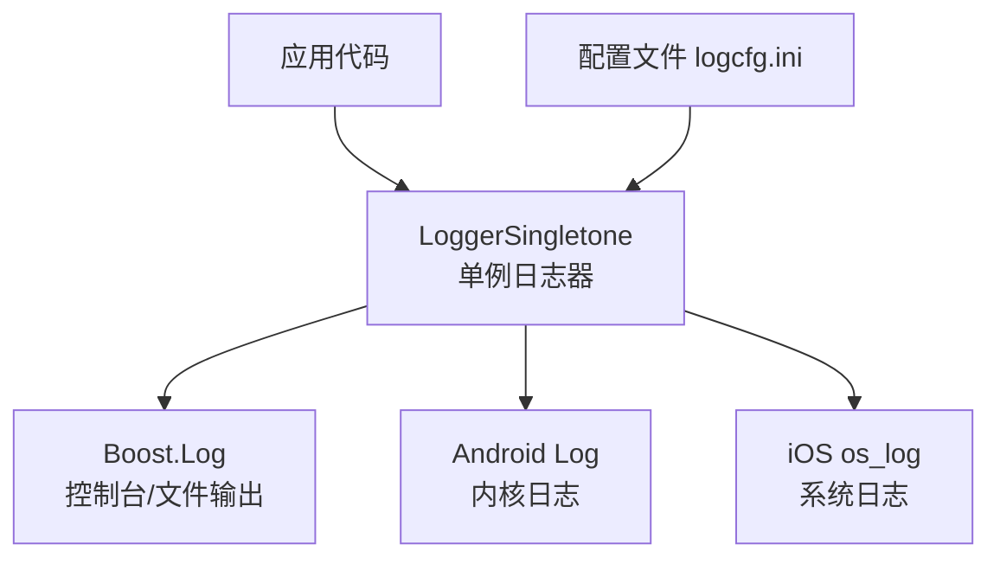
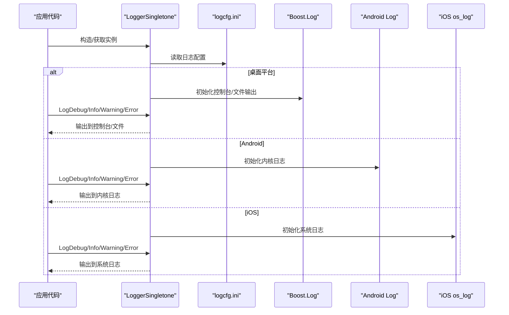
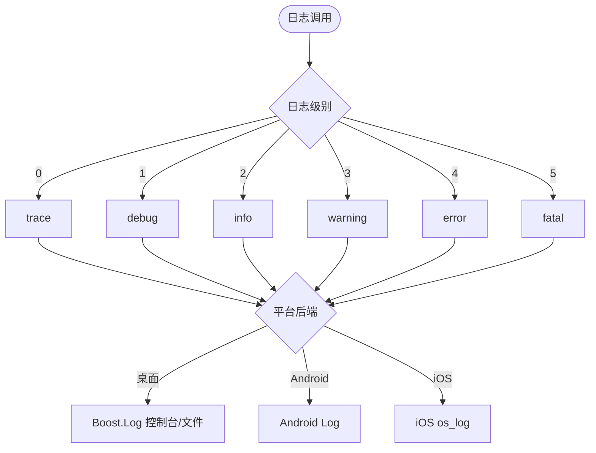
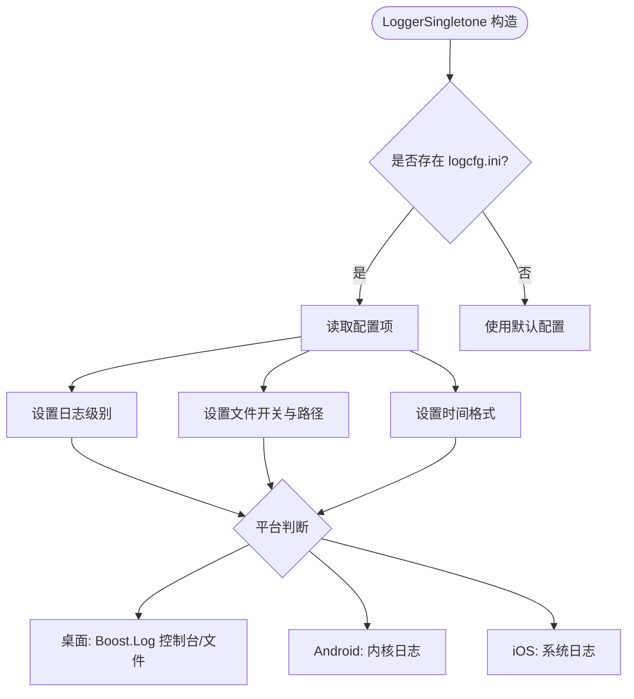
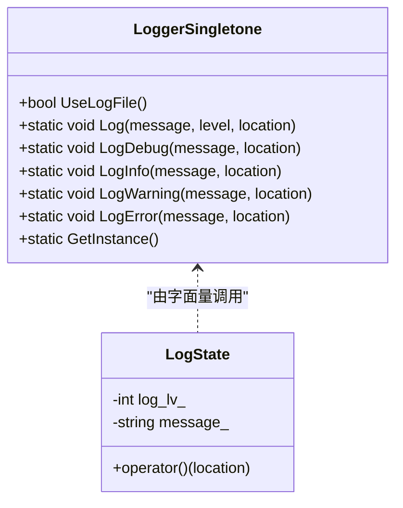
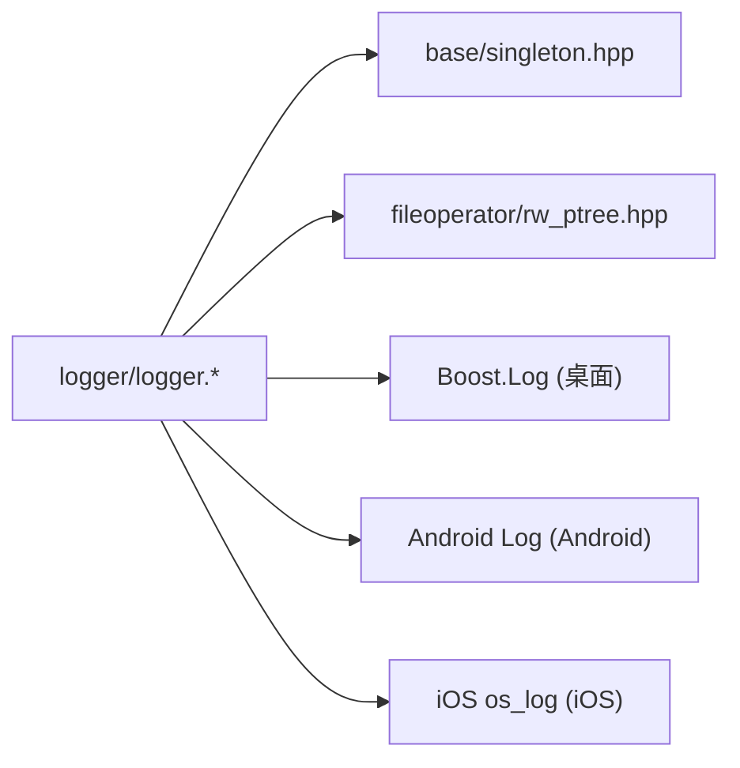

# 调试工具和技巧

<cite>
**本文引用的文件**   
- [logger.hpp](file://logger/logger.hpp)
- [logger.cpp](file://logger/logger.cpp)
- [README.md](file://README.md)
- [log_state.md](file://docs/zh/logger/log_state.md)
- [logger_singletone.md](file://docs/zh/logger/logger_singletone.md)
</cite>

## 目录
1. [简介](#简介)
2. [项目结构](#项目结构)
3. [核心组件](#核心组件)
4. [架构总览](#架构总览)
5. [详细组件分析](#详细组件分析)
6. [依赖关系分析](#依赖关系分析)
7. [性能与内存分析](#性能与内存分析)
8. [Lua 脚本调试指南](#lua-脚本调试指南)
9. [单元测试与自动化测试](#单元测试与自动化测试)
10. [远程与分布式调试](#远程与分布式调试)
11. [常见问题排查](#常见问题排查)
12. [结论](#结论)

## 简介
本文件面向 HsBaSlicer 扩展开发者，系统梳理调试工具与技巧，重点覆盖：
- 日志系统：级别、格式化、文件输出与配置
- Lua 脚本调试：断点、变量检查、错误追踪
- 性能分析：内存使用与分析、执行时间统计
- 单元测试框架：用例编写与自动化
- 远程与分布式调试：配置与使用
- 常见问题诊断与解决方案

## 项目结构
HsBaSlicer 采用模块化设计，日志子系统位于 logger 模块，提供跨平台、线程安全的单例日志器；文档位于 docs/zh/logger。构建与安装说明见根 README。

图表来源
- [logger.cpp:136-222](file://logger/logger.cpp#L136-L222)
- [logger.hpp:35-122](file://logger/logger.hpp#L35-L122)

章节来源
- [README.md:100-124](file://README.md#L100-L124)

## 核心组件
- LoggerSingletone：线程安全的单例日志器，支持多级别日志、源代码位置追踪、文件输出控制与跨平台适配（Windows/Linux/macOS、Android、iOS）。
- LogState + 自定义字面量：提供更简洁的日志语法，自动携带源码位置信息。

章节来源
- [logger.hpp:35-122](file://logger/logger.hpp#L35-L122)
- [logger.hpp:123-192](file://logger/logger.hpp#L123-L192)
- [logger.cpp:382-408](file://logger/logger.cpp#L382-L408)

## 架构总览
日志子系统通过单例初始化时读取配置，按平台选择后端：桌面端使用 Boost.Log，移动端分别使用 Android Log 与 iOS os_log。所有日志调用统一进入 LoggerSingletone::Log，内部根据级别分发到对应后端并附带源码位置信息。

图表来源
- [logger.cpp:136-222](file://logger/logger.cpp#L136-L222)
- [logger.cpp:242-343](file://logger/logger.cpp#L242-L343)

## 详细组件分析

### 日志级别与输出
- 级别映射：0=trace, 1=debug, 2=info, 3=warning, 4=error, 5=fatal。默认在 Debug 构建为 debug，Release 构建为 warning。
- 输出目标：控制台与可选文件（可配置大小与时间轮转）。
- 源码位置：自动捕获文件名、行号与函数名。

图表来源
- [logger.cpp:54-133](file://logger/logger.cpp#L54-L133)
- [logger.cpp:242-343](file://logger/logger.cpp#L242-L343)

章节来源
- [logger.cpp:54-133](file://logger/logger.cpp#L54-L133)
- [logger.cpp:242-343](file://logger/logger.cpp#L242-L343)

### 日志配置与文件记录
- 配置文件路径：当前工作目录下的 logcfg.ini。
- 关键配置项：
  - log.log_level_debug / log.log_level：Debug/Release 下日志阈值
  - log.use_log_file：是否启用文件输出
  - log.log_file：日志文件相对路径
  - log_format.log_datatime_format：时间戳格式
- 文件轮转：按大小（默认 50MB）与时间（每日 00:00）轮转。

图表来源
- [logger.cpp:136-222](file://logger/logger.cpp#L136-L222)

章节来源
- [logger.cpp:136-222](file://logger/logger.cpp#L136-L222)

### 便捷日志 API 与字面量
- 常规 API：LogDebug/LogInfo/LogWarning/LogError，均自动携带源码位置。
- 字面量 API：_log_debug/_log_info/_log_warning/_log_error，返回 LogState，析构时触发实际输出。

图表来源
- [logger.hpp:35-122](file://logger/logger.hpp#L35-L122)
- [logger.hpp:123-192](file://logger/logger.hpp#L123-L192)
- [logger.cpp:382-408](file://logger/logger.cpp#L382-L408)

章节来源
- [logger.hpp:35-122](file://logger/logger.hpp#L35-L122)
- [logger.hpp:123-192](file://logger/logger.hpp#L123-L192)
- [logger.cpp:382-408](file://logger/logger.cpp#L382-L408)

### Lua 日志集成
- 项目包含 Lua 适配器与绑定能力（如 utils/LuaAnyObject、utils/LuaDllLoader），可在 Lua 侧通过 C++ 暴露的接口访问日志等基础能力。
- 建议在 Lua 中封装轻量日志函数，复用 C++ 日志级别与格式化，便于统一排错。

章节来源
- [README.md:29-37](file://README.md#L29-L37)

## 依赖关系分析
- 外部依赖：Boost.Log（桌面端）、Android Log（移动端）、iOS os_log（移动端）。
- 内部依赖：base/singleton（单例基元）、fileoperator/rw_ptree（INI 配置解析）。

图表来源
- [logger.hpp:24-25](file://logger/logger.hpp#L24-L25)
- [logger.cpp:37-37](file://logger/logger.cpp#L37-L37)
- [logger.cpp:17-27](file://logger/logger.cpp#L17-L27)

章节来源
- [logger.hpp:24-25](file://logger/logger.hpp#L24-L25)
- [logger.cpp:17-27](file://logger/logger.cpp#L17-L27)
- [logger.cpp:37-37](file://logger/logger.cpp#L37-L37)

## 性能与内存分析
- 日志开销：
  - 桌面端：Boost.Log 控制台/文件 I/O 可能成为热点，建议 Release 提高日志阈值，仅在必要时开启文件输出。
  - 移动端：Android/iOS 系统日志也有开销，避免高频打印。
- 内存占用：
  - 日志缓冲与文件轮转会占用磁盘空间，注意清理或限制轮转数量。
- 执行时间统计：
  - 可使用 std::chrono 对关键路径计时，结合日志输出阶段名称与耗时，定位瓶颈。
- 内存分析工具：
  - Windows：Visual Studio 诊断工具、CRT 堆转储、PerfView。
  - Linux：Valgrind、AddressSanitizer、heaptrack。
  - macOS：Instruments、Xcode Memory Graph。
- 性能采样：
  - perf（Linux）、VTune（Intel）、Instruments（macOS）、VS Profiler（Windows）。

[本节为通用指导，不直接分析具体文件]

## Lua 脚本调试指南
- 断点调试：
  - 在 C++ 侧 Lua 调用入口（如 Lua 适配器）设置断点，观察参数与返回值。
  - 在 Lua 中使用 print 或复用 C++ 日志接口输出上下文。
- 变量检查：
  - 在调试器中查看 Lua 栈帧与局部变量；必要时将复杂对象序列化后通过日志输出。
- 错误追踪：
  - 捕获 Lua 运行时错误（pcall/xpcall），记录错误信息与回溯栈，配合日志级别输出。
- 最佳实践：
  - 将关键流程拆分为小函数，减少单次调用的复杂度。
  - 使用结构化日志（JSON/键值对）便于后续检索与分析。

[本节为通用指导，不直接分析具体文件]

## 单元测试与自动化测试
- 测试组织：tests 目录下按功能模块划分测试用例，静态测试位于 static_tests。
- 运行方式：
  - 使用 CMake 生成测试目标并通过 ctest 执行。
  - 在 CI 中集成自动化测试与覆盖率收集。
- 编写建议：
  - 针对日志行为：验证不同级别是否被正确过滤与输出。
  - 针对 Lua 交互：模拟输入数据，校验输出结构与边界条件。
  - 针对性能敏感路径：使用基准测试与采样工具辅助回归检测。

[本节为通用指导，不直接分析具体文件]

## 远程与分布式调试
- 远程调试：
  - Windows：VS Remote Debugger 连接至目标机器。
  - Linux/macOS：gdbserver/lldb-server 启动待调试进程，IDE 连接进行调试。
- 分布式场景：
  - 为每个节点独立输出日志文件，集中采集（如 ELK/Fluentd）。
  - 使用统一 trace_id 关联跨服务请求链路。
- 注意事项：
  - 确保时间同步（NTP），以便跨节点日志对齐。
  - 控制日志量，避免网络带宽与存储压力。

[本节为通用指导，不直接分析具体文件]

## 常见问题排查
- 日志未输出到文件：
  - 检查 logcfg.ini 是否存在且字段正确；确认 use_log_file 为 true。
  - 确认程序有写入权限与磁盘空间充足。
- 日志级别不符合预期：
  - 检查 Debug/Release 下的日志阈值配置；确认级别映射是否正确。
- 移动端无日志：
  - Android：通过 adb logcat 查看；iOS：通过 Console.app 查看系统日志。
- 性能问题：
  - 降低日志频率或提高阈值；关闭不必要的文件输出；使用采样工具定位热点。
- Lua 脚本崩溃：
  - 捕获 pcall 错误并输出完整回溯；在 C++ 侧断点检查 Lua 状态与参数。

章节来源
- [logger.cpp:136-222](file://logger/logger.cpp#L136-L222)
- [logger.cpp:242-343](file://logger/logger.cpp#L242-L343)

## 结论
通过统一的日志子系统与规范的调试流程，HsBaSlicer 扩展开发可实现高效的排错与性能优化。建议：
- 在生产环境严格控制日志级别与输出目标。
- 在开发与测试环境充分利用断点、变量检查与性能分析工具。
- 将 Lua 脚本纳入统一日志与错误追踪体系，提升可观测性。
- 持续完善单元测试与自动化测试，保障质量与稳定性。

[本节为总结性内容，不直接分析具体文件]