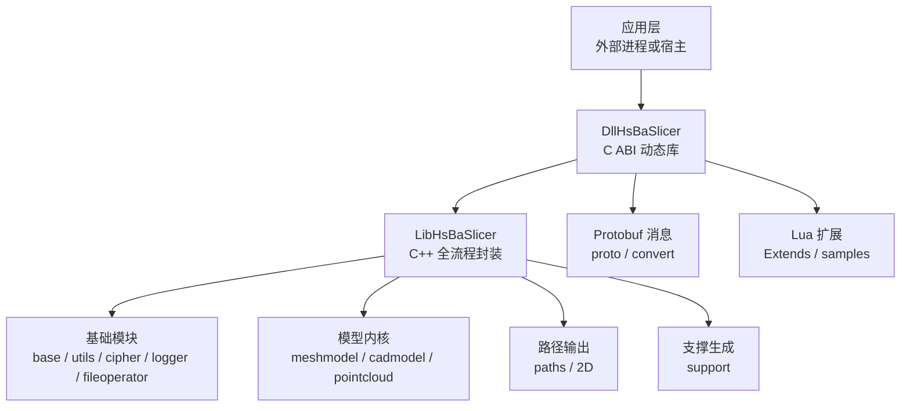
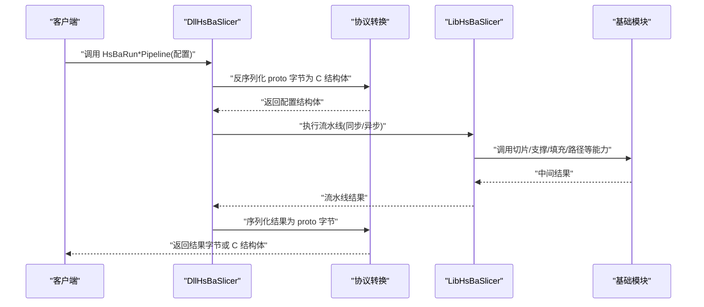
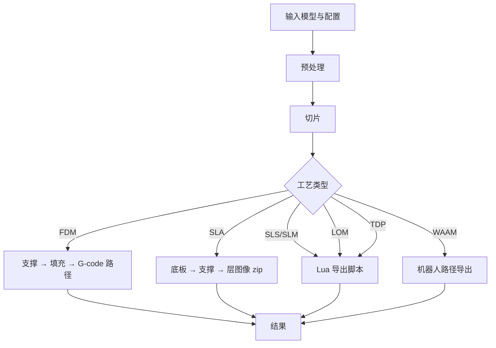
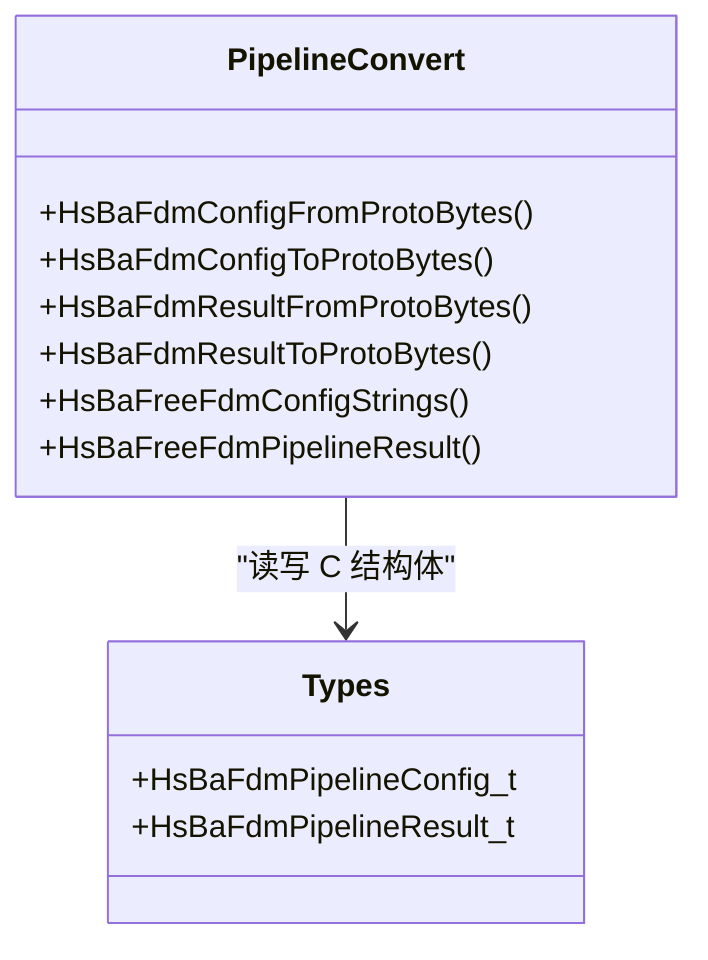
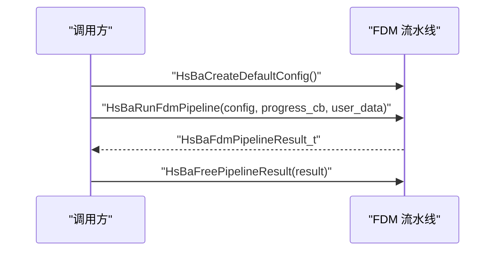
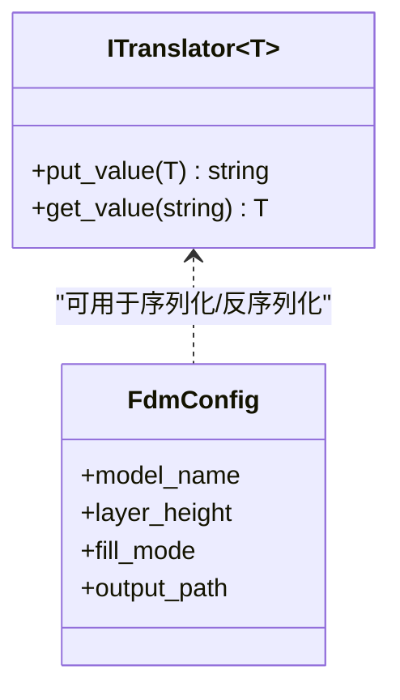
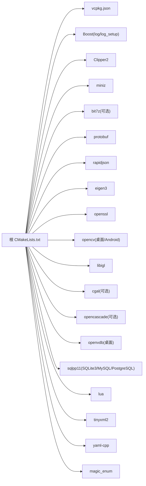
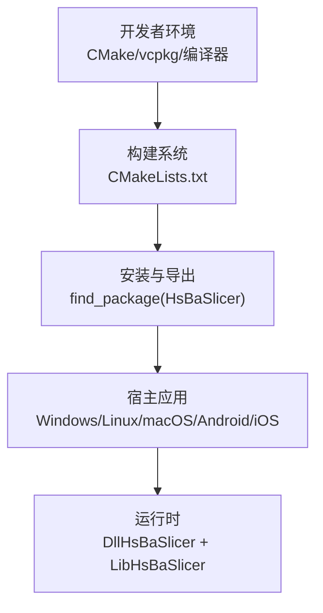

# 架构总览

<cite>
**本文引用的文件**   
- [README.md](file://README.md)
- [CMakeLists.txt](file://CMakeLists.txt)
- [vcpkg.json](file://vcpkg.json)
- [DllHsBaSlicer/dllexport.h](file://DllHsBaSlicer/dllexport.h)
- [LibHsBaSlicer/export.h](file://LibHsBaSlicer/export.h)
- [base/base_interface.hpp](file://base/base_interface.hpp)
- [pipelinetypes/pipeline_types.h](file://pipelinetypes/pipeline_types.h)
- [DllHsBaSlicer/fdm_pipeline.h](file://DllHsBaSlicer/fdm_pipeline.h)
- [DllHsBaSlicer/sla_pipeline.h](file://DllHsBaSlicer/sla_pipeline.h)
- [DllHsBaSlicer/slm_pipeline.h](file://DllHsBaSlicer/slm_pipeline.h)
- [DllHsBaSlicer/lom_pipeline.h](file://DllHsBaSlicer/lom_pipeline.h)
- [DllHsBaSlicer/tdp_pipeline.h](file://DllHsBaSlicer/tdp_pipeline.h)
- [DllHsBaSlicer/waam_pipeline.h](file://DllHsBaSlicer/waam_pipeline.h)
- [DllHsBaSlicer/pipeline_convert.h](file://DllHsBaSlicer/pipeline_convert.h)
</cite>

## 目录
1. [引言](#引言)
2. [项目结构](#项目结构)
3. [核心组件](#核心组件)
4. [架构总览](#架构总览)
5. [详细组件分析](#详细组件分析)
6. [依赖关系分析](#依赖关系分析)
7. [性能与可扩展性](#性能与可扩展性)
8. [横切关注点：安全、监控与灾难恢复](#横切关注点安全监控与灾难恢复)
9. [基础设施、部署拓扑与兼容性](#基础设施部署拓扑与兼容性)
10. [故障排除要点](#故障排除要点)
11. [结论](#结论)

## 引言
HsBaSlicer 是一个面向 3D 打印切片领域的高性能 C++ 软件框架，提供模块化、跨平台的切片核心能力，适用于研发与生产级别的切片流水线。其高层设计采用分层架构模式：应用层通过 DllHsBaSlicer 暴露的 C ABI 调用运行时流水线；DllHsBaSlicer 作为动态库边界，负责协议转换、参数校验、协程调度与结果封装；LibHsBaSlicer 提供 C++ 全流程切片能力封装；底层由 base、meshmodel、support、paths、fileoperator、utils、cipher、logger 等基础模块组成。系统同时支持多技术流水线（FDM、SLA、SLS、SLM、LOM、TDP/WAAM）以及完全由 Lua 驱动的自定义流水线，并通过 Protobuf 消息实现跨语言配置与结果交换。

本架构总览聚焦以下目标：
- 说明高层设计与分层边界。
- 解释组件交互关系、数据流设计和集成模式。
- 记录技术决策、权衡与约束条件。
- 给出基础设施需求、可扩展性考虑和部署拓扑。
- 覆盖安全性、监控与灾难恢复等横切关注点。
- 明确多技术流水线的设计原理与差异。

**章节来源**
- [README.md:21-39](file://README.md#L21-L39)

## 项目结构
仓库按“功能域 + 分层”组织：
- 顶层构建与安装：根 CMakeLists.txt 定义全局特性检查、平台开关、依赖发现、子模块包含与安装导出。
- 动态库边界：DllHsBaSlicer 暴露 C ABI，包含各工艺流水线头文件与协议转换接口。
- 静态库封装：LibHsBaSlicer 暴露 C++ API，封装 Slice、Preprocess、Support、Fill、Path、Floor、ParamStore、Extends/Lua 等能力。
- 基础模块：base、utils、cipher、logger、fileoperator、2D、meshmodel、cadmodel、pointcloud、preprocess、support、paths、pipelinetypes、convert、proto 等。
- 示例与测试：samples、tests、static_tests。
- 文档与脚本：docs、scripts、cmake。

**图表来源**
- [CMakeLists.txt:409-439](file://CMakeLists.txt#L409-L439)
- [README.md:100-124](file://README.md#L100-L124)

**章节来源**
- [CMakeLists.txt:409-439](file://CMakeLists.txt#L409-L439)
- [README.md:100-124](file://README.md#L100-L124)

## 核心组件
- DllHsBaSlicer：对外暴露 C ABI，提供 FDM/SLA/SLS/SLM/LOM/TDP/WAAM/FileTransfer/Custom 流水线的创建默认配置、同步运行、异步运行与结果释放接口；并提供 proto 字节与 C 结构体之间的序列化/反序列化函数。
- LibHsBaSlicer：提供 C++ 全流程切片能力，包括网格切片、模型预处理、填充、支撑、路径生成、SLA 底板、参数存储与 Lua 扩展。
- pipelinetypes：独立于 DLL 的 C 兼容类型定义，供 convert 等下游模块使用，避免对共享库的强依赖。
- base：基础类型与工具，如 ITranslator 翻译器接口、单例、线程池、委托、内存池等。
- 其他模块：meshmodel/cadmodel/pointcloud 提供几何与 CAD 后端；paths/2D 提供路径与多边形处理；fileoperator 提供压缩、SQL、配置树与 Lua 适配器；cipher 提供加密与哈希；logger 提供日志。

关键职责边界：
- DllHsBaSlicer 不直接实现复杂算法，而是编排流程、转换数据、管理生命周期。
- LibHsBaSlicer 实现具体切片逻辑，并复用基础模块。
- base/utils/cipher/logger/fileoperator 是横切能力，被上层模块组合使用。

**章节来源**
- [DllHsBaSlicer/fdm_pipeline.h:17-61](file://DllHsBaSlicer/fdm_pipeline.h#L17-L61)
- [DllHsBaSlicer/sla_pipeline.h:17-56](file://DllHsBaSlicer/sla_pipeline.h#L17-L56)
- [DllHsBaSlicer/slm_pipeline.h:17-56](file://DllHsBaSlicer/slm_pipeline.h#L17-L56)
- [DllHsBaSlicer/lom_pipeline.h:17-56](file://DllHsBaSlicer/lom_pipeline.h#L17-L56)
- [DllHsBaSlicer/tdp_pipeline.h:17-56](file://DllHsBaSlicer/tdp_pipeline.h#L17-L56)
- [DllHsBaSlicer/waam_pipeline.h:17-57](file://DllHsBaSlicer/waam_pipeline.h#L17-L57)
- [DllHsBaSlicer/pipeline_convert.h:17-22](file://DllHsBaSlicer/pipeline_convert.h#L17-L22)
- [base/base_interface.hpp:15-25](file://base/base_interface.hpp#L15-L25)

## 架构总览
系统采用“应用层 → DllHsBaSlicer → LibHsBaSlicer → 基础模块”的分层架构，并以 Protobuf 作为跨语言数据契约。DLL 层通过 C ABI 暴露统一入口，内部使用 C++20 协程进行异步编排，将配置从 proto 字节转换为 C 结构体，再交由 LibHsBaSlicer 执行流水线，最终返回结果并释放内存。

**图表来源**
- [DllHsBaSlicer/pipeline_convert.h:17-22](file://DllHsBaSlicer/pipeline_convert.h#L17-L22)
- [DllHsBaSlicer/fdm_pipeline.h:23-51](file://DllHsBaSlicer/fdm_pipeline.h#L23-L51)
- [DllHsBaSlicer/sla_pipeline.h:23-47](file://DllHsBaSlicer/sla_pipeline.h#L23-L47)

**章节来源**
- [DllHsBaSlicer/pipeline_convert.h:17-22](file://DllHsBaSlicer/pipeline_convert.h#L17-L22)
- [DllHsBaSlicer/fdm_pipeline.h:23-51](file://DllHsBaSlicer/fdm_pipeline.h#L23-L51)
- [DllHsBaSlicer/sla_pipeline.h:23-47](file://DllHsBaSlicer/sla_pipeline.h#L23-L47)

## 详细组件分析

### 多技术流水线设计原理
各工艺流水线在 DllHsBaSlicer 中提供统一的 C ABI 入口，但内部流程与输出产物不同：
- FDM：预处理器 → 切片 → 支撑 → 填充 → 路径生成（G-code）。
- SLA：预处理器 → 切片 → 底板 → 支撑 → 导出（层图像 zip）。
- SLS/SLM：预处理器 → 切片 → Lua 导出（粉末床工艺，无标准输出格式，由 Lua 决定）。
- LOM：预处理器 → 切片 → Lua 导出（层压板切割与粘合）。
- TDP：预处理器 → 切片 → Lua 导出（粘结剂喷射）。
- WAAM：预处理器 → 切片 → 机器人路径导出（ABB/KUKA/FANUC 程序）。

**图表来源**
- [DllHsBaSlicer/fdm_pipeline.h:23-35](file://DllHsBaSlicer/fdm_pipeline.h#L23-L35)
- [DllHsBaSlicer/sla_pipeline.h:23-34](file://DllHsBaSlicer/sla_pipeline.h#L23-L34)
- [DllHsBaSlicer/slm_pipeline.h:23-37](file://DllHsBaSlicer/slm_pipeline.h#L23-L37)
- [DllHsBaSlicer/lom_pipeline.h:23-37](file://DllHsBaSlicer/lom_pipeline.h#L23-L37)
- [DllHsBaSlicer/tdp_pipeline.h:23-37](file://DllHsBaSlicer/tdp_pipeline.h#L23-L37)
- [DllHsBaSlicer/waam_pipeline.h:23-38](file://DllHsBaSlicer/waam_pipeline.h#L23-L38)

**章节来源**
- [DllHsBaSlicer/fdm_pipeline.h:23-35](file://DllHsBaSlicer/fdm_pipeline.h#L23-L35)
- [DllHsBaSlicer/sla_pipeline.h:23-34](file://DllHsBaSlicer/sla_pipeline.h#L23-L34)
- [DllHsBaSlicer/slm_pipeline.h:23-37](file://DllHsBaSlicer/slm_pipeline.h#L23-L37)
- [DllHsBaSlicer/lom_pipeline.h:23-37](file://DllHsBaSlicer/lom_pipeline.h#L23-L37)
- [DllHsBaSlicer/tdp_pipeline.h:23-37](file://DllHsBaSlicer/tdp_pipeline.h#L23-L37)
- [DllHsBaSlicer/waam_pipeline.h:23-38](file://DllHsBaSlicer/waam_pipeline.h#L23-L38)

### 协议转换与内存管理
pipeline_convert.h 提供每种工艺的 Config/Result 与 proto 字节之间的互转函数，所有输出缓冲区由 malloc 分配，必须由调用方释放；同时提供各结构体的字符串字段释放函数，确保跨语言边界的内存所有权清晰。

**图表来源**
- [DllHsBaSlicer/pipeline_convert.h:24-62](file://DllHsBaSlicer/pipeline_convert.h#L24-L62)
- [pipelinetypes/pipeline_types.h:53-127](file://pipelinetypes/pipeline_types.h#L53-L127)

**章节来源**
- [DllHsBaSlicer/pipeline_convert.h:24-62](file://DllHsBaSlicer/pipeline_convert.h#L24-L62)
- [pipelinetypes/pipeline_types.h:53-127](file://pipelinetypes/pipeline_types.h#L53-L127)

### 流水线入口与回调模型
每个工艺流水线均提供：
- 创建默认配置函数。
- 同步运行函数（阻塞直到完成）。
- 异步运行函数（非阻塞，通过回调返回结果）。
- 结果释放函数。

回调模型支持进度回调与结果回调，便于 UI 或任务队列集成。

**图表来源**
- [DllHsBaSlicer/fdm_pipeline.h:17-61](file://DllHsBaSlicer/fdm_pipeline.h#L17-L61)

**章节来源**
- [DllHsBaSlicer/fdm_pipeline.h:17-61](file://DllHsBaSlicer/fdm_pipeline.h#L17-L61)

### 类型系统与基础接口
pipelinetypes/pipeline_types.h 定义了所有工艺的 C 兼容配置与结果结构体，以及进度回调与结果回调类型；base/base_interface.hpp 提供 ITranslator 模板接口，用于类型与字符串表示之间的转换。该设计使配置可序列化为 JSON/Proto，并在 Lua 与 C++ 之间传递。

**图表来源**
- [base/base_interface.hpp:15-25](file://base/base_interface.hpp#L15-L25)
- [pipelinetypes/pipeline_types.h:53-127](file://pipelinetypes/pipeline_types.h#L53-L127)

**章节来源**
- [base/base_interface.hpp:15-25](file://base/base_interface.hpp#L15-L25)
- [pipelinetypes/pipeline_types.h:53-127](file://pipelinetypes/pipeline_types.h#L53-L127)

## 依赖关系分析
构建系统通过 vcpkg 管理第三方依赖，并根据平台与特性开关启用可选内核（CGAL/OpenCASCADE）与功能（OpenCV、bit7z、OpenVDB、sqlpp11 等）。根 CMakeLists.txt 还定义了 copyleft 特性检测与许可证切换逻辑。

**图表来源**
- [CMakeLists.txt:206-349](file://CMakeLists.txt#L206-L349)
- [vcpkg.json:10-88](file://vcpkg.json#L10-L88)

**章节来源**
- [CMakeLists.txt:206-349](file://CMakeLists.txt#L206-L349)
- [vcpkg.json:10-88](file://vcpkg.json#L10-L88)

## 性能与可扩展性
- 并发与协程：流水线内部使用 C++20 协程进行异步编排，结合线程池提升吞吐；可在构建时启用协程支持。
- 对象池与内存管理：基础模块提供内存池与对象池，减少频繁分配开销；DLL 层通过明确的释放函数管理跨语言内存。
- 内核选择：根据是否启用 copyleft 内核（CGAL/OpenCASCADE）调整布尔运算能力与模型池大小；Debug 模式下禁用布尔运算以降低内存占用。
- 可扩展性：
  - 新增工艺：在 DllHsBaSlicer 添加 *_pipeline.h/.cpp，并在 pipeline_types.h 增加对应结构与转换函数。
  - Lua 扩展：通过 Extends/Lua 扩展点注入自定义填充、支撑、底板与导出逻辑。
  - 插件加载：可选的动态库加载器允许在桌面平台加载外部流水线或算法插件。

**章节来源**
- [CMakeLists.txt:258-262](file://CMakeLists.txt#L258-L262)
- [CMakeLists.txt:294-306](file://CMakeLists.txt#L294-L306)
- [CMakeLists.txt:228-240](file://CMakeLists.txt#L228-L240)

## 横切关注点：安全、监控与灾难恢复
- 安全性：
  - 加密与哈希：cipher 模块提供加密与哈希能力，可用于配置文件或传输数据的保护。
  - 输入校验：流水线配置需进行合法性校验（例如空指针、范围检查），错误信息通过结果结构体返回。
- 监控：
  - 日志：logger 模块提供结构化日志；在非游戏主机平台启用。
  - 进度回调：各流水线提供进度回调，便于上报指标与追踪阶段耗时。
- 灾难恢复：
  - 异步任务：异步流水线可通过回调机制取消或重试（预留任务句柄）。
  - 资源清理：所有动态分配的字符串与数组必须通过对应的释放函数释放，防止泄漏。

**章节来源**
- [README.md:100-124](file://README.md#L100-L124)
- [DllHsBaSlicer/fdm_pipeline.h:53-61](file://DllHsBaSlicer/fdm_pipeline.h#L53-L61)
- [DllHsBaSlicer/pipeline_convert.h:336-390](file://DllHsBaSlicer/pipeline_convert.h#L336-L390)

## 基础设施、部署拓扑与兼容性
- 构建要求：
  - CMake ≥ 3.28，C++20 编译器，vcpkg，PowerShell（Windows）。
  - 可选 Doxygen 用于文档构建。
- 平台支持：
  - Windows/Linux/macOS 桌面平台完整支持。
  - Android/iOS 部分功能受限（如 OpenCascade、OpenVDB、bit7z）。
  - 游戏主机通过 VCPKG_TARGET_TRIPLET 识别并关闭某些功能。
- 安装与导出：
  - 通过 cmake --install 安装，提供 find_package(HsBaSlicer) 集成。
  - 导出头文件布局与 CMake 配置文件位于安装目录。
- 版本与许可证：
  - 版本信息通过 version 模块提供。
  - 条件双许可：不包含 GPL/LGPL 内核时为 MIT；包含时为 GPL-3.0-or-later。

**图表来源**
- [README.md:41-99](file://README.md#L41-L99)
- [README.md:100-124](file://README.md#L100-L124)
- [CMakeLists.txt:477-685](file://CMakeLists.txt#L477-L685)

**章节来源**
- [README.md:41-99](file://README.md#L41-L99)
- [README.md:100-124](file://README.md#L100-L124)
- [CMakeLists.txt:477-685](file://CMakeLists.txt#L477-L685)

## 故障排除要点
- 编译失败：
  - 缺少 C++20 特性（concepts/ranges/source_location）会导致致命错误。
  - Debug 模式下布尔运算被禁用，若依赖 CGAL/IGL 布尔操作需切换到 Release。
- 运行时问题：
  - 未释放 DLL 层返回的字符串或数组会导致内存泄漏。
  - Lua 脚本路径或函数名不正确会导致自定义流水线失败。
- 平台限制：
  - 非桌面平台禁用 bit7z 与动态库加载器。
  - Android/iOS 不支持 OpenCascade/OpenVDB。

**章节来源**
- [CMakeLists.txt:60-86](file://CMakeLists.txt#L60-L86)
- [CMakeLists.txt:294-298](file://CMakeLists.txt#L294-L298)
- [CMakeLists.txt:228-240](file://CMakeLists.txt#L228-L240)

## 结论
HsBaSlicer 以分层架构与 C ABI 边界为核心，将多技术流水线（FDM/SLA/SLS/SLM/LOM/TDP/WAAM）统一到一致的调用模型中，并通过 Protobuf 与 Lua 扩展实现跨语言与可定制性。其设计在性能、可扩展性与跨平台兼容性之间取得平衡，适合研究与生产级切片场景。后续扩展应遵循现有模式：在 DllHsBaSlicer 暴露新流水线入口，在 LibHsBaSlicer 实现核心逻辑，并在 pipelinetypes 与 pipeline_convert 中维护类型与协议一致性。