# 架构总览

<cite>
**本文引用的文件**   
- [README.md](file://README.md)
- [CMakeLists.txt](file://CMakeLists.txt)
- [vcpkg.json](file://vcpkg.json)
- [pipeline_types.h](file://pipelinetypes/pipeline_types.h)
- [fdm_pipeline.h](file://DllHsBaSlicer/fdm_pipeline.h)
- [custom_pipeline.h](file://DllHsBaSlicer/custom_pipeline.h)
- [export.h](file://LibHsBaSlicer/export.h)
- [base_interface.hpp](file://base/base_interface.hpp)
- [thread_pool.hpp](file://base/thread_pool.hpp)
- [coroutine.hpp](file://base/coroutine.hpp)
- [concepts.hpp](file://base/concepts.hpp)
</cite>

## 目录
1. [引言](#引言)
2. [项目结构](#项目结构)
3. [核心组件](#核心组件)
4. [架构总览](#架构总览)
5. [详细组件分析](#详细组件分析)
6. [依赖关系分析](#依赖关系分析)
7. [性能与并行模型](#性能与并行模型)
8. [Lua 脚本扩展机制](#lua-脚本扩展机制)
9. [跨平台、安全与部署拓扑](#跨平台安全与部署拓扑)
10. [可扩展性与边界定义](#可扩展性与边界定义)
11. [故障排除指南](#故障排除指南)
12. [结论](#结论)

## 引言
HsBaSlicer 是一个面向 3D 打印切片领域的高性能 C++ 框架，提供模块化、跨平台的切片核心能力，适用于研发与生产级别的切片流水线。其高层设计围绕“工艺管线 + 数据协议 + 可插拔算法 + Lua 脚本扩展”展开：以 `DllHsBaSlicer` 暴露 C ABI 的运行时接口，以 `LibHsBaSlicer` 封装 C++ 全流程切片能力，以 `pipelinetypes` 提供与 DLL 解耦的 C 兼容配置类型，并通过 Protobuf、JSON、Lua 等机制实现跨语言、跨进程和可配置的数据流。

从架构视角看，系统可以理解为三层：
- 外部集成层：C ABI、多语言绑定、动态库加载、远程执行器。
- 流水线编排层：FDM/SLA/SLS/SLM/LOM/TDP/WAAM/FileTransfer/Custom 等具体工艺管线。
- 核心计算层：网格/CAD/点云预处理、切片、支撑、填充、路径生成、导出。

该文档面向架构师和高级开发者，重点说明系统边界、模块职责、数据流、并发模型、技术选型权衡以及部署拓扑。

**章节来源**
- [README.md:21-39](file://README.md#L21-L39)

## 项目结构
仓库采用按功能域划分的目录组织方式，核心目录包括：
- `base`：基础类型、概念约束、线程池、协程、单例、内存池等基础设施。
- `utils`：配置、序列化、Lua 绑定、DLL 加载等工具。
- `fileoperator`：ZIP、SQLite、参数存储、参数反射、远程执行器等。
- `meshmodel` / `cadmodel` / `pointcloud`：网格、CAD、点云模型后端。
- `support` / `2D` / `paths`：支撑、2D 几何、路径输出。
- `LibHsBaSlicer`：C++ 全流程切片 API。
- `DllHsBaSlicer`：C ABI 运行时流水线接口。
- `pipelinetypes` / `proto` / `convert`：流水线类型、Protobuf 消息、消息转换。
- `samples` / `tests`：示例与测试。

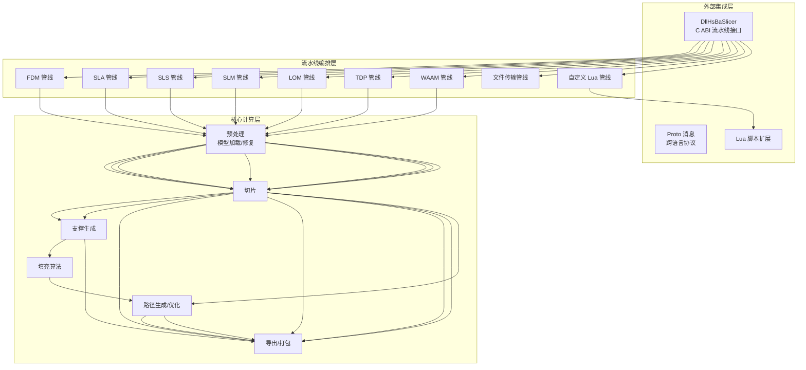

**图表来源**
- [CMakeLists.txt:410-439](file://CMakeLists.txt#L410-L439)
- [README.md:29-39](file://README.md#L29-L39)

**章节来源**
- [CMakeLists.txt:410-439](file://CMakeLists.txt#L410-L439)
- [README.md:29-39](file://README.md#L29-L39)

## 核心组件
本项目的核心组件可以分为四类：
- 流水线类型与协议：`pipelinetypes/pipeline_types.h` 定义了所有工艺的 C 兼容配置与结果结构体，是 DLL 与上层调用方之间的稳定契约。
- C ABI 流水线接口：`DllHsBaSlicer` 下的 `fdm_pipeline.h`、`custom_pipeline.h` 等头文件暴露同步/异步运行入口。
- C++ 全流程 API：`LibHsBaSlicer/export.h` 定义 C++ 库导出宏，内部包含切片、支撑、填充、路径等模块。
- 基础设施：`base` 中的线程池、协程、概念约束、基础接口等。

关键职责划分如下：
- `pipelinetypes`：纯 C 兼容结构体与默认初始化函数，避免下游依赖共享库。
- `DllHsBaSlicer`：对外暴露 C ABI，负责参数校验、Lua 环境初始化、协程调度、结果释放。
- `LibHsBaSlicer`：实现真实切片逻辑，组合预处理、切片、支撑、填充、路径、导出。
- `base`：提供通用并发、类型约束、基础抽象，被多个子系统复用。

**章节来源**
- [pipeline_types.h:5-12](file://pipelinetypes/pipeline_types.h#L5-L12)
- [fdm_pipeline.h:1-68](file://DllHsBaSlicer/fdm_pipeline.h#L1-L68)
- [custom_pipeline.h:1-69](file://DllHsBaSlicer/custom_pipeline.h#L1-L69)
- [export.h:1-22](file://LibHsBaSlicer/export.h#L1-L22)

## 架构总览
HsBaSlicer 的系统上下文图强调外部调用者、C ABI、Lua 脚本、底层内核与安装导出之间的关系。

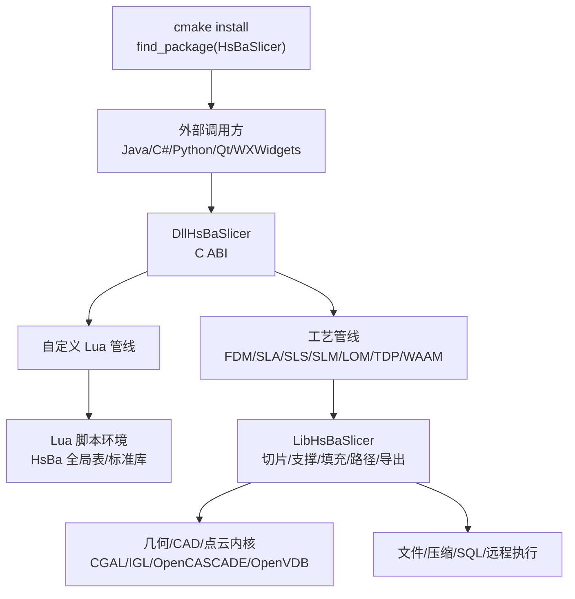

**图表来源**
- [README.md:100-124](file://README.md#L100-L124)
- [CMakeLists.txt:456-479](file://CMakeLists.txt#L456-L479)

该架构的关键决策包括：
- 使用 C ABI 作为对外边界，便于多语言集成。
- 将流水线类型与 DLL 解耦，通过独立头文件降低耦合。
- 使用 Protobuf 作为跨语言消息格式，支持多语言代码生成。
- 使用 Lua 作为可插拔脚本语言，允许用户自定义支撑、填充、导出流程。
- 使用 C++20 协程与线程池实现异步流水线，提升吞吐量和响应性。

**章节来源**
- [README.md:100-124](file://README.md#L100-L124)
- [CMakeLists.txt:456-479](file://CMakeLists.txt#L456-L479)

## 详细组件分析

### FDM 流水线接口
FDM 流水线是典型的增材制造切片流程，包含预处理、切片、支撑、填充、路径生成和 G-code 输出。其 C ABI 接口提供同步和异步两种调用方式，并支持进度回调。

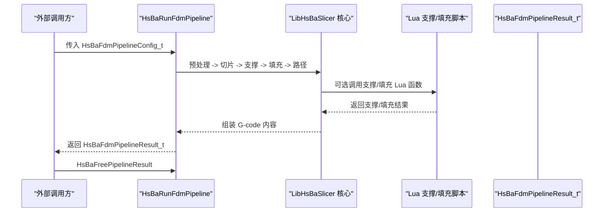

**图表来源**
- [fdm_pipeline.h:21-61](file://DllHsBaSlicer/fdm_pipeline.h#L21-L61)
- [pipeline_types.h:56-127](file://pipelinetypes/pipeline_types.h#L56-L127)

关键要点：
- 配置结构体包含模型、切片、填充、支撑、路径、G-code 输出和 Lua 自定义项。
- 结果结构体包含成功标志、层数、G-code 内容、错误信息和耗时。
- 同步接口内部使用 C++20 协程阻塞等待结果；异步接口通过回调返回结果。
- 内存释放由调用方负责，需调用对应的 Free 函数。

**章节来源**
- [fdm_pipeline.h:21-61](file://DllHsBaSlicer/fdm_pipeline.h#L21-L61)
- [pipeline_types.h:56-127](file://pipelinetypes/pipeline_types.h#L56-L127)

### 自定义 Lua 流水线接口
自定义流水线将整个工作流交由 Lua 脚本定义，C++ 侧仅提供构建块（模型加载、切片、支撑、填充、地板、G-code 输出、SLA/SLS 打包）和标准库。

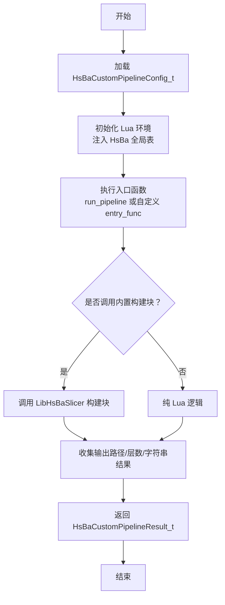

**图表来源**
- [custom_pipeline.h:17-62](file://DllHsBaSlicer/custom_pipeline.h#L17-L62)
- [pipeline_types.h:689-732](file://pipelinetypes/pipeline_types.h#L689-L732)

关键要点：
- 自定义管线可通过 `pipeline_lua_script` 或 `pipeline_lua_source` 指定脚本。
- `config_json` 作为自由格式 JSON 传递给 Lua，用于传递额外配置。
- 结果包含输出路径、层数、字符串返回值和错误信息。
- 进度回调由 Lua 侧通过 `HsBa.progress()` 驱动。

**章节来源**
- [custom_pipeline.h:17-62](file://DllHsBaSlicer/custom_pipeline.h#L17-L62)
- [pipeline_types.h:689-732](file://pipelinetypes/pipeline_types.h#L689-L732)

### 流水线类型与协议
`pipelinetypes/pipeline_types.h` 是所有工艺管线的 C 兼容类型定义中心，涵盖 FDM、SLA、SLS、SLM、LOM、TDP、WAAM、文件传输和自定义 Lua 管线。

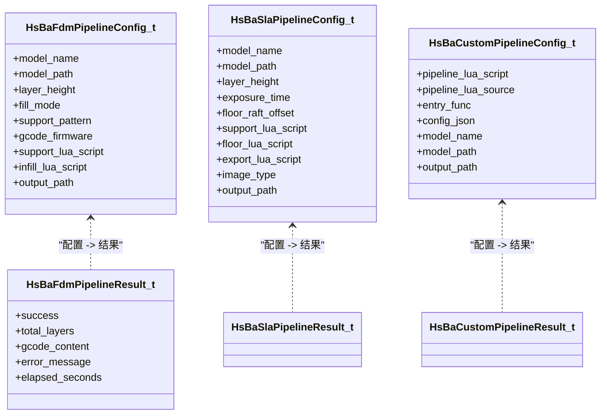

**图表来源**
- [pipeline_types.h:56-127](file://pipelinetypes/pipeline_types.h#L56-L127)
- [pipeline_types.h:170-232](file://pipelinetypes/pipeline_types.h#L170-L232)
- [pipeline_types.h:689-732](file://pipelinetypes/pipeline_types.h#L689-L732)

关键要点：
- 所有配置结构体均包含模型名称、模型路径、层高等基础字段。
- 不同工艺在支撑、曝光、激光、材料、机器人控制器等方面有差异化字段。
- 结果结构体统一包含成功标志、层数、输出路径/G-code、错误信息和耗时。
- 默认初始化函数以 inline 形式提供，避免 DLL 依赖。

**章节来源**
- [pipeline_types.h:56-127](file://pipelinetypes/pipeline_types.h#L56-L127)
- [pipeline_types.h:170-232](file://pipelinetypes/pipeline_types.h#L170-L232)
- [pipeline_types.h:689-732](file://pipelinetypes/pipeline_types.h#L689-L732)

### 基础设施：线程池与协程
HsBaSlicer 在基础设施层提供了线程池和协程工具，用于实现高并发、非阻塞的流水线执行。

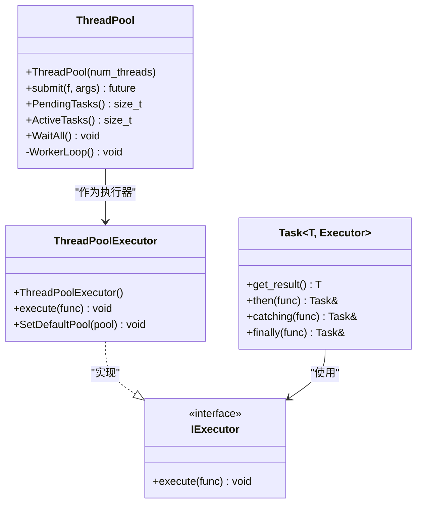

**图表来源**
- [thread_pool.hpp:29-162](file://base/thread_pool.hpp#L29-L162)
- [thread_pool.hpp:170-207](file://base/thread_pool.hpp#L170-L207)
- [coroutine.hpp:47-73](file://base/coroutine.hpp#L47-L73)
- [coroutine.hpp:205-382](file://base/coroutine.hpp#L205-L382)

关键要点：
- `ThreadPool` 管理 worker 线程队列，支持提交任务、等待全部完成、查询待处理/活跃任务数。
- `ThreadPoolExecutor` 实现 `IExecutor`，可将协程任务调度到线程池。
- `Task<T, Executor>` 提供协程任务抽象，支持链式回调、异常捕获、最终清理。
- 协程可用性与线程池协程支持通过编译期宏控制。

**章节来源**
- [thread_pool.hpp:29-162](file://base/thread_pool.hpp#L29-L162)
- [thread_pool.hpp:170-207](file://base/thread_pool.hpp#L170-L207)
- [coroutine.hpp:47-73](file://base/coroutine.hpp#L47-L73)
- [coroutine.hpp:205-382](file://base/coroutine.hpp#L205-L382)

### 基础接口与类型约束
`base/base_interface.hpp` 定义了翻译器接口，`base/concepts.hpp` 定义了丰富的 C++20 concepts，用于约束模板类型行为。

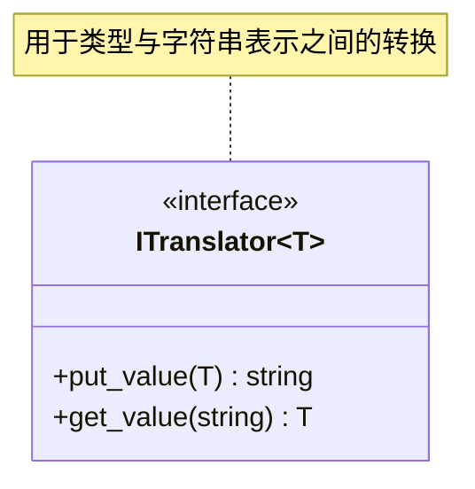

**图表来源**
- [base_interface.hpp:19-25](file://base/base_interface.hpp#L19-L25)

关键要点：
- `ITranslator` 是通用的值转换器接口，可用于配置树、序列化、Lua 绑定等场景。
- `concepts.hpp` 提供字符流、枚举、指针、哈希、字符串、分配器等概念，增强模板安全性和可读性。

**章节来源**
- [base_interface.hpp:19-25](file://base/base_interface.hpp#L19-L25)
- [concepts.hpp:17-267](file://base/concepts.hpp#L17-L267)

## 依赖关系分析
HsBaSlicer 的依赖关系由 CMake 和 vcpkg 共同管理，核心依赖包括 Boost、Clipper2、miniz、bit7z、Protobuf、RapidJSON、Eigen3、OpenSSL、OpenCV、libigl、CGAL、OpenCASCADE、OpenVDB、sqlpp11、Lua、tinyxml2、yaml-cpp、magic_enum。

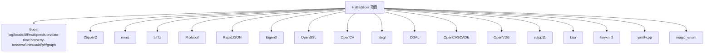

**图表来源**
- [CMakeLists.txt:206-349](file://CMakeLists.txt#L206-L349)
- [vcpkg.json:10-88](file://vcpkg.json#L10-L88)

关键决策与权衡：
- 桌面平台启用更多依赖（OpenCV、CGAL、OpenCASCADE、OpenVDB），移动端/游戏主机平台禁用部分依赖以降低体积和复杂度。
- copyleft 内核（CGAL、OpenCASCADE）通过 vcpkg feature 控制，影响项目许可证。
- bit7z 仅在桌面平台启用，移动端禁用。
- sqlpp11 在桌面平台启用 MySQL/PostgreSQL，移动端仅 SQLite。

**章节来源**
- [CMakeLists.txt:206-349](file://CMakeLists.txt#L206-L349)
- [vcpkg.json:10-88](file://vcpkg.json#L10-L88)

## 性能与并行模型
HsBaSlicer 的性能模型基于以下要素：
- 多线程任务队列：`ThreadPool` 提供固定数量的 worker 线程，适合 CPU 密集型任务如网格布尔运算、填充、路径优化。
- C++20 协程：`Task` 和 `IExecutor` 提供非阻塞异步编程模型，适合 I/O 密集或长耗时操作。
- 流水线阶段并行：不同层或不同模型的切片、支撑、填充可并行处理。
- 内核选择：CGAL 提供布尔运算但可能慢且占用内存，Debug 模式禁用布尔运算；IGL 作为默认网格内核。

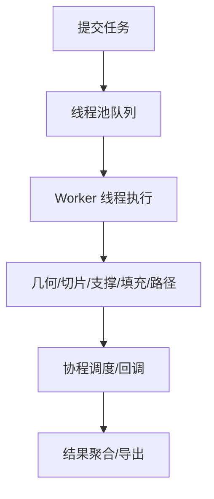

**图表来源**
- [thread_pool.hpp:62-111](file://base/thread_pool.hpp#L62-L111)
- [coroutine.hpp:205-382](file://base/coroutine.hpp#L205-L382)

优化建议：
- 根据硬件并发调整线程池大小。
- 对大模型分片处理，减少单次内存峰值。
- 在 Debug 模式下避免 CGAL 布尔运算，Release 模式下谨慎评估性能。
- 使用对象池和内存池减少频繁分配开销。

**章节来源**
- [thread_pool.hpp:62-111](file://base/thread_pool.hpp#L62-L111)
- [coroutine.hpp:205-382](file://base/coroutine.hpp#L205-L382)
- [CMakeLists.txt:294-306](file://CMakeLists.txt#L294-L306)

## Lua 脚本扩展机制
Lua 脚本扩展机制允许用户自定义支撑、填充、地板、导出等流程。系统通过 `HsBa` 全局表向 Lua 暴露构建块，同时支持标准 polygon/support/fill/file 库。

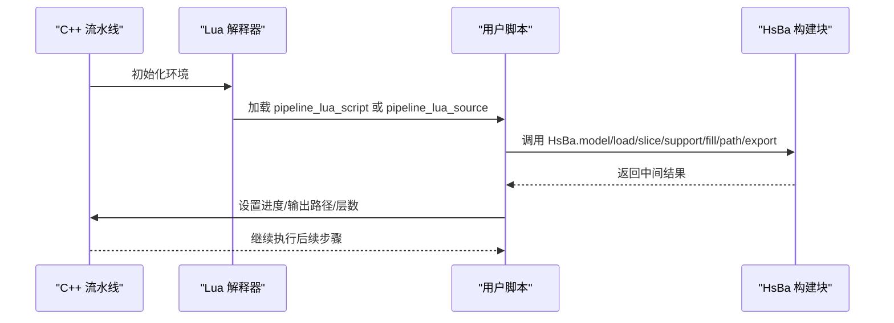

**图表来源**
- [custom_pipeline.h:23-40](file://DllHsBaSlicer/custom_pipeline.h#L23-L40)
- [pipeline_types.h:689-732](file://pipelinetypes/pipeline_types.h#L689-L732)

关键点：
- 自定义管线完全由 Lua 定义，C++ 侧仅提供构建块。
- 进度回调由 Lua 侧驱动，便于细粒度 UI 更新。
- 配置 JSON 可自由扩展，适应不同工艺需求。

**章节来源**
- [custom_pipeline.h:23-40](file://DllHsBaSlicer/custom_pipeline.h#L23-L40)
- [pipeline_types.h:689-732](file://pipelinetypes/pipeline_types.h#L689-L732)

## 跨平台、安全与部署拓扑
HsBaSlicer 支持 Windows、Linux、macOS、Android、iOS 等平台，并通过 CMake 预设和 vcpkg triplet 控制构建行为。

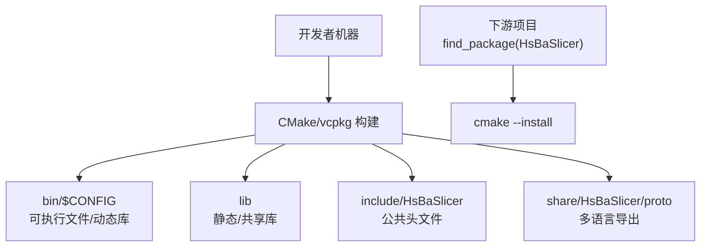

**图表来源**
- [README.md:100-124](file://README.md#L100-L124)
- [CMakeLists.txt:456-479](file://CMakeLists.txt#L456-L479)

安全考虑：
- 使用 OpenSSL 进行加密和哈希。
- 使用 Protobuf 和 JSON 进行结构化数据传输，避免任意代码执行。
- Lua 脚本沙箱化，限制危险函数访问。
- 动态库加载在非桌面平台禁用，降低安全风险。

部署拓扑：
- 桌面平台：完整依赖，支持 CGAL、OpenCASCADE、OpenVDB。
- 移动端/游戏主机：精简依赖，禁用 copyleft 内核和部分功能。
- 安装后通过 `find_package(HsBaSlicer)` 引用目标，支持命名空间 `HsBaSlicer::`。

**章节来源**
- [README.md:100-124](file://README.md#L100-L124)
- [CMakeLists.txt:456-479](file://CMakeLists.txt#L456-L479)

## 可扩展性与边界定义
HsBaSlicer 的可扩展性体现在以下几个层面：
- 工艺管线扩展：新增工艺只需添加新的 `*_pipeline.h` 和对应配置结构体。
- 算法插件：通过 Lua 脚本替换支撑、填充、导出算法。
- 模型后端：支持多种网格/CAD/点云后端，通过接口抽象切换。
- 数据协议：Protobuf 支持多语言代码生成，便于跨语言集成。

系统边界定义：
- 外部边界：C ABI、多语言绑定、动态库加载。
- 内部边界：LibHsBaSlicer 封装核心逻辑，DllHsBaSlicer 负责编排和桥接。
- 数据边界：pipelinetypes 提供稳定 C 兼容类型，Protobuf 提供跨语言消息。

**章节来源**
- [pipeline_types.h:5-12](file://pipelinetypes/pipeline_types.h#L5-L12)
- [fdm_pipeline.h:1-68](file://DllHsBaSlicer/fdm_pipeline.h#L1-L68)
- [custom_pipeline.h:1-69](file://DllHsBaSlicer/custom_pipeline.h#L1-L69)

## 故障排除指南
常见问题及排查方向：
- 编译器不支持 C++20 特性：检查 CMake 配置和编译器版本，确保 Concepts、Ranges、Source Location、NTTP Class、Template Template Matching 等特性可用。
- copyleft 内核未找到：检查 vcpkg manifest features 和 CGAL/OpenCASCADE 是否安装。
- 动态库加载失败：在非桌面平台动态库加载被禁用，需确认平台配置。
- Lua 脚本执行错误：检查脚本路径、函数名、HsBa 全局表是否正确注入。
- 内存泄漏：确保调用对应的 Free 函数释放结果结构体中的字符串字段。

**章节来源**
- [CMakeLists.txt:48-104](file://CMakeLists.txt#L48-L104)
- [CMakeLists.txt:170-204](file://CMakeLists.txt#L170-L204)
- [CMakeLists.txt:228-240](file://CMakeLists.txt#L228-L240)
- [fdm_pipeline.h:53-61](file://DllHsBaSlicer/fdm_pipeline.h#L53-L61)

## 结论
HsBaSlicer 通过清晰的层次划分、稳定的 C ABI 边界、灵活的 Lua 脚本扩展和强大的 C++20 并发模型，为 3D 打印切片提供了一个高性能、可扩展、跨平台的解决方案。其架构决策在性能、可维护性和可移植性之间取得了良好平衡，适合从研究原型到生产部署的多种场景。未来扩展应优先考虑新工艺管线接入、算法插件化和多语言生态完善。