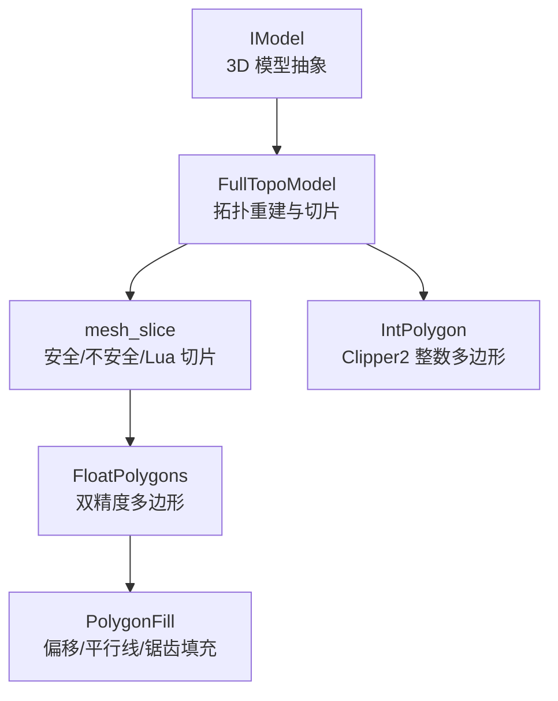
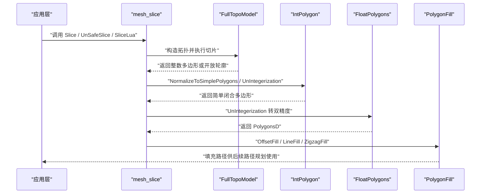
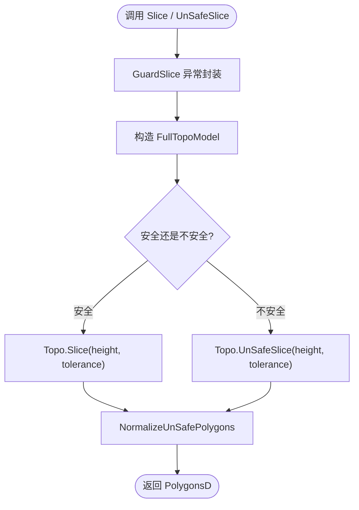
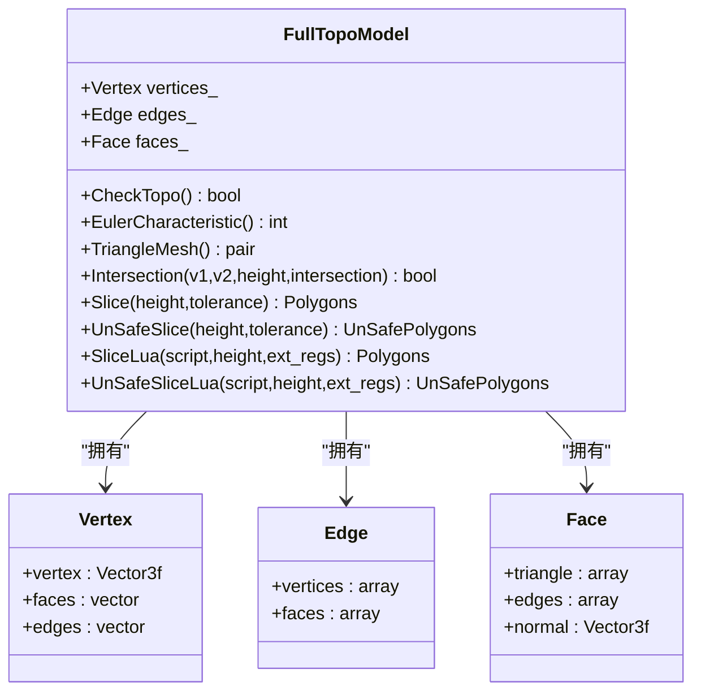
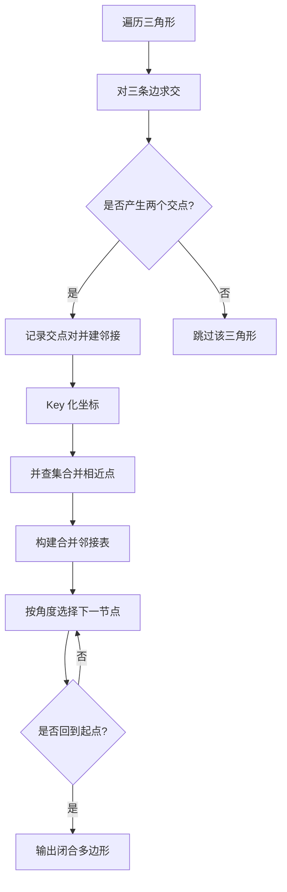
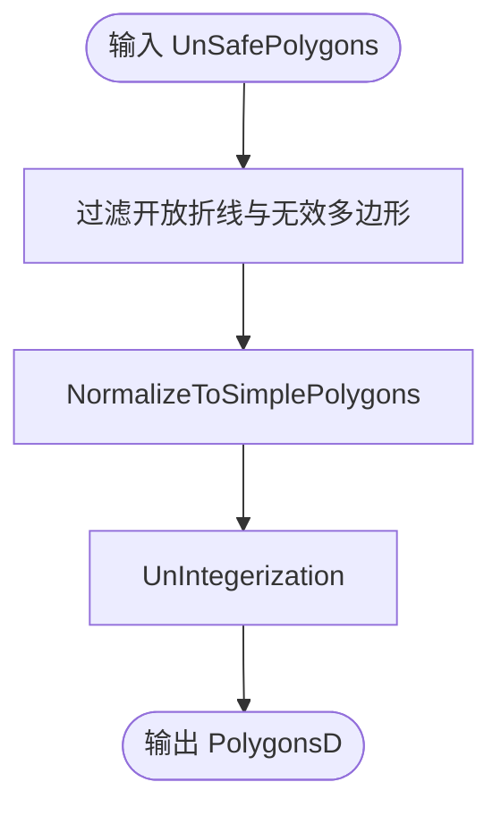
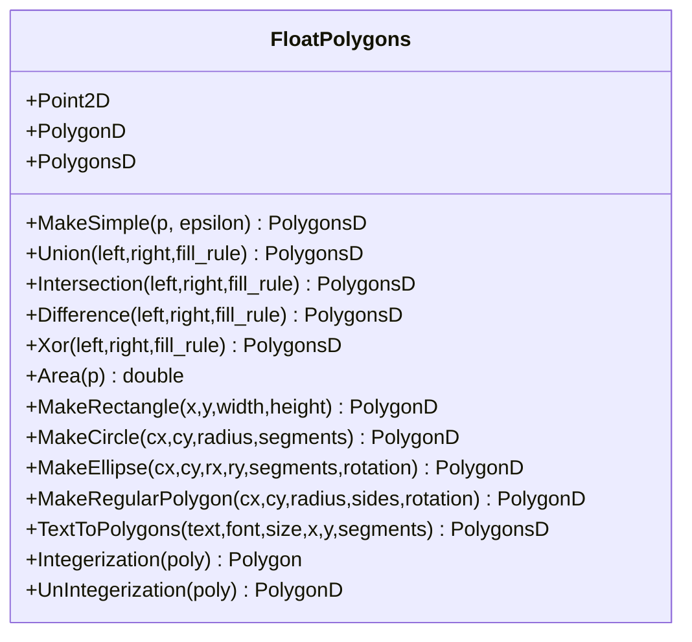
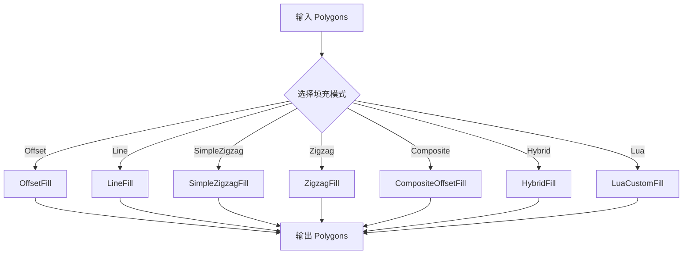
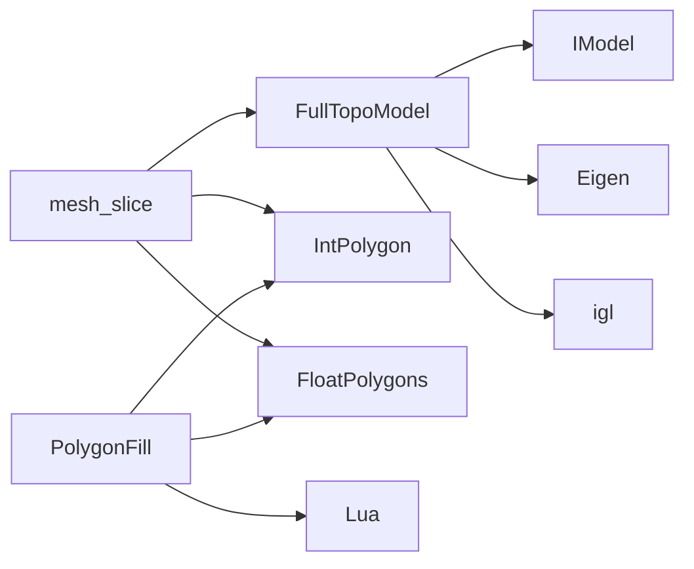

# 3D 切片基础

<cite>
**本文引用的文件**   
- [LibHsBaSlicer/Slice/mesh_slice.hpp](file://LibHsBaSlicer/Slice/mesh_slice.hpp)
- [LibHsBaSlicer/Slice/mesh_slice.cpp](file://LibHsBaSlicer/Slice/mesh_slice.cpp)
- [meshmodel/FullTopoModel.hpp](file://meshmodel/FullTopoModel.hpp)
- [meshmodel/FullTopoModel.cpp](file://meshmodel/FullTopoModel.cpp)
- [base/IModel.hpp](file://base/IModel.hpp)
- [2D/IntPolygon.hpp](file://2D/IntPolygon.hpp)
- [2D/FloatPolygons.hpp](file://2D/FloatPolygons.hpp)
- [2D/FloatPolygons.cpp](file://2D/FloatPolygons.cpp)
- [2D/PolygonFill.hpp](file://2D/PolygonFill.hpp)
- [2D/PolygonFill.cpp](file://2D/PolygonFill.cpp)
</cite>

## 目录
1. [引言](#引言)
2. [项目结构](#项目结构)
3. [核心概念](#核心概念)
4. [架构总览](#架构总览)
5. [详细组件分析](#详细组件分析)
6. [依赖关系分析](#依赖关系分析)
7. [性能与优化](#性能与优化)
8. [故障排除指南](#故障排除指南)
9. [结论](#结论)

## 引言
本文面向 HsBaSlicer 的 3D 切片基础，目标是帮助读者理解从 3D 模型到 G-code 的完整切片流程：三角形网格如何被 Z 轴平面切割、如何在 XY 平面上生成轮廓、如何把轮廓规范化为简单多边形，以及如何使用偏移、平行线、锯齿等填充算法生成打印路径。文档同时深入解释 mesh_slice 模块的实现机制、FloatPolygons 数据结构设计、PolygonFill 填充算法原理，并给出性能优化建议与常见问题解决方案。

## 项目结构
围绕 3D 切片，本仓库的关键代码分布在以下位置：
- 切片对外 API：LibHsBaSlicer/Slice/mesh_slice.*
- 拓扑重建与切片内核：meshmodel/FullTopoModel.*
- 整数坐标多边形与布尔运算：2D/IntPolygon.*
- 双精度多边形与几何工具：2D/FloatPolygons.*
- 填充算法：2D/PolygonFill.*
- 模型抽象接口：base/IModel.hpp

**图表来源**
- [base/IModel.hpp:110-139](file://base/IModel.hpp#L110-L139)
- [meshmodel/FullTopoModel.hpp:43-145](file://meshmodel/FullTopoModel.hpp#L43-L145)
- [LibHsBaSlicer/Slice/mesh_slice.hpp:18-105](file://LibHsBaSlicer/Slice/mesh_slice.hpp#L18-L105)
- [2D/IntPolygon.hpp:14-27](file://2D/IntPolygon.hpp#L14-L27)
- [2D/FloatPolygons.hpp:16-26](file://2D/FloatPolygons.hpp#L16-L26)
- [2D/PolygonFill.hpp:16-137](file://2D/PolygonFill.hpp#L16-L137)

**章节来源**
- [base/IModel.hpp:110-139](file://base/IModel.hpp#L110-L139)
- [meshmodel/FullTopoModel.hpp:43-145](file://meshmodel/FullTopoModel.hpp#L43-L145)
- [LibHsBaSlicer/Slice/mesh_slice.hpp:18-105](file://LibHsBaSlicer/Slice/mesh_slice.hpp#L18-L105)
- [2D/IntPolygon.hpp:14-27](file://2D/IntPolygon.hpp#L14-L27)
- [2D/FloatPolygons.hpp:16-26](file://2D/FloatPolygons.hpp#L16-L26)
- [2D/PolygonFill.hpp:16-137](file://2D/PolygonFill.hpp#L16-L137)

## 核心概念
- 3D 模型抽象：IModel 提供统一接口，支持加载、保存、变换、包围盒、体积和三角网格提取。
- 拓扑重建：FullTopoModel 从三角网格构建顶点、边、面的拓扑关系，用于稳定切片。
- 平面切片：对每个三角形三条边与目标高度求交，得到 XY 平面上的点集，再连接成轮廓。
- 轮廓规范化：将可能开放、自相交的多边形简化、拆分、去重，转换为简单闭合多边形。
- 填充算法：基于偏移、扫描线和连通性，生成偏移边界、平行线、简单锯齿和高级锯齿填充。
- 数据精度：整数坐标用于 Clipper2 布尔运算；双精度坐标用于几何计算与可视化。

**章节来源**
- [base/IModel.hpp:110-139](file://base/IModel.hpp#L110-L139)
- [meshmodel/FullTopoModel.hpp:43-145](file://meshmodel/FullTopoModel.hpp#L43-L145)
- [2D/IntPolygon.hpp:14-27](file://2D/IntPolygon.hpp#L14-L27)
- [2D/FloatPolygons.hpp:16-26](file://2D/FloatPolygons.hpp#L16-L26)

## 架构总览
下图展示从 3D 模型到 G-code 的主要阶段：模型抽象 → 拓扑重建 → 平面切片 → 轮廓规范化 → 填充 → 路径导出。

**图表来源**
- [LibHsBaSlicer/Slice/mesh_slice.cpp:46-116](file://LibHsBaSlicer/Slice/mesh_slice.cpp#L46-L116)
- [meshmodel/FullTopoModel.cpp:328-600](file://meshmodel/FullTopoModel.cpp#L328-L600)
- [2D/IntPolygon.hpp:44-66](file://2D/IntPolygon.hpp#L44-L66)
- [2D/FloatPolygons.hpp:195-221](file://2D/FloatPolygons.hpp#L195-L221)
- [2D/PolygonFill.hpp:20-102](file://2D/PolygonFill.hpp#L20-L102)

## 详细组件分析

### 切片对外 API：mesh_slice 模块
mesh_slice 提供安全的切片（仅闭合轮廓）、不安全的切片（包含开放轮廓）、Lua 驱动切片、以及可复用拓扑切片。所有对外函数通过 GuardSlice 包装，将 CGAL、OCCT 等第三方异常统一转换为项目的 IOError，避免跨 C ABI 边界传播未知异常类型。

关键职责：
- 安全切片：忽略开放轮廓，适合 SLA 等表面成型工艺。
- 不安全切片：保留开放轮廓，适合 FDM/FFF 等材料供给工艺。
- Lua 切片：允许用户脚本自定义切片逻辑。
- 拓扑复用：BuildSliceTopology + SliceLayer 避免每层重复构建拓扑。

**图表来源**
- [LibHsBaSlicer/Slice/mesh_slice.cpp:28-43](file://LibHsBaSlicer/Slice/mesh_slice.cpp#L28-L43)
- [LibHsBaSlicer/Slice/mesh_slice.cpp:46-116](file://LibHsBaSlicer/Slice/mesh_slice.cpp#L46-L116)

**章节来源**
- [LibHsBaSlicer/Slice/mesh_slice.hpp:22-103](file://LibHsBaSlicer/Slice/mesh_slice.hpp#L22-L103)
- [LibHsBaSlicer/Slice/mesh_slice.cpp:17-116](file://LibHsBaSlicer/Slice/mesh_slice.cpp#L17-L116)

### 拓扑与切片内核：FullTopoModel
FullTopoModel 负责从 IModel 的三角网格重建拓扑，包括顶点、边、面及其邻接关系。它提供：
- 拓扑检查：CheckTopo 验证顶点、边、面索引一致性。
- 欧拉特征：EulerCharacteristic 辅助检测孔洞或非流形结构。
- 线段与平面相交：Intersection 计算三角形边与 Z=height 平面的交点。
- 安全切片：Slice 返回闭合多边形集合。
- 不安全切片：UnSafeSlice 返回可能开放的轮廓集合。
- Lua 切片：SliceLua 暴露 V/E/F 全局表给脚本。

**图表来源**
- [meshmodel/FullTopoModel.hpp:53-145](file://meshmodel/FullTopoModel.hpp#L53-L145)

**章节来源**
- [meshmodel/FullTopoModel.hpp:43-145](file://meshmodel/FullTopoModel.hpp#L43-L145)
- [meshmodel/FullTopoModel.cpp:27-158](file://meshmodel/FullTopoModel.cpp#L27-L158)
- [meshmodel/FullTopoModel.cpp:246-324](file://meshmodel/FullTopoModel.cpp#L246-L324)

### 三角形网格与 Z 轴平面切片过程
切片的核心步骤如下：
1. 遍历每个三角形，对其三条边分别调用 Intersection，判断是否与目标高度相交。
2. 若某三角形在该高度产生两个交点，则建立这两个交点的邻接关系。
3. 将所有交点映射为整数坐标 Key，并使用并查集合并相近点。
4. 构建合并后的邻接表，按角度选择下一个节点，追踪形成闭合环。
5. 输出闭合多边形（安全切片）或开放轮廓（不安全切片）。

**图表来源**
- [meshmodel/FullTopoModel.cpp:328-600](file://meshmodel/FullTopoModel.cpp#L328-L600)
- [meshmodel/FullTopoModel.cpp:604-800](file://meshmodel/FullTopoModel.cpp#L604-L800)

**章节来源**
- [meshmodel/FullTopoModel.cpp:246-272](file://meshmodel/FullTopoModel.cpp#L246-L272)
- [meshmodel/FullTopoModel.cpp:328-600](file://meshmodel/FullTopoModel.cpp#L328-L600)
- [meshmodel/FullTopoModel.cpp:604-800](file://meshmodel/FullTopoModel.cpp#L604-L800)

### 轮廓提取与多边形构建
切片后得到的可能是开放折线或自相交多边形。NormalizeUnSafePolygons 会：
- 过滤掉开放折线（closed=false 或点数小于 3）。
- 调用 NormalizeToSimplePolygons 将复杂多边形拆分为简单多边形。
- 使用 UnIntegerization 将整数坐标转为双精度坐标，便于后续处理。

**图表来源**
- [LibHsBaSlicer/Slice/mesh_slice.cpp:86-104](file://LibHsBaSlicer/Slice/mesh_slice.cpp#L86-L104)
- [2D/IntPolygon.hpp:44-66](file://2D/IntPolygon.hpp#L44-L66)
- [2D/FloatPolygons.hpp:195-221](file://2D/FloatPolygons.hpp#L195-L221)

**章节来源**
- [LibHsBaSlicer/Slice/mesh_slice.cpp:86-104](file://LibHsBaSlicer/Slice/mesh_slice.cpp#L86-L104)
- [2D/IntPolygon.hpp:44-66](file://2D/IntPolygon.hpp#L44-L66)
- [2D/FloatPolygons.hpp:195-221](file://2D/FloatPolygons.hpp#L195-L221)

### FloatPolygons 数据结构与设计
FloatPolygons 定义双精度点、多边形和多边形集合的类型别名，并提供：
- 简化：MakeSimple 去除共线点。
- 布尔运算：Union、Intersection、Difference、Xor。
- 面积计算：Area。
- 形状生成：矩形、圆、椭圆、正多边形、文本转多边形。
- 精度转换：Integerization 与 UnIntegerization。

**图表来源**
- [2D/FloatPolygons.hpp:16-221](file://2D/FloatPolygons.hpp#L16-L221)
- [2D/FloatPolygons.cpp:25-221](file://2D/FloatPolygons.cpp#L25-L221)

**章节来源**
- [2D/FloatPolygons.hpp:16-221](file://2D/FloatPolygons.hpp#L16-L221)
- [2D/FloatPolygons.cpp:25-221](file://2D/FloatPolygons.cpp#L25-L221)

### PolygonFill 填充算法工作原理
PolygonFill 提供多种填充模式：
- OffsetFill：向内偏移生成多层边界线。
- LineFill：沿指定角度生成平行线，裁剪与主体交集。
- SimpleZigzagFill：在相邻行之间连接段，形成连续锯齿路径。
- ZigzagFill：更复杂的锯齿填充，考虑连通分量、桥接与边界弧。
- CompositeOffsetFill / HybridFill：组合偏移与内部填充，支持外扩与内缩多层。
- LuaCustomFill：通过 Lua 脚本自定义填充。

**图表来源**
- [2D/PolygonFill.hpp:20-137](file://2D/PolygonFill.hpp#L20-L137)
- [2D/PolygonFill.cpp:504-1600](file://2D/PolygonFill.cpp#L504-L1600)

**章节来源**
- [2D/PolygonFill.hpp:20-137](file://2D/PolygonFill.hpp#L20-L137)
- [2D/PolygonFill.cpp:504-1600](file://2D/PolygonFill.cpp#L504-L1600)

## 依赖关系分析
- mesh_slice 依赖 FullTopoModel 进行切片，依赖 IntPolygon 进行轮廓规范化，依赖 FloatPolygons 进行双精度转换。
- FullTopoModel 依赖 IModel 获取三角网格，依赖 Eigen 进行向量运算，依赖 igl 计算面法向。
- PolygonFill 依赖 FloatPolygons 与 IntPolygon 进行几何操作，依赖 Lua 进行脚本扩展。

**图表来源**
- [LibHsBaSlicer/Slice/mesh_slice.cpp:5-13](file://LibHsBaSlicer/Slice/mesh_slice.cpp#L5-L13)
- [meshmodel/FullTopoModel.cpp:17-23](file://meshmodel/FullTopoModel.cpp#L17-L23)
- [2D/PolygonFill.cpp:6-20](file://2D/PolygonFill.cpp#L6-L20)

**章节来源**
- [LibHsBaSlicer/Slice/mesh_slice.cpp:5-13](file://LibHsBaSlicer/Slice/mesh_slice.cpp#L5-L13)
- [meshmodel/FullTopoModel.cpp:17-23](file://meshmodel/FullTopoModel.cpp#L17-L23)
- [2D/PolygonFill.cpp:6-20](file://2D/PolygonFill.cpp#L6-L20)

## 性能与优化
- 拓扑复用：对于多层切片，优先使用 BuildSliceTopology 一次构建拓扑，再用 SliceLayer 逐层切片，避免每层 O(总面数) 的重建开销。
- 容差控制：合理设置 tolerance，避免过多点合并导致拓扑失真，同时减少浮点误差。
- 填充参数：spacing 过小会导致大量偏移层，增大计算量；lineThickness 影响锯齿桥接采样步长。
- 布尔运算：Clipper2 的 Offset/Union/Intersection 在整数坐标上更高效，尽量保持整数化流程。
- Lua 脚本：自定义填充会增加解释器开销，仅在必要时启用。

[本节为通用指导，无需源码引用]

## 故障排除指南
- 切片失败异常：外部库异常会被 GuardSlice 捕获并转换为 IOError，检查模型拓扑完整性（CheckTopo）与三角索引有效性。
- 开放轮廓问题：FDM/FFF 只接受闭合多边形，使用 NormalizeUnSafePolygons 过滤开放折线。
- 填充为空：检查 spacing 是否为正，polygon 是否有效（点数≥3），以及角度与厚度参数是否合理。
- Lua 脚本错误：确保脚本路径正确、函数名存在，且返回值为多边形表。

**章节来源**
- [LibHsBaSlicer/Slice/mesh_slice.cpp:28-43](file://LibHsBaSlicer/Slice/mesh_slice.cpp#L28-L43)
- [LibHsBaSlicer/Slice/mesh_slice.cpp:86-104](file://LibHsBaSlicer/Slice/mesh_slice.cpp#L86-L104)
- [2D/PolygonFill.cpp:1494-1600](file://2D/PolygonFill.cpp#L1494-L1600)

## 结论
HsBaSlicer 的 3D 切片系统以 IModel 为入口，通过 FullTopoModel 重建拓扑并进行稳定的 Z 轴平面切片，随后利用 IntPolygon 与 FloatPolygons 完成轮廓规范化与精度转换，最终由 PolygonFill 生成多种填充路径。该体系兼顾初学者友好与高级用户的技术深度，同时提供 Lua 扩展能力与性能优化策略，适用于 FDM、SLA、SLM、TDP、WAAM 等多种增材制造工艺。