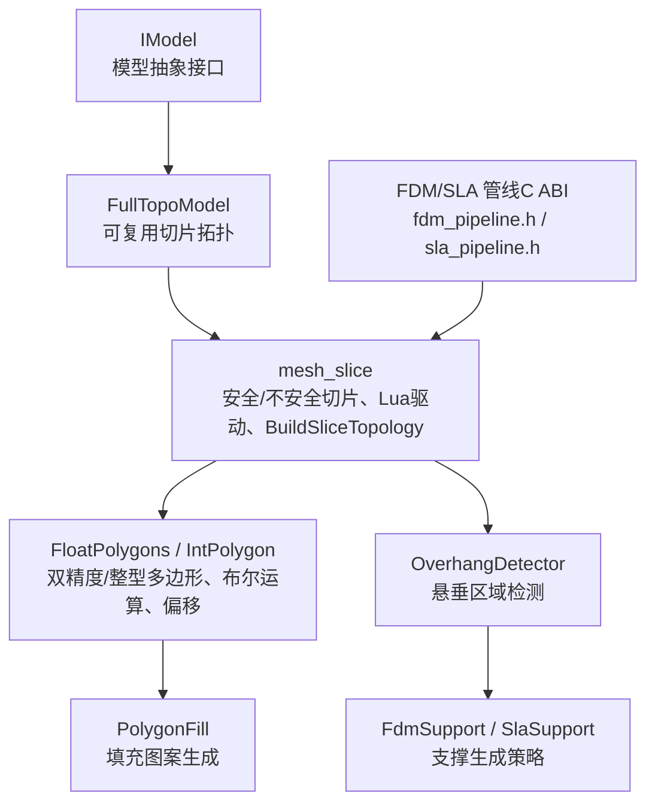
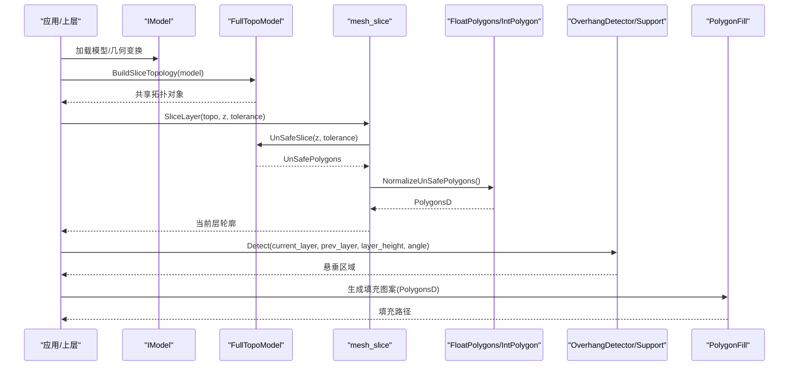
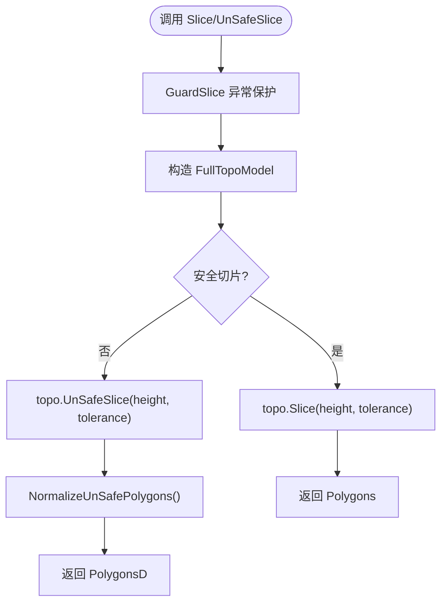
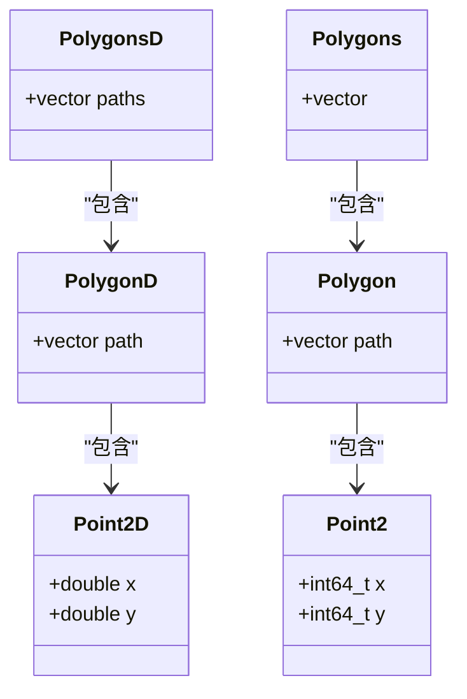
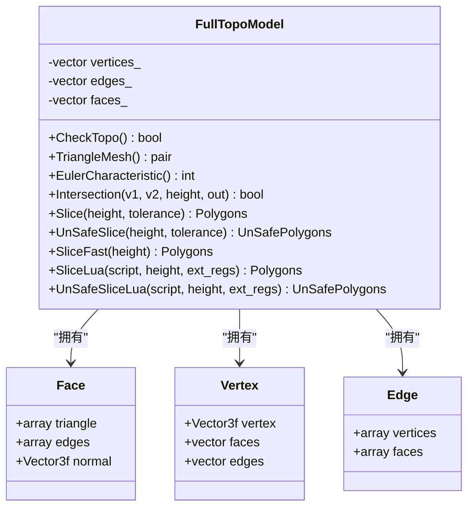
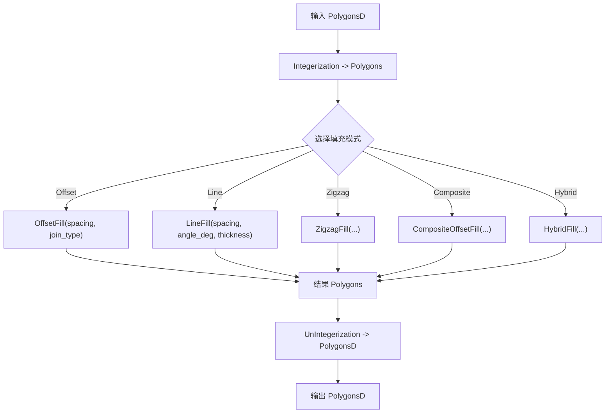
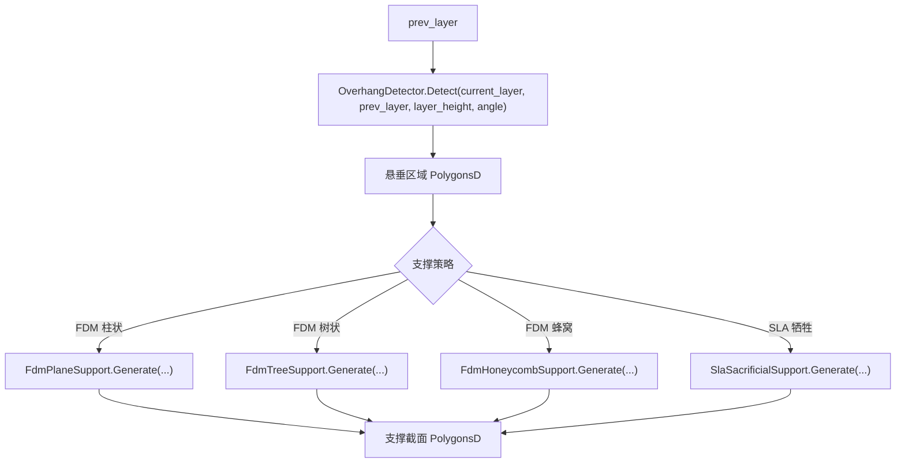
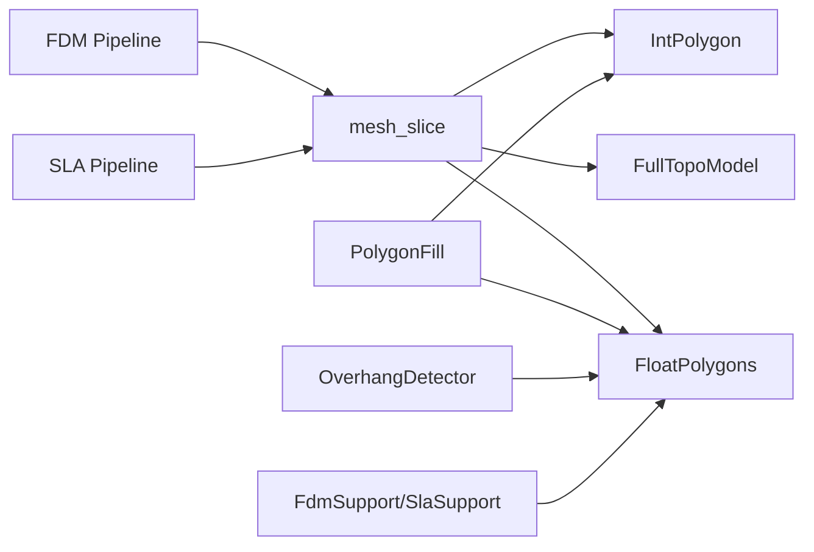

# 3D 打印切片原理

<cite>
**本文引用的文件**   
- [mesh_slice.hpp](file://LibHsBaSlicer/Slice/mesh_slice.hpp)
- [mesh_slice.cpp](file://LibHsBaSlicer/Slice/mesh_slice.cpp)
- [FloatPolygons.hpp](file://2D/FloatPolygons.hpp)
- [FloatPolygons.cpp](file://2D/FloatPolygons.cpp)
- [IntPolygon.hpp](file://2D/IntPolygon.hpp)
- [PolygonFill.hpp](file://2D/PolygonFill.hpp)
- [PolygonFill.cpp](file://2D/PolygonFill.cpp)
- [FullTopoModel.hpp](file://meshmodel/FullTopoModel.hpp)
- [IModel.hpp](file://base/IModel.hpp)
- [fdm_pipeline.h](file://DllHsBaSlicer/fdm_pipeline.h)
- [sla_pipeline.h](file://DllHsBaSlicer/sla_pipeline.h)
- [FdmSupport.hpp](file://support/FdmSupport.hpp)
- [SlaSupport.hpp](file://support/SlaSupport.hpp)
- [OverhangDetector.hpp](file://support/OverhangDetector.hpp)
</cite>

## 目录
1. [引言](#引言)
2. [项目结构](#项目结构)
3. [核心概念](#核心概念)
4. [架构总览](#架构总览)
5. [详细组件分析](#详细组件分析)
6. [依赖关系分析](#依赖关系分析)
7. [性能与复杂度](#性能与复杂度)
8. [故障排除指南](#故障排除指南)
9. [结论](#结论)
10. [附录：使用示例与最佳实践](#附录使用示例与最佳实践)

## 引言
本文件面向 HsBaSlicer 的 3D 打印切片原理，系统解释从三维模型到层切片的完整转换过程。内容覆盖网格几何处理、轮廓提取、层间数据组织，以及 FDM、SLA、SLS 等增材制造技术的切片差异与特殊逻辑。文档还包含关键步骤说明（模型加载与验证、几何变换、布尔运算、悬垂检测、支撑生成）、代码级调用路径、数据结构职责，以及可视化图表帮助初学者理解复杂的几何计算流程。

## 项目结构
围绕切片的核心代码主要分布在以下模块：
- 切片接口与拓扑切片：LibHsBaSlicer/Slice
- 二维多边形与布尔运算：2D
- 网格拓扑与切片实现：meshmodel
- 填充算法：2D/PolygonFill
- 支撑与悬垂检测：support
- 工艺管线对外 C ABI：DllHsBaSlicer
- 模型抽象接口：base

**图示来源** 
- [IModel.hpp:111-139](file://base/IModel.hpp#L111-L139)
- [FullTopoModel.hpp:53-142](file://meshmodel/FullTopoModel.hpp#L53-L142)
- [mesh_slice.hpp:22-103](file://LibHsBaSlicer/Slice/mesh_slice.hpp#L22-L103)
- [FloatPolygons.hpp:18-26](file://2D/FloatPolygons.hpp#L18-L26)
- [IntPolygon.hpp:16-26](file://2D/IntPolygon.hpp#L16-L26)
- [PolygonFill.hpp:20-136](file://2D/PolygonFill.hpp#L20-L136)
- [OverhangDetector.hpp:14-50](file://support/OverhangDetector.hpp#L14-L50)
- [FdmSupport.hpp:13-63](file://support/FdmSupport.hpp#L13-L63)
- [SlaSupport.hpp:13-42](file://support/SlaSupport.hpp#L13-L42)
- [fdm_pipeline.h:17-61](file://DllHsBaSlicer/fdm_pipeline.h#L17-L61)
- [sla_pipeline.h:17-56](file://DllHsBaSlicer/sla_pipeline.h#L17-L56)

**章节来源**
- [IModel.hpp:111-139](file://base/IModel.hpp#L111-L139)
- [FullTopoModel.hpp:53-142](file://meshmodel/FullTopoModel.hpp#L53-L142)
- [mesh_slice.hpp:22-103](file://LibHsBaSlicer/Slice/mesh_slice.hpp#L22-L103)
- [FloatPolygons.hpp:18-26](file://2D/FloatPolygons.hpp#L18-L26)
- [IntPolygon.hpp:16-26](file://2D/IntPolygon.hpp#L16-L26)
- [PolygonFill.hpp:20-136](file://2D/PolygonFill.hpp#L20-L136)
- [OverhangDetector.hpp:14-50](file://support/OverhangDetector.hpp#L14-L50)
- [FdmSupport.hpp:13-63](file://support/FdmSupport.hpp#L13-L63)
- [SlaSupport.hpp:13-42](file://support/SlaSupport.hpp#L13-L42)
- [fdm_pipeline.h:17-61](file://DllHsBaSlicer/fdm_pipeline.h#L17-L61)
- [sla_pipeline.h:17-56](file://DllHsBaSlicer/sla_pipeline.h#L17-L56)

## 核心概念
- IModel：统一的三维模型抽象接口，提供加载、保存、几何变换、包围盒、体积与三角网格导出能力。
- FullTopoModel：面向切片的“全拓扑重建”网格模型，构建顶点、边、面拓扑关系，支持安全切片、不安全切片、快速切片与 Lua 自定义切片。
- PolygonsD / PolygonD：基于 Clipper2 的双精度多边形类型，用于后续布尔运算、偏移、面积计算与填充。
- Polygons / Polygon：基于 Clipper2 的整型多边形类型，内部几何计算常在此精度下进行，配合 integerization 缩放因子进行坐标转换。
- UnSafePolygons / UnSafePolygon：允许开放轮廓的切片结果集合，常用于材料供给类工艺或中间态数据处理。
- OverhangDetector：根据层高与角度阈值检测悬垂区域，为支撑生成提供输入。
- FdmSupport / SlaSupport：针对不同工艺的支撑生成策略（柱状、树状、蜂窝、牺牲支撑等）。

**章节来源**
- [IModel.hpp:111-139](file://base/IModel.hpp#L111-L139)
- [FullTopoModel.hpp:25-41](file://meshmodel/FullTopoModel.hpp#L25-L41)
- [FullTopoModel.hpp:53-142](file://meshmodel/FullTopoModel.hpp#L53-L142)
- [FloatPolygons.hpp:18-26](file://2D/FloatPolygons.hpp#L18-L26)
- [IntPolygon.hpp:16-26](file://2D/IntPolygon.hpp#L16-L26)
- [OverhangDetector.hpp:14-50](file://support/OverhangDetector.hpp#L14-L50)
- [FdmSupport.hpp:13-63](file://support/FdmSupport.hpp#L13-L63)
- [SlaSupport.hpp:13-42](file://support/SlaSupport.hpp#L13-L42)

## 架构总览
从模型到层切片的整体流程如下：
- 模型加载与验证：通过 IModel 加载并获取三角网格；必要时进行几何变换（平移、旋转、缩放）。
- 拓扑重建：将 IModel 转换为 FullTopoModel，构建顶点/边/面拓扑关系，便于高效切片。
- 平面切片：按 Z 高度执行 Slice/UnSafeSlice，得到闭合或开放的二维轮廓。
- 规范化与布尔运算：对不安全切片结果进行清理（过滤开放折线、非简单多边形），并转换为双精度 PolygonsD。
- 悬垂检测与支撑生成：比较相邻层轮廓，检测悬垂区域，按工艺选择支撑策略。
- 填充与路径规划：在每层轮廓上生成填充图案，再优化路径输出至各工艺格式。

**图示来源**
- [mesh_slice.hpp:80-103](file://LibHsBaSlicer/Slice/mesh_slice.hpp#L80-L103)
- [mesh_slice.cpp:86-116](file://LibHsBaSlicer/Slice/mesh_slice.cpp#L86-L116)
- [FullTopoModel.hpp:100-121](file://meshmodel/FullTopoModel.hpp#L100-L121)
- [FloatPolygons.hpp:18-26](file://2D/FloatPolygons.hpp#L18-L26)
- [IntPolygon.hpp:16-26](file://2D/IntPolygon.hpp#L16-L26)
- [OverhangDetector.hpp:31-49](file://support/OverhangDetector.hpp#L31-L49)
- [PolygonFill.hpp:20-136](file://2D/PolygonFill.hpp#L20-L136)

## 详细组件分析

### 切片接口 mesh_slice
- 安全切片 Slice：返回闭合多边形，适用于需要封闭轮廓的工艺（如 SLA）。
- 不安全切片 UnSafeSlice：返回可能开放的轮廓，适用于材料供给类工艺（如 FDM）的中间处理。
- Lua 驱动切片 SliceLua/UnSafeSliceLua：通过脚本自定义切片逻辑，暴露 V/E/F 与 height 给脚本。
- 规范化 NormalizeUnSafePolygons：过滤开放折线与非简单多边形，转换为双精度 PolygonsD。
- 可复用拓扑 BuildSliceTopology：一次性构建拓扑，避免每层重复重建，提升多层切片性能。
- 单层切片 SliceLayer：基于预建拓扑的单层切片并规范化。

**图示来源**
- [mesh_slice.cpp:28-43](file://LibHsBaSlicer/Slice/mesh_slice.cpp#L28-L43)
- [mesh_slice.cpp:46-63](file://LibHsBaSlicer/Slice/mesh_slice.cpp#L46-L63)
- [mesh_slice.cpp:86-104](file://LibHsBaSlicer/Slice/mesh_slice.cpp#L86-L104)
- [mesh_slice.cpp:106-116](file://LibHsBaSlicer/Slice/mesh_slice.cpp#L106-L116)

**章节来源**
- [mesh_slice.hpp:22-103](file://LibHsBaSlicer/Slice/mesh_slice.hpp#L22-L103)
- [mesh_slice.cpp:28-43](file://LibHsBaSlicer/Slice/mesh_slice.cpp#L28-L43)
- [mesh_slice.cpp:46-63](file://LibHsBaSlicer/Slice/mesh_slice.cpp#L46-L63)
- [mesh_slice.cpp:86-104](file://LibHsBaSlicer/Slice/mesh_slice.cpp#L86-L104)
- [mesh_slice.cpp:106-116](file://LibHsBaSlicer/Slice/mesh_slice.cpp#L106-L116)

### 二维多边形 FloatPolygons / IntPolygon
- 双精度类型：Point2D、PolygonD、PolygonsD，封装 Clipper2 的 PathD/PathsD。
- 布尔运算：Union、Intersection、Difference、Xor，支持单多边形与多边形集合。
- 偏移与简化：Offset、MakeSimple，用于轮廓膨胀/收缩与去共线点。
- 面积与形状生成：Area、MakeRectangle/MakeCircle/MakeEllipse/MakeRegularPolygon。
- 整数化与反整数化：Integerization/UnIntegerization，配合 integerization 缩放因子在整型与浮点之间转换。

**图示来源**
- [FloatPolygons.hpp:18-26](file://2D/FloatPolygons.hpp#L18-L26)
- [IntPolygon.hpp:16-26](file://2D/IntPolygon.hpp#L16-L26)

**章节来源**
- [FloatPolygons.hpp:18-26](file://2D/FloatPolygons.hpp#L18-L26)
- [FloatPolygons.cpp:184-221](file://2D/FloatPolygons.cpp#L184-L221)
- [IntPolygon.hpp:16-26](file://2D/IntPolygon.hpp#L16-L26)

### 网格拓扑 FullTopoModel
- 拓扑结构：Face（三角形、边索引、法向量）、Vertex（顶点、关联面/边）、Edge（端点、关联面）。
- 切片方法：Slice（仅闭合）、UnSafeSlice（含开放）、SliceFast（快速切片，需拓扑完整性检查）、SliceLua（Lua 自定义）。
- 几何交集：Intersection(v1,v2,height,out) 用于线段与水平面的交点计算。
- 欧拉特征：EulerCharacteristic 可用于检测孔洞与拓扑完整性问题。

**图示来源**
- [FullTopoModel.hpp:53-142](file://meshmodel/FullTopoModel.hpp#L53-L142)

**章节来源**
- [FullTopoModel.hpp:53-142](file://meshmodel/FullTopoModel.hpp#L53-L142)

### 填充算法 PolygonFill
- 填充模式：OffsetFill（偏移填充）、LineFill（平行线填充）、SimpleZigzagFill/ZigzagFill（锯齿填充）、CompositeOffsetFill/HybridFill（复合/混合填充）。
- Lua 扩展：LuaCustomFill/LuaCustomFillString 支持脚本自定义填充；RegisterLuaPolygonFillFunctions 注册函数到 Lua。
- 核心流程：将 PolygonsD 整数化为 Polygons，执行几何操作后转回 PolygonsD。

**图示来源**
- [PolygonFill.hpp:20-136](file://2D/PolygonFill.hpp#L20-L136)
- [PolygonFill.cpp:504-541](file://2D/PolygonFill.cpp#L504-L541)
- [PolygonFill.cpp:544-564](file://2D/PolygonFill.cpp#L544-L564)
- [PolygonFill.cpp:568-800](file://2D/PolygonFill.cpp#L568-L800)

**章节来源**
- [PolygonFill.hpp:20-136](file://2D/PolygonFill.hpp#L20-L136)
- [PolygonFill.cpp:504-541](file://2D/PolygonFill.cpp#L504-L541)
- [PolygonFill.cpp:544-564](file://2D/PolygonFill.cpp#L544-L564)
- [PolygonFill.cpp:568-800](file://2D/PolygonFill.cpp#L568-L800)

### 悬垂检测与支撑生成
- 悬垂检测 OverhangDetector：基于层高与角度阈值计算最大桥接距离，检测当前层相对于前一层的悬垂区域。
- FDM 支撑：FdmPlaneSupport（柱状）、FdmTreeSupport（树状分支）、FdmHoneycombSupport（蜂窝填充）。
- SLA 支撑：SlaSacrificialSupport（牺牲支撑，细尖粗底，逐层锥度）。

**图示来源**
- [OverhangDetector.hpp:31-49](file://support/OverhangDetector.hpp#L31-L49)
- [FdmSupport.hpp:13-63](file://support/FdmSupport.hpp#L13-L63)
- [SlaSupport.hpp:13-42](file://support/SlaSupport.hpp#L13-L42)

**章节来源**
- [OverhangDetector.hpp:31-49](file://support/OverhangDetector.hpp#L31-L49)
- [FdmSupport.hpp:13-63](file://support/FdmSupport.hpp#L13-L63)
- [SlaSupport.hpp:13-42](file://support/SlaSupport.hpp#L13-L42)

### 不同增材制造技术的切片差异
- FDM（熔融沉积）：
  - 管线：预处理 -> 切片 -> 支撑 -> 填充 -> 路径生成。
  - 切片更关注闭合轮廓与填充路径质量；支撑常用柱状/树状/蜂窝。
  - 参考：[fdm_pipeline.h:17-61](file://DllHsBaSlicer/fdm_pipeline.h#L17-L61)。
- SLA（光固化）：
  - 管线：预处理 -> 切片 -> 底层成型 -> 支撑 -> 导出（zip）。
  - 切片强调表面质量与支撑去除性；支撑常用牺牲支撑（细尖粗底）。
  - 参考：[sla_pipeline.h:17-56](file://DllHsBaSlicer/sla_pipeline.h#L17-L56)。
- SLS（选择性激光烧结）：
  - 通常以粉末床为基础，切片阶段更注重热应力与粉末支撑；本项目中可通过自定义管线与填充策略适配。
  - 参考：项目结构中存在 sls_pipeline.h，但具体实现未在本节直接引用源码。

**章节来源**
- [fdm_pipeline.h:17-61](file://DllHsBaSlicer/fdm_pipeline.h#L17-L61)
- [sla_pipeline.h:17-56](file://DllHsBaSlicer/sla_pipeline.h#L17-L56)

## 依赖关系分析
- mesh_slice 依赖 FullTopoModel 进行几何切片，并通过 FloatPolygons/IntPolygon 完成多边形规范化与布尔运算。
- PolygonFill 依赖 FloatPolygons/IntPolygon 提供的双精度与整型多边形类型及布尔运算。
- OverhangDetector 与 Support 模块依赖 PolygonsD 作为悬垂区域与支撑截面的统一表示。
- FDM/SLA 管线通过 C ABI 暴露配置与运行接口，内部调用上述核心模块。

**图示来源**
- [mesh_slice.hpp:22-103](file://LibHsBaSlicer/Slice/mesh_slice.hpp#L22-L103)
- [FloatPolygons.hpp:18-26](file://2D/FloatPolygons.hpp#L18-L26)
- [IntPolygon.hpp:16-26](file://2D/IntPolygon.hpp#L16-L26)
- [PolygonFill.hpp:20-136](file://2D/PolygonFill.hpp#L20-L136)
- [OverhangDetector.hpp:31-49](file://support/OverhangDetector.hpp#L31-L49)
- [FdmSupport.hpp:13-63](file://support/FdmSupport.hpp#L13-L63)
- [SlaSupport.hpp:13-42](file://support/SlaSupport.hpp#L13-L42)
- [fdm_pipeline.h:17-61](file://DllHsBaSlicer/fdm_pipeline.h#L17-L61)
- [sla_pipeline.h:17-56](file://DllHsBaSlicer/sla_pipeline.h#L17-L56)

**章节来源**
- [mesh_slice.hpp:22-103](file://LibHsBaSlicer/Slice/mesh_slice.hpp#L22-L103)
- [FloatPolygons.hpp:18-26](file://2D/FloatPolygons.hpp#L18-L26)
- [IntPolygon.hpp:16-26](file://2D/IntPolygon.hpp#L16-L26)
- [PolygonFill.hpp:20-136](file://2D/PolygonFill.hpp#L20-L136)
- [OverhangDetector.hpp:31-49](file://support/OverhangDetector.hpp#L31-L49)
- [FdmSupport.hpp:13-63](file://support/FdmSupport.hpp#L13-L63)
- [SlaSupport.hpp:13-42](file://support/SlaSupport.hpp#L13-L42)
- [fdm_pipeline.h:17-61](file://DllHsBaSlicer/fdm_pipeline.h#L17-L61)
- [sla_pipeline.h:17-56](file://DllHsBaSlicer/sla_pipeline.h#L17-L56)

## 性能与复杂度
- 拓扑重建成本：FullTopoModel 构造函数会重建拓扑关系，适合一次性构建后多次切片。
- 多层切片优化：使用 BuildSliceTopology 与 SliceLayer 避免每层重复重建拓扑，显著降低 O(total_faces) 的重复开销。
- 布尔运算与偏移：Clipper2 的 Union/Intersection/Difference/Xor 与 Offset 在多边形集合上的复杂度取决于多边形数量与顶点数，建议控制输入规模与合理设置 epsilon。
- 填充算法：OffsetFill 迭代次数受 MAX_FILL_ITERATIONS 限制；LineFill/ZigzagFill 涉及扫描线与二分搜索，注意 spacing 与 angle_deg 的选择以避免过多行段。

[本节为通用性能讨论，不直接分析具体文件]

## 故障排除指南
- 切片失败异常保护：所有切片入口通过 GuardSlice 捕获 CGAL/OCCT 等第三方异常，并转换为 IOError，避免跨边界传播。
- 开放轮廓与无效多边形：NormalizeUnSafePolygons 会跳过 open polylines 与非简单多边形，确保下游处理稳定。
- 拓扑完整性：FullTopoModel::CheckTopo 与 EulerCharacteristic 可用于检测模型是否为拓扑流形或存在孔洞。
- Lua 脚本错误：SliceLua/UnSafeSliceLua 暴露 V/E/F 与 height，脚本应返回合法的多边形表；若脚本抛出异常，将被包装为项目错误类型。

**章节来源**
- [mesh_slice.cpp:28-43](file://LibHsBaSlicer/Slice/mesh_slice.cpp#L28-L43)
- [mesh_slice.cpp:86-104](file://LibHsBaSlicer/Slice/mesh_slice.cpp#L86-L104)
- [FullTopoModel.hpp:80-98](file://meshmodel/FullTopoModel.hpp#L80-L98)
- [FullTopoModel.hpp:116-132](file://meshmodel/FullTopoModel.hpp#L116-L132)

## 结论
HsBaSlicer 的切片体系以 IModel 抽象为入口，通过 FullTopoModel 进行拓扑重建与高效切片，结合 FloatPolygons/IntPolygon 的布尔运算与偏移能力，形成稳定的二维轮廓处理链。在此基础上，OverhangDetector 与多种支撑策略适配不同工艺需求，PolygonFill 提供丰富的填充模式。FDM/SLA 管线通过 C ABI 暴露统一接口，便于上层集成。该设计在保证几何精度的同时，兼顾了可扩展性与性能优化。

[本节为总结性内容，不直接分析具体文件]

## 附录：使用示例与最佳实践

### 使用 mesh_slice 进行切片
- 安全切片（闭合轮廓）：
  - 调用 Slice(model, height, tolerance)，返回 Polygons。
  - 适用场景：SLA 等需要封闭轮廓的表面成型工艺。
- 不安全切片（含开放轮廓）：
  - 调用 UnSafeSlice(model, height, tolerance)，返回 UnSafePolygons。
  - 适用场景：FDM 等材料供给工艺，或需要中间态数据的处理流程。
- Lua 驱动切片：
  - 调用 SliceLua(model, script, height) 或 UnSafeSliceLua(model, script, height)。
  - 脚本可用全局变量 V/E/F 与 height 自定义切片逻辑。
- 可复用拓扑与单层切片：
  - 先 BuildSliceTopology(model) 构建拓扑，再 SliceLayer(topo, z, tolerance) 获取当前层 PolygonsD。
  - 推荐用于多层流水线，避免重复拓扑重建。

**章节来源**
- [mesh_slice.hpp:22-103](file://LibHsBaSlicer/Slice/mesh_slice.hpp#L22-L103)
- [mesh_slice.cpp:46-83](file://LibHsBaSlicer/Slice/mesh_slice.cpp#L46-L83)
- [mesh_slice.cpp:106-116](file://LibHsBaSlicer/Slice/mesh_slice.cpp#L106-L116)

### PolygonsD 在切片流程中的作用
- 双精度多边形集合用于后续布尔运算、偏移、面积计算与填充。
- 与整型多边形 Polygons 通过 Integerization/UnIntegerization 相互转换，平衡精度与性能。
- 在 NormalizeUnSafePolygons 中作为最终输出类型，供填充与路径规划使用。

**章节来源**
- [FloatPolygons.hpp:18-26](file://2D/FloatPolygons.hpp#L18-L26)
- [FloatPolygons.cpp:184-221](file://2D/FloatPolygons.cpp#L184-L221)
- [mesh_slice.cpp:86-104](file://LibHsBaSlicer/Slice/mesh_slice.cpp#L86-L104)