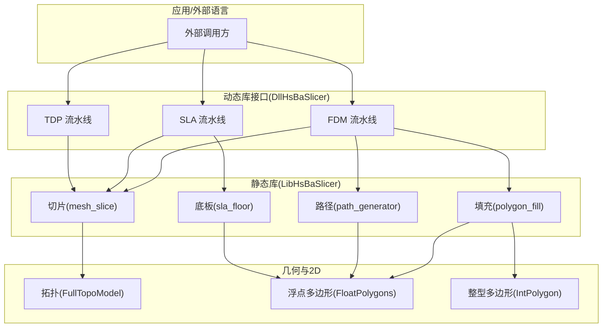
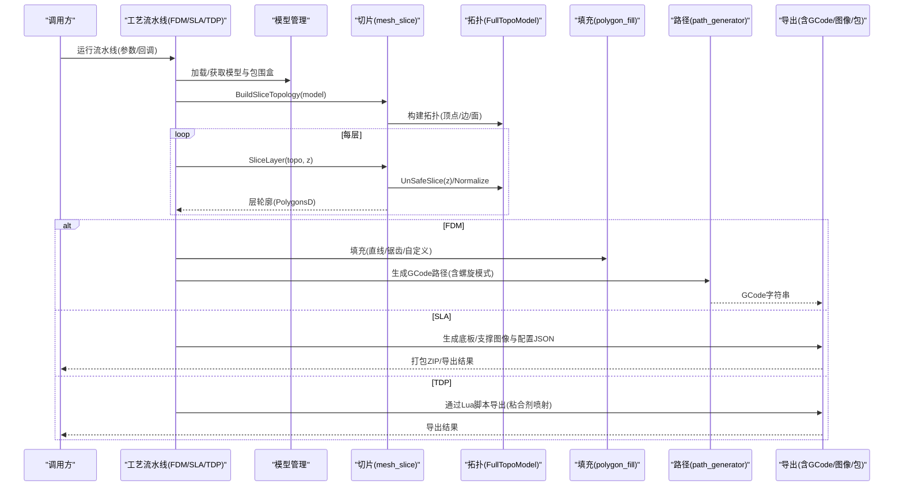
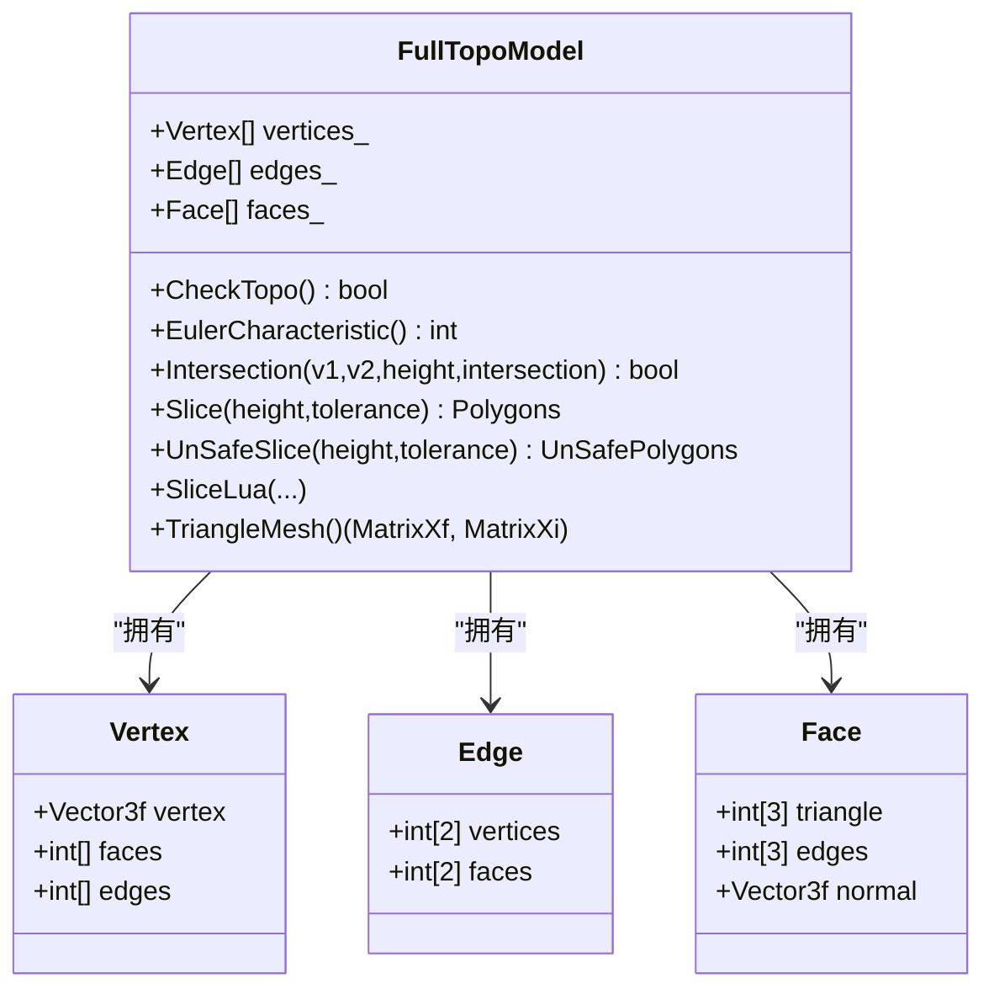
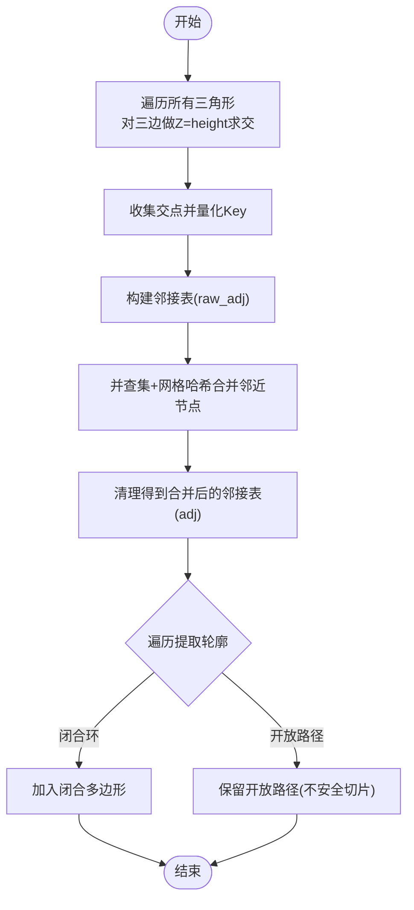
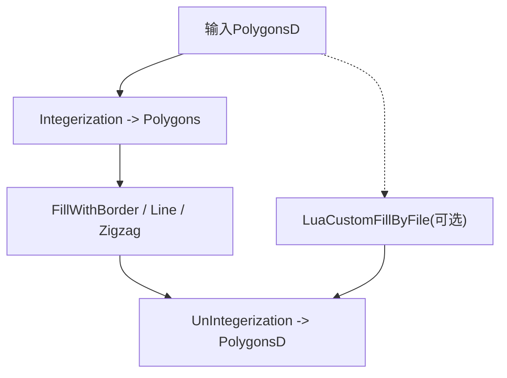
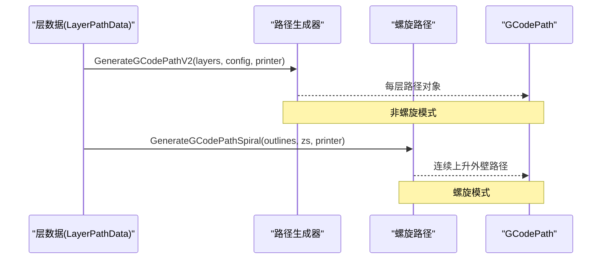
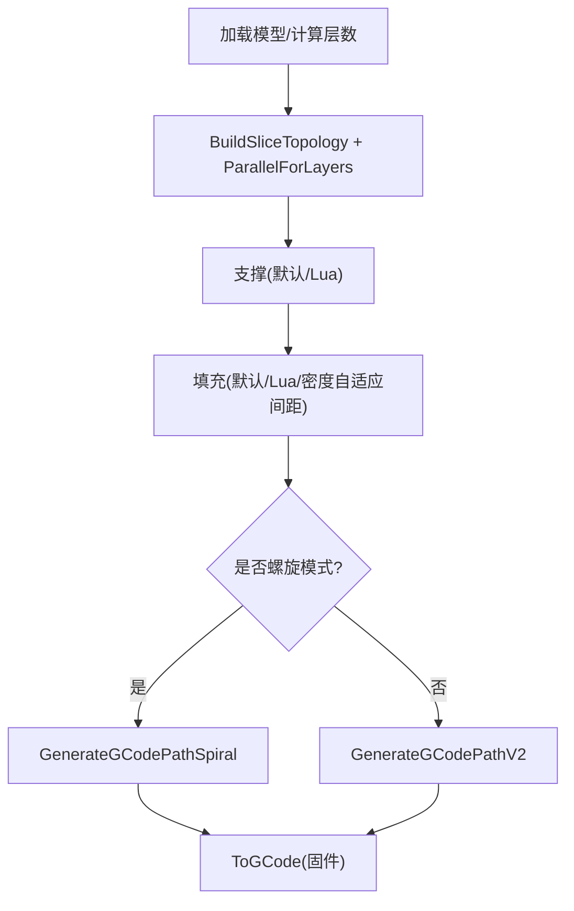
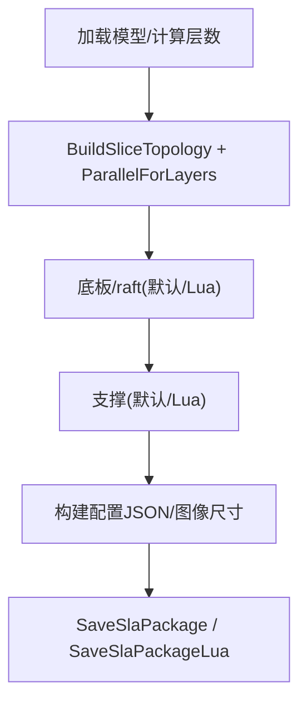
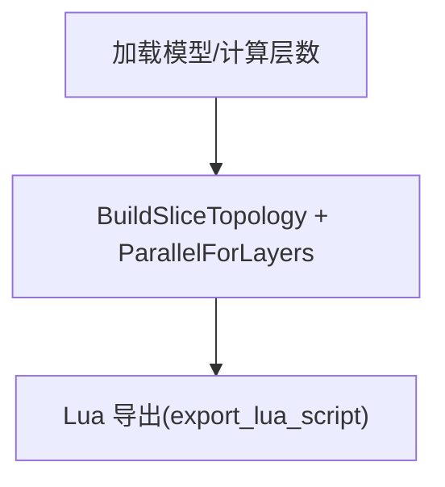
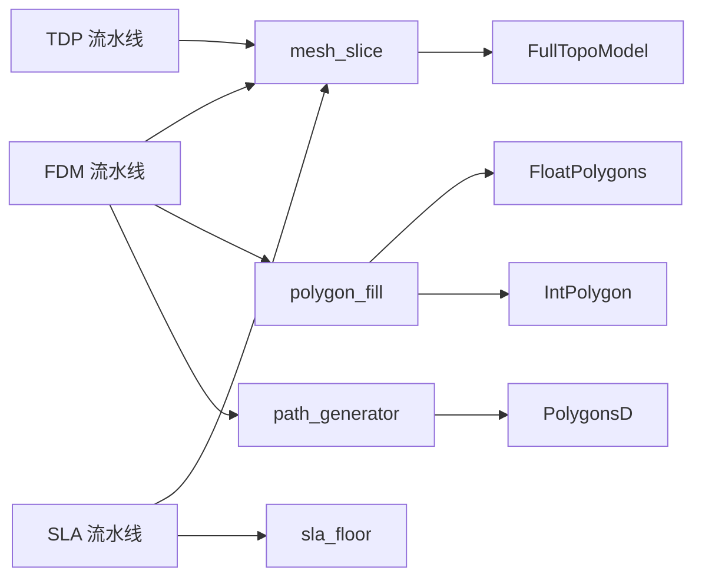

# 3D打印切片原理

<cite>
**本文引用的文件**   
- [README.md](file://README.md)
- [mesh_slice.hpp](file://LibHsBaSlicer/Slice/mesh_slice.hpp)
- [mesh_slice.cpp](file://LibHsBaSlicer/Slice/mesh_slice.cpp)
- [FullTopoModel.hpp](file://meshmodel/FullTopoModel.hpp)
- [FullTopoModel.cpp](file://meshmodel/FullTopoModel.cpp)
- [FloatPolygons.hpp](file://2D/FloatPolygons.hpp)
- [IntPolygon.hpp](file://2D/IntPolygon.hpp)
- [polygon_fill.hpp](file://LibHsBaSlicer/Fill/polygon_fill.hpp)
- [polygon_fill.cpp](file://LibHsBaSlicer/Fill/polygon_fill.cpp)
- [path_generator.hpp](file://LibHsBaSlicer/Path/path_generator.hpp)
- [path_generator.cpp](file://LibHsBaSlicer/Path/path_generator.cpp)
- [gcodepath.hpp](file://paths/gcodepath.hpp)
- [fdm_pipeline.cpp](file://DllHsBaSlicer/fdm_pipeline.cpp)
- [sla_pipeline.cpp](file://DllHsBaSlicer/sla_pipeline.cpp)
- [tdp_pipeline.cpp](file://DllHsBaSlicer/tdp_pipeline.cpp)
- [slice_config.proto](file://proto/slice_config.proto)
</cite>

## 目录
1. [引言](#引言)
2. [项目结构](#项目结构)
3. [核心组件](#核心组件)
4. [架构总览](#架构总览)
5. [详细组件分析](#详细组件分析)
6. [依赖关系分析](#依赖关系分析)
7. [性能与并行化](#性能与并行化)
8. [故障排查指南](#故障排查指南)
9. [结论](#结论)
10. [附录：多工艺切片差异对照](#附录多工艺切片差异对照)

## 引言
本文件面向 HsBaSlicer 的 3D 打印切片原理，系统阐述从 3D 模型到 GCode（或各工艺专属输出）的完整转换过程。内容覆盖网格切片算法、层构建与轮廓提取、拓扑结构在切片中的作用、不同 3D 打印技术（FDM、SLA、SLS、SLM、LOM、TDP、WAAM）的切片差异与特殊处理，并辅以流程图与时序图帮助理解关键阶段。

## 项目结构
HsBaSlicer 提供模块化、跨平台的切片核心能力，包含基础类型、2D 多边形、网格/CAD 模型、路径生成、支撑、文件与配置等模块。切片管线通过 DllHsBaSlicer 暴露 C ABI，供外部语言调用；LibHsBaSlicer 封装全流程 C++ API。

图示来源
- [fdm_pipeline.cpp:214-434](file://DllHsBaSlicer/fdm_pipeline.cpp#L214-L434)
- [sla_pipeline.cpp:281-463](file://DllHsBaSlicer/sla_pipeline.cpp#L281-L463)
- [tdp_pipeline.cpp:236-267](file://DllHsBaSlicer/tdp_pipeline.cpp#L236-L267)
- [mesh_slice.hpp:18-103](file://LibHsBaSlicer/Slice/mesh_slice.hpp#L18-L103)
- [polygon_fill.hpp:15-55](file://LibHsBaSlicer/Fill/polygon_fill.hpp#L15-L55)
- [path_generator.hpp:20-70](file://LibHsBaSlicer/Path/path_generator.hpp#L20-L70)

章节来源
- [README.md:25-39](file://README.md#L25-L39)

## 核心组件
- 切片接口：提供安全/不安全切片、Lua 驱动切片、可复用拓扑构建与逐层切片。
- 拓扑模型：重建顶点/边/面拓扑，支持欧拉特征检查、法线计算、线面求交与切片遍历。
- 2D 多边形：基于 Clipper2 的布尔运算、偏移、简化、面积计算与整数/浮点坐标互转。
- 填充引擎：直线/锯齿/简单锯齿填充，带边框复合偏移，以及 Lua 自定义填充。
- 路径生成：将每层轮廓/填充/支撑转换为 GCode 路径，支持连续螺旋壁与多固件输出。
- 工艺流水线：FDM/SLA/TDP 等流水线编排切片、支撑、填充、底板与导出。

章节来源
- [mesh_slice.hpp:18-103](file://LibHsBaSlicer/Slice/mesh_slice.hpp#L18-L103)
- [FullTopoModel.hpp:43-146](file://meshmodel/FullTopoModel.hpp#L43-L146)
- [FloatPolygons.hpp:18-221](file://2D/FloatPolygons.hpp#L18-L221)
- [IntPolygon.hpp:16-212](file://2D/IntPolygon.hpp#L16-L212)
- [polygon_fill.hpp:15-55](file://LibHsBaSlicer/Fill/polygon_fill.hpp#L15-L55)
- [path_generator.hpp:20-70](file://LibHsBaSlicer/Path/path_generator.hpp#L20-L70)

## 架构总览
下图展示从原始模型到最终路径规划的端到端流程，涵盖预处理、切片、支撑、填充、路径生成与导出。

图示来源
- [fdm_pipeline.cpp:214-434](file://DllHsBaSlicer/fdm_pipeline.cpp#L214-L434)
- [sla_pipeline.cpp:281-463](file://DllHsBaSlicer/sla_pipeline.cpp#L281-L463)
- [tdp_pipeline.cpp:236-267](file://DllHsBaSlicer/tdp_pipeline.cpp#L236-L267)
- [mesh_slice.cpp:105-115](file://LibHsBaSlicer/Slice/mesh_slice.cpp#L105-L115)
- [FullTopoModel.cpp:328-600](file://meshmodel/FullTopoModel.cpp#L328-L600)

## 详细组件分析

### 网格切片与拓扑
- 安全切片返回闭合多边形，丢弃开放轮廓；不安全切片保留开放轮廓，适用于材料供给类工艺。
- 可复用拓扑 BuildSliceTopology 一次性构建 FullTopoModel，避免每层重复重建拓扑，提升多层切片性能。
- FullTopoModel 维护 Vertex/Edge/Face 拓扑关系，支持欧拉特征检查、法线计算、线面求交与遍历。

图示来源
- [FullTopoModel.hpp:53-146](file://meshmodel/FullTopoModel.hpp#L53-L146)
- [FullTopoModel.cpp:50-158](file://meshmodel/FullTopoModel.cpp#L50-L158)

章节来源
- [mesh_slice.hpp:18-103](file://LibHsBaSlicer/Slice/mesh_slice.hpp#L18-L103)
- [mesh_slice.cpp:45-115](file://LibHsBaSlicer/Slice/mesh_slice.cpp#L45-L115)
- [FullTopoModel.hpp:43-146](file://meshmodel/FullTopoModel.hpp#L43-L146)
- [FullTopoModel.cpp:241-272](file://meshmodel/FullTopoModel.cpp#L241-L272)

#### 切片算法流程（安全/不安全）
- 步骤1：对每个三角形三边进行 Z=height 平面求交，收集交点。
- 步骤2：将交点量化为整型 Key，建立邻接表。
- 步骤3：使用并查集+网格哈希合并邻近节点，消除数值误差导致的断点。
- 步骤4：按角度连续性遍历，提取闭合环或多段开放路径。
- 步骤5：安全切片过滤开放路径；不安全切片保留开放路径。

图示来源
- [FullTopoModel.cpp:328-600](file://meshmodel/FullTopoModel.cpp#L328-L600)
- [FullTopoModel.cpp:604-800](file://meshmodel/FullTopoModel.cpp#L604-L800)

章节来源
- [FullTopoModel.cpp:328-600](file://meshmodel/FullTopoModel.cpp#L328-L600)
- [FullTopoModel.cpp:604-800](file://meshmodel/FullTopoModel.cpp#L604-L800)

### 2D 多边形与填充
- 2D 多边形类型：整型 Polygon/Polygons 与浮点 PolygonD/PolygonsD，提供布尔运算、偏移、简化、面积计算与坐标互转。
- 填充模式：直线(Line)、简单锯齿(SimpleZigzag)、锯齿(Zigzag)，支持带边框的复合偏移填充。
- Lua 自定义填充：通过 2D 函数与路径优化函数注册，允许用户脚本生成复杂填充图案。

图示来源
- [polygon_fill.cpp:13-48](file://LibHsBaSlicer/Fill/polygon_fill.cpp#L13-L48)
- [FloatPolygons.hpp:196-221](file://2D/FloatPolygons.hpp#L196-L221)
- [IntPolygon.hpp:16-212](file://2D/IntPolygon.hpp#L16-L212)

章节来源
- [polygon_fill.hpp:15-55](file://LibHsBaSlicer/Fill/polygon_fill.hpp#L15-L55)
- [polygon_fill.cpp:13-48](file://LibHsBaSlicer/Fill/polygon_fill.cpp#L13-L48)
- [FloatPolygons.hpp:18-221](file://2D/FloatPolygons.hpp#L18-L221)
- [IntPolygon.hpp:16-212](file://2D/IntPolygon.hpp#L16-L212)

### 路径生成与GCode输出
- 路径数据：每层包含轮廓(outlines)、填充(fills)、支撑(supports)与层高(z_height)。
- 生成方式：
  - 普通模式：GenerateGCodePathV2 将每层路径转为多固件支持的 GCodePath。
  - 螺旋模式：GenerateGCodePathSpiral 将所有层外轮廓合并为一条连续上升的螺旋壁。
- 固件输出：Marlin/RepRap/Klipper 等，支持喷嘴/耗材/温度/回抽等打印机配置。

图示来源
- [path_generator.hpp:20-70](file://LibHsBaSlicer/Path/path_generator.hpp#L20-L70)
- [path_generator.cpp:14-41](file://LibHsBaSlicer/Path/path_generator.cpp#L14-L41)
- [gcodepath.hpp:24-43](file://paths/gcodepath.hpp#L24-L43)

章节来源
- [path_generator.hpp:20-70](file://LibHsBaSlicer/Path/path_generator.hpp#L20-L70)
- [path_generator.cpp:14-41](file://LibHsBaSlicer/Path/path_generator.cpp#L14-L41)
- [gcodepath.hpp:24-43](file://paths/gcodepath.hpp#L24-L43)

### FDM 流水线
- 阶段：预处理→切片→支撑→填充→路径生成→GCode 输出。
- 特性：
  - 支持螺旋/花瓶模式（无填充/支撑，单条连续外壁）。
  - 支持 Lua 自定义支撑与填充。
  - 并行执行切片与填充，提升吞吐。

图示来源
- [fdm_pipeline.cpp:214-434](file://DllHsBaSlicer/fdm_pipeline.cpp#L214-L434)

章节来源
- [fdm_pipeline.cpp:137-192](file://DllHsBaSlicer/fdm_pipeline.cpp#L137-L192)
- [fdm_pipeline.cpp:214-434](file://DllHsBaSlicer/fdm_pipeline.cpp#L214-L434)

### SLA 流水线
- 阶段：预处理→切片→底板/raft→支撑→导出（PNG/JPG/SVG 图像 + 配置 JSON → ZIP 包）。
- 特性：
  - 底板生成支持凸包、边框与填充角度。
  - 支撑可通过 Lua 自定义。
  - 导出支持 Lua 脚本扩展。

图示来源
- [sla_pipeline.cpp:281-463](file://DllHsBaSlicer/sla_pipeline.cpp#L281-L463)

章节来源
- [sla_pipeline.cpp:227-265](file://DllHsBaSlicer/sla_pipeline.cpp#L227-L265)
- [sla_pipeline.cpp:281-463](file://DllHsBaSlicer/sla_pipeline.cpp#L281-L463)

### TDP（3DP 粘合剂喷射）流水线
- 阶段：预处理→切片→Lua 导出（类似 SLS 的 zip + 可选数据库，携带粘合剂参数）。
- 特性：需要 export_lua_script 指定导出脚本。

图示来源
- [tdp_pipeline.cpp:236-267](file://DllHsBaSlicer/tdp_pipeline.cpp#L236-L267)

章节来源
- [tdp_pipeline.cpp:236-267](file://DllHsBaSlicer/tdp_pipeline.cpp#L236-L267)

## 依赖关系分析
- 切片依赖拓扑：mesh_slice 通过 FullTopoModel 实现安全/不安全切片与 Lua 驱动切片。
- 填充依赖 2D 多边形：polygon_fill 基于 FloatPolygons/IntPolygon 的布尔与偏移操作。
- 路径依赖层数据：path_generator 将 LayerPathData 转换为 GCodePath。
- 流水线编排：FDM/SLA/TDP 流水线组合上述组件，并通过协程与并行工具提升性能。

图示来源
- [mesh_slice.cpp:105-115](file://LibHsBaSlicer/Slice/mesh_slice.cpp#L105-L115)
- [polygon_fill.cpp:13-48](file://LibHsBaSlicer/Fill/polygon_fill.cpp#L13-L48)
- [path_generator.cpp:14-41](file://LibHsBaSlicer/Path/path_generator.cpp#L14-L41)
- [fdm_pipeline.cpp:214-434](file://DllHsBaSlicer/fdm_pipeline.cpp#L214-L434)
- [sla_pipeline.cpp:281-463](file://DllHsBaSlicer/sla_pipeline.cpp#L281-L463)
- [tdp_pipeline.cpp:236-267](file://DllHsBaSlicer/tdp_pipeline.cpp#L236-L267)

章节来源
- [mesh_slice.hpp:18-103](file://LibHsBaSlicer/Slice/mesh_slice.hpp#L18-L103)
- [polygon_fill.hpp:15-55](file://LibHsBaSlicer/Fill/polygon_fill.hpp#L15-L55)
- [path_generator.hpp:20-70](file://LibHsBaSlicer/Path/path_generator.hpp#L20-L70)

## 性能与并行化
- 拓扑复用：BuildSliceTopology 一次构建，SliceLayer 多次复用，避免每层 O(total_faces) 的重建开销。
- 层切片并行：ParallelForLayers 对每层独立切片进行并行化，SliceLayer 仅只读共享拓扑，线程安全。
- 填充并行：C++ 填充（Clipper2）可并行；Lua 填充因解释器状态需串行。
- 螺旋模式：跳过填充/支撑，直接生成连续外壁，减少计算量。

章节来源
- [mesh_slice.hpp:79-103](file://LibHsBaSlicer/Slice/mesh_slice.hpp#L79-L103)
- [fdm_pipeline.cpp:252-272](file://DllHsBaSlicer/fdm_pipeline.cpp#L252-L272)
- [fdm_pipeline.cpp:304-372](file://DllHsBaSlicer/fdm_pipeline.cpp#L304-L372)

## 故障排查指南
- 切片异常保护：GuardSlice 捕获 CGAL/OCCT 等第三方异常，统一转换为 IOError，避免跨 C ABI 边界传播。
- 模型高度无效：当包围盒高度 ≤ 0 时，流水线直接失败并返回错误信息。
- 导出脚本缺失：TDP/SLA 若未提供 export_lua_script，导出阶段失败。
- 拓扑完整性：可使用 CheckTopo 与 EulerCharacteristic 检测非流形/孔洞等问题。

章节来源
- [mesh_slice.cpp:27-42](file://LibHsBaSlicer/Slice/mesh_slice.cpp#L27-L42)
- [fdm_pipeline.cpp:239-248](file://DllHsBaSlicer/fdm_pipeline.cpp#L239-L248)
- [tdp_pipeline.cpp:257-267](file://DllHsBaSlicer/tdp_pipeline.cpp#L257-L267)
- [FullTopoModel.hpp:80-98](file://meshmodel/FullTopoModel.hpp#L80-L98)

## 结论
HsBaSlicer 以可复用的拓扑模型为核心，结合稳健的 2D 多边形与填充引擎，实现了从 3D 网格到 GCode/图像/包的完整切片流水线。其设计强调：
- 拓扑复用与层级并行，显著提升多层切片性能。
- 可扩展的 Lua 脚本机制，适配不同工艺与用户定制需求。
- 清晰的组件分层与稳定的 C ABI 接口，便于集成与二次开发。

## 附录：多工艺切片差异对照
- FDM（熔融沉积）
  - 输出：GCode（Marlin/RRF/Klipper），支持连续螺旋壁。
  - 关键阶段：切片→支撑→填充→路径生成。
  - 参考：[fdm_pipeline.cpp:214-434](file://DllHsBaSlicer/fdm_pipeline.cpp#L214-L434)
- SLA（光固化）
  - 输出：层图像（PNG/JPG/SVG）+ 配置 JSON → ZIP 包。
  - 关键阶段：切片→底板/raft→支撑→导出。
  - 参考：[sla_pipeline.cpp:281-463](file://DllHsBaSlicer/sla_pipeline.cpp#L281-L463)
- SLM（选择性激光熔化）
  - 输出：金属粉末熔覆路径/能量分布（通常由导出脚本定义）。
  - 参考：[slm_pipeline.cpp](file://DllHsBaSlicer/slm_pipeline.cpp)
- SLS（选择性激光烧结）
  - 输出：粉末烧结路径（通常由导出脚本定义）。
  - 参考：[sls_pipeline.cpp](file://DllHsBaSlicer/sls_pipeline.cpp)
- LOM（分层实体制造）
  - 输出：层轮廓切割路径（通常由导出脚本定义）。
  - 参考：[lom_pipeline.cpp](file://DllHsBaSlicer/lom_pipeline.cpp)
- TDP（3DP 粘合剂喷射）
  - 输出：粘合剂喷射路径（通过 Lua 导出脚本，类似 SLS 的 zip + 数据库）。
  - 参考：[tdp_pipeline.cpp:236-267](file://DllHsBaSlicer/tdp_pipeline.cpp#L236-L267)
- WAAM（电弧增材制造）
  - 输出：机器人焊接路径（通常由导出脚本定义）。
  - 参考：[waam_pipeline.cpp](file://DllHsBaSlicer/waam_pipeline.cpp)

章节来源
- [fdm_pipeline.cpp:214-434](file://DllHsBaSlicer/fdm_pipeline.cpp#L214-L434)
- [sla_pipeline.cpp:281-463](file://DllHsBaSlicer/sla_pipeline.cpp#L281-L463)
- [tdp_pipeline.cpp:236-267](file://DllHsBaSlicer/tdp_pipeline.cpp#L236-L267)
- [slice_config.proto:8-27](file://proto/slice_config.proto#L8-L27)