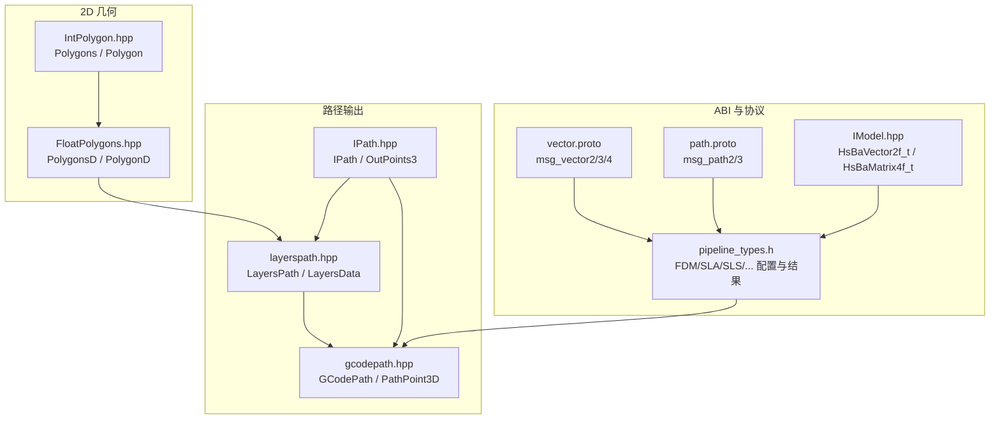
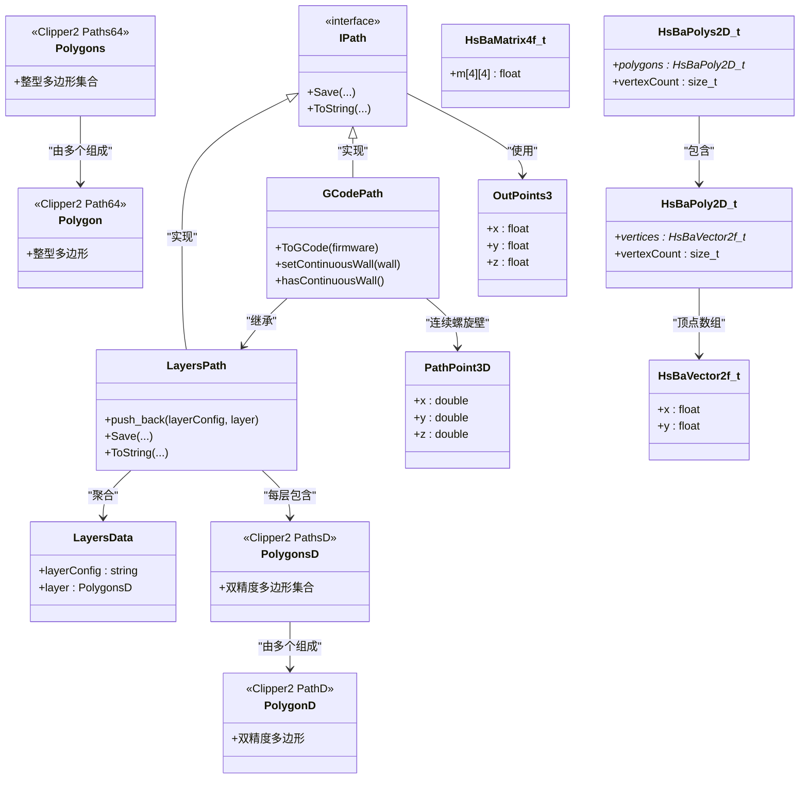
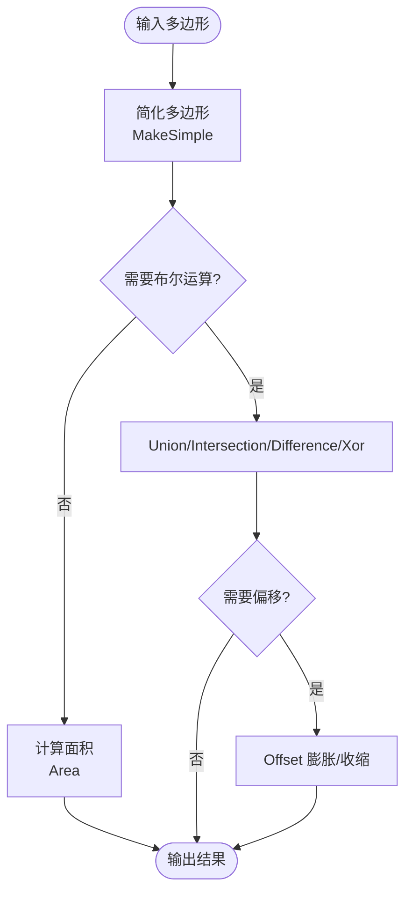
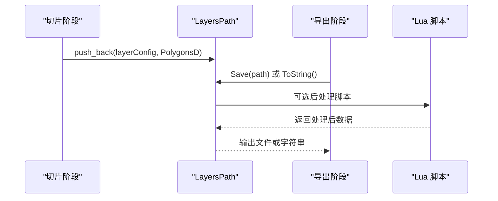
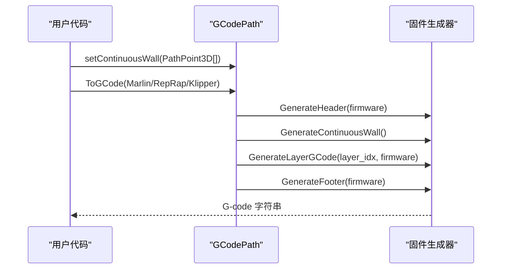
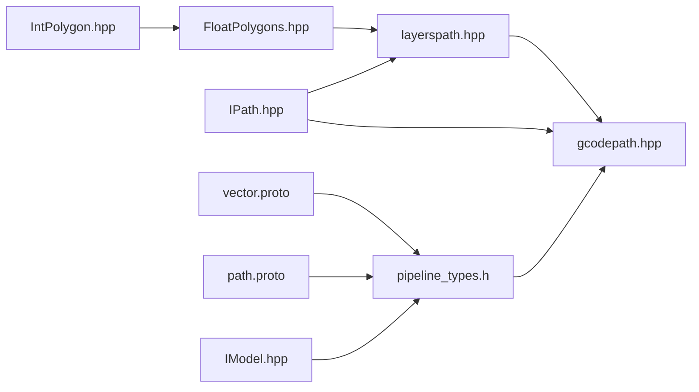

# 数据类型定义

<cite>
**本文引用的文件**   
- [FloatPolygons.hpp](file://2D/FloatPolygons.hpp)
- [IntPolygon.hpp](file://2D/IntPolygon.hpp)
- [layerspath.hpp](file://paths/layerspath.hpp)
- [gcodepath.hpp](file://paths/gcodepath.hpp)
- [IPath.hpp](file://paths/IPath.hpp)
- [pipeline_types.h](file://pipelinetypes/pipeline_types.h)
- [vector.proto](file://proto/vector.proto)
- [path.proto](file://proto/path.proto)
- [IModel.hpp](file://base/IModel.hpp)
</cite>

## 目录
1. [引言](#引言)
2. [项目结构](#项目结构)
3. [核心组件](#核心组件)
4. [架构总览](#架构总览)
5. [详细组件分析](#详细组件分析)
6. [依赖关系分析](#依赖关系分析)
7. [性能与内存布局优化](#性能与内存布局优化)
8. [故障排除指南](#故障排除指南)
9. [结论](#结论)
10. [附录：C ABI 与内部类型映射](#附录c-abi-与内部类型映射)

## 引言
本文件聚焦 HsBaSlicer 中“切片流水线”的基础数据类型定义，重点解释以下关键类型的职责、设计动机以及在数据流中的位置：
- PolygonsD：浮点数多边形集合，用于高精度几何计算。
- LayerPathData（以 LayersPath 的层数据结构体现）：按层组织的多边形与配置字符串。
- G-code 坐标点：包括 PathPoint3D（连续螺旋路径点）与 OutPoints3（通用输出点）。
- C ABI 接口类型：HsBaVector2f_t、HsBaMatrix4f_t 等与 C++ 内部类型的映射。

这些类型贯穿模型预处理、切片、填充、支撑、路径生成与导出等阶段，是理解 HsBaSlicer 数据流转的关键。

## 项目结构
围绕数据类型定义的相关代码主要分布在以下模块：
- 2D 几何：FloatPolygons.hpp、IntPolygon.hpp 提供双精度与整型多边形及布尔运算、偏移、面积等工具。
- 路径输出：IPath.hpp 抽象输出接口；layerspath.hpp 提供按层存储的数据结构；gcodepath.hpp 提供 G-code 路径与连续螺旋壁支持。
- C ABI 与协议：pipelinetypes/pipeline_types.h 暴露 C 兼容的配置与结果结构；proto/vector.proto、proto/path.proto 定义跨语言消息类型；base/IModel.hpp 定义 C ABI 基础几何类型。



**图表来源** 
- [FloatPolygons.hpp:16-25](file://2D/FloatPolygons.hpp#L16-L25)
- [IntPolygon.hpp:14-26](file://2D/IntPolygon.hpp#L14-L26)
- [layerspath.hpp:15-60](file://paths/layerspath.hpp#L15-L60)
- [gcodepath.hpp:21-107](file://paths/gcodepath.hpp#L21-L107)
- [IPath.hpp:18-66](file://paths/IPath.hpp#L18-L66)
- [pipeline_types.h:19-127](file://pipelinetypes/pipeline_types.h#L19-L127)
- [vector.proto:1-24](file://proto/vector.proto#L1-L24)
- [path.proto:1-15](file://proto/path.proto#L1-L15)
- [IModel.hpp:40-60](file://base/IModel.hpp#L40-L60)

**章节来源**
- [FloatPolygons.hpp:16-25](file://2D/FloatPolygons.hpp#L16-L25)
- [IntPolygon.hpp:14-26](file://2D/IntPolygon.hpp#L14-L26)
- [layerspath.hpp:15-60](file://paths/layerspath.hpp#L15-L60)
- [gcodepath.hpp:21-107](file://paths/gcodepath.hpp#L21-L107)
- [IPath.hpp:18-66](file://paths/IPath.hpp#L18-L66)
- [pipeline_types.h:19-127](file://pipelinetypes/pipeline_types.h#L19-L127)
- [vector.proto:1-24](file://proto/vector.proto#L1-L24)
- [path.proto:1-15](file://proto/path.proto#L1-L15)
- [IModel.hpp:40-60](file://base/IModel.hpp#L40-L60)

## 核心组件
本节概述关键数据类型及其在切片流水线中的作用：
- PolygonsD：基于 Clipper2 的双精度多边形集合，用于高精度布尔运算、偏移、面积计算等。
- Polygons/Polygon：基于 Clipper2 的整型多边形集合，常用于需要整数精度的算法或中间表示。
- LayersPath/LayersData：按层组织的数据结构，每层包含一个自由格式配置字符串与一组 PolygonsD。
- GCodePath/GCodePrinterConfig/PathPoint3D：面向 FDM 的 G-code 输出，支持连续螺旋外壁（vase 模式）。
- IPath/OutPoints3：路径输出的抽象接口与通用 3D 输出点。
- C ABI 类型：HsBaVector2f_t、HsBaMatrix4f_t、HsBaPoly2D_t、HsBaPolys2D_t 等，供外部调用者使用。

**章节来源**
- [FloatPolygons.hpp:16-25](file://2D/FloatPolygons.hpp#L16-L25)
- [IntPolygon.hpp:14-26](file://2D/IntPolygon.hpp#L14-L26)
- [layerspath.hpp:15-60](file://paths/layerspath.hpp#L15-L60)
- [gcodepath.hpp:21-107](file://paths/gcodepath.hpp#L21-L107)
- [IPath.hpp:18-66](file://paths/IPath.hpp#L18-L66)
- [IModel.hpp:40-60](file://base/IModel.hpp#L40-L60)

## 架构总览
下图展示从 2D 几何到路径输出再到 C ABI 的整体数据流与类型关系：



**图表来源** 
- [FloatPolygons.hpp:16-25](file://2D/FloatPolygons.hpp#L16-L25)
- [IntPolygon.hpp:14-26](file://2D/IntPolygon.hpp#L14-L26)
- [layerspath.hpp:15-60](file://paths/layerspath.hpp#L15-L60)
- [gcodepath.hpp:21-107](file://paths/gcodepath.hpp#L21-L107)
- [IPath.hpp:18-66](file://paths/IPath.hpp#L18-L66)
- [IModel.hpp:40-60](file://base/IModel.hpp#L40-L60)

## 详细组件分析

### PolygonsD 与 Polygons：双精度与整型多边形
- 设计理念：
  - PolygonsD 使用双精度坐标，适合高精度几何操作（布尔运算、偏移、面积计算），是切片与填充阶段的核心数据结构。
  - Polygons 使用整型坐标，常作为中间表示或某些算法对整数精度的要求。
- 常用操作：
  - MakeSimple：去除共线点简化多边形。
  - Union/Intersection/Difference/Xor：布尔运算。
  - Offset：膨胀/收缩多边形。
  - Area：计算面积。
- 复杂度与性能：
  - 布尔运算与偏移通常依赖于 Clipper2 的高效实现，时间复杂度与多边形顶点数相关。
  - 建议尽量复用 PolygonsD 对象，避免频繁分配与拷贝。



**图表来源** 
- [FloatPolygons.hpp:27-135](file://2D/FloatPolygons.hpp#L27-L135)
- [IntPolygon.hpp:28-192](file://2D/IntPolygon.hpp#L28-L192)

**章节来源**
- [FloatPolygons.hpp:16-25](file://2D/FloatPolygons.hpp#L16-L25)
- [FloatPolygons.hpp:27-135](file://2D/FloatPolygons.hpp#L27-L135)
- [IntPolygon.hpp:14-26](file://2D/IntPolygon.hpp#L14-L26)
- [IntPolygon.hpp:28-192](file://2D/IntPolygon.hpp#L28-L192)

### LayersPath 与 LayersData：层路径数据
- 设计理念：
  - LayersPath 继承 IPath，提供按层组织的数据结构，每层包含一个自由格式配置字符串与一组 PolygonsD。
  - LayersData 是内部结构，封装 layerConfig 与 layer。
- 数据流转：
  - 切片阶段产生每层的 PolygonsD，并附带配置字符串（如层高、填充参数等）。
  - 路径生成阶段读取 LayersPath 中的数据，转换为具体输出（如 G-code、图像等）。
- 扩展性：
  - 支持通过 Lua 脚本进行后处理，灵活定制输出格式。



**图表来源** 
- [layerspath.hpp:15-60](file://paths/layerspath.hpp#L15-L60)
- [IPath.hpp:18-66](file://paths/IPath.hpp#L18-L66)

**章节来源**
- [layerspath.hpp:15-60](file://paths/layerspath.hpp#L15-L60)
- [IPath.hpp:18-66](file://paths/IPath.hpp#L18-L66)

### GCodePath、PathPoint3D 与 GCodePrinterConfig：G-code 路径与连续螺旋壁
- 设计理念：
  - GCodePath 继承 LayersPath，增加 G-code 生成能力，支持多种固件（Marlin、RepRap、Klipper）。
  - PathPoint3D 表示连续螺旋壁的三维路径点，Z 值随层递增。
  - GCodePrinterConfig 描述打印机参数（喷嘴直径、层高、速度等）。
- 数据流转：
  - 设置 continuous_wall_ 后，ToGCode 会优先输出连续螺旋壁，再输出逐层多边形。
  - 根据固件类型生成不同的 G-code 头尾与层指令。



**图表来源** 
- [gcodepath.hpp:21-107](file://paths/gcodepath.hpp#L21-L107)

**章节来源**
- [gcodepath.hpp:21-107](file://paths/gcodepath.hpp#L21-L107)

### IPath 与 OutPoints3：抽象接口与通用输出点
- 设计理念：
  - IPath 抽象了路径输出的保存与序列化接口，支持 Lua 后处理。
  - OutPoints3 是通用的 3D 输出点，用于不同路径类型之间的数据传递。
- 扩展性：
  - 所有具体路径类型（PointsPath、LayersPath、ImagesPath、RobotPath、WeldRobotPath、GCodePath）均实现 IPath。

**章节来源**
- [IPath.hpp:18-66](file://paths/IPath.hpp#L18-L66)

## 依赖关系分析
- 2D 几何模块（FloatPolygons.hpp、IntPolygon.hpp）为上层路径输出提供基础几何操作。
- 路径输出模块（IPath.hpp、layerspath.hpp、gcodepath.hpp）依赖 2D 几何模块，并向上提供可序列化的路径数据。
- C ABI 模块（pipeline_types.h、IModel.hpp）与协议模块（vector.proto、path.proto）提供跨语言接口，与内部类型存在映射关系。



**图表来源** 
- [FloatPolygons.hpp:16-25](file://2D/FloatPolygons.hpp#L16-L25)
- [IntPolygon.hpp:14-26](file://2D/IntPolygon.hpp#L14-L26)
- [layerspath.hpp:15-60](file://paths/layerspath.hpp#L15-L60)
- [gcodepath.hpp:21-107](file://paths/gcodepath.hpp#L21-L107)
- [IPath.hpp:18-66](file://paths/IPath.hpp#L18-L66)
- [pipeline_types.h:19-127](file://pipelinetypes/pipeline_types.h#L19-L127)
- [vector.proto:1-24](file://proto/vector.proto#L1-L24)
- [path.proto:1-15](file://proto/path.proto#L1-L15)
- [IModel.hpp:40-60](file://base/IModel.hpp#L40-L60)

**章节来源**
- [FloatPolygons.hpp:16-25](file://2D/FloatPolygons.hpp#L16-L25)
- [IntPolygon.hpp:14-26](file://2D/IntPolygon.hpp#L14-L26)
- [layerspath.hpp:15-60](file://paths/layerspath.hpp#L15-L60)
- [gcodepath.hpp:21-107](file://paths/gcodepath.hpp#L21-L107)
- [IPath.hpp:18-66](file://paths/IPath.hpp#L18-L66)
- [pipeline_types.h:19-127](file://pipelinetypes/pipeline_types.h#L19-L127)
- [vector.proto:1-24](file://proto/vector.proto#L1-L24)
- [path.proto:1-15](file://proto/path.proto#L1-L15)
- [IModel.hpp:40-60](file://base/IModel.hpp#L40-L60)

## 性能与内存布局优化
- 多边形集合：
  - 尽量复用 PolygonsD 对象，避免频繁分配与拷贝。
  - 使用 MakeSimple 减少冗余顶点，提升后续布尔运算效率。
- 层路径数据：
  - LayersPath 内部使用 vector 存储 LayersData，建议在批量添加层时预分配容量。
- G-code 生成：
  - 连续螺旋壁（continuous_wall_）适用于 vase 模式，可减少逐层处理的开销。
  - 合理设置 GCodePrinterConfig 参数，避免不必要的移动与重绘。
- C ABI 类型：
  - HsBaVector2f_t、HsBaMatrix4f_t 等类型应保持紧凑布局，避免额外填充。
  - 跨语言传递时注意内存所有权与释放策略。

**章节来源**
- [FloatPolygons.hpp:27-135](file://2D/FloatPolygons.hpp#L27-L135)
- [layerspath.hpp:15-60](file://paths/layerspath.hpp#L15-L60)
- [gcodepath.hpp:21-107](file://paths/gcodepath.hpp#L21-L107)
- [IModel.hpp:40-60](file://base/IModel.hpp#L40-L60)

## 故障排除指南
- 多边形布尔运算失败：
  - 检查多边形是否自相交或退化，必要时使用 MakeSimple 简化。
- 层路径数据为空：
  - 确认切片阶段是否正确生成 PolygonsD 并添加到 LayersPath。
- G-code 生成异常：
  - 检查 GCodePrinterConfig 参数是否合理，特别是层高与线宽。
  - 连续螺旋壁未设置时，确保逐层多边形数据正确。
- C ABI 类型不匹配：
  - 确认 HsBaVector2f_t、HsBaMatrix4f_t 等类型与 C++ 内部类型一致。
  - 注意内存释放责任，避免内存泄漏。

**章节来源**
- [FloatPolygons.hpp:27-135](file://2D/FloatPolygons.hpp#L27-L135)
- [layerspath.hpp:15-60](file://paths/layerspath.hpp#L15-L60)
- [gcodepath.hpp:21-107](file://paths/gcodepath.hpp#L21-L107)
- [IModel.hpp:40-60](file://base/IModel.hpp#L40-L60)

## 结论
HsBaSlicer 的数据类型定义围绕高精度几何、层路径组织与 G-code 输出展开，形成了清晰的数据流与职责分离。PolygonsD 与 Polygons 提供基础几何操作，LayersPath 组织层数据，GCodePath 负责具体输出。C ABI 类型与协议定义确保了跨语言接口的稳定性。开发者应关注内存布局与性能优化，合理使用这些基础类型以提升切片流水线的效率与可靠性。

## 附录：C ABI 与内部类型映射
- HsBaVector2f_t：对应 C++ 中的二维向量（float x, y）。
- HsBaMatrix4f_t：对应 C++ 中的 4x4 矩阵（float m[4][4]）。
- HsBaPoly2D_t：对应 C++ 中的二维多边形（顶点数组与数量）。
- HsBaPolys2D_t：对应 C++ 中的多边形集合（多边形数组与数量）。
- 与 proto 类型映射：
  - msg_vector2/3/4：对应 HsBaVector2f_t 等向量类型。
  - msg_path2/3：对应路径点序列。

```mermaid
erDiagram
HSBA_VECTOR2F_T {
float x
float y
}
HSBA_MATRIX4F_T {
float m[4][4]
}
HSBA_POLY2D_T {
HsBaVector2f_t* vertices
size_t vertexCount
}
HSBA_POLYS2D_T {
HsBaPoly2D_t* polygons
size_t vertexCount
}
MSG_VECTOR2 {
float x
float y
}
MSG_VECTOR3 {
float x
float y
float z
}
MSG_VECTOR4 {
float x
float y
float z
float w
}
MSG_PATH2 {
repeated msg_point2 point
}
MSG_PATH3 {
repeated msg_point3 point
}
HSBA_POLY2D_T --> HSBA_VECTOR2F_T : "包含"
HSBA_POLYS2D_T --> HSBA_POLY2D_T : "包含"
MSG_PATH2 --> MSG_VECTOR2 : "点类型为"
MSG_PATH3 --> MSG_VECTOR3 : "点类型为"
```

**图表来源** 
- [IModel.hpp:40-60](file://base/IModel.hpp#L40-L60)
- [vector.proto:1-24](file://proto/vector.proto#L1-L24)
- [path.proto:1-15](file://proto/path.proto#L1-L15)

**章节来源**
- [IModel.hpp:40-60](file://base/IModel.hpp#L40-L60)
- [vector.proto:1-24](file://proto/vector.proto#L1-L24)
- [path.proto:1-15](file://proto/path.proto#L1-L15)