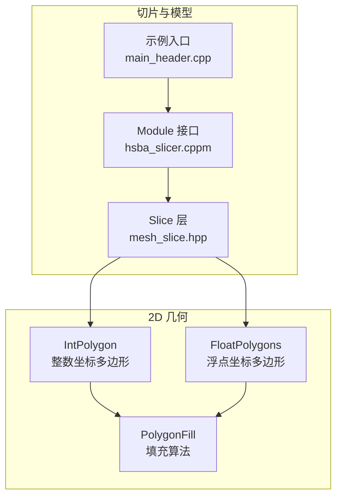
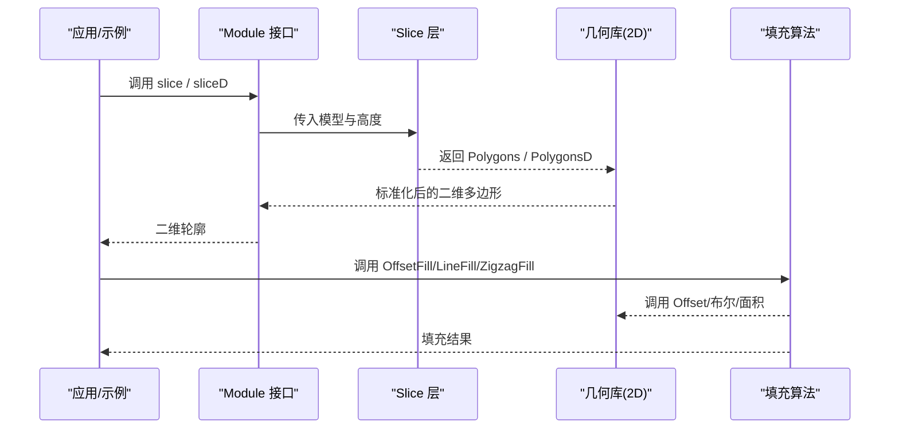
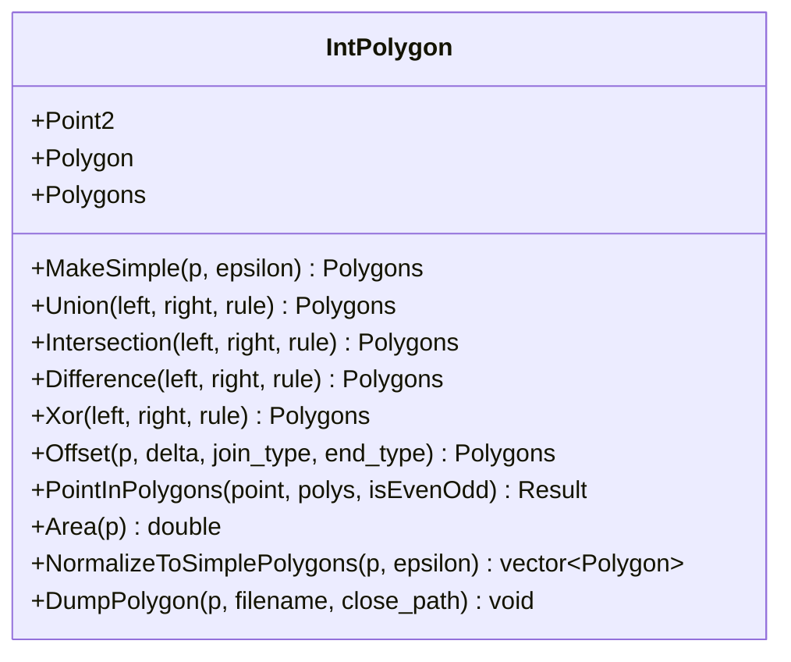
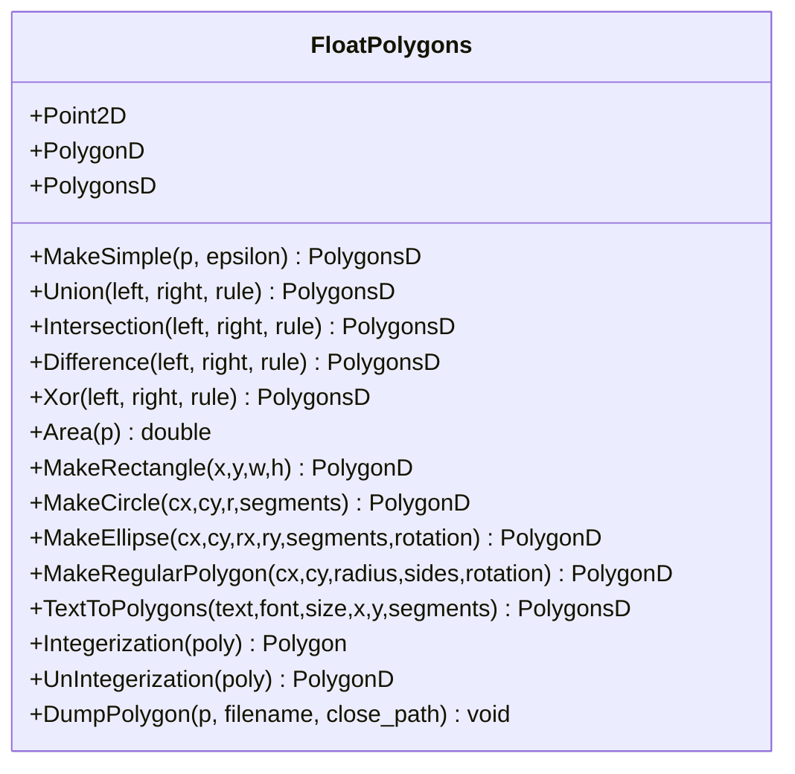
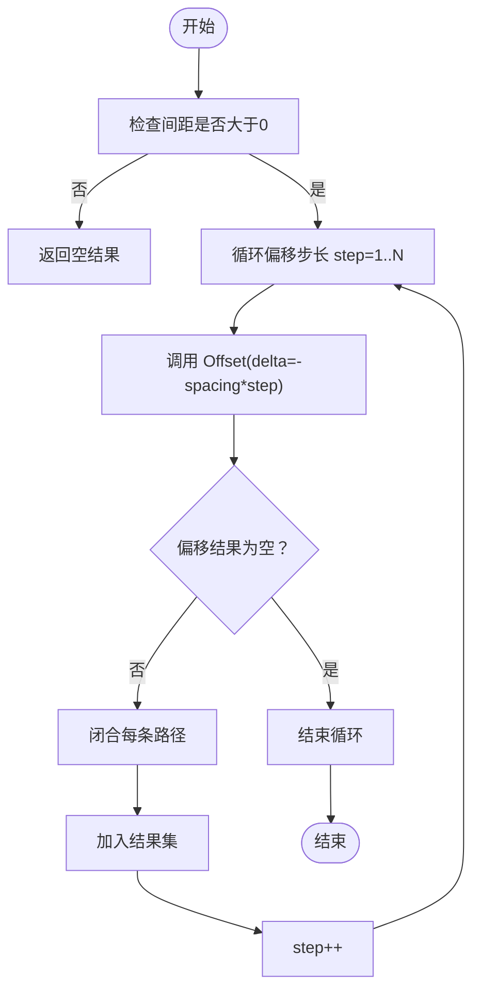
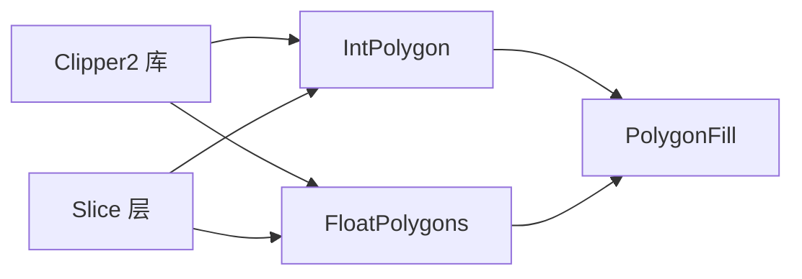
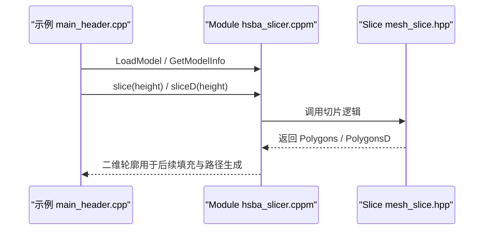

# 几何数据类型

<cite>
**本文引用的文件**   
- [IntPolygon.hpp](file://2D/IntPolygon.hpp)
- [IntPolygon.cpp](file://2D/IntPolygon.cpp)
- [FloatPolygons.hpp](file://2D/FloatPolygons.hpp)
- [FloatPolygons.cpp](file://2D/FloatPolygons.cpp)
- [PolygonFill.hpp](file://2D/PolygonFill.hpp)
- [PolygonFill.cpp](file://2D/PolygonFill.cpp)
- [mesh_slice.hpp](file://LibHsBaSlicer/Slice/mesh_slice.hpp)
- [hsba_slicer.cppm](file://ModuleHsBaSlicer/hsba_slicer.cppm)
- [main_header.cpp](file://samples/LibHsBaSlicer/main_header.cpp)
</cite>

## 目录
1. [引言](#引言)
2. [项目结构](#项目结构)
3. [核心组件](#核心组件)
4. [架构总览](#架构总览)
5. [详细组件分析](#详细组件分析)
6. [依赖关系分析](#依赖关系分析)
7. [性能与内存布局](#性能与内存布局)
8. [常见问题与排错](#常见问题与排错)
9. [结论](#结论)
10. [附录：坐标系统与切片流程](#附录坐标系统与切片流程)

## 引言
本文件面向 HsBaSlicer 的二维几何数据类型，重点解释整数坐标多边形 IntPolygon 与双精度浮点坐标多边形 FloatPolygons 的设计动机、数据结构、拓扑语义、坐标转换机制以及常用几何运算（偏移、布尔、填充）的实现思路。文档同时给出内存布局分析与性能考量，并说明从 CAD 模型到切片平面的坐标变换在系统中的位置与作用。

## 项目结构
与几何类型直接相关的代码集中在 2D 模块中：
- IntPolygon：基于 Clipper2 的 64 位整数坐标多边形类型与布尔/偏移/面积等基础操作。
- FloatPolygons：基于 Clipper2 的双精度浮点坐标多边形类型，提供形状构造、文本转轮廓、整型与浮点互转等能力。
- PolygonFill：基于上述两种类型的填充算法（偏移填充、平行线填充、折线填充、复合/混合填充）。
- 切片与模型接口：Slice 层将三维模型切片为二维多边形；上层模块通过统一 API 暴露 slice/sliceD 等方法。

图表来源
- [IntPolygon.hpp:1-241](file://2D/IntPolygon.hpp#L1-L241)
- [FloatPolygons.hpp:1-271](file://2D/FloatPolygons.hpp#L1-L271)
- [PolygonFill.hpp:1-141](file://2D/PolygonFill.hpp#L1-L141)
- [mesh_slice.hpp:40-71](file://LibHsBaSlicer/Slice/mesh_slice.hpp#L40-L71)
- [hsba_slicer.cppm:179-219](file://ModuleHsBaSlicer/hsba_slicer.cppm#L179-L219)
- [main_header.cpp:62-92](file://samples/LibHsBaSlicer/main_header.cpp#L62-L92)

章节来源
- [IntPolygon.hpp:1-241](file://2D/IntPolygon.hpp#L1-L241)
- [FloatPolygons.hpp:1-271](file://2D/FloatPolygons.hpp#L1-L271)
- [PolygonFill.hpp:1-141](file://2D/PolygonFill.hpp#L1-L141)
- [mesh_slice.hpp:40-71](file://LibHsBaSlicer/Slice/mesh_slice.hpp#L40-L71)
- [hsba_slicer.cppm:179-219](file://ModuleHsBaSlicer/hsba_slicer.cppm#L179-L219)
- [main_header.cpp:62-92](file://samples/LibHsBaSlicer/main_header.cpp#L62-L92)

## 核心组件
- 整数坐标多边形（IntPolygon）
  - 使用 64 位整数 Point2 与 Path64/Paths64 表示单条路径与多边形集合。
  - 提供简化、布尔运算（并/交/差/XOR）、偏移、点包含测试、面积计算、SVG 调试导出、哈希特化等。
  - 缩放因子 integerization 用于在整数与浮点坐标之间进行高精度转换。
- 浮点坐标多边形（FloatPolygons）
  - 使用双精度 PointD/PathD/PathsD 表示多边形。
  - 提供简化、布尔运算、面积、矩形/圆/椭圆/正多边形构造、文本转轮廓、整型与浮点互转、SVG 调试导出、哈希特化等。
- 填充算法（PolygonFill）
  - 提供 OffsetFill、LineFill、SimpleZigzagFill、ZigzagFill、CompositeOffsetFill、HybridFill 等。
  - 内部大量调用 IntPolygon::Offset 与布尔运算，并在 Lua 绑定中完成浮点到整数的转换。

章节来源
- [IntPolygon.hpp:16-192](file://2D/IntPolygon.hpp#L16-L192)
- [FloatPolygons.hpp:18-221](file://2D/FloatPolygons.hpp#L18-L221)
- [PolygonFill.hpp:20-136](file://2D/PolygonFill.hpp#L20-L136)

## 架构总览
下图展示几何类型与切片流程的关系：CAD/网格模型经 Slice 层生成二维多边形，随后进入填充与路径优化阶段。

图表来源
- [hsba_slicer.cppm:179-219](file://ModuleHsBaSlicer/hsba_slicer.cppm#L179-L219)
- [mesh_slice.hpp:40-71](file://LibHsBaSlicer/Slice/mesh_slice.hpp#L40-L71)
- [PolygonFill.cpp:422-451](file://2D/PolygonFill.cpp#L422-L451)

## 详细组件分析

### 整数坐标多边形（IntPolygon）
- 设计要点
  - 以 Clipper2 的 64 位整数类型作为底层存储，保证布尔运算与偏移过程中的数值稳定性。
  - 通过 integerization 常量实现与浮点坐标的高精度互转。
- 关键数据结构
  - Point2：64 位整数二维点。
  - Polygon：Path64，即有序顶点序列。
  - Polygons：Paths64，即多边形集合。
- 主要功能
  - MakeSimple：去除共线点，简化路径。
  - Union/Intersection/Difference/Xor：布尔运算。
  - Offset：膨胀/收缩偏移，支持 JoinType 与 EndType。
  - PointInPolygons：点包含判断，支持 EvenOdd 与非 EvenOdd 规则的统一处理。
  - Area：面积计算，符号反映方向。
  - NormalizeToSimplePolygons：将自相交或复杂多边形归一化为简单多边形集合，并重建外环与孔洞的父子拓扑。
  - DumpPolygon/DumpPolygons：SVG 可视化（编译开关 HSBA_POLYGON_DUMP）。
  - std::hash 特化：便于在多容器中使用。

图表来源
- [IntPolygon.hpp:16-210](file://2D/IntPolygon.hpp#L16-L210)
- [IntPolygon.cpp:19-130](file://2D/IntPolygon.cpp#L19-L130)
- [IntPolygon.cpp:265-416](file://2D/IntPolygon.cpp#L265-L416)

章节来源
- [IntPolygon.hpp:16-210](file://2D/IntPolygon.hpp#L16-L210)
- [IntPolygon.cpp:19-130](file://2D/IntPolygon.cpp#L19-L130)
- [IntPolygon.cpp:265-416](file://2D/IntPolygon.cpp#L265-L416)

### 浮点坐标多边形（FloatPolygons）
- 设计要点
  - 以 Clipper2 的双精度类型作为底层存储，适合建模、构造与显示。
  - 提供丰富的几何构造器（矩形、圆、椭圆、正多边形）与文本转轮廓（FreeType）。
  - 提供 Integerization/UnIntegerization 与 IntPolygon 互通。
- 关键数据结构
  - Point2D：双精度二维点。
  - PolygonD：PathD，即有序顶点序列。
  - PolygonsD：PathsD，即多边形集合。
- 主要功能
  - MakeSimple：简化路径。
  - Union/Intersection/Difference/Xor：布尔运算。
  - Area：面积计算。
  - MakeRectangle/MakeCircle/MakeEllipse/MakeRegularPolygon：几何构造。
  - TextToPolygons：字体轮廓转多边形（HSBA_HAVE_FREETYPE）。
  - Integerization/UnIntegerization：与整数坐标互转。
  - DumpPolygon/DumpPolygons：SVG 可视化（编译开关 HSBA_POLYGON_DUMP）。
  - std::hash 特化：便于在多容器中使用。

图表来源
- [FloatPolygons.hpp:18-221](file://2D/FloatPolygons.hpp#L18-L221)
- [FloatPolygons.cpp:25-75](file://2D/FloatPolygons.cpp#L25-L75)
- [FloatPolygons.cpp:176-213](file://2D/FloatPolygons.cpp#L176-L213)
- [FloatPolygons.cpp:314-407](file://2D/FloatPolygons.cpp#L314-L407)

章节来源
- [FloatPolygons.hpp:18-221](file://2D/FloatPolygons.hpp#L18-L221)
- [FloatPolygons.cpp:25-75](file://2D/FloatPolygons.cpp#L25-L75)
- [FloatPolygons.cpp:176-213](file://2D/FloatPolygons.cpp#L176-L213)
- [FloatPolygons.cpp:314-407](file://2D/FloatPolygons.cpp#L314-L407)

### 填充算法（PolygonFill）
- 设计要点
  - 所有填充算法均以 Polygons（整数坐标）为输入，内部通过 UnIntegerization 转为浮点进行扫描与求交，再回转为整数输出。
  - 大量复用 IntPolygon::Offset 与布尔运算，确保数值稳定与拓扑正确。
- 主要功能
  - OffsetFill：向内偏移生成同心环，直到多边形消失。
  - LineFill：按角度生成平行线填充段。
  - SimpleZigzagFill：连接相邻行线段形成连续折线路径。
  - ZigzagFill：改进版折线填充，考虑连通性与桥接。
  - CompositeOffsetFill：外扩/内缩偏移层 + 内部填充组合。
  - HybridFill：先偏移若干层，再对最后一层进行填充。
  - LuaCustomFill/LuaCustomFillString：通过 Lua 脚本自定义填充。

图表来源
- [PolygonFill.cpp:422-451](file://2D/PolygonFill.cpp#L422-L451)

章节来源
- [PolygonFill.hpp:20-136](file://2D/PolygonFill.hpp#L20-L136)
- [PolygonFill.cpp:422-451](file://2D/PolygonFill.cpp#L422-L451)
- [PolygonFill.cpp:1179-1260](file://2D/PolygonFill.cpp#L1179-L1260)

## 依赖关系分析
- IntPolygon 依赖 Clipper2 提供的布尔、偏移、简化与面积函数。
- FloatPolygons 同样依赖 Clipper2，并通过 Integerization/UnIntegerization 与 IntPolygon 互通。
- PolygonFill 依赖 IntPolygon 与 FloatPolygons，Lua 绑定层负责参数解析与类型转换。
- Slice 层将三维模型转换为二维多边形，供后续填充与路径优化使用。

图表来源
- [IntPolygon.hpp:9-11](file://2D/IntPolygon.hpp#L9-L11)
- [FloatPolygons.hpp:9-12](file://2D/FloatPolygons.hpp#L9-L12)
- [PolygonFill.hpp:9-10](file://2D/PolygonFill.hpp#L9-L10)
- [mesh_slice.hpp:40-71](file://LibHsBaSlicer/Slice/mesh_slice.hpp#L40-L71)

章节来源
- [IntPolygon.hpp:9-11](file://2D/IntPolygon.hpp#L9-L11)
- [FloatPolygons.hpp:9-12](file://2D/FloatPolygons.hpp#L9-L12)
- [PolygonFill.hpp:9-10](file://2D/PolygonFill.hpp#L9-L10)
- [mesh_slice.hpp:40-71](file://LibHsBaSlicer/Slice/mesh_slice.hpp#L40-L71)

## 性能与内存布局
- 内存布局
  - Point2/Point2D：两个标量字段（x、y），顺序存储，利于缓存局部性。
  - Polygon/PolygonD：std::vector<Point*>，动态扩容；建议预分配 reserve 以减少重分配。
  - Polygons/PolygonsD：std::vector<Polygon*>，外层容器管理多个多边形。
- 向量化与 SIMD
  - 当前实现未显式使用 SIMD 指令；但数据布局紧凑，编译器可自动向量化部分循环（如遍历顶点、投影计算）。
  - 建议在热点路径（如 LineFilling 中的投影与排序）引入显式向量化或并行化（OpenMP/TBB）。
- 数值稳定性
  - 整数坐标用于布尔与偏移，避免浮点误差累积；integerization 放大坐标提升精度。
  - 浮点坐标用于建模与显示，便于插值与曲线近似。
- 复杂度
  - 布尔运算与偏移由 Clipper2 实现，典型复杂度与顶点数相关；大规模模型需预处理简化（MakeSimple）。
  - 填充算法涉及多次 Offset 与 Intersection，应控制偏移层数与步长。

[本节为通用性能讨论，不直接分析具体文件]

## 常见问题与排错
- 点包含判断异常
  - 非 EvenOdd 规则时，PointInPolygons 会先将多边形集合合并为 EvenOdd 形式，再进行判断。若出现误判，检查多边形方向与面积符号。
  - 参考实现路径：[IntPolygon.cpp:79-121](file://2D/IntPolygon.cpp#L79-L121)
- 偏移结果为空
  - 当偏移距离过大或过小，可能导致偏移后无有效区域。OffsetFill 会在偏移为空时终止循环。
  - 参考实现路径：[PolygonFill.cpp:422-451](file://2D/PolygonFill.cpp#L422-L451)
- 文本转轮廓失败
  - 需要启用 FreeType 编译选项（HSBA_HAVE_FREETYPE），否则抛出“Need FreeType support”。
  - 参考实现路径：[FloatPolygons.cpp:346-407](file://2D/FloatPolygons.cpp#L346-L407)
- SVG 调试导出不可用
  - 需要启用 HSBA_POLYGON_DUMP 编译开关。
  - 参考实现路径：[IntPolygon.cpp:132-230](file://2D/IntPolygon.cpp#L132-L230), [FloatPolygons.cpp:77-173](file://2D/FloatPolygons.cpp#L77-L173)

章节来源
- [IntPolygon.cpp:79-121](file://2D/IntPolygon.cpp#L79-L121)
- [PolygonFill.cpp:422-451](file://2D/PolygonFill.cpp#L422-L451)
- [FloatPolygons.cpp:346-407](file://2D/FloatPolygons.cpp#L346-L407)
- [IntPolygon.cpp:132-230](file://2D/IntPolygon.cpp#L132-L230)
- [FloatPolygons.cpp:77-173](file://2D/FloatPolygons.cpp#L77-L173)

## 结论
HsBaSlicer 的几何数据类型以 IntPolygon 与 FloatPolygons 为核心，分别服务于数值稳定的几何运算与高精度的建模/显示需求。二者通过 integerization 无缝互转，配合 Clipper2 提供稳健的布尔、偏移与面积计算。PolygonFill 在此基础上构建多种填充模式，满足增材制造中对路径生成的多样化要求。整体架构清晰、职责分离，便于扩展与维护。

[本节为总结性内容，不直接分析具体文件]

## 附录：坐标系统与切片流程
- 坐标系统
  - 整数坐标：以 integerization 为缩放因子，将浮点坐标放大至 64 位整数空间，提高布尔与偏移的数值稳定性。
  - 浮点坐标：直接使用双精度，适用于建模、曲线近似与可视化。
- 从 CAD 模型到切片平面
  - 模型加载与预处理：示例入口展示加载模型、查询边界框与体积、可选变换。
  - 切片：Slice 层根据高度生成二维多边形（含开放轮廓与闭合轮廓），并标准化为 PolygonsD。
  - 上层 API：Module 层暴露 slice/sliceD 方法，供应用调用。

图表来源
- [main_header.cpp:62-92](file://samples/LibHsBaSlicer/main_header.cpp#L62-L92)
- [hsba_slicer.cppm:179-219](file://ModuleHsBaSlicer/hsba_slicer.cppm#L179-L219)
- [mesh_slice.hpp:40-71](file://LibHsBaSlicer/Slice/mesh_slice.hpp#L40-L71)

章节来源
- [main_header.cpp:62-92](file://samples/LibHsBaSlicer/main_header.cpp#L62-L92)
- [hsba_slicer.cppm:179-219](file://ModuleHsBaSlicer/hsba_slicer.cppm#L179-L219)
- [mesh_slice.hpp:40-71](file://LibHsBaSlicer/Slice/mesh_slice.hpp#L40-L71)