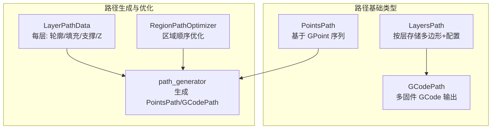
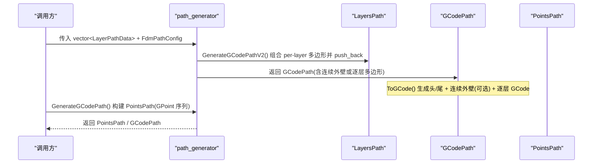
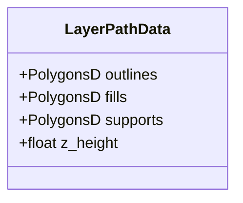
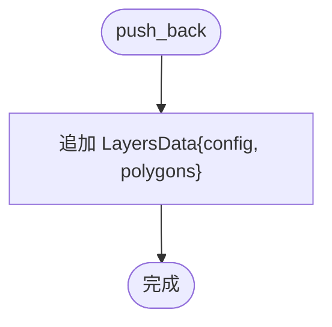
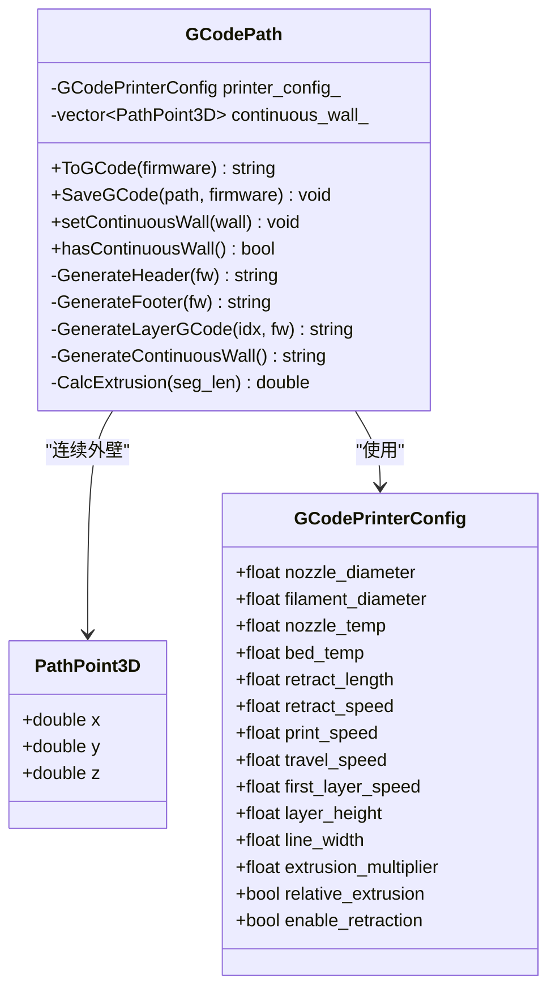
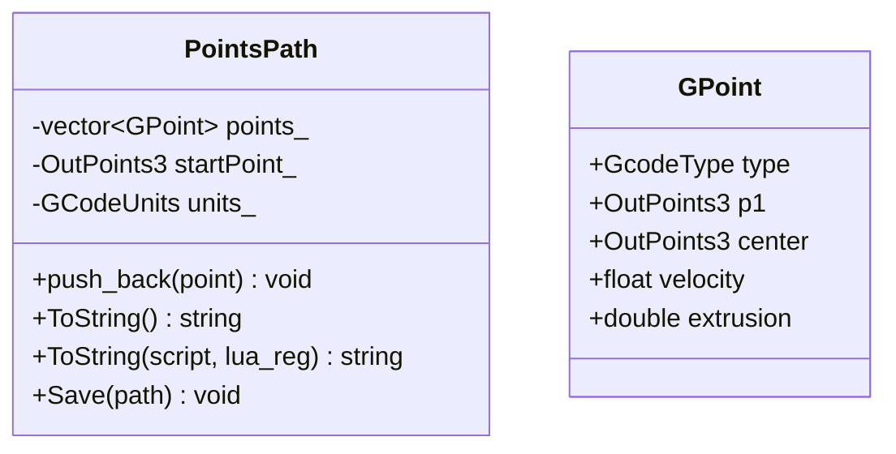
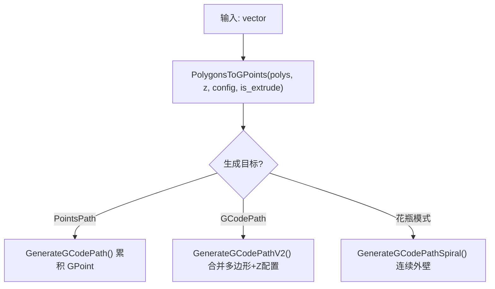
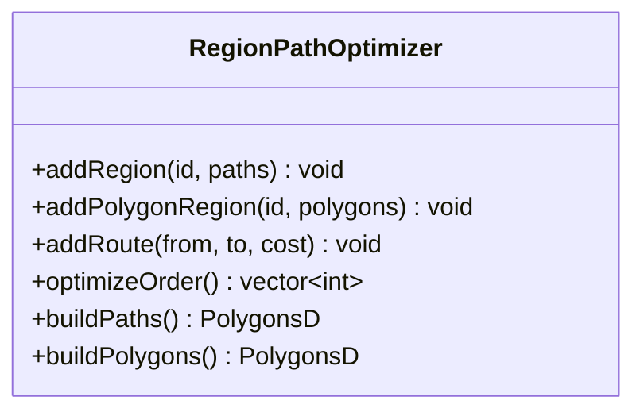
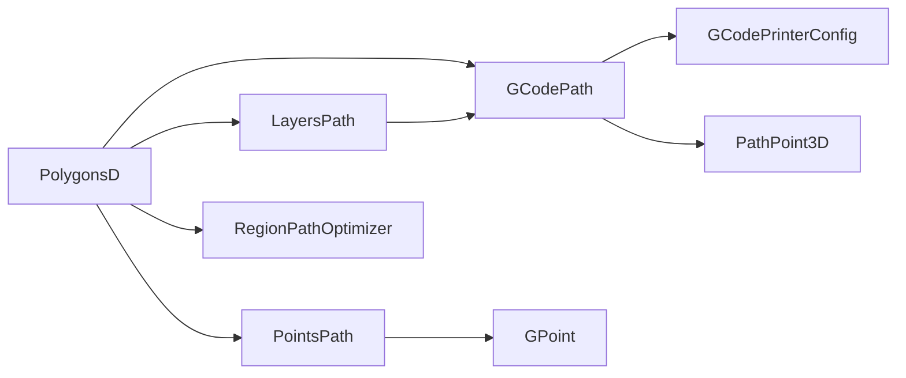

# 层路径数据结构

<cite>
**本文引用的文件**   
- [layerspath.hpp](file://paths/layerspath.hpp)
- [layerspath.cpp](file://paths/layerspath.cpp)
- [gcodepath.hpp](file://paths/gcodepath.hpp)
- [gcodepath.cpp](file://paths/gcodepath.cpp)
- [pointspath.hpp](file://paths/pointspath.hpp)
- [pointspath.cpp](file://paths/pointspath.cpp)
- [path_generator.hpp](file://LibHsBaSlicer/Path/path_generator.hpp)
- [path_generator.cpp](file://LibHsBaSlicer/Path/path_generator.cpp)
- [path_optimizer.hpp](file://LibHsBaSlicer/Path/path_optimizer.hpp)
- [path_optimizer.cpp](file://LibHsBaSlicer/Path/path_optimizer.cpp)
</cite>

## 目录
1. [引言](#引言)
2. [项目结构](#项目结构)
3. [核心组件](#核心组件)
4. [架构总览](#架构总览)
5. [详细组件分析](#详细组件分析)
6. [依赖关系分析](#依赖关系分析)
7. [性能与内存管理](#性能与内存管理)
8. [故障排查指南](#故障排查指南)
9. [结论](#结论)
10. [附录：使用示例](#附录使用示例)

## 引言
本文围绕 HsBaSlicer 的“层路径数据结构”进行系统化文档化，重点覆盖以下目标：
- 解释 LayerPathData 的结构设计，以及如何组织每一层的轮廓、填充和支撑路径数据。
- 深入分析 GCodePath 的实现，包括路径点的存储格式、GCode 指令生成逻辑（含连续螺旋外壁）。
- 阐述层与层之间的数据传递机制，以及几何信息完整性的保持方式。
- 提供路径优化的数据结构支持，包括路径合并、去重与排序算法的数据基础。
- 给出具体使用示例，展示如何创建、修改和访问层路径数据。
- 解释内存管理与性能优化策略。

## 项目结构
本主题涉及的核心代码位于 paths 与 LibHsBaSlicer/Path 两个目录：
- paths：定义层路径与点路径的基础数据结构与序列化能力（LayersPath、GCodePath、PointsPath）。
- LibHsBaSlicer/Path：提供 FDM 路径生成 API（LayerPathData、GenerateGCodePath*）与区域路径预优化器（RegionPathOptimizer）。

图表来源
- [layerspath.hpp:15-60](file://paths/layerspath.hpp#L15-L60)
- [gcodepath.hpp:21-107](file://paths/gcodepath.hpp#L21-L107)
- [pointspath.hpp:14-94](file://paths/pointspath.hpp#L14-L94)
- [path_generator.hpp:23-91](file://LibHsBaSlicer/Path/path_generator.hpp#L23-L91)
- [path_optimizer.hpp:23-100](file://LibHsBaSlicer/Path/path_optimizer.hpp#L23-L100)

章节来源
- [layerspath.hpp:15-60](file://paths/layerspath.hpp#L15-L60)
- [gcodepath.hpp:21-107](file://paths/gcodepath.hpp#L21-L107)
- [pointspath.hpp:14-94](file://paths/pointspath.hpp#L14-L94)
- [path_generator.hpp:23-91](file://LibHsBaSlicer/Path/path_generator.hpp#L23-L91)
- [path_optimizer.hpp:23-100](file://LibHsBaSlicer/Path/path_optimizer.hpp#L23-L100)

## 核心组件
- LayerPathData：描述单层路径数据的聚合体，包含轮廓、填充、支撑与层高 Z。
- LayersPath：按层存储 PolygonsD 与自由文本配置，支持原生或 Lua 后处理导出。
- GCodePath：继承 LayersPath，面向多固件（Marlin/RepRap/Klipper）生成 GCode，支持连续螺旋外壁。
- PointsPath：以 GPoint 序列表示运动指令，支持直线/圆弧及速度/挤出参数。
- RegionPathOptimizer：对独立区域进行访问顺序优化（TSP + 最近邻贪心），减少空走距离。

章节来源
- [path_generator.hpp:33-42](file://LibHsBaSlicer/Path/path_generator.hpp#L33-L42)
- [layerspath.hpp:17-60](file://paths/layerspath.hpp#L17-L60)
- [gcodepath.hpp:62-107](file://paths/gcodepath.hpp#L62-L107)
- [pointspath.hpp:44-94](file://paths/pointspath.hpp#L44-L94)
- [path_optimizer.hpp:23-100](file://LibHsBaSlicer/Path/path_optimizer.hpp#L23-L100)

## 架构总览
下图展示了从“层路径数据”到“GCode 输出”的主流程，以及可选的区域路径优化环节。

图表来源
- [path_generator.cpp:61-116](file://LibHsBaSlicer/Path/path_generator.cpp#L61-L116)
- [gcodepath.cpp:310-327](file://paths/gcodepath.cpp#L310-L327)

## 详细组件分析

### LayerPathData 与层数据组织
- 字段含义
  - outlines：轮廓路径（外壁）
  - fills：填充路径（内部填充）
  - supports：支撑路径
  - z_height：当前层 Z 高度
- 组织方式
  - 通过 vector<LayerPathData> 表达多层切片结果。
  - 在 GenerateGCodePathV2 中，将三层多边形合并为单层的 PolygonsD，并以字符串形式携带 Z 高度（如 "Z:<value>"）作为层配置。

图表来源
- [path_generator.hpp:33-42](file://LibHsBaSlicer/Path/path_generator.hpp#L33-L42)
- [path_generator.cpp:95-116](file://LibHsBaSlicer/Path/path_generator.cpp#L95-L116)

章节来源
- [path_generator.hpp:33-42](file://LibHsBaSlicer/Path/path_generator.hpp#L33-L42)
- [path_generator.cpp:95-116](file://LibHsBaSlicer/Path/path_generator.cpp#L95-L116)

### LayersPath：按层存储与导出
- 数据结构
  - layers_：vector<LayersData>，每个元素包含 layerConfig（自由文本）与 layer（PolygonsD）。
- 关键行为
  - push_back(layerConfig, layer)：追加一层。
  - Save/ToString：原生序列化或经 Lua 脚本处理后输出。
  - 原生 Save 会写入 SQLite 表 layers，字段包含 layer_config 与 layer_data（JSON-like 多边形数组）。

图表来源
- [layerspath.hpp:49-60](file://paths/layerspath.hpp#L49-L60)
- [layerspath.cpp:25-28](file://paths/layerspath.cpp#L25-L28)

章节来源
- [layerspath.hpp:49-60](file://paths/layerspath.hpp#L49-L60)
- [layerspath.cpp:25-28](file://paths/layerspath.cpp#L25-L28)
- [layerspath.cpp:30-59](file://paths/layerspath.cpp#L30-L59)

### GCodePath：多固件 GCode 生成与连续外壁
- 打印机配置
  - GCodePrinterConfig：喷嘴直径、线材直径、温度、速度、层高、线宽、挤出倍率、相对/绝对挤出、回抽等。
- 连续外壁
  - PathPoint3D：带独立 Z 的三维路径点；setContinuousWall 设置连续上升的外壁（花瓶模式）。
- GCode 生成
  - GenerateHeader/GenerateFooter：根据固件类型输出初始化/收尾指令。
  - GenerateLayerGCode：解析层配置中的 Z，遍历多边形，计算段长与挤出量，输出 G0/G1 指令（支持回抽与相对/绝对挤出）。
  - GenerateContinuousWall：将连续外壁作为一条不间断挤出路径输出（无回抽/旅行移动）。
  - ToGCode：先输出连续外壁（若存在），再输出逐层 GCode，最后输出尾部。

图表来源
- [gcodepath.hpp:32-107](file://paths/gcodepath.hpp#L32-L107)
- [gcodepath.cpp:53-63](file://paths/gcodepath.cpp#L53-L63)
- [gcodepath.cpp:65-142](file://paths/gcodepath.cpp#L65-L142)
- [gcodepath.cpp:195-269](file://paths/gcodepath.cpp#L195-L269)
- [gcodepath.cpp:271-308](file://paths/gcodepath.cpp#L271-L308)
- [gcodepath.cpp:310-327](file://paths/gcodepath.cpp#L310-L327)

章节来源
- [gcodepath.hpp:32-107](file://paths/gcodepath.hpp#L32-L107)
- [gcodepath.cpp:53-63](file://paths/gcodepath.cpp#L53-L63)
- [gcodepath.cpp:65-142](file://paths/gcodepath.cpp#L65-L142)
- [gcodepath.cpp:195-269](file://paths/gcodepath.cpp#L195-L269)
- [gcodepath.cpp:271-308](file://paths/gcodepath.cpp#L271-L308)
- [gcodepath.cpp:310-327](file://paths/gcodepath.cpp#L310-L327)

### PointsPath：GPoint 序列与指令序列化
- GPoint 字段
  - type：G0/G1/G2/G3 等运动/设置码。
  - p1：目标点。
  - center：圆弧中心点（G2/G3）。
  - velocity：进给速度。
  - extrusion：挤出长度。
- 序列化
  - ToString：输出单位头（G20/G21）、绝对定位（G90）、起点移动，然后依次输出各 GPoint。
  - 支持 Lua 后处理：将 points/startPoint/units 暴露给脚本。

图表来源
- [pointspath.hpp:44-94](file://paths/pointspath.hpp#L44-L94)
- [pointspath.cpp:66-114](file://paths/pointspath.cpp#L66-L114)

章节来源
- [pointspath.hpp:44-94](file://paths/pointspath.hpp#L44-L94)
- [pointspath.cpp:66-114](file://paths/pointspath.cpp#L66-L114)

### 路径生成：LayerPathData -> PointsPath/GCodePath
- PolygonsToGPoints：将 PolygonsD 转换为 GPoint 序列，首点为 G0 旅行，后续为 G1 打印，挤出量按 line_width * layer_height * seg_len * multiplier 计算。
- GenerateGCodePath：逐层输出 outlines/fills/supports 为 GPoint 序列，累积到 PointsPath。
- GenerateGCodePathV2：将每层多边形合并为 PolygonsD，并以 "Z:<z>" 作为层配置，构造 GCodePath。
- GenerateGCodePathSpiral：对所有层外轮廓进行螺旋化，生成连续外壁（无逐层多边形）。

图表来源
- [path_generator.cpp:14-59](file://LibHsBaSlicer/Path/path_generator.cpp#L14-L59)
- [path_generator.cpp:61-136](file://LibHsBaSlicer/Path/path_generator.cpp#L61-L136)

章节来源
- [path_generator.cpp:14-59](file://LibHsBaSlicer/Path/path_generator.cpp#L14-L59)
- [path_generator.cpp:61-136](file://LibHsBaSlicer/Path/path_generator.cpp#L61-L136)

### 路径优化：RegionPathOptimizer
- 两种模式（不可混用）
  - 多边形模式（填充前）：区域为多边形本身，所有顶点作为门（gate），输出优化顺序的多边形集合。
  - 填充结果模式（填充后）：区域为填充路径（支持多点折线），每条折线的端点作为门，输出完整的填充路径。
- 建模与求解
  - 将每个区域建模为 AreaGraph 的一个面积节点，门为候选进出点。
  - 区域内门到门代价为直线距离；区域间路由代价为门对门直线距离（可手动覆盖）。
  - 区域访问顺序由遗传 TSP 求解；区域内路径方向/顺序采用最近邻贪心安排。
- 接口
  - addRegion/addPolygonRegion/addRoute/optimizeOrder/buildPaths/buildPolygons。
  - 提供 Lua 绑定（PathOptimize.*）与脚本式优化函数。

图表来源
- [path_optimizer.hpp:23-100](file://LibHsBaSlicer/Path/path_optimizer.hpp#L23-L100)
- [path_optimizer.cpp:43-116](file://LibHsBaSlicer/Path/path_optimizer.cpp#L43-L116)
- [path_optimizer.cpp:118-166](file://LibHsBaSlicer/Path/path_optimizer.cpp#L118-L166)
- [path_optimizer.cpp:268-375](file://LibHsBaSlicer/Path/path_optimizer.cpp#L268-L375)

章节来源
- [path_optimizer.hpp:23-100](file://LibHsBaSlicer/Path/path_optimizer.hpp#L23-L100)
- [path_optimizer.cpp:43-116](file://LibHsBaSlicer/Path/path_optimizer.cpp#L43-L116)
- [path_optimizer.cpp:118-166](file://LibHsBaSlicer/Path/path_optimizer.cpp#L118-L166)
- [path_optimizer.cpp:268-375](file://LibHsBaSlicer/Path/path_optimizer.cpp#L268-L375)

## 依赖关系分析
- LayersPath 依赖 IPath 接口与 FloatPolygons（PolygonsD）。
- GCodePath 继承 LayersPath，依赖 PrinterConfig 与 PathPoint3D。
- PointsPath 依赖 OutPoints3 与 GcodeType/GCodeUnits。
- path_generator 依赖上述路径类型与 SpiralizeOuterWall（用于花瓶模式）。
- path_optimizer 依赖 AreaGraph 与 PolygonFill/Lua 适配器。

图表来源
- [layerspath.hpp:9-13](file://paths/layerspath.hpp#L9-L13)
- [gcodepath.hpp:9-16](file://paths/gcodepath.hpp#L9-L16)
- [pointspath.hpp:9-12](file://paths/pointspath.hpp#L9-L12)
- [path_generator.hpp:9-16](file://LibHsBaSlicer/Path/path_generator.hpp#L9-L16)
- [path_optimizer.hpp:10-16](file://LibHsBaSlicer/Path/path_optimizer.hpp#L10-L16)

章节来源
- [layerspath.hpp:9-13](file://paths/layerspath.hpp#L9-L13)
- [gcodepath.hpp:9-16](file://paths/gcodepath.hpp#L9-L16)
- [pointspath.hpp:9-12](file://paths/pointspath.hpp#L9-L12)
- [path_generator.hpp:9-16](file://LibHsBaSlicer/Path/path_generator.hpp#L9-L16)
- [path_optimizer.hpp:10-16](file://LibHsBaSlicer/Path/path_optimizer.hpp#L10-L16)

## 性能与内存管理
- 挤出量计算
  - CalcExtrusion 基于线宽×层高×段长，除以线材截面积，再乘以挤出倍率，保证体积守恒。
- 速度与进给
  - 打印速度/旅行速度分别映射为 mm/min（乘以 60）作为 GCode 进给。
- 回抽与相对/绝对挤出
  - 支持开启/关闭回抽；支持相对（M83）与绝对（M82）挤出模式。
- 内存与容器
  - 使用 std::vector 存储层、路径点与多边形；必要时 reserve 预分配以减少扩容开销。
- 区域优化
  - 通过 TSP + 最近邻贪心降低空走距离；区域内路径方向/顺序调整减少跳跃。
- Lua 后处理
  - 在导出阶段可注入 Lua 脚本，避免重复 C++ 分支逻辑，提高扩展性。

章节来源
- [gcodepath.cpp:53-63](file://paths/gcodepath.cpp#L53-L63)
- [gcodepath.cpp:65-142](file://paths/gcodepath.cpp#L65-L142)
- [gcodepath.cpp:195-269](file://paths/gcodepath.cpp#L195-L269)
- [path_optimizer.cpp:118-166](file://LibHsBaSlicer/Path/path_optimizer.cpp#L118-L166)
- [path_optimizer.cpp:268-375](file://LibHsBaSlicer/Path/path_optimizer.cpp#L268-L375)

## 故障排查指南
- Lua 加载/运行错误
  - LayersPath/GCodePath/PointsPath 在调用 Lua 脚本时，若 loadbuffer/pcall 失败，会抛出 RuntimeError，提示加载错误或运行时错误。
- 文件打开失败
  - 保存文件或脚本文件无法打开时，抛出 RuntimeError，提示路径无效或权限问题。
- 数据库连接失败
  - LayersPath::Save 原生 SQLite 导出时，若连接失败，抛出 RuntimeError。
- 模式冲突
  - RegionPathOptimizer 不允许在同一实例中混合“路径区域”与“多边形区域”，否则抛出 RuntimeError。

章节来源
- [layerspath.cpp:30-59](file://paths/layerspath.cpp#L30-L59)
- [layerspath.cpp:61-159](file://paths/layerspath.cpp#L61-L159)
- [layerspath.cpp:161-255](file://paths/layerspath.cpp#L161-L255)
- [gcodepath.cpp:329-338](file://paths/gcodepath.cpp#L329-L338)
- [pointspath.cpp:220-233](file://paths/pointspath.cpp#L220-L233)
- [path_optimizer.cpp:63-109](file://LibHsBaSlicer/Path/path_optimizer.cpp#L63-L109)

## 结论
HsBaSlicer 的层路径数据结构以 LayerPathData 为核心，将每层的轮廓、填充与支撑路径统一组织，并通过 LayersPath/GCodePath/PointsPath 实现灵活的序列化与输出。GCodePath 在多固件场景下提供一致的 GCode 生成能力，同时支持连续螺旋外壁的花瓶模式。RegionPathOptimizer 在路径输出前对区域访问顺序进行优化，显著减少空走距离。整体设计兼顾可扩展性（Lua 后处理）、性能（体积守恒挤出、速度映射、预分配）与健壮性（完善的错误处理）。

## 附录：使用示例
- 创建与访问层路径数据
  - 使用 vector<LayerPathData> 组织多层数据，其中 outlines/fills/supports 为 PolygonsD，z_height 为层高。
  - 通过 GenerateGCodePathV2 将每层多边形合并并附加 Z 配置，得到 GCodePath。
  - 通过 GenerateGCodePath 得到 PointsPath（GPoint 序列）。
- 修改与访问
  - LayersPath::push_back 追加层；GCodePath::setContinuousWall 设置连续外壁；PointsPath::push_back 追加 GPoint。
  - 访问 GCodePath::printerConfig 获取打印机配置；GCodePath::hasContinuousWall 判断是否启用花瓶模式。
- 导出
  - GCodePath::ToGCode 生成字符串；SaveGCode 直接写文件。
  - LayersPath/PointsPath 支持 ToString/Save 的原生与 Lua 后处理版本。

章节来源
- [path_generator.cpp:61-136](file://LibHsBaSlicer/Path/path_generator.cpp#L61-L136)
- [layerspath.cpp:25-28](file://paths/layerspath.cpp#L25-L28)
- [gcodepath.cpp:310-338](file://paths/gcodepath.cpp#L310-L338)
- [pointspath.cpp:60-63](file://paths/pointspath.cpp#L60-L63)