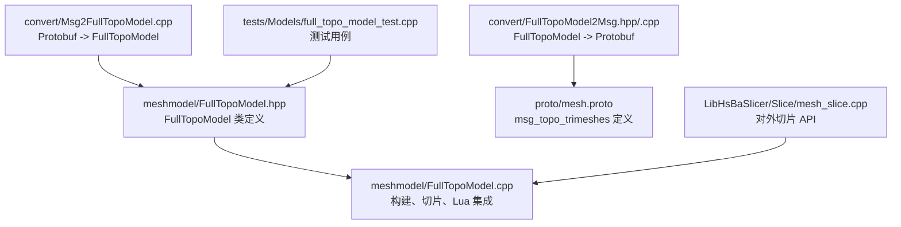
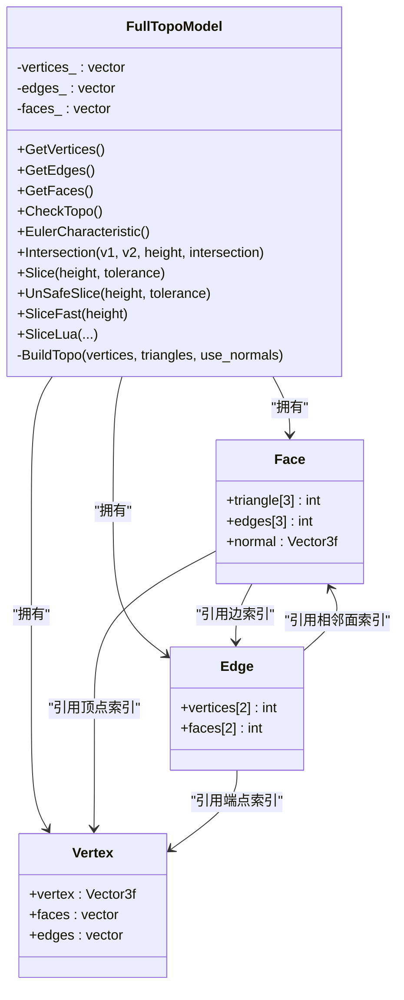
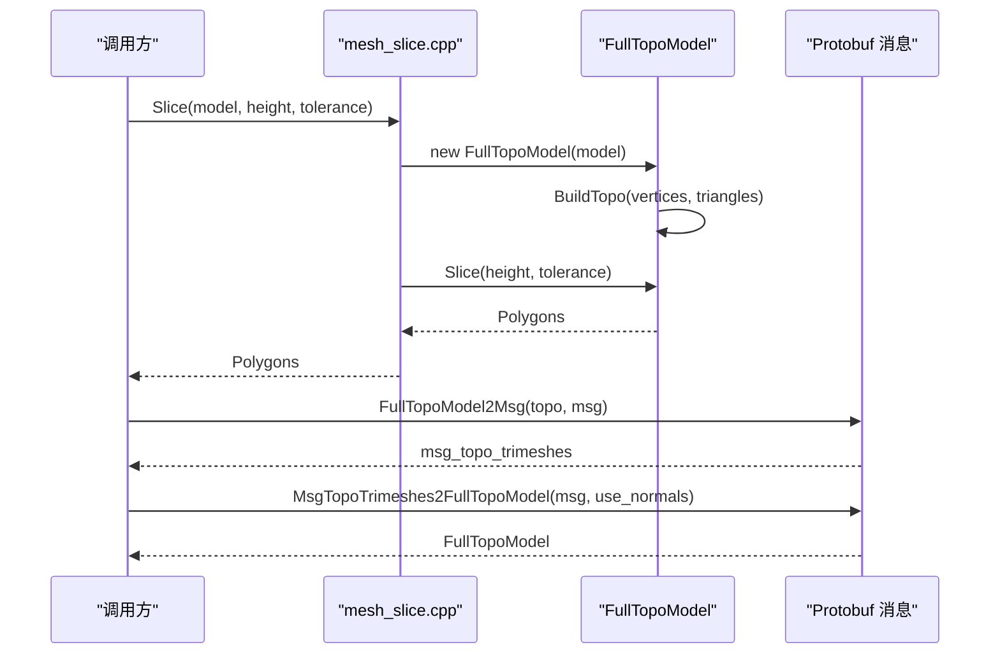
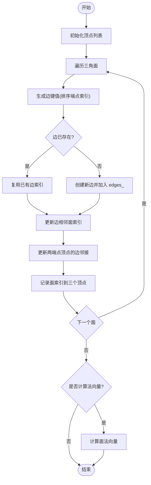
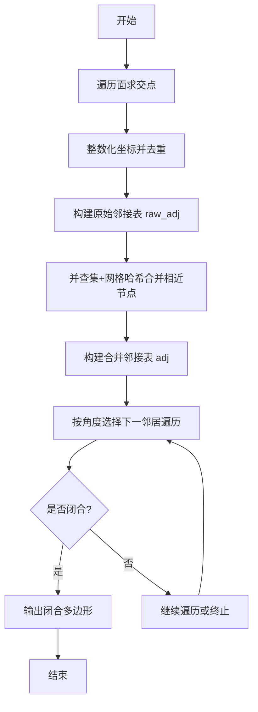
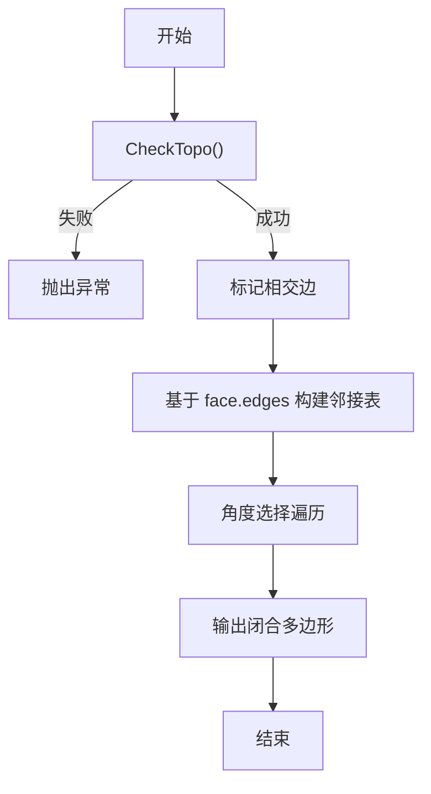
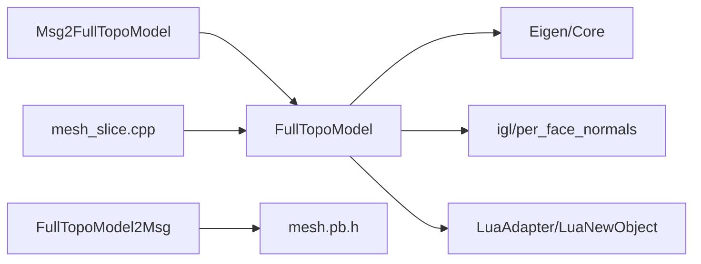
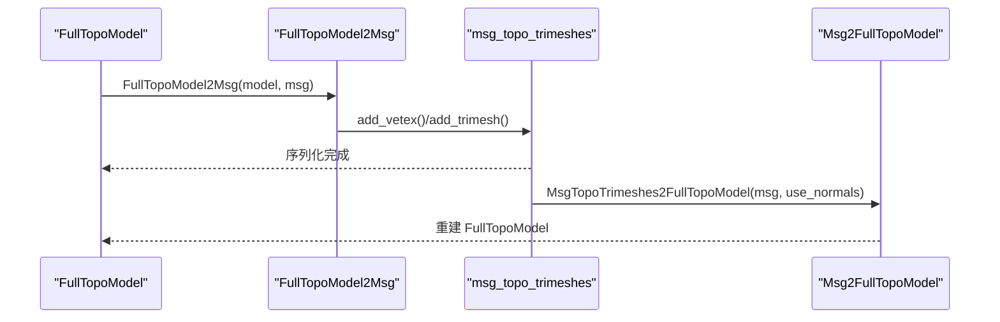

# 拓扑数据模型

<cite>
**本文引用的文件**   
- [FullTopoModel.hpp](file://meshmodel/FullTopoModel.hpp)
- [FullTopoModel.cpp](file://meshmodel/FullTopoModel.cpp)
- [FullTopoModel2Msg.hpp](file://convert/FullTopoModel2Msg.hpp)
- [FullTopoModel2Msg.cpp](file://convert/FullTopoModel2Msg.cpp)
- [Msg2FullTopoModel.cpp](file://convert/Msg2FullTopoModel.cpp)
- [mesh.proto](file://proto/mesh.proto)
- [full_topo_model_test.cpp](file://tests/Models/full_topo_model_test.cpp)
- [mesh_slice.cpp](file://LibHsBaSlicer/Slice/mesh_slice.cpp)
</cite>

## 目录
1. [引言](#引言)
2. [项目结构](#项目结构)
3. [核心组件](#核心组件)
4. [架构总览](#架构总览)
5. [详细组件分析](#详细组件分析)
6. [依赖关系分析](#依赖关系分析)
7. [性能与内存优化](#性能与内存优化)
8. [序列化与网络传输](#序列化与网络传输)
9. [使用示例](#使用示例)
10. [故障排查](#故障排查)
11. [结论](#结论)

## 引言
本文件面向 HsBaSlicer 的拓扑数据模型，围绕 FullTopoModel 的设计、构建、查询与序列化展开。目标包括：
- 解释顶点、边、面等拓扑元素的定义与相互关系映射；
- 说明从原始网格到完整拓扑模型的构建流程；
- 阐述切片（Slice）与快速切片（SliceFast）、不安全切片（UnSafeSlice）等遍历算法；
- 给出 Protobuf 消息定义及双向转换；
- 提供可复现的使用示例；
- 总结内存布局与性能优化策略。

## 项目结构
与拓扑数据模型直接相关的代码主要分布在以下模块：
- meshmodel：FullTopoModel 的核心定义与实现；
- convert：FullTopoModel 与 Protobuf 消息的双向转换；
- proto：Protobuf 消息定义；
- LibHsBaSlicer/Slice：对外暴露的切片 API，内部委托给 FullTopoModel；
- tests：单元测试用例，展示典型用法与断言。

图表来源
- [FullTopoModel.hpp:53-142](file://meshmodel/FullTopoModel.hpp#L53-L142)
- [FullTopoModel.cpp:50-158](file://meshmodel/FullTopoModel.cpp#L50-L158)
- [FullTopoModel2Msg.cpp:10-40](file://convert/FullTopoModel2Msg.cpp#L10-L40)
- [mesh.proto:20-31](file://proto/mesh.proto#L20-L31)
- [Msg2FullTopoModel.cpp:10-35](file://convert/Msg2FullTopoModel.cpp#L10-L35)
- [mesh_slice.cpp:45-115](file://LibHsBaSlicer/Slice/mesh_slice.cpp#L45-L115)

章节来源
- [FullTopoModel.hpp:53-142](file://meshmodel/FullTopoModel.hpp#L53-L142)
- [FullTopoModel.cpp:50-158](file://meshmodel/FullTopoModel.cpp#L50-L158)
- [FullTopoModel2Msg.cpp:10-40](file://convert/FullTopoModel2Msg.cpp#L10-L40)
- [mesh.proto:20-31](file://proto/mesh.proto#L20-L31)
- [Msg2FullTopoModel.cpp:10-35](file://convert/Msg2FullTopoModel.cpp#L10-L35)
- [mesh_slice.cpp:45-115](file://LibHsBaSlicer/Slice/mesh_slice.cpp#L45-L115)

## 核心组件
FullTopoModel 是面向切片的全拓扑重建三角网格模型，提供只读访问接口，并在构造时重建拓扑关系。其核心数据结构如下：
- Face：包含三角形顶点索引、三条边索引以及可选的法向量；
- Vertex：包含三维坐标、关联的面索引和边索引；
- Edge：包含两个端点顶点索引、相邻的两个面索引。

这些结构通过索引互相引用，形成“面-边-点”的邻接关系图，便于后续切片遍历与边界检测。

图表来源
- [FullTopoModel.hpp:56-72](file://meshmodel/FullTopoModel.hpp#L56-L72)
- [FullTopoModel.hpp:86-98](file://meshmodel/FullTopoModel.hpp#L86-L98)
- [FullTopoModel.cpp:50-158](file://meshmodel/FullTopoModel.cpp#L50-L158)

章节来源
- [FullTopoModel.hpp:56-72](file://meshmodel/FullTopoModel.hpp#L56-L72)
- [FullTopoModel.hpp:86-98](file://meshmodel/FullTopoModel.hpp#L86-L98)
- [FullTopoModel.cpp:50-158](file://meshmodel/FullTopoModel.cpp#L50-L158)

## 架构总览
FullTopoModel 的构建与使用流程如下：
- 输入：IModel 或顶点/三角面数组；
- 构建：BuildTopo 将三角面转换为拓扑结构，建立顶点、边、面的邻接关系；
- 校验：CheckTopo 检查拓扑完整性；
- 切片：Slice/UnSafeSlice/SliceFast 基于拓扑进行 Z 方向切片，输出多边形轮廓；
- Lua 扩展：PushFullTopoModelToLua 将 V/E/F 与高度注入 Lua 环境，供脚本自定义切片逻辑；
- 序列化：FullTopoModel2Msg 将模型转为 Protobuf 消息，用于网络传输或持久化；
- 反序列化：MsgTopoTrimeshes2FullTopoModel 从 Protobuf 消息重建 FullTopoModel。

图表来源
- [mesh_slice.cpp:45-52](file://LibHsBaSlicer/Slice/mesh_slice.cpp#L45-L52)
- [FullTopoModel.cpp:50-158](file://meshmodel/FullTopoModel.cpp#L50-L158)
- [FullTopoModel.cpp:328-600](file://meshmodel/FullTopoModel.cpp#L328-L600)
- [FullTopoModel2Msg.cpp:10-40](file://convert/FullTopoModel2Msg.cpp#L10-L40)
- [Msg2FullTopoModel.cpp:10-35](file://convert/Msg2FullTopoModel.cpp#L10-L35)

## 详细组件分析

### 拓扑构建过程（BuildTopo）
BuildTopo 负责从三角面重建拓扑：
- 初始化顶点列表；
- 使用哈希表 edge_map 去重边，并为每条边分配唯一索引；
- 为每个面记录三条边的索引，并维护边相邻的两个面索引；
- 更新顶点的 faces 与 edges 邻接表；
- 可选计算面法向量（依赖 igl::per_face_normals）。

该过程时间复杂度近似 O(F)，其中 F 为三角面数量，空间复杂度与顶点数、边数、面数线性相关。

图表来源
- [FullTopoModel.cpp:50-158](file://meshmodel/FullTopoModel.cpp#L50-L158)

章节来源
- [FullTopoModel.cpp:50-158](file://meshmodel/FullTopoModel.cpp#L50-L158)

### 拓扑完整性检查（CheckTopo）
CheckTopo 验证：
- 所有面的顶点与边索引有效且覆盖全部顶点与边；
- 所有边的端点与相邻面索引有效且覆盖全部面。

若拓扑不完整，某些算法（如 SliceFast）可能抛出异常。

章节来源
- [FullTopoModel.cpp:160-218](file://meshmodel/FullTopoModel.cpp#L160-L218)

### 欧拉示性数（EulerCharacteristic）
欧拉示性数 χ = V - E + F，可用于初步判断模型是否为拓扑流形或是否存在孔洞。注意该函数不检查拓扑完整性。

章节来源
- [FullTopoModel.cpp:241-244](file://meshmodel/FullTopoModel.cpp#L241-L244)

### 线段与水平面相交（Intersection）
Intersection 计算线段与 z=height 平面的交点，处理共线、平行、无交等情况，返回布尔值与交点坐标。

章节来源
- [FullTopoModel.cpp:246-272](file://meshmodel/FullTopoModel.cpp#L246-L272)

### 安全切片（Slice）
Slice 的输出仅包含闭合多边形，丢弃开放折线。核心步骤：
- 对每个三角面求三边与 z=height 的交点；
- 将交点整数化并去重，构建原始邻接表 raw_adj；
- 使用并查集与网格哈希合并相近节点；
- 构建合并后的邻接表 adj；
- 按角度最小原则遍历提取闭合环；
- 输出 Polygons。

图表来源
- [FullTopoModel.cpp:328-600](file://meshmodel/FullTopoModel.cpp#L328-L600)

章节来源
- [FullTopoModel.cpp:328-600](file://meshmodel/FullTopoModel.cpp#L328-L600)

### 不安全切片（UnSafeSlice）
UnSafeSlice 允许返回开放折线，并在结果中标记 closed 标志。与 Slice 类似，但遍历结束后根据路径长度与闭合情况生成 UnSafePolygon。

章节来源
- [FullTopoModel.cpp:604-873](file://meshmodel/FullTopoModel.cpp#L604-L873)

### 快速切片（SliceFast）
SliceFast 假设拓扑完整，直接利用边邻接信息加速：
- 预计算每条边是否与 z=height 相交；
- 基于 face.edges 快速定位相交边；
- 构建邻接表并按角度遍历提取闭合环；
- 若 CheckTopo 失败则抛出异常。

图表来源
- [FullTopoModel.cpp:875-1025](file://meshmodel/FullTopoModel.cpp#L875-L1025)

章节来源
- [FullTopoModel.cpp:875-1025](file://meshmodel/FullTopoModel.cpp#L875-L1025)

### Lua 驱动切片（SliceLua / UnSafeSliceLua）
PushFullTopoModelToLua 将 V/E/F 与 height 注入 Lua 全局变量，用户脚本可自定义切片逻辑。SliceLua 支持字符串脚本与函数名，也支持从文件加载脚本。错误处理会捕获 Lua 加载与运行期错误并抛出 RuntimeError。

章节来源
- [FullTopoModel.cpp:274-324](file://meshmodel/FullTopoModel.cpp#L274-L324)
- [FullTopoModel.cpp:1027-1241](file://meshmodel/FullTopoModel.cpp#L1027-L1241)

## 依赖关系分析
- FullTopoModel 依赖 Eigen 进行向量运算；
- 可选依赖 igl::per_face_normals 计算面法向量；
- Lua 集成依赖 LuaAdapter 与 LuaNewObject；
- 序列化依赖 Protobuf 生成的 mesh.pb.h；
- 对外 API 在 mesh_slice.cpp 中封装，统一异常类型。

图表来源
- [FullTopoModel.hpp:11-16](file://meshmodel/FullTopoModel.hpp#L11-L16)
- [FullTopoModel.cpp:17-23](file://meshmodel/FullTopoModel.cpp#L17-L23)
- [FullTopoModel2Msg.hpp:9-10](file://convert/FullTopoModel2Msg.hpp#L9-L10)
- [Msg2FullTopoModel.cpp:1-5](file://convert/Msg2FullTopoModel.cpp#L1-L5)
- [mesh_slice.cpp:1-12](file://LibHsBaSlicer/Slice/mesh_slice.cpp#L1-L12)

章节来源
- [FullTopoModel.hpp:11-16](file://meshmodel/FullTopoModel.hpp#L11-L16)
- [FullTopoModel.cpp:17-23](file://meshmodel/FullTopoModel.cpp#L17-L23)
- [FullTopoModel2Msg.hpp:9-10](file://convert/FullTopoModel2Msg.hpp#L9-L10)
- [Msg2FullTopoModel.cpp:1-5](file://convert/Msg2FullTopoModel.cpp#L1-L5)
- [mesh_slice.cpp:1-12](file://LibHsBaSlicer/Slice/mesh_slice.cpp#L1-L12)

## 性能与内存优化
- 邻接表构建：使用 unordered_map 与 boost::hash 降低哈希冲突；
- 节点合并：并查集与网格哈希减少浮点误差导致的重复节点；
- 快速切片：避免逐面扫描，直接利用边相交标记与 face.edges 索引；
- 内存预留：vertices_/edges_/faces_ 使用 reserve 减少扩容开销；
- 法向量计算：仅在需要时启用，避免额外计算成本；
- 整数化坐标：提升比较稳定性，减少浮点误差影响。

章节来源
- [FullTopoModel.cpp:50-158](file://meshmodel/FullTopoModel.cpp#L50-L158)
- [FullTopoModel.cpp:328-600](file://meshmodel/FullTopoModel.cpp#L328-L600)
- [FullTopoModel.cpp:875-1025](file://meshmodel/FullTopoModel.cpp#L875-L1025)

## 序列化与网络传输
FullTopoModel 可通过 FullTopoModel2Msg 序列化为 Protobuf 消息 msg_topo_trimeshes，包含顶点列表 vetex 与三角面 trimesh（含 p0/p1/p2 索引与可选 normal）。反向转换由 MsgTopoTrimeshes2FullTopoModel 完成，将消息中的顶点与三角面索引还原为 FullTopoModel。

图表来源
- [FullTopoModel2Msg.cpp:10-40](file://convert/FullTopoModel2Msg.cpp#L10-L40)
- [Msg2FullTopoModel.cpp:10-35](file://convert/Msg2FullTopoModel.cpp#L10-L35)
- [mesh.proto:20-31](file://proto/mesh.proto#L20-L31)

章节来源
- [FullTopoModel2Msg.cpp:10-40](file://convert/FullTopoModel2Msg.cpp#L10-L40)
- [Msg2FullTopoModel.cpp:10-35](file://convert/Msg2FullTopoModel.cpp#L10-L35)
- [mesh.proto:20-31](file://proto/mesh.proto#L20-L31)

## 使用示例
以下为典型用法路径与行为说明（不包含具体代码内容）：
- 从 IModel 构建拓扑：
  - 通过 mesh_slice.cpp 的 Slice/UnSafeSlice 入口，内部创建 FullTopoModel 并调用对应切片方法；
  - 或直接调用 BuildSliceTopology 获取共享指针，多次复用同一拓扑对象；
- 执行切片：
  - Slice 返回闭合多边形；
  - UnSafeSlice 返回可能开放的折线，并带 closed 标志；
  - SliceFast 要求拓扑完整，否则抛异常；
- Lua 自定义切片：
  - 使用 SliceLua 传入脚本字符串或文件名，脚本可访问 V/E/F 与 height；
  - 返回的多边形通过 LuaAdapter 转换为 Polygons；
- 序列化与反序列化：
  - 使用 FullTopoModel2Msg 将模型转为 Protobuf 消息；
  - 使用 MsgTopoTrimeshes2FullTopoModel 从消息重建模型；
- 单元测试参考：
  - full_topo_model_test.cpp 展示了立方体在 z=0 处的切片断言与 Lua 脚本凸包计算。

章节来源
- [mesh_slice.cpp:45-115](file://LibHsBaSlicer/Slice/mesh_slice.cpp#L45-L115)
- [full_topo_model_test.cpp:55-75](file://tests/Models/full_topo_model_test.cpp#L55-L75)
- [full_topo_model_test.cpp:77-142](file://tests/Models/full_topo_model_test.cpp#L77-L142)
- [full_topo_model_test.cpp:144-158](file://tests/Models/full_topo_model_test.cpp#L144-L158)

## 故障排查
- 拓扑不完整：
  - 现象：SliceFast 抛出异常；
  - 原因：CheckTopo 失败；
  - 建议：先调用 CheckTopo 或改用 Slice/UnSafeSlice；
- Lua 脚本错误：
  - 现象：RuntimeError 提示 Lua load/runtime error；
  - 原因：脚本语法错误或运行时异常；
  - 建议：检查脚本语法与全局变量 V/E/F/height 是否正确；
- 外部异常：
  - 现象：CGAL 或 OCCT 等第三方库抛出非项目异常；
  - 原因：底层几何内核失败；
  - 建议：通过 mesh_slice.cpp 的 GuardSlice 包装，统一转换为 IOError；
- 序列化问题：
  - 现象：Protobuf 消息字段缺失或索引越界；
  - 原因：FullTopoModel2Msg 或 Msg2FullTopoModel 的参数不正确；
  - 建议：检查 vetex/trimesh 数量与索引范围。

章节来源
- [FullTopoModel.cpp:875-880](file://meshmodel/FullTopoModel.cpp#L875-L880)
- [FullTopoModel.cpp:1027-1241](file://meshmodel/FullTopoModel.cpp#L1027-L1241)
- [mesh_slice.cpp:27-42](file://LibHsBaSlicer/Slice/mesh_slice.cpp#L27-L42)
- [FullTopoModel2Msg.cpp:10-40](file://convert/FullTopoModel2Msg.cpp#L10-L40)
- [Msg2FullTopoModel.cpp:10-35](file://convert/Msg2FullTopoModel.cpp#L10-L35)

## 结论
FullTopoModel 提供了面向切片的完整拓扑重建能力，通过顶点、边、面的索引化邻接关系，实现了高效的切片与遍历。其设计兼顾了准确性（拓扑校验）、可扩展性（Lua 脚本）、可移植性（Protobuf 序列化）与性能（快速切片与内存优化）。在实际使用中，推荐优先构建一次拓扑对象并复用，结合 Slice/UnSafeSlice/SliceFast 的不同特性满足多样化需求；同时借助 Protobuf 消息进行跨进程或网络传输。