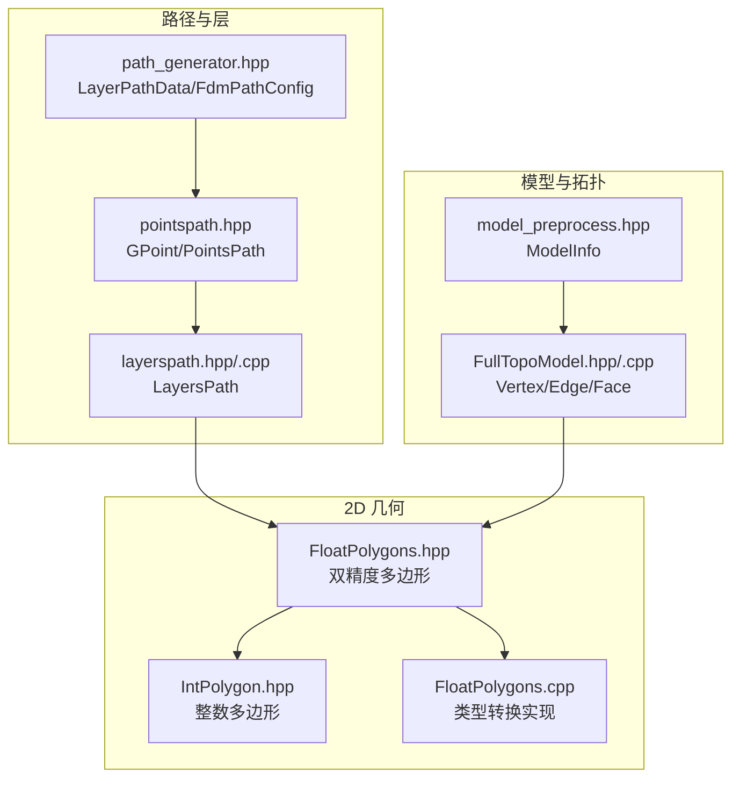
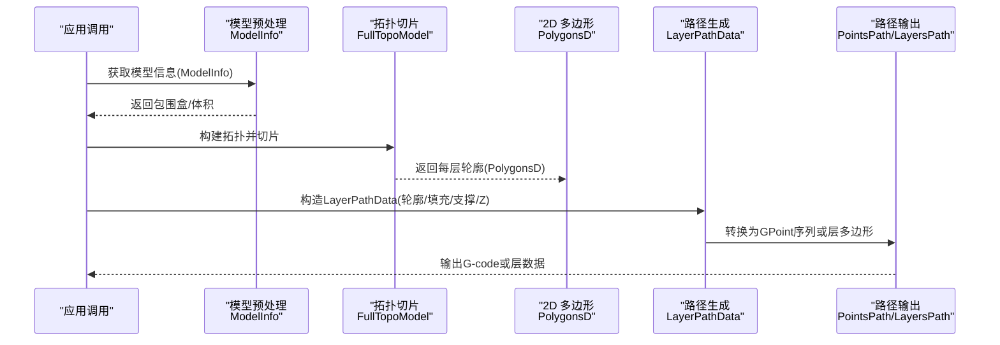
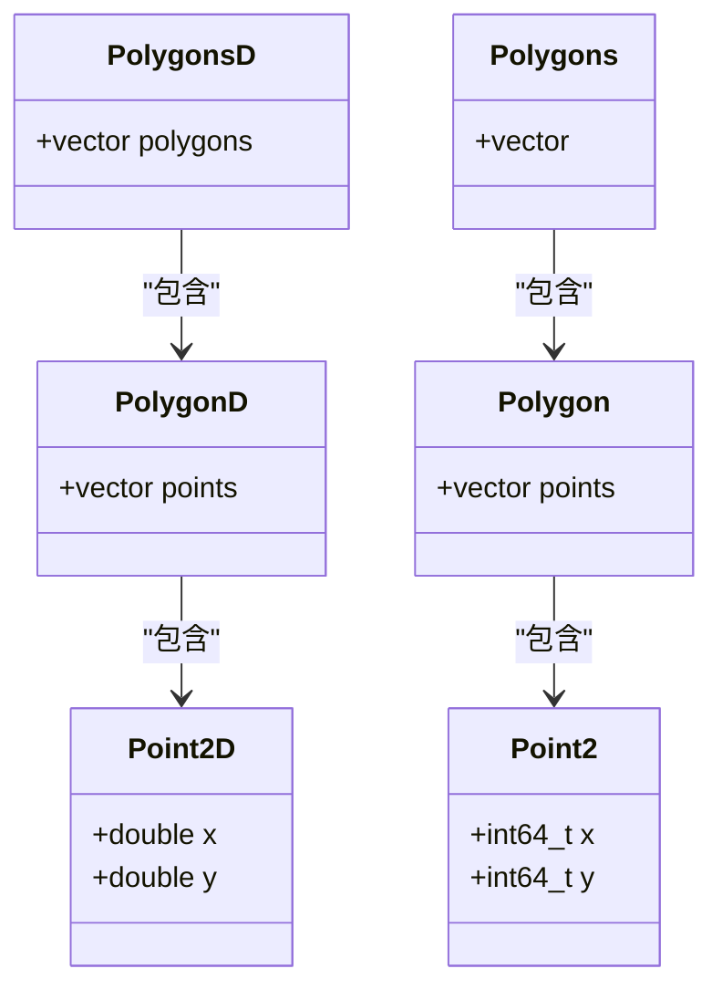
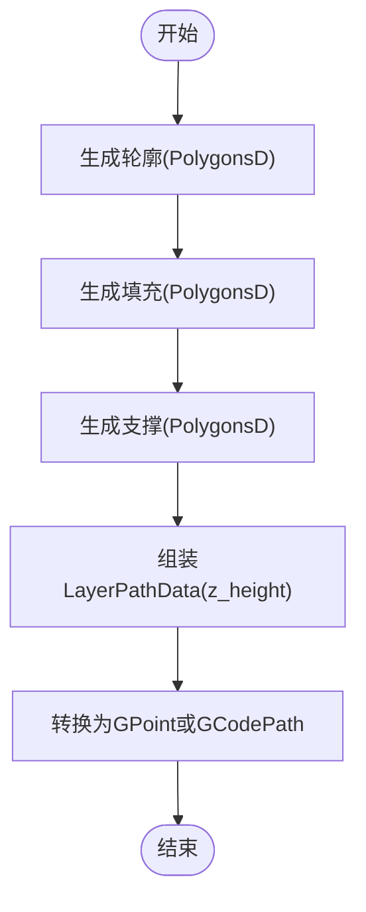
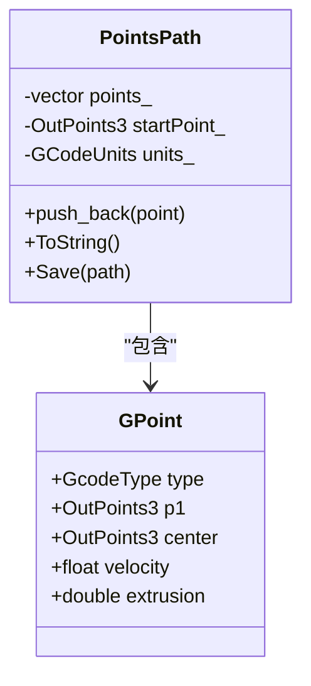
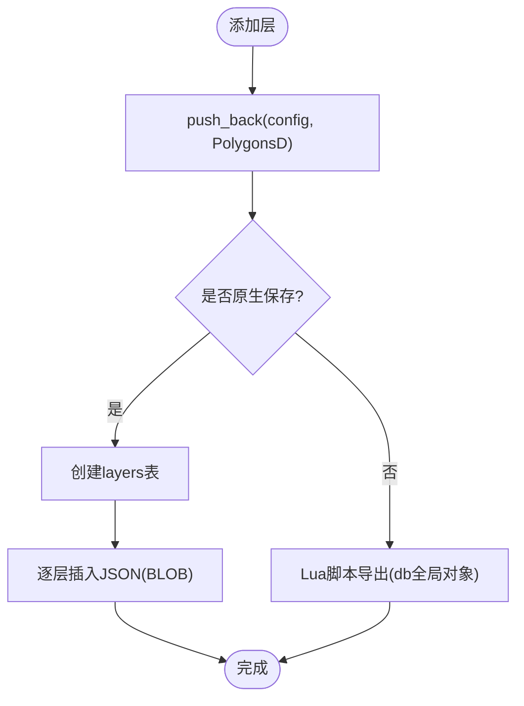
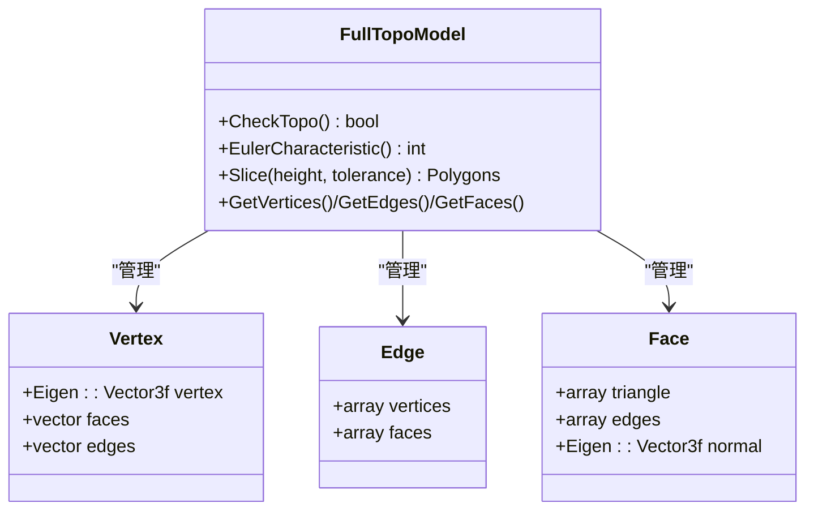
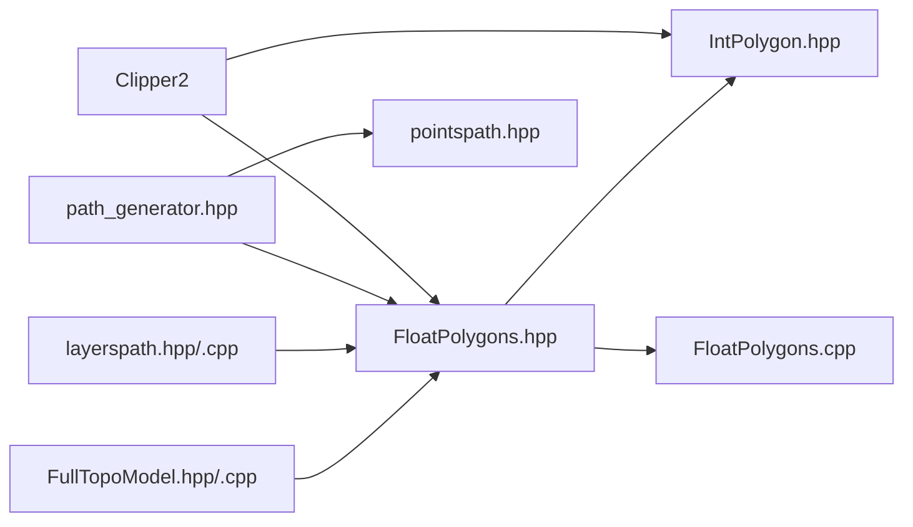
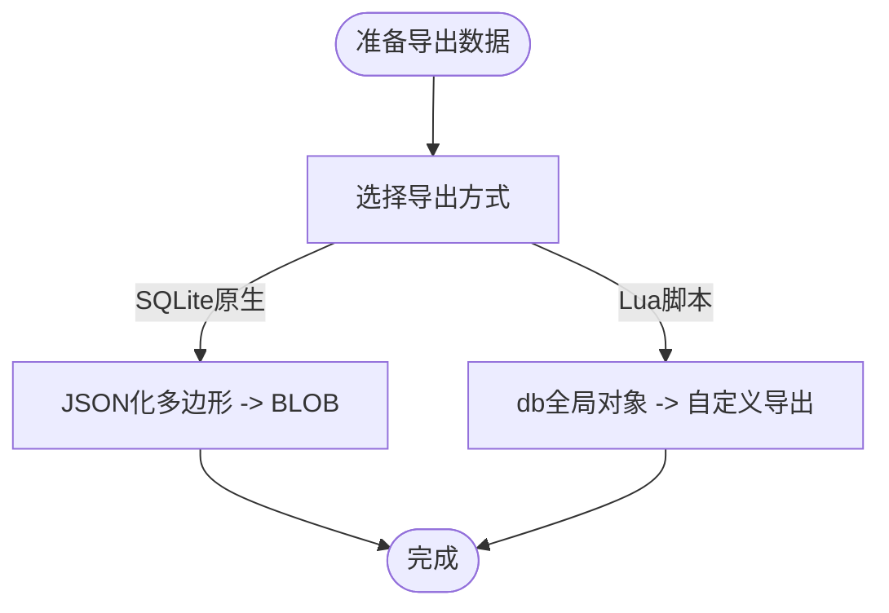

# 核心数据结构

<cite>
**本文引用的文件**   
- [model_preprocess.hpp](file://LibHsBaSlicer/Preprocess/model_preprocess.hpp)
- [path_generator.hpp](file://LibHsBaSlicer/Path/path_generator.hpp)
- [pointspath.hpp](file://paths/pointspath.hpp)
- [FloatPolygons.hpp](file://2D/FloatPolygons.hpp)
- [IntPolygon.hpp](file://2D/IntPolygon.hpp)
- [layerspath.hpp](file://paths/layerspath.hpp)
- [layerspath.cpp](file://paths/layerspath.cpp)
- [FullTopoModel.hpp](file://meshmodel/FullTopoModel.hpp)
- [FullTopoModel.cpp](file://meshmodel/FullTopoModel.cpp)
- [FloatPolygons.cpp](file://2D/FloatPolygons.cpp)
</cite>

## 目录
1. [简介](#简介)
2. [项目结构](#项目结构)
3. [核心组件](#核心组件)
4. [架构总览](#架构总览)
5. [详细组件分析](#详细组件分析)
6. [依赖关系分析](#依赖关系分析)
7. [性能与内存布局](#性能与内存布局)
8. [序列化与反序列化](#序列化与反序列化)
9. [常见问题排查](#常见问题排查)
10. [结论](#结论)

## 简介
本文件聚焦 HsBaSlicer 的核心数据结构，围绕以下目标展开：
- 解释关键数据类型 ModelInfo、LayerPathData、Polygons、GPoint 等的定义与用途。
- 深入剖析 2D 多边形数据结构的设计，包括整数坐标与双精度浮点坐标的区别与使用场景。
- 阐述层路径数据的组织方式，如何存储和处理每一层的几何信息。
- 解释拓扑结构的数据表示，包括顶点、边、面的关系映射。
- 提供内存布局分析与性能考虑。
- 说明数据序列化与反序列化的处理方式。
- 给出实际使用示例与常见操作模式（以代码片段路径形式呈现）。

## 项目结构
与核心数据结构直接相关的模块分布如下：
- 2D 几何与多边形：2D/FloatPolygons.hpp、2D/IntPolygon.hpp、2D/FloatPolygons.cpp
- 路径与层输出：paths/pointspath.hpp、paths/layerspath.hpp、paths/layerspath.cpp
- 路径生成与配置：LibHsBaSlicer/Path/path_generator.hpp
- 模型信息与预处理：LibHsBaSlicer/Preprocess/model_preprocess.hpp
- 拓扑切片模型：meshmodel/FullTopoModel.hpp、meshmodel/FullTopoModel.cpp

图示来源
- [FloatPolygons.hpp:1-271](file://2D/FloatPolygons.hpp#L1-L271)
- [IntPolygon.hpp:1-241](file://2D/IntPolygon.hpp#L1-L241)
- [FloatPolygons.cpp:176-213](file://2D/FloatPolygons.cpp#L176-L213)
- [pointspath.hpp:44-94](file://paths/pointspath.hpp#L44-L94)
- [layerspath.hpp:17-36](file://paths/layerspath.hpp#L17-L36)
- [layerspath.cpp:25-59](file://paths/layerspath.cpp#L25-L59)
- [path_generator.hpp:20-51](file://LibHsBaSlicer/Path/path_generator.hpp#L20-L51)
- [model_preprocess.hpp:22-30](file://LibHsBaSlicer/Preprocess/model_preprocess.hpp#L22-L30)
- [FullTopoModel.hpp:53-108](file://meshmodel/FullTopoModel.hpp#L53-L108)

章节来源
- [FloatPolygons.hpp:1-271](file://2D/FloatPolygons.hpp#L1-L271)
- [IntPolygon.hpp:1-241](file://2D/IntPolygon.hpp#L1-L241)
- [pointspath.hpp:44-94](file://paths/pointspath.hpp#L44-L94)
- [layerspath.hpp:17-36](file://paths/layerspath.hpp#L17-L36)
- [layerspath.cpp:25-59](file://paths/layerspath.cpp#L25-L59)
- [path_generator.hpp:20-51](file://LibHsBaSlicer/Path/path_generator.hpp#L20-L51)
- [model_preprocess.hpp:22-30](file://LibHsBaSlicer/Preprocess/model_preprocess.hpp#L22-L30)
- [FullTopoModel.hpp:53-108](file://meshmodel/FullTopoModel.hpp#L53-L108)

## 核心组件
本节概述关键数据结构及其职责：
- ModelInfo：描述模型的包围盒与体积等元信息。
- Polygons/PolygonD：2D 多边形集合与单个多边形，分别基于 Clipper2 的 Paths64/Path64 与 PathsD/PathD。
- LayerPathData：单层路径数据，包含轮廓、填充、支撑以及层高。
- GPoint：G-code 运动命令的点，含类型、目标点、圆弧中心、速度与挤出量。
- LayersPath：按层组织的几何输出容器，支持原生或 Lua 后处理导出。
- FullTopoModel：拓扑重建后的网格模型，维护顶点、边、面索引及法向。

章节来源
- [model_preprocess.hpp:22-30](file://LibHsBaSlicer/Preprocess/model_preprocess.hpp#L22-L30)
- [FloatPolygons.hpp:18-25](file://2D/FloatPolygons.hpp#L18-L25)
- [IntPolygon.hpp:16-26](file://2D/IntPolygon.hpp#L16-L26)
- [path_generator.hpp:33-42](file://LibHsBaSlicer/Path/path_generator.hpp#L33-L42)
- [pointspath.hpp:44-52](file://paths/pointspath.hpp#L44-L52)
- [layerspath.hpp:17-36](file://paths/layerspath.hpp#L17-L36)
- [FullTopoModel.hpp:53-108](file://meshmodel/FullTopoModel.hpp#L53-L108)

## 架构总览
下图展示从模型信息到层路径再到 G-code 点的整体数据流：

图示来源
- [model_preprocess.hpp:22-30](file://LibHsBaSlicer/Preprocess/model_preprocess.hpp#L22-L30)
- [FullTopoModel.hpp:100-108](file://meshmodel/FullTopoModel.hpp#L100-L108)
- [FloatPolygons.hpp:18-25](file://2D/FloatPolygons.hpp#L18-L25)
- [path_generator.hpp:33-51](file://LibHsBaSlicer/Path/path_generator.hpp#L33-L51)
- [pointspath.hpp:44-94](file://paths/pointspath.hpp#L44-L94)
- [layerspath.hpp:17-36](file://paths/layerspath.hpp#L17-L36)

## 详细组件分析

### ModelInfo：模型信息
- 字段含义
  - bbox_min/bbox_max：包围盒最小/最大角点（三维向量）。
  - volume：模型体积。
- 典型用途
  - 用于打印前估算材料用量、平台占用空间、切片参数初始化。
- 复杂度
  - 仅包含少量标量与向量，构造/拷贝开销极低。

章节来源
- [model_preprocess.hpp:22-30](file://LibHsBaSlicer/Preprocess/model_preprocess.hpp#L22-L30)

### Polygons 与 PolygonD：2D 多边形
- 类型定义
  - 双精度：Point2D、PolygonD、PolygonsD（基于 Clipper2 的 PointD/PathD/PathsD）。
  - 整数：Point2、Polygon、Polygons（基于 Clipper2 的 Point64/Path64/Paths64）。
- 设计要点
  - 双精度用于几何计算与可视化；整数用于布尔运算与偏移等高精度稳定算法。
  - 提供 MakeSimple、Union/Intersection/Difference/Xor、Offset、Area、TextToPolygons 等工具函数。
  - 提供 Integerization/UnIntegerization 在双精度与整数之间转换。
- 使用场景
  - 切片轮廓、填充区域、支撑区域均以 PolygonsD 表达。
  - 布尔运算与偏移通常先转整数再计算，最后可还原为双精度。

图示来源
- [FloatPolygons.hpp:18-25](file://2D/FloatPolygons.hpp#L18-L25)
- [IntPolygon.hpp:16-26](file://2D/IntPolygon.hpp#L16-L26)

章节来源
- [FloatPolygons.hpp:18-25](file://2D/FloatPolygons.hpp#L18-L25)
- [IntPolygon.hpp:16-26](file://2D/IntPolygon.hpp#L16-L26)
- [FloatPolygons.cpp:176-213](file://2D/FloatPolygons.cpp#L176-L213)

### LayerPathData：单层路径数据
- 字段含义
  - outlines：轮廓路径（PolygonsD）。
  - fills：填充路径（PolygonsD）。
  - supports：支撑路径（PolygonsD）。
  - z_height：当前层 Z 高度（mm）。
- 典型流程
  - 由切片结果生成轮廓，再由填充/支撑算法生成 fills/supports。
  - 通过 GenerateGCodePath/GenerateGCodePathV2 转为 PointsPath/GCodePath。
  - 通过 PolygonsToGPoints 将多边形序列化为 GPoint 序列。

图示来源
- [path_generator.hpp:33-51](file://LibHsBaSlicer/Path/path_generator.hpp#L33-L51)

章节来源
- [path_generator.hpp:33-51](file://LibHsBaSlicer/Path/path_generator.hpp#L33-L51)

### GPoint 与 PointsPath：G-code 点与路径
- GPoint
  - type：G-code 指令类型（如 G0/G1/G2/G3 等）。
  - p1：目标点（三维 OutPoints3）。
  - center：圆弧中点（可选）。
  - velocity：进给速度。
  - extrusion：挤出长度。
- PointsPath
  - 维护 GPoint 序列，支持保存为 G-code 文本或经 Lua 脚本后处理。
  - 提供 ToString/Save 重载，支持单位设置与起始点。

图示来源
- [pointspath.hpp:44-94](file://paths/pointspath.hpp#L44-L94)

章节来源
- [pointspath.hpp:44-94](file://paths/pointspath.hpp#L44-L94)

### LayersPath：层路径容器
- 功能
  - 按顺序保存每层的 PolygonsD 与自由格式配置字符串。
  - 支持原生保存到 SQLite（BLOB 存储 JSON 化多边形）或通过 Lua 脚本导出。
- 序列化细节
  - 原生 Save：创建表 layers(layer_config TEXT, layer_data BLOB)，逐层写入 JSON 字符串。
  - Lua Save：暴露 db(SQLiteAdapter) 全局对象，供脚本自定义落库或导出。

图示来源
- [layerspath.cpp:25-59](file://paths/layerspath.cpp#L25-L59)
- [layerspath.cpp:61-159](file://paths/layerspath.cpp#L61-L159)

章节来源
- [layerspath.hpp:17-36](file://paths/layerspath.hpp#L17-L36)
- [layerspath.cpp:25-59](file://paths/layerspath.cpp#L25-L59)
- [layerspath.cpp:61-159](file://paths/layerspath.cpp#L61-L159)

### FullTopoModel：拓扑结构与切片
- 数据结构
  - Vertex：顶点位置，关联 faces/edges 索引列表。
  - Edge：两端顶点索引，相邻面索引。
  - Face：三角形三顶点索引，三条边索引，法向量。
- 构建过程
  - 从 IModel 提取三角网格，建立顶点/边/面索引映射，计算面法向（可选）。
  - 提供 CheckTopo/EulerCharacteristic 进行拓扑完整性检查。
- 切片接口
  - Slice(height, tolerance)：沿 Z 轴切片，返回闭合轮廓（Polygons）。

图示来源
- [FullTopoModel.hpp:53-108](file://meshmodel/FullTopoModel.hpp#L53-L108)
- [FullTopoModel.cpp:50-158](file://meshmodel/FullTopoModel.cpp#L50-L158)

章节来源
- [FullTopoModel.hpp:53-108](file://meshmodel/FullTopoModel.hpp#L53-L108)
- [FullTopoModel.cpp:50-158](file://meshmodel/FullTopoModel.cpp#L50-L158)

## 依赖关系分析
- 2D 多边形依赖
  - FloatPolygons 依赖 IntPolygon（提供整数化/去整数化）。
  - 两者均依赖 Clipper2 库进行布尔运算与偏移。
- 路径生成依赖
  - path_generator 依赖 FloatPolygons/IntPolygon 与 paths/gcodepath/pointspath。
- 层输出依赖
  - layerspath 依赖 FloatPolygons 与 SQLite/Lua 适配器。
- 拓扑切片依赖
  - FullTopoModel 依赖 IModel 与 Eigen/IGL 计算法向。

图示来源
- [FloatPolygons.hpp:1-271](file://2D/FloatPolygons.hpp#L1-L271)
- [IntPolygon.hpp:1-241](file://2D/IntPolygon.hpp#L1-L241)
- [path_generator.hpp:1-51](file://LibHsBaSlicer/Path/path_generator.hpp#L1-L51)
- [layerspath.hpp:1-36](file://paths/layerspath.hpp#L1-L36)
- [FullTopoModel.hpp:53-108](file://meshmodel/FullTopoModel.hpp#L53-L108)

章节来源
- [FloatPolygons.hpp:1-271](file://2D/FloatPolygons.hpp#L1-L271)
- [IntPolygon.hpp:1-241](file://2D/IntPolygon.hpp#L1-L241)
- [path_generator.hpp:1-51](file://LibHsBaSlicer/Path/path_generator.hpp#L1-L51)
- [layerspath.hpp:1-36](file://paths/layerspath.hpp#L1-L36)
- [FullTopoModel.hpp:53-108](file://meshmodel/FullTopoModel.hpp#L53-L108)

## 性能与内存布局
- 多边形类型选择
  - 双精度（PolygonD/PolygonsD）适合几何计算与可视化，但布尔运算可能受浮点误差影响。
  - 整数（Polygon/Polygons）用于稳定布尔运算与偏移，需通过 integerization 缩放（1e6）避免溢出。
- 转换成本
  - Integerization/UnIntegerization 为线性遍历，时间复杂度 O(N)，N 为顶点数。
- 层数据组织
  - LayersPath 内部为 vector<LayersData>，每层包含 config 与 PolygonsD；序列化时 JSON 化多边形，I/O 成本与层数和顶点数成正比。
- GPoint 序列
  - PointsPath 内部为 vector<GPoint>，追加与序列化均为线性复杂度；挤出与速度字段对 G-code 体积有直接影响。
- 拓扑模型
  - FullTopoModel 构建阶段需要哈希映射边键，平均 O(F) 构建时间（F 为面数），后续查询为常数或线性扫描。

章节来源
- [IntPolygon.hpp:16-26](file://2D/IntPolygon.hpp#L16-L26)
- [FloatPolygons.cpp:176-213](file://2D/FloatPolygons.cpp#L176-L213)
- [layerspath.cpp:25-59](file://paths/layerspath.cpp#L25-L59)
- [pointspath.hpp:44-94](file://paths/pointspath.hpp#L44-L94)
- [FullTopoModel.cpp:50-158](file://meshmodel/FullTopoModel.cpp#L50-L158)

## 序列化与反序列化
- LayersPath 原生序列化
  - 使用 SQLite 表 layers(layer_config TEXT, layer_data BLOB)。
  - 每层多边形被 JSON 化后存入 BLOB，便于跨语言解析。
- LayersPath Lua 导出
  - 暴露 SQLiteAdapter 全局对象，允许脚本自定义导出逻辑。
- Polygons 序列化
  - sls_export 中将 PolygonsD 序列化为 JSON 数组，嵌入层 Z 高度包装 JSON。
- SpiralPath 序列化
  - 将连续螺旋路径序列化为 JSON，包含点集。

图示来源
- [layerspath.cpp:25-59](file://paths/layerspath.cpp#L25-L59)
- [layerspath.cpp:61-159](file://paths/layerspath.cpp#L61-L159)
- [sls_export.cpp:54-89](file://LibHsBaSlicer/Path/sls_export.cpp#L54-L89)

章节来源
- [layerspath.cpp:25-59](file://paths/layerspath.cpp#L25-L59)
- [layerspath.cpp:61-159](file://paths/layerspath.cpp#L61-L159)
- [sls_export.cpp:54-89](file://LibHsBaSlicer/Path/sls_export.cpp#L54-L89)

## 常见问题排查
- 浮点精度问题
  - 现象：布尔运算结果不稳定或出现微小缝隙。
  - 建议：优先使用整数多边形进行布尔/偏移，必要时再 UnIntegerization 回双精度。
- 层数据为空
  - 现象：LayersPath 无层数据或导出为空。
  - 建议：检查切片输入与容差参数，确认 PolygonsD 非空后再写入。
- G-code 挤出异常
  - 现象：挤出量为 0 或过大。
  - 建议：检查 FdmPathConfig 与 PolygonsToGPoints 的 is_extrude 标志。
- 拓扑不完整
  - 现象：CheckTopo 失败或 EulerCharacteristic 异常。
  - 建议：检查源三角网格的连通性与法向一致性。

章节来源
- [FloatPolygons.cpp:176-213](file://2D/FloatPolygons.cpp#L176-L213)
- [layerspath.cpp:25-59](file://paths/layerspath.cpp#L25-L59)
- [path_generator.hpp:82-91](file://LibHsBaSlicer/Path/path_generator.hpp#L82-L91)
- [FullTopoModel.cpp:160-179](file://meshmodel/FullTopoModel.cpp#L160-L179)

## 结论
HsBaSlicer 的核心数据结构围绕“模型信息—拓扑切片—2D 多边形—层路径—G-code 点”这一主线组织。通过双精度与整数多边形互补，既保证了几何计算的灵活性，又确保了布尔运算的稳定性。LayerPathData 与 LayersPath 提供了清晰的层组织与灵活的导出机制，而 FullTopoModel 则提供了可靠的拓扑切片能力。在实际使用中，应依据精度需求选择合适的多边形类型，并通过序列化接口将结果持久化或传递给下游系统。