# 流水线配置类型

<cite>
**本文引用的文件**   
- [pipeline_types.h](file://pipelinetypes/pipeline_types.h)
- [fdm_pipeline.proto](file://proto/fdm_pipeline.proto)
- [sla_pipeline.proto](file://proto/sla_pipeline.proto)
- [sls_pipeline.proto](file://proto/sls_pipeline.proto)
- [slm_pipeline.proto](file://proto/slm_pipeline.proto)
- [lom_pipeline.proto](file://proto/lom_pipeline.proto)
- [tdp_pipeline.proto](file://proto/tdp_pipeline.proto)
- [waam_pipeline.proto](file://proto/waam_pipeline.proto)
- [PipelineConfig2Msg.cpp](file://convert/PipelineConfig2Msg.cpp)
- [Msg2PipelineConfig.cpp](file://convert/Msg2PipelineConfig.cpp)
- [pipeline_convert.h](file://DllHsBaSlicer/pipeline_convert.h)
- [param_store_pipeline.h](file://DllHsBaSlicer/param_store_pipeline.h)
- [hsba_slicer.cppm](file://ModuleHsBaSlicer/hsba_slicer.cppm)
- [lua_pipeline.hpp](file://LibHsBaSlicer/Extends/lua_pipeline.hpp)
</cite>

## 目录
1. [简介](#简介)
2. [项目结构](#项目结构)
3. [核心组件](#核心组件)
4. [架构总览](#架构总览)
5. [详细组件分析](#详细组件分析)
6. [依赖关系分析](#依赖关系分析)
7. [性能与验证](#性能与验证)
8. [故障排查指南](#故障排查指南)
9. [结论](#结论)
10. [附录：配置示例与最佳实践](#附录配置示例与最佳实践)

## 简介
本文件系统性梳理 HsBaSlicer 的“流水线配置类型”，覆盖 FDM、SLA、SLS、SLM、LOM、TDP、WAAM 等工艺的配置结构体，以及自定义 Lua 流水线与文件传输流水线的配置。文档从体系结构、数据流、序列化/反序列化（Protobuf）、参数持久化、错误处理与性能特性等维度展开，并提供面向开发者的最佳实践建议，帮助正确设置参数以获得稳定高效的切片效果。

## 项目结构
围绕“流水线配置类型”的关键代码分布在以下模块：
- C ABI 配置与结果类型定义：pipelinetypes/pipeline_types.h
- Protobuf 协议定义：proto/*.proto
- C 结构与 Protobuf 消息互转：convert/*
- DLL 对外暴露的序列化/反序列化接口：DllHsBaSlicer/pipeline_convert.h
- 参数存储（ParamStore）C ABI：DllHsBaSlicer/param_store_pipeline.h
- C++ 模块封装与默认工厂函数：ModuleHsBaSlicer/hsba_slicer.cppm
- 自定义 Lua 流水线上下文与输出：LibHsBaSlicer/Extends/lua_pipeline.hpp

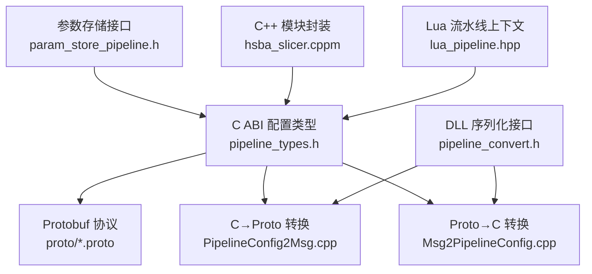

图表来源
- [pipeline_types.h:56-113](file://pipelinetypes/pipeline_types.h#L56-L113)
- [fdm_pipeline.proto:26-72](file://proto/fdm_pipeline.proto#L26-L72)
- [PipelineConfig2Msg.cpp:10-63](file://convert/PipelineConfig2Msg.cpp#L10-L63)
- [Msg2PipelineConfig.cpp:31-79](file://convert/Msg2PipelineConfig.cpp#L31-L79)
- [pipeline_convert.h:17-36](file://DllHsBaSlicer/pipeline_convert.h#L17-L36)
- [param_store_pipeline.h:17-50](file://DllHsBaSlicer/param_store_pipeline.h#L17-L50)
- [hsba_slicer.cppm:129-146](file://ModuleHsBaSlicer/hsba_slicer.cppm#L129-L146)
- [lua_pipeline.hpp:34-51](file://LibHsBaSlicer/Extends/lua_pipeline.hpp#L34-L51)

章节来源
- [pipeline_types.h:56-113](file://pipelinetypes/pipeline_types.h#L56-L113)
- [pipeline_types.h:170-218](file://pipelinetypes/pipeline_types.h#L170-L218)
- [pipeline_types.h:259-283](file://pipelinetypes/pipeline_types.h#L259-L283)
- [pipeline_types.h:359-376](file://pipelinetypes/pipeline_types.h#L359-L376)
- [pipeline_types.h:419-436](file://pipelinetypes/pipeline_types.h#L419-L436)
- [pipeline_types.h:480-496](file://pipelinetypes/pipeline_types.h#L480-L496)
- [pipeline_types.h:578-600](file://pipelinetypes/pipeline_types.h#L578-L600)
- [pipeline_types.h:636-647](file://pipelinetypes/pipeline_types.h#L636-L647)
- [pipeline_types.h:689-704](file://pipelinetypes/pipeline_types.h#L689-L704)

## 核心组件
本节按工艺分类，概述各流水线配置的核心字段分组与职责。

- FDM（熔融沉积）
  - 模型配置：模型名、模型路径
  - 切片参数：层高、首层层高
  - 填充设置：填充间距、填充模式、填充角度、壁厚层数、顶/底层数、填充密度
  - 支撑选项：是否启用、悬垂角度、支撑间隙、支撑直径、支撑密度、支撑图案、界面层数/密度
  - 路径/打印参数：线宽、打印速度、空移速度、挤出倍率、螺旋模式（花瓶模式）
  - GCode 输出：目标固件、喷嘴直径、线材直径、喷嘴温度、热床温度、回抽长度/速度、首层速度
  - Lua 扩展：支撑/填充脚本与函数名
  - 输出：GCode 输出路径

- SLA（光固化）
  - 模型配置：模型名、模型路径
  - 切片参数：层高、首层层高
  - 曝光参数：底层曝光时间、普通层曝光时间、底层抬升距离、抬升距离、抬升速度、回抽速度
  - 底板/底垫：偏移、边框宽度、填充间距/角度、边框圈数、凸包使用
  - 支撑选项：是否启用、悬垂角度、支撑间隙/直径/密度、支撑图案
  - Lua 扩展：支撑/底板/导出脚本与函数名
  - 输出：图片格式（PNG/JPG/SVG）、分辨率、输出 zip 路径

- SLS（选择性激光烧结）
  - 模型配置：模型名、模型路径
  - 切片参数：层高、首层层高
  - 激光参数：功率、扫描速度、 hatch 间距/旋转、粉床温度
  - Lua 导出：导出脚本与函数名（必需）
  - 输出：导出文件路径

- SLM（选择性激光熔化，金属）
  - 模型配置：模型名、模型路径
  - 切片参数：层高、首层层高
  - 能量源参数：功率、扫描速度、hatch 间距/旋转、粉床温度
  - 材料/光源/保护气：枚举
  - Lua 导出：导出脚本与函数名（必需）
  - 输出：导出文件路径

- LOM（分层实体制造，片材粘接+切割）
  - 模型配置：模型名、模型路径
  - 切片参数：片材厚度、首层厚度
  - 切割参数：切割速度、轮廓偏移、切割功率
  - 粘接参数：温度、压力、时间
  - 封边与切割模式：封边开关、切割模式（轮廓/半色调）
  - Lua 导出：导出脚本与函数名（必需）
  - 输出：导出文件路径

- TDP（粘结剂喷射，粉末床+液体粘结剂）
  - 模型配置：模型名、模型路径
  - 切片参数：层高、首层层高
  - 喷头/粘结剂：头数、滴落间距、饱和度、固化时间、粉床温度
  - 模式：全彩/单通道/烧结辅助
  - Lua 导出：导出脚本与函数名（必需）
  - 输出：导出文件路径；可选螺旋模式

- WAAM（电弧增材制造，机器人逐道沉积）
  - 模型配置：模型名、模型路径
  - 切片/焊道：层高、首层层高、焊道宽度、行走速度
  - 焊接参数：送丝速度、电流、电压、气体流量
  - 材料与工艺：材料、焊接过程、保护方式、保护气、层间温度
  - 机器人控制器：ABB/KUKA/FANUC/未知（未知需 Lua 路径脚本）
  - Lua 路径生成：路径脚本与函数名（可选）
  - 输出：机器人程序路径；可选螺旋模式

- 文件传输流水线
  - 连接：主机、端口、连接池大小
  - 文件：文件路径数组与数量
  - 结果：成功标志、已传文件数、总数、耗时、错误信息

- 自定义 Lua 流水线
  - Lua 入口：脚本路径或内联源码、入口函数名、自由 JSON 配置
  - 模型：模型名/路径（可选）
  - 输出：默认输出路径
  - 结果：成功标志、层数、输出路径、返回字符串、错误信息、耗时

章节来源
- [pipeline_types.h:56-113](file://pipelinetypes/pipeline_types.h#L56-L113)
- [pipeline_types.h:170-218](file://pipelinetypes/pipeline_types.h#L170-L218)
- [pipeline_types.h:259-283](file://pipelinetypes/pipeline_types.h#L259-L283)
- [pipeline_types.h:359-376](file://pipelinetypes/pipeline_types.h#L359-L376)
- [pipeline_types.h:419-436](file://pipelinetypes/pipeline_types.h#L419-L436)
- [pipeline_types.h:480-496](file://pipelinetypes/pipeline_types.h#L480-L496)
- [pipeline_types.h:578-600](file://pipelinetypes/pipeline_types.h#L578-L600)
- [pipeline_types.h:636-647](file://pipelinetypes/pipeline_types.h#L636-L647)
- [pipeline_types.h:689-704](file://pipelinetypes/pipeline_types.h#L689-L704)

## 架构总览
下图展示 C ABI 配置类型与 Protobuf 消息之间的双向转换，以及 DLL 对外提供的序列化/反序列化接口和参数存储能力。

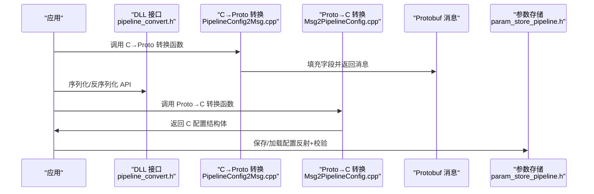

图表来源
- [pipeline_convert.h:17-36](file://DllHsBaSlicer/pipeline_convert.h#L17-L36)
- [PipelineConfig2Msg.cpp:10-63](file://convert/PipelineConfig2Msg.cpp#L10-L63)
- [Msg2PipelineConfig.cpp:31-79](file://convert/Msg2PipelineConfig.cpp#L31-L79)
- [param_store_pipeline.h:17-50](file://DllHsBaSlicer/param_store_pipeline.h#L17-L50)

## 详细组件分析

### FDM 流水线配置
- 关键枚举：填充模式、支撑图案、GCode 固件
- 关键字段：层高/首层层高、填充间距/模式/角度、壁厚/顶/底层数、填充密度、支撑相关、路径参数、GCode 输出参数、Lua 扩展、输出路径
- 典型流程：构建配置 → 运行切片 → 生成 GCode → 回调进度/结果

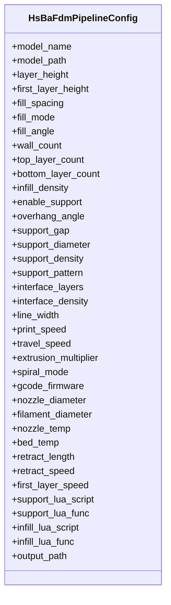

图表来源
- [pipeline_types.h:56-113](file://pipelinetypes/pipeline_types.h#L56-L113)

章节来源
- [pipeline_types.h:56-113](file://pipelinetypes/pipeline_types.h#L56-L113)
- [fdm_pipeline.proto:26-72](file://proto/fdm_pipeline.proto#L26-L72)
- [PipelineConfig2Msg.cpp:10-63](file://convert/PipelineConfig2Msg.cpp#L10-L63)
- [Msg2PipelineConfig.cpp:31-79](file://convert/Msg2PipelineConfig.cpp#L31-L79)

### SLA 流水线配置
- 关键枚举：支撑图案、图像格式
- 关键字段：层高/首层层高、曝光参数、底板/底垫参数、支撑参数、Lua 扩展、图像尺寸/格式、输出路径

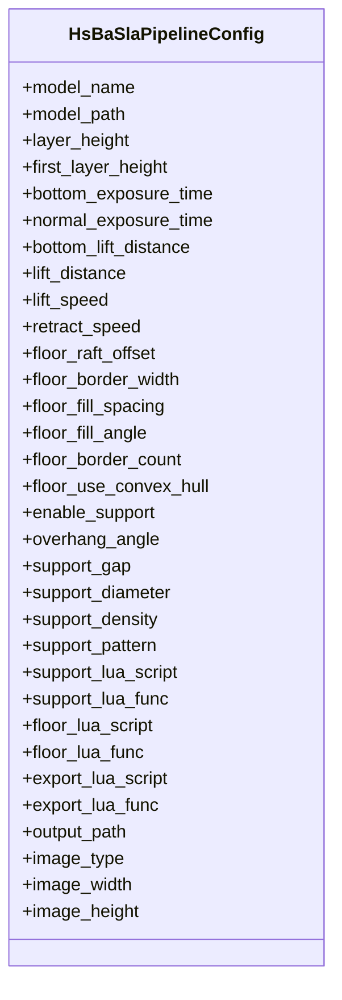

图表来源
- [pipeline_types.h:170-218](file://pipelinetypes/pipeline_types.h#L170-L218)
- [sla_pipeline.proto:18-58](file://proto/sla_pipeline.proto#L18-L58)

章节来源
- [pipeline_types.h:170-218](file://pipelinetypes/pipeline_types.h#L170-L218)
- [sla_pipeline.proto:18-58](file://proto/sla_pipeline.proto#L18-L58)
- [PipelineConfig2Msg.cpp:76-125](file://convert/PipelineConfig2Msg.cpp#L76-L125)
- [Msg2PipelineConfig.cpp:90-132](file://convert/Msg2PipelineConfig.cpp#L90-L132)

### SLS / SLM 流水线配置
- SLS：无支撑/底板，依赖粉床；激光参数与 hatch 策略；Lua 导出必需
- SLM：在 SLS 基础上增加材料、光源、保护气枚举；同样需要 Lua 导出

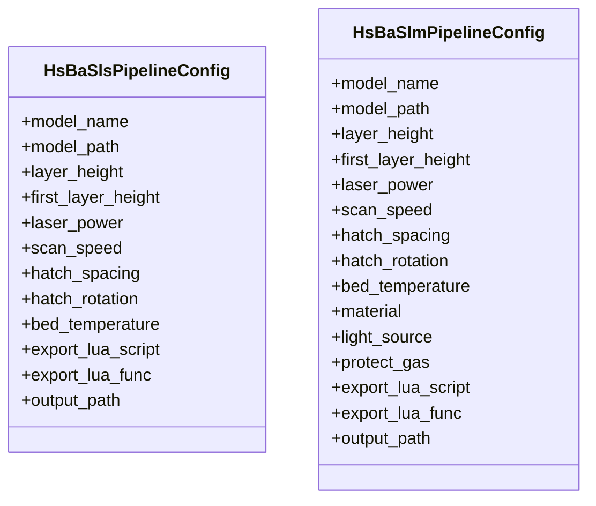

图表来源
- [pipeline_types.h:259-283](file://pipelinetypes/pipeline_types.h#L259-L283)
- [pipeline_types.h:359-376](file://pipelinetypes/pipeline_types.h#L359-L376)
- [sls_pipeline.proto:5-23](file://proto/sls_pipeline.proto#L5-L23)
- [slm_pipeline.proto:33-55](file://proto/slm_pipeline.proto#L33-L55)

章节来源
- [pipeline_types.h:259-283](file://pipelinetypes/pipeline_types.h#L259-L283)
- [pipeline_types.h:359-376](file://pipelinetypes/pipeline_types.h#L359-L376)
- [sls_pipeline.proto:5-23](file://proto/sls_pipeline.proto#L5-L23)
- [slm_pipeline.proto:33-55](file://proto/slm_pipeline.proto#L33-L55)
- [PipelineConfig2Msg.cpp:138-172](file://convert/PipelineConfig2Msg.cpp#L138-L172)
- [Msg2PipelineConfig.cpp:143-172](file://convert/Msg2PipelineConfig.cpp#L143-L172)
- [PipelineConfig2Msg.cpp:235-273](file://convert/PipelineConfig2Msg.cpp#L235-L273)
- [Msg2PipelineConfig.cpp:232-265](file://convert/Msg2PipelineConfig.cpp#L232-L265)

### LOM 流水线配置
- 关键参数：切割速度/偏移/功率、粘接温度/压力/时间、封边开关、切割模式、Lua 导出、输出路径

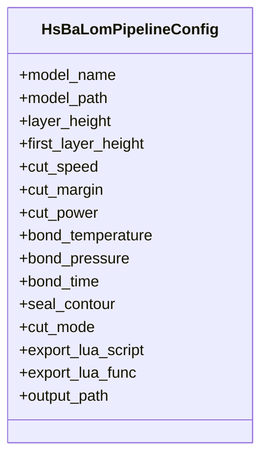

图表来源
- [pipeline_types.h:419-436](file://pipelinetypes/pipeline_types.h#L419-L436)
- [lom_pipeline.proto:13-36](file://proto/lom_pipeline.proto#L13-L36)

章节来源
- [pipeline_types.h:419-436](file://pipelinetypes/pipeline_types.h#L419-L436)
- [lom_pipeline.proto:13-36](file://proto/lom_pipeline.proto#L13-L36)
- [PipelineConfig2Msg.cpp:275-303](file://convert/PipelineConfig2Msg.cpp#L275-L303)
- [Msg2PipelineConfig.cpp:267-292](file://convert/Msg2PipelineConfig.cpp#L267-L292)

### TDP 流水线配置
- 关键参数：头数、滴落间距、饱和度、固化时间、粉床温度、模式、Lua 导出、螺旋模式、输出路径

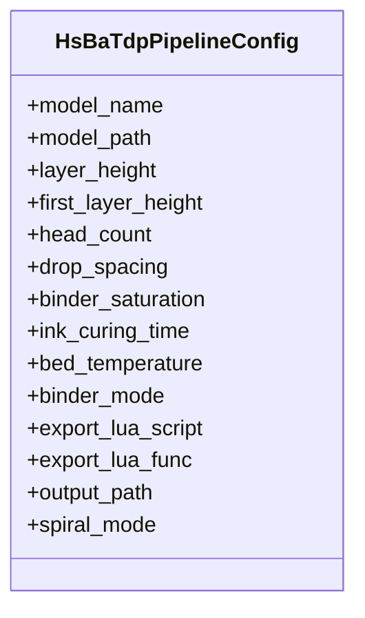

图表来源
- [pipeline_types.h:480-496](file://pipelinetypes/pipeline_types.h#L480-L496)
- [tdp_pipeline.proto:15-37](file://proto/tdp_pipeline.proto#L15-L37)

章节来源
- [pipeline_types.h:480-496](file://pipelinetypes/pipeline_types.h#L480-L496)
- [tdp_pipeline.proto:15-37](file://proto/tdp_pipeline.proto#L15-L37)
- [PipelineConfig2Msg.cpp:316-343](file://convert/PipelineConfig2Msg.cpp#L316-L343)
- [Msg2PipelineConfig.cpp:303-327](file://convert/Msg2PipelineConfig.cpp#L303-L327)

### WAAM 流水线配置
- 关键参数：层高/首层层高、焊道宽度、行走速度、送丝速度、电流/电压、气体流量、材料、焊接过程、保护方式、保护气、层间温度、机器人类型、路径 Lua、螺旋模式、输出路径

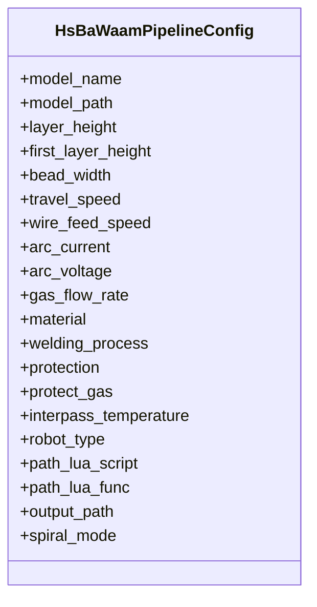

图表来源
- [pipeline_types.h:578-600](file://pipelinetypes/pipeline_types.h#L578-L600)
- [waam_pipeline.proto:49-79](file://proto/waam_pipeline.proto#L49-L79)

章节来源
- [pipeline_types.h:578-600](file://pipelinetypes/pipeline_types.h#L578-L600)
- [waam_pipeline.proto:49-79](file://proto/waam_pipeline.proto#L49-L79)
- [PipelineConfig2Msg.cpp:356-391](file://convert/PipelineConfig2Msg.cpp#L356-L391)
- [Msg2PipelineConfig.cpp:338-370](file://convert/Msg2PipelineConfig.cpp#L338-L370)

### 文件传输流水线配置
- 关键参数：host/port/pool_size、file_paths/file_count
- 用途：通过远程执行器连接池批量发送文件

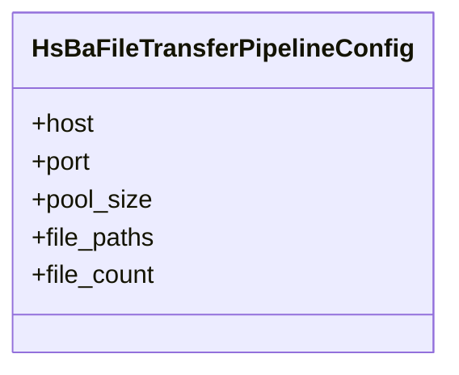

图表来源
- [pipeline_types.h:636-647](file://pipelinetypes/pipeline_types.h#L636-L647)

章节来源
- [pipeline_types.h:636-647](file://pipelinetypes/pipeline_types.h#L636-L647)
- [PipelineConfig2Msg.cpp:174-200](file://convert/PipelineConfig2Msg.cpp#L174-L200)
- [Msg2PipelineConfig.cpp:174-204](file://convert/Msg2PipelineConfig.cpp#L174-L204)

### 自定义 Lua 流水线配置
- 关键参数：pipeline_lua_script/pipeline_lua_source/entry_func/config_json/model_name/model_path/output_path
- 特点：整个工作流由 Lua 入口函数编排，C++ 侧提供切片/支撑/填充/导出等工具

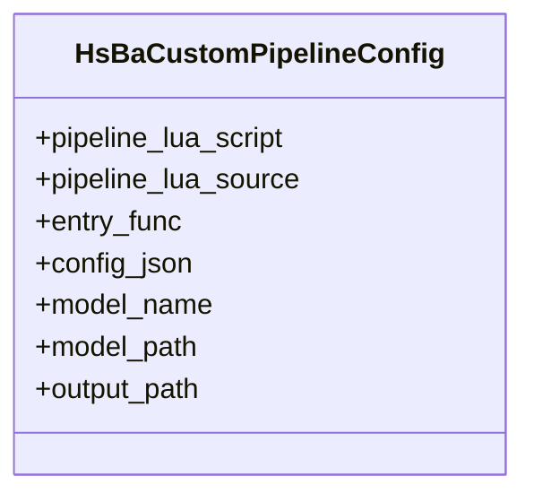

图表来源
- [pipeline_types.h:689-704](file://pipelinetypes/pipeline_types.h#L689-L704)
- [lua_pipeline.hpp:34-51](file://LibHsBaSlicer/Extends/lua_pipeline.hpp#L34-L51)

章节来源
- [pipeline_types.h:689-704](file://pipelinetypes/pipeline_types.h#L689-L704)
- [lua_pipeline.hpp:34-51](file://LibHsBaSlicer/Extends/lua_pipeline.hpp#L34-L51)
- [PipelineConfig2Msg.cpp:202-233](file://convert/PipelineConfig2Msg.cpp#L202-L233)
- [Msg2PipelineConfig.cpp:206-230](file://convert/Msg2PipelineConfig.cpp#L206-L230)

## 依赖关系分析
- 类型定义与协议映射：C ABI 结构体与 Protobuf 消息一一对应，枚举值顺序保持一致，便于直接 static_cast 转换
- 转换层：PipelineConfig2Msg.cpp 与 Msg2PipelineConfig.cpp 负责双向映射，字符串字段采用 malloc 分配并由调用方释放
- DLL 接口：pipeline_convert.h 暴露二进制序列化的 C API，屏蔽内部实现细节
- 参数存储：param_store_pipeline.h 提供基于反射的参数保存/加载，支持类型推导表名与业务键
- C++ 模块：hsba_slicer.cppm 提供默认配置工厂函数与各工艺 Pipeline 类封装

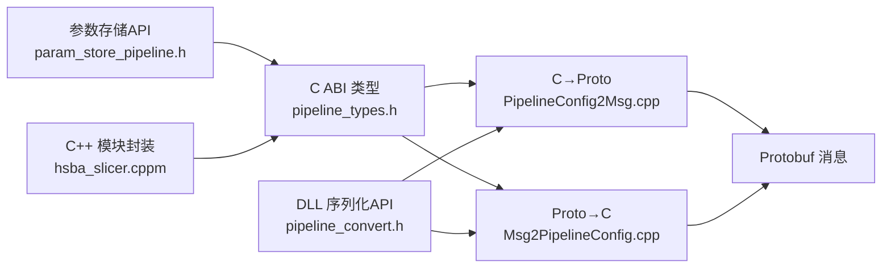

图表来源
- [pipeline_types.h:56-113](file://pipelinetypes/pipeline_types.h#L56-L113)
- [PipelineConfig2Msg.cpp:10-63](file://convert/PipelineConfig2Msg.cpp#L10-L63)
- [Msg2PipelineConfig.cpp:31-79](file://convert/Msg2PipelineConfig.cpp#L31-L79)
- [pipeline_convert.h:17-36](file://DllHsBaSlicer/pipeline_convert.h#L17-L36)
- [param_store_pipeline.h:17-50](file://DllHsBaSlicer/param_store_pipeline.h#L17-L50)
- [hsba_slicer.cppm:129-146](file://ModuleHsBaSlicer/hsba_slicer.cppm#L129-L146)

章节来源
- [pipeline_types.h:56-113](file://pipelinetypes/pipeline_types.h#L56-L113)
- [PipelineConfig2Msg.cpp:10-63](file://convert/PipelineConfig2Msg.cpp#L10-L63)
- [Msg2PipelineConfig.cpp:31-79](file://convert/Msg2PipelineConfig.cpp#L31-L79)
- [pipeline_convert.h:17-36](file://DllHsBaSlicer/pipeline_convert.h#L17-L36)
- [param_store_pipeline.h:17-50](file://DllHsBaSlicer/param_store_pipeline.h#L17-L50)
- [hsba_slicer.cppm:129-146](file://ModuleHsBaSlicer/hsba_slicer.cppm#L129-L146)

## 性能与验证
- 数据类型约束
  - 数值型参数多为浮点/整型，部分布尔以 int 表示（0/1），枚举用于离散取值
  - 字符串字段为 const char*，可为 NULL；转换为 Protobuf 时为空则跳过赋值
- 配置验证机制
  - 参数存储层通过“反射+强制类型转换+Upsert”流程进行基本合法性检查
  - 某些工艺要求必填项（如 SLS/SLM/LOM/TDP 的 export_lua_script），缺失将导致运行时错误
- 序列化/反序列化
  - 使用 Protobuf 二进制格式，避免文本解析开销
  - 字符串字段复制采用 malloc，调用方需负责释放，避免内存泄漏
- 性能要点
  - 枚举直转减少分支判断
  - 批量文件传输使用连接池提升吞吐
  - 螺旋模式可简化路径生成，减少中间计算

章节来源
- [param_store_pipeline.h:17-50](file://DllHsBaSlicer/param_store_pipeline.h#L17-L50)
- [pipeline_types.h:56-113](file://pipelinetypes/pipeline_types.h#L56-L113)
- [pipeline_types.h:259-283](file://pipelinetypes/pipeline_types.h#L259-L283)
- [pipeline_types.h:359-376](file://pipelinetypes/pipeline_types.h#L359-L376)
- [pipeline_types.h:419-436](file://pipelinetypes/pipeline_types.h#L419-L436)
- [pipeline_types.h:480-496](file://pipelinetypes/pipeline_types.h#L480-L496)
- [pipeline_types.h:578-600](file://pipelinetypes/pipeline_types.h#L578-L600)

## 故障排查指南
- 常见错误来源
  - 必填字段缺失：例如 SLS/SLM/LOM/TDP 未设置 export_lua_script
  - 枚举越界：C 枚举与 Protobuf 枚举不一致导致转换异常
  - 字符串生命周期：未释放由库分配的 char* 导致内存泄漏
- 定位方法
  - 检查 result.success 与 error_message
  - 确认 Lua 脚本路径与函数名是否正确
  - 对 Protobuf 字节流进行最小用例测试，逐步缩小问题范围
- 修复建议
  - 使用默认配置初始化后再修改必要字段
  - 确保所有 const char* 非空指针指向有效 UTF-8 字符串
  - 在异步回调中及时释放结果结构中的动态内存

章节来源
- [pipeline_types.h:120-127](file://pipelinetypes/pipeline_types.h#L120-L127)
- [pipeline_types.h:225-232](file://pipelinetypes/pipeline_types.h#L225-L232)
- [pipeline_types.h:290-297](file://pipelinetypes/pipeline_types.h#L290-L297)
- [pipeline_types.h:381-388](file://pipelinetypes/pipeline_types.h#L381-L388)
- [pipeline_types.h:441-448](file://pipelinetypes/pipeline_types.h#L441-L448)
- [pipeline_types.h:501-508](file://pipelinetypes/pipeline_types.h#L501-L508)
- [pipeline_types.h:605-612](file://pipelinetypes/pipeline_types.h#L605-L612)

## 结论
HsBaSlicer 的流水线配置类型以 C ABI 结构体为核心，配合 Protobuf 协议与 DLL 序列化接口，形成清晰的双向转换链路。每种工艺的配置均围绕“模型—切片—填充/支撑—导出/输出”的主线组织，并通过 Lua 扩展保持灵活性与可定制性。开发者应优先使用默认配置初始化，按需调整关键参数，严格遵循必填项与枚举约束，并在序列化/反序列化过程中正确处理字符串生命周期，从而获得稳定高效的切片与导出效果。

## 附录：配置示例与最佳实践
- 通用步骤
  - 使用对应工艺的默认配置初始化函数
  - 仅修改必要字段，其余保持默认
  - 对必填项（如 export_lua_script）进行非空校验
  - 如需跨进程/网络传输，使用 DLL 提供的 Protobuf 序列化接口
  - 使用参数存储进行配置的持久化与复用
- 工艺级建议
  - FDM：合理设置层高与填充密度平衡强度与耗时；开启螺旋模式可显著简化外壁路径
  - SLA：根据树脂特性调优曝光时间与抬升参数；选择合适的图片格式与分辨率
  - SLS/SLM：依据材料与设备能力设定激光功率、扫描速度与 hatch 策略；务必提供导出脚本
  - LOM：根据片材材质调整切割功率与粘接参数；必要时开启封边
  - TDP：根据粘结剂特性设置饱和度与固化时间；多喷头模式下注意滴落间距
  - WAAM：匹配材料/工艺/保护气组合；选择目标机器人语言或使用 Lua 路径脚本
- 资源管理
  - 所有由库分配的 char* 必须调用对应的释放函数或 free
  - 异步回调中避免持有长生命周期引用，及时清理临时对象

章节来源
- [pipeline_types.h:742-783](file://pipelinetypes/pipeline_types.h#L742-L783)
- [pipeline_types.h:789-800](file://pipelinetypes/pipeline_types.h#L789-L800)
- [pipeline_convert.h:17-36](file://DllHsBaSlicer/pipeline_convert.h#L17-L36)
- [param_store_pipeline.h:17-50](file://DllHsBaSlicer/param_store_pipeline.h#L17-L50)
- [hsba_slicer.cppm:129-146](file://ModuleHsBaSlicer/hsba_slicer.cppm#L129-L146)