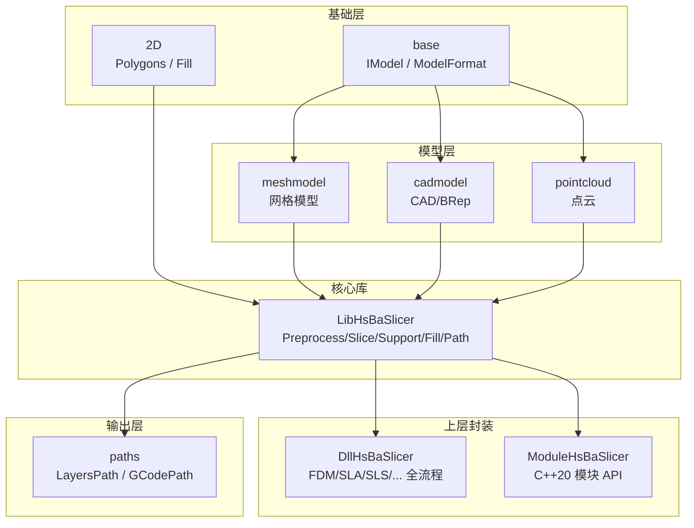
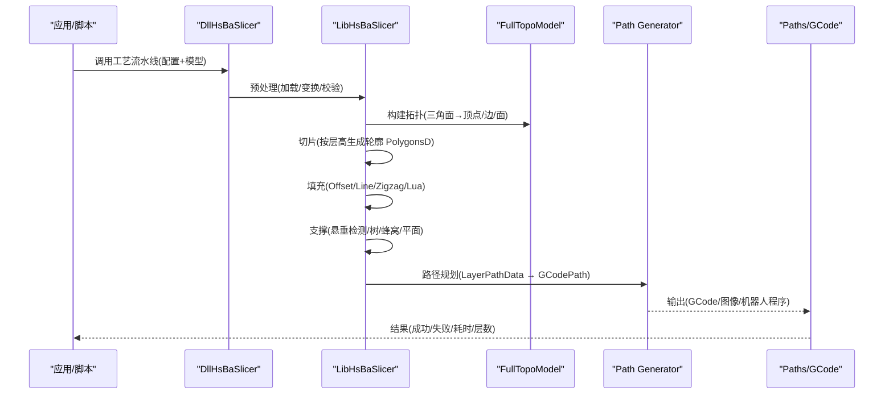
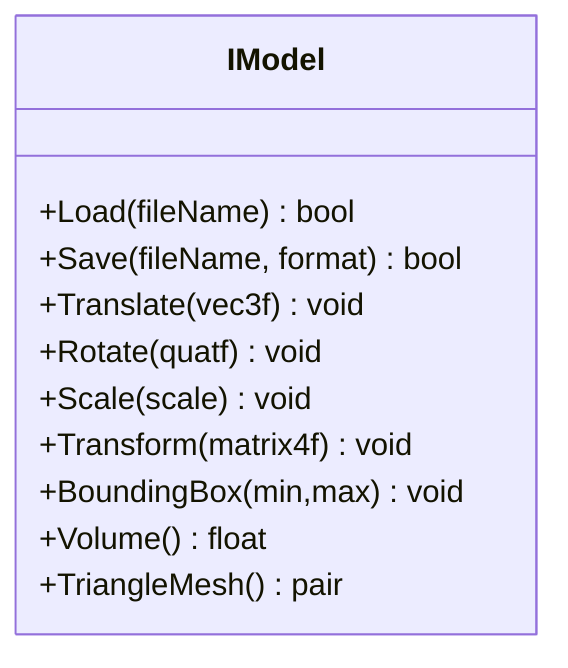
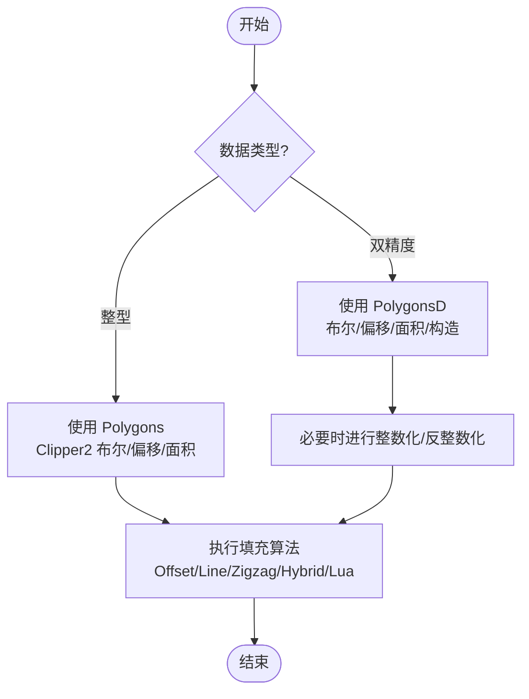
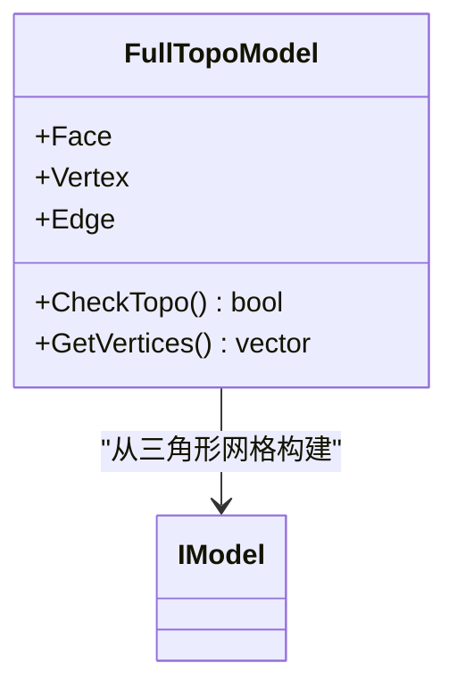
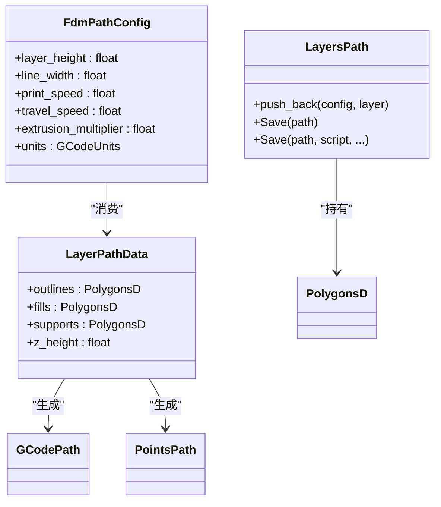
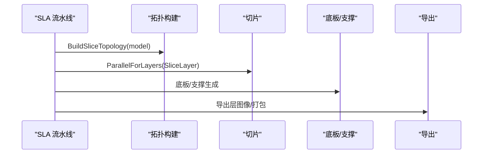
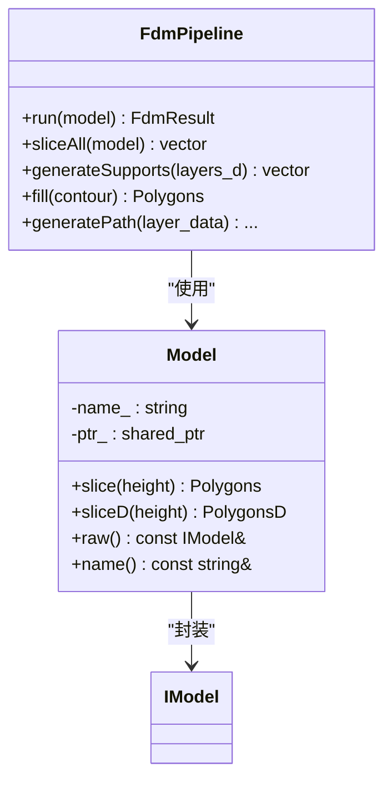
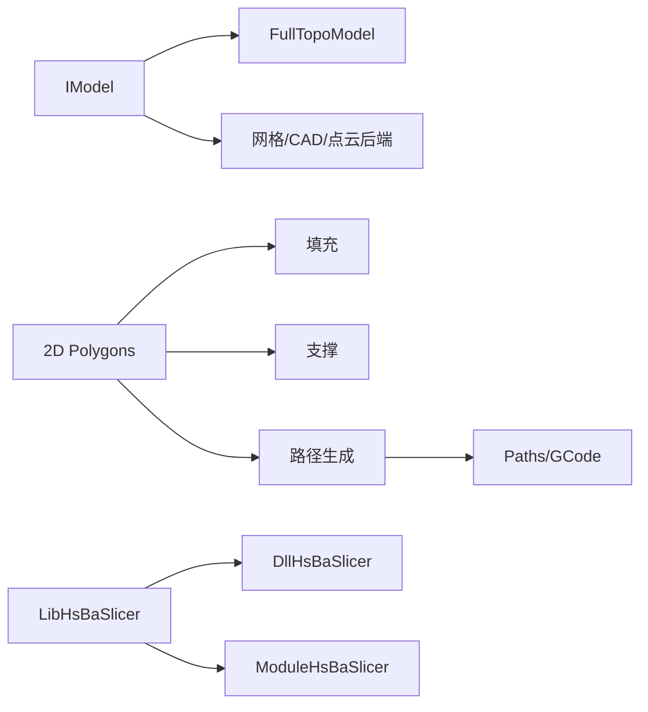

# 核心概念

<cite>
**本文引用的文件**   
- [IModel.hpp](file://base/IModel.hpp)
- [ModelFormat.hpp](file://base/ModelFormat.hpp)
- [pipeline_types.h](file://pipelinetypes/pipeline_types.h)
- [FloatPolygons.hpp](file://2D/FloatPolygons.hpp)
- [IntPolygon.hpp](file://2D/IntPolygon.hpp)
- [PolygonFill.hpp](file://2D/PolygonFill.hpp)
- [FullTopoModel.hpp](file://meshmodel/FullTopoModel.hpp)
- [FullTopoModel.cpp](file://meshmodel/FullTopoModel.cpp)
- [hsba_slicer.cppm](file://ModuleHsBaSlicer/hsba_slicer.cppm)
- [path_generator.hpp](file://LibHsBaSlicer/Path/path_generator.hpp)
- [layerspath.hpp](file://paths/layerspath.hpp)
- [layerspath.cpp](file://paths/layerspath.cpp)
- [sla_pipeline.cpp](file://DllHsBaSlicer/sla_pipeline.cpp)
</cite>

## 目录
1. [引言](#引言)
2. [项目结构](#项目结构)
3. [核心组件](#核心组件)
4. [架构总览](#架构总览)
5. [详细组件分析](#详细组件分析)
6. [依赖关系分析](#依赖关系分析)
7. [性能与可扩展性](#性能与可扩展性)
8. [故障排查指南](#故障排查指南)
9. [结论](#结论)

## 引言
本章节面向初学者与高级用户，系统阐述 HsBaSlicer 的核心概念：从 3D 模型到 GCode 的切片流水线、统一抽象 IModel、关键数据结构（如 ModelInfo、LayerPathData、Polygons）、拓扑结构在切片中的作用，以及预处理、切片、填充、支撑生成、路径规划等阶段。文档通过图示与代码片段路径帮助读者建立从“几何输入”到“打印输出”的完整认知。

## 项目结构
HsBaSlicer 采用模块化分层设计：
- base：基础接口与通用工具（IModel、ModelFormat、数学与错误处理）
- 2D：二维多边形类型与布尔运算、偏移、填充算法
- meshmodel/cadmodel/pointcloud：不同数据源的模型实现（网格/CAD/点云）
- LibHsBaSlicer：核心静态库（预处理、切片、支撑、填充、路径生成）
- DllHsBaSlicer：上层动态库，封装 FDM/SLA/SLS/SLM/LOM/WAAM 等工艺的全流程
- ModuleHsBaSlicer：C++20 模块入口，暴露高层 API（Model、FdmPipeline 等）
- paths：路径输出抽象（LayersPath、GCodePath 等）
- pipelinetypes：跨语言兼容的配置与结果类型定义

图表来源
- [IModel.hpp:110-139](file://base/IModel.hpp#L110-L139)
- [FloatPolygons.hpp:18-26](file://2D/FloatPolygons.hpp#L18-L26)
- [path_generator.hpp:23-42](file://LibHsBaSlicer/Path/path_generator.hpp#L23-L42)
- [layerspath.hpp:17-36](file://paths/layerspath.hpp#L17-L36)

章节来源
- [IModel.hpp:110-139](file://base/IModel.hpp#L110-L139)
- [FloatPolygons.hpp:18-26](file://2D/FloatPolygons.hpp#L18-L26)
- [path_generator.hpp:23-42](file://LibHsBaSlicer/Path/path_generator.hpp#L23-L42)
- [layerspath.hpp:17-36](file://paths/layerspath.hpp#L17-L36)

## 核心组件
本节聚焦以下核心概念：
- IModel 接口：统一抽象不同格式的 3D 模型
- 模型格式与类型判断：支持网格、BRep、CSG、点云
- 二维多边形体系：Polygons/PolygonsD、布尔运算、偏移、填充
- 顶层拓扑 FullTopoModel：为切片提供稳定拓扑
- 流水线配置与结果：各工艺的统一 C 兼容类型
- 路径与层数据：LayerPathData、LayersPath、GCodePath

章节来源
- [IModel.hpp:110-139](file://base/IModel.hpp#L110-L139)
- [ModelFormat.hpp:19-93](file://base/ModelFormat.hpp#L19-L93)
- [FloatPolygons.hpp:18-26](file://2D/FloatPolygons.hpp#L18-L26)
- [IntPolygon.hpp:16-26](file://2D/IntPolygon.hpp#L16-L26)
- [PolygonFill.hpp:20-136](file://2D/PolygonFill.hpp#L20-L136)
- [FullTopoModel.hpp:53-86](file://meshmodel/FullTopoModel.hpp#L53-L86)
- [pipeline_types.h:23-127](file://pipelinetypes/pipeline_types.h#L23-L127)
- [path_generator.hpp:23-42](file://LibHsBaSlicer/Path/path_generator.hpp#L23-L42)
- [layerspath.hpp:17-36](file://paths/layerspath.hpp#L17-L36)

## 架构总览
HsBaSlicer 的切片流水线遵循“预处理 → 切片 → 填充 → 支撑 → 路径规划 → 输出”的阶段化模式。不同工艺（FDM/SLA/SLS/SLM/LOM/WAAM）共享同一套核心能力，差异主要体现在参数与导出格式。

图表来源
- [sla_pipeline.cpp:321-352](file://DllHsBaSlicer/sla_pipeline.cpp#L321-L352)
- [hsba_slicer.cppm:179-219](file://ModuleHsBaSlicer/hsba_slicer.cppm#L179-L219)
- [path_generator.hpp:44-80](file://LibHsBaSlicer/Path/path_generator.hpp#L44-L80)

## 详细组件分析

### IModel 接口与模型抽象
IModel 是 HsBaSlicer 对 3D 模型的统一抽象，屏蔽了网格、CAD、点云等具体实现的差异。它提供：
- 加载/保存模型
- 平移/旋转/缩放/仿射变换
- 计算包围盒与体积
- 获取三角形网格（Eigen 风格）

图表来源
- [IModel.hpp:110-139](file://base/IModel.hpp#L110-L139)

章节来源
- [IModel.hpp:110-139](file://base/IModel.hpp#L110-L139)

### 模型格式与类型判断
ModelFormat 枚举覆盖 PLY/OBJ/STL/OFF/VRML/STEP/IGES/BREP/SLDPRT/CATPART/XYZ/VDB 等格式，并提供字符串转换与扩展名识别。同时提供 IsMeshFormat/IsBrepFormat/IsCSGFormat/IsPointCloudFormat 等判断函数，便于上游根据扩展名或枚举值选择加载器与处理策略。

章节来源
- [IModel.hpp:65-109](file://base/IModel.hpp#L65-L109)
- [ModelFormat.hpp:19-93](file://base/ModelFormat.hpp#L19-L93)

### 二维多边形体系与填充
- PolygonsD：双精度多边形集合，用于高精度几何运算
- Polygons：整型多边形集合，基于 Clipper2，用于布尔运算、偏移、面积计算
- PolygonFill：提供 OffsetFill、LineFill、SimpleZigzagFill、ZigzagFill、CompositeOffsetFill、HybridFill 及 Lua 自定义填充

图表来源
- [FloatPolygons.hpp:18-26](file://2D/FloatPolygons.hpp#L18-L26)
- [IntPolygon.hpp:16-26](file://2D/IntPolygon.hpp#L16-L26)
- [PolygonFill.hpp:20-136](file://2D/PolygonFill.hpp#L20-L136)

章节来源
- [FloatPolygons.hpp:18-26](file://2D/FloatPolygons.hpp#L18-L26)
- [IntPolygon.hpp:16-26](file://2D/IntPolygon.hpp#L16-L26)
- [PolygonFill.hpp:20-136](file://2D/PolygonFill.hpp#L20-L136)

### 拓扑结构与切片
FullTopoModel 将 IModel 提供的三角形网格重建为包含 Face/Edge/Vertex 的拓扑结构，并支持拓扑完整性检查。切片时先构建一次拓扑，再并行按层高 SliceLayer，提升效率与稳定性。

图表来源
- [FullTopoModel.hpp:53-86](file://meshmodel/FullTopoModel.hpp#L53-L86)
- [FullTopoModel.cpp:27-48](file://meshmodel/FullTopoModel.cpp#L27-L48)

章节来源
- [FullTopoModel.hpp:53-86](file://meshmodel/FullTopoModel.hpp#L53-L86)
- [FullTopoModel.cpp:27-48](file://meshmodel/FullTopoModel.cpp#L27-L48)

### 流水线配置与结果类型
pipelinetypes.h 定义了各工艺的 C 兼容配置与结果结构体，例如：
- FDM：HsBaFdmPipelineConfig_t / HsBaFdmPipelineResult_t
- SLA：HsBaSlaPipelineConfig_t / HsBaSlaPipelineResult_t
- SLS/SLM/LOM/3DP/WAAM：对应 Config/Result 结构
- 回调：ProgressCallback/ResultCallback

这些类型贯穿 DllHsBaSlicer 与 LibHsBaSlicer 的交互，确保跨语言与跨进程的稳定数据交换。

章节来源
- [pipeline_types.h:23-127](file://pipelinetypes/pipeline_types.h#L23-L127)
- [pipeline_types.h:146-245](file://pipelinetypes/pipeline_types.h#L146-L245)
- [pipeline_types.h:247-310](file://pipelinetypes/pipeline_types.h#L247-L310)
- [pipeline_types.h:312-401](file://pipelinetypes/pipeline_types.h#L312-L401)
- [pipeline_types.h:403-461](file://pipelinetypes/pipeline_types.h#L403-L461)
- [pipeline_types.h:463-521](file://pipelinetypes/pipeline_types.h#L463-L521)
- [pipeline_types.h:523-625](file://pipelinetypes/pipeline_types.h#L523-L625)
- [pipeline_types.h:627-732](file://pipelinetypes/pipeline_types.h#L627-L732)

### 路径规划与层数据
- LayerPathData：单层的轮廓、填充、支撑与 Z 高度
- FdmPathConfig：路径生成的打印机参数
- GenerateGCodePath/GenerateGCodePathV2/GenerateGCodePathSpiral：从层数据生成 GCodePath 或 PointsPath
- LayersPath：按层存储 PolygonsD 与自由文本配置，支持 SQLite 持久化与 Lua 后处理

图表来源
- [path_generator.hpp:23-42](file://LibHsBaSlicer/Path/path_generator.hpp#L23-L42)
- [path_generator.hpp:44-80](file://LibHsBaSlicer/Path/path_generator.hpp#L44-L80)
- [layerspath.hpp:17-36](file://paths/layerspath.hpp#L17-L36)

章节来源
- [path_generator.hpp:23-42](file://LibHsBaSlicer/Path/path_generator.hpp#L23-L42)
- [path_generator.hpp:44-80](file://LibHsBaSlicer/Path/path_generator.hpp#L44-L80)
- [layerspath.hpp:17-36](file://paths/layerspath.hpp#L17-L36)
- [layerspath.cpp:25-47](file://paths/layerspath.cpp#L25-L47)

### 典型流水线：SLA 示例
SLA 流水线展示了“构建拓扑 → 并行切片 → 底板/支撑 → 导出”的典型流程。其中 BuildSliceTopology 仅构建一次，SliceLayer 按层高并行执行，随后进行底板生成与支撑处理，最终导出层图像或打包文件。

图表来源
- [sla_pipeline.cpp:321-352](file://DllHsBaSlicer/sla_pipeline.cpp#L321-L352)

章节来源
- [sla_pipeline.cpp:321-352](file://DllHsBaSlicer/sla_pipeline.cpp#L321-L352)

### 高层 API：Model 与 FdmPipeline
ModuleHsBaSlicer 暴露了更高层的 C++20 接口：
- Model：封装 IModel 指针与名称，提供 slice 方法
- FdmPipeline：封装 FDM 全流程（切片→支撑→填充→路径），并提供 sliceAll/generateSupports/fill/generatePath 等便捷方法

图表来源
- [hsba_slicer.cppm:179-219](file://ModuleHsBaSlicer/hsba_slicer.cppm#L179-L219)

章节来源
- [hsba_slicer.cppm:179-219](file://ModuleHsBaSlicer/hsba_slicer.cppm#L179-L219)

## 依赖关系分析
- IModel 被 FullTopoModel 与所有模型后端（meshmodel/cadmodel/pointcloud）依赖
- 2D 多边形库被填充、支撑、路径生成与导出模块广泛使用
- LibHsBaSlicer 作为核心库，向上被 DllHsBaSlicer 与 ModuleHsBaSlicer 依赖
- paths 模块与 path_generator 共同完成从层数据到 GCode 的转换

图表来源
- [IModel.hpp:110-139](file://base/IModel.hpp#L110-L139)
- [FullTopoModel.hpp:53-86](file://meshmodel/FullTopoModel.hpp#L53-L86)
- [path_generator.hpp:44-80](file://LibHsBaSlicer/Path/path_generator.hpp#L44-L80)
- [layerspath.hpp:17-36](file://paths/layerspath.hpp#L17-L36)

## 性能与可扩展性
- 并行切片：SLA 流水线中按层高并行 SliceLayer，减少总体耗时
- 拓扑复用：BuildSliceTopology 仅构建一次，避免重复计算
- 数据类型优化：双精度用于几何运算，整型用于 Clipper2 布尔/偏移，兼顾精度与速度
- Lua 扩展：填充、支撑、导出均可通过 Lua 脚本定制，便于快速迭代与工艺适配

[本节为通用指导，不直接分析具体文件]

## 故障排查指南
- 拓扑不完整：FullTopoModel::CheckTopo 可用于检测非流形拓扑；若返回不完整，需检查原始模型是否闭合、法线方向是否正确
- 层数据为空：确认层高设置合理、模型包围盒与坐标范围正确
- GCode 异常：检查 FdmPathConfig 的单位、线宽、层高是否与模型单位一致；确认 LayerPathData 的 outlines/fills/supports 非空
- 导出失败：检查 LayersPath 的 SQLite 写入权限与路径；Lua 导出脚本是否存在语法错误

章节来源
- [FullTopoModel.hpp:80-86](file://meshmodel/FullTopoModel.hpp#L80-L86)
- [layerspath.cpp:30-47](file://paths/layerspath.cpp#L30-L47)
- [path_generator.hpp:23-42](file://LibHsBaSlicer/Path/path_generator.hpp#L23-L42)

## 结论
HsBaSlicer 通过 IModel 统一抽象、稳定的二维多边形体系、可复用的拓扑结构以及清晰的流水线阶段划分，实现了从 3D 模型到 GCode 的高效转换。开发者可以基于现有接口扩展新的模型格式、填充算法、支撑策略与导出格式，同时借助 Lua 脚本灵活定制工艺细节。对于初学者，建议从 Model 与 FdmPipeline 的高层 API 入手；对于高级用户，可直接深入 LibHsBaSlicer 与 DllHsBaSlicer 的内部实现，按需优化性能与功能。