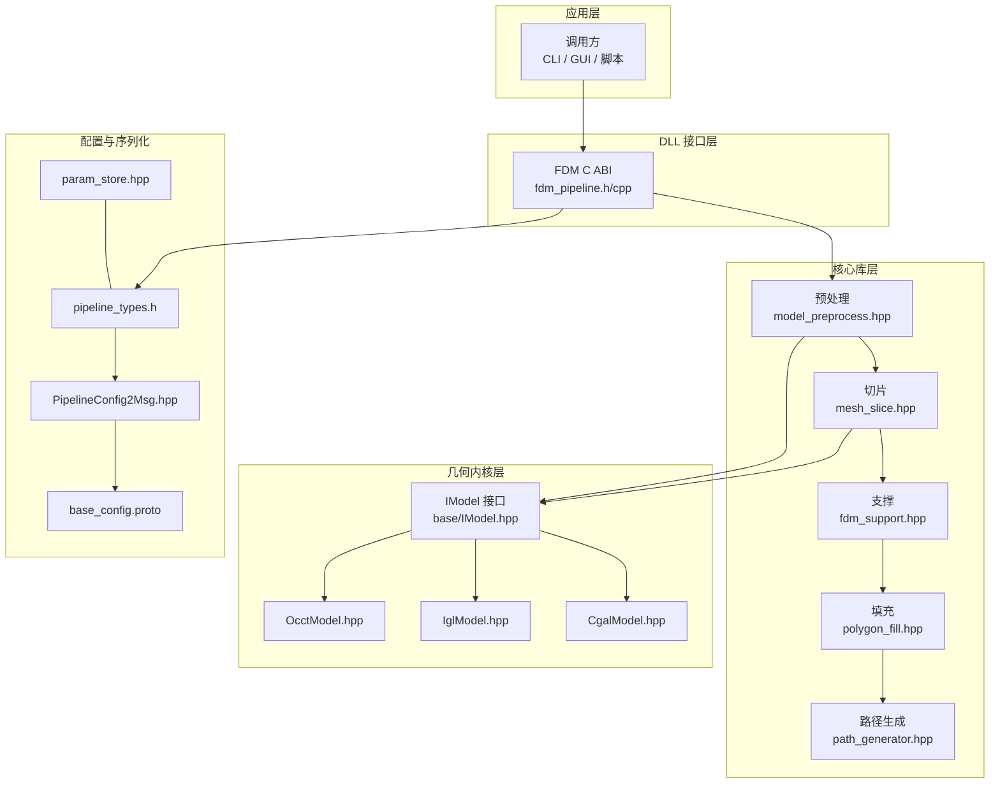
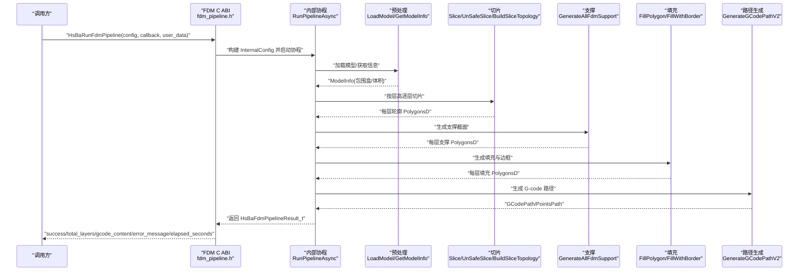
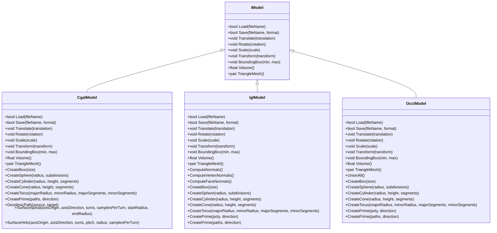
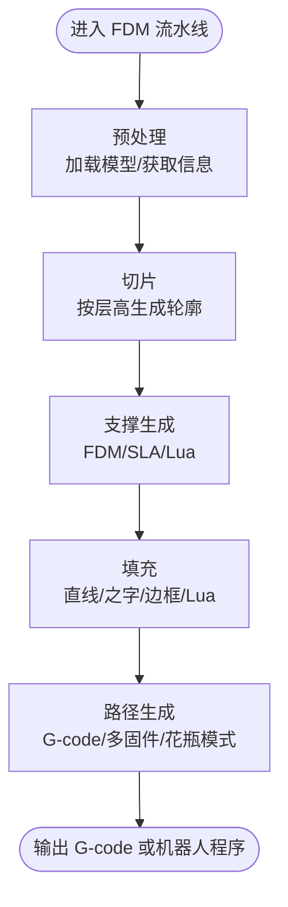
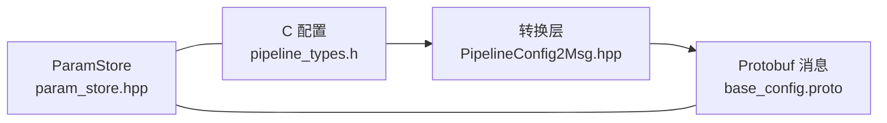
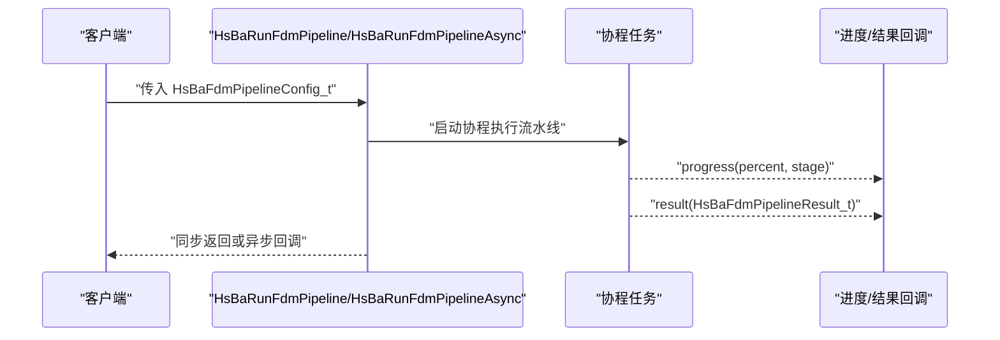
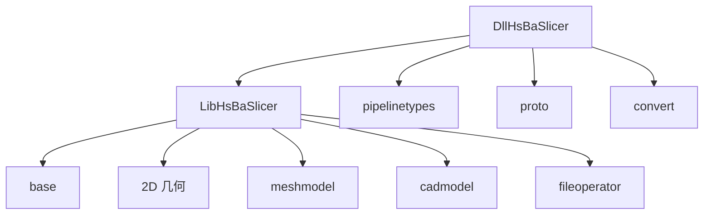

# 核心概念

<cite>
**本文引用的文件**   
- [base/IModel.hpp](file://base/IModel.hpp)
- [meshmodel/CgalModel.hpp](file://meshmodel/CgalModel.hpp)
- [meshmodel/IglModel.hpp](file://meshmodel/IglModel.hpp)
- [cadmodel/OcctModel.hpp](file://cadmodel/OcctModel.hpp)
- [LibHsBaSlicer/Preprocess/model_preprocess.hpp](file://LibHsBaSlicer/Preprocess/model_preprocess.hpp)
- [LibHsBaSlicer/Slice/mesh_slice.hpp](file://LibHsBaSlicer/Slice/mesh_slice.hpp)
- [LibHsBaSlicer/Support/fdm_support.hpp](file://LibHsBaSlicer/Support/fdm_support.hpp)
- [LibHsBaSlicer/Fill/polygon_fill.hpp](file://LibHsBaSlicer/Fill/polygon_fill.hpp)
- [LibHsBaSlicer/Path/path_generator.hpp](file://LibHsBaSlicer/Path/path_generator.hpp)
- [pipelinetypes/pipeline_types.h](file://pipelinetypes/pipeline_types.h)
- [DllHsBaSlicer/fdm_pipeline.h](file://DllHsBaSlicer/fdm_pipeline.h)
- [DllHsBaSlicer/fdm_pipeline.cpp](file://DllHsBaSlicer/fdm_pipeline.cpp)
- [proto/base_config.proto](file://proto/base_config.proto)
- [convert/PipelineConfig2Msg.hpp](file://convert/PipelineConfig2Msg.hpp)
- [fileoperator/param_store.hpp](file://fileoperator/param_store.hpp)
</cite>

## 目录
1. [引言](#引言)
2. [项目结构](#项目结构)
3. [核心组件](#核心组件)
4. [架构总览](#架构总览)
5. [详细组件分析](#详细组件分析)
6. [依赖关系分析](#依赖关系分析)
7. [性能考虑](#性能考虑)
8. [故障排除指南](#故障排除指南)
9. [结论](#结论)
10. [附录](#附录)

## 引言
本文件面向 HsBaSlicer 的核心概念，目标是帮助读者从“3D 模型到 G-code”的完整切片流程出发，理解流水线架构、模型抽象接口、几何内核统一抽象、配置系统层次结构，以及支撑生成、填充与路径生成的关键阶段。文档既适合初学者建立整体认知，也为高级用户提供足够的源码级技术细节和可操作建议。

## 项目结构
HsBaSlicer 采用分层模块化设计：
- base：基础类型与通用工具（如 IModel 接口、错误处理、协程等）。
- meshmodel/cadmodel：几何内核实现（CGAL、libigl、OpenCASCADE），统一实现 IModel。
- LibHsBaSlicer：核心算法库（预处理、切片、支撑、填充、路径生成）。
- DllHsBaSlicer：对外 C ABI 封装，暴露 FDM/SLA/SLS/SLM/WAAM/Lua 自定义流水线入口。
- pipelinetypes：C 兼容的配置与结果类型定义。
- proto：Protobuf 消息定义，用于跨语言/跨进程配置序列化。
- convert：C 配置与 Protobuf 消息之间的双向转换。
- fileoperator：参数存储、序列化、加密与数据库适配。

**图示来源**
- [DllHsBaSlicer/fdm_pipeline.h:17-61](file://DllHsBaSlicer/fdm_pipeline.h#L17-L61)
- [LibHsBaSlicer/Preprocess/model_preprocess.hpp:22-47](file://LibHsBaSlicer/Preprocess/model_preprocess.hpp#L22-L47)
- [LibHsBaSlicer/Slice/mesh_slice.hpp:22-103](file://LibHsBaSlicer/Slice/mesh_slice.hpp#L22-L103)
- [LibHsBaSlicer/Support/fdm_support.hpp:19-67](file://LibHsBaSlicer/Support/fdm_support.hpp#L19-L67)
- [LibHsBaSlicer/Fill/polygon_fill.hpp:17-53](file://LibHsBaSlicer/Fill/polygon_fill.hpp#L17-L53)
- [LibHsBaSlicer/Path/path_generator.hpp:20-91](file://LibHsBaSlicer/Path/path_generator.hpp#L20-L91)
- [base/IModel.hpp:110-139](file://base/IModel.hpp#L110-L139)
- [meshmodel/CgalModel.hpp:26-82](file://meshmodel/CgalModel.hpp#L26-L82)
- [meshmodel/IglModel.hpp:18-82](file://meshmodel/IglModel.hpp#L18-L82)
- [cadmodel/OcctModel.hpp:22-81](file://cadmodel/OcctModel.hpp#L22-L81)
- [pipelinetypes/pipeline_types.h:23-113](file://pipelinetypes/pipeline_types.h#L23-L113)
- [proto/base_config.proto:125-132](file://proto/base_config.proto#L125-L132)
- [convert/PipelineConfig2Msg.hpp:24-76](file://convert/PipelineConfig2Msg.hpp#L24-L76)
- [fileoperator/param_store.hpp:30-108](file://fileoperator/param_store.hpp#L30-L108)

**章节来源**
- [DllHsBaSlicer/fdm_pipeline.h:1-68](file://DllHsBaSlicer/fdm_pipeline.h#L1-L68)
- [pipelinetypes/pipeline_types.h:1-113](file://pipelinetypes/pipeline_types.h#L1-L113)

## 核心组件
本节聚焦 HsBaSlicer 在“模型抽象—流水线阶段—配置系统”三个维度的核心组件。

- 模型抽象接口 IModel
  - 职责：统一加载/保存、变换、包围盒/体积查询、三角网格导出。
  - 设计要点：通过纯虚接口屏蔽不同几何内核差异，便于替换与扩展。
  - 关键能力：Translate/Rotate/Scale/Transform/BoundingBox/Volume/TriangleMesh。

- 几何内核实现
  - CgalModel：基于 CGAL 的多面体网格，支持布尔运算、几何构造与表面测地线/螺旋/螺旋线计算。
  - IglModel：基于 libigl 的三角网格，提供法线计算、布尔运算与基本几何构造。
  - OcctModel：基于 OpenCASCADE 的 BRep CAD 模型，支持 STEP/IGES/VRML/BRep 读写、布尔运算与壳化。

- 流水线阶段
  - 预处理：模型加载、变换、信息查询与池化管理。
  - 切片：平面切片 API，支持安全/不安全切片、Lua 驱动切片、拓扑复用。
  - 支撑：FDM/SLA 支撑生成，支持内置算法与 Lua 自定义。
  - 填充：多模式填充（直线/简单之字/之字）、边框偏移与 Lua 自定义填充。
  - 路径生成：FDM G-code 路径生成，支持多固件输出与花瓶模式连续外壁。

- 配置系统
  - pipeline_types.h：C 兼容的结构体与枚举，定义各工艺（FDM/SLA/SLS/SLM/WAAM/Lua 自定义）的参数与结果。
  - base_config.proto：Protobuf 消息定义，描述技术类型、材料、支撑、输出格式等。
  - PipelineConfig2Msg.hpp：C 配置与 Protobuf 消息的双向转换。
  - param_store.hpp：参数持久化，包含 Schema 管理、CRUD、事务、进度回调、迁移钩子与可选 AES 加密。

**章节来源**
- [base/IModel.hpp:110-139](file://base/IModel.hpp#L110-L139)
- [meshmodel/CgalModel.hpp:26-155](file://meshmodel/CgalModel.hpp#L26-L155)
- [meshmodel/IglModel.hpp:18-121](file://meshmodel/IglModel.hpp#L18-L121)
- [cadmodel/OcctModel.hpp:22-124](file://cadmodel/OcctModel.hpp#L22-L124)
- [LibHsBaSlicer/Preprocess/model_preprocess.hpp:22-120](file://LibHsBaSlicer/Preprocess/model_preprocess.hpp#L22-L120)
- [LibHsBaSlicer/Slice/mesh_slice.hpp:22-103](file://LibHsBaSlicer/Slice/mesh_slice.hpp#L22-L103)
- [LibHsBaSlicer/Support/fdm_support.hpp:19-67](file://LibHsBaSlicer/Support/fdm_support.hpp#L19-L67)
- [LibHsBaSlicer/Fill/polygon_fill.hpp:17-53](file://LibHsBaSlicer/Fill/polygon_fill.hpp#L17-L53)
- [LibHsBaSlicer/Path/path_generator.hpp:20-91](file://LibHsBaSlicer/Path/path_generator.hpp#L20-L91)
- [pipelinetypes/pipeline_types.h:23-113](file://pipelinetypes/pipeline_types.h#L23-L113)
- [proto/base_config.proto:125-132](file://proto/base_config.proto#L125-L132)
- [convert/PipelineConfig2Msg.hpp:24-76](file://convert/PipelineConfig2Msg.hpp#L24-L76)
- [fileoperator/param_store.hpp:30-108](file://fileoperator/param_store.hpp#L30-L108)

## 架构总览
下图展示从外部调用到内部各阶段的控制流，以及数据在各阶段间的流转。

**图示来源**
- [DllHsBaSlicer/fdm_pipeline.h:23-61](file://DllHsBaSlicer/fdm_pipeline.h#L23-L61)
- [DllHsBaSlicer/fdm_pipeline.cpp:216-257](file://DllHsBaSlicer/fdm_pipeline.cpp#L216-L257)
- [LibHsBaSlicer/Preprocess/model_preprocess.hpp:32-82](file://LibHsBaSlicer/Preprocess/model_preprocess.hpp#L32-L82)
- [LibHsBaSlicer/Slice/mesh_slice.hpp:22-103](file://LibHsBaSlicer/Slice/mesh_slice.hpp#L22-L103)
- [LibHsBaSlicer/Support/fdm_support.hpp:19-67](file://LibHsBaSlicer/Support/fdm_support.hpp#L19-L67)
- [LibHsBaSlicer/Fill/polygon_fill.hpp:17-53](file://LibHsBaSlicer/Fill/polygon_fill.hpp#L17-L53)
- [LibHsBaSlicer/Path/path_generator.hpp:44-91](file://LibHsBaSlicer/Path/path_generator.hpp#L44-L91)

## 详细组件分析

### 模型抽象接口 IModel 与几何内核统一
IModel 是 HsBaSlicer 中所有几何表示的统一抽象，屏蔽底层实现差异，使上层流水线无需关心具体几何内核。

**图示来源**
- [base/IModel.hpp:110-139](file://base/IModel.hpp#L110-L139)
- [meshmodel/CgalModel.hpp:26-155](file://meshmodel/CgalModel.hpp#L26-L155)
- [meshmodel/IglModel.hpp:18-121](file://meshmodel/IglModel.hpp#L18-L121)
- [cadmodel/OcctModel.hpp:22-124](file://cadmodel/OcctModel.hpp#L22-L124)

**章节来源**
- [base/IModel.hpp:110-139](file://base/IModel.hpp#L110-L139)
- [meshmodel/CgalModel.hpp:26-155](file://meshmodel/CgalModel.hpp#L26-L155)
- [meshmodel/IglModel.hpp:18-121](file://meshmodel/IglModel.hpp#L18-L121)
- [cadmodel/OcctModel.hpp:22-124](file://cadmodel/OcctModel.hpp#L22-L124)

### 流水线阶段：预处理、切片、支撑、填充、路径生成
- 预处理
  - 负责模型加载、变换、信息查询与池化管理；提供 LoadModel/GetModel/TranslateModel/RotateModel/ScaleModel/GetModelInfo/RemoveModel/InsertModel/ContainsModel/ModelCount/GetModelNames/CleanupModels 等能力。
- 切片
  - 提供 Slice/UnSafeSlice/SliceLua/UnSafeSliceLua 进行单层高切片；NormalizeUnSafePolygons 清理开放轮廓与非简单多边形；BuildSliceTopology/SliceLayer 复用拓扑以提升多层切片性能。
- 支撑
  - GenerateFdmSupport/GenerateAllFdmSupport 生成 FDM 支撑；GenerateAllSlaSupport 生成 SLA 牺牲型支撑；GenerateAllLuaSupport 允许 Lua 自定义支撑算法。
- 填充
  - FillPolygon/FillWithBorder 提供直线/之字填充与边框偏移；LuaCustomFillByFile 支持 Lua 自定义填充图案。
- 路径生成
  - GenerateGCodePath/GenerateGCodePathV2 将每层轮廓/填充/支撑转换为 G-code 路径；GenerateGCodePathSpiral 支持花瓶模式连续外壁；PolygonsToGPoints 提供辅助转换。

**图示来源**
- [LibHsBaSlicer/Preprocess/model_preprocess.hpp:32-120](file://LibHsBaSlicer/Preprocess/model_preprocess.hpp#L32-L120)
- [LibHsBaSlicer/Slice/mesh_slice.hpp:22-103](file://LibHsBaSlicer/Slice/mesh_slice.hpp#L22-L103)
- [LibHsBaSlicer/Support/fdm_support.hpp:19-67](file://LibHsBaSlicer/Support/fdm_support.hpp#L19-L67)
- [LibHsBaSlicer/Fill/polygon_fill.hpp:17-53](file://LibHsBaSlicer/Fill/polygon_fill.hpp#L17-L53)
- [LibHsBaSlicer/Path/path_generator.hpp:44-91](file://LibHsBaSlicer/Path/path_generator.hpp#L44-L91)

**章节来源**
- [LibHsBaSlicer/Preprocess/model_preprocess.hpp:32-120](file://LibHsBaSlicer/Preprocess/model_preprocess.hpp#L32-L120)
- [LibHsBaSlicer/Slice/mesh_slice.hpp:22-103](file://LibHsBaSlicer/Slice/mesh_slice.hpp#L22-L103)
- [LibHsBaSlicer/Support/fdm_support.hpp:19-67](file://LibHsBaSlicer/Support/fdm_support.hpp#L19-L67)
- [LibHsBaSlicer/Fill/polygon_fill.hpp:17-53](file://LibHsBaSlicer/Fill/polygon_fill.hpp#L17-L53)
- [LibHsBaSlicer/Path/path_generator.hpp:44-91](file://LibHsBaSlicer/Path/path_generator.hpp#L44-L91)

### 配置系统：Protobuf 消息、参数存储与序列化
- Protobuf 消息
  - base_config.proto 定义了技术类型、材料、支撑、输出格式等枚举与基础配置消息，作为跨语言/跨进程的配置契约。
- C 配置与 Protobuf 转换
  - PipelineConfig2Msg.hpp 提供 FDM/SLA/SLS/SLM/WAAM/Lua 自定义配置的 C 结构与 Protobuf 消息之间的转换函数。
- 参数存储
  - ParamStore 提供 EnsureSchema/Save/Load/List/Update/Delete 等 CRUD 能力，支持批量事务、进度回调、迁移钩子与可选 AES 加密；字段遍历由 AnyObject::ForeachField 驱动，表结构由 Schema 管理。

**图示来源**
- [pipelinetypes/pipeline_types.h:23-113](file://pipelinetypes/pipeline_types.h#L23-L113)
- [convert/PipelineConfig2Msg.hpp:24-76](file://convert/PipelineConfig2Msg.hpp#L24-L76)
- [proto/base_config.proto:125-132](file://proto/base_config.proto#L125-L132)
- [fileoperator/param_store.hpp:30-108](file://fileoperator/param_store.hpp#L30-L108)

**章节来源**
- [proto/base_config.proto:125-132](file://proto/base_config.proto#L125-L132)
- [convert/PipelineConfig2Msg.hpp:24-76](file://convert/PipelineConfig2Msg.hpp#L24-L76)
- [fileoperator/param_store.hpp:30-108](file://fileoperator/param_store.hpp#L30-L108)

### FDM 流水线入口与异步执行
FDM 流水线的 C ABI 提供了默认配置创建、同步与异步执行、结果释放等接口。内部使用 C++20 协程实现非阻塞执行，并通过回调报告进度与结果。

**图示来源**
- [DllHsBaSlicer/fdm_pipeline.h:23-61](file://DllHsBaSlicer/fdm_pipeline.h#L23-L61)
- [DllHsBaSlicer/fdm_pipeline.cpp:216-257](file://DllHsBaSlicer/fdm_pipeline.cpp#L216-L257)

**章节来源**
- [DllHsBaSlicer/fdm_pipeline.h:17-61](file://DllHsBaSlicer/fdm_pipeline.h#L17-L61)
- [DllHsBaSlicer/fdm_pipeline.cpp:216-257](file://DllHsBaSlicer/fdm_pipeline.cpp#L216-L257)

## 依赖关系分析
- 组件耦合
  - DllHsBaSlicer 对 LibHsBaSlicer 强依赖（预处理、切片、支撑、填充、路径生成）。
  - LibHsBaSlicer 对 base 与 2D 几何库（FloatPolygons/IntPolygon/PolygonFill）有依赖。
  - 几何内核（CgalModel/IglModel/OcctModel）均实现 IModel，被预处理与切片模块间接依赖。
- 外部依赖
  - Eigen/EigenGeometry 用于向量/矩阵/变换。
  - CGAL/libigl/OpenCASCADE 分别提供不同几何内核能力。
  - Protobuf 用于配置序列化。
  - SQL 适配器用于参数存储。

**图示来源**
- [DllHsBaSlicer/fdm_pipeline.cpp:17-26](file://DllHsBaSlicer/fdm_pipeline.cpp#L17-L26)
- [LibHsBaSlicer/Preprocess/model_preprocess.hpp:14-18](file://LibHsBaSlicer/Preprocess/model_preprocess.hpp#L14-L18)
- [LibHsBaSlicer/Slice/mesh_slice.hpp:12-16](file://LibHsBaSlicer/Slice/mesh_slice.hpp#L12-L16)
- [meshmodel/CgalModel.hpp:14-22](file://meshmodel/CgalModel.hpp#L14-L22)
- [meshmodel/IglModel.hpp:9-14](file://meshmodel/IglModel.hpp#L9-L14)
- [cadmodel/OcctModel.hpp:11-18](file://cadmodel/OcctModel.hpp#L11-L18)
- [pipelinetypes/pipeline_types.h:1-12](file://pipelinetypes/pipeline_types.h#L1-L12)
- [proto/base_config.proto:1-4](file://proto/base_config.proto#L1-L4)
- [convert/PipelineConfig2Msg.hpp:9-19](file://convert/PipelineConfig2Msg.hpp#L9-L19)
- [fileoperator/param_store.hpp:22-26](file://fileoperator/param_store.hpp#L22-L26)

**章节来源**
- [DllHsBaSlicer/fdm_pipeline.cpp:17-26](file://DllHsBaSlicer/fdm_pipeline.cpp#L17-L26)
- [LibHsBaSlicer/Preprocess/model_preprocess.hpp:14-18](file://LibHsBaSlicer/Preprocess/model_preprocess.hpp#L14-L18)
- [LibHsBaSlicer/Slice/mesh_slice.hpp:12-16](file://LibHsBaSlicer/Slice/mesh_slice.hpp#L12-L16)
- [meshmodel/CgalModel.hpp:14-22](file://meshmodel/CgalModel.hpp#L14-L22)
- [meshmodel/IglModel.hpp:9-14](file://meshmodel/IglModel.hpp#L9-L14)
- [cadmodel/OcctModel.hpp:11-18](file://cadmodel/OcctModel.hpp#L11-L18)
- [pipelinetypes/pipeline_types.h:1-12](file://pipelinetypes/pipeline_types.h#L1-L12)
- [proto/base_config.proto:1-4](file://proto/base_config.proto#L1-L4)
- [convert/PipelineConfig2Msg.hpp:9-19](file://convert/PipelineConfig2Msg.hpp#L9-L19)
- [fileoperator/param_store.hpp:22-26](file://fileoperator/param_store.hpp#L22-L26)

## 性能考虑
- 拓扑复用
  - BuildSliceTopology 一次性构建切片拓扑，SliceLayer 复用该拓扑进行多层切片，避免每层重建 O(total_faces) 的拓扑开销，显著提升多层流水线性能。
- 并行与协程
  - FDM 流水线内部使用 C++20 协程实现异步执行，结合进度回调提升 UI 响应性与吞吐。
- 内存与字符串管理
  - OwnedCString RAII 包装确保 malloc 分配的 C 字符串在异常或早返回时正确释放，避免内存泄漏。
- 填充与路径优化
  - 填充模式（直线/之字）与边框偏移可减少重复路径；路径生成支持多固件输出与花瓶模式，减少层间移动与挤出停顿。
- 配置与序列化
  - ParamStore 支持批量事务与可选 AES 加密，在保证数据安全的同时降低频繁 IO 的开销。

[本节为通用性能指导，不直接分析具体文件]

## 故障排除指南
- 模型加载失败
  - 现象：流水线返回 success=false，error_message 包含“Failed to load model”。
  - 排查：检查模型路径与格式是否受支持；确认 GetModel/LoadModel 返回值。
  - 参考：[DllHsBaSlicer/fdm_pipeline.cpp:231-244](file://DllHsBaSlicer/fdm_pipeline.cpp#L231-L244)
- 无效模型高度
  - 现象：total_layers<=0，error_message 为“Invalid model height”。
  - 排查：检查包围盒 Z 范围与层高设置；确认 first_layer_height 与 layer_height 合理性。
  - 参考：[DllHsBaSlicer/fdm_pipeline.cpp:246-257](file://DllHsBaSlicer/fdm_pipeline.cpp#L246-L257)
- 参数存储错误
  - 现象：Save/Load/Update/Delete 抛出异常，last_error_ 记录最近失败消息。
  - 排查：检查 Schema 是否已 EnsureSchema；确认 key 唯一性与字段类型匹配；必要时启用/关闭加密密钥。
  - 参考：[fileoperator/param_store.hpp:45-108](file://fileoperator/param_store.hpp#L45-L108)

**章节来源**
- [DllHsBaSlicer/fdm_pipeline.cpp:231-257](file://DllHsBaSlicer/fdm_pipeline.cpp#L231-L257)
- [fileoperator/param_store.hpp:45-108](file://fileoperator/param_store.hpp#L45-L108)

## 结论
HsBaSlicer 通过 IModel 抽象统一了多种几何内核，以清晰的流水线阶段组织从模型到 G-code 的完整流程。配置系统以 C 兼容结构为基础，借助 Protobuf 与 ParamStore 实现跨语言与持久化能力。对于初学者，建议从 FDM 流水线入口入手，逐步理解预处理、切片、支撑、填充与路径生成；对于高级用户，可深入几何内核与 Lua 自定义扩展，结合拓扑复用与协程优化性能。

[本节为总结性内容，不直接分析具体文件]

## 附录
- 常用 API 速查
  - 模型预处理：LoadModel/GetModel/TranslateModel/RotateModel/ScaleModel/GetModelInfo/RemoveModel/InsertModel/ContainsModel/ModelCount/GetModelNames/CleanupModels
  - 切片：Slice/UnSafeSlice/SliceLua/UnSafeSliceLua/NormalizeUnSafePolygons/BuildSliceTopology/SliceLayer
  - 支撑：GenerateFdmSupport/GenerateAllFdmSupport/GenerateAllSlaSupport/GenerateAllLuaSupport
  - 填充：FillPolygon/FillWithBorder/LuaCustomFillByFile
  - 路径生成：GenerateGCodePath/GenerateGCodePathV2/GenerateGCodePathSpiral/PolygonsToGPoints
  - FDM C ABI：HsBaCreateDefaultConfig/HsBaRunFdmPipeline/HsBaRunFdmPipelineAsync/HsBaFreePipelineResult

[本节为补充信息，不直接分析具体文件]