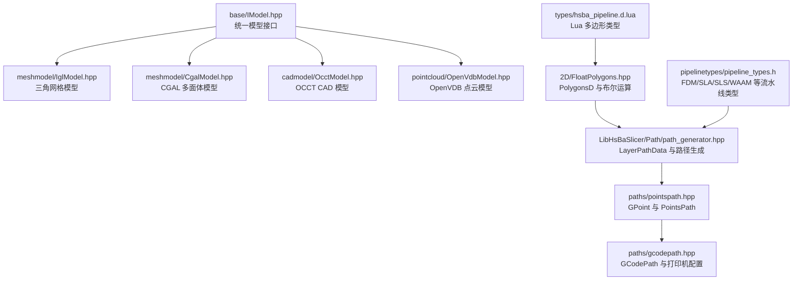
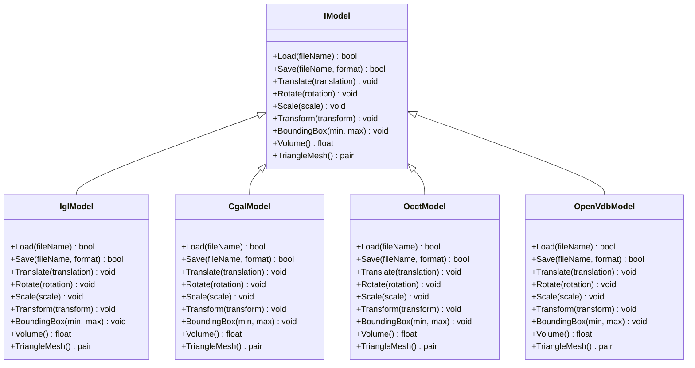
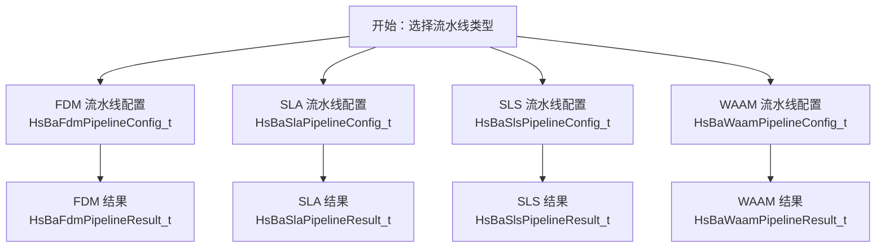
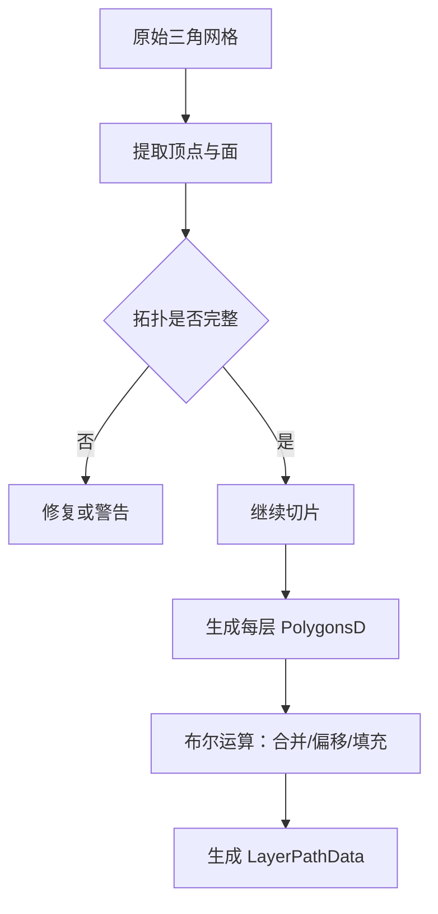
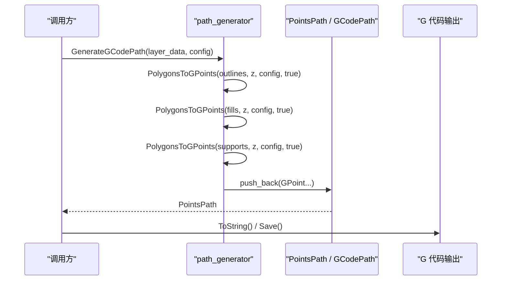
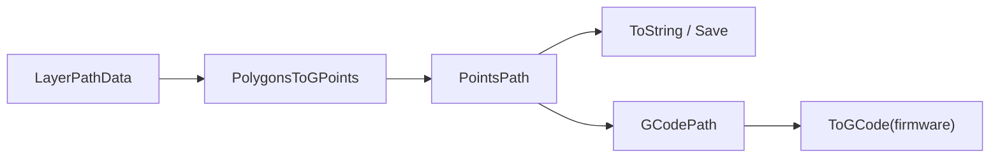
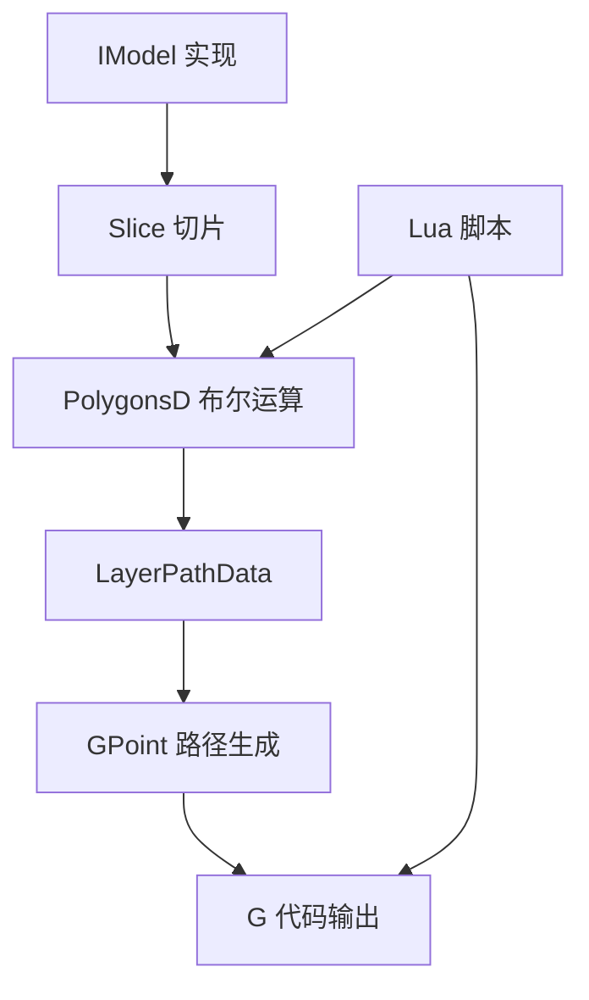

# 核心概念

<cite>
**本文引用的文件**   
- [IModel.hpp](file://base/IModel.hpp)
- [FloatPolygons.hpp](file://2D/FloatPolygons.hpp)
- [path_generator.hpp](file://LibHsBaSlicer/Path/path_generator.hpp)
- [path_generator.cpp](file://LibHsBaSlicer/Path/path_generator.cpp)
- [pointspath.hpp](file://paths/pointspath.hpp)
- [gcodepath.hpp](file://paths/gcodepath.hpp)
- [pipeline_types.h](file://pipelinetypes/pipeline_types.h)
- [hsba_pipeline.d.lua](file://types/hsba_pipeline.d.lua)
- [CgalModel.hpp](file://meshmodel/CgalModel.hpp)
- [IglModel.hpp](file://meshmodel/IglModel.hpp)
- [FullTopoModel.hpp](file://meshmodel/FullTopoModel.hpp)
- [OcctModel.hpp](file://cadmodel/OcctModel.hpp)
- [OpenVdbModel.hpp](file://pointcloud/OpenVdbModel.hpp)
</cite>

## 目录
1. [引言](#引言)
2. [项目结构中的核心位置](#项目结构中的核心位置)
3. [统一模型抽象接口 IModel](#统一模型抽象接口-imodel)
4. [切片数据流与流水线类型](#切片数据流与流水线类型)
5. [关键数据结构：PolygonsD、LayerPathData、GPoint](#关键数据结构polygonsdlayerpathdatagpoint)
6. [几何学基础：多边形、布尔运算与拓扑分析](#几何学基础多边形布尔运算与拓扑分析)
7. [从模型到 G 代码的转换流程](#从模型到-g-代码的转换流程)
8. [实际使用示例路径](#实际使用示例路径)
9. [依赖关系与扩展点](#依赖关系与扩展点)
10. [常见问题与排错建议](#常见问题与排错建议)
11. [总结](#总结)

## 引言
本文面向 HsBaSlicer 的核心概念，目标是帮助读者理解 3D 打印切片的基本原理、模型抽象接口设计、流水线概念和关键数据类型。文档重点解释以下问题：
- 为什么需要统一的 `IModel` 接口？
- 网格模型、CAD 模型、点云模型如何被抽象成同一套能力？
- 切片过程中数据是如何从三维模型逐步变成二维多边形、层路径、G 代码点的？
- `PolygonsD`、`LayerPathData`、`GPoint` 等结构在系统中承担什么角色？
- 初学者如何理解多边形、布尔运算、拓扑分析这些几何概念？

## 项目结构中的核心位置
HsBaSlicer 的核心概念分布在多个模块中：
- 模型抽象接口位于 `base/IModel.hpp`。
- 二维多边形类型与布尔运算位于 `2D/FloatPolygons.hpp`。
- FDM 路径生成与层路径数据结构位于 `LibHsBaSlicer/Path/path_generator.hpp` 与 `.cpp`。
- G 代码点与路径输出位于 `paths/pointspath.hpp` 与 `paths/gcodepath.hpp`。
- 各工艺流水线配置集中在 `pipelinetypes/pipeline_types.h`。
- Lua 脚本侧的多边形类型定义位于 `types/hsba_pipeline.d.lua`。
- 网格模型实现包括 `meshmodel/CgalModel.hpp`、`meshmodel/IglModel.hpp`、`meshmodel/FullTopoModel.hpp`。
- CAD 模型实现位于 `cadmodel/OcctModel.hpp`。
- 点云模型实现位于 `pointcloud/OpenVdbModel.hpp`。



**图表来源**
- [IModel.hpp:111-139](file://base/IModel.hpp#L111-L139)
- [FloatPolygons.hpp:18-25](file://2D/FloatPolygons.hpp#L18-L25)
- [path_generator.hpp:23-42](file://LibHsBaSlicer/Path/path_generator.hpp#L23-L42)
- [pointspath.hpp:45-52](file://paths/pointspath.hpp#L45-L52)
- [gcodepath.hpp:42-73](file://paths/gcodepath.hpp#L42-L73)
- [pipeline_types.h:56-113](file://pipelinetypes/pipeline_types.h#L56-L113)
- [hsba_pipeline.d.lua:27-47](file://types/hsba_pipeline.d.lua#L27-L47)

**章节来源**
- [IModel.hpp:111-139](file://base/IModel.hpp#L111-L139)
- [FloatPolygons.hpp:18-25](file://2D/FloatPolygons.hpp#L18-L25)
- [path_generator.hpp:23-42](file://LibHsBaSlicer/Path/path_generator.hpp#L23-L42)
- [pointspath.hpp:45-52](file://paths/pointspath.hpp#L45-L52)
- [gcodepath.hpp:42-73](file://paths/gcodepath.hpp#L42-L73)
- [pipeline_types.h:56-113](file://pipelinetypes/pipeline_types.h#L56-L113)
- [hsba_pipeline.d.lua:27-47](file://types/hsba_pipeline.d.lua#L27-L47)

## 统一模型抽象接口 IModel
`IModel` 是 HsBaSlicer 中所有 3D 模型的统一抽象。它不关心模型内部是三角网格、BRep CAD 实体还是点云体素，只暴露一组通用能力：
- 加载与保存模型。
- 平移、旋转、缩放、仿射变换。
- 获取轴对齐包围盒。
- 计算体积。
- 导出为 IGL 风格的三角网格顶点与面索引。

这种设计的核心价值是“解耦”：上层切片逻辑只需要调用 `IModel`，而不需要知道具体实现是 `IglModel`、`CgalModel`、`OcctModel` 还是 `OpenVdbModel`。



**图表来源**
- [IModel.hpp:111-139](file://base/IModel.hpp#L111-L139)
- [IglModel.hpp:55-82](file://meshmodel/IglModel.hpp#L55-L82)
- [CgalModel.hpp:54-82](file://meshmodel/CgalModel.hpp#L54-L82)
- [OcctModel.hpp:54-81](file://cadmodel/OcctModel.hpp#L54-L81)
- [OpenVdbModel.hpp:46-58](file://pointcloud/OpenVdbModel.hpp#L46-L58)

**章节来源**
- [IModel.hpp:111-139](file://base/IModel.hpp#L111-L139)
- [IglModel.hpp:55-82](file://meshmodel/IglModel.hpp#L55-L82)
- [CgalModel.hpp:54-82](file://meshmodel/CgalModel.hpp#L54-L82)
- [OcctModel.hpp:54-81](file://cadmodel/OcctModel.hpp#L54-L81)
- [OpenVdbModel.hpp:46-58](file://pointcloud/OpenVdbModel.hpp#L46-L58)

## 切片数据流与流水线类型
HsBaSlicer 支持多种 3D 打印工艺，每种工艺都有对应的流水线配置。以 FDM 为例，`HsBaFdmPipelineConfig_t` 描述了模型名称、模型路径、层高、填充间距、填充模式、壁厚、支撑参数、挤出线宽、打印速度、喷嘴直径、材料直径、温度、回抽、螺旋花瓶模式、固件目标等；结果 `HsBaFdmPipelineResult_t` 包含是否成功、总层数、G 代码内容、错误信息和耗时。

其他工艺如 SLA、SLS、SLM、LOM、TDP、WAAM、文件传输、自定义 Lua 流水线也通过相同风格的结构表达输入配置与输出结果。这样做的目的是让上层调用者可以用统一方式描述“我要用什么模型、怎么切片、输出什么”。



**图表来源**
- [pipeline_types.h:56-127](file://pipelinetypes/pipeline_types.h#L56-L127)
- [pipeline_types.h:170-232](file://pipelinetypes/pipeline_types.h#L170-L232)
- [pipeline_types.h:259-297](file://pipelinetypes/pipeline_types.h#L259-L297)
- [pipeline_types.h:578-612](file://pipelinetypes/pipeline_types.h#L578-L612)

**章节来源**
- [pipeline_types.h:56-127](file://pipelinetypes/pipeline_types.h#L56-L127)
- [pipeline_types.h:170-232](file://pipelinetypes/pipeline_types.h#L170-L232)
- [pipeline_types.h:259-297](file://pipelinetypes/pipeline_types.h#L259-L297)
- [pipeline_types.h:578-612](file://pipelinetypes/pipeline_types.h#L578-L612)

## 关键数据结构：PolygonsD、LayerPathData、GPoint
### PolygonsD：二维多边形集合
`PolygonsD` 是双精度二维多边形集合类型，底层基于 Clipper2 的 `PathsD`。它表示一层切片中的轮廓、填充、支撑等 2D 区域。常见操作包括：
- 简化多边形。
- 并集、交集、差集、异或。
- 面积计算。
- 矩形、圆、椭圆、正多边形构造。
- 文本转多边形。
- 整数坐标与双精度坐标互转。

对初学者来说，可以把 `PolygonsD` 理解为“一层切片上的黑色区域”，也就是打印机最终要覆盖或填充的 2D 形状集合。

### LayerPathData：单层路径数据
`LayerPathData` 表示一个 Z 高度层的完整路径信息，包含：
- `outlines`：轮廓多边形。
- `fills`：填充多边形。
- `supports`：支撑多边形。
- `z_height`：该层的高度。

它是连接“几何切片”和“路径生成”的关键中间结构。

### GPoint：G 代码运动点
`GPoint` 表示一条 G 代码运动指令，包含：
- 运动类型：快速移动、直线、顺时针圆弧、逆时针圆弧等。
- 目标点。
- 圆弧中心点。
- 进给速度。
- 挤出长度。

`PointsPath` 是有序 `GPoint` 序列的实现，用于累积并最终序列化出 G 代码文本。

```mermaid
classDiagram
class PolygonsD {
<<typedef>>
"Clipper2Lib : : PathsD"
+Union()
+Intersection()
+Difference()
+Xor()
+Area()
+MakeRectangle()
+MakeCircle()
}
class LayerPathData {
+outlines : PolygonsD
+fills : PolygonsD
+supports : PolygonsD
+z_height : float
}
class GPoint {
+type : GcodeType
+p1 : OutPoints3
+center : OutPoints3
+velocity : float
+extrusion : double
}
class PointsPath {
+push_back(point) void
+ToString() string
+Save(path) void
}
PolygonsD --> LayerPathData : "组成"
LayerPathData --> GPoint : "转换为"
GPoint --> PointsPath : "累积"
```

**图表来源**
- [FloatPolygons.hpp:18-25](file://2D/FloatPolygons.hpp#L18-L25)
- [FloatPolygons.hpp:43-135](file://2D/FloatPolygons.hpp#L43-L135)
- [path_generator.hpp:36-42](file://LibHsBaSlicer/Path/path_generator.hpp#L36-L42)
- [pointspath.hpp:45-52](file://paths/pointspath.hpp#L45-L52)
- [pointspath.hpp:54-94](file://paths/pointspath.hpp#L54-L94)

**章节来源**
- [FloatPolygons.hpp:18-25](file://2D/FloatPolygons.hpp#L18-L25)
- [FloatPolygons.hpp:43-135](file://2D/FloatPolygons.hpp#L43-L135)
- [path_generator.hpp:36-42](file://LibHsBaSlicer/Path/path_generator.hpp#L36-L42)
- [pointspath.hpp:45-52](file://paths/pointspath.hpp#L45-L52)
- [pointspath.hpp:54-94](file://paths/pointspath.hpp#L54-L94)

## 几何学基础：多边形、布尔运算与拓扑分析
### 多边形
在切片系统中，多边形不是数学课本里严格的凸多边形，而是由一系列二维点组成的闭合路径。它可以有孔洞、自相交、非凸形状。`PolygonsD` 就是这类路径的集合。

### 布尔运算
布尔运算包括：
- 并集：把两个多边形合并成一个整体。
- 交集：只保留两个多边形重叠的部分。
- 差集：从一个多边形中减去另一个多边形。
- 异或：保留只属于其中一个多边形的部分。

这些运算常用于：
- 合并轮廓与支撑。
- 用外壳偏移生成边界环。
- 用填充区域与轮廓做差得到可填充区域。
- 将多个独立零件合并后一起切片。

### 拓扑分析
拓扑关注的是“连接关系”而不是精确坐标。例如：
- 一个封闭的三角网格是否构成合法的水密实体？
- 面与边、边与顶点的邻接关系是否正确？
- 法线方向是否一致？

`FullTopoModel` 提供了更完整的拓扑结构，包括顶点、边、面的索引关系，并支持检查拓扑完整性。如果模型不完整，可能影响后续算法，比如布尔运算、体积计算、切片稳定性。



**图表来源**
- [FullTopoModel.hpp:53-86](file://meshmodel/FullTopoModel.hpp#L53-L86)
- [FloatPolygons.hpp:43-135](file://2D/FloatPolygons.hpp#L43-L135)
- [path_generator.hpp:36-42](file://LibHsBaSlicer/Path/path_generator.hpp#L36-L42)

**章节来源**
- [FullTopoModel.hpp:53-86](file://meshmodel/FullTopoModel.hpp#L53-L86)
- [FloatPolygons.hpp:43-135](file://2D/FloatPolygons.hpp#L43-L135)
- [path_generator.hpp:36-42](file://LibHsBaSlicer/Path/path_generator.hpp#L36-L42)

## 从模型到 G 代码的转换流程
HsBaSlicer 的典型 FDM 路径生成流程如下：
1. 输入 `LayerPathData` 列表，每个元素包含该层的轮廓、填充、支撑和 Z 高度。
2. 对每层的多边形调用 `PolygonsToGPoints`，将其转换为 `GPoint` 序列。
3. 按顺序拼接轮廓、填充、支撑的点序列，形成 `PointsPath`。
4. 可选地通过 `GenerateGCodePathV2` 生成带固件适配能力的 `GCodePath`。
5. 最终输出 G 代码字符串或文件。



**图表来源**
- [path_generator.cpp:14-60](file://LibHsBaSlicer/Path/path_generator.cpp#L14-L60)
- [path_generator.cpp:63-95](file://LibHsBaSlicer/Path/path_generator.cpp#L63-L95)
- [pointspath.hpp:54-94](file://paths/pointspath.hpp#L54-L94)

**章节来源**
- [path_generator.cpp:14-60](file://LibHsBaSlicer/Path/path_generator.cpp#L14-L60)
- [path_generator.cpp:63-95](file://LibHsBaSlicer/Path/path_generator.cpp#L63-L95)
- [path_generator.hpp:50-62](file://LibHsBaSlicer/Path/path_generator.hpp#L50-L62)
- [pointspath.hpp:54-94](file://paths/pointspath.hpp#L54-L94)

## 实际使用示例路径
虽然本文不直接粘贴代码，但可以通过以下路径定位真实实现：
- 使用 `PolygonsToGPoints` 将多边形转为 G 代码点：[path_generator.cpp:14-60](file://LibHsBaSlicer/Path/path_generator.cpp#L14-L60)。
- 使用 `GenerateGCodePath` 构建 `PointsPath`：[path_generator.cpp:63-95](file://LibHsBaSlicer/Path/path_generator.cpp#L63-L95)。
- 使用 `GenerateGCodePathV2` 构建带固件输出的 `GCodePath`：[path_generator.cpp:97-110](file://LibHsBaSlicer/Path/path_generator.cpp#L97-L110)。
- 查看 FDM 流水线配置默认值：[pipeline_types.h:742-783](file://pipelinetypes/pipeline_types.h#L742-L783)。
- 查看 Lua 侧多边形类型定义：[hsba_pipeline.d.lua:27-47](file://types/hsba_pipeline.d.lua#L27-L47)。



**图表来源**
- [path_generator.cpp:14-110](file://LibHsBaSlicer/Path/path_generator.cpp#L14-L110)
- [gcodepath.hpp:42-73](file://paths/gcodepath.hpp#L42-L73)

**章节来源**
- [path_generator.cpp:14-110](file://LibHsBaSlicer/Path/path_generator.cpp#L14-L110)
- [pipeline_types.h:742-783](file://pipelinetypes/pipeline_types.h#L742-L783)
- [hsba_pipeline.d.lua:27-47](file://types/hsba_pipeline.d.lua#L27-L47)

## 依赖关系与扩展点
### 模型实现的扩展点
- 如果你有自己的网格格式，可以实现 `IModel`，提供 `Load`、`Save`、`Transform`、`BoundingBox`、`Volume`、`TriangleMesh`。
- 如果你希望使用 CGAL 的布尔运算，可以选择 `CgalModel`。
- 如果你处理 CAD 文件，可以选择 `OcctModel`。
- 如果你处理点云，可以选择 `OpenVdbModel`。

### 路径生成的扩展点
- 你可以修改 `FdmPathConfig` 控制层高、线宽、速度、挤出倍数。
- 你可以替换路径生成逻辑，例如先优化路径再输出。
- 你可以使用 `GCodePrinterConfig` 控制不同固件的 G 代码行为。

### Lua 脚本扩展点
Lua 脚本系统暴露多边形布尔运算、偏移、凸包、面积、矩形、圆等工具，适合用户自定义填充、支撑、地板、导出逻辑。



**图表来源**
- [IModel.hpp:111-139](file://base/IModel.hpp#L111-L139)
- [FloatPolygons.hpp:43-135](file://2D/FloatPolygons.hpp#L43-L135)
- [path_generator.hpp:23-42](file://LibHsBaSlicer/Path/path_generator.hpp#L23-L42)
- [hsba_pipeline.d.lua:35-47](file://types/hsba_pipeline.d.lua#L35-L47)

**章节来源**
- [IModel.hpp:111-139](file://base/IModel.hpp#L111-L139)
- [FloatPolygons.hpp:43-135](file://2D/FloatPolygons.hpp#L43-L135)
- [path_generator.hpp:23-42](file://LibHsBaSlicer/Path/path_generator.hpp#L23-L42)
- [hsba_pipeline.d.lua:35-47](file://types/hsba_pipeline.d.lua#L35-L47)

## 常见问题与排错建议
1. **模型无法切片或体积异常**  
   检查模型是否水密、法线方向是否一致、拓扑是否完整。`FullTopoModel` 提供了拓扑检查能力，不完整模型可能导致后续算法出错。

2. **G 代码挤出量不正确**  
   检查 `FdmPathConfig` 中的层高、线宽、挤出倍数，以及 `PolygonsToGPoints` 中挤出长度的计算逻辑。

3. **布尔运算结果异常**  
   检查输入多边形是否闭合、是否有自相交、坐标精度是否合适。Clipper2 对数值精度敏感，必要时使用整数化或调整容差。

4. **Lua 脚本中多边形类型不匹配**  
   Lua 侧的 `Polygon`、`Polygons`、`LayerList` 与 C++ 侧的 `PolygonD`、`PolygonsD`、`LayerPathData` 需要保持一致的数据语义。

**章节来源**
- [FullTopoModel.hpp:80-86](file://meshmodel/FullTopoModel.hpp#L80-L86)
- [path_generator.cpp:44-52](file://LibHsBaSlicer/Path/path_generator.cpp#L44-L52)
- [FloatPolygons.hpp:196-221](file://2D/FloatPolygons.hpp#L196-L221)
- [hsba_pipeline.d.lua:27-47](file://types/hsba_pipeline.d.lua#L27-L47)

## 总结
HsBaSlicer 的核心概念围绕“统一模型抽象、二维多边形几何、层路径数据、G 代码路径输出”展开：
- `IModel` 统一了网格、CAD、点云等不同模型的能力。
- `PolygonsD` 是切片几何的基础，承载布尔运算、偏移、面积等 2D 几何能力。
- `LayerPathData` 是连接几何切片与路径生成的桥梁。
- `GPoint` 是 G 代码的最小运动单元，`PointsPath` 和 `GCodePath` 负责累积和输出。
- 流水线类型定义了不同 3D 打印工艺的输入输出契约。
- Lua 脚本提供了灵活的扩展点，让用户可以自定义几何处理和输出逻辑。

理解这些概念后，读者可以更容易地阅读源码、调试切片问题、扩展新工艺或自定义路径生成策略。