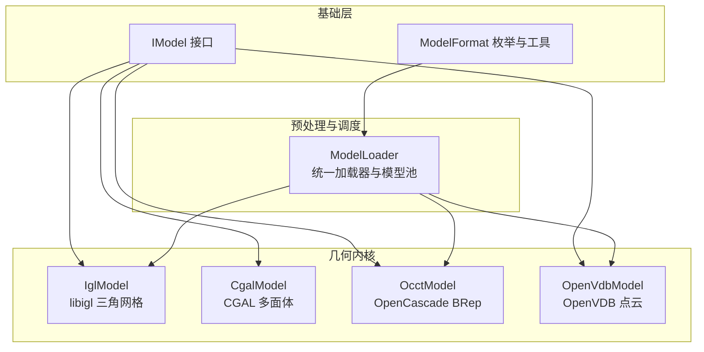
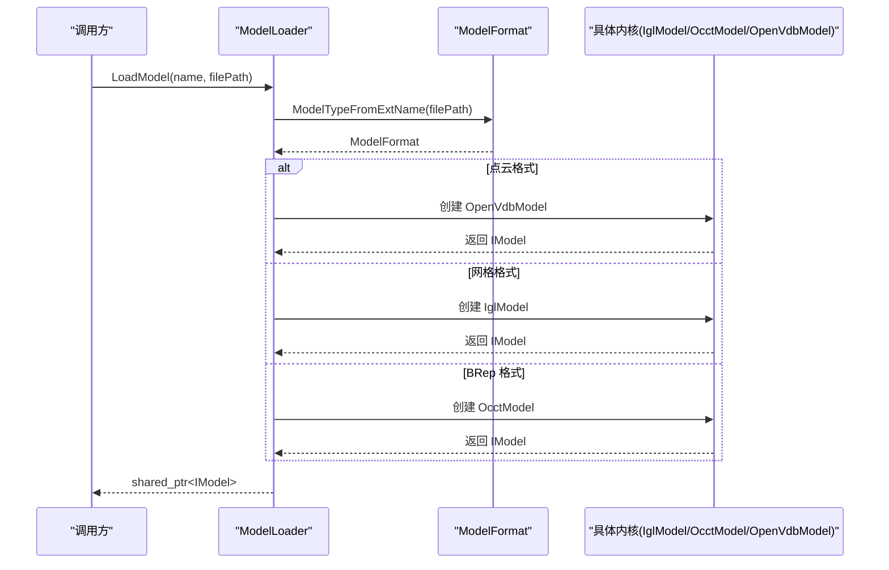
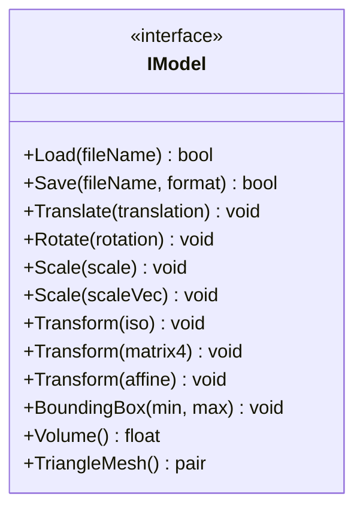
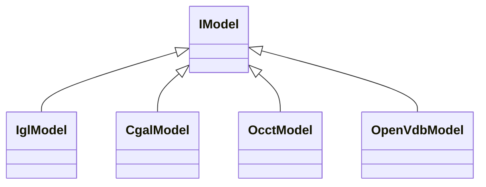
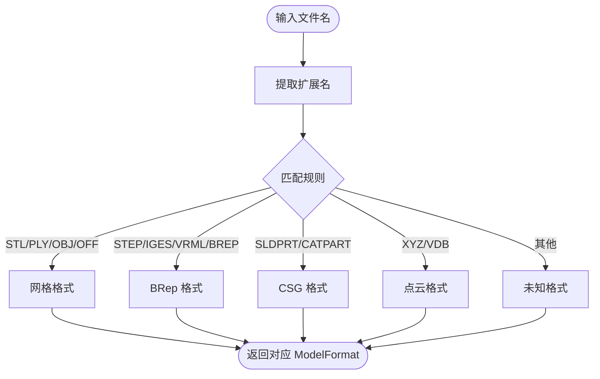
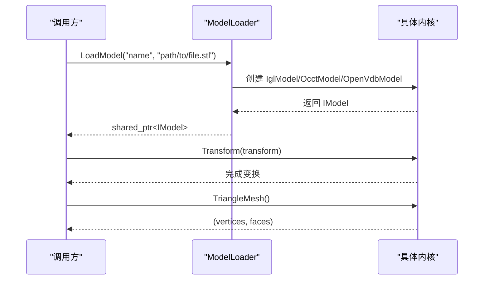
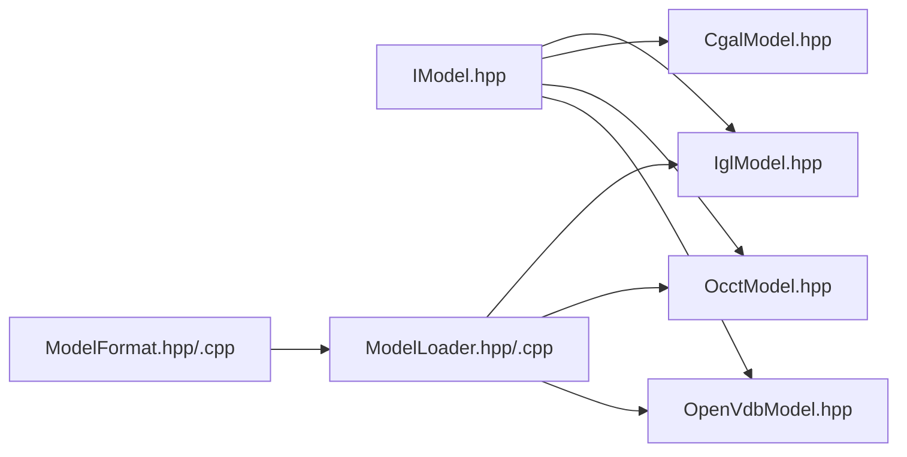

# 模型抽象

<cite>
**本文引用的文件**   
- [IModel.hpp](file://base/IModel.hpp)
- [ModelFormat.hpp](file://base/ModelFormat.hpp)
- [ModelFormat.cpp](file://base/ModelFormat.cpp)
- [ModelLoader.hpp](file://preprocess/ModelLoader.hpp)
- [ModelLoader.cpp](file://preprocess/ModelLoader.cpp)
- [IglModel.hpp](file://meshmodel/IglModel.hpp)
- [CgalModel.hpp](file://meshmodel/CgalModel.hpp)
- [OcctModel.hpp](file://cadmodel/OcctModel.hpp)
- [OpenVdbModel.hpp](file://pointcloud/OpenVdbModel.hpp)
</cite>

## 目录
1. [引言](#引言)
2. [项目结构](#项目结构)
3. [核心概念](#核心概念)
4. [架构总览](#架构总览)
5. [详细组件分析](#详细组件分析)
6. [依赖关系分析](#依赖关系分析)
7. [性能与内核选择策略](#性能与内核选择策略)
8. [故障排除指南](#故障排除指南)
9. [结论](#结论)
10. [附录：使用示例与最佳实践](#附录使用示例与最佳实践)

## 引言
本文件面向 HsBaSlicer 的“模型抽象”主题，系统性解释 IModel 接口的设计理念、几何变换统一方法、数据访问模式，以及 CGAL、IGL、OpenCascade、OpenVDB 等几何内核的统一抽象机制。文档同时说明 ModelFormat 枚举支持的多种文件格式、格式分类与转换路径，并给出加载、保存、变换和查询的统一接口设计思路与实践建议。内容兼顾初学者友好与高级用户的技术深度。

## 项目结构
围绕模型抽象的核心代码分布在以下模块：
- base：定义 IModel 接口与 ModelFormat 枚举及工具函数
- preprocess：提供 ModelLoader，按扩展名自动选择内核并管理命名模型池
- meshmodel：实现基于 libigl 与 CGAL 的网格模型
- cadmodel：实现基于 OpenCascade 的 BRep CAD 模型
- pointcloud：实现基于 OpenVDB 的点云模型

**图表来源**
- [IModel.hpp:110-139](file://base/IModel.hpp#L110-L139)
- [ModelFormat.hpp:19-93](file://base/ModelFormat.hpp#L19-L93)
- [ModelLoader.hpp:23-59](file://preprocess/ModelLoader.hpp#L23-L59)
- [IglModel.hpp:18-82](file://meshmodel/IglModel.hpp#L18-L82)
- [CgalModel.hpp:26-82](file://meshmodel/CgalModel.hpp#L26-L82)
- [OcctModel.hpp:22-81](file://cadmodel/OcctModel.hpp#L22-L81)
- [OpenVdbModel.hpp:21-58](file://pointcloud/OpenVdbModel.hpp#L21-L58)

**章节来源**
- [IModel.hpp:110-139](file://base/IModel.hpp#L110-L139)
- [ModelFormat.hpp:19-93](file://base/ModelFormat.hpp#L19-L93)
- [ModelLoader.hpp:23-59](file://preprocess/ModelLoader.hpp#L23-L59)

## 核心概念
- IModel 接口：为所有 3D 模型提供统一的加载/保存、几何变换（平移、旋转、缩放、仿射变换）、边界框与体积查询、以及三角形网格数据访问（顶点矩阵与面索引矩阵）。
- ModelFormat 枚举：统一描述支持的文件格式，包括网格（STL/OBJ/PLY/OFF）、BRep（STEP/IGES/VRML/BREP）、CSG（SLDPRT/CATPART）与点云（XYZ/VDB），并提供字符串转换、扩展名解析与格式分类（IsMeshFormat/IsBrepFormat/IsPointCloudFormat/IsCSGFormat）。
- 内核抽象：不同几何内核通过实现 IModel 暴露一致能力；上层通过 ModelLoader 根据扩展名自动选择合适内核，并通过共享指针以 IModel 类型操作。

**章节来源**
- [IModel.hpp:110-139](file://base/IModel.hpp#L110-L139)
- [ModelFormat.hpp:19-93](file://base/ModelFormat.hpp#L19-L93)
- [ModelFormat.cpp:95-175](file://base/ModelFormat.cpp#L95-L175)

## 架构总览
HsBaSlicer 的模型系统采用“接口 + 多实现 + 统一调度”的架构：
- IModel 作为稳定契约，屏蔽底层几何内核差异
- ModelLoader 负责从文件名推断格式，创建具体内核实例，并将模型放入命名池
- 各内核（IglModel、CgalModel、OcctModel、OpenVdbModel）各自实现 Load/Save、Transform、BoundingBox、Volume、TriangleMesh 等方法

**图表来源**
- [ModelLoader.cpp:45-84](file://preprocess/ModelLoader.cpp#L45-L84)
- [ModelFormat.cpp:95-99](file://base/ModelFormat.cpp#L95-L99)

**章节来源**
- [ModelLoader.cpp:45-84](file://preprocess/ModelLoader.cpp#L45-L84)
- [ModelFormat.cpp:95-99](file://base/ModelFormat.cpp#L95-L99)

## 详细组件分析

### IModel 接口设计
IModel 定义了统一的模型操作契约：
- 加载与保存：Load(fileName)、Save(fileName, format)
- 几何变换：Translate、Rotate、Scale(标量/向量)、Transform(Isometry3f/Matrix4f/Affine)
- 查询：BoundingBox(min,max)、Volume()
- 数据访问：TriangleMesh() 返回 (vertices, faces) 的 Eigen 矩阵对

该接口确保上层逻辑无需关心具体内核实现，从而获得一致的 API 体验。

**图表来源**
- [IModel.hpp:110-139](file://base/IModel.hpp#L110-L139)

**章节来源**
- [IModel.hpp:110-139](file://base/IModel.hpp#L110-L139)

### 几何内核统一抽象机制
四种主要内核均继承自 IModel，并在各自头文件中声明了相同的接口方法，保证行为一致性：
- IglModel：基于 libigl 的三角网格模型，适合通用网格处理与布尔运算（在启用 CGAL 时回退到 CgalModel 的 Nef boolean）
- CgalModel：基于 CGAL 的多面体模型，提供 Nef 布尔运算、表面测地线/螺旋/螺旋线等高级几何功能
- OcctModel：基于 OpenCascade 的 BRep CAD 模型，支持 STEP/IGES/VRML/BREP 读写与布尔运算、加厚实体等
- OpenVdbModel：基于 OpenVDB 的点云模型，提供点云插入、KNN/半径搜索、体素化、法线估计、水平集重建网格等

**图表来源**
- [IglModel.hpp:18-82](file://meshmodel/IglModel.hpp#L18-L82)
- [CgalModel.hpp:26-82](file://meshmodel/CgalModel.hpp#L26-L82)
- [OcctModel.hpp:22-81](file://cadmodel/OcctModel.hpp#L22-L81)
- [OpenVdbModel.hpp:21-58](file://pointcloud/OpenVdbModel.hpp#L21-L58)

**章节来源**
- [IglModel.hpp:18-82](file://meshmodel/IglModel.hpp#L18-L82)
- [CgalModel.hpp:26-82](file://meshmodel/CgalModel.hpp#L26-L82)
- [OcctModel.hpp:22-81](file://cadmodel/OcctModel.hpp#L22-L81)
- [OpenVdbModel.hpp:21-58](file://pointcloud/OpenVdbModel.hpp#L21-L58)

### ModelFormat 枚举与格式转换
ModelFormat 枚举集中描述了支持的格式族：
- 网格：UnknownPLY、ASCIIPLY、BinaryPLY、OBJ、UnknownSTL、BinarySTL、ASCIISTL、OFF
- BRep：VRML、STEP、IGES、BREP
- CSG：SLDPRT、CATPART
- 点云：XYZ、VDB
- 未知：Unknown

工具函数提供：
- ToString(format)：枚举转字符串
- GetExtName(file_name)：提取扩展名
- ModelTypeFromExtName(file_name)：扩展名转枚举
- IsMeshFormat/IsBrepFormat/IsPointCloudFormat/IsCSGFormat：格式分类判断

**图表来源**
- [ModelFormat.cpp:14-85](file://base/ModelFormat.cpp#L14-L85)
- [ModelFormat.cpp:95-99](file://base/ModelFormat.cpp#L95-L99)

**章节来源**
- [ModelFormat.hpp:19-93](file://base/ModelFormat.hpp#L19-L93)
- [ModelFormat.cpp:14-85](file://base/ModelFormat.cpp#L14-L85)
- [ModelFormat.cpp:95-175](file://base/ModelFormat.cpp#L95-L175)

### 模型的加载、保存、变换与查询统一接口
- 加载：ModelLoader::LoadModel 根据扩展名选择内核并创建实例，随后将结果存入命名池
- 保存：各内核实现 Save(fileName, format)，内部根据 ModelFormat 分派到具体写入逻辑
- 变换：所有内核实现 Translate/Rotate/Scale/Transform，保持语义一致
- 查询：所有内核实现 BoundingBox/Volume/TriangleMesh，便于上层统一处理

**图表来源**
- [ModelLoader.cpp:45-84](file://preprocess/ModelLoader.cpp#L45-L84)
- [IglModel.hpp:55-82](file://meshmodel/IglModel.hpp#L55-L82)
- [OcctModel.hpp:54-81](file://cadmodel/OcctModel.hpp#L54-L81)
- [OpenVdbModel.hpp:46-58](file://pointcloud/OpenVdbModel.hpp#L46-L58)

**章节来源**
- [ModelLoader.cpp:45-84](file://preprocess/ModelLoader.cpp#L45-L84)
- [IglModel.hpp:55-82](file://meshmodel/IglModel.hpp#L55-L82)
- [OcctModel.hpp:54-81](file://cadmodel/OcctModel.hpp#L54-L81)
- [OpenVdbModel.hpp:46-58](file://pointcloud/OpenVdbModel.hpp#L46-L58)

## 依赖关系分析
- IModel 是稳定的抽象层，被所有内核实现引用
- ModelFormat 提供格式识别与分类，被 ModelLoader 用于内核选择
- ModelLoader 依赖具体内核头文件（条件编译控制 USE_OCCT、USE_OPENVDB、USE_CGAL）
- 内核之间可通过 TriangleMesh 进行数据桥接（例如将 OcctModel/CgalModel 转换为 IglModel 进行布尔运算）

**图表来源**
- [IModel.hpp:110-139](file://base/IModel.hpp#L110-L139)
- [ModelFormat.hpp:19-93](file://base/ModelFormat.hpp#L19-L93)
- [ModelLoader.hpp:23-59](file://preprocess/ModelLoader.hpp#L23-L59)

**章节来源**
- [IModel.hpp:110-139](file://base/IModel.hpp#L110-L139)
- [ModelFormat.hpp:19-93](file://base/ModelFormat.hpp#L19-L93)
- [ModelLoader.hpp:23-59](file://preprocess/ModelLoader.hpp#L23-L59)

## 性能与内核选择策略
- 默认选择策略：
  - 网格格式（STL/OBJ/PLY/OFF）→ IglModel
  - BRep 格式（STEP/IGES/VRML/BREP）→ OcctModel（需要 USE_OCCT）
  - 点云格式（XYZ/VDB）→ OpenVdbModel（需要 USE_OPENVDB）
- 布尔运算策略：
  - 若两端均为 OcctModel，优先使用 OCCT 布尔运算
  - 否则回退到 IglModel（需要 USE_CGAL），必要时先通过 TriangleMesh 提取网格
- CGAL 相关注意事项：
  - IglModel 的布尔运算在浮点精度不足时可能失败，会回退到 CgalModel 的 Nef boolean
- 性能建议：
  - 大规模网格布尔运算建议使用 OCCT（拓扑精确）或 CGAL（Nef 布尔）
  - 点云处理使用 OpenVDB 的体素化与过滤，避免全量遍历
  - 频繁变换与查询尽量复用 IModel 接口，减少重复构造与转换

**章节来源**
- [ModelLoader.cpp:132-323](file://preprocess/ModelLoader.cpp#L132-L323)
- [IglModel.cpp:195-230](file://meshmodel/IglModel.cpp#L195-L230)

## 故障排除指南
- 不支持的平台特性：
  - 未启用 USE_OCCT 时尝试加载 BRep 格式 → 抛出运行时错误
  - 未启用 USE_OPENVDB 时尝试加载点云格式 → 抛出运行时错误
- 名称冲突：
  - 向 ModelLoader 插入已存在的模型名称 → 抛出参数无效错误
- 空模型或无效数据：
  - 某些内核构造或转换返回空网格 → 抛出运行时错误
- 格式不支持：
  - 扩展名无法识别或内核未实现对应格式 → 抛出参数无效或运行时错误

**章节来源**
- [ModelLoader.cpp:45-84](file://preprocess/ModelLoader.cpp#L45-L84)
- [ModelLoader.cpp:172-213](file://preprocess/ModelLoader.cpp#L172-L213)
- [ModelLoader.cpp:343-361](file://preprocess/ModelLoader.cpp#L343-L361)

## 结论
HsBaSlicer 通过 IModel 接口实现了跨几何内核的统一模型抽象，结合 ModelFormat 枚举与 ModelLoader 调度器，提供了简洁而强大的模型加载、保存、变换与查询能力。不同内核各司其职：IglModel 适用于通用网格处理，CgalModel 提供高级几何算法，OcctModel 擅长 BRep 与 CAD 流程，OpenVdbModel 专注点云与体素处理。这种分层与解耦的设计既保证了易用性，也为高级用户提供了足够的技术深度与扩展空间。

## 附录：使用示例与最佳实践
以下为使用 IModel 接口进行模型操作的步骤式示例（不直接展示源码内容，仅给出路径参考）：
- 加载网格模型（STL/OBJ/PLY/OFF）：
  - 通过 ModelLoader::LoadModel 传入文件名，内部自动选择 IglModel
  - 参考路径：[ModelLoader.cpp:45-84](file://preprocess/ModelLoader.cpp#L45-L84)
- 加载 BRep 模型（STEP/IGES/VRML/BREP）：
  - 通过 ModelLoader::LoadModel 传入文件名，内部自动选择 OcctModel（需启用 USE_OCCT）
  - 参考路径：[ModelLoader.cpp:68-80](file://preprocess/ModelLoader.cpp#L68-L80)
- 加载点云模型（XYZ/VDB）：
  - 通过 ModelLoader::LoadModel 传入文件名，内部自动选择 OpenVdbModel（需启用 USE_OPENVDB）
  - 参考路径：[ModelLoader.cpp:29-42](file://preprocess/ModelLoader.cpp#L29-L42)
- 执行几何变换：
  - 使用 IModel::Translate/Rotate/Scale/Transform 进行统一变换
  - 参考路径：[IglModel.hpp:60-73](file://meshmodel/IglModel.hpp#L60-L73)、[CgalModel.hpp:59-72](file://meshmodel/CgalModel.hpp#L59-L72)、[OcctModel.hpp:59-72](file://cadmodel/OcctModel.hpp#L59-L72)、[OpenVdbModel.hpp:49-55](file://pointcloud/OpenVdbModel.hpp#L49-L55)
- 查询边界框与体积：
  - 使用 IModel::BoundingBox/Volume 获取几何信息
  - 参考路径：[IglModel.hpp:75-82](file://meshmodel/IglModel.hpp#L75-L82)、[CgalModel.hpp:74-79](file://meshmodel/CgalModel.hpp#L74-L79)、[OcctModel.hpp:74-81](file://cadmodel/OcctModel.hpp#L74-L81)、[OpenVdbModel.hpp:56-58](file://pointcloud/OpenVdbModel.hpp#L56-L58)
- 获取三角形网格数据：
  - 使用 IModel::TriangleMesh 返回 (vertices, faces)
  - 参考路径：[IglModel.hpp:79-82](file://meshmodel/IglModel.hpp#L79-L82)、[CgalModel.hpp:81-82](file://meshmodel/CgalModel.hpp#L81-L82)、[OcctModel.hpp:78-81](file://cadmodel/OcctModel.hpp#L78-L81)、[OpenVdbModel.hpp:57-58](file://pointcloud/OpenVdbModel.hpp#L57-L58)
- 格式转换与保存：
  - 使用 IModel::Save 指定 ModelFormat，内核内部根据格式分派写入逻辑
  - 参考路径：[IglModel.hpp:55-58](file://meshmodel/IglModel.hpp#L55-L58)、[CgalModel.hpp:54-57](file://meshmodel/CgalModel.hpp#L54-L57)、[OcctModel.hpp:54-57](file://cadmodel/OcctModel.hpp#L54-L57)

最佳实践建议：
- 始终通过 ModelLoader 加载模型，以获得统一的内核选择与命名池管理
- 对布尔运算，优先使用 OcctModel（若可用），否则回退到 IglModel（需启用 CGAL）
- 对点云处理，使用 OpenVdbModel 提供的体素化、过滤与法线估计等功能，避免手动遍历
- 对大规模网格，谨慎使用高精度布尔运算，必要时先简化网格或选择合适的内核