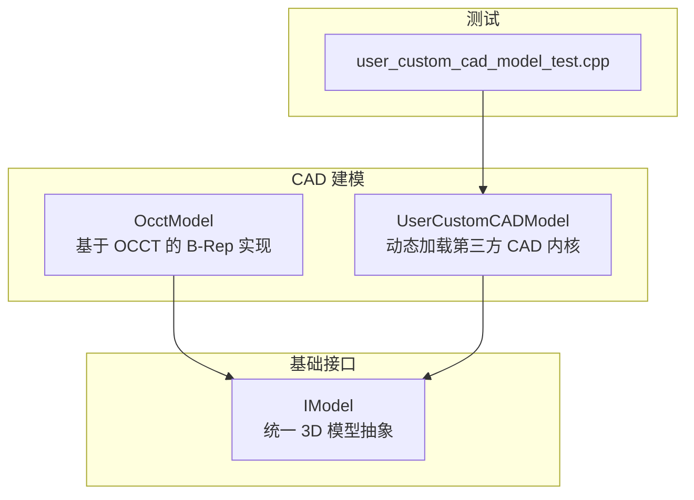
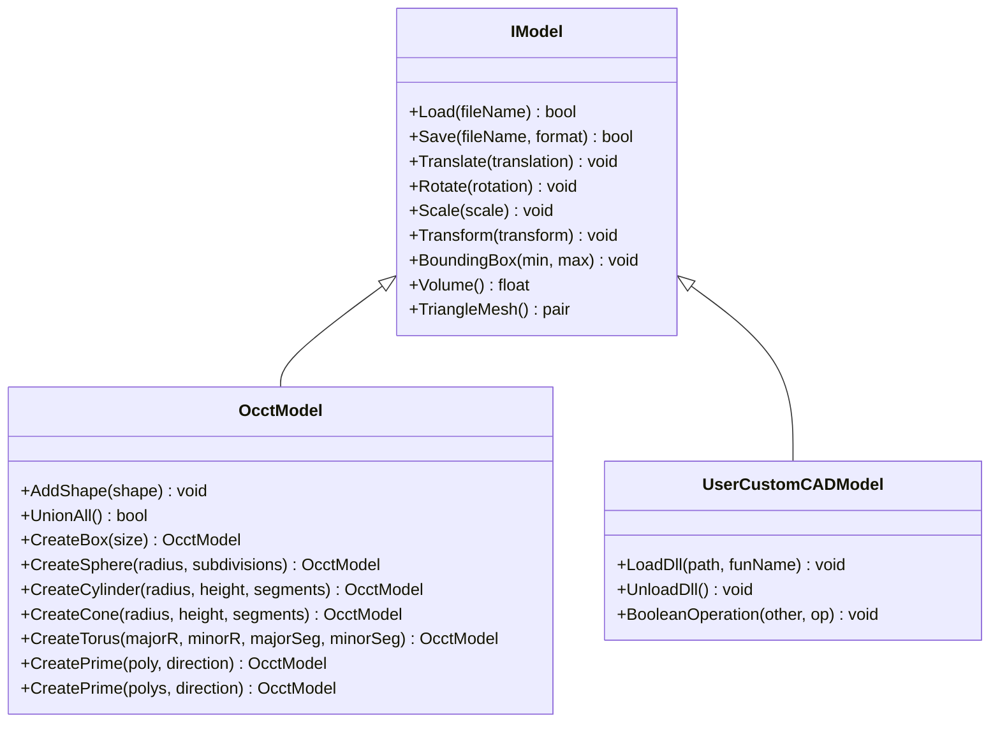
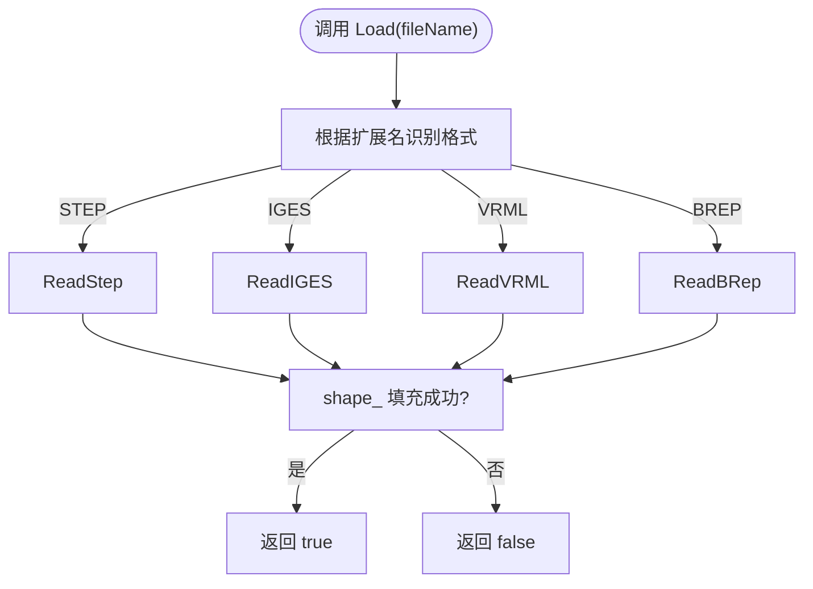
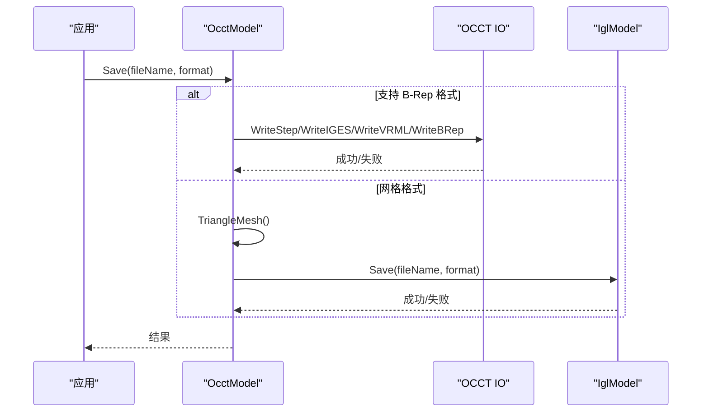
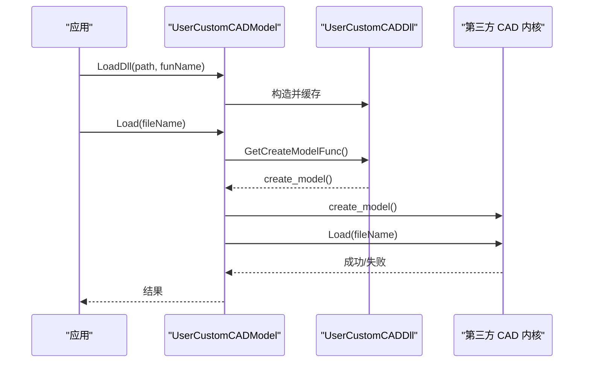
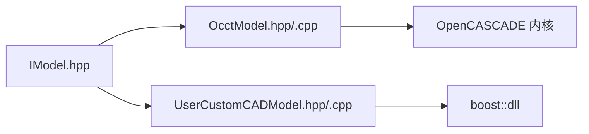

# CAD 模型实现

<cite>
**本文引用的文件**   
- [OcctModel.hpp](file://cadmodel/OcctModel.hpp)
- [OcctModel.cpp](file://cadmodel/OcctModel.cpp)
- [UserCustomCADModel.hpp](file://cadmodel/UserCustomCADModel.hpp)
- [UserCustomCADModel.cpp](file://cadmodel/UserCustomCADModel.cpp)
- [IModel.hpp](file://base/IModel.hpp)
- [user_custom_cad_model_test.cpp](file://tests/CADModel/user_custom_cad_model_test.cpp)
</cite>

## 目录
1. [简介](#简介)
2. [项目结构](#项目结构)
3. [核心组件](#核心组件)
4. [架构总览](#架构总览)
5. [详细组件分析](#详细组件分析)
6. [依赖关系分析](#依赖关系分析)
7. [性能与精度考量](#性能与精度考量)
8. [故障排查指南](#故障排查指南)
9. [结论](#结论)
10. [附录：使用示例与最佳实践](#附录使用示例与最佳实践)

## 简介
本文件围绕 HsBaSlicer 的 CAD 建模子系统，系统性阐述基于 OpenCASCADE（OCCT）内核的 B-Rep 建模能力、布尔运算与实体/曲面操作、以及用户自定义 CAD 内核的动态加载扩展机制。同时梳理 STEP、IGES、VRML、BREP 等格式的导入导出流程，并给出精度控制与容差设置的指导原则。文档力求在保持技术深度的同时，让非专业读者也能理解整体设计与使用方法。

## 项目结构
CAD 相关代码主要位于 cadmodel 目录，核心接口定义于 base/IModel.hpp；测试用例位于 tests/CADModel。

图表来源
- [OcctModel.hpp:22-124](file://cadmodel/OcctModel.hpp#L22-L124)
- [UserCustomCADModel.hpp:19-121](file://cadmodel/UserCustomCADModel.hpp#L19-L121)
- [IModel.hpp:110-139](file://base/IModel.hpp#L110-L139)
- [user_custom_cad_model_test.cpp:118-145](file://tests/CADModel/user_custom_cad_model_test.cpp#L118-L145)

章节来源
- [OcctModel.hpp:22-124](file://cadmodel/OcctModel.hpp#L22-L124)
- [UserCustomCADModel.hpp:19-121](file://cadmodel/UserCustomCADModel.hpp#L19-L121)
- [IModel.hpp:110-139](file://base/IModel.hpp#L110-L139)

## 核心组件
- OcctModel：封装 TopoDS_Shape，提供加载/保存、几何变换、包围盒/体积/三角网格查询、布尔运算、实体加厚、基本体与拉伸工厂方法等。
- UserCustomCADModel：通过动态库加载第三方 CAD 内核，暴露统一的 IModel 接口，支持布尔运算、变换、网格导出等。
- IModel：统一 3D 模型抽象，定义加载/保存、变换、包围盒、体积、三角网格等通用能力。

章节来源
- [OcctModel.hpp:22-124](file://cadmodel/OcctModel.hpp#L22-L124)
- [UserCustomCADModel.hpp:19-121](file://cadmodel/UserCustomCADModel.hpp#L19-L121)
- [IModel.hpp:110-139](file://base/IModel.hpp#L110-L139)

## 架构总览
系统以 IModel 为统一抽象，OcctModel 作为默认实现，UserCustomCADModel 作为插件适配器，允许运行时加载第三方 CAD 内核。

图表来源
- [IModel.hpp:110-139](file://base/IModel.hpp#L110-L139)
- [OcctModel.hpp:22-124](file://cadmodel/OcctModel.hpp#L22-L124)
- [UserCustomCADModel.hpp:19-121](file://cadmodel/UserCustomCADModel.hpp#L19-L121)

## 详细组件分析

### OcctModel：基于 OCCT 的 B-Rep 建模
- 数据表示：内部维护一个 TopoDS_Shape，承载所有拓扑元素（顶点、边、面、壳、实体、复合体）。
- 文件格式：
  - 读取：STEP、IGES、VRML、BREP
  - 写入：STEP、IGES、VRML、BREP；对网格格式（如 STL/OBJ）自动转换为三角网格后委托给 Mesh 模型保存
- 几何变换：平移、旋转、缩放、任意仿射变换，均通过 OCCT 的 gp_Trsf 与 BRepBuilderAPI_Transform 完成
- 几何查询：
  - 包围盒：遍历所有顶点计算 AABB
  - 体积：使用 GProp_GProps 计算有符号体积
  - 三角网格：遍历 Face 的 Poly_Triangulation，考虑方向反转，输出 libigl 风格 (vertices, faces)
- 布尔运算：
  - Union / Intersection / Difference / Xor
  - 针对复合体提供 UnionAll 合并所有子实体
- 实体加厚：
  - 全表面加厚或指定面集合进行 Join 加厚，内部使用 BRepOffsetAPI_MakeThickSolid
- 基本体与参数化：
  - CreateBox/Sphere/Cylinder/Cone/Torus
  - CreatePrime：从单多边形或多边形（外轮廓+孔洞）沿方向拉伸生成实体

图表来源
- [OcctModel.cpp:76-147](file://cadmodel/OcctModel.cpp#L76-L147)
- [OcctModel.cpp:213-237](file://cadmodel/OcctModel.cpp#L213-L237)

图表来源
- [OcctModel.cpp:148-190](file://cadmodel/OcctModel.cpp#L148-L190)
- [OcctModel.cpp:238-271](file://cadmodel/OcctModel.cpp#L238-L271)
- [OcctModel.cpp:353-400](file://cadmodel/OcctModel.cpp#L353-L400)

章节来源
- [OcctModel.hpp:22-124](file://cadmodel/OcctModel.hpp#L22-L124)
- [OcctModel.cpp:76-190](file://cadmodel/OcctModel.cpp#L76-L190)
- [OcctModel.cpp:213-271](file://cadmodel/OcctModel.cpp#L213-L271)
- [OcctModel.cpp:331-407](file://cadmodel/OcctModel.cpp#L331-L407)
- [OcctModel.cpp:451-540](file://cadmodel/OcctModel.cpp#L451-L540)
- [OcctModel.cpp:542-663](file://cadmodel/OcctModel.cpp#L542-L663)

### UserCustomCADModel：第三方 CAD 内核扩展机制
- 设计目标：在不修改主程序的情况下，通过动态库（DLL/SO）集成第三方 CAD 内核，并保持与 IModel 一致的 API。
- 动态加载：
  - UserCustomCADDll 负责加载动态库并按约定名称解析函数指针（例如 addedFunName_create_model、addedFunName_boolean_operation 等）
  - 使用 NamedObjectPool 缓存已加载的 DLL，避免重复加载开销
- 适配层：
  - UserCustomCADModel 持有底层 IModel* 指针，将 Load/Save/Transform/BoundingBox/Volume/TriangleMesh 等操作转发到具体内核
  - BooleanOperation 通过内核导出的布尔运算函数执行，要求两个模型来自同一 DLL
- 跨边界数据结构：
  - 使用 C 风格的 HsBaPoly2D_t/HsBaPolys2D_t/HsBaVector3f_t 传递二维多边形与三维向量，确保跨 DLL 内存可读性

图表来源
- [UserCustomCADModel.cpp:24-30](file://cadmodel/UserCustomCADModel.cpp#L24-L30)
- [UserCustomCADModel.cpp:31-44](file://cadmodel/UserCustomCADModel.cpp#L31-L44)
- [UserCustomCADModel.cpp:134-173](file://cadmodel/UserCustomCADModel.cpp#L134-L173)

章节来源
- [UserCustomCADModel.hpp:19-121](file://cadmodel/UserCustomCADModel.hpp#L19-L121)
- [UserCustomCADModel.cpp:24-116](file://cadmodel/UserCustomCADModel.cpp#L24-L116)
- [UserCustomCADModel.cpp:134-173](file://cadmodel/UserCustomCADModel.cpp#L134-L173)
- [user_custom_cad_model_test.cpp:118-145](file://tests/CADModel/user_custom_cad_model_test.cpp#L118-L145)

## 依赖关系分析
- 模块耦合：
  - OcctModel 强依赖 OCCT 头文件与算法类（布尔运算、变换、实体加厚、读写器等）
  - UserCustomCADModel 依赖 boost::dll 进行动态库加载，并通过 IUserCustomCAD 抽象解耦具体内核
  - 两者均实现 IModel，保证上层调用一致性
- 外部依赖：
  - Eigen：用于几何变换与矩阵运算
  - OCCT：提供 B-Rep 内核、IO、几何属性计算
  - Boost.DLL：动态库加载与符号解析

图表来源
- [IModel.hpp:110-139](file://base/IModel.hpp#L110-L139)
- [OcctModel.cpp:1-59](file://cadmodel/OcctModel.cpp#L1-L59)
- [UserCustomCADModel.cpp:1-17](file://cadmodel/UserCustomCADModel.cpp#L1-L17)

章节来源
- [OcctModel.cpp:1-59](file://cadmodel/OcctModel.cpp#L1-L59)
- [UserCustomCADModel.cpp:1-17](file://cadmodel/UserCustomCADModel.cpp#L1-L17)
- [IModel.hpp:110-139](file://base/IModel.hpp#L110-L139)

## 性能与精度考量
- 三角网格生成：
  - 遍历 Face 的 Poly_Triangulation，若未三角化则跳过；注意处理 TopAbs_REVERSED 方向，避免法向错误
  - 建议对大规模模型先评估是否需要三角网格，避免不必要的转换成本
- 布尔运算：
  - 复杂形状组合可能产生大量拓扑碎片，建议在布尔前尽量简化输入（如去重、修复自交）
  - 对大型装配体可考虑分步布尔或区域裁剪
- 实体加厚：
  - 指定面集合时，内部使用距离比较与变换迹线判断匹配面，需关注 tolerance 设置对匹配精度的影响
- 精度与容差：
  - 当前厚实体 Join 路径中使用了固定容差常量（1e-6），适用于一般工程尺度；对于微细特征或超大尺度模型，应调整该值以避免误判
  - 建议在高层配置中暴露全局容差参数，并在不同 CAD 内核间保持一致语义

章节来源
- [OcctModel.cpp:353-400](file://cadmodel/OcctModel.cpp#L353-L400)
- [OcctModel.cpp:477-540](file://cadmodel/OcctModel.cpp#L477-L540)

## 故障排查指南
- 文件读取失败：
  - STEP/IGES/VRML/BREP 读取失败会抛出 IOError；检查文件路径编码与权限，确认扩展名与格式一致
- VRML 读取异常：
  - 使用 VrmlData_Scene 读取时需捕获 Standard_Failure，常见原因为非法 VRML 语法或缺少必要节点
- 不支持的格式：
  - 当 Save 传入未知格式且非网格格式时会抛出 NotSupportedError；请确认 ModelFormat 枚举或使用网格中间格式
- 动态库加载问题：
  - 若未加载 DLL 即调用 Load/Transform 等方法，会抛出 RuntimeError；请先调用 LoadDll
  - 布尔运算要求两个模型来自同一 DLL，否则抛出“不兼容 DLL”错误
- 参数校验：
  - CreatePrime 要求至少 3 个顶点，空路径集合会被拒绝；无效孔多边形将被跳过但仍需保证外轮廓有效

章节来源
- [OcctModel.cpp:76-147](file://cadmodel/OcctModel.cpp#L76-L147)
- [OcctModel.cpp:213-271](file://cadmodel/OcctModel.cpp#L213-L271)
- [UserCustomCADModel.cpp:151-173](file://cadmodel/UserCustomCADModel.cpp#L151-L173)
- [UserCustomCADModel.cpp:268-289](file://cadmodel/UserCustomCADModel.cpp#L268-L289)
- [OcctModel.cpp:542-663](file://cadmodel/OcctModel.cpp#L542-L663)

## 结论
HsBaSlicer 的 CAD 子系统以 IModel 为统一抽象，OcctModel 提供强大的 OCCT 原生 B-Rep 能力，覆盖实体建模、布尔运算、实体加厚、基本体与参数化拉伸；UserCustomCADModel 通过动态库机制无缝接入第三方 CAD 内核，形成可扩展的插件体系。结合稳健的文件 IO 与误差处理，系统在工程实践中具备高可用性与可维护性。

## 附录：使用示例与最佳实践

### 使用示例（概念性步骤）
- 创建基本体与布尔运算
  - 使用 CreateBox/CreateSphere/CreateCylinder 等工厂方法构建几何
  - 使用 Union/Intersection/Difference/Xor 进行布尔组合
  - 使用 ThickSolid 对实体进行加厚，或指定面集合进行局部加厚
- 参数化拉伸
  - 使用 CreatePrime 从单多边形或多边形（含孔洞）沿方向拉伸生成实体
- 导入导出
  - 使用 Load/Save 支持 STEP/IGES/VRML/BREP；对网格格式自动走三角网格路径
- 动态内核
  - 使用 UserCustomCADModel::LoadDll 加载第三方内核，随后按 IModel 接口调用
  - 布尔运算需确保双方模型来自同一内核 DLL

章节来源
- [OcctModel.hpp:95-110](file://cadmodel/OcctModel.hpp#L95-L110)
- [OcctModel.cpp:451-540](file://cadmodel/OcctModel.cpp#L451-L540)
- [OcctModel.cpp:542-663](file://cadmodel/OcctModel.cpp#L542-L663)
- [UserCustomCADModel.hpp:84-116](file://cadmodel/UserCustomCADModel.hpp#L84-L116)

### 精度与容差设置指导
- 全局容差
  - 建议在应用层维护全局容差配置，并根据模型尺度（微米级至米级）动态调整
- 厚实体 Join
  - 当前实现使用固定容差（1e-6）；对于高精度需求场景，可在封装层引入可调容差参数
- 布尔运算稳定性
  - 预处理阶段进行自交检测与修复，减少布尔运算失败概率
- 网格导出
  - 对需要可视化的场景，合理设置三角细分密度，平衡精度与性能

章节来源
- [OcctModel.cpp:477-540](file://cadmodel/OcctModel.cpp#L477-L540)