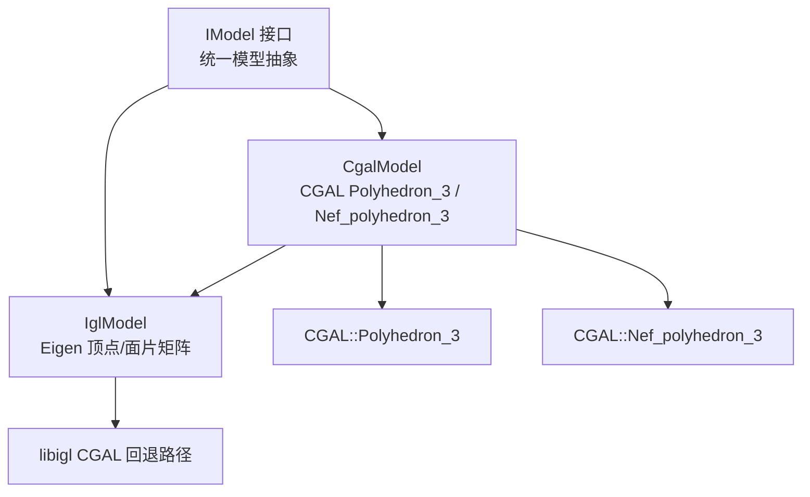
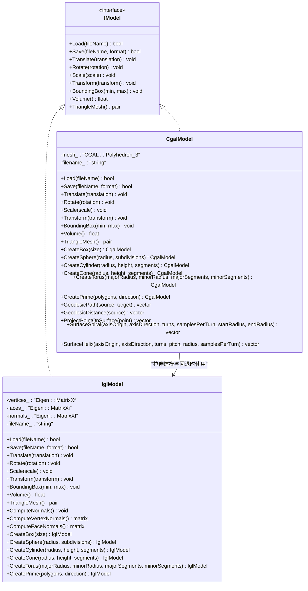
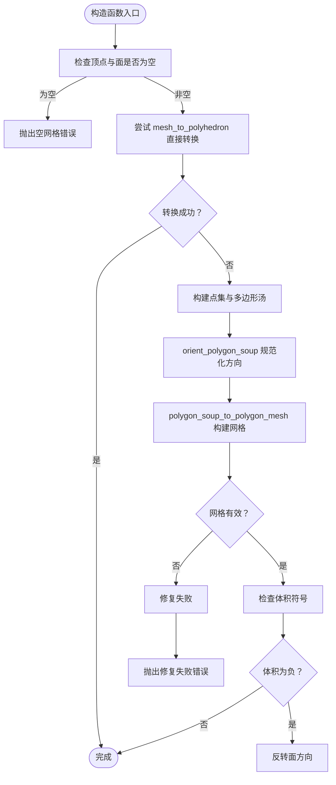
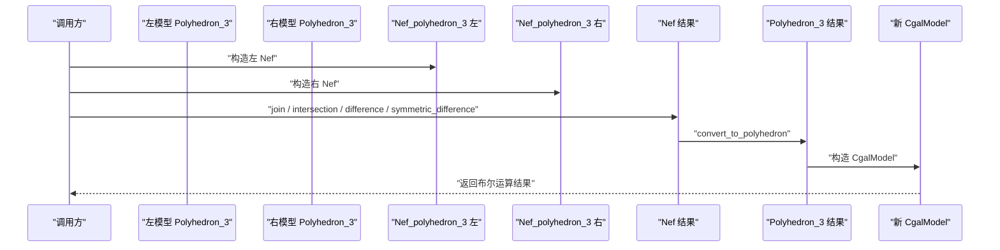
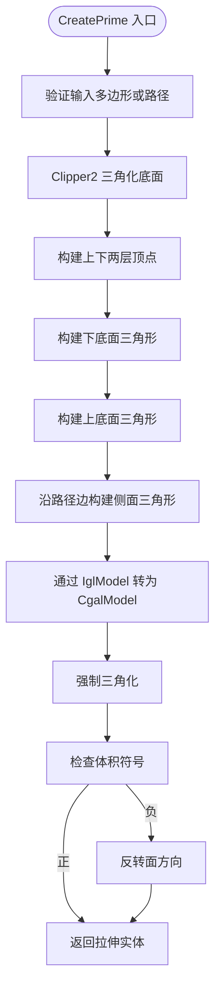
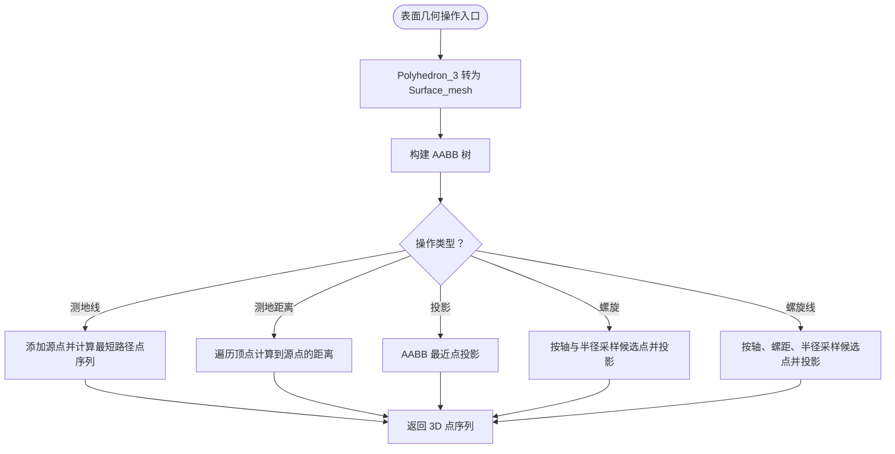
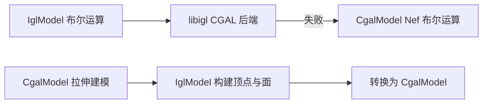
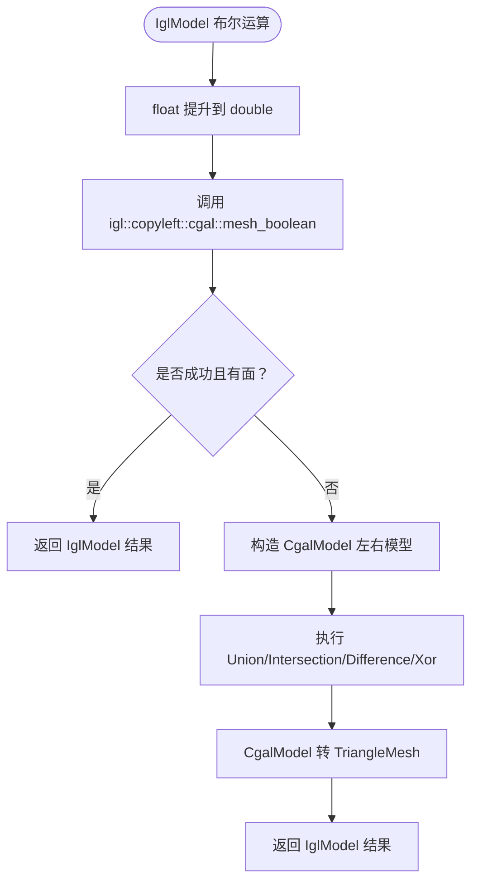

# CGAL 网格模型实现

<cite>
**本文引用的文件**   
- [CgalModel.hpp](file://meshmodel/CgalModel.hpp)
- [CgalModel.cpp](file://meshmodel/CgalModel.cpp)
- [IglModel.hpp](file://meshmodel/IglModel.hpp)
- [IglModel.cpp](file://meshmodel/IglModel.cpp)
- [IModel.hpp](file://base/IModel.hpp)
- [cgal_model_test.cpp](file://tests/Models/cgal_model_test.cpp)
- [model_loader_test.cpp](file://tests/Preprocess/model_loader_test.cpp)
- [CMakeLists.txt](file://CMakeLists.txt)
</cite>

## 目录
1. [引言](#引言)
2. [项目结构定位](#项目结构定位)
3. [核心组件总览](#核心组件总览)
4. [架构与数据流](#架构与数据流)
5. [CgalModel 详细分析](#cgalmode l-详细分析)
6. [与 IglModel 的对比与协作](#与-iglmodel-的对比与协作)
7. [布尔运算与几何处理流程](#布尔运算与几何处理流程)
8. [高级表面几何操作](#高级表面几何操作)
9. [使用指南与最佳实践](#使用指南与最佳实践)
10. [性能与资源特性](#性能与资源特性)
11. [故障排除](#故障排除)
12. [结论](#结论)

## 引言
本文面向需要在 HsBaSlicer 中进行高精度三维网格处理的开发者，聚焦 `CgalModel` 类及其在 CGAL 库支撑下的布尔运算、拓扑修复、体积计算、边界框查询、拉伸建模以及表面测地线、螺旋和螺旋线等高级几何能力。文档同时说明 `CgalModel` 与 `IglModel` 的职责分工、协作方式与性能取舍，帮助你在需要精确几何计算时选择合适的实现。

## 项目结构定位
`CgalModel` 位于网格模型层，继承统一的 `IModel` 接口，负责把 CGAL 的 `Polyhedron_3` 与 `Nef_polyhedron_3` 暴露为可加载、可保存、可变换、可求体积与三角网格的通用模型对象。与之并列的是基于 libigl 的 `IglModel`，两者都实现 `IModel`，但底层数据结构与算法侧重点不同：`CgalModel` 偏向 CGAL 几何内核，`IglModel` 偏向 Eigen 矩阵驱动的轻量网格操作。

**图表来源**
- [CgalModel.hpp:24-52](file://meshmodel/CgalModel.hpp#L24-L52)
- [IglModel.hpp:16-37](file://meshmodel/IglModel.hpp#L16-L37)
- [IModel.hpp](file://base/IModel.hpp)

**章节来源**
- [CgalModel.hpp:24-52](file://meshmodel/CgalModel.hpp#L24-L52)
- [IglModel.hpp:16-37](file://meshmodel/IglModel.hpp#L16-L37)

## 核心组件总览
- `CgalModel`：封装 CGAL 多面体，提供加载保存、仿射变换、包围盒、体积、三角网格导出、布尔运算、基础几何体工厂、拉伸建模、表面测地线与投影、表面螺旋与螺旋线。
- `IglModel`：封装 Eigen 顶点矩阵与三角形索引矩阵，提供相同风格的 `IModel` 接口；当启用 CGAL 编译选项时，其布尔运算会优先尝试 libigl 的 CGAL 后端，失败后回退到 `CgalModel` 的 Nef 布尔运算。
- `IModel`：定义所有模型共享的接口，包括 `Load`、`Save`、`Translate`、`Rotate`、`Scale`、`Transform`、`BoundingBox`、`Volume`、`TriangleMesh` 等。

**章节来源**
- [CgalModel.hpp:26-155](file://meshmodel/CgalModel.hpp#L26-L155)
- [IglModel.hpp:18-121](file://meshmodel/IglModel.hpp#L18-L121)
- [IModel.hpp](file://base/IModel.hpp)

## 架构与数据流
`CgalModel` 的核心数据是内部成员 `mesh_`，类型为 `CGAL::Polyhedron_3<EpicKernel>`。对外暴露的 API 大多通过 CGAL 的 `Polygon_mesh_processing` 或 AABB 树、最短路径工具进行几何计算。

**图表来源**
- [CgalModel.hpp:34-155](file://meshmodel/CgalModel.hpp#L34-L155)
- [IglModel.hpp:26-121](file://meshmodel/IglModel.hpp#L26-L121)

**章节来源**
- [CgalModel.hpp:34-155](file://meshmodel/CgalModel.hpp#L34-L155)
- [IglModel.hpp:26-121](file://meshmodel/IglModel.hpp#L26-L121)

## CgalModel 详细分析

### 构造与网格修复
`CgalModel` 支持从现有 CGAL `Polyhedron_3` 或 Eigen 顶点/面片构造。当从 `Eigen::MatrixXf` 与 `Eigen::MatrixXi` 构造时，实现会先尝试直接转换为 CGAL `Polyhedron_3`；如果失败，则进入修复流程：将顶点与三角形转为点集和多边形汤，调用 CGAL 的方向规范化与多边形汤转网格，再检查有效性并修正面方向。

**图表来源**
- [CgalModel.cpp:42-119](file://meshmodel/CgalModel.cpp#L42-L119)

**章节来源**
- [CgalModel.cpp:42-119](file://meshmodel/CgalModel.cpp#L42-L119)

### 加载与保存
`Load` 使用 CGAL IO 读取多边形网格，并在成功后强制三角化面，保证下游代码面对的是三角形面。`Save` 根据 `ModelFormat` 选择 STL、PLY、OBJ、OFF 等格式输出。

**章节来源**
- [CgalModel.cpp:121-157](file://meshmodel/CgalModel.cpp#L121-L157)

### 变换与几何查询
- 平移、旋转、缩放、刚体变换、齐次变换、仿射变换均通过 CGAL `Affine_3` 与 `Polygon_mesh_processing::transform` 作用于内部 `mesh_`。
- `BoundingBox` 遍历顶点计算最小最大坐标。
- `Volume` 返回 CGAL 计算的有符号体积，并以浮点数形式暴露。
- `TriangleMesh` 先确保面被三角化，再通过 libigl 的 `polyhedron_to_mesh` 导出为 Eigen 顶点与三角形索引。

**章节来源**
- [CgalModel.cpp:158-237](file://meshmodel/CgalModel.cpp#L158-L237)

### 布尔运算
`Union`、`Intersection`、`Difference`、`Xor` 是自由函数，作为 `CgalModel` 的友元访问内部 `mesh_`。它们将左右两个模型的 `Polyhedron_3` 包装为 `Nef_polyhedron_3`，执行 join、intersection、difference、symmetric_difference，再把结果转回 `Polyhedron_3` 并构造新的 `CgalModel`。

**图表来源**
- [CgalModel.cpp:238-276](file://meshmodel/CgalModel.cpp#L238-L276)

**章节来源**
- [CgalModel.cpp:238-276](file://meshmodel/CgalModel.cpp#L238-L276)

### 基础几何体工厂
`CreateBox`、`CreateSphere`、`CreateCylinder`、`CreateCone`、`CreateTorus` 都是静态工厂方法，生成封闭且方向一致的三角网格。其中 `CreateBox` 使用 CGAL 的 `make_hexahedron`，随后强制三角化以兼容 libigl 的 polyhedron 到 mesh 转换。

**章节来源**
- [CgalModel.cpp:278-445](file://meshmodel/CgalModel.cpp#L278-L445)

### 拉伸建模 CreatePrime
`CreatePrime` 支持单条闭合多边形或多条路径沿方向拉伸成实体。实现中：
- 对单条多边形，使用 Clipper2 三角化底面，然后通过 `IglModel` 构建顶点与面，再转换为 `CgalModel`。
- 对多条路径，先按包含关系判断外轮廓与孔洞，规范化方向，再用 Clipper2 三角化，收集唯一顶点，构建上下底面与侧面。
- 最终都会强制三角化并检查体积符号，必要时反转面方向，以保证体积为正。

**图表来源**
- [CgalModel.cpp:625-733](file://meshmodel/CgalModel.cpp#L625-L733)
- [CgalModel.cpp:735-955](file://meshmodel/CgalModel.cpp#L735-L955)

**章节来源**
- [CgalModel.cpp:625-733](file://meshmodel/CgalModel.cpp#L625-L733)
- [CgalModel.cpp:735-955](file://meshmodel/CgalModel.cpp#L735-L955)

### 高级表面几何操作
`CgalModel` 还实现了表面测地线、测地距离、点到表面最近点投影、表面螺旋与表面螺旋线。这些功能基于 CGAL 的 `Surface_mesh`、`Surface_mesh_shortest_path` 与 AABB 树：
- 先将 `Polyhedron_3` 复制为 `Surface_mesh` 并三角化。
- 构建 AABB 树加速最近点查询。
- 通过重心坐标与半邻接关系构造 `Face_location`，用于最短路径起点。
- 螺旋与螺旋线通过轴、半径、高度参数生成候选点，再投影到表面上。

**图表来源**
- [CgalModel.cpp:957-1210](file://meshmodel/CgalModel.cpp#L957-L1210)

**章节来源**
- [CgalModel.cpp:957-1210](file://meshmodel/CgalModel.cpp#L957-L1210)

## 与 IglModel 的对比与协作

### 职责差异
- `IglModel` 存储 `vertices_`、`faces_`、可选 `normals_`，适合快速线性代数操作、法向量计算、轻量布尔运算（依赖 CGAL 时）。
- `CgalModel` 存储 CGAL `Polyhedron_3`，更适合需要 CGAL 几何内核的布尔运算、拓扑修复、体积与测地线计算。

### 协作方式
- `CgalModel::CreatePrime` 在构造拉伸实体时，先通过 `IglModel` 构建顶点与面，再转换为 `CgalModel`。
- `IglModel` 的布尔运算在启用 CGAL 时，优先尝试 `igl::copyleft::cgal::mesh_boolean`；若失败，则回退到 `CgalModel` 的 Nef 布尔运算。

**图表来源**
- [IglModel.cpp:195-245](file://meshmodel/IglModel.cpp#L195-L245)
- [CgalModel.cpp:721-732](file://meshmodel/CgalModel.cpp#L721-L732)

**章节来源**
- [IglModel.cpp:195-245](file://meshmodel/IglModel.cpp#L195-L245)
- [CgalModel.cpp:721-732](file://meshmodel/CgalModel.cpp#L721-L732)

## 布尔运算与几何处理流程

### IglModel 布尔运算回退策略
当启用 `USE_CGAL` 时，`IglModel` 的布尔运算实现如下：
1. 将 float 顶点提升为 double。
2. 调用 `igl::copyleft::cgal::mesh_boolean`。
3. 如果返回空网格或失败，则构造 `CgalModel` 并使用 Nef 布尔运算。
4. 将结果转回 `IglModel`。

**图表来源**
- [IglModel.cpp:195-245](file://meshmodel/IglModel.cpp#L195-L245)

**章节来源**
- [IglModel.cpp:195-245](file://meshmodel/IglModel.cpp#L195-L245)

### CgalModel 布尔运算测试
测试用例创建两个单位立方体，一个平移后执行并集、交集、差集、异或，并断言体积接近预期值。这体现了 Nef 布尔运算在简单几何上的稳定性。

**章节来源**
- [cgal_model_test.cpp:40-62](file://tests/Models/cgal_model_test.cpp#L40-L62)

### 预处理模块中的布尔运算
预处理模块在启用 CGAL 时提供布尔运算 API，BRep 模型优先走 OCCT，网格模型走 IGL/CGAL 回退。这与 `IglModel` 的回退策略一致。

**章节来源**
- [model_loader_test.cpp:151-188](file://tests/Preprocess/model_loader_test.cpp#L151-L188)

## 高级表面几何操作

### 测地线与测地距离
- `GeodesicPath`：在表面找到两点之间的最短路径点序列。
- `GeodesicDistance`：从源点到所有顶点的测地距离数组。

实现要点：
- 使用 `Surface_mesh_shortest_path`。
- 通过 AABB 树找到目标点最近的三角形，并构造 `Face_location`。
- 返回 CGAL 点序列并转换为 Eigen 向量。

**章节来源**
- [CgalModel.cpp:1075-1120](file://meshmodel/CgalModel.cpp#L1075-L1120)

### 点到表面投影
`ProjectPointOnSurface` 使用 AABB 树的最近点查询，将任意 3D 点投影到网格表面。

**章节来源**
- [CgalModel.cpp:1122-1128](file://meshmodel/CgalModel.cpp#L1122-L1128)

### 表面螺旋与螺旋线
- `SurfaceSpiral`：围绕给定轴生成螺旋路径，半径可从起始半径渐变到结束半径。
- `SurfaceHelix`：围绕给定轴生成等螺距螺旋路径。

实现要点：
- 计算轴的正交基。
- 根据圈数、采样数、半径、高度生成候选点。
- 用 AABB 树投影到表面。

**章节来源**
- [CgalModel.cpp:1130-1210](file://meshmodel/CgalModel.cpp#L1130-L1210)

## 使用指南与最佳实践

### 何时选择 CgalModel
- 你需要精确的布尔运算，尤其是复杂网格相交、挖孔、合并。
- 你需要可靠的体积计算与拓扑修复。
- 你需要表面测地线、投影、螺旋等高级几何操作。
- 你希望使用 CGAL 的 Nef 多面体保证布尔运算的数学严谨性。

### 何时选择 IglModel
- 你主要做轻量网格操作、法向量计算、快速可视化。
- 你的布尔运算场景简单，且 libigl CGAL 后端能稳定工作。
- 你希望在不启用 CGAL 的情况下也能编译运行（布尔运算会被禁用或抛出未支持错误）。

### 推荐操作流程
1. 如果需要布尔运算且输入是网格，优先使用 `IglModel` 的布尔运算；若返回空结果，考虑改用 `CgalModel` 的布尔运算。
2. 如果需要拉伸建模并后续进行布尔运算，可直接使用 `CgalModel::CreatePrime`，因为它已经做了三角化与方向修正。
3. 如果需要表面路径规划或扫描轨迹，使用 `CgalModel` 的 `GeodesicPath`、`SurfaceSpiral`、`SurfaceHelix`。
4. 如果需要导出给其他系统，使用 `TriangleMesh` 获取 Eigen 顶点与三角形索引。

### 代码示例路径
- 布尔运算与体积断言：[cgal_model_test.cpp:40-62](file://tests/Models/cgal_model_test.cpp#L40-L62)
- 预处理模块布尔运算调用：[model_loader_test.cpp:151-188](file://tests/Preprocess/model_loader_test.cpp#L151-L188)
- IglModel 布尔运算回退逻辑：[IglModel.cpp:195-245](file://meshmodel/IglModel.cpp#L195-L245)
- CgalModel 拉伸建模与三角化修复：[CgalModel.cpp:625-733](file://meshmodel/CgalModel.cpp#L625-L733)、[CgalModel.cpp:735-955](file://meshmodel/CgalModel.cpp#L735-L955)

## 性能与资源特性

### 编译开关与布尔运算开销
顶层 `CMakeLists.txt` 中包含布尔运算相关提示，指出 Debug 模式下布尔运算可能较慢且内存占用较高。此外，当启用 copyleft 内核（CGAL/OCCT）时，模型池大小被设置为 10，以便布尔运算可同时持有多个模型；否则模型池大小为 1。

**章节来源**
- [CMakeLists.txt:297-306](file://CMakeLists.txt#L297-L306)

### 时间复杂度与空间复杂度
- 布尔运算：Nef 布尔运算的时间与空间复杂度通常随输入网格规模增长较快，复杂拓扑可能导致高内存占用。
- 拉伸建模：Clipper2 三角化与顶点/面构建是 O(n)，n 为多边形顶点数量；最终转换为 CGAL 网格后，后续布尔运算成本取决于网格规模。
- 表面几何：测地线计算与 AABB 最近点查询依赖于 CGAL 内部数据结构，复杂度与网格面片数量相关。

### 优化建议
- 在大规模布尔运算前尽量简化网格，减少冗余面片。
- 避免在 Debug 模式下进行大量布尔运算。
- 合理设置 `CreateSphere`、`CreateCylinder` 等工厂方法的细分参数，控制网格密度。
- 对于多次布尔运算，尽量复用中间结果，减少重复构造。

## 故障排除

### 空网格或无效网格
- 从 Eigen 顶点/面片构造 `CgalModel` 时，如果直接转换失败且修复失败，会抛出错误。常见原因包括顶点为空、面为空、面方向不一致、网格不封闭。
- 解决思路：检查输入网格是否封闭、面方向是否一致、是否存在重复顶点或退化三角形。

**章节来源**
- [CgalModel.cpp:42-119](file://meshmodel/CgalModel.cpp#L42-L119)

### 布尔运算返回空结果
- `IglModel` 的布尔运算在 libigl CGAL 后端失败时会回退到 `CgalModel`；如果仍为空，可能是输入网格质量差或布尔运算本身不可行。
- 解决思路：先检查网格有效性，再尝试使用 `CgalModel` 的布尔运算；必要时简化或修复网格。

**章节来源**
- [IglModel.cpp:195-245](file://meshmodel/IglModel.cpp#L195-L245)

### 体积为负或方向错误
- 拉伸建模后，实现会检查体积符号并可能反转面方向。如果体积仍异常，需检查输入多边形方向与孔洞判定是否正确。
- 解决思路：确认外轮廓与孔洞方向符合约定，必要时手动调整多边形顺序。

**章节来源**
- [CgalModel.cpp:721-732](file://meshmodel/CgalModel.cpp#L721-L732)
- [CgalModel.cpp:947-954](file://meshmodel/CgalModel.cpp#L947-L954)

### 未启用 CGAL 时的布尔运算
- 如果未启用 `USE_CGAL`，`IglModel` 的布尔运算会抛出未支持错误。
- 解决思路：启用 CGAL 编译选项，或使用 `CgalModel` 直接进行布尔运算。

**章节来源**
- [IglModel.cpp:392-409](file://meshmodel/IglModel.cpp#L392-L409)

## 结论
`CgalModel` 在 HsBaSlicer 中承担了高精度几何计算的核心角色：它利用 CGAL 的 `Polyhedron_3` 与 `Nef_polyhedron_3` 提供稳健的布尔运算、拓扑修复、体积计算、边界框查询、拉伸建模以及表面测地线与投影等高级功能。与 `IglModel` 相比，`CgalModel` 更适合复杂几何处理任务，而 `IglModel` 更适合作为轻量网格表示与快速操作的载体，并在启用 CGAL 时借助 `CgalModel` 作为布尔运算回退路径。

在实际工程中，建议：
- 对简单网格与快速操作优先使用 `IglModel`。
- 对复杂布尔运算、拓扑修复、表面几何路径规划优先使用 `CgalModel`。
- 在大规模几何处理中注意 Debug 模式的性能与内存开销，合理控制网格密度与布尔运算次数。
- 充分利用 `CreatePrime` 的三角化与方向修正能力，确保后续布尔运算与体积计算的稳定性。