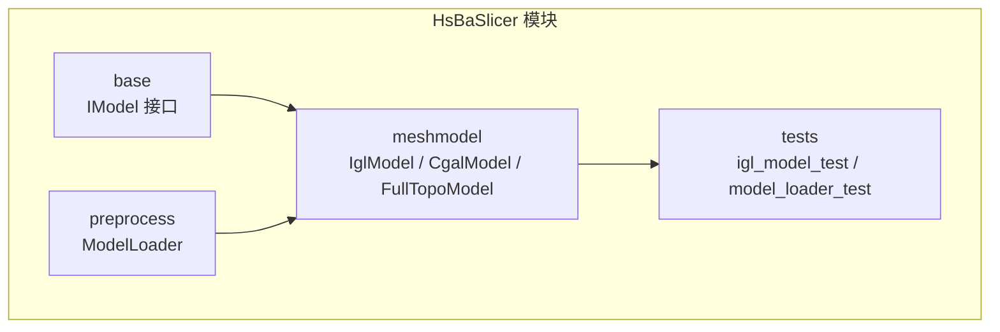
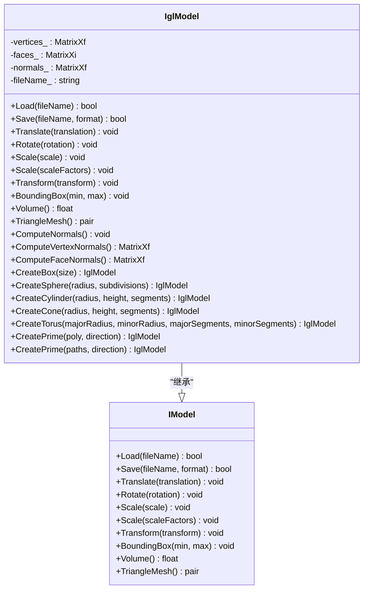
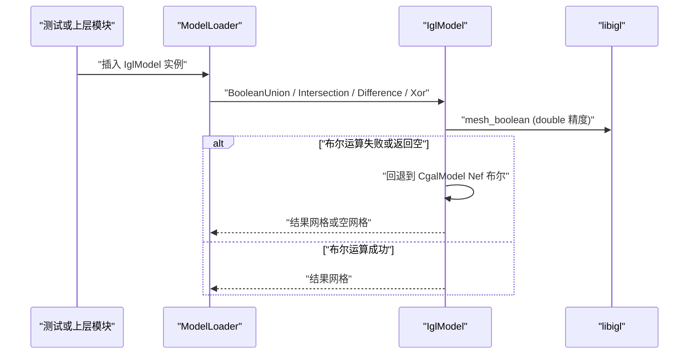
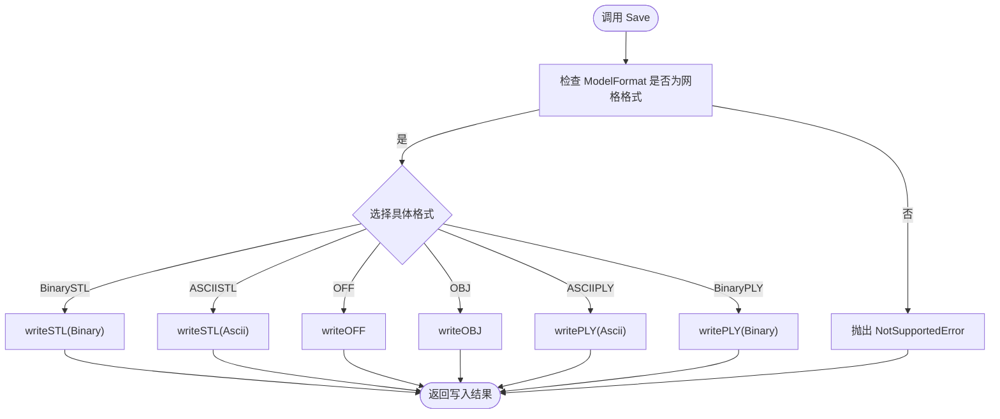
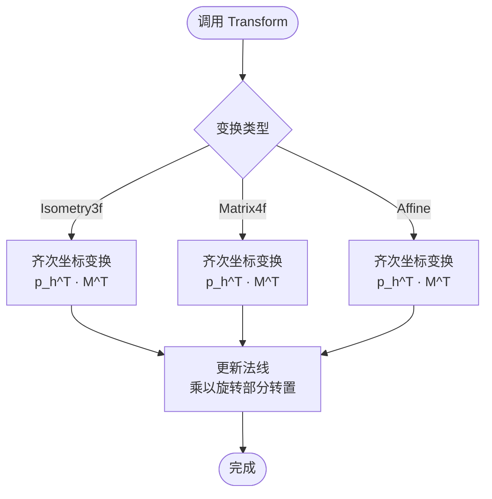
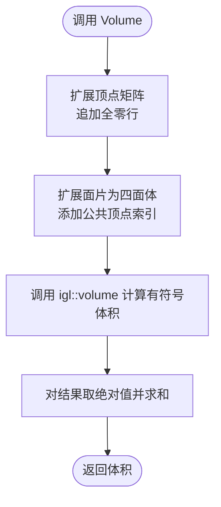
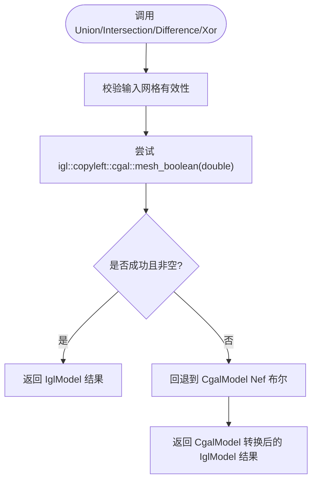
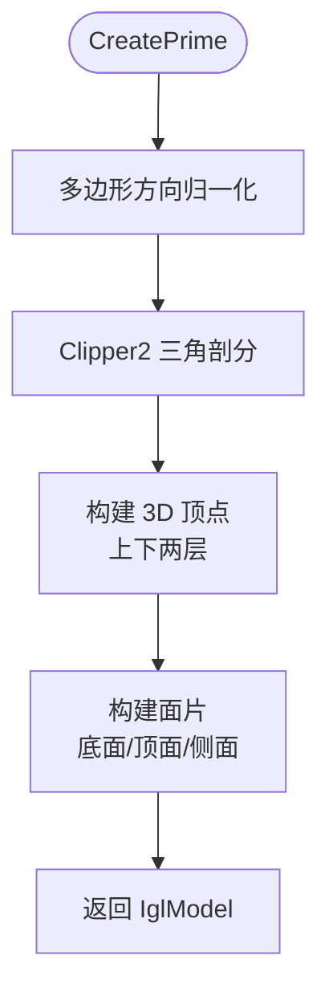
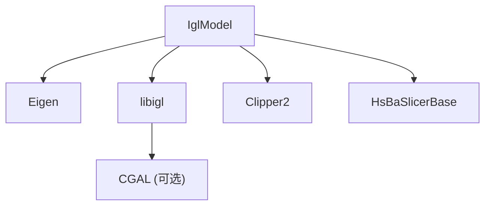
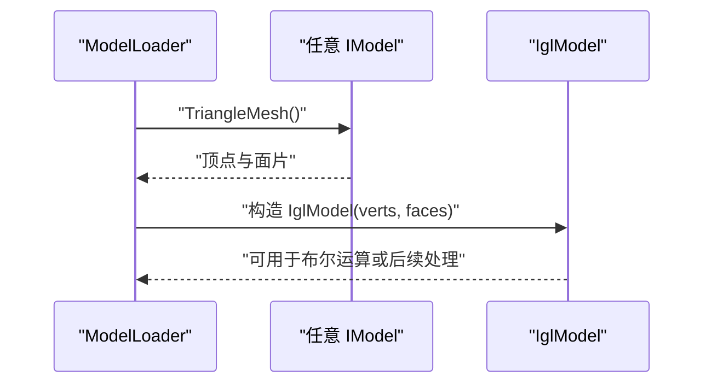

# IGL 网格模型实现

<cite>
**本文引用的文件**   
- [IglModel.hpp](file://meshmodel/IglModel.hpp)
- [IglModel.cpp](file://meshmodel/IglModel.cpp)
- [IModel.hpp](file://base/IModel.hpp)
- [CMakeLists.txt（meshmodel）](file://meshmodel/CMakeLists.txt)
- [igl_model_test.cpp](file://tests/Models/igl_model_test.cpp)
- [model_loader_test.cpp](file://tests/Preprocess/model_loader_test.cpp)
- [ModelLoader.cpp](file://preprocess/ModelLoader.cpp)
</cite>

## 目录
1. [简介](#简介)
2. [项目结构定位](#项目结构定位)
3. [核心概念与接口契约](#核心概念与接口契约)
4. [架构总览](#架构总览)
5. [详细组件分析](#详细组件分析)
6. [依赖关系分析](#依赖关系分析)
7. [性能特点与复杂度](#性能特点与复杂度)
8. [使用示例与集成方式](#使用示例与集成方式)
9. [故障排除与常见问题](#故障排除与常见问题)
10. [结论与选型建议](#结论与选型建议)

## 简介
本文件聚焦 HsBaSlicer 中的 IGL 网格模型实现，系统说明 `IglModel` 如何基于 libigl 提供高效的三角网格处理。内容覆盖：
- 继承自 `IModel` 接口的具体实现方式；
- 网格加载、保存、几何变换、包围盒与体积计算；
- 法线计算、布尔运算、基本几何体创建与二维多边形拉伸；
- 与其他模块的集成点；
- 性能特征、限制条件与适用场景。

该实现适合需要轻量三角网格数据、快速几何操作和稳定布尔运算回退路径的开发者，尤其适用于切片管线中常见的 STL/OBJ/PLY/OFF 网格读写、仿射变换、布尔运算以及从二维轮廓生成三维实体。

## 项目结构定位
`IglModel` 位于 `meshmodel` 模块，是 HsBaSlicer 中面向三角网格的核心实现之一。其头文件定义类接口，源文件实现 libigl 调用、格式转换、布尔运算与几何构造逻辑。

**图表来源**
- [IModel.hpp:110-139](file://base/IModel.hpp#L110-L139)
- [IglModel.hpp:16-121](file://meshmodel/IglModel.hpp#L16-L121)
- [ModelLoader.cpp:136-146](file://preprocess/ModelLoader.cpp#L136-L146)

**章节来源**
- [IModel.hpp:110-139](file://base/IModel.hpp#L110-L139)
- [IglModel.hpp:16-121](file://meshmodel/IglModel.hpp#L16-L121)
- [ModelLoader.cpp:136-146](file://preprocess/ModelLoader.cpp#L136-L146)

## 核心概念与接口契约
`IModel` 定义了 HsBaSlicer 中通用 3D 模型的抽象接口，包括：
- 文件加载与保存；
- 平移、旋转、缩放、仿射变换；
- 轴对齐包围盒查询；
- 体积查询；
- 三角网格数据访问。

`IglModel` 通过继承 `IModel`，以 Eigen 矩阵存储顶点、面片索引和可选法线，并委托 libigl 完成 IO、法线、体积等计算。

**图表来源**
- [IModel.hpp:110-139](file://base/IModel.hpp#L110-L139)
- [IglModel.hpp:16-121](file://meshmodel/IglModel.hpp#L16-L121)

**章节来源**
- [IModel.hpp:110-139](file://base/IModel.hpp#L110-L139)
- [IglModel.hpp:16-121](file://meshmodel/IglModel.hpp#L16-L121)

## 架构总览
`IglModel` 在 HsBaSlicer 中的位置如下：
- 作为 `IModel` 的具体实现之一，与 `OcctModel`、`CgalModel`、`FullTopoModel` 并列；
- 被预处理模块 `ModelLoader` 用于布尔运算、网格提取与类型转换；
- 在测试中被广泛验证，包括基础几何体、体积、包围盒、布尔运算与多边形拉伸。

**图表来源**
- [IglModel.cpp:195-245](file://meshmodel/IglModel.cpp#L195-L245)
- [ModelLoader.cpp:136-146](file://preprocess/ModelLoader.cpp#L136-L146)

**章节来源**
- [IglModel.cpp:195-245](file://meshmodel/IglModel.cpp#L195-L245)
- [ModelLoader.cpp:136-146](file://preprocess/ModelLoader.cpp#L136-L146)

## 详细组件分析

### 网格加载与保存
`IglModel::Load` 使用 libigl 的三角网格读取函数，支持多种常见网格格式；`Save` 根据 `ModelFormat` 枚举选择对应写入器。

- 支持的输出格式包括：
  - 二进制 STL；
  - ASCII STL；
  - OFF；
  - OBJ；
  - ASCII PLY；
  - Binary PLY。
- 非网格格式会抛出“不支持”的错误。
- 文件名在内部转换为本地编码路径，避免跨平台路径编码问题。

**图表来源**
- [IglModel.cpp:72-99](file://meshmodel/IglModel.cpp#L72-L99)
- [IModel.hpp:66-109](file://base/IModel.hpp#L66-L109)

**章节来源**
- [IglModel.cpp:64-99](file://meshmodel/IglModel.cpp#L64-L99)
- [IModel.hpp:66-109](file://base/IModel.hpp#L66-L109)

### 几何变换
`IglModel` 对顶点采用行主序存储（N×3），因此变换实现特别注意矩阵乘法方向与齐次坐标处理：
- 平移：按行广播加法；
- 旋转：将旋转四元数转为旋转矩阵，并对顶点与法线右乘转置矩阵；
- 缩放：统一缩放与逐轴缩放；
- 变换：支持 `Isometry3f`、`Matrix4f`、`Affine` 三种变换类型，均通过齐次坐标进行变换，并同步更新法线。

**图表来源**
- [IglModel.cpp:126-150](file://meshmodel/IglModel.cpp#L126-L150)

**章节来源**
- [IglModel.cpp:101-150](file://meshmodel/IglModel.cpp#L101-L150)

### 包围盒与体积
- 包围盒：通过对顶点矩阵列取最小值与最大值获得 AABB；
- 体积：通过向顶点矩阵追加零行、扩展面片为四面体，再调用 libigl 的体积函数求和绝对值。

**图表来源**
- [IglModel.cpp:157-168](file://meshmodel/IglModel.cpp#L157-L168)

**章节来源**
- [IglModel.cpp:152-168](file://meshmodel/IglModel.cpp#L152-L168)

### 法线计算
- 面法线：直接调用 libigl 的面法线计算；
- 顶点法线：调用 libigl 的顶点法线计算；
- 构造函数可选择是否立即计算面法线。

**章节来源**
- [IglModel.cpp:170-185](file://meshmodel/IglModel.cpp#L170-L185)
- [IglModel.hpp:84-89](file://meshmodel/IglModel.hpp#L84-L89)

### 布尔运算
布尔运算分为两条路径：
1. 优先尝试 libigl 的 CGAL 后端 `mesh_boolean`，但要求输入提升为 double 精度；
2. 若失败或结果为空，则回退到 `CgalModel` 的 Nef 多面体布尔运算。

未启用 CGAL 时，布尔运算函数会抛出“不支持”错误。

**图表来源**
- [IglModel.cpp:195-245](file://meshmodel/IglModel.cpp#L195-L245)
- [IglModel.cpp:248-391](file://meshmodel/IglModel.cpp#L248-L391)
- [IglModel.cpp:392-409](file://meshmodel/IglModel.cpp#L392-L409)

**章节来源**
- [IglModel.cpp:195-409](file://meshmodel/IglModel.cpp#L195-L409)

### 基本几何体与拉伸
`IglModel` 提供常用基本几何体的静态工厂方法：
- 立方体；
- 球体；
- 圆柱体；
- 圆锥体；
- 环面。

此外，还提供从二维多边形或多边形集合拉伸为三维实体的工厂方法：
- 单条闭合多边形拉伸；
- 多条多边形（含孔洞）拉伸。

拉伸过程包含：
- 多边形方向归一化（外轮廓 CCW，孔 CW）；
- 使用 Clipper2 进行三角剖分；
- 构建上下底面与侧面三角形；
- 保证法线方向一致，使布尔运算与体积计算正确。

**图表来源**
- [IglModel.cpp:598-713](file://meshmodel/IglModel.cpp#L598-L713)
- [IglModel.cpp:715-929](file://meshmodel/IglModel.cpp#L715-L929)

**章节来源**
- [IglModel.cpp:411-596](file://meshmodel/IglModel.cpp#L411-L596)
- [IglModel.cpp:598-929](file://meshmodel/IglModel.cpp#L598-L929)

## 依赖关系分析
`IglModel` 的主要外部依赖包括：
- Eigen：用于向量、矩阵与几何变换；
- libigl：用于网格 IO、法线、体积、布尔运算；
- CGAL（可选）：当启用 `USE_CGAL` 时提供布尔运算能力；
- Clipper2：用于二维多边形三角剖分与方向判断；
- HsBaSlicerBase：提供 `ModelFormat`、错误类型与编码转换工具。

**图表来源**
- [IglModel.cpp:12-31](file://meshmodel/IglModel.cpp#L12-L31)
- [CMakeLists.txt（meshmodel）:1-26](file://meshmodel/CMakeLists.txt#L1-L26)

**章节来源**
- [IglModel.cpp:12-31](file://meshmodel/IglModel.cpp#L12-L31)
- [CMakeLists.txt（meshmodel）:1-26](file://meshmodel/CMakeLists.txt#L1-L26)

## 性能特点与复杂度
- 网格 IO：由 libigl 实现，时间复杂度主要取决于文件大小与解析开销；
- 变换：对顶点矩阵进行批量操作，时间复杂度 O(N)，N 为顶点数；
- 包围盒：O(N)；
- 体积：通过扩展为四面体后调用 libigl 体积函数，时间复杂度与面片数量相关；
- 法线计算：O(F)，F 为面片数量；
- 布尔运算：
  - 首选 libigl CGAL 后端，需 double 精度输入；
  - 失败时回退到 CgalModel Nef 布尔，可能更稳健但开销更大；
  - 共面或退化输入可能导致空结果，属于已知限制。

优化建议：
- 避免频繁重复计算法线，必要时缓存；
- 对大规模网格，优先使用已三角化的输入；
- 布尔运算前尽量消除共面与退化面片；
- 使用移动语义构造 `IglModel`，减少拷贝开销。

[本节为通用性能讨论，不直接分析具体代码片段]

## 使用示例与集成方式

### 示例一：创建立方体并查询体积与包围盒
- 使用 `IglModel::CreateBox` 创建单位立方体；
- 调用 `Volume` 验证体积；
- 调用 `BoundingBox` 验证边界范围；
- 调用 `ComputeFaceNormals` 验证法线单位长度。

参考测试用例路径：
- [igl_model_test.cpp:11-26](file://tests/Models/igl_model_test.cpp#L11-L26)

**章节来源**
- [igl_model_test.cpp:11-26](file://tests/Models/igl_model_test.cpp#L11-L26)

### 示例二：布尔运算
- 创建两个立方体；
- 沿对角线平移以避免共面；
- 调用 `Union`、`Intersection`、`Difference`、`Xor`；
- 检查结果网格是否非空，并验证体积。

参考测试用例路径：
- [igl_model_test.cpp:44-72](file://tests/Models/igl_model_test.cpp#L44-L72)
- [model_loader_test.cpp:188-206](file://tests/Preprocess/model_loader_test.cpp#L188-L206)

**章节来源**
- [igl_model_test.cpp:44-72](file://tests/Models/igl_model_test.cpp#L44-L72)
- [model_loader_test.cpp:188-206](file://tests/Preprocess/model_loader_test.cpp#L188-L206)

### 示例三：从二维多边形拉伸为三维实体
- 单三角形拉伸：验证顶点数、面片数与体积；
- 带孔正方形拉伸：验证体积等于底面积乘以高度；
- L 形多边形拉伸：验证复杂形状体积；
- 斜方向拉伸：验证体积与包围盒变化。

参考测试用例路径：
- [igl_model_test.cpp:74-107](file://tests/Models/igl_model_test.cpp#L74-L107)
- [igl_model_test.cpp:109-145](file://tests/Models/igl_model_test.cpp#L109-L145)
- [igl_model_test.cpp:147-177](file://tests/Models/igl_model_test.cpp#L147-L177)
- [igl_model_test.cpp:179-203](file://tests/Models/igl_model_test.cpp#L179-L203)

**章节来源**
- [igl_model_test.cpp:74-203](file://tests/Models/igl_model_test.cpp#L74-L203)

### 与其他模块集成
- `ModelLoader` 会将任意 `IModel` 转换为 `IglModel`，以便进行布尔运算或网格处理；
- 若目标模型已是 `IglModel`，则直接复制；
- 否则通过 `TriangleMesh()` 提取顶点与面片，再构造新的 `IglModel`。

**图表来源**
- [ModelLoader.cpp:136-146](file://preprocess/ModelLoader.cpp#L136-L146)

**章节来源**
- [ModelLoader.cpp:136-146](file://preprocess/ModelLoader.cpp#L136-L146)

## 故障排除与常见问题

### 布尔运算返回空网格
- 原因：
  - 输入网格为空或无效；
  - 共面或退化面片导致 libigl mesh_boolean 失败；
  - 浮点精度不足，未提升到 double。
- 处理：
  - 确保输入网格有效；
  - 避免完全共面；
  - 若启用 CGAL，会自动回退到 CgalModel Nef 布尔；
  - 未启用 CGAL 时，布尔运算会抛出“不支持”。

**章节来源**
- [IglModel.cpp:195-245](file://meshmodel/IglModel.cpp#L195-L245)
- [IglModel.cpp:392-409](file://meshmodel/IglModel.cpp#L392-L409)

### 保存格式不支持
- 原因：传入的 `ModelFormat` 不是网格格式。
- 处理：
  - 仅支持 STL、OBJ、OFF、PLY；
  - 其他格式会抛出“不支持”。

**章节来源**
- [IglModel.cpp:72-99](file://meshmodel/IglModel.cpp#L72-L99)
- [IModel.hpp:66-109](file://base/IModel.hpp#L66-L109)

### 拉伸多边形方向错误
- 原因：
  - 外轮廓与孔的方向不一致；
  - 三角剖分输出方向不符合预期。
- 处理：
  - 实现中已对多边形方向进行归一化；
  - 对三角面片强制调整方向以保证法线向外；
  - 若仍出现异常，检查输入多边形是否自交或退化。

**章节来源**
- [IglModel.cpp:598-713](file://meshmodel/IglModel.cpp#L598-L713)
- [IglModel.cpp:715-929](file://meshmodel/IglModel.cpp#L715-L929)

## 结论与选型建议
`IglModel` 是 HsBaSlicer 中高效、轻量的三角网格实现，适合以下场景：
- 需要快速加载/保存 STL/OBJ/PLY/OFF；
- 需要进行平移、旋转、缩放与仿射变换；
- 需要 AABB 与体积查询；
- 需要从二维多边形生成三维实体；
- 需要在启用 CGAL 的情况下执行布尔运算。

何时选择 IGL 实现：
- 当你的工作流以三角网格为主，不需要 CAD 拓扑或 BRep 高级特性；
- 当你希望布尔运算具备稳定的回退路径；
- 当你需要与 libigl 生态良好集成。

何时考虑其他实现：
- 如果需要精确 CAD 建模与 BRep 操作，可考虑 `OcctModel`；
- 如果需要更强大的布尔与几何内核，可考虑 `CgalModel`；
- 如果需要完整拓扑信息，可考虑 `FullTopoModel`。

[本节为总结性内容，不直接分析具体代码片段]