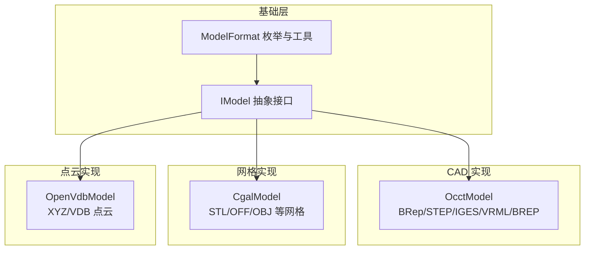
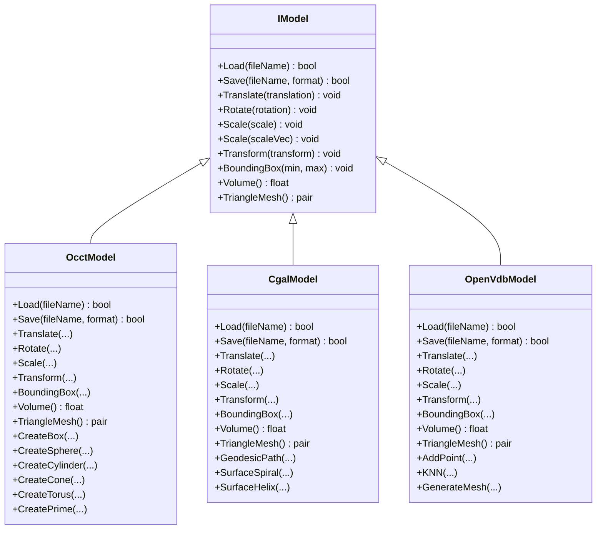
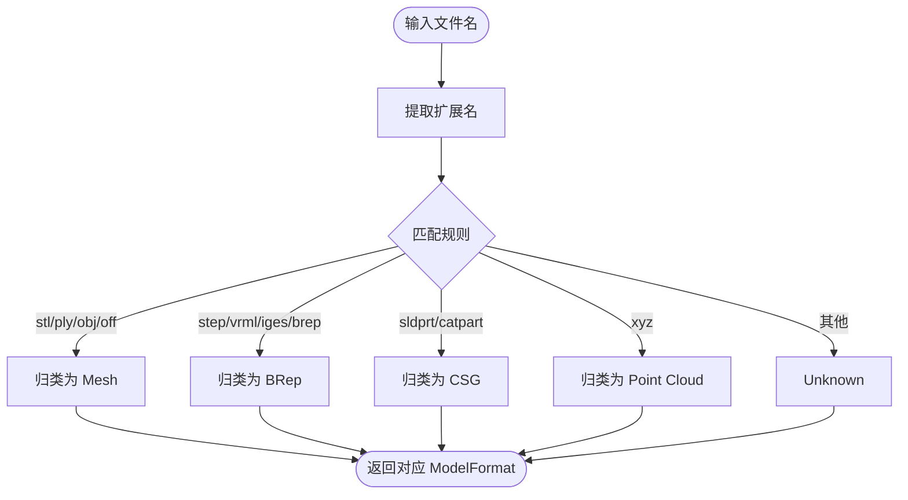
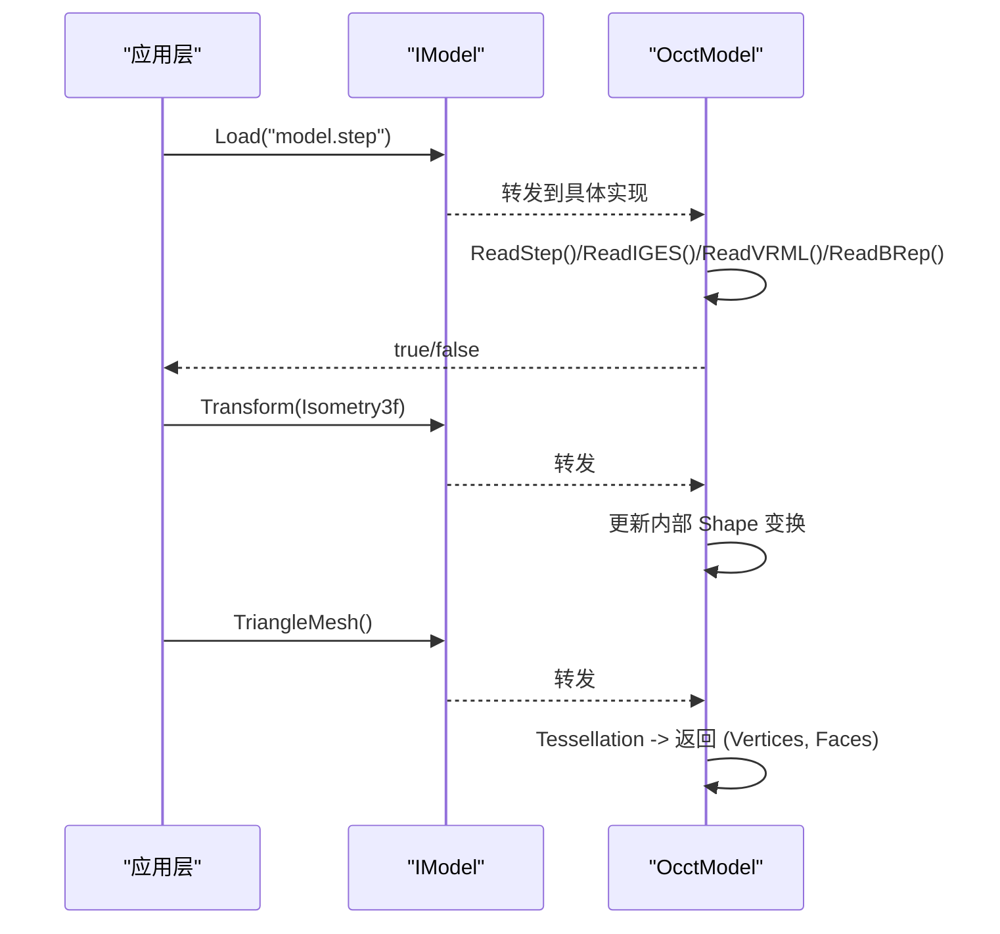
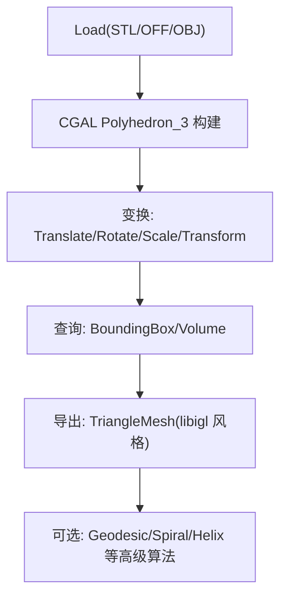
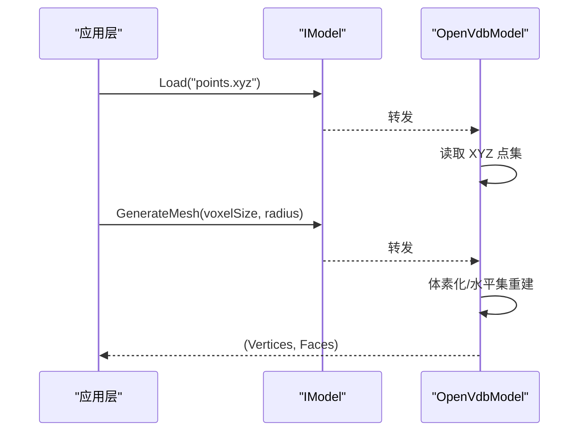
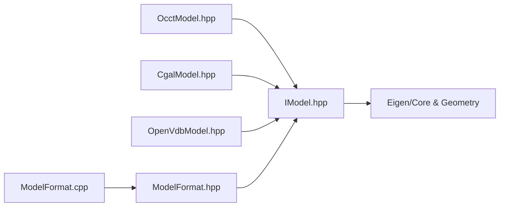

# IModel 接口设计

<cite>
**本文引用的文件**   
- [IModel.hpp](file://base/IModel.hpp)
- [ModelFormat.hpp](file://base/ModelFormat.hpp)
- [ModelFormat.cpp](file://base/ModelFormat.cpp)
- [OcctModel.hpp](file://cadmodel/OcctModel.hpp)
- [CgalModel.hpp](file://meshmodel/CgalModel.hpp)
- [OpenVdbModel.hpp](file://pointcloud/OpenVdbModel.hpp)
</cite>

## 目录
1. [引言](#引言)
2. [项目结构](#项目结构)
3. [核心组件](#核心组件)
4. [架构总览](#架构总览)
5. [详细组件分析](#详细组件分析)
6. [依赖关系分析](#依赖关系分析)
7. [性能与扩展性](#性能与扩展性)
8. [故障排查指南](#故障排查指南)
9. [结论](#结论)
10. [附录：使用示例与最佳实践](#附录使用示例与最佳实践)

## 引言
本文件围绕 HsBa Slicer 中的 IModel 抽象接口展开，系统性阐述其设计理念、方法语义、格式分类与实现策略。IModel 通过统一接口屏蔽不同 3D 模型格式（网格 mesh、BRep 实体、点云）的底层差异，为上层切片、路径生成、支撑等管线提供一致的几何操作能力。文档同时给出 ModelFormat 枚举的分类与判定工具函数，以及 OcctModel、CgalModel、OpenVdbModel 三类典型实现的职责边界与扩展方式。

## 项目结构
围绕 IModel 的核心代码分布在 base、cadmodel、meshmodel、pointcloud 四个模块中：
- base：定义 IModel 抽象接口与 ModelFormat 枚举及工具函数
- cadmodel：基于 OpenCASCADE 的 BRep CAD 模型实现
- meshmodel：基于 CGAL 的多面体网格模型实现
- pointcloud：基于 OpenVDB 的点云模型实现

图表来源
- [IModel.hpp:63-139](file://base/IModel.hpp#L63-L139)
- [ModelFormat.hpp:19-93](file://base/ModelFormat.hpp#L19-L93)
- [OcctModel.hpp:30-81](file://cadmodel/OcctModel.hpp#L30-L81)
- [CgalModel.hpp:34-82](file://meshmodel/CgalModel.hpp#L34-L82)
- [OpenVdbModel.hpp:28-58](file://pointcloud/OpenVdbModel.hpp#L28-L58)

章节来源
- [IModel.hpp:63-139](file://base/IModel.hpp#L63-L139)
- [ModelFormat.hpp:19-93](file://base/ModelFormat.hpp#L19-L93)

## 核心组件
本节聚焦 IModel 抽象接口的设计要点与关键方法语义。

- 文件操作
  - Load(fileName): 从文件加载模型数据，具体解析逻辑由实现类负责。
  - Save(fileName, format): 将当前模型保存为目标格式，format 由 ModelFormat 指定。

- 几何变换
  - Translate(translation): 平移变换。
  - Rotate(rotation): 旋转变换，采用四元数表示。
  - Scale(scale)/Scale(scaleVec): 均匀或非均匀缩放。
  - Transform(...): 支持多种 Eigen 变换类型（Isometry3f、Matrix4f、Affine），便于与上游几何库无缝对接。

- 查询与分析
  - BoundingBox(min, max): 计算轴对齐包围盒。
  - Volume(): 返回模型的有符号体积（对非流形或开放网格可能为近似值）。
  - TriangleMesh(): 以 libigl 风格返回 (顶点矩阵, 面索引矩阵)，用于切片、可视化等下游流程。

- 设计原则
  - 统一抽象：上层无需关心底层是 BRep、三角网格还是点云。
  - 多态扩展：新增模型类型只需继承 IModel 并实现接口。
  - 数值稳定：变换接口兼容多种 Eigen 类型，减少转换开销与误差。

章节来源
- [IModel.hpp:110-139](file://base/IModel.hpp#L110-L139)

## 架构总览
IModel 作为统一入口，被不同后端实现复用；ModelFormat 提供格式识别与分类工具，贯穿加载/保存与预处理阶段。

图表来源
- [IModel.hpp:110-139](file://base/IModel.hpp#L110-L139)
- [OcctModel.hpp:30-109](file://cadmodel/OcctModel.hpp#L30-L109)
- [CgalModel.hpp:34-154](file://meshmodel/CgalModel.hpp#L34-L154)
- [OpenVdbModel.hpp:28-115](file://pointcloud/OpenVdbModel.hpp#L28-L115)

## 详细组件分析

### IModel 抽象接口
- 目标：为所有 3D 模型提供统一的加载/保存、几何变换、几何分析与网格导出能力。
- 关键点：
  - 变换接口重载覆盖 Isometry/Affine/Matrix4，降低调用方适配成本。
  - TriangleMesh 返回 libigl 风格的数据结构，便于与现有网格处理工具链集成。
  - Volume 与 BoundingBox 为通用几何属性，供切片、碰撞检测、布局等模块使用。

章节来源
- [IModel.hpp:63-139](file://base/IModel.hpp#L63-L139)

### ModelFormat 枚举与工具
- 分类体系
  - Mesh：PLY、OBJ、STL、OFF 等三角网格格式
  - BRep：VRML、STEP、IGES、BREP 等边界表示格式
  - CSG：SLDPRT、CATPART 等参数化 CAD 格式（预留扩展）
  - Point Cloud：XYZ、VDB 等点云格式
- 工具函数
  - ToString(format)：枚举到字符串映射
  - GetExtName(file_name)：提取扩展名
  - ModelTypeFromExtName(file_name)：根据扩展名推断格式
  - IsMeshFormat / IsBrepFormat / IsCSGFormat / IsPointCloudFormat：按枚举或文件名判断类别

图表来源
- [ModelFormat.cpp:12-86](file://base/ModelFormat.cpp#L12-L86)
- [ModelFormat.hpp:19-93](file://base/ModelFormat.hpp#L19-L93)

章节来源
- [ModelFormat.hpp:19-93](file://base/ModelFormat.hpp#L19-L93)
- [ModelFormat.cpp:12-177](file://base/ModelFormat.cpp#L12-L177)

### OcctModel（BRep CAD 实现）
- 职责：封装 TopoDS_Shape，提供 STEP/IGES/VRML/BREP 的读写、布尔运算、实体构造与网格化。
- 接口一致性：完整实现 IModel 的 Load/Save、变换、包围盒、体积、三角网格导出。
- 扩展点：静态工厂方法（CreateBox/Sphere/Cylinder/Cone/Torus/Extrude）便于快速构建几何。

图表来源
- [OcctModel.hpp:54-81](file://cadmodel/OcctModel.hpp#L54-L81)

章节来源
- [OcctModel.hpp:30-124](file://cadmodel/OcctModel.hpp#L30-L124)

### CgalModel（网格实现）
- 职责：基于 CGAL Polyhedron_3 管理三角网格，提供网格 IO、布尔运算、测地线/螺旋/螺旋线等高级几何算法。
- 接口一致性：完整实现 IModel 的 Load/Save、变换、包围盒、体积、三角网格导出。
- 特色能力：表面测地线、投影、螺旋/螺旋线生成，适合路径规划与工艺轨迹生成。

图表来源
- [CgalModel.hpp:54-82](file://meshmodel/CgalModel.hpp#L54-L82)
- [CgalModel.hpp:105-149](file://meshmodel/CgalModel.hpp#L105-L149)

章节来源
- [CgalModel.hpp:34-154](file://meshmodel/CgalModel.hpp#L34-L154)

### OpenVdbModel（点云实现）
- 职责：基于 OpenVDB 体素网格管理点云，提供点增删、邻域查询、体素化、降采样、法向量估计、水平集网格重建等。
- 接口一致性：实现 IModel 的 Load/Save、变换、包围盒、体积、三角网格导出（可经由 GenerateMesh 重建）。
- 典型工作流：点云 → 体素化/滤波 → 重建网格 → 进入切片管线。

图表来源
- [OpenVdbModel.hpp:46-83](file://pointcloud/OpenVdbModel.hpp#L46-L83)

章节来源
- [OpenVdbModel.hpp:28-115](file://pointcloud/OpenVdbModel.hpp#L28-L115)

## 依赖关系分析
- IModel 仅依赖 Eigen 数学库与标准库，保持轻量与跨平台。
- 各实现分别依赖各自后端：
  - OcctModel 依赖 OpenCASCADE（TopoDS_*）
  - CgalModel 依赖 CGAL（Polyhedron/Nef 等）
  - OpenVdbModel 依赖 OpenVDB（体素网格）
- ModelFormat 工具函数在预处理与管线中广泛使用，用于路由到正确的实现与解析器。

图表来源
- [IModel.hpp:13-17](file://base/IModel.hpp#L13-L17)
- [OcctModel.hpp:11-18](file://cadmodel/OcctModel.hpp#L11-L18)
- [CgalModel.hpp:9-22](file://meshmodel/CgalModel.hpp#L9-L22)
- [OpenVdbModel.hpp:13-16](file://pointcloud/OpenVdbModel.hpp#L13-L16)
- [ModelFormat.hpp:11-14](file://base/ModelFormat.hpp#L11-L14)
- [ModelFormat.cpp:5-8](file://base/ModelFormat.cpp#L5-L8)

章节来源
- [IModel.hpp:13-17](file://base/IModel.hpp#L13-L17)
- [ModelFormat.hpp:11-14](file://base/ModelFormat.hpp#L11-L14)
- [ModelFormat.cpp:5-8](file://base/ModelFormat.cpp#L5-L8)

## 性能与扩展性
- 性能要点
  - 变换接口支持多种 Eigen 类型，避免频繁类型转换带来的额外开销。
  - TriangleMesh 按需生成，避免不必要的网格化（如 BRep 仅在需要时 tessellate）。
  - 点云场景下，OpenVdbModel 提供体素化与降采样，有助于控制内存与后续网格重建成本。
- 扩展性建议
  - 新增格式：在 ModelFormat 中添加枚举项，并在 ModelFormat.cpp 的匹配规则中补充扩展名映射。
  - 新增实现：继承 IModel，实现全部虚方法；若仅需局部增强（如点云特有方法），可在派生类中扩展。
  - 工厂/注册机制：建议在预处理层增加“文件名→实现类”的注册表，简化 Load 路由。

[本节为通用指导，不直接分析具体文件]

## 故障排查指南
- 加载失败
  - 检查文件扩展名是否被 ModelFormat 正确识别（参考 ModelFormat.cpp 的正则匹配）。
  - 确认实现类是否支持该格式（例如 OcctModel 支持 STEP/IGES/VRML/BREP，CgalModel 支持 STL/OFF/OBJ 等）。
- 变换异常
  - 确保传入的四元数为单位四元数，避免旋转失真。
  - 注意非均匀缩放可能导致拓扑退化，必要时在网格重建后执行修复。
- 体积/包围盒异常
  - 开放网格或非流形几何的体积可能无意义或为近似值，应结合业务进行校验。
  - 点云的 Volume 通常通过重建网格估算，需关注 voxelSize/particleRadius 参数设置。
- 网格导出问题
  - 某些 BRep 或复杂几何 tessellate 后可能出现重复顶点/非法面，建议在下游做去重与合法性检查。

章节来源
- [ModelFormat.cpp:12-86](file://base/ModelFormat.cpp#L12-L86)
- [OcctModel.hpp:54-81](file://cadmodel/OcctModel.hpp#L54-L81)
- [CgalModel.hpp:54-82](file://meshmodel/CgalModel.hpp#L54-L82)
- [OpenVdbModel.hpp:46-83](file://pointcloud/OpenVdbModel.hpp#L46-L83)

## 结论
IModel 通过统一接口抽象了 3D 模型的加载/保存、几何变换、几何分析与网格导出能力，有效屏蔽了 mesh/BRep/point cloud 的差异。配合 ModelFormat 的分类与工具函数，系统可在预处理与管线阶段以一致的方式处理多源几何数据。各实现类在保持接口一致性的同时，提供了丰富的领域能力（如布尔运算、测地线、点云重建），为上层应用提供了强大而灵活的几何基座。

[本节为总结性内容，不直接分析具体文件]

## 附录：使用示例与最佳实践

- 统一接口操作不同类型模型
  - 加载：通过 IModel::Load 加载任意支持的格式，具体解析由实现类完成。
  - 变换：使用 Translate/Rotate/Scale/Transform 进行几何调整，推荐优先使用 Transform(Eigen::Isometry3f) 保证刚体变换精度。
  - 查询：调用 BoundingBox 与 Volume 获取基本几何信息，用于布局、碰撞检测或质量评估。
  - 导出：调用 TriangleMesh 获得 libigl 风格的顶点/面数据，用于切片、可视化或进一步几何处理。

- 格式选择与分类
  - 使用 ModelTypeFromExtName 自动识别格式，再结合 IsMeshFormat/IsBrepFormat/IsPointCloudFormat 决定使用何种实现类。
  - 对于 CAD 工程图（STEP/IGES），优先使用 OcctModel；对于三角网格（STL/OBJ/PLY/OFF），使用 CgalModel；对于扫描点云（XYZ/VDB），使用 OpenVdbModel。

- 最佳实践
  - 在预处理阶段尽早确定模型类型与实现类，避免运行时多次类型判断。
  - 对大规模点云，先进行体素化与降采样，再进行网格重建，平衡精度与性能。
  - 对 BRep 模型，仅在需要时进行 tessellation，避免不必要的网格化开销。
  - 对变换序列进行合并（如多个 Translate/Rotate 合并为一个 Transform），减少中间状态与误差累积。

[本节为概念性指导，不直接分析具体文件]