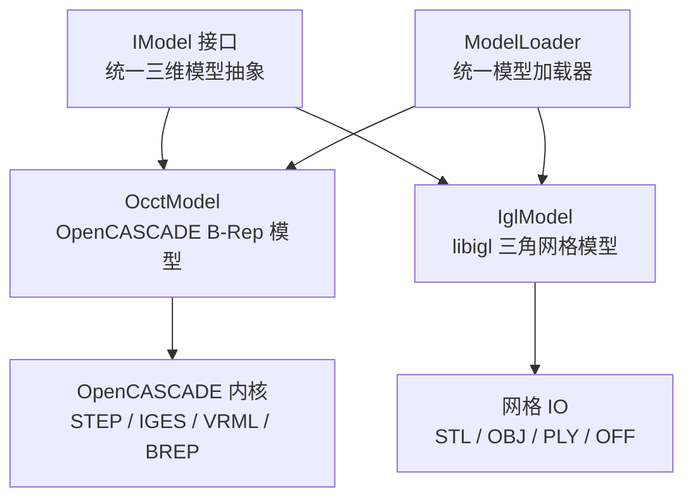
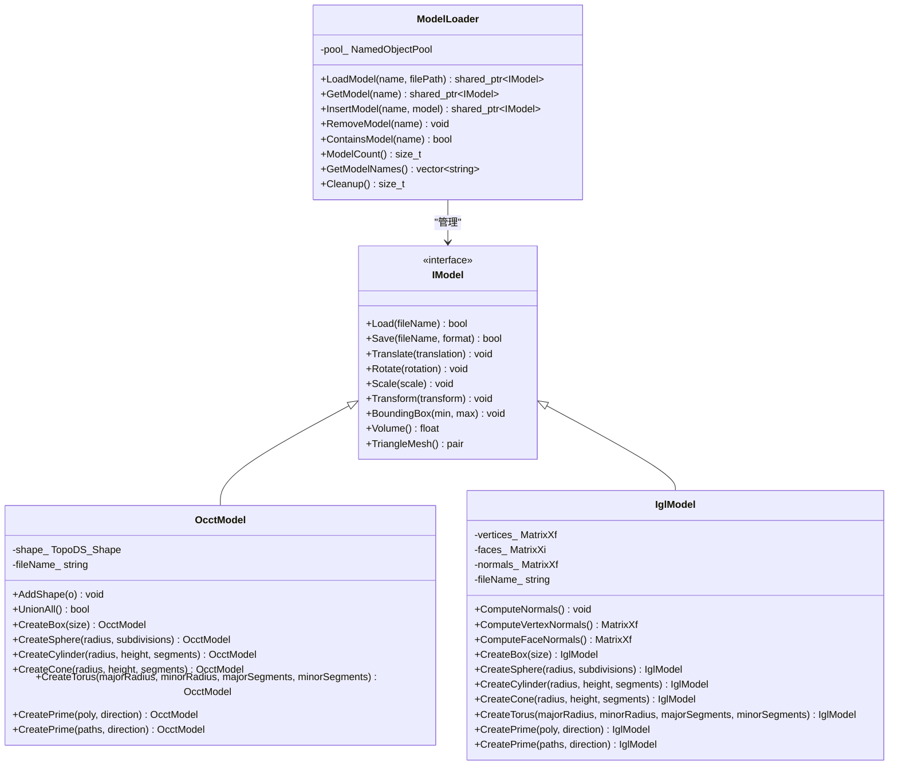
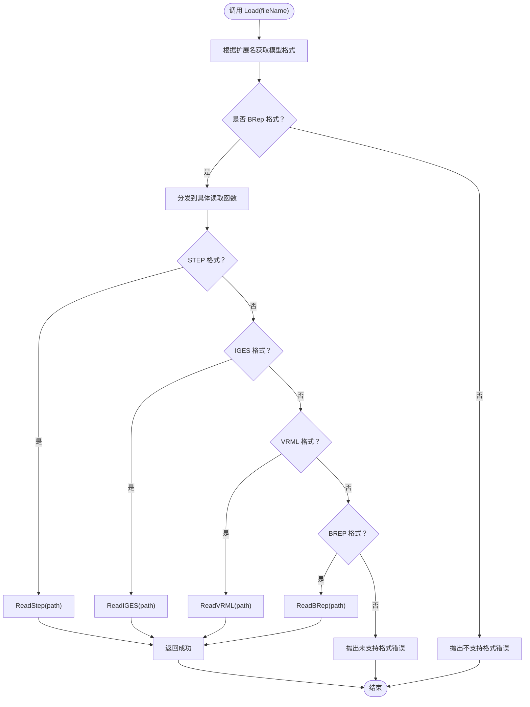
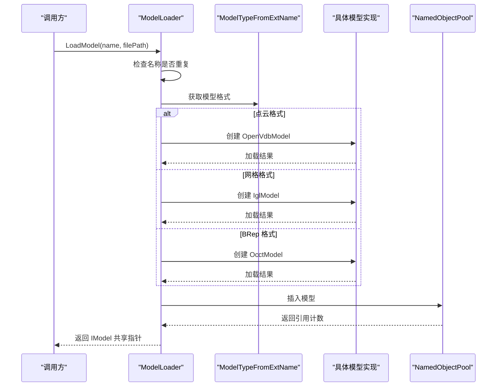
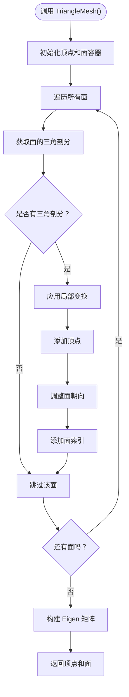
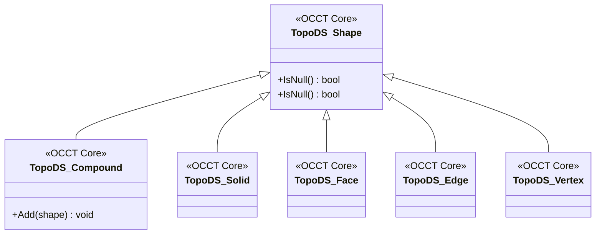

# OpenCASCADE CAD 模型实现

<cite>
**本文引用的文件**   
- [OcctModel.hpp](file://cadmodel/OcctModel.hpp)
- [OcctModel.cpp](file://cadmodel/OcctModel.cpp)
- [IModel.hpp](file://base/IModel.hpp)
- [ModelFormat.hpp](file://base/ModelFormat.hpp)
- [ModelLoader.hpp](file://preprocess/ModelLoader.hpp)
- [ModelLoader.cpp](file://preprocess/ModelLoader.cpp)
- [IglModel.hpp](file://meshmodel/IglModel.hpp)
</cite>

## 目录
1. [项目概述与快速开始](#项目概述与快速开始)
2. [架构总览](#架构总览)
3. [核心概念](#核心概念)
4. [核心模块详解](#核心模块详解)
5. [高级主题](#高级主题)
6. [Lua 脚本系统](#lua-脚本系统)
7. [API 参考文档](#api-参考文档)
8. [集成指南](#集成指南)
9. [开发·测试与贡献](#开发·测试与贡献)
10. [扩展开发指南](#扩展开发指南)
11. [示例与教程](#示例与教程)
12. [部署·故障排除与FAQ](#部署·故障排除与faq)
13. [附录](#附录)

## 项目概述与快速开始
本页面聚焦 HsBaSlicer 中基于 OpenCASCADE 的 CAD 模型实现，核心是 `OcctModel` 类。它封装 OpenCASCADE 的 `TopoDS_Shape`，提供 B-Rep 格式 CAD 模型的加载、保存、几何变换、包围盒、体积、三角剖分、布尔运算、实体抽壳以及基础几何体创建能力。同时，项目通过统一的 `IModel` 接口和 `ModelLoader` 调度器，将 CAD 模型与网格模型、点云模型统一抽象，便于在切片、路径生成等下游流程中使用。

对于初学者，建议按以下顺序阅读：
- 先理解 `IModel` 接口如何统一不同模型类型。
- 再了解 `ModelLoader` 如何根据文件扩展名选择 `OcctModel` 或 `IglModel`。
- 最后深入 `OcctModel` 的具体实现，包括 STEP、IGES、VRML、BREP 的读写、布尔运算、抽壳、拉伸建模等。



**图表来源**
- [IModel.hpp:66-139](file://base/IModel.hpp#L66-L139)
- [OcctModel.hpp:22-124](file://cadmodel/OcctModel.hpp#L22-L124)
- [IglModel.hpp:18-121](file://meshmodel/IglModel.hpp#L18-L121)
- [ModelLoader.hpp:23-59](file://preprocess/ModelLoader.hpp#L23-L59)

**章节来源**
- [IModel.hpp:66-139](file://base/IModel.hpp#L66-L139)
- [OcctModel.hpp:22-124](file://cadmodel/OcctModel.hpp#L22-L124)
- [ModelLoader.hpp:23-59](file://preprocess/ModelLoader.hpp#L23-L59)

## 架构总览
HsBaSlicer 的模型层采用“接口 + 多实现 + 统一调度”的设计：
- `IModel` 定义模型通用能力：加载、保存、变换、包围盒、体积、三角网格。
- `OcctModel` 实现 B-Rep CAD 模型，依赖 OpenCASCADE。
- `IglModel` 实现三角网格模型，依赖 libigl。
- `ModelLoader` 根据文件扩展名自动选择实现，并将模型放入命名对象池。



**图表来源**
- [IModel.hpp:66-139](file://base/IModel.hpp#L66-L139)
- [OcctModel.hpp:22-124](file://cadmodel/OcctModel.hpp#L22-L124)
- [IglModel.hpp:18-121](file://meshmodel/IglModel.hpp#L18-L121)
- [ModelLoader.hpp:30-202](file://preprocess/ModelLoader.hpp#L30-L202)

**章节来源**
- [IModel.hpp:66-139](file://base/IModel.hpp#L66-L139)
- [OcctModel.hpp:22-124](file://cadmodel/OcctModel.hpp#L22-L124)
- [IglModel.hpp:18-121](file://meshmodel/IglModel.hpp#L18-L121)
- [ModelLoader.hpp:30-202](file://preprocess/ModelLoader.hpp#L30-L202)

## 核心概念
### IModel 接口
`IModel` 是所有三维模型的统一抽象，定义了加载、保存、变换、包围盒、体积、三角网格等通用方法。它不关心模型内部是 B-Rep、三角网格还是点云，从而允许上层逻辑以统一方式处理不同数据源。

关键点：
- 支持多种模型格式枚举，包括网格、BRep、CSG、点云。
- 所有模型必须实现 `Load`、`Save`、`Translate`、`Rotate`、`Scale`、`Transform`、`BoundingBox`、`Volume`、`TriangleMesh`。
- 为 C 接口暴露了向量、四元数、矩阵、多边形等基础数据结构。

**章节来源**
- [IModel.hpp:66-139](file://base/IModel.hpp#L66-L139)

### 模型格式分类
`ModelFormat` 枚举将模型分为网格、BRep、CSG、点云等类别，并提供工具函数判断格式类型。`OcctModel` 主要处理 BRep 格式，包括 STEP、IGES、VRML、BREP。

| 格式类别 | 典型扩展名 | 说明 |
|---|---|---|
| 网格 | STL、OBJ、PLY、OFF | 三角网格模型，适合渲染和网格算法 |
| BRep | STEP、IGES、VRML、BREP | 精确几何建模，适合工程设计和布尔运算 |
| CSG | SLDPRT、CATPART | 参数化 CAD 软件原生格式（预留） |
| 点云 | XYZ、VDB | 扫描数据，适合重建和体素处理 |

**章节来源**
- [IModel.hpp:66-109](file://base/IModel.hpp#L66-L109)
- [ModelFormat.hpp:19-59](file://base/ModelFormat.hpp#L19-L59)

## 核心模块详解
### OcctModel：OpenCASCADE B-Rep CAD 模型
`OcctModel` 是 HsBaSlicer 中基于 OpenCASCADE 的核心 CAD 模型实现。它封装 `TopoDS_Shape`，提供完整的 CAD 数据处理能力。

#### 支持的 CAD 格式
- **STEP**：工业标准交换格式，广泛用于机械设计和制造。
- **IGES**：早期 CAD 交换格式，仍被许多系统支持。
- **VRML**：虚拟现实建模语言，可用于简单 3D 场景。
- **BREP**：OpenCASCADE 原生二进制格式，保留完整拓扑信息。

#### 核心功能
- **加载与保存**：根据文件扩展名自动选择读取器或写入器。
- **几何变换**：平移、旋转、缩放、仿射变换。
- **几何查询**：包围盒、体积、三角剖分。
- **布尔运算**：并集、交集、差集、异或。
- **实体抽壳**：将实体转换为薄壳结构。
- **基础几何体**：立方体、球体、圆柱体、圆锥体、圆环体。
- **拉伸建模**：从 2D 多边形沿方向拉伸为 3D 实体。



**图表来源**
- [OcctModel.cpp:213-237](file://cadmodel/OcctModel.cpp#L213-L237)

#### 代码级分析
- **构造与析构**：支持空构造、从 `TopoDS_Shape` 拷贝或移动构造。
- **形状组合**：`AddShape` 将其他模型或原始形状加入当前复合形状。
- **文件格式处理**：`Load` 根据扩展名调用对应读取函数；`Save` 根据目标格式调用对应写入函数。
- **变换操作**：所有变换最终转换为 OpenCASCADE 的 `gp_Trsf` 变换矩阵。
- **三角剖分**：遍历面并提取三角形顶点与索引，返回 libigl 风格的顶点和面数组。
- **布尔运算**：使用 `BRepAlgoAPI_Fuse`、`BRepAlgoAPI_Common`、`BRepAlgoAPI_Cut` 实现。
- **抽壳操作**：使用 `BRepOffsetAPI_MakeThickSolid` 实现实体抽壳。
- **拉伸建模**：从 2D 多边形构建线框、面，然后沿方向拉伸为实体。

**章节来源**
- [OcctModel.hpp:30-124](file://cadmodel/OcctModel.hpp#L30-L124)
- [OcctModel.cpp:63-669](file://cadmodel/OcctModel.cpp#L63-L669)

### ModelLoader：统一模型加载器
`ModelLoader` 是 HsBaSlicer 的模型入口点，负责根据文件扩展名自动选择合适的模型实现。

#### 加载流程
1. 检查模型名称是否已存在。
2. 根据文件扩展名判断模型类型。
3. 如果是点云格式，尝试加载 `OpenVdbModel`。
4. 如果是网格格式，加载 `IglModel`。
5. 如果是 BRep 格式，加载 `OcctModel`。
6. 将模型插入命名对象池并返回共享指针。



**图表来源**
- [ModelLoader.cpp:45-84](file://preprocess/ModelLoader.cpp#L45-L84)

#### 高级操作
当启用 CGAL 时，`ModelLoader` 还提供布尔运算和抽壳操作：
- **ThickSolidModel**：对 `OcctModel` 执行抽壳。
- **BooleanUnion/Intersection/Difference/Xor**：优先使用 `OcctModel` 的精确布尔运算，否则回退到 `IglModel` 的网格布尔运算。

**章节来源**
- [ModelLoader.hpp:30-202](file://preprocess/ModelLoader.hpp#L30-L202)
- [ModelLoader.cpp:45-321](file://preprocess/ModelLoader.cpp#L45-L321)

### IglModel：libigl 三角网格模型
`IglModel` 是基于 libigl 的三角网格模型实现，与 `OcctModel` 并列作为 `IModel` 的不同实现。它存储顶点、面和法向量，提供网格相关的计算能力。

#### 与 OcctModel 的关系
- **互补关系**：`OcctModel` 适合精确几何建模和布尔运算，`IglModel` 适合网格处理和渲染。
- **转换机制**：`OcctModel::TriangleMesh` 可将 B-Rep 转换为三角网格；`ModelLoader` 中的辅助函数可在需要时将任意模型转换为 `IglModel`。
- **回退策略**：当布尔运算的两个输入不是 `OcctModel` 时，`ModelLoader` 会回退到 `IglModel` 的网格布尔运算。

**章节来源**
- [IglModel.hpp:18-121](file://meshmodel/IglModel.hpp#L18-L121)
- [ModelLoader.cpp:137-166](file://preprocess/ModelLoader.cpp#L137-L166)

## 高级主题
### 精确几何建模的优势
`OcctModel` 基于 OpenCASCADE 内核，具有以下优势：
- **精确性**：B-Rep 表示数学上精确的几何体，避免网格近似误差。
- **拓扑完整性**：保留面、边、顶点的拓扑关系，支持复杂布尔运算。
- **工程兼容性**：支持 STEP、IGES 等工业标准格式，便于与 CAD 软件交互。
- **体积计算**：直接计算实体体积，无需依赖网格近似。

### 与网格模型的转换机制
`OcctModel` 通过 `TriangleMesh` 方法将 B-Rep 转换为三角网格：
1. 遍历所有面。
2. 获取每个面的三角剖分数据。
3. 应用局部变换矩阵。
4. 调整顶点索引和面朝向。
5. 返回 libigl 风格的顶点和面数组。



**图表来源**
- [OcctModel.cpp:353-400](file://cadmodel/OcctModel.cpp#L353-L400)

### 布尔运算与实体抽壳
`OcctModel` 提供两种布尔运算方式：
- **函数式布尔运算**：`Union`、`Intersection`、`Difference`、`Xor` 直接操作两个 `OcctModel`。
- **成员函数布尔运算**：`UnionAll` 将所有子实体合并为一个实体。

抽壳操作通过 `ThickSolid` 函数实现，支持：
- **整体抽壳**：对整个实体进行均匀厚度抽壳。
- **选择性抽壳**：指定某些面保持开放，形成开口壳体。

**章节来源**
- [OcctModel.cpp:409-540](file://cadmodel/OcctModel.cpp#L409-L540)

## Lua 脚本系统
HsBaSlicer 支持通过 Lua 脚本扩展切片流程，但 `OcctModel` 本身不直接暴露给 Lua。用户通常通过 `ModelLoader` 加载模型后，在 Lua 脚本中进行后续处理。

如果需要从 Lua 访问 CAD 模型，建议：
1. 在 C++ 层通过 `ModelLoader` 加载模型。
2. 将模型转换为 `IglModel` 或提取网格数据。
3. 通过 Lua 适配器将网格数据传递给 Lua 脚本。

目前源码中没有直接暴露 `OcctModel` 给 Lua 的代码，因此建议在 C++ 层完成 CAD 相关操作，再将结果传递给 Lua。

[本节为概念性内容，不直接分析具体文件]

## API 参考文档
### OcctModel 关键 API
| 方法 | 参数 | 返回值 | 说明 |
|---|---|---|---|
| `Load` | `fileName` | `bool` | 从文件加载 CAD 模型 |
| `Save` | `fileName`, `format` | `bool` | 保存模型到指定格式 |
| `Translate` | `translation` | `void` | 平移模型 |
| `Rotate` | `rotation` | `void` | 旋转模型 |
| `Scale` | `scale` 或 `Vector3f` | `void` | 缩放模型 |
| `Transform` | `Isometry3f`/`Matrix4f`/`Affine` | `void` | 应用变换矩阵 |
| `BoundingBox` | `min`, `max` | `void` | 获取包围盒 |
| `Volume` | 无 | `float` | 计算体积 |
| `TriangleMesh` | 无 | `pair<MatrixXf, MatrixXi>` | 转换为三角网格 |
| `UnionAll` | 无 | `bool` | 合并所有子实体 |
| `CreateBox` | `size` | `OcctModel` | 创建立方体 |
| `CreateSphere` | `radius`, `subdivisions` | `OcctModel` | 创建球体 |
| `CreateCylinder` | `radius`, `height`, `segments` | `OcctModel` | 创建圆柱体 |
| `CreateCone` | `radius`, `height`, `segments` | `OcctModel` | 创建圆锥体 |
| `CreateTorus` | `majorRadius`, `minorRadius`, `majorSegments`, `minorSegments` | `OcctModel` | 创建圆环体 |
| `CreatePrime` | `poly`, `direction` | `OcctModel` | 从单多边形拉伸 |
| `CreatePrime` | `paths`, `direction` | `OcctModel` | 从多多边形拉伸 |

**章节来源**
- [OcctModel.hpp:30-124](file://cadmodel/OcctModel.hpp#L30-L124)

### ModelLoader 关键 API
| 方法 | 参数 | 返回值 | 说明 |
|---|---|---|---|
| `LoadModel` | `name`, `filePath` | `shared_ptr<IModel>` | 加载模型到命名池 |
| `GetModel` | `name` | `shared_ptr<IModel>` | 按名称获取模型 |
| `InsertModel` | `name`, `model` | `shared_ptr<IModel>` | 插入预构建模型 |
| `RemoveModel` | `name` | `void` | 移除模型 |
| `ContainsModel` | `name` | `bool` | 检查模型是否存在 |
| `ModelCount` | 无 | `size_t` | 获取模型数量 |
| `GetModelNames` | 无 | `vector<string>` | 获取所有模型名称 |
| `Cleanup` | 无 | `size_t` | 清理未引用模型 |

**章节来源**
- [ModelLoader.hpp:30-202](file://preprocess/ModelLoader.hpp#L30-L202)

## 集成指南
### 在项目中集成 OcctModel
1. **确保启用 USE_OCCT 编译选项**：`ModelLoader` 在加载 BRep 格式时需要 OpenCASCADE。
2. **链接 OpenCASCADE 库**：确保构建系统正确链接 OpenCASCADE 相关库。
3. **使用 ModelLoader 加载模型**：通过 `LoadModel` 方法加载 STEP、IGES、VRML、BREP 文件。
4. **处理模型**：调用 `OcctModel` 的方法进行布尔运算、抽壳、变换等操作。
5. **转换为网格**：如需渲染或切片，调用 `TriangleMesh` 转换为三角网格。

### 自定义 CAD 格式支持
要扩展支持自定义 CAD 格式，可以：
1. **在 `ModelFormat` 中添加新格式枚举**。
2. **在 `ModelTypeFromExtName` 中添加扩展名映射**。
3. **在 `OcctModel` 中添加对应的读取和写入函数**。
4. **在 `Load` 和 `Save` 方法中添加格式分支**。

例如，如果要支持 SolidWorks 的 `.sldprt` 格式：
1. 在 `ModelFormat` 中添加 `SLDPRT` 枚举。
2. 在 `ModelTypeFromExtName` 中将 `.sldprt` 映射到 `SLDPRT`。
3. 在 `OcctModel` 中实现 `ReadSldprt` 和 `WriteSldprt`。
4. 在 `Load` 和 `Save` 中添加 `SLDPRT` 分支。

**章节来源**
- [ModelFormat.hpp:68-114](file://base/ModelFormat.hpp#L68-L114)
- [OcctModel.cpp:213-271](file://cadmodel/OcctModel.cpp#L213-L271)

## 开发·测试与贡献
### 单元测试
项目包含针对 `OcctModel` 的单元测试，位于 `tests/Models/occt_model_test.cpp`。测试覆盖：
- 基本构造和赋值。
- 文件加载和保存。
- 几何变换。
- 布尔运算。
- 抽壳操作。
- 拉伸建模。

### 调试建议
- **文件路径问题**：确保文件路径使用 UTF-8 编码，`OcctModel` 会通过 `utf8_to_local` 转换为本地编码。
- **OpenCASCADE 异常**：OpenCASCADE 操作可能抛出 `Standard_Failure`，`OcctModel` 会将其转换为 `IOError`。
- **内存泄漏**：`TopoDS_Shape` 是 OpenCASCADE 的智能指针类型，通常不需要手动管理内存。
- **性能瓶颈**：复杂布尔运算和大量三角剖分可能耗时，建议分批处理或使用并行优化。

**章节来源**
- [OcctModel.cpp:76-147](file://cadmodel/OcctModel.cpp#L76-L147)

## 扩展开发指南
### 实现自定义 CAD 模型
如果现有 `OcctModel` 无法满足需求，可以实现自定义 CAD 模型：
1. **继承 `IModel` 接口**。
2. **实现所有虚方法**：`Load`、`Save`、`Translate`、`Rotate`、`Scale`、`Transform`、`BoundingBox`、`Volume`、`TriangleMesh`。
3. **注册到 `ModelLoader`**：在 `LoadModel` 中添加对新格式的识别和实例化逻辑。
4. **编写单元测试**：确保新模型的正确性和稳定性。

### 与现有系统集成
- **命名对象池**：使用 `NamedObjectPool` 管理模型生命周期。
- **错误处理**：遵循项目的错误类型，如 `InvalidArgumentError`、`RuntimeError`、`IOError`。
- **线程安全**：注意 `TopoDS_Shape` 的线程安全性，避免多线程同时修改同一形状。

**章节来源**
- [ModelLoader.cpp:45-84](file://preprocess/ModelLoader.cpp#L45-L84)

## 示例与教程
### 加载 STEP 模型
```cpp
#include "preprocess/ModelLoader.hpp"
#include "cadmodel/OcctModel.hpp"

auto loader = HsBa::Slicer::ModelLoader();
auto model = loader.LoadModel("my_part", "part.step");

// 转换为 OcctModel 进行 CAD 操作
auto* occtModel = dynamic_cast<HsBa::Slicer::OcctModel*>(model.get());
if (occtModel) {
    // 执行布尔运算、抽壳等操作
}
```

### 创建基础几何体
```cpp
#include "cadmodel/OcctModel.hpp"

auto box = HsBa::Slicer::OcctModel::CreateBox({1.0f, 2.0f, 3.0f});
auto sphere = HsHa::Slicer::OcctModel::CreateSphere(1.0f, 8);
auto cylinder = HsBa::Slicer::OcctModel::CreateCylinder(0.5f, 2.0f, 32);
```

### 执行布尔运算
```cpp
#include "cadmodel/OcctModel.hpp"

auto result = HsBa::Slicer::Union(modelA, modelB);
auto intersection = HsBa::Slicer::Intersection(modelA, modelB);
auto difference = HsBa::Slicer::Difference(modelA, modelB);
```

### 转换为网格
```cpp
#include "meshmodel/IglModel.hpp"

auto [vertices, faces] = occtModel->TriangleMesh();
auto meshModel = HsBa::Slicer::IglModel(vertices, faces);
```

[本节为示例性内容，不直接分析具体文件]

## 部署·故障排除与FAQ
### 常见问题
1. **无法加载 STEP 文件**
   - 检查文件路径是否正确。
   - 确认文件是否为有效的 STEP 格式。
   - 查看 OpenCASCADE 日志输出。

2. **布尔运算失败**
   - 检查输入模型是否封闭。
   - 调整容差参数。
   - 简化复杂几何体后再进行布尔运算。

3. **内存不足**
   - 减少三角剖分的复杂度。
   - 分批处理大型模型。
   - 及时释放不再使用的模型。

4. **性能缓慢**
   - 避免不必要的三角剖分。
   - 使用 `UnionAll` 预先合并模型。
   - 考虑使用并行处理。

### 性能优化建议
- **批量操作**：将多个布尔运算合并为一次操作。
- **延迟三角剖分**：只在需要渲染或切片时才调用 `TriangleMesh`。
- **模型简化**：在导入前简化复杂几何体。
- **内存管理**：及时释放中间结果，避免内存累积。

**章节来源**
- [OcctModel.cpp:353-400](file://cadmodel/OcctModel.cpp#L353-L400)

## 附录
### OpenCASCADE 核心类关系


**图表来源**
- [OcctModel.hpp:11-14](file://cadmodel/OcctModel.hpp#L11-L14)

### 文件格式支持矩阵
| 格式 | 读取 | 写入 | 说明 |
|---|---:|---:|---|
| STEP | ✓ | ✓ | 工业标准交换格式 |
| IGES | ✓ | ✓ | 早期 CAD 交换格式 |
| VRML | ✓ | ✓ | 虚拟现实建模语言 |
| BREP | ✓ | ✓ | OpenCASCADE 原生格式 |
| STL | ✗ | ✓ | 通过 IglModel 支持 |
| OBJ | ✗ | ✓ | 通过 IglModel 支持 |
| PLY | ✗ | ✓ | 通过 IglModel 支持 |
| OFF | ✗ | ✓ | 通过 IglModel 支持 |

**章节来源**
- [OcctModel.cpp:213-271](file://cadmodel/OcctModel.cpp#L213-L271)
- [IglModel.hpp:55-58](file://meshmodel/IglModel.hpp#L55-L58)