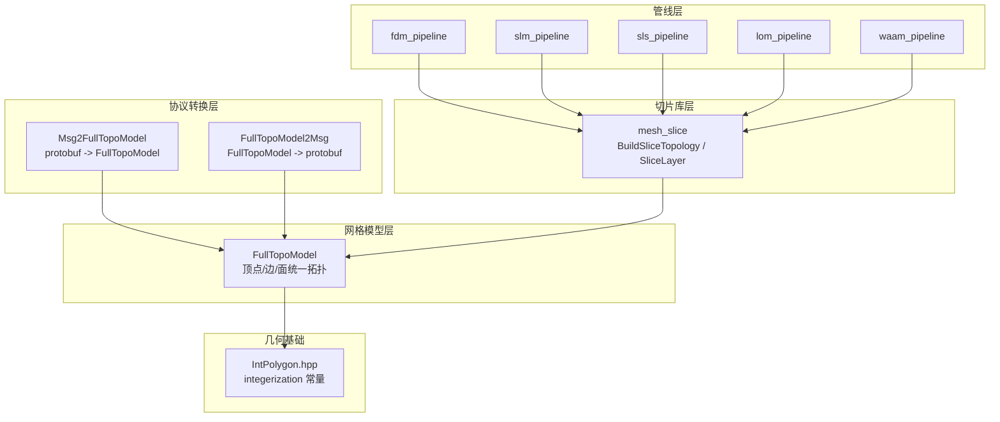
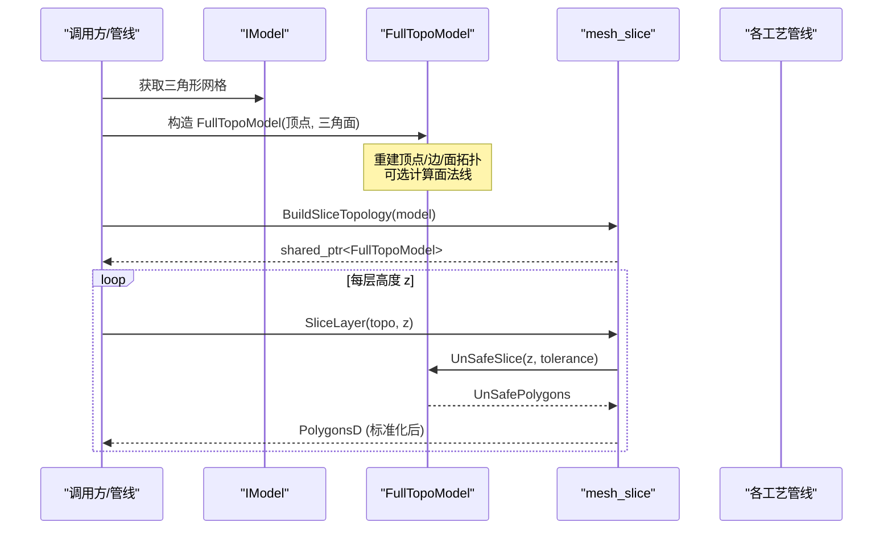
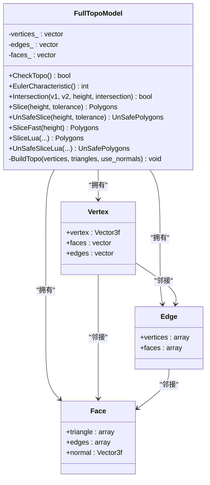
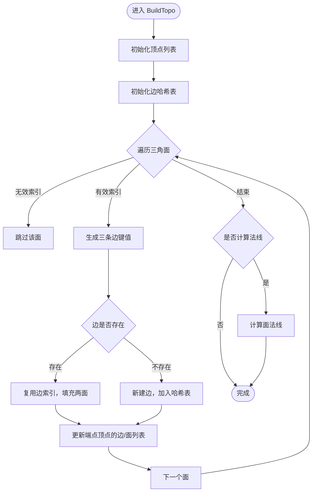
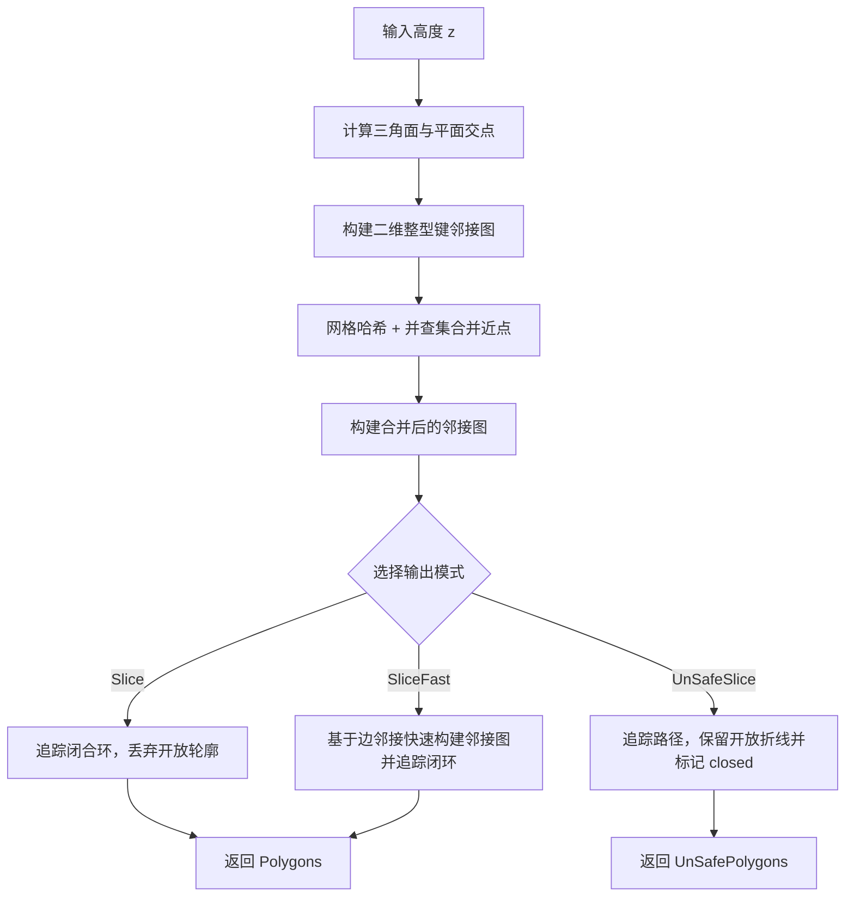
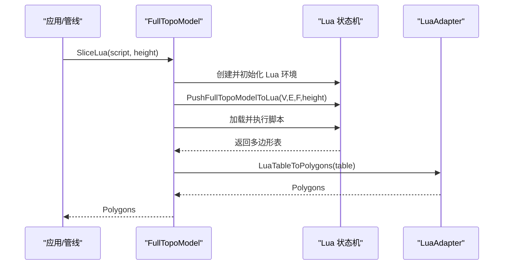
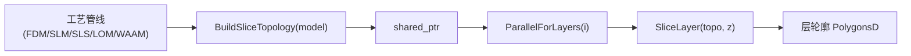
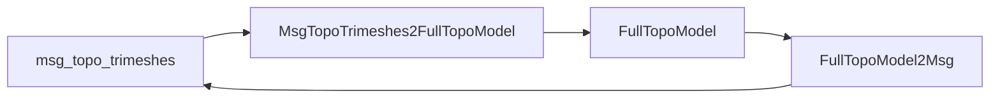
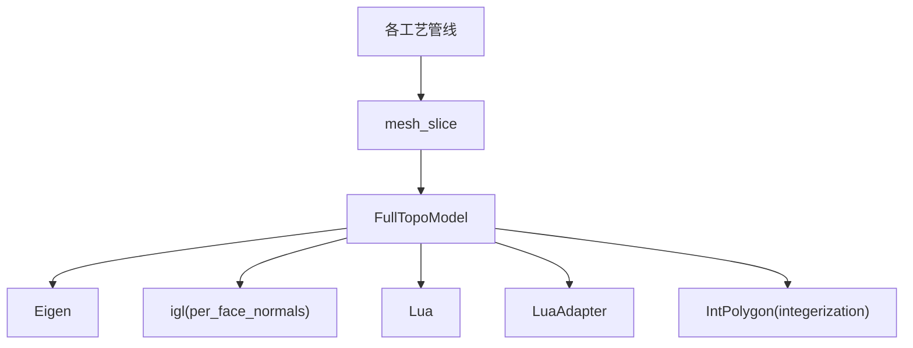

# 完整拓扑模型

<cite>
**本文引用的文件**   
- [FullTopoModel.hpp](file://meshmodel/FullTopoModel.hpp)
- [FullTopoModel.cpp](file://meshmodel/FullTopoModel.cpp)
- [Msg2FullTopoModel.hpp](file://convert/Msg2FullTopoModel.hpp)
- [Msg2FullTopoModel.cpp](file://convert/Msg2FullTopoModel.cpp)
- [FullTopoModel2Msg.hpp](file://convert/FullTopoModel2Msg.hpp)
- [FullTopoModel2Msg.cpp](file://convert/FullTopoModel2Msg.cpp)
- [mesh_slice.hpp](file://LibHsBaSlicer/Slice/mesh_slice.hpp)
- [mesh_slice.cpp](file://LibHsBaSlicer/Slice/mesh_slice.cpp)
- [fdm_pipeline.cpp](file://DllHsBaSlicer/fdm_pipeline.cpp)
- [slm_pipeline.cpp](file://DllHsBaSlicer/slm_pipeline.cpp)
- [sls_pipeline.cpp](file://DllHsBaSlicer/sls_pipeline.cpp)
- [lom_pipeline.cpp](file://DllHsBaSlicer/lom_pipeline.cpp)
- [waam_pipeline.cpp](file://DllHsBaSlicer/waam_pipeline.cpp)
- [IntPolygon.hpp](file://2D/IntPolygon.hpp)
</cite>

## 目录
1. [引言](#引言)
2. [项目结构](#项目结构)
3. [核心组件](#核心组件)
4. [架构总览](#架构总览)
5. [详细组件分析](#详细组件分析)
6. [依赖关系分析](#依赖关系分析)
7. [性能与内存管理](#性能与内存管理)
8. [故障排除指南](#故障排除指南)
9. [结论](#结论)
10. [附录](#附录)

## 引言
本文件面向 HsBaSlicer 的“完整拓扑模型”主题，聚焦 FullTopoModel 类如何提供完整的拓扑信息存储与操作能力。该模型在构造阶段重建顶点、边、面之间的拓扑关系，并提供面向 Z 轴切片的多种接口：安全切片（仅闭合轮廓）、不安全切片（允许开放轮廓）、快速切片（基于已重建拓扑的高效路径）以及 Lua 脚本扩展切片。文档将解释其数据结构、算法流程、与上层管线（FDM/SLM/SLS/LOM/WAAM）的集成方式，并给出性能优化与内存管理建议。

## 项目结构
围绕 FullTopoModel 的关键代码分布在以下模块：
- meshmodel: 完整拓扑模型定义与实现
- convert: 与 protobuf 消息的双向转换
- LibHsBaSlicer/Slice: 对外暴露的切片 API 与拓扑构建封装
- DllHsBaSlicer/*_pipeline: 各工艺管线中复用 BuildSliceTopology + SliceLayer 的模式
- 2D: 坐标整数化常量与多边形类型

**图表来源**
- [FullTopoModel.hpp:43-142](file://meshmodel/FullTopoModel.hpp#L43-L142)
- [Msg2FullTopoModel.hpp:18-22](file://convert/Msg2FullTopoModel.hpp#L18-L22)
- [FullTopoModel2Msg.hpp:15-16](file://convert/FullTopoModel2Msg.hpp#L15-L16)
- [mesh_slice.hpp:97-116](file://LibHsBaSlicer/Slice/mesh_slice.hpp#L97-L116)
- [fdm_pipeline.cpp:259-279](file://DllHsBaSlicer/fdm_pipeline.cpp#L259-L279)
- [slm_pipeline.cpp:280-294](file://DllHsBaSlicer/slm_pipeline.cpp#L280-L294)
- [sls_pipeline.cpp:220-232](file://DllHsBaSlicer/sls_pipeline.cpp#L220-L232)
- [lom_pipeline.cpp:233-251](file://DllHsBaSlicer/lom_pipeline.cpp#L233-L251)
- [waam_pipeline.cpp:208-231](file://DllHsBaSlicer/waam_pipeline.cpp#L208-L231)
- [IntPolygon.hpp:17](file://2D/IntPolygon.hpp#L17)

**章节来源**
- [FullTopoModel.hpp:43-142](file://meshmodel/FullTopoModel.hpp#L43-L142)
- [mesh_slice.hpp:97-116](file://LibHsBaSlicer/Slice/mesh_slice.hpp#L97-L116)

## 核心组件
FullTopoModel 是面向切片的完整拓扑重建网格模型。它通过构造函数从 IModel 或原始顶点/三角面片数据重建拓扑，并在内部维护三类元素：
- 顶点 Vertex：包含三维坐标，以及关联的面和边索引列表
- 边 Edge：连接两个顶点，并记录相邻的两个面索引
- 面 Face：由三个顶点构成，记录三条边索引及可选的法向量

该类还提供：
- 拓扑完整性检查 CheckTopo
- 欧拉示性数 EulerCharacteristic
- 线段与水平面相交 Intersection
- 多种切片接口：Slice、UnSafeSlice、SliceFast、SliceLua/UnSafeSliceLua
- 与 Lua 环境的桥接 PushFullTopoModelToLua

此外，convert 模块提供与 protobuf 消息的双向转换；LibHsBaSlicer 提供 BuildSliceTopology 与 SliceLayer 等高层 API；各工艺管线统一采用“一次构建拓扑，并行逐层切片”的模式。

**章节来源**
- [FullTopoModel.hpp:56-142](file://meshmodel/FullTopoModel.hpp#L56-L142)
- [FullTopoModel.cpp:27-48](file://meshmodel/FullTopoModel.cpp#L27-L48)
- [Msg2FullTopoModel.hpp:18-22](file://convert/Msg2FullTopoModel.hpp#L18-L22)
- [FullTopoModel2Msg.hpp:15-16](file://convert/FullTopoModel2Msg.hpp#L15-L16)
- [mesh_slice.cpp:106-116](file://LibHsBaSlicer/Slice/mesh_slice.cpp#L106-L116)

## 架构总览
下图展示从输入模型到切片输出的整体流程，突出 FullTopoModel 在其中的位置与作用。

**图表来源**
- [mesh_slice.cpp:46-116](file://LibHsBaSlicer/Slice/mesh_slice.cpp#L46-L116)
- [FullTopoModel.cpp:328-600](file://meshmodel/FullTopoModel.cpp#L328-L600)
- [fdm_pipeline.cpp:259-279](file://DllHsBaSlicer/fdm_pipeline.cpp#L259-L279)
- [slm_pipeline.cpp:280-294](file://DllHsBaSlicer/slm_pipeline.cpp#L280-L294)
- [sls_pipeline.cpp:220-232](file://DllHsBaSlicer/sls_pipeline.cpp#L220-L232)
- [lom_pipeline.cpp:233-251](file://DllHsBaSlicer/lom_pipeline.cpp#L233-L251)
- [waam_pipeline.cpp:208-231](file://DllHsBaSlicer/waam_pipeline.cpp#L208-L231)

## 详细组件分析

### FullTopoModel 类与数据结构
FullTopoModel 以数组式容器保存顶点、边、面，并通过索引建立双向邻接关系。构造时遍历三角面片，为每条边建立唯一键（无序对顶点索引），使用哈希表去重并填充边的两面索引；同时更新顶点的边/面邻接列表。若启用法线计算，则调用外部库计算每个面的法向量。

**图表来源**
- [FullTopoModel.hpp:56-142](file://meshmodel/FullTopoModel.hpp#L56-L142)
- [FullTopoModel.cpp:50-158](file://meshmodel/FullTopoModel.cpp#L50-L158)

**章节来源**
- [FullTopoModel.hpp:56-142](file://meshmodel/FullTopoModel.hpp#L56-L142)
- [FullTopoModel.cpp:50-158](file://meshmodel/FullTopoModel.cpp#L50-L158)

### 拓扑重建算法 BuildTopo
BuildTopo 的核心步骤：
1. 初始化顶点列表，复制坐标
2. 使用哈希表 edge_map 按无序顶点对建边索引，避免重复边
3. 对每个三角面，记录三边索引，并填充边的两面索引
4. 更新两端顶点的边/面邻接列表
5. 可选：计算面法线

时间复杂度近似 O(F)，其中 F 为三角面数量；空间复杂度与 V+E+F 线性相关。

**图表来源**
- [FullTopoModel.cpp:50-158](file://meshmodel/FullTopoModel.cpp#L50-L158)

**章节来源**
- [FullTopoModel.cpp:50-158](file://meshmodel/FullTopoModel.cpp#L50-L158)

### 切片算法 Slice / UnSafeSlice / SliceFast
三种切片方法均基于 Z 轴水平面切割，但策略不同：
- Slice：对每个三角面求与平面的交点，构建二维整型键的邻接图，合并近点（并查集+网格哈希），再沿角度最小原则追踪闭合环，丢弃开放轮廓
- UnSafeSlice：同上，但保留开放折线，并标记 closed 标志
- SliceFast：先校验拓扑完整性，然后直接利用已重建的边邻接信息，扫描边与平面相交，构建邻接图并追踪闭环，速度更快

**图表来源**
- [FullTopoModel.cpp:328-600](file://meshmodel/FullTopoModel.cpp#L328-L600)
- [FullTopoModel.cpp:604-873](file://meshmodel/FullTopoModel.cpp#L604-L873)
- [FullTopoModel.cpp:875-1025](file://meshmodel/FullTopoModel.cpp#L875-L1025)

**章节来源**
- [FullTopoModel.cpp:328-600](file://meshmodel/FullTopoModel.cpp#L328-L600)
- [FullTopoModel.cpp:604-873](file://meshmodel/FullTopoModel.cpp#L604-L873)
- [FullTopoModel.cpp:875-1025](file://meshmodel/FullTopoModel.cpp#L875-L1025)

### Lua 脚本切片 SliceLua / UnSafeSliceLua
FullTopoModel 支持通过 Lua 脚本自定义切片逻辑。PushFullTopoModelToLua 将顶点、边、面数据以全局变量 V/E/F 和 height 注入 Lua 环境，脚本可返回多边形表，再由 LuaAdapter 转换为 Polygons。

**图表来源**
- [FullTopoModel.cpp:274-324](file://meshmodel/FullTopoModel.cpp#L274-L324)
- [FullTopoModel.cpp:1027-1073](file://meshmodel/FullTopoModel.cpp#L1027-L1073)
- [FullTopoModel.cpp:1132-1186](file://meshmodel/FullTopoModel.cpp#L1132-L1186)
- [FullTopoModel.cpp:1188-1241](file://meshmodel/FullTopoModel.cpp#L1188-L1241)

**章节来源**
- [FullTopoModel.cpp:274-324](file://meshmodel/FullTopoModel.cpp#L274-L324)
- [FullTopoModel.cpp:1027-1073](file://meshmodel/FullTopoModel.cpp#L1027-L1073)
- [FullTopoModel.cpp:1132-1186](file://meshmodel/FullTopoModel.cpp#L1132-L1186)
- [FullTopoModel.cpp:1188-1241](file://meshmodel/FullTopoModel.cpp#L1188-L1241)

### 与上层管线的集成
各工艺管线（FDM/SLM/SLS/LOM/WAAM）均采用相同模式：
- 调用 BuildSliceTopology 一次性构建 FullTopoModel
- 使用 ParallelForLayers 并行处理每一层，调用 SliceLayer(topo, z)
- 将结果用于后续路径生成或导出

**图表来源**
- [fdm_pipeline.cpp:259-279](file://DllHsBaSlicer/fdm_pipeline.cpp#L259-L279)
- [slm_pipeline.cpp:280-294](file://DllHsBaSlicer/slm_pipeline.cpp#L280-L294)
- [sls_pipeline.cpp:220-232](file://DllHsBaSlicer/sls_pipeline.cpp#L220-L232)
- [lom_pipeline.cpp:233-251](file://DllHsBaSlicer/lom_pipeline.cpp#L233-L251)
- [waam_pipeline.cpp:208-231](file://DllHsBaSlicer/waam_pipeline.cpp#L208-L231)
- [mesh_slice.cpp:106-116](file://LibHsBaSlicer/Slice/mesh_slice.cpp#L106-L116)

**章节来源**
- [fdm_pipeline.cpp:259-279](file://DllHsBaSlicer/fdm_pipeline.cpp#L259-L279)
- [slm_pipeline.cpp:280-294](file://DllHsBaSlicer/slm_pipeline.cpp#L280-L294)
- [sls_pipeline.cpp:220-232](file://DllHsBaSlicer/sls_pipeline.cpp#L220-L232)
- [lom_pipeline.cpp:233-251](file://DllHsBaSlicer/lom_pipeline.cpp#L233-L251)
- [waam_pipeline.cpp:208-231](file://DllHsBaSlicer/waam_pipeline.cpp#L208-L231)
- [mesh_slice.cpp:106-116](file://LibHsBaSlicer/Slice/mesh_slice.cpp#L106-L116)

### 与 protobuf 的消息转换
convert 模块提供 FullTopoModel 与 msg_topo_trimeshes 的双向转换：
- MsgTopoTrimeshes2FullTopoModel：解析顶点与三角面，过滤非法索引，构造 FullTopoModel
- FullTopoModel2Msg：序列化顶点与三角面，可选写入面法线

**图表来源**
- [Msg2FullTopoModel.cpp:12-36](file://convert/Msg2FullTopoModel.cpp#L12-L36)
- [FullTopoModel2Msg.cpp:10-40](file://convert/FullTopoModel2Msg.cpp#L10-L40)

**章节来源**
- [Msg2FullTopoModel.cpp:12-36](file://convert/Msg2FullTopoModel.cpp#L12-L36)
- [FullTopoModel2Msg.cpp:10-40](file://convert/FullTopoModel2Msg.cpp#L10-L40)

## 依赖关系分析
- FullTopoModel 依赖 Eigen 进行向量与矩阵运算，依赖 igl 计算面法线
- 切片算法依赖 2D 多边形类型与 integerization 常量进行坐标整数化
- 与 Lua 的交互通过 LuaAdapter 与 LuaNewObject 工具函数
- 上层管线通过 LibHsBaSlicer 的 mesh_slice 接口间接使用 FullTopoModel

**图表来源**
- [FullTopoModel.cpp:8-23](file://meshmodel/FullTopoModel.cpp#L8-L23)
- [IntPolygon.hpp:17](file://2D/IntPolygon.hpp#L17)
- [mesh_slice.cpp:46-116](file://LibHsBaSlicer/Slice/mesh_slice.cpp#L46-L116)

**章节来源**
- [FullTopoModel.cpp:8-23](file://meshmodel/FullTopoModel.cpp#L8-L23)
- [IntPolygon.hpp:17](file://2D/IntPolygon.hpp#L17)
- [mesh_slice.cpp:46-116](file://LibHsBaSlicer/Slice/mesh_slice.cpp#L46-L116)

## 性能与内存管理
- 拓扑重建
  - 使用 unordered_map 与 reserve 预分配减少扩容开销
  - 遍历三角面一次构建边映射，时间复杂度近似 O(F)
  - 可选法线计算仅在需要时启用，避免不必要的矩阵构造与 igl 调用
- 切片算法
  - 坐标整数化使用 integerization 常量，提升哈希与比较效率
  - 网格哈希 + 并查集合并近点，降低邻接图规模
  - SliceFast 在拓扑完整前提下直接基于边邻接构建图，减少重复计算
- 内存管理
  - 顶层 API 使用 GuardSlice 捕获异常并保证资源释放
  - BuildSliceTopology 返回 shared_ptr，允许多层并行切片共享拓扑对象
  - Lua 环境通过 MakeUniqueLuaState 自动销毁，避免泄漏
- 大规模模型优化建议
  - 优先使用 BuildSliceTopology + SliceLayer 模式，避免每层重复构建拓扑
  - 合理设置 tolerance，平衡精度与合并效果
  - 在不需要法线时关闭 use_normals，减少额外计算
  - 对超大模型分块处理或流式读取，控制峰值内存

**章节来源**
- [FullTopoModel.cpp:50-158](file://meshmodel/FullTopoModel.cpp#L50-L158)
- [FullTopoModel.cpp:328-600](file://meshmodel/FullTopoModel.cpp#L328-L600)
- [FullTopoModel.cpp:875-1025](file://meshmodel/FullTopoModel.cpp#L875-L1025)
- [mesh_slice.cpp:46-116](file://LibHsBaSlicer/Slice/mesh_slice.cpp#L46-L116)
- [IntPolygon.hpp:17](file://2D/IntPolygon.hpp#L17)

## 故障排除指南
- 拓扑不完整
  - 现象：SliceFast 抛出运行时错误
  - 原因：CheckTopo 失败，通常表示顶点/边/面索引不一致或缺失
  - 处理：检查输入三角面索引有效性，必要时修复模型或使用非快速切片
- Lua 脚本错误
  - 现象：Lua load error 或 runtime error
  - 原因：脚本语法错误或运行期异常
  - 处理：检查脚本内容，确认返回多边形表结构正确
- 切片结果为空
  - 现象：某层无轮廓
  - 可能原因：tolerance 过大导致点合并过度，或模型在该高度无有效截面
  - 处理：调整 tolerance，检查模型几何与高度范围
- 性能问题
  - 现象：切片耗时过长
  - 可能原因：频繁重建拓扑、未使用 SliceFast、tolerance 过小导致邻接图过大
  - 处理：复用 BuildSliceTopology，启用 SliceFast，调优 tolerance

**章节来源**
- [FullTopoModel.cpp:875-880](file://meshmodel/FullTopoModel.cpp#L875-L880)
- [FullTopoModel.cpp:1027-1073](file://meshmodel/FullTopoModel.cpp#L1027-L1073)
- [FullTopoModel.cpp:1132-1186](file://meshmodel/FullTopoModel.cpp#L1132-L1186)
- [FullTopoModel.cpp:1188-1241](file://meshmodel/FullTopoModel.cpp#L1188-L1241)

## 结论
FullTopoModel 为 HsBaSlicer 提供了统一的顶点/边/面拓扑存储与查询能力，支撑了多种切片算法与 Lua 扩展机制。通过一次构建拓扑、多层并行切片的模式，各工艺管线实现了高效稳定的切片流程。开发者在使用时应关注拓扑完整性、tolerance 参数与法线计算的开关，以获得更好的性能与稳定性。

## 附录
- 使用示例（概念性说明）
  - 预处理：从 IModel 或 protobuf 消息构建 FullTopoModel
  - 切片：调用 SliceLayer(topo, z) 获取每层轮廓
  - 后处理：根据工艺需求对轮廓进行填充、路径优化或导出
- 参考路径
  - 构建拓扑：[mesh_slice.cpp:106-116](file://LibHsBaSlicer/Slice/mesh_slice.cpp#L106-L116)
  - 逐层切片：[fdm_pipeline.cpp:259-279](file://DllHsBaSlicer/fdm_pipeline.cpp#L259-L279)
  - Lua 脚本切片：[FullTopoModel.cpp:1027-1073](file://meshmodel/FullTopoModel.cpp#L1027-L1073)