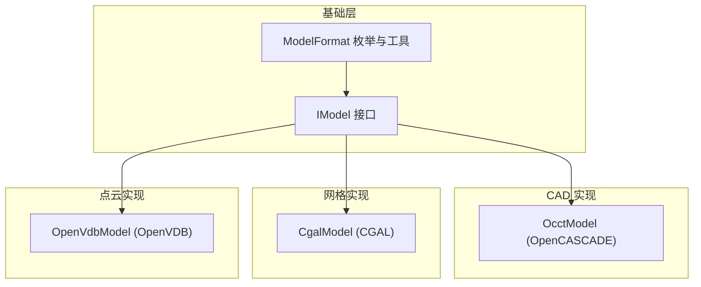
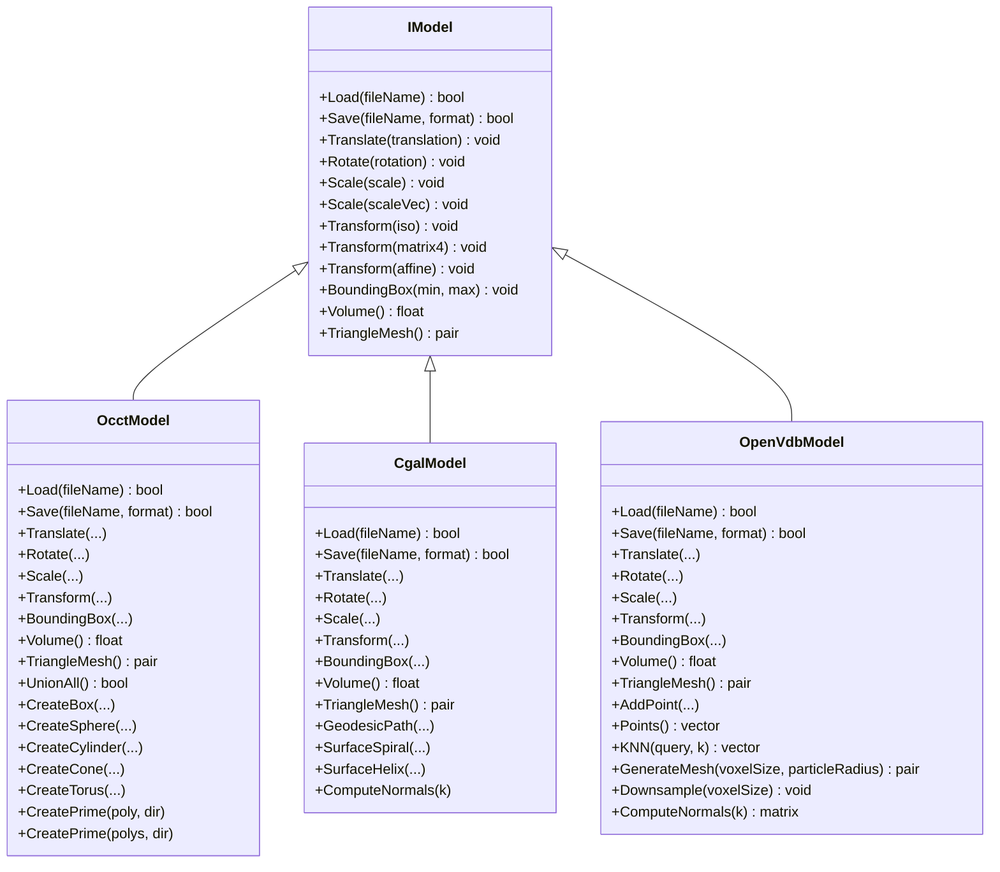
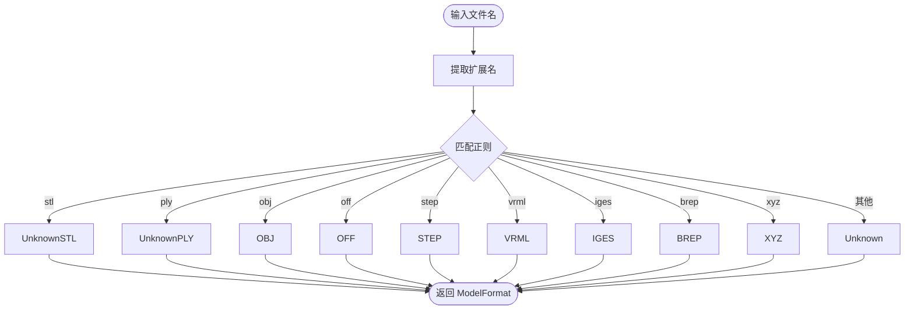
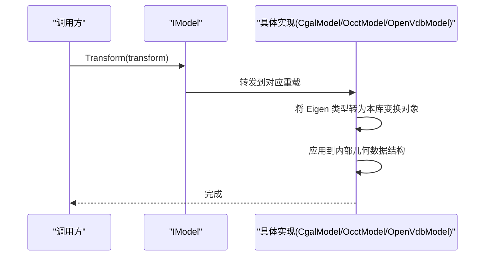
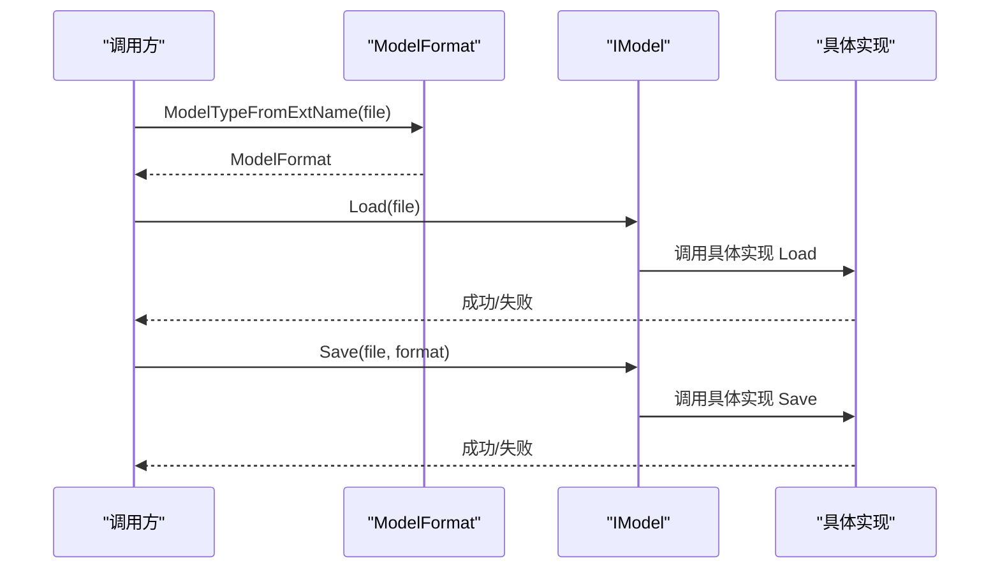
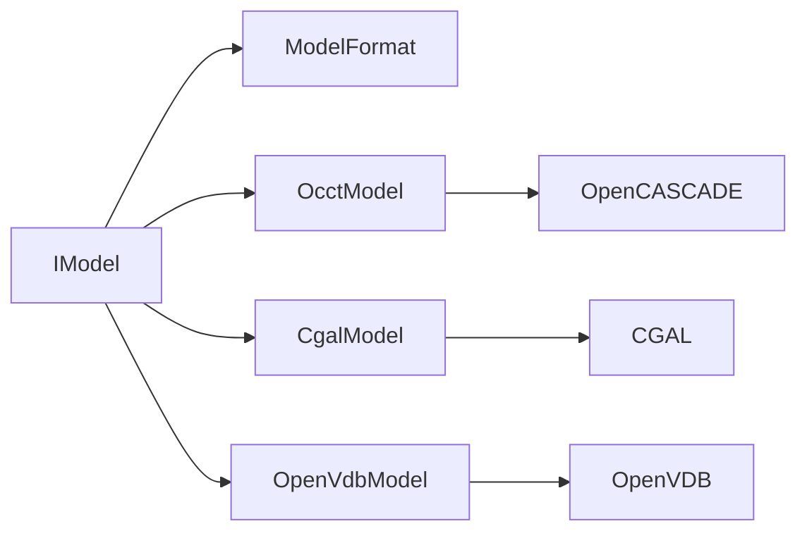
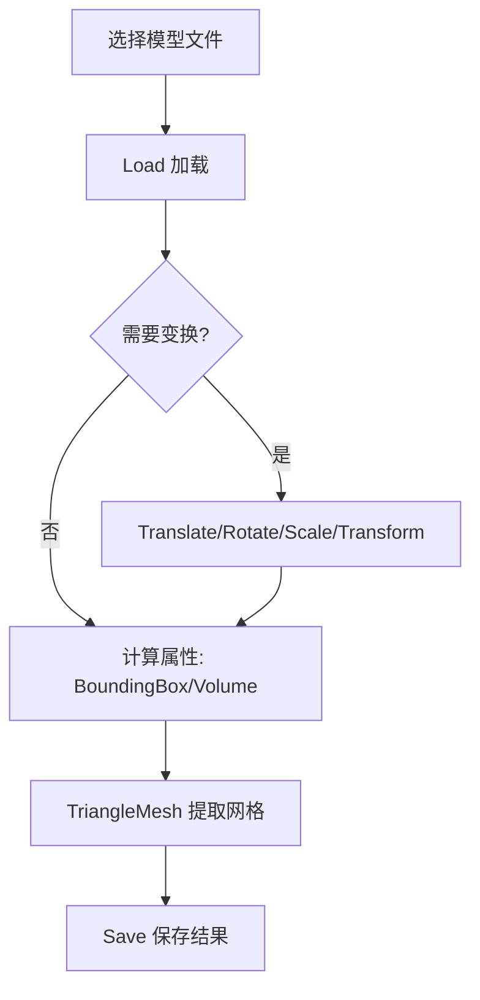

# 模型抽象接口

<cite>
**本文引用的文件**   
- [IModel.hpp](file://base/IModel.hpp)
- [ModelFormat.hpp](file://base/ModelFormat.hpp)
- [ModelFormat.cpp](file://base/ModelFormat.cpp)
- [OcctModel.hpp](file://cadmodel/OcctModel.hpp)
- [OcctModel.cpp](file://cadmodel/OcctModel.cpp)
- [CgalModel.hpp](file://meshmodel/CgalModel.hpp)
- [CgalModel.cpp](file://meshmodel/CgalModel.cpp)
- [OpenVdbModel.hpp](file://pointcloud/OpenVdbModel.hpp)
- [OpenVdbModel.cpp](file://pointcloud/OpenVdbModel.cpp)
</cite>

## 目录
1. [简介](#简介)
2. [项目结构](#项目结构)
3. [核心组件](#核心组件)
4. [架构总览](#架构总览)
5. [详细组件分析](#详细组件分析)
6. [依赖关系分析](#依赖关系分析)
7. [性能与优化建议](#性能与优化建议)
8. [故障排查指南](#故障排查指南)
9. [结论](#结论)
10. [附录：统一接口使用示例](#附录统一接口使用示例)

## 简介
本文件面向 HsBaSlicer 的“模型抽象接口”设计，系统性阐述 IModel 接口如何为不同格式、不同数据结构的 3D 模型提供统一的加载/保存、几何变换、边界框/体积计算与三角网格提取能力。文档同时覆盖支持的模型格式（STL、OBJ、PLY、STEP、IGES、VRML、XYZ、VDB 等），并给出实现原理、调用流程、性能优化与最佳实践建议。

## 项目结构
围绕模型抽象的关键代码分布在以下模块：
- base：定义 IModel 接口与 ModelFormat 枚举及工具函数
- cadmodel：基于 OpenCASCADE 的 BRep CAD 模型实现
- meshmodel：基于 CGAL 的多面体网格模型实现
- pointcloud：基于 OpenVDB 的点云模型实现

图表来源
- [IModel.hpp:63-139](file://base/IModel.hpp#L63-L139)
- [ModelFormat.hpp:16-115](file://base/ModelFormat.hpp#L16-L115)
- [OcctModel.hpp:20-124](file://cadmodel/OcctModel.hpp#L20-L124)
- [CgalModel.hpp:24-155](file://meshmodel/CgalModel.hpp#L24-L155)
- [OpenVdbModel.hpp:18-116](file://pointcloud/OpenVdbModel.hpp#L18-L116)

章节来源
- [IModel.hpp:63-139](file://base/IModel.hpp#L63-L139)
- [ModelFormat.hpp:16-115](file://base/ModelFormat.hpp#L16-L115)

## 核心组件
- IModel 接口：统一抽象了模型的加载/保存、平移/旋转/缩放/仿射变换、边界框、体积、三角网格导出等能力。
- ModelFormat 枚举与工具：对 STL、OBJ、PLY、OFF、VRML、STEP、IGES、BREP、SLDPRT、CATPART、XYZ、VDB 等格式进行识别、分类与字符串转换。
- OcctModel：封装 TopoDS_Shape，支持 STEP/IGES/VRML/BREP 等 BRep 格式的读写、布尔运算、实体加厚、基本体创建、三角化与体积/包围盒查询。
- CgalModel：封装 CGAL Polyhedron_3，支持 STL/OBJ/PLY/OFF 等网格格式的读写、仿射变换、布尔运算、基本体创建、测地线/螺旋/法线等高级网格操作。
- OpenVdbModel：封装 OpenVDB Vec3fGrid，支持 XYZ/VDB 点云读写、KNN/半径搜索、体素化、下采样、统计离群点剔除、法线估计、Level Set 重建网格等。

章节来源
- [IModel.hpp:63-139](file://base/IModel.hpp#L63-L139)
- [ModelFormat.hpp:16-115](file://base/ModelFormat.hpp#L16-L115)
- [OcctModel.hpp:20-124](file://cadmodel/OcctModel.hpp#L20-L124)
- [CgalModel.hpp:24-155](file://meshmodel/CgalModel.hpp#L24-L155)
- [OpenVdbModel.hpp:18-116](file://pointcloud/OpenVdbModel.hpp#L18-L116)

## 架构总览
IModel 作为统一抽象，屏蔽底层数据表示差异（BRep、多面体网格、点云）。上层切片、路径生成、支撑等模块仅依赖 IModel 提供的稳定接口，从而实现对多种模型格式的统一处理。

图表来源
- [IModel.hpp:63-139](file://base/IModel.hpp#L63-L139)
- [OcctModel.hpp:20-124](file://cadmodel/OcctModel.hpp#L20-L124)
- [CgalModel.hpp:24-155](file://meshmodel/CgalModel.hpp#L24-L155)
- [OpenVdbModel.hpp:18-116](file://pointcloud/OpenVdbModel.hpp#L18-L116)

## 详细组件分析

### IModel 接口设计与统一抽象机制
- 设计理念
  - 通过纯虚接口将“模型是什么”和“模型能做什么”解耦，使上层算法无需关心具体是 BRep、网格还是点云。
  - 所有几何变换以 Eigen 类型表达，保证数值一致性与跨库兼容性。
  - 统一返回 IGL 风格的三角网格（顶点矩阵+面索引矩阵），便于下游切片与可视化。
- 关键方法
  - 加载/保存：Load/Save 配合 ModelFormat 决定具体解析器/写入器。
  - 几何变换：Translate/Rotate/Scale/Transform 提供从刚体到仿射的统一入口。
  - 几何属性：BoundingBox/Volume/TriangleMesh 暴露常用几何度量与离散化能力。

章节来源
- [IModel.hpp:63-139](file://base/IModel.hpp#L63-L139)

### 模型格式支持与分类
- 支持的格式
  - 网格：STL（ASCII/Binary）、OBJ、PLY（ASCII/Binary）、OFF
  - BRep：VRML、STEP、IGES、BREP
  - CSG：SLDPRT、CATPART（枚举存在，当前主要逻辑在格式识别）
  - 点云：XYZ、VDB
- 分类工具
  - IsMeshFormat/IsBrepFormat/IsCSGFormat/IsPointCloudFormat 用于按类别判断。
  - ModelTypeFromExtName/GetExtName 根据扩展名推断格式。
- 字符串映射
  - ToString 将枚举值转为可读字符串，便于日志与调试。

图表来源
- [ModelFormat.cpp:12-86](file://base/ModelFormat.cpp#L12-L86)

章节来源
- [ModelFormat.hpp:16-115](file://base/ModelFormat.hpp#L16-L115)
- [ModelFormat.cpp:12-177](file://base/ModelFormat.cpp#L12-L177)

### 几何变换实现原理
- 统一接口
  - Translate(Eigen::Vector3f)
  - Rotate(Eigen::Quaternionf)
  - Scale(float/Eigen::Vector3f)
  - Transform(Eigen::Isometry3f / Matrix4f / Affine)
- 各实现的内部策略
  - CgalModel：将 Eigen 变换转换为 CGAL::Aff_transformation_3，并通过 Polygon_mesh_processing::transform 作用于 Polyhedron_3。
  - OcctModel：将 Eigen 变换映射到 OCCT 的 gp_Trsf/gp_Quaternion/gp_Vec，再应用至 TopoDS_Shape。
  - OpenVdbModel：对点云坐标或体素网格的变换，保持与 IModel 一致的语义。

图表来源
- [CgalModel.cpp:158-200](file://meshmodel/CgalModel.cpp#L158-L200)
- [OcctModel.hpp:59-72](file://cadmodel/OcctModel.hpp#L59-L72)
- [OpenVdbModel.hpp:49-55](file://pointcloud/OpenVdbModel.hpp#L49-L55)

章节来源
- [CgalModel.cpp:158-200](file://meshmodel/CgalModel.cpp#L158-L200)
- [OcctModel.hpp:59-72](file://cadmodel/OcctModel.hpp#L59-L72)
- [OpenVdbModel.hpp:49-55](file://pointcloud/OpenVdbModel.hpp#L49-L55)

### 边界框与体积计算
- 边界框
  - IModel::BoundingBox 返回 AABB 的最小/最大角点。
  - OcctModel 使用 OCCT 的包围盒计算；CgalModel/OpenVdbModel 分别基于网格/点云遍历或体素结构估算。
- 体积
  - IModel::Volume 返回有符号体积（闭合流形为正）。
  - CgalModel 使用 CGAL 的体积计算；OcctModel 使用 GProp_GProps 等几何属性工具；OpenVdbModel 可结合 Level Set 或体素计数估算。

章节来源
- [IModel.hpp:132-136](file://base/IModel.hpp#L132-L136)
- [OcctModel.hpp:74-81](file://cadmodel/OcctModel.hpp#L74-L81)
- [CgalModel.hpp:74-79](file://meshmodel/CgalModel.hpp#L74-L79)
- [OpenVdbModel.hpp:56-58](file://pointcloud/OpenVdbModel.hpp#L56-L58)

### 三角网格提取
- IModel::TriangleMesh 返回 IGL 风格（顶点矩阵 Nx3，面索引 Mx3）。
- CgalModel：直接输出 Polyhedron_3 的三角面；必要时进行三角化。
- OcctModel：对 BRep 形状进行三角化（如使用 Poly_Triangulation）。
- OpenVdbModel：可从点云通过 Level Set 重建网格（见 GenerateMesh）。

章节来源
- [IModel.hpp:137-138](file://base/IModel.hpp#L137-L138)
- [CgalModel.hpp:81-82](file://meshmodel/CgalModel.hpp#L81-L82)
- [OpenVdbModel.hpp:77-83](file://pointcloud/OpenVdbModel.hpp#L77-L83)

### 加载/保存流程
- 通用流程
  - Load：根据扩展名选择具体读取器（OCCT/CGAL/OpenVDB）。
  - Save：根据 ModelFormat 选择写入器，若不支持则抛出异常。
- 错误处理
  - 常见 IO 错误通过 IOError 抛出；格式不支持通过 NotSupportedError 抛出。

图表来源
- [ModelFormat.cpp:95-99](file://base/ModelFormat.cpp#L95-L99)
- [CgalModel.cpp:121-157](file://meshmodel/CgalModel.cpp#L121-L157)
- [OcctModel.cpp:76-190](file://cadmodel/OcctModel.cpp#L76-L190)
- [OpenVdbModel.cpp:148-200](file://pointcloud/OpenVdbModel.cpp#L148-L200)

章节来源
- [ModelFormat.cpp:95-99](file://base/ModelFormat.cpp#L95-L99)
- [CgalModel.cpp:121-157](file://meshmodel/CgalModel.cpp#L121-L157)
- [OcctModel.cpp:76-190](file://cadmodel/OcctModel.cpp#L76-L190)
- [OpenVdbModel.cpp:148-200](file://pointcloud/OpenVdbModel.cpp#L148-L200)

## 依赖关系分析
- 耦合与内聚
  - IModel 与具体实现之间松耦合，新增格式只需实现 IModel 并提供相应 Load/Save。
  - ModelFormat 与具体实现解耦，仅负责格式识别与分类。
- 外部依赖
  - Eigen：统一的数学与几何变换类型。
  - OCCT/CGAL/OpenVDB：各自擅长的领域（BRep、网格、点云/体素）。
- 潜在循环依赖
  - IModel 不反向依赖具体实现，避免循环依赖。

图表来源
- [IModel.hpp:63-139](file://base/IModel.hpp#L63-L139)
- [ModelFormat.hpp:16-115](file://base/ModelFormat.hpp#L16-L115)
- [OcctModel.hpp:20-124](file://cadmodel/OcctModel.hpp#L20-L124)
- [CgalModel.hpp:24-155](file://meshmodel/CgalModel.hpp#L24-L155)
- [OpenVdbModel.hpp:18-116](file://pointcloud/OpenVdbModel.hpp#L18-L116)

章节来源
- [IModel.hpp:63-139](file://base/IModel.hpp#L63-L139)
- [ModelFormat.hpp:16-115](file://base/ModelFormat.hpp#L16-L115)

## 性能与优化建议
- 网格规模控制
  - 对大型 STL/OBJ/PLY，优先使用二进制格式以减少 I/O 时间。
  - 在不需要高精度时，降低三角细分（如球体/圆柱体的 segments/subdivisions）。
- 变换批量合并
  - 多次 Translate/Rotate/Scale 会多次遍历几何数据，建议合并为一次 Transform 以减少重复计算。
- 体积/包围盒缓存
  - 对频繁查询的场景，可在应用层缓存 BoundingBox/Volume，或在实现中按需惰性更新。
- 点云预处理
  - 使用 Downsample/RemoveStatisticalOutliers 减少噪声与冗余点，提升后续 KNN/法线估计效率。
- 网格重建参数
  - OpenVdbModel::GenerateMesh 的 voxelSize/particleRadius 需根据点云密度调参，过大导致细节丢失，过小导致内存与耗时上升。
- 布尔运算与厚实体
  - OCCT/CGAL 布尔运算复杂度较高，建议在布尔前简化模型（去重、修复法向、移除退化面）。

[本节为通用指导，不直接分析具体文件]

## 故障排查指南
- 文件格式不支持
  - 现象：Save 时抛出 NotSupportedError。
  - 排查：确认 ModelFormat 是否属于目标实现支持的范围（例如 CgalModel 仅支持网格格式）。
- 读取失败
  - 现象：Load 返回 false 或抛出 IOError。
  - 排查：检查文件路径、编码转换（UTF-8 到本地编码）、权限与磁盘空间。
- 空网格/无效网格
  - 现象：构造 CgalModel 时抛出 RuntimeError。
  - 排查：确保顶点/面非空且拓扑有效；必要时先进行网格修复。
- 点云为空
  - 现象：OpenVdbModel::Load 后 Points 为空。
  - 排查：确认输入文件包含至少一个有效 XYZ 行或 VDB 中包含 Vec3f 网格。

章节来源
- [CgalModel.cpp:42-118](file://meshmodel/CgalModel.cpp#L42-L118)
- [OcctModel.cpp:76-190](file://cadmodel/OcctModel.cpp#L76-L190)
- [OpenVdbModel.cpp:148-200](file://pointcloud/OpenVdbModel.cpp#L148-L200)

## 结论
IModel 通过统一接口屏蔽了 BRep、网格与点云的底层差异，配合 ModelFormat 的格式识别与分类，为 HsBaSlicer 提供了可扩展、可维护的模型抽象层。开发者可以基于该接口无缝切换不同后端实现，并在保证一致 API 的前提下获得高性能的几何处理能力。

[本节为总结性内容，不直接分析具体文件]

## 附录：统一接口使用示例
以下为典型的使用流程（概念性步骤，不涉及具体代码片段）：
- 加载模型
  - 根据文件扩展名自动识别格式，调用 IModel::Load。
- 几何变换
  - 使用 Translate/Rotate/Scale/Transform 对模型进行定位、定向与缩放。
- 几何属性
  - 调用 BoundingBox 获取包围盒，Volume 获取体积。
- 网格导出
  - 调用 TriangleMesh 获取 IGL 风格的顶点与面索引，用于切片、可视化或导出。
- 保存结果
  - 根据需求选择合适格式调用 Save（注意格式与实现的支持范围）。

[本图为概念流程图，不直接映射具体源码文件]