# 模型抽象接口

<cite>
**本文引用的文件**   
- [IModel.hpp](file://base/IModel.hpp)
- [ModelFormat.hpp](file://base/ModelFormat.hpp)
- [ModelFormat.cpp](file://base/ModelFormat.cpp)
- [CgalModel.hpp](file://meshmodel/CgalModel.hpp)
- [IglModel.hpp](file://meshmodel/IglModel.hpp)
- [FullTopoModel.hpp](file://meshmodel/FullTopoModel.hpp)
- [OcctModel.hpp](file://cadmodel/OcctModel.hpp)
- [OpenVdbModel.hpp](file://pointcloud/OpenVdbModel.hpp)
</cite>

## 目录
1. [引言](#引言)
2. [项目结构](#项目结构)
3. [核心概念](#核心概念)
4. [架构总览](#架构总览)
5. [详细组件分析](#详细组件分析)
6. [依赖关系分析](#依赖关系分析)
7. [性能与选型指南](#性能与选型指南)
8. [故障排除](#故障排除)
9. [结论](#结论)
10. [附录：自定义模型实现步骤](#附录自定义模型实现步骤)

## 引言
本文件面向 HsBaSlicer 的模型抽象层，系统性说明 IModel 统一接口的设计理念、ModelFormat 枚举的分类与扩展方式，以及网格模型、CAD 模型、点云模型三类实现的职责边界。文档重点解释统一的几何变换接口（Translate、Rotate、Scale、Transform）如何适配不同几何内核，并给出多态使用模式、类型选择建议与性能对比，帮助开发者在工程实践中做出正确取舍。

## 项目结构
围绕模型抽象的核心代码分布在以下模块：
- base：定义 IModel 接口与 ModelFormat 枚举及格式判定工具
- meshmodel：网格模型实现（基于 libigl 的 IglModel、基于 CGAL 的 CgalModel），以及面向切片拓扑重建的 FullTopoModel
- cadmodel：基于 OpenCASCADE 的 BRep CAD 模型 OcctModel
- pointcloud：基于 OpenVDB 的点云模型 OpenVdbModel

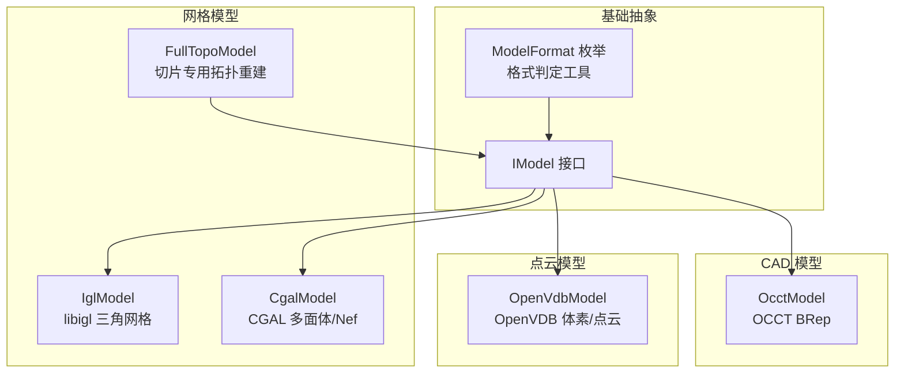

图表来源
- [IModel.hpp:110-139](file://base/IModel.hpp#L110-L139)
- [ModelFormat.hpp:19-114](file://base/ModelFormat.hpp#L19-L114)
- [IglModel.hpp:18-121](file://meshmodel/IglModel.hpp#L18-L121)
- [CgalModel.hpp:26-155](file://meshmodel/CgalModel.hpp#L26-L155)
- [OcctModel.hpp:22-124](file://cadmodel/OcctModel.hpp#L22-L124)
- [OpenVdbModel.hpp:20-116](file://pointcloud/OpenVdbModel.hpp#L20-L116)

章节来源
- [IModel.hpp:110-139](file://base/IModel.hpp#L110-L139)
- [ModelFormat.hpp:19-114](file://base/ModelFormat.hpp#L19-L114)
- [ModelFormat.cpp:101-175](file://base/ModelFormat.cpp#L101-L175)

## 核心概念
- IModel 统一接口：为所有 3D 模型提供一致的加载/保存、几何变换、包围盒/体积查询、三角网格导出等能力，使上层算法无需关心具体几何内核。
- ModelFormat 枚举：对输入输出文件格式进行统一分类，支持 mesh、Brep、CSG、point cloud 四类，并提供字符串转换与按扩展名判定工具函数。
- 几何变换一致性：通过 Translate/Rotate/Scale/Transform 系列方法，将 Eigen 几何类型作为统一输入，各实现内部转换为自身几何内核的变换表示。
- 多态使用：上层以 IModel& 或 std::unique_ptr<IModel> 持有具体模型，调用统一接口完成通用处理；需要特定能力时再 downcast 到具体类型。

章节来源
- [IModel.hpp:110-139](file://base/IModel.hpp#L110-L139)
- [ModelFormat.hpp:19-114](file://base/ModelFormat.hpp#L19-L114)
- [ModelFormat.cpp:101-175](file://base/ModelFormat.cpp#L101-L175)

## 架构总览
下图展示 IModel 与各模型实现的关系，以及 ModelFormat 在加载/保存流程中的作用。

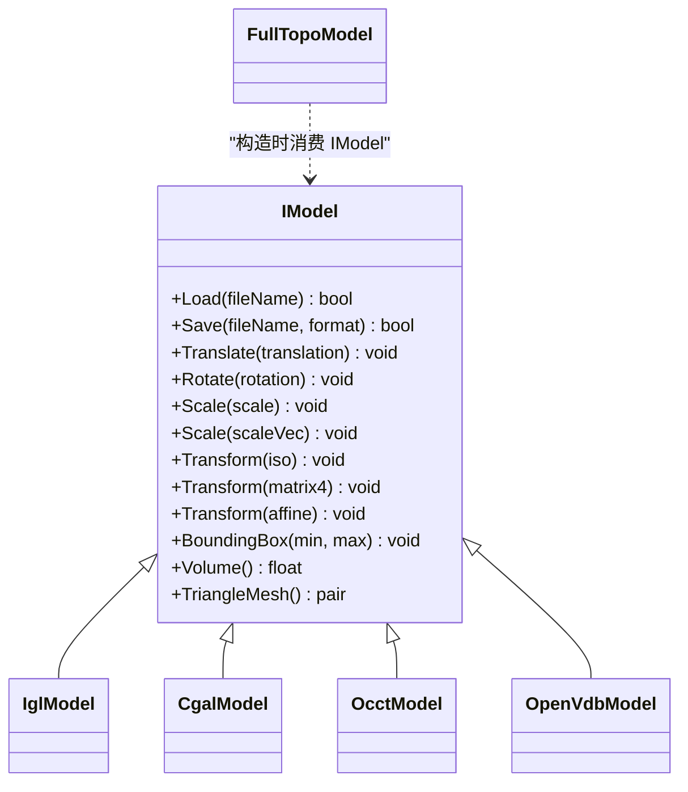

图表来源
- [IModel.hpp:110-139](file://base/IModel.hpp#L110-L139)
- [IglModel.hpp:18-121](file://meshmodel/IglModel.hpp#L18-L121)
- [CgalModel.hpp:26-155](file://meshmodel/CgalModel.hpp#L26-L155)
- [OcctModel.hpp:22-124](file://cadmodel/OcctModel.hpp#L22-L124)
- [OpenVdbModel.hpp:20-116](file://pointcloud/OpenVdbModel.hpp#L20-L116)
- [FullTopoModel.hpp:43-142](file://meshmodel/FullTopoModel.hpp#L43-L142)

## 详细组件分析

### IModel 统一接口
IModel 定义了模型生命周期与几何操作的最小公共集：
- 生命周期：Load/Save 负责从文件加载与保存到指定 ModelFormat。
- 几何变换：Translate/Rotate/Scale/Transform 接受 Eigen 向量、四元数、仿射/等距/矩阵等常见几何类型，屏蔽底层差异。
- 几何查询：BoundingBox/Volume/TriangleMesh 提供包围盒、体积与三角网格导出，便于可视化、切片与路径生成。

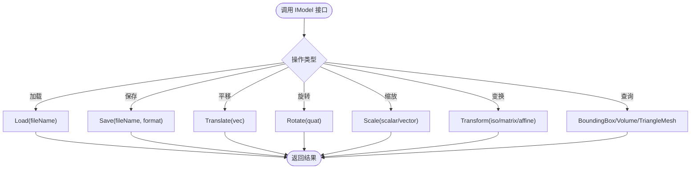

图表来源
- [IModel.hpp:110-139](file://base/IModel.hpp#L110-L139)

章节来源
- [IModel.hpp:110-139](file://base/IModel.hpp#L110-L139)

### ModelFormat 枚举与格式分类
ModelFormat 将文件格式分为四类：
- mesh：PLY、OBJ、STL、OFF 等三角/多边形网格
- Brep：VRML、STEP、IGES、BREP 等边界表示
- CSG：SLDPRT、CATPART 等参数化实体（当前枚举已预留）
- point cloud：XYZ、VDB 等点云/体素数据

同时提供：
- ToString：枚举到字符串
- GetExtName/ModelTypeFromExtName：从文件名推断格式
- IsMeshFormat/IsBrepFormat/IsCSGFormat/IsPointCloudFormat：按枚举或文件名判断类别

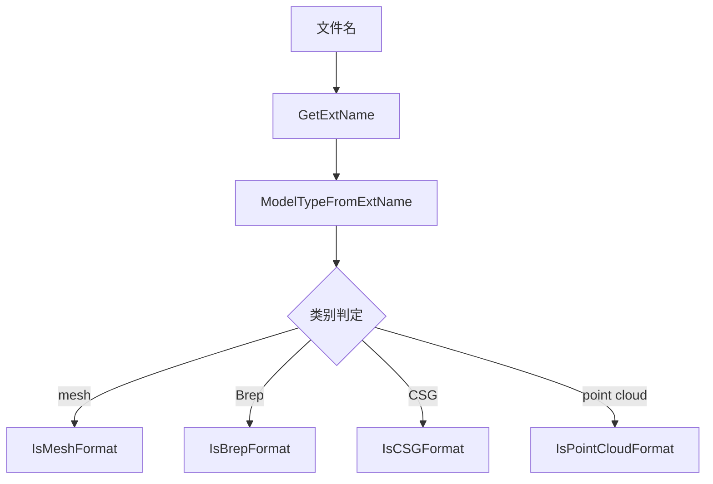

图表来源
- [ModelFormat.hpp:19-114](file://base/ModelFormat.hpp#L19-L114)
- [ModelFormat.cpp:14-99](file://base/ModelFormat.cpp#L14-L99)
- [ModelFormat.cpp:101-175](file://base/ModelFormat.cpp#L101-L175)

章节来源
- [ModelFormat.hpp:19-114](file://base/ModelFormat.hpp#L19-L114)
- [ModelFormat.cpp:14-99](file://base/ModelFormat.cpp#L14-L99)
- [ModelFormat.cpp:101-175](file://base/ModelFormat.cpp#L101-L175)

### 网格模型实现

#### IglModel（libigl 三角网格）
- 数据组织：顶点、面片、可选法线矩阵
- 能力：加载/保存多种网格格式、几何变换、包围盒/体积、法线计算、布尔运算、基本原语创建、拉伸工厂
- 适用场景：轻量级网格处理、快速原型、与 libigl 生态集成

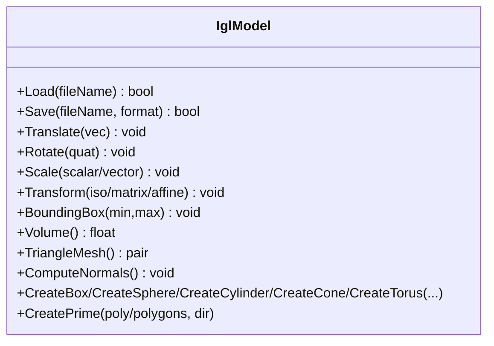

图表来源
- [IglModel.hpp:18-121](file://meshmodel/IglModel.hpp#L18-L121)

章节来源
- [IglModel.hpp:18-121](file://meshmodel/IglModel.hpp#L18-L121)

#### CgalModel（CGAL 多面体/Nef）
- 数据组织：CGAL Polyhedron_3，支持 Nef 布尔运算
- 能力：加载/保存网格、几何变换、包围盒/体积、三角网格导出、布尔运算、原语创建、表面测地线/螺旋/螺线等高级几何
- 适用场景：需要高精度布尔运算、复杂几何分析的网格处理

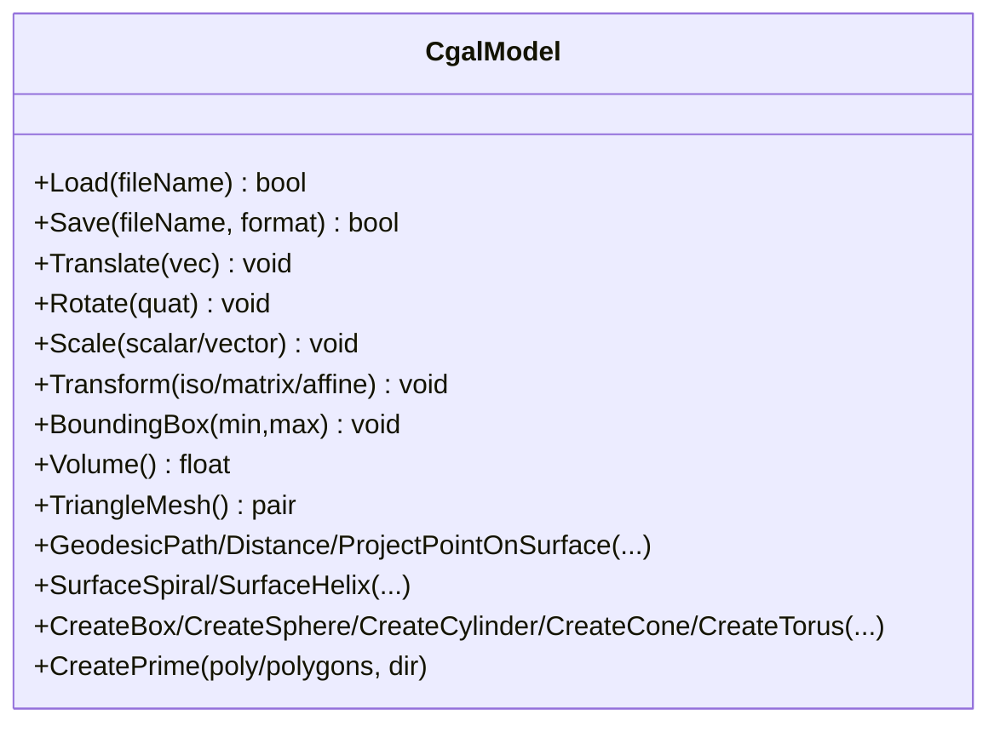

图表来源
- [CgalModel.hpp:26-155](file://meshmodel/CgalModel.hpp#L26-L155)

章节来源
- [CgalModel.hpp:26-155](file://meshmodel/CgalModel.hpp#L26-L155)

#### FullTopoModel（切片专用拓扑重建）
- 设计目标：面向切片的全拓扑重建，提供安全/不安全切片、快速切片、Euler 特征检查、Lua 脚本切片
- 与 IModel 的关系：构造函数消费 IModel 或原始顶点/面片数据，不直接继承 IModel
- 适用场景：对拓扑完整性敏感、需要稳定切片结果的流水线

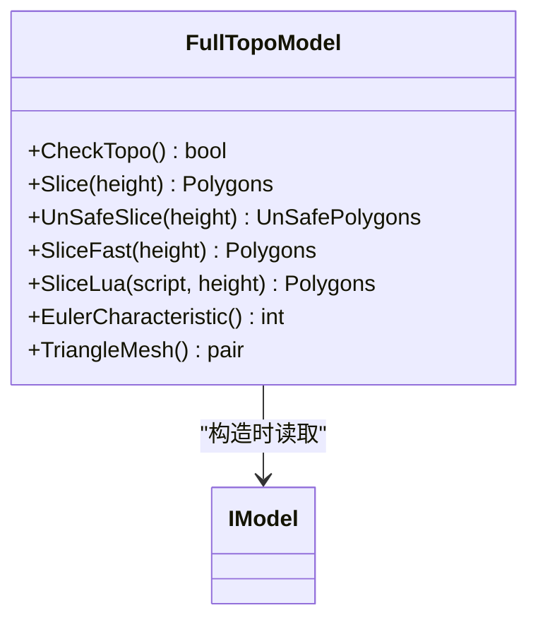

图表来源
- [FullTopoModel.hpp:43-142](file://meshmodel/FullTopoModel.hpp#L43-L142)

章节来源
- [FullTopoModel.hpp:43-142](file://meshmodel/FullTopoModel.hpp#L43-L142)

### CAD 模型实现

#### OcctModel（OpenCASCADE BRep）
- 数据组织：TopoDS_Shape，支持复合形状
- 能力：加载/保存 STEP/IGES/VRML/BREP、几何变换、包围盒/体积、三角网格化、布尔运算、加厚实体、原语创建、拉伸工厂
- 适用场景：CAD 数据导入、精确 BRep 操作、工程建模管线

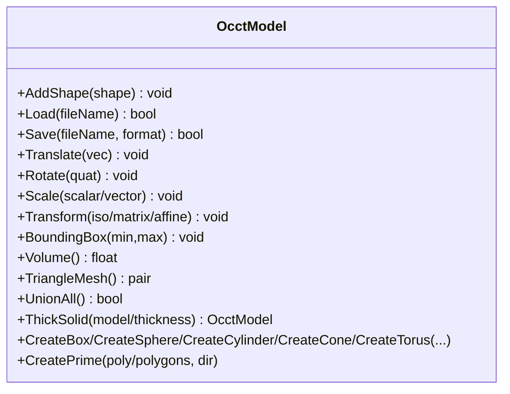

图表来源
- [OcctModel.hpp:22-124](file://cadmodel/OcctModel.hpp#L22-L124)

章节来源
- [OcctModel.hpp:22-124](file://cadmodel/OcctModel.hpp#L22-L124)

### 点云模型实现

#### OpenVdbModel（OpenVDB 体素/点云）
- 数据组织：OpenVDB Vec3fGrid，支持体素化、KNN/半径搜索、统计去噪、法线估计、网格重建
- 能力：加载/保存 XYZ/VDB、几何变换、包围盒/体积、三角网格导出（通过 Level Set 重建）、点云增删改查
- 适用场景：大规模点云处理、体素化、重建网格、空间查询

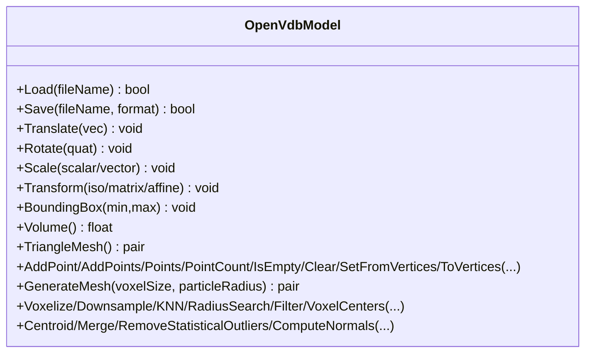

图表来源
- [OpenVdbModel.hpp:20-116](file://pointcloud/OpenVdbModel.hpp#L20-L116)

章节来源
- [OpenVdbModel.hpp:20-116](file://pointcloud/OpenVdbModel.hpp#L20-L116)

## 依赖关系分析
- IModel 是核心抽象，被所有模型实现依赖
- ModelFormat 与 IModel 解耦，但通过 Load/Save 参与模型生命周期
- FullTopoModel 依赖 IModel 作为输入源，但不继承 IModel
- 各模型实现均依赖 Eigen 进行几何表达，并通过各自后端库（libigl/CGAL/OCCT/OpenVDB）实现具体逻辑

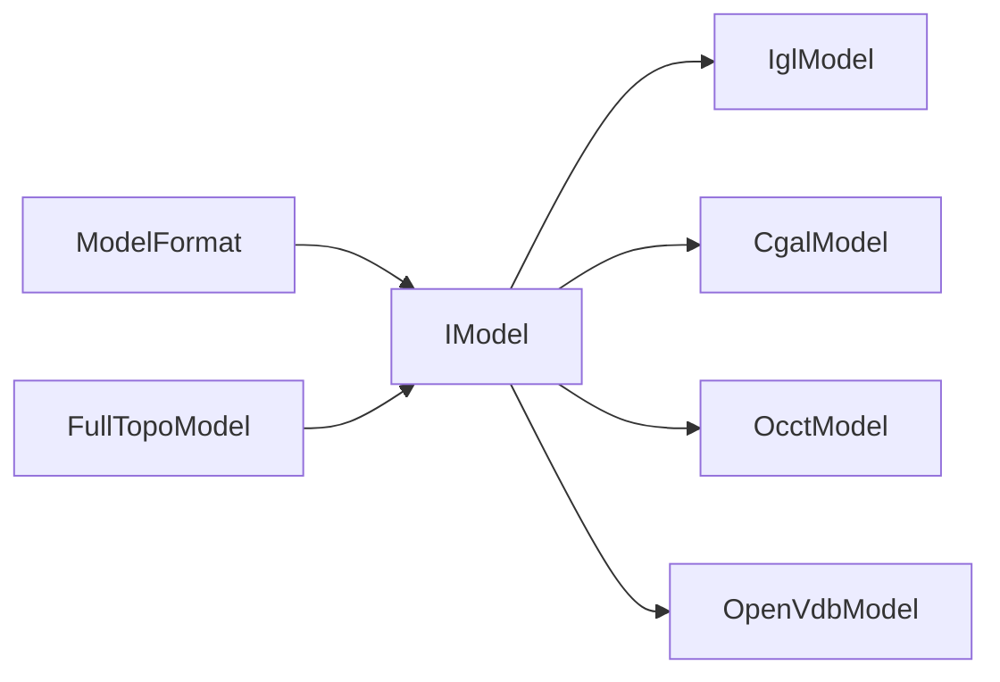

图表来源
- [IModel.hpp:110-139](file://base/IModel.hpp#L110-L139)
- [ModelFormat.hpp:19-114](file://base/ModelFormat.hpp#L19-L114)
- [FullTopoModel.hpp:43-142](file://meshmodel/FullTopoModel.hpp#L43-L142)

## 性能与选型指南

### 几何变换接口适配机制
IModel 暴露的 Translate/Rotate/Scale/Transform 均以 Eigen 类型作为输入，各实现内部将其转换为自身几何内核的变换表示：
- IglModel：直接作用于顶点矩阵
- CgalModel：转换为 CGAL Affine_3 并作用于 Polyhedron_3
- OcctModel：转换为 OCCT 变换并作用于 TopoDS_Shape
- OpenVdbModel：对体素网格或点坐标应用变换

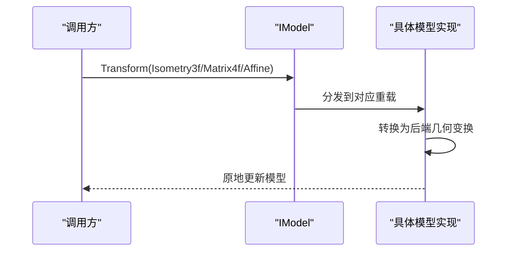

图表来源
- [IModel.hpp:120-130](file://base/IModel.hpp#L120-L130)
- [IglModel.hpp:60-73](file://meshmodel/IglModel.hpp#L60-L73)
- [CgalModel.hpp:59-72](file://meshmodel/CgalModel.hpp#L59-L72)
- [OcctModel.hpp:59-72](file://cadmodel/OcctModel.hpp#L59-L72)
- [OpenVdbModel.hpp:49-55](file://pointcloud/OpenVdbModel.hpp#L49-L55)

### 模型类型选择建议
- 若需快速三角网格处理与可视化：优先 IglModel
- 若需高精度布尔运算与复杂几何分析：优先 CgalModel
- 若需 CAD 数据导入与 BRep 操作：优先 OcctModel
- 若需大规模点云处理、体素化与重建：优先 OpenVdbModel
- 若切片对拓扑稳定性要求高：使用 IglModel/CgalModel/OcctModel 构建后，再交给 FullTopoModel 做拓扑重建与切片

### 性能对比要点
- IglModel：内存与计算开销较低，适合大量简单网格操作
- CgalModel：布尔运算与几何分析能力强，但复杂度较高
- OcctModel：BRep 精度高，但三角网格化与布尔运算可能较慢
- OpenVdbModel：体素化与空间查询高效，但重建网格存在额外开销
- FullTopoModel：拓扑重建有固定成本，但可显著提升后续切片稳定性

[本节为通用指导，不直接分析具体源码]

## 故障排除
- 文件格式识别失败：确认扩展名是否受 ModelFormat 支持；必要时扩展 ExtRegexMatch 匹配规则
- 变换后体积异常：检查非均匀缩放与奇异变换；确保 Scale 与 Transform 使用一致的单位与坐标系
- 布尔运算失败：检查模型拓扑完整性；对于网格模型，优先使用 CgalModel 或先经 FullTopoModel 校验
- 点云重建网格质量差：调整 GenerateMesh 的 voxelSize 与 particleRadius；或使用 Downsample/RemoveStatisticalOutliers 预处理

章节来源
- [ModelFormat.cpp:14-99](file://base/ModelFormat.cpp#L14-L99)
- [OpenVdbModel.hpp:77-111](file://pointcloud/OpenVdbModel.hpp#L77-L111)
- [FullTopoModel.hpp:80-127](file://meshmodel/FullTopoModel.hpp#L80-L127)

## 结论
IModel 通过最小公共接口屏蔽了不同几何内核的差异，配合 ModelFormat 的统一格式分类，使得 HsBaSlicer 能够以一致的方式处理网格、CAD 与点云模型。开发者可根据业务需求选择合适的实现，并在需要时借助 FullTopoModel 提升切片鲁棒性。统一的几何变换接口确保了跨内核的可移植性与可扩展性。

## 附录：自定义模型实现步骤
- 步骤一：继承 IModel，实现 Load/Save/Translate/Rotate/Scale/Transform/BoundingBox/Volume/TriangleMesh
- 步骤二：根据目标几何内核选择合适的 Eigen 类型进行变换封装
- 步骤三：在 Save 中支持至少一种 ModelFormat，并在 ModelFormat.cpp 中补充扩展名映射（如需）
- 步骤四：在工程中注册新模型类型，供上层以 IModel 多态使用

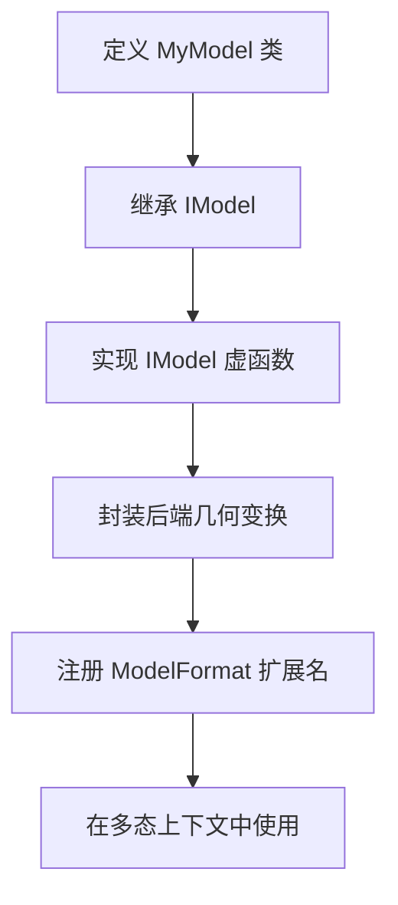

图表来源
- [IModel.hpp:110-139](file://base/IModel.hpp#L110-L139)
- [ModelFormat.cpp:14-99](file://base/ModelFormat.cpp#L14-L99)