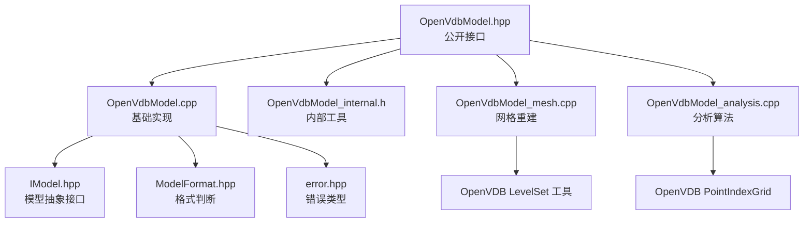
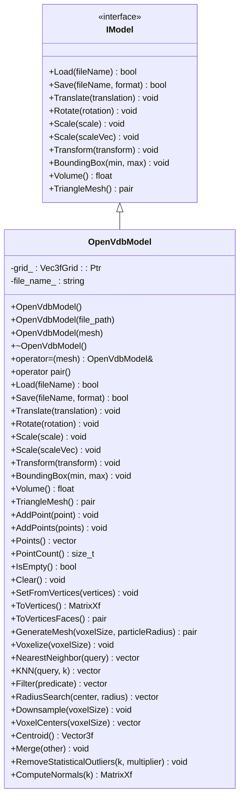
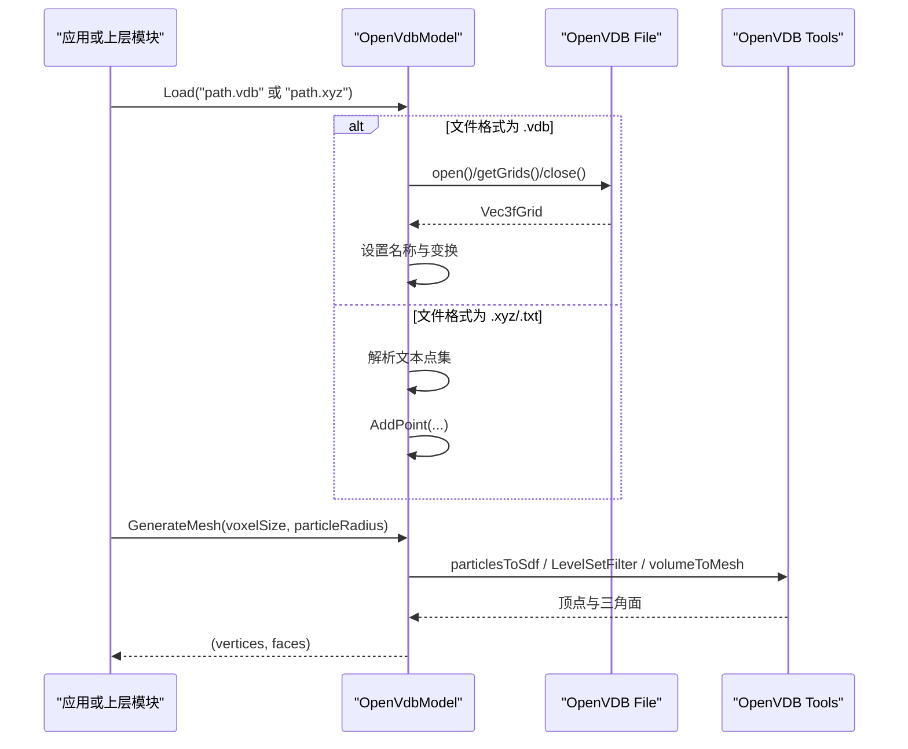
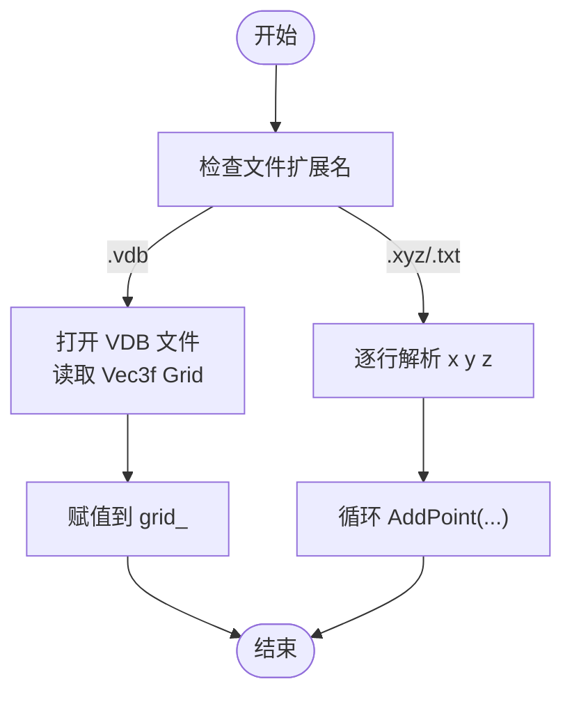
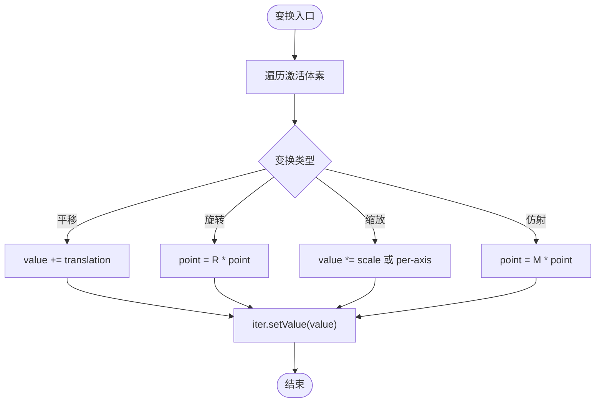
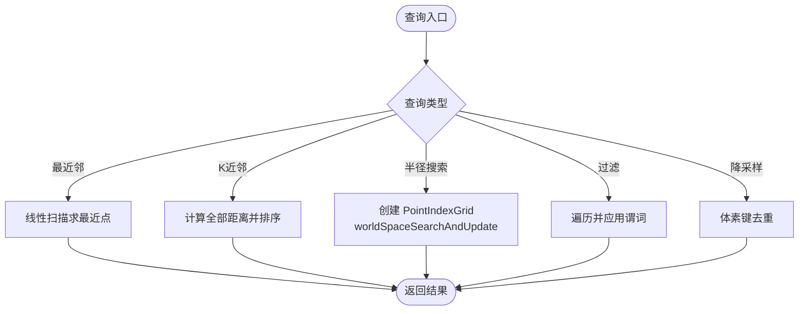
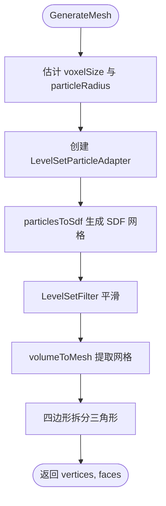
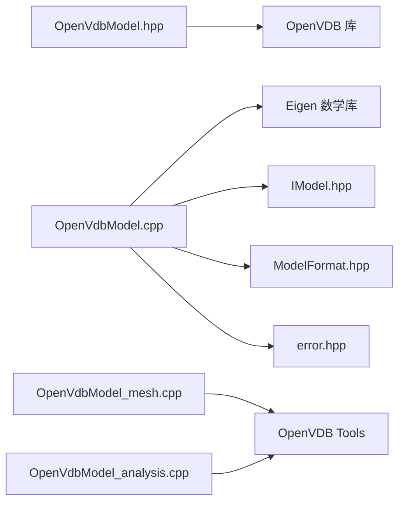

# 点云模型实现

<cite>
**本文引用的文件**   
- [OpenVdbModel.hpp](file://pointcloud/OpenVdbModel.hpp)
- [OpenVdbModel.cpp](file://pointcloud/OpenVdbModel.cpp)
- [OpenVdbModel_internal.h](file://pointcloud/OpenVdbModel_internal.h)
- [OpenVdbModel_mesh.cpp](file://pointcloud/OpenVdbModel_mesh.cpp)
- [OpenVdbModel_analysis.cpp](file://pointcloud/OpenVdbModel_analysis.cpp)
- [IModel.hpp](file://base/IModel.hpp)
- [ModelFormat.hpp](file://base/ModelFormat.hpp)
- [error.hpp](file://base/error.hpp)
- [openvdb_model_test.cpp](file://tests/Models/openvdb_model_test.cpp)
</cite>

## 目录
1. [引言](#引言)
2. [项目结构](#项目结构)
3. [核心组件](#核心组件)
4. [架构总览](#架构总览)
5. [详细组件分析](#详细组件分析)
6. [依赖关系分析](#依赖关系分析)
7. [性能与内存管理](#性能与内存管理)
8. [使用示例与可视化建议](#使用示例与可视化建议)
9. [故障排除](#故障排除)
10. [结论](#结论)

## 引言
本文件面向 HsBaSlicer 的点云模型实现，重点说明 OpenVdbModel 类如何基于 OpenVDB 的体素网格高效存储和访问大规模点云数据，并支持 VDB 格式的高效读写。文档还覆盖三维重建、医学影像处理等场景中的优势，给出加载、处理、可视化的代码路径指引，并提供内存管理与性能优化策略，帮助开发者在处理海量点云时获得稳定且高效的体验。

## 项目结构
OpenVdbModel 相关源码集中在 pointcloud 目录，采用“接口声明 + 主实现 + 内部工具 + 网格生成 + 分析算法”的分层组织方式：
- OpenVdbModel.hpp：公开接口定义，继承 IModel，暴露点云操作、变换、查询、体素化、网格重建等 API。
- OpenVdbModel.cpp：基础实现，包含构造、Load/Save、点增删、变换、包围盒、最近邻、KNN、过滤、体素中心、质心、合并等。
- OpenVdbModel_internal.h：内部辅助函数与适配器（坐标转换、路径规范化、粒子适配器）。
- OpenVdbModel_mesh.cpp：基于 OpenVDB Level Set 的重建网格流程，避免单对象文件过大。
- OpenVdbModel_analysis.cpp：空间查询、降采样、统计离群点剔除、法向量估计等高级分析。

图表来源
- [OpenVdbModel.hpp:18-116](file://pointcloud/OpenVdbModel.hpp#L18-L116)
- [OpenVdbModel.cpp:150-219](file://pointcloud/OpenVdbModel.cpp#L150-L219)
- [OpenVdbModel_internal.h:23-94](file://pointcloud/OpenVdbModel_internal.h#L23-L94)
- [OpenVdbModel_mesh.cpp:21-117](file://pointcloud/OpenVdbModel_mesh.cpp#L21-L117)
- [OpenVdbModel_analysis.cpp:27-96](file://pointcloud/OpenVdbModel_analysis.cpp#L27-L96)

章节来源
- [OpenVdbModel.hpp:18-116](file://pointcloud/OpenVdbModel.hpp#L18-L116)
- [OpenVdbModel.cpp:150-219](file://pointcloud/OpenVdbModel.cpp#L150-L219)
- [OpenVdbModel_internal.h:23-94](file://pointcloud/OpenVdbModel_internal.h#L23-L94)
- [OpenVdbModel_mesh.cpp:21-117](file://pointcloud/OpenVdbModel_mesh.cpp#L21-L117)
- [OpenVdbModel_analysis.cpp:27-96](file://pointcloud/OpenVdbModel_analysis.cpp#L27-L96)

## 核心组件
OpenVdbModel 是 HsBaSlicer 中基于 OpenVDB 的点云模型实现，核心职责包括：
- 点云数据的加载与保存：支持 .vdb 与 .xyz/.txt 文本点云。
- 点云基本操作：添加点、批量添加、清空、计数、判空、导出顶点矩阵。
- 几何变换：平移、旋转、缩放、仿射变换，均作用于体素网格中的点值。
- 空间查询：最近邻、K 近邻、半径搜索、条件过滤。
- 体素化与降采样：按体素大小进行体素化、获取体素中心、降采样去重。
- 网格重建：通过 Level Set 将点云重建为三角网格，返回 IGL 风格的顶点和面片。
- 统计分析：质心、合并点云、统计离群点剔除、逐点法向量估计。

图表来源
- [IModel.hpp:111-139](file://base/IModel.hpp#L111-L139)
- [OpenVdbModel.hpp:28-116](file://pointcloud/OpenVdbModel.hpp#L28-L116)

章节来源
- [OpenVdbModel.hpp:28-116](file://pointcloud/OpenVdbModel.hpp#L28-L116)
- [IModel.hpp:111-139](file://base/IModel.hpp#L111-L139)

## 架构总览
OpenVdbModel 在 HsBaSlicer 中作为 IModel 的具体实现之一，承担点云数据的统一抽象。其内部以 openvdb::Vec3fGrid 存储点位置，并通过 OpenVDB 的工具库完成 Level Set 重建、点索引网格查询等高性能计算。对外暴露的 API 既兼容 IModel 的通用模型接口，也提供丰富的点云专用方法。

图表来源
- [OpenVdbModel.cpp:150-219](file://pointcloud/OpenVdbModel.cpp#L150-L219)
- [OpenVdbModel_mesh.cpp:21-117](file://pointcloud/OpenVdbModel_mesh.cpp#L21-L117)

## 详细组件分析

### 数据加载与保存
- 加载逻辑：
  - 若文件后缀为 .vdb，则通过 OpenVDB File 读取第一个 Vec3f 类型的 Grid，并替换当前 grid_。
  - 否则视为 .xyz/.txt 文本点云，逐行解析 x y z，调用 AddPoint 插入。
  - 加载失败会清空状态并返回 false。
- 保存逻辑：
  - 若目标为 .vdb，则将当前 grid_ 写入文件。
  - 否则导出为 .xyz/.txt 文本点云。
  - 不支持的格式抛出异常。

图表来源
- [OpenVdbModel.cpp:150-219](file://pointcloud/OpenVdbModel.cpp#L150-L219)

章节来源
- [OpenVdbModel.cpp:150-219](file://pointcloud/OpenVdbModel.cpp#L150-L219)
- [ModelFormat.hpp](file://base/ModelFormat.hpp)
- [error.hpp](file://base/error.hpp)

### 点云基本操作与几何变换
- 点操作：
  - AddPoint/AddPoints：向 Vec3fGrid 的树结构中插入点值。
  - Points/PointCount/IsEmpty/Clear/SetFromVertices/ToVertices：遍历 activeVoxelCount 与迭代器获取点集。
- 几何变换：
  - Translate/Rotate/Scale/Transform：直接遍历 grid_->beginValueOn() 修改体素值，保证与 IModel 一致。
- 包围盒与体积：
  - BoundingBox：线性扫描所有激活体素，计算最小最大坐标。
  - Volume：当前实现返回 0，因为点云本身无体积语义。

图表来源
- [OpenVdbModel.cpp:221-294](file://pointcloud/OpenVdbModel.cpp#L221-L294)

章节来源
- [OpenVdbModel.cpp:221-294](file://pointcloud/OpenVdbModel.cpp#L221-L294)
- [OpenVdbModel.cpp:296-328](file://pointcloud/OpenVdbModel.cpp#L296-L328)
- [OpenVdbModel.cpp:330-414](file://pointcloud/OpenVdbModel.cpp#L330-L414)

### 空间查询与分析
- 最近邻与 K 近邻：
  - NearestNeighbor：线性扫描计算平方距离，返回最近点。
  - KNN：收集所有点的平方距离后排序，取前 k 个。
- 半径搜索：
  - RadiusSearch：使用 OpenVDB PointIndexGrid 构建空间索引，按半径检索。
- 过滤与降采样：
  - Filter：根据谓词筛选点。
  - Downsample：基于体素网格去重，保留每个体素中的一个点。
- 统计离群点剔除：
  - RemoveStatisticalOutliers：对每个点计算到 k 近邻的平均距离，全局均值与标准差阈值剔除离群点。
- 法向量估计：
  - ComputeNormals：对每个点用 KNN 构建协方差矩阵，最小特征值对应方向即法线。

图表来源
- [OpenVdbModel.cpp:416-487](file://pointcloud/OpenVdbModel.cpp#L416-L487)
- [OpenVdbModel_analysis.cpp:27-96](file://pointcloud/OpenVdbModel_analysis.cpp#L27-L96)
- [OpenVdbModel_analysis.cpp:98-160](file://pointcloud/OpenVdbModel_analysis.cpp#L98-L160)
- [OpenVdbModel_analysis.cpp:162-212](file://pointcloud/OpenVdbModel_analysis.cpp#L162-L212)

章节来源
- [OpenVdbModel.cpp:416-487](file://pointcloud/OpenVdbModel.cpp#L416-L487)
- [OpenVdbModel_analysis.cpp:27-96](file://pointcloud/OpenVdbModel_analysis.cpp#L27-L96)
- [OpenVdbModel_analysis.cpp:98-160](file://pointcloud/OpenVdbModel_analysis.cpp#L98-L160)
- [OpenVdbModel_analysis.cpp:162-212](file://pointcloud/OpenVdbModel_analysis.cpp#L162-L212)

### 网格重建（Level Set）
OpenVdbModel::GenerateMesh 将点云转换为三角网格，流程如下：
- 自动估计体素大小与粒子半径：
  - voxelSize：若未指定，按包围盒最大边长的 1/100 估算。
  - particleRadius：若未指定，按平均间距（extent / cbrt(count)）乘以系数估算。
- 粒子适配与 SDF 栅格化：
  - 使用 LevelSetParticleAdapter 将点集适配为 OpenVDB 粒子接口。
  - 通过 particlesToSdf 将点渲染为球体的符号距离场（SDF）。
- 平滑与等值面提取：
  - LevelSetFilter 进行均值与高斯平滑。
  - volumeToMesh 提取等值面（marching cubes），得到顶点与三角形/四边形。
- 输出：
  - 将四边形拆分为两个三角形，最终返回 IGL 风格的 (vertices, faces)。

图表来源
- [OpenVdbModel_mesh.cpp:21-117](file://pointcloud/OpenVdbModel_mesh.cpp#L21-L117)

章节来源
- [OpenVdbModel_mesh.cpp:21-117](file://pointcloud/OpenVdbModel_mesh.cpp#L21-L117)

### 内部工具与适配器
- NormalizePath：路径编码转换（UTF-8 到本地编码）。
- ToCoord/ToEigen/ToVec3d：OpenVDB 与 Eigen 之间的坐标转换。
- PointArrayAdapter：用于 PointIndexGrid 的粒子位置访问。
- LevelSetParticleAdapter：用于 Level Set 重建的粒子位置与半径访问。

章节来源
- [OpenVdbModel_internal.h:23-94](file://pointcloud/OpenVdbModel_internal.h#L23-L94)

## 依赖关系分析
OpenVdbModel 依赖以下关键外部组件：
- OpenVDB：
  - openvdb::Vec3fGrid：存储点位置的体素网格。
  - openvdb::io::File：VDB 文件读写。
  - openvdb::tools::ParticlesToLevelSet、LevelSetFilter、VolumeToMesh：网格重建工具链。
  - openvdb::tools::PointIndexGrid：空间索引加速半径搜索。
- Eigen：
  - 向量与矩阵运算、特征值求解（法向量估计）。
- HsBaSlicer 基础库：
  - IModel：模型抽象接口。
  - ModelFormat：模型格式判断。
  - error.hpp：自定义异常类型。

图表来源
- [OpenVdbModel.hpp:9-16](file://pointcloud/OpenVdbModel.hpp#L9-L16)
- [OpenVdbModel.cpp:17-20](file://pointcloud/OpenVdbModel.cpp#L17-L20)
- [OpenVdbModel_mesh.cpp:12-14](file://pointcloud/OpenVdbModel_mesh.cpp#L12-L14)
- [OpenVdbModel_analysis.cpp:17](file://pointcloud/OpenVdbModel_analysis.cpp#L17)

章节来源
- [OpenVdbModel.hpp:9-16](file://pointcloud/OpenVdbModel.hpp#L9-L16)
- [OpenVdbModel.cpp:17-20](file://pointcloud/OpenVdbModel.cpp#L17-L20)
- [OpenVdbModel_mesh.cpp:12-14](file://pointcloud/OpenVdbModel_mesh.cpp#L12-L14)
- [OpenVdbModel_analysis.cpp:17](file://pointcloud/OpenVdbModel_analysis.cpp#L17)

## 性能与内存管理
- 体素网格存储：
  - 使用 openvdb::Vec3fGrid 稀疏存储点位置，适合大规模点云；activeVoxelCount 提供快速点数统计。
- 遍历与更新：
  - beginValueOn/cbeginValueOn 仅遍历激活体素，避免全量扫描。
- 空间索引：
  - RadiusSearch 使用 PointIndexGrid 加速半径查询，显著降低 O(N) 扫描成本。
- 网格重建参数：
  - 合理设置 voxelSize 与 particleRadius 可平衡重建质量与计算开销；默认自动估计适用于多数场景。
- 内存分配：
  - Points()/ToVertices() 会复制点集，建议在批量处理时使用引用或就地处理以减少拷贝。
  - Clear() 会重置网格并恢复单位变换，注意后续变换需重新设置 transform。
- 异常与健壮性：
  - 加载失败会清空状态，避免脏数据；参数校验抛出自定义异常（如 InvalidArgumentError）。

优化建议：
- 大批量点云导入优先使用 AddPoints 而非逐点 AddPoint，减少重复开销。
- 对频繁的空间查询，先执行 Downsample 或 Voxelize 以降低点数。
- 网格重建时，根据点密度调整 particleRadius，避免过密或过疏导致重建噪声或缺失。
- 对超大点云，分块处理（例如按包围盒子区域）可降低峰值内存占用。

章节来源
- [OpenVdbModel.cpp:350-369](file://pointcloud/OpenVdbModel.cpp#L350-L369)
- [OpenVdbModel_analysis.cpp:27-96](file://pointcloud/OpenVdbModel_analysis.cpp#L27-L96)
- [OpenVdbModel_mesh.cpp:21-48](file://pointcloud/OpenVdbModel_mesh.cpp#L21-L48)

## 使用示例与可视化建议
以下为典型工作流与对应源码路径，便于开发者快速定位实现细节：

- 加载点云（VDB 或 XYZ/TXT）
  - 参考路径：[OpenVdbModel.cpp:150-219](file://pointcloud/OpenVdbModel.cpp#L150-L219)
- 添加点与批量导入
  - 参考路径：[OpenVdbModel.cpp:330-348](file://pointcloud/OpenVdbModel.cpp#L330-L348)
- 几何变换（平移/旋转/缩放/仿射）
  - 参考路径：[OpenVdbModel.cpp:221-294](file://pointcloud/OpenVdbModel.cpp#L221-L294)
- 空间查询（最近邻/KNN/半径搜索/过滤）
  - 参考路径：[OpenVdbModel.cpp:416-487](file://pointcloud/OpenVdbModel.cpp#L416-L487)、[OpenVdbModel_analysis.cpp:27-96](file://pointcloud/OpenVdbModel_analysis.cpp#L27-L96)
- 体素化与降采样
  - 参考路径：[OpenVdbModel.cpp:489-533](file://pointcloud/OpenVdbModel.cpp#L489-L533)、[OpenVdbModel_analysis.cpp:66-96](file://pointcloud/OpenVdbModel_analysis.cpp#L66-L96)
- 网格重建（Level Set）
  - 参考路径：[OpenVdbModel_mesh.cpp:21-117](file://pointcloud/OpenVdbModel_mesh.cpp#L21-L117)
- 统计分析与法向量估计
  - 参考路径：[OpenVdbModel_analysis.cpp:98-212](file://pointcloud/OpenVdbModel_analysis.cpp#L98-L212)
- 测试用例（往返保存与点集一致性）
  - 参考路径：[openvdb_model_test.cpp:90-119](file://tests/Models/openvdb_model_test.cpp#L90-L119)

可视化建议：
- 点云可视化：使用 Points()/ToVertices() 获取顶点矩阵，结合可视化库（如 PCL Visualizer、CloudCompare、Qt/VTK）显示。
- 网格重建可视化：调用 GenerateMesh() 获取 (vertices, faces)，使用 OpenGL/MeshLab/ParaView 等工具查看三角网格。
- 法向量可视化：ComputeNormals() 返回的法向量可用于箭头可视化，评估局部表面朝向。

章节来源
- [OpenVdbModel.cpp:150-219](file://pointcloud/OpenVdbModel.cpp#L150-L219)
- [OpenVdbModel.cpp:330-348](file://pointcloud/OpenVdbModel.cpp#L330-L348)
- [OpenVdbModel.cpp:221-294](file://pointcloud/OpenVdbModel.cpp#L221-L294)
- [OpenVdbModel.cpp:416-487](file://pointcloud/OpenVdbModel.cpp#L416-L487)
- [OpenVdbModel_analysis.cpp:27-96](file://pointcloud/OpenVdbModel_analysis.cpp#L27-L96)
- [OpenVdbModel.cpp:489-533](file://pointcloud/OpenVdbModel.cpp#L489-L533)
- [OpenVdbModel_analysis.cpp:66-96](file://pointcloud/OpenVdbModel_analysis.cpp#L66-L96)
- [OpenVdbModel_mesh.cpp:21-117](file://pointcloud/OpenVdbModel_mesh.cpp#L21-L117)
- [OpenVdbModel_analysis.cpp:98-212](file://pointcloud/OpenVdbModel_analysis.cpp#L98-L212)
- [openvdb_model_test.cpp:90-119](file://tests/Models/openvdb_model_test.cpp#L90-L119)

## 故障排除
常见问题与解决思路：
- 加载失败：
  - 现象：Load 返回 false 或抛出 IOError。
  - 排查：确认文件路径正确、扩展名为 .vdb 或 .xyz/.txt；确保文件中存在有效点集。
  - 参考路径：[OpenVdbModel.cpp:150-197](file://pointcloud/OpenVdbModel.cpp#L150-L197)
- 不支持的保存格式：
  - 现象：Save 抛出 NotSupportedError。
  - 排查：仅支持 .vdb 或 .xyz/.txt；其他格式需转换。
  - 参考路径：[OpenVdbModel.cpp:199-219](file://pointcloud/OpenVdbModel.cpp#L199-L219)
- 参数非法：
  - 现象：InvalidArgumentError（如 voxelSize <= 0、radius <= 0、k == 0）。
  - 排查：确保传入参数为正数且符合语义。
  - 参考路径：[OpenVdbModel.cpp:489-533](file://pointcloud/OpenVdbModel.cpp#L489-L533)、[OpenVdbModel_analysis.cpp:27-32](file://pointcloud/OpenVdbModel_analysis.cpp#L27-L32)、[OpenVdbModel_analysis.cpp:98-103](file://pointcloud/OpenVdbModel_analysis.cpp#L98-L103)
- 网格重建结果为空：
  - 现象：GenerateMesh 返回空面片。
  - 排查：检查 voxelSize 与 particleRadius 是否合理；必要时手动设置而非依赖自动估计。
  - 参考路径：[OpenVdbModel_mesh.cpp:21-48](file://pointcloud/OpenVdbModel_mesh.cpp#L21-L48)

章节来源
- [OpenVdbModel.cpp:150-219](file://pointcloud/OpenVdbModel.cpp#L150-L219)
- [OpenVdbModel.cpp:489-533](file://pointcloud/OpenVdbModel.cpp#L489-L533)
- [OpenVdbModel_analysis.cpp:27-32](file://pointcloud/OpenVdbModel_analysis.cpp#L27-L32)
- [OpenVdbModel_analysis.cpp:98-103](file://pointcloud/OpenVdbModel_analysis.cpp#L98-L103)
- [OpenVdbModel_mesh.cpp:21-48](file://pointcloud/OpenVdbModel_mesh.cpp#L21-L48)

## 结论
OpenVdbModel 在 HsBaSlicer 中提供了基于 OpenVDB 的高性能点云模型实现，具备 VDB 格式的高效存储与访问能力，同时支持丰富的点云操作、空间查询、体素化、网格重建与统计分析。其设计兼顾易用性与可扩展性，适用于三维重建、医学影像处理等需要大规模点云处理的场景。通过合理的参数配置与内存管理策略，开发者可在海量点云数据处理中获得稳定且高效的性能表现。