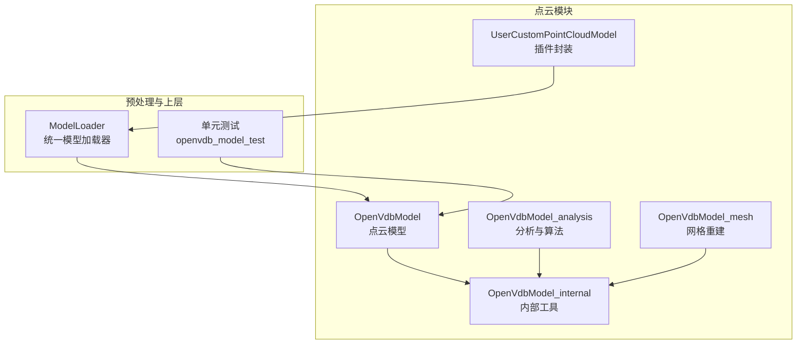
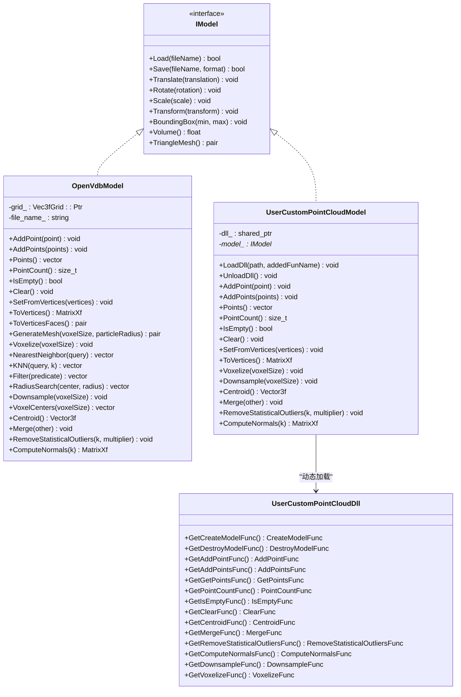
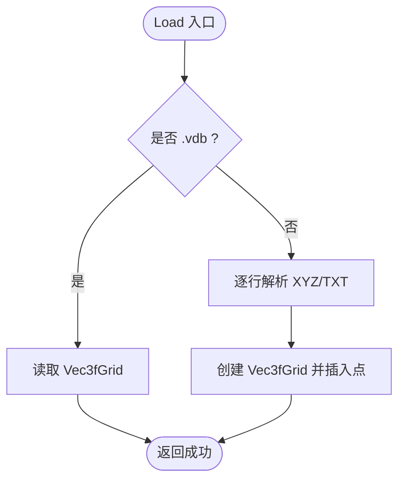
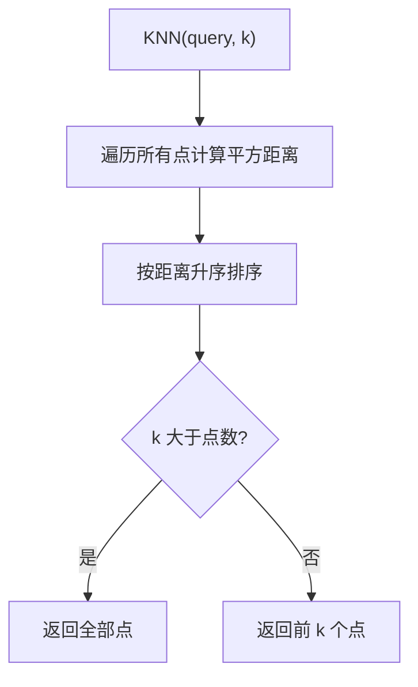
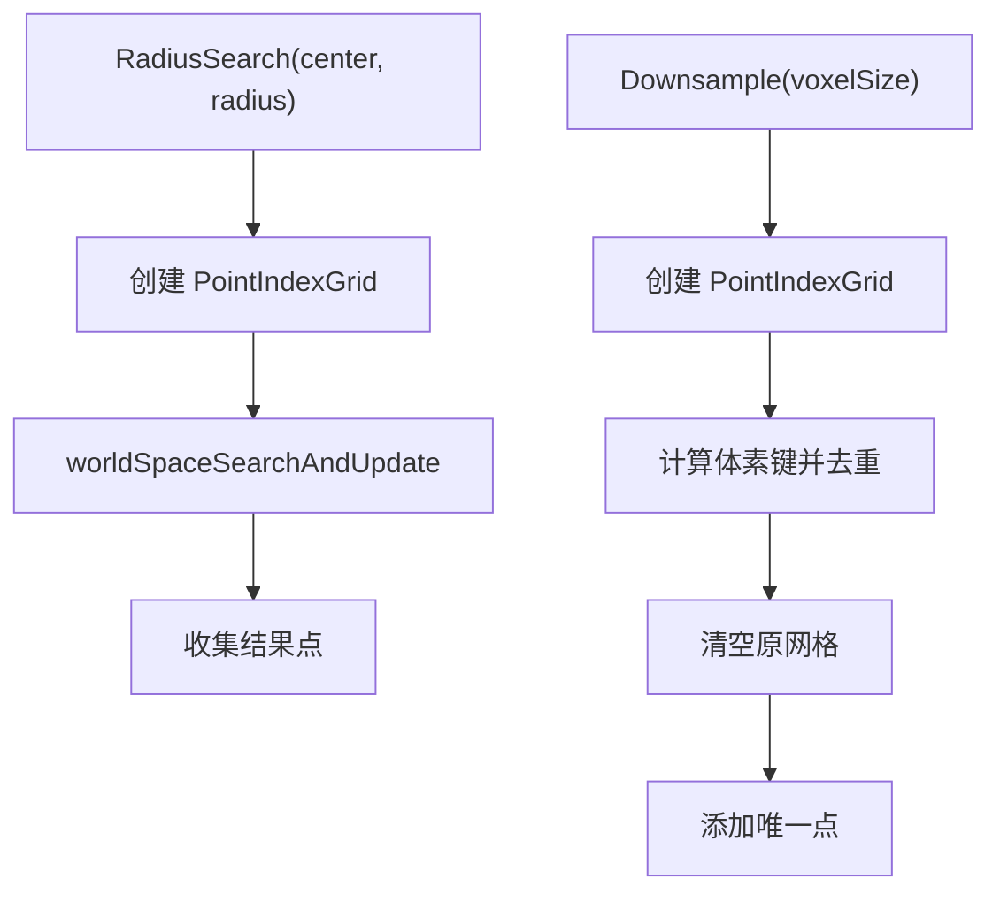
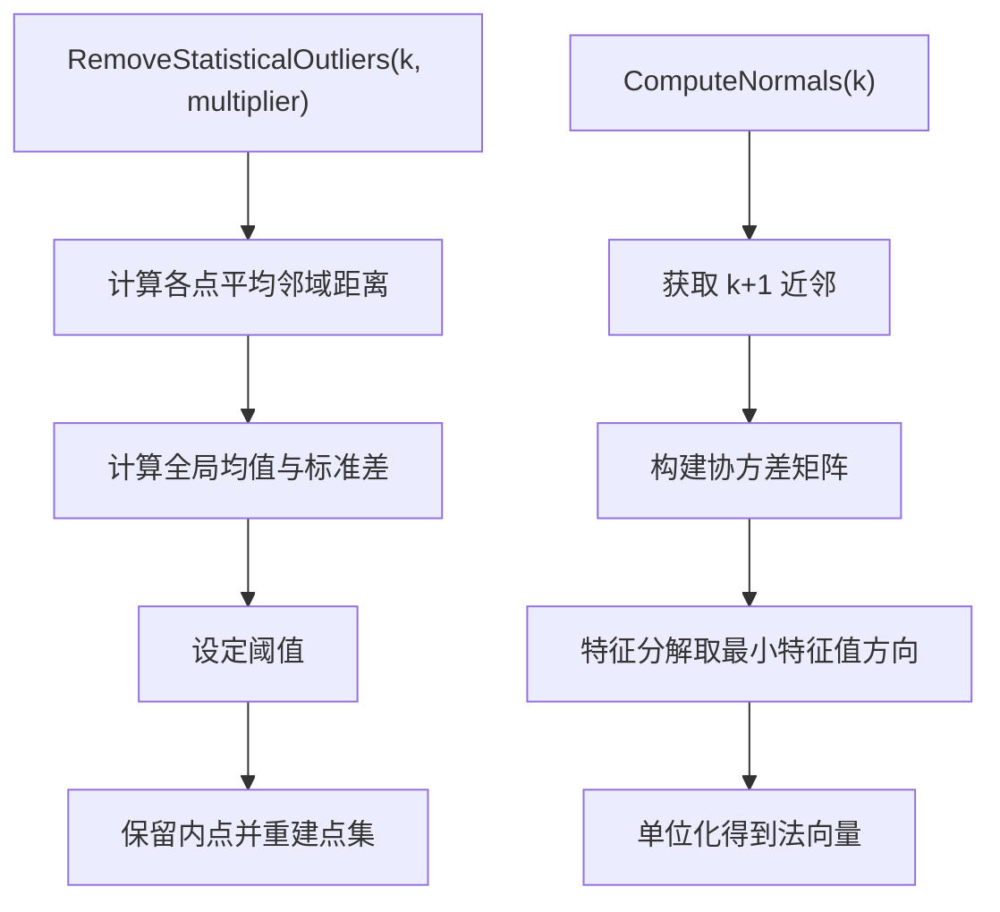
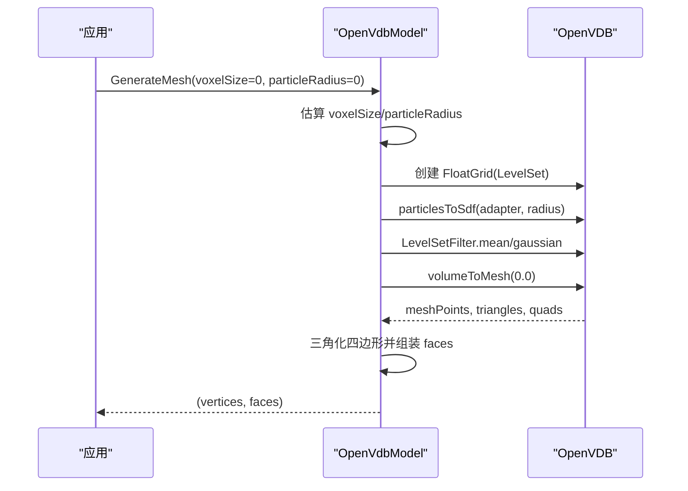
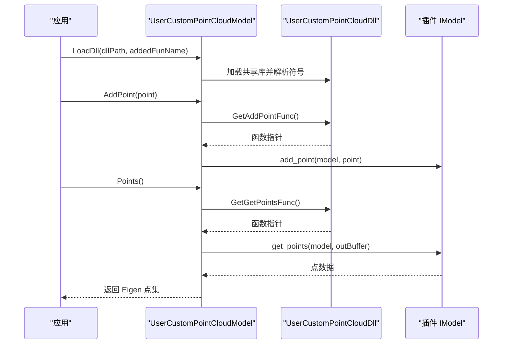
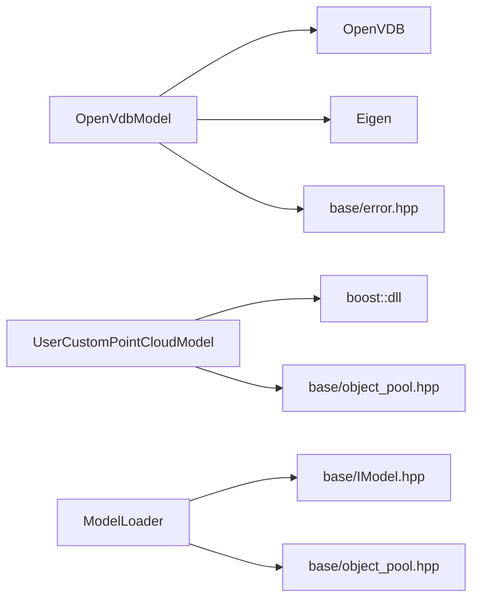

# 点云模型实现

<cite>
**本文引用的文件**   
- [OpenVdbModel.hpp](file://pointcloud/OpenVdbModel.hpp)
- [OpenVdbModel.cpp](file://pointcloud/OpenVdbModel.cpp)
- [OpenVdbModel_internal.h](file://pointcloud/OpenVdbModel_internal.h)
- [OpenVdbModel_analysis.cpp](file://pointcloud/OpenVdbModel_analysis.cpp)
- [OpenVdbModel_mesh.cpp](file://pointcloud/OpenVdbModel_mesh.cpp)
- [UserCustomPointCloudModel.hpp](file://pointcloud/UserCustomPointCloudModel.hpp)
- [UserCustomPointCloudModel.cpp](file://pointcloud/UserCustomPointCloudModel.cpp)
- [ModelLoader.hpp](file://preprocess/ModelLoader.hpp)
- [openvdb_model_test.cpp](file://tests/Models/openvdb_model_test.cpp)
</cite>

## 目录
1. [引言](#引言)
2. [项目结构](#项目结构)
3. [核心组件](#核心组件)
4. [架构总览](#架构总览)
5. [详细组件分析](#详细组件分析)
6. [依赖关系分析](#依赖关系分析)
7. [性能与优化](#性能与优化)
8. [故障排查指南](#故障排查指南)
9. [结论](#结论)
10. [附录：使用示例与最佳实践](#附录使用示例与最佳实践)

## 引言
本文件面向点云数据处理与建模，系统性梳理 HsBaSlicer 中基于 OpenVDB 的高性能点云模型实现，并说明如何通过 UserCustomPointCloudModel 扩展接口集成第三方点云库。文档重点包括：
- OpenVdbModel 的稀疏体素表示、八叉树数据结构、大规模点云操作（插入、查询、滤波、配准、分割等）
- XYZ、VDB 等点云格式的处理流程与优化策略
- 自定义点云模型的插件化扩展机制
- 代码级流程图、类图与调用序列图
- 测试用例与工程化最佳实践

## 项目结构
点云相关代码集中在 pointcloud 目录，按职责拆分为多个源文件：
- OpenVdbModel.hpp/.cpp：OpenVDB 点云模型主实现，包含 IModel 接口、基础几何变换、体素化、读写、KNN/最近邻、过滤等
- OpenVdbModel_internal.h：内部工具函数与适配器（坐标转换、路径处理、PointIndexGrid 适配器等）
- OpenVdbModel_analysis.cpp：空间查询、降采样、统计离群点剔除、法向量估计等分析算法
- OpenVdbModel_mesh.cpp：基于 LevelSet 的点云网格重建（Marching Cubes）
- UserCustomPointCloudModel.hpp/.cpp：通过 DLL/SO 动态加载用户自定义点云内核，提供与 OpenVdbModel 一致的 API

图表来源
- [OpenVdbModel.hpp:20-116](file://pointcloud/OpenVdbModel.hpp#L20-L116)
- [OpenVdbModel.cpp:148-217](file://pointcloud/OpenVdbModel.cpp#L148-L217)
- [OpenVdbModel_analysis.cpp:28-97](file://pointcloud/OpenVdbModel_analysis.cpp#L28-L97)
- [OpenVdbModel_mesh.cpp:21-117](file://pointcloud/OpenVdbModel_mesh.cpp#L21-L117)
- [UserCustomPointCloudModel.hpp:90-171](file://pointcloud/UserCustomPointCloudModel.hpp#L90-L171)
- [ModelLoader.hpp:135-198](file://preprocess/ModelLoader.hpp#L135-L198)

章节来源
- [OpenVdbModel.hpp:20-116](file://pointcloud/OpenVdbModel.hpp#L20-L116)
- [ModelLoader.hpp:135-198](file://preprocess/ModelLoader.hpp#L135-L198)

## 核心组件
- OpenVdbModel：基于 openvdb::Vec3fGrid 的稀疏体素点云模型，实现 IModel 接口并提供点云专属 API（AddPoints、Filter、KNN、RadiusSearch、Downsample、RemoveStatisticalOutliers、ComputeNormals、GenerateMesh 等）
- UserCustomPointCloudModel：对动态库导出函数的封装，暴露与 OpenVdbModel 一致的点云 API，便于替换或扩展后端
- ModelLoader：统一模型加载与命名池管理，在启用 USE_OPENVDB 时提供点云高级操作（降采样、去噪、质心、法线、点云转网格）

章节来源
- [OpenVdbModel.hpp:20-116](file://pointcloud/OpenVdbModel.hpp#L20-L116)
- [UserCustomPointCloudModel.hpp:90-171](file://pointcloud/UserCustomPointCloudModel.hpp#L90-L171)
- [ModelLoader.hpp:135-198](file://preprocess/ModelLoader.hpp#L135-L198)

## 架构总览
OpenVdbModel 以 OpenVDB 的 Vec3fGrid 作为底层存储，采用八叉树组织活跃体素；所有点云操作均围绕该网格进行。UserCustomPointCloudModel 通过 C ABI 函数指针桥接外部 DLL/SO，保持与 OpenVdbModel 一致的调用方式。ModelLoader 在上层统一管理模型生命周期，并在需要时调用 OpenVdbModel 的具体方法。

图表来源
- [OpenVdbModel.hpp:20-116](file://pointcloud/OpenVdbModel.hpp#L20-L116)
- [UserCustomPointCloudModel.hpp:26-171](file://pointcloud/UserCustomPointCloudModel.hpp#L26-L171)

## 详细组件分析

### OpenVdbModel：稀疏体素点云模型
- 数据表示
  - 使用 openvdb::Vec3fGrid 存储点位置，激活体素即代表一个点
  - 通过 grid_->tree().setValue(coord, value) 写入点，避免重复点合并（由体素索引决定）
- 文件格式
  - Load：自动识别 .vdb 与 .xyz/.txt；.vdb 直接读取 Vec3fGrid；否则逐行解析 XYZ 文本
  - Save：根据扩展名选择 VDB 二进制或 XYZ 文本输出
- 几何变换
  - Translate/Rotate/Scale/Transform：遍历活跃体素值并更新坐标
- 点云操作
  - AddPoint/AddPoints/SetFromVertices/ToVertices/Points/Clear
  - BoundingBox/Volume/TriangleMesh（后者委托 GenerateMesh）
  - NearestNeighbor/KNN/Filter/RadiusSearch/Voxelize/VoxelCenters
  - Centroid/Merge/RemoveStatisticalOutliers/ComputeNormals
- 网格重建
  - GenerateMesh：将点集转换为 LevelSet SDF，平滑后 Marching Cubes 提取三角面片

图表来源
- [OpenVdbModel.cpp:148-217](file://pointcloud/OpenVdbModel.cpp#L148-L217)

#### 最近邻与 KNN
- NearestNeighbor：线性扫描计算最小平方距离
- KNN：收集所有点的平方距离，排序取前 k 个

图表来源
- [OpenVdbModel.cpp:442-466](file://pointcloud/OpenVdbModel.cpp#L442-L466)

#### 半径搜索与降采样
- RadiusSearch：构建 PointIndexGrid，使用 worldSpaceSearchAndUpdate 加速空间查询
- Downsample：基于体素网格去重，将同一体素内的点合并为一个

图表来源
- [OpenVdbModel_analysis.cpp:28-97](file://pointcloud/OpenVdbModel_analysis.cpp#L28-L97)

#### 统计离群点剔除与法向量估计
- RemoveStatisticalOutliers：对每个点计算到 k 近邻的平均距离，全局均值与标准差阈值剔除离群点
- ComputeNormals：对每个点构建邻域协方差矩阵，最小特征值对应方向为法向量

图表来源
- [OpenVdbModel_analysis.cpp:99-213](file://pointcloud/OpenVdbModel_analysis.cpp#L99-L213)

#### 网格重建（LevelSet + Marching Cubes）
- 步骤：估算 voxelSize/particleRadius → 创建 FloatGrid 作为 LevelSet → particlesToSdf → 平滑 → volumeToMesh → 三角面片整理

图表来源
- [OpenVdbModel_mesh.cpp:21-117](file://pointcloud/OpenVdbModel_mesh.cpp#L21-L117)

章节来源
- [OpenVdbModel.hpp:20-116](file://pointcloud/OpenVdbModel.hpp#L20-L116)
- [OpenVdbModel.cpp:148-217](file://pointcloud/OpenVdbModel.cpp#L148-L217)
- [OpenVdbModel_analysis.cpp:28-213](file://pointcloud/OpenVdbModel_analysis.cpp#L28-L213)
- [OpenVdbModel_mesh.cpp:21-117](file://pointcloud/OpenVdbModel_mesh.cpp#L21-L117)

### UserCustomPointCloudModel：插件化点云内核
- IUserCustomPointCloud：定义 C ABI 函数指针类型（create/destroy/add/query/transform/filter/normals/downsample/voxelize 等）
- UserCustomPointCloudDll：使用 boost::dll 加载共享库，按约定符号名解析函数指针
- UserCustomPointCloudModel：对外暴露与 OpenVdbModel 一致的点云 API，内部转发至插件实现的 IModel

图表来源
- [UserCustomPointCloudModel.hpp:26-171](file://pointcloud/UserCustomPointCloudModel.hpp#L26-L171)
- [UserCustomPointCloudModel.cpp:32-158](file://pointcloud/UserCustomPointCloudModel.cpp#L32-L158)
- [UserCustomPointCloudModel.cpp:345-446](file://pointcloud/UserCustomPointCloudModel.cpp#L345-L446)

章节来源
- [UserCustomPointCloudModel.hpp:26-171](file://pointcloud/UserCustomPointCloudModel.hpp#L26-L171)
- [UserCustomPointCloudModel.cpp:175-208](file://pointcloud/UserCustomPointCloudModel.cpp#L175-L208)
- [UserCustomPointCloudModel.cpp:345-543](file://pointcloud/UserCustomPointCloudModel.cpp#L345-L543)

### ModelLoader：点云操作统一入口
- 当启用 USE_OPENVDB 时，提供点云相关的高级操作：
  - PointCloudToMesh：点云转网格
  - MergePointClouds：合并点云
  - DownsamplePointCloud：体素降采样
  - RemovePointCloudOutliers：统计离群点剔除
  - PointCloudCentroid/PointCloudNormals：质心与法向量
  - PointCloudCount：点数量

章节来源
- [ModelLoader.hpp:135-198](file://preprocess/ModelLoader.hpp#L135-L198)

## 依赖关系分析
- OpenVdbModel 依赖：
  - OpenVDB：Vec3fGrid、tools::PointIndexGrid、tools::ParticlesToLevelSet、tools::LevelSetFilter、tools::VolumeToMesh
  - Eigen：向量与矩阵运算
  - base/error.hpp：错误类型抛出
- UserCustomPointCloudModel 依赖：
  - boost::dll：动态库加载与符号解析
  - base/object_pool.hpp：DLL 对象池复用
- ModelLoader 依赖：
  - base/IModel.hpp：统一模型接口
  - base/object_pool.hpp：命名模型池

图表来源
- [OpenVdbModel.cpp:17-20](file://pointcloud/OpenVdbModel.cpp#L17-L20)
- [OpenVdbModel_mesh.cpp:12-14](file://pointcloud/OpenVdbModel_mesh.cpp#L12-L14)
- [UserCustomPointCloudModel.cpp:9-12](file://pointcloud/UserCustomPointCloudModel.cpp#L9-L12)
- [ModelLoader.hpp:9-15](file://preprocess/ModelLoader.hpp#L9-L15)

章节来源
- [OpenVdbModel.cpp:17-20](file://pointcloud/OpenVdbModel.cpp#L17-L20)
- [OpenVdbModel_mesh.cpp:12-14](file://pointcloud/OpenVdbModel_mesh.cpp#L12-L14)
- [UserCustomPointCloudModel.cpp:9-12](file://pointcloud/UserCustomPointCloudModel.cpp#L9-L12)
- [ModelLoader.hpp:9-15](file://preprocess/ModelLoader.hpp#L9-L15)

## 性能与优化
- 稀疏体素存储
  - 使用 openvdb::Vec3fGrid 的八叉树结构，仅存储活跃体素，适合大规模稀疏点云
- 空间查询加速
  - RadiusSearch 使用 PointIndexGrid 进行体素化索引，显著减少全量扫描
- 降采样策略
  - Downsample 基于体素键去重，避免重复点导致的数据膨胀
- 网格重建参数
  - GenerateMesh 支持自动估算 voxelSize 与 particleRadius，平衡重建质量与效率
- 内存与 IO
  - VDB 二进制格式保存/加载更高效；XYZ 文本格式便于调试与交换
- 插件化
  - UserCustomPointCloudModel 允许用高性能后端替换默认实现，同时保持 API 一致

[本节为通用指导，不直接分析具体文件]

## 故障排查指南
- 文件加载失败
  - .vdb 文件中无 Vec3fGrid 或网格为空：检查文件格式与内容
  - .xyz/.txt 文件无法打开或无有效点：检查路径权限与数据格式
- 参数校验异常
  - voxelSize/radius/k 非正数：确保传入正值
- 插件未加载或符号缺失
  - EnsureModel 抛出“Dll not loaded”或“Create model function not found in DLL”：确认 LoadDll 已调用且符号名正确
  - 具体功能函数缺失：检查插件导出的函数名是否符合约定（如 _add_point、_compute_normals 等）
- 网格重建结果为空
  - 点集过少或参数不合理：调整 voxelSize/particleRadius 或增加点密度

章节来源
- [OpenVdbModel.cpp:148-217](file://pointcloud/OpenVdbModel.cpp#L148-L217)
- [OpenVdbModel_analysis.cpp:28-97](file://pointcloud/OpenVdbModel_analysis.cpp#L28-L97)
- [UserCustomPointCloudModel.cpp:192-208](file://pointcloud/UserCustomPointCloudModel.cpp#L192-L208)
- [UserCustomPointCloudModel.cpp:345-543](file://pointcloud/UserCustomPointCloudModel.cpp#L345-L543)

## 结论
OpenVdbModel 提供了基于 OpenVDB 的高效点云处理能力，涵盖从数据加载、体素化、空间查询、滤波降噪到网格重建的完整流程。UserCustomPointCloudModel 通过插件机制扩展了后端能力，使系统可灵活集成其他点云库。ModelLoader 则在上层统一管理与调度这些能力，形成稳定可扩展的点云处理管线。

[本节为总结性内容，不直接分析具体文件]

## 附录：使用示例与最佳实践

### 点云加载与保存
- 加载 VDB 或 XYZ/TXT 文件
- 保存为 VDB 或 XYZ 文本

参考路径
- [OpenVdbModel.cpp:148-217](file://pointcloud/OpenVdbModel.cpp#L148-L217)

### 点云基本操作
- 插入点、批量插入、清空、计数、判断空
- 坐标变换：平移、旋转、缩放、仿射变换
- 边界框、质心、合并点云

参考路径
- [OpenVdbModel.cpp:219-316](file://pointcloud/OpenVdbModel.cpp#L219-L316)
- [OpenVdbModel.cpp:328-393](file://pointcloud/OpenVdbModel.cpp#L328-L393)
- [OpenVdbModel.cpp:533-554](file://pointcloud/OpenVdbModel.cpp#L533-L554)

### 点云滤波与降噪
- Filter：自定义谓词过滤
- Downsample：体素降采样
- RemoveStatisticalOutliers：统计离群点剔除

参考路径
- [OpenVdbModel.cpp:468-485](file://pointcloud/OpenVdbModel.cpp#L468-L485)
- [OpenVdbModel_analysis.cpp:67-97](file://pointcloud/OpenVdbModel_analysis.cpp#L67-L97)
- [OpenVdbModel_analysis.cpp:99-161](file://pointcloud/OpenVdbModel_analysis.cpp#L99-L161)

### 点云配准与分割
- 配准：可使用 KNN/RadiusSearch 进行点对匹配，结合 RANSAC 或 ICP（需自行实现）
- 分割：基于 Filter 或聚类（例如基于法向量或距离阈值），再分别导出子点云

参考路径
- [OpenVdbModel.cpp:442-466](file://pointcloud/OpenVdbModel.cpp#L442-L466)
- [OpenVdbModel_analysis.cpp:28-65](file://pointcloud/OpenVdbModel_analysis.cpp#L28-L65)

### 点云法向量估计
- ComputeNormals：基于 KNN 协方差分析估计单位法向量

参考路径
- [OpenVdbModel_analysis.cpp:163-213](file://pointcloud/OpenVdbModel_analysis.cpp#L163-L213)

### 点云转网格
- GenerateMesh：LevelSet + Marching Cubes 重建三角网格

参考路径
- [OpenVdbModel_mesh.cpp:21-117](file://pointcloud/OpenVdbModel_mesh.cpp#L21-L117)

### 单元测试参考
- 点云基本操作、半径搜索、降采样、XYZ 往返一致性

参考路径
- [openvdb_model_test.cpp:25-119](file://tests/Models/openvdb_model_test.cpp#L25-L119)
- [openvdb_model_test.cpp:121-153](file://tests/Models/openvdb_model_test.cpp#L121-L153)

### 最佳实践
- 优先使用 VDB 格式进行大规模点云的持久化与传输
- 在进行空间查询前，先进行 Downsample 降低数据规模
- 合理设置 voxelSize 与 particleRadius，以获得高质量网格重建
- 使用 Plugin 模式替换后端以提升性能或集成特定算法
- 在关键路径上捕获 IOError/RuntimeError 并进行日志记录

[本节为通用指导，不直接分析具体文件]