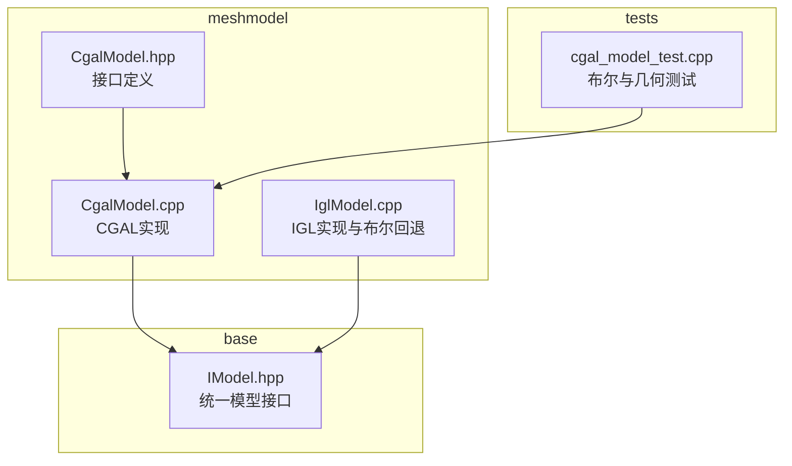
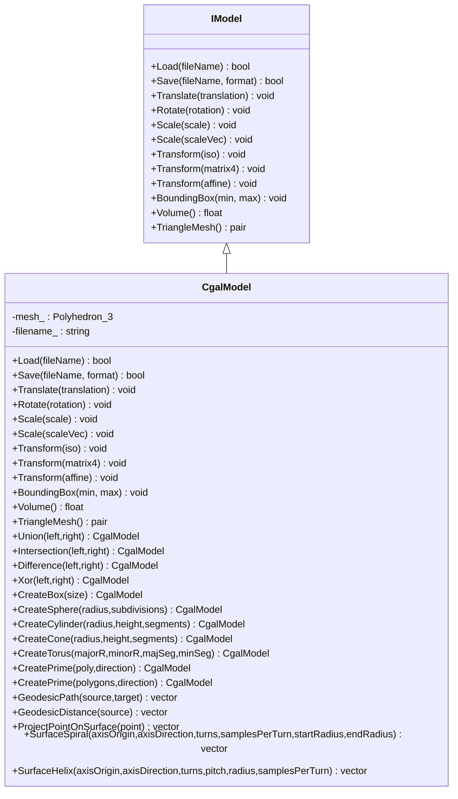
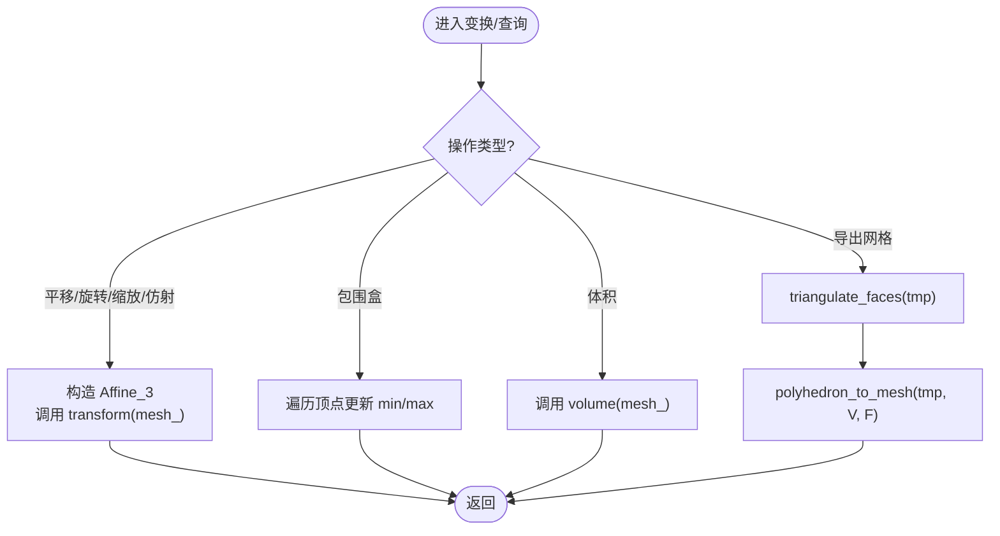
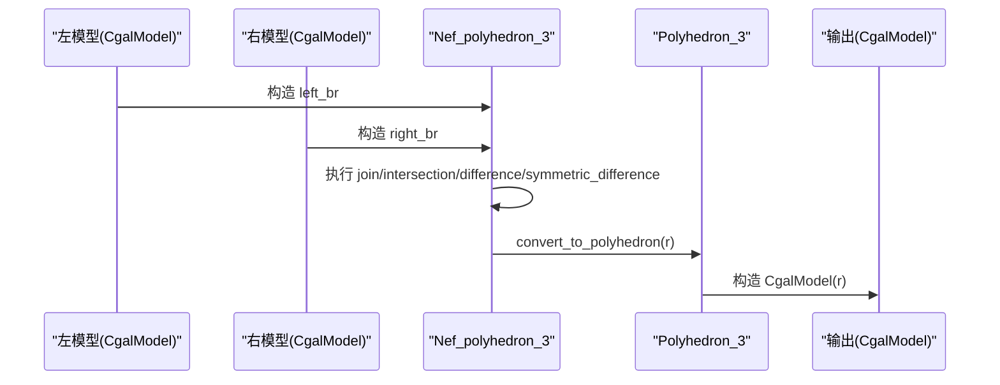
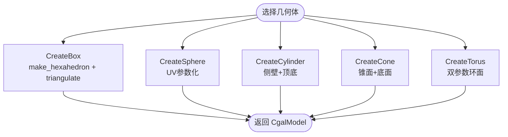
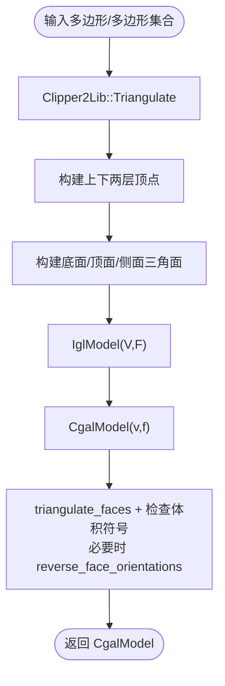
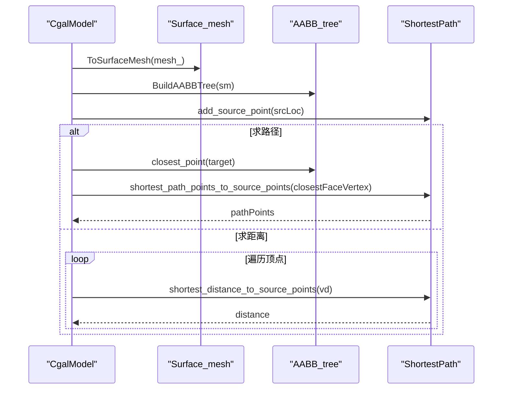
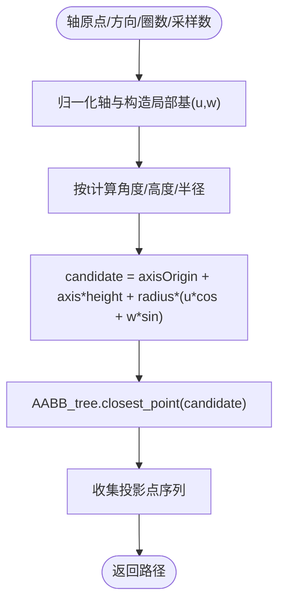
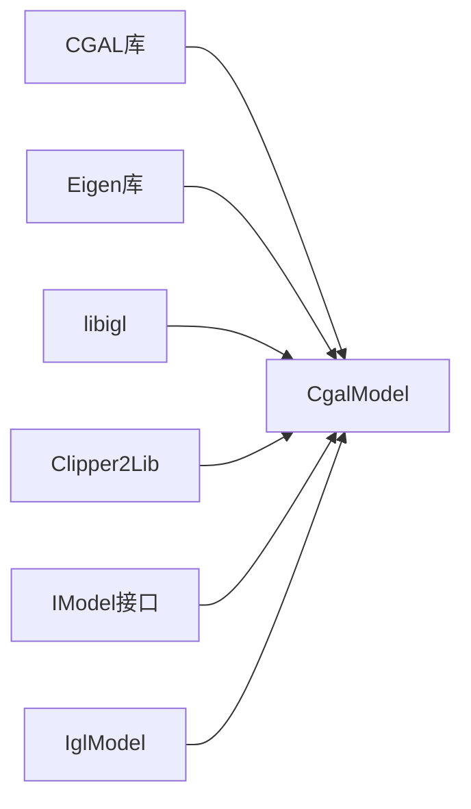

# CgalModel - CGAL网格模型

<cite>
**本文引用的文件**   
- [CgalModel.hpp](file://meshmodel/CgalModel.hpp)
- [CgalModel.cpp](file://meshmodel/CgalModel.cpp)
- [IglModel.cpp](file://meshmodel/IglModel.cpp)
- [IModel.hpp](file://base/IModel.hpp)
- [cgal_model_test.cpp](file://tests/Models/cgal_model_test.cpp)
</cite>

## 目录
1. [简介](#简介)
2. [项目结构](#项目结构)
3. [核心组件](#核心组件)
4. [架构总览](#架构总览)
5. [详细组件分析](#详细组件分析)
6. [依赖关系分析](#依赖关系分析)
7. [性能与内存优化建议](#性能与内存优化建议)
8. [故障排查指南](#故障排查指南)
9. [结论](#结论)
10. [附录：完整使用示例](#附录完整使用示例)

## 简介
CgalModel 是基于 CGAL 库的三角网格模型实现，封装了 CGAL 的 Polyhedron_3 与 Nef_polyhedron_3，提供加载/保存、几何变换、包围盒与体积查询、布尔运算（并集、交集、差集、异或）、基础几何体创建（立方体、球体、圆柱体、圆锥体、圆环体）、多边形拉伸以及表面测地线、螺旋路径与螺旋线生成等高级几何操作。该类实现了统一的 IModel 接口，便于在切片与建模管线中替换不同后端。

## 项目结构
CgalModel 位于 meshmodel 模块，对外暴露 CgalModel.hpp 接口，具体实现在 CgalModel.cpp；同时通过 IModel 抽象与其他模型类型（如 IglModel）协同工作。测试用例位于 tests/Models/cgal_model_test.cpp。

**图示来源**
- [CgalModel.hpp:34-155](file://meshmodel/CgalModel.hpp#L34-L155)
- [CgalModel.cpp:1-34](file://meshmodel/CgalModel.cpp#L1-L34)
- [IModel.hpp:111-139](file://base/IModel.hpp#L111-L139)
- [cgal_model_test.cpp:40-62](file://tests/Models/cgal_model_test.cpp#L40-L62)

**章节来源**
- [CgalModel.hpp:34-155](file://meshmodel/CgalModel.hpp#L34-L155)
- [CgalModel.cpp:1-34](file://meshmodel/CgalModel.cpp#L1-L34)
- [IModel.hpp:111-139](file://base/IModel.hpp#L111-L139)

## 核心组件
- 内核与类型别名
  - EpicKernel：精确谓词/非精确构造内核
  - Point_3 / Vector_3 / Affine_3：三维点、向量与仿射变换
  - Polyhedron_3：CGAL 多面体表面网格
  - Nef_Polyheron_3：用于布尔运算的 Nef 多面体
- 数据成员
  - mesh_：内部存储的 Polyhedron_3
  - filename_：最近一次加载的文件名（便于调试与日志）
- 公共能力
  - 加载/保存：Load/Save（STL/OFF/PLY/OBJ）
  - 几何变换：Translate/Rotate/Scale/Transform（多种 Eigen 变换）
  - 查询：BoundingBox/Volume/TriangleMesh
  - 布尔运算：Union/Intersection/Difference/Xor（友元函数）
  - 基础几何体：CreateBox/CreateSphere/CreateCylinder/CreateCone/CreateTorus
  - 拉伸：CreatePrime（单多边形与多多边形）
  - 高级几何：GeodesicPath/GeodesicDistance/ProjectPointOnSurface/SurfaceSpiral/SurfaceHelix

**章节来源**
- [CgalModel.hpp:34-155](file://meshmodel/CgalModel.hpp#L34-L155)

## 架构总览
CgalModel 以 Polyhedron_3 为内部表示，所有几何操作均基于 CGAL 的多面体处理工具。布尔运算通过 Nef_polyhedron_3 完成，结果再转换回 Polyhedron_3。对于需要与 libigl 交互的场景（如从顶点/面片构建），通过 IglModel 作为中间层进行转换与修复。

**图示来源**
- [IModel.hpp:111-139](file://base/IModel.hpp#L111-L139)
- [CgalModel.hpp:34-155](file://meshmodel/CgalModel.hpp#L34-L155)

## 详细组件分析

### 几何变换与基础查询
- 变换
  - Translate/Rotate/Scale/Transform 均通过 CGAL::Aff_transformation_3 与 Polygon_mesh_processing::transform 直接作用于 mesh_。
- 包围盒与体积
  - BoundingBox 遍历顶点计算 AABB。
  - Volume 调用 CGAL::Polygon_mesh_processing::volume。
- 三角网格导出
  - TriangleMesh 先确保三角化，再通过 igl::copyleft::cgal::polyhedron_to_mesh 转换为 (vertices, faces)。

**图示来源**
- [CgalModel.cpp:158-204](file://meshmodel/CgalModel.cpp#L158-L204)
- [CgalModel.cpp:206-236](file://meshmodel/CgalModel.cpp#L206-L236)

**章节来源**
- [CgalModel.cpp:158-236](file://meshmodel/CgalModel.cpp#L158-L236)

### 布尔运算（Nef_polyhedron_3）
- Union/Intersection/Difference/Xor 将左右模型的 Polyhedron_3 转为 Nef_polyhedron_3，执行 join/intersection/difference/symmetric_difference，再将结果 convert_to_polyhedron 回 Polyhedron_3。
- IglModel 的布尔实现优先尝试 igl::copyleft::cgal::mesh_boolean，失败时回退到 CgalModel 的 Nef 布尔。

**图示来源**
- [CgalModel.cpp:238-276](file://meshmodel/CgalModel.cpp#L238-L276)
- [IglModel.cpp:202-245](file://meshmodel/IglModel.cpp#L202-L245)

**章节来源**
- [CgalModel.cpp:238-276](file://meshmodel/CgalModel.cpp#L238-L276)
- [IglModel.cpp:202-245](file://meshmodel/IglModel.cpp#L202-L245)
- [cgal_model_test.cpp:40-62](file://tests/Models/cgal_model_test.cpp#L40-L62)

### 基础几何体创建
- CreateBox：使用 CGAL::make_hexahedron 生成封闭六面体，随后强制三角化。
- CreateSphere：按细分级别生成 UV 球面网格。
- CreateCylinder/CreateCone：参数化生成侧壁与端面三角形。
- CreateTorus：双参数环面参数化生成。

**图示来源**
- [CgalModel.cpp:278-445](file://meshmodel/CgalModel.cpp#L278-L445)

**章节来源**
- [CgalModel.cpp:278-445](file://meshmodel/CgalModel.cpp#L278-L445)

### 多边形拉伸（CreatePrime）
- 单多边形版本：对输入多边形进行三角剖分，构建上下底面与侧面，借助 IglModel 生成网格后转回 CgalModel，并强制三角化与方向修正以保证正体积。
- 多多边形版本：通过 Clipper2Lib 进行孔洞判定与方向归一化，三角剖分后构建唯一顶点表，生成上下底面与侧墙，同样经 IglModel 转换与方向修正。

**图示来源**
- [CgalModel.cpp:625-733](file://meshmodel/CgalModel.cpp#L625-L733)
- [CgalModel.cpp:735-955](file://meshmodel/CgalModel.cpp#L735-L955)

**章节来源**
- [CgalModel.cpp:625-955](file://meshmodel/CgalModel.cpp#L625-L955)

### 表面测地线与投影
- GeodesicPath：将 Polyhedron_3 转为 Surface_mesh，构建 AABB 树，使用 Surface_mesh_shortest_path 计算两点间最短测地线路径。
- GeodesicDistance：从源点到所有顶点的测地距离。
- ProjectPointOnSurface：基于 AABB 树的最近点投影。

**图示来源**
- [CgalModel.cpp:959-1128](file://meshmodel/CgalModel.cpp#L959-L1128)

**章节来源**
- [CgalModel.cpp:959-1128](file://meshmodel/CgalModel.cpp#L959-L1128)

### 螺旋与螺旋线（SurfaceSpiral / SurfaceHelix）
- SurfaceSpiral：沿给定轴生成螺旋采样点，半径可线性变化，最终通过 AABB 树投影到表面。
- SurfaceHelix：固定半径与螺距的螺旋采样，同样投影到表面。

**图示来源**
- [CgalModel.cpp:1130-1210](file://meshmodel/CgalModel.cpp#L1130-L1210)

**章节来源**
- [CgalModel.cpp:1130-1210](file://meshmodel/CgalModel.cpp#L1130-L1210)

## 依赖关系分析
- 外部依赖
  - CGAL：Polyhedron_3、Nef_polyhedron_3、Surface_mesh、Surface_mesh_shortest_path、AABB_tree、Polygon_mesh_processing、IO 读写。
  - Eigen：矩阵与变换类型。
  - libigl：mesh_to_polyhedron/polyhedron_to_mesh 转换与布尔回退。
  - Clipper2Lib：二维多边形三角剖分与面积/包含性判断。
- 内部依赖
  - IModel：统一接口。
  - IglModel：作为中间层进行网格构建与转换。

**图示来源**
- [CgalModel.cpp:1-34](file://meshmodel/CgalModel.cpp#L1-L34)
- [CgalModel.cpp:27-33](file://meshmodel/CgalModel.cpp#L27-L33)
- [CgalModel.cpp:633-636](file://meshmodel/CgalModel.cpp#L633-L636)
- [IModel.hpp:111-139](file://base/IModel.hpp#L111-L139)

**章节来源**
- [CgalModel.cpp:1-34](file://meshmodel/CgalModel.cpp#L1-L34)
- [CgalModel.cpp:27-33](file://meshmodel/CgalModel.cpp#L27-L33)
- [CgalModel.cpp:633-636](file://meshmodel/CgalModel.cpp#L633-L636)
- [IModel.hpp:111-139](file://base/IModel.hpp#L111-L139)

## 性能与内存优化建议
- 布尔运算
  - 大模型布尔运算可能产生复杂拓扑，建议在调用前对输入模型进行简化或预处理（减少冗余顶点与退化面）。
  - 若仅需近似结果，可考虑降低细分级别或使用更粗的网格。
- 网格转换
  - TriangleMesh 会复制并三角化临时副本，频繁调用会产生额外开销；建议缓存结果或在批处理中复用。
- 测地线与投影
  - SurfaceSpiral/SurfaceHelix 每采样点进行一次 AABB 最近点查询，采样数越大开销越高；合理设置 samplesPerTurn 与 turns。
  - GeodesicDistance 对每个顶点查询距离，复杂度较高；仅在必要时调用。
- 内存管理
  - 避免长时间持有大型临时 Surface_mesh/AABB_tree；在函数作用域内创建并在返回前释放。
  - 使用移动语义与 const 引用传递大对象，减少拷贝。
- I/O
  - Save 支持二进制 STL/PLY，优先使用二进制模式以减少文件大小与 I/O 时间。

[本节为通用指导，不直接分析具体文件]

## 故障排查指南
- 空网格构造异常
  - 当传入空顶点或面片时，构造函数抛出运行时错误；请检查输入数据完整性。
- 三角化失败
  - 某些输入网格无法直接转换为 Polyhedron_3，实现中包含修复流程（定向、合并重复顶点、翻转面方向）；若仍失败，需检查网格连通性与法向一致性。
- 拉伸失败
  - 单多边形/多多边形拉伸依赖 Clipper2Lib 三角剖分；若三角剖分失败，检查多边形自交、退化边或非法顶点顺序。
- 布尔运算结果为空
  - 若 igl 布尔失败且 Nef 布尔也返回空网格，检查两个模型是否相交或包含关系是否符合预期；必要时调整位置或尺寸。
- 文件格式不支持
  - Save 仅支持 MeshFormat 枚举中的格式；传入不支持的格式将抛出未支持错误。

**章节来源**
- [CgalModel.cpp:42-118](file://meshmodel/CgalModel.cpp#L42-L118)
- [CgalModel.cpp:133-157](file://meshmodel/CgalModel.cpp#L133-L157)
- [CgalModel.cpp:625-733](file://meshmodel/CgalModel.cpp#L625-L733)
- [CgalModel.cpp:735-955](file://meshmodel/CgalModel.cpp#L735-L955)

## 结论
CgalModel 提供了稳健的 CGAL 网格模型实现，覆盖从基础几何体创建、布尔运算到高级表面几何计算的完整功能链。其设计兼顾了易用性与扩展性，并通过 IModel 接口与 IglModel 协作，形成灵活的建模后端。在实际工程中，应关注布尔运算与测地计算的复杂度，合理使用采样与网格简化策略，以获得良好的性能与稳定性。

[本节为总结性内容，不直接分析具体文件]

## 附录：完整使用示例
以下示例展示如何加载 STL/OFF 文件、执行几何变换、进行布尔运算并导出结果。为避免泄露源码，此处仅提供步骤与对应代码片段路径。

- 加载模型
  - 调用 Load 方法读取 STL/OFF 文件。
  - 参考路径：[CgalModel.cpp:121-131](file://meshmodel/CgalModel.cpp#L121-L131)
- 几何变换
  - 使用 Translate/Rotate/Scale/Transform 对模型进行变换。
  - 参考路径：[CgalModel.cpp:158-204](file://meshmodel/CgalModel.cpp#L158-L204)
- 布尔运算
  - 使用 Union/Intersection/Difference/Xor 对两个模型进行布尔操作。
  - 参考路径：[CgalModel.cpp:238-276](file://meshmodel/CgalModel.cpp#L238-L276)
  - 测试用例验证体积与网格有效性。
  - 参考路径：[cgal_model_test.cpp:40-62](file://tests/Models/cgal_model_test.cpp#L40-L62)
- 导出结果
  - 调用 Save 指定目标格式（BinarySTL/ASCIISTL/BinaryPLY/ASCIIPLY/OBJ/OFF）。
  - 参考路径：[CgalModel.cpp:133-157](file://meshmodel/CgalModel.cpp#L133-L157)

[本节为使用指引，不直接分析具体文件]