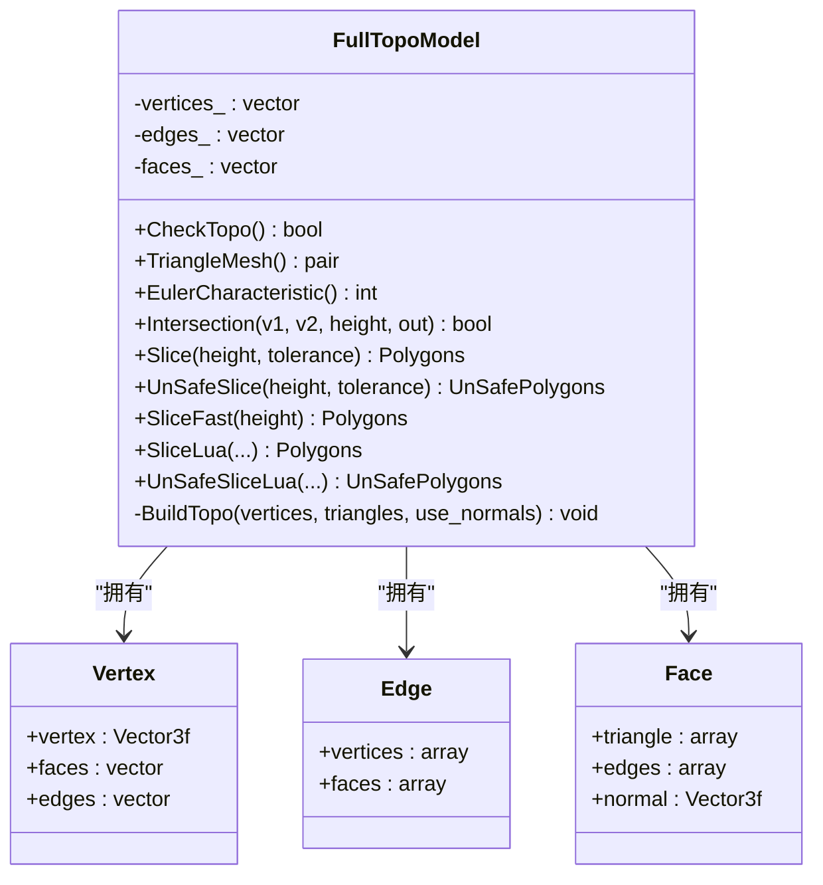
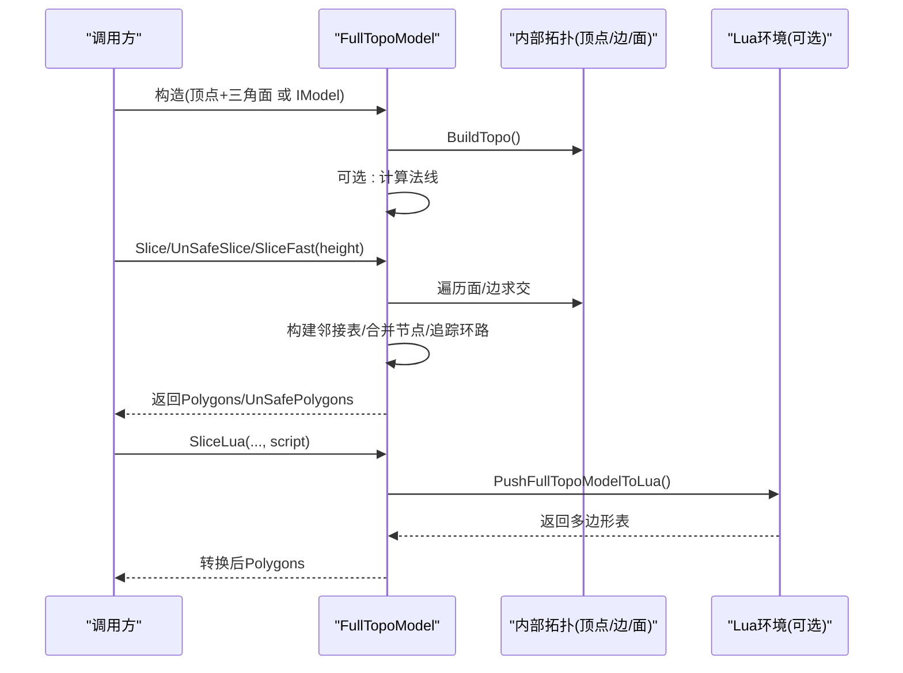
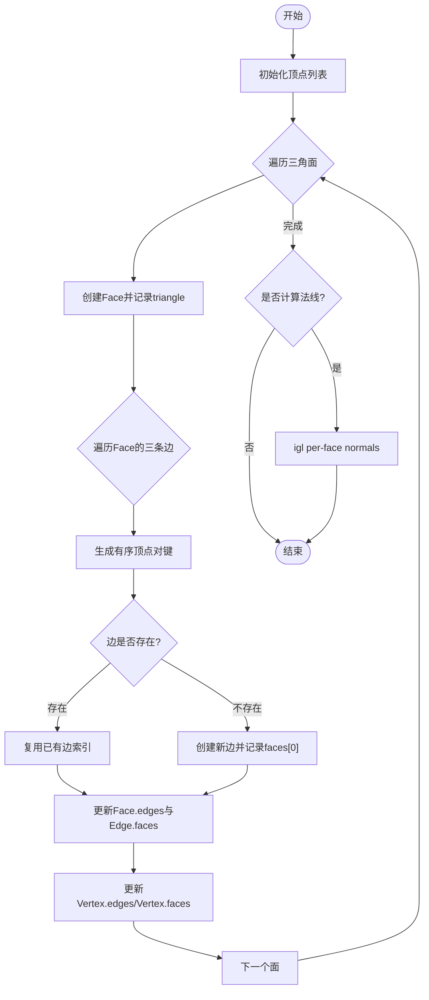
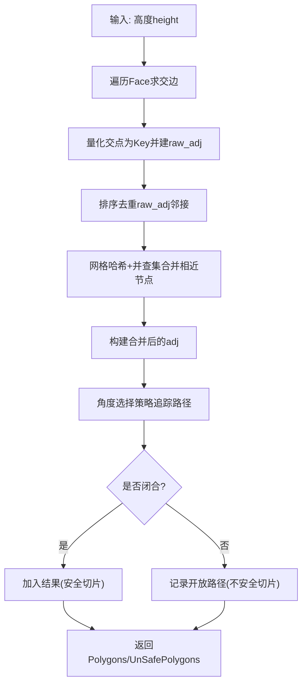
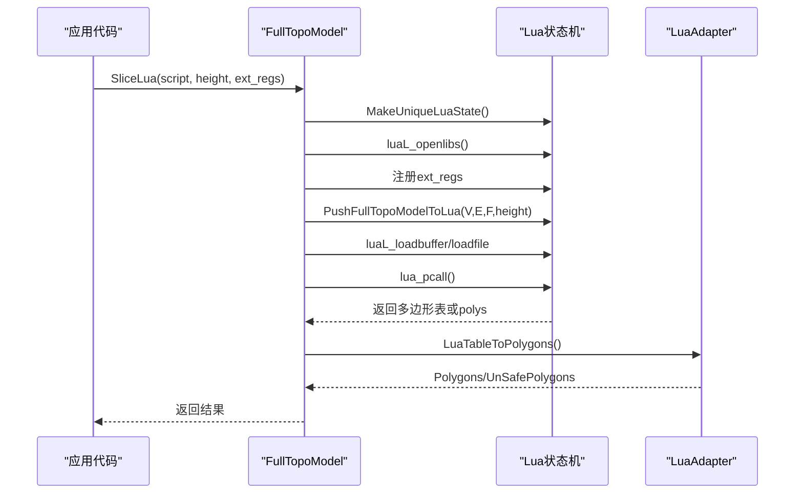

# FullTopoModel - 完整拓扑模型

<cite>
**本文引用的文件**   
- [FullTopoModel.hpp](file://meshmodel/FullTopoModel.hpp)
- [FullTopoModel.cpp](file://meshmodel/FullTopoModel.cpp)
- [Msg2FullTopoModel.hpp](file://convert/Msg2FullTopoModel.hpp)
- [Msg2FullTopoModel.cpp](file://convert/Msg2FullTopoModel.cpp)
- [FullTopoModel2Msg.hpp](file://convert/FullTopoModel2Msg.hpp)
- [FullTopoModel2Msg.cpp](file://convert/FullTopoModel2Msg.cpp)
- [full_topo_model_test.cpp](file://tests/Models/full_topo_model_test.cpp)
</cite>

## 目录
1. [简介](#简介)
2. [项目结构与定位](#项目结构与定位)
3. [核心组件与数据模型](#核心组件与数据模型)
4. [架构总览](#架构总览)
5. [详细组件分析](#详细组件分析)
6. [依赖关系分析](#依赖关系分析)
7. [性能与内存管理](#性能与内存管理)
8. [故障排查与常见问题](#故障排查与常见问题)
9. [结论](#结论)
10. [附录：使用示例与最佳实践](#附录使用示例与最佳实践)

## 简介
FullTopoModel 是一个面向切片场景的“完整拓扑重建”网格模型。它在构造阶段从三角形面片重建顶点、边、面之间的拓扑关系，并提供面向 Z 轴的切片接口（安全切片、不安全切片、快速切片）以及基于 Lua 的可扩展切片脚本能力。该模型不对外暴露修改接口（除构造外），主要用于切片算法中复用已构建的拓扑结构，避免重复计算。

与传统仅存储顶点与三角面的网格不同，FullTopoModel 显式维护了边和面之间的邻接关系，并支持欧拉示性数检查、法线计算、拓扑完整性校验等高级能力。它不是通用布尔运算或网格修复库的直接实现，但为切片提供了稳定且高效的拓扑基础。

## 项目结构与定位
- 位置：位于 meshmodel 模块，是切片管线中的核心几何数据结构之一。
- 输入来源：可从 IModel 抽象接口或原始顶点/三角面数组构造。
- 输出用途：提供 Polygons/UnSafePolygons 等二维轮廓集合，供后续填充、路径生成等流程使用。
- 外部集成：通过 convert 子模块与 protobuf 消息互转；通过 Lua 适配器暴露给脚本层。

```mermaid
graph TB
A["IModel<br/>三角形网格抽象"] --> B["FullTopoModel<br/>完整拓扑模型"]
C["protobuf msg_topo_trimeshes"] < --> D["Msg2FullTopoModel / FullTopoModel2Msg"]
B --> E["Slice / UnSafeSlice / SliceFast"]
B --> F["SliceLua / UnSafeSliceLua"]
E --> G["Polygons / UnSafePolygons"]
F --> G
```

图表来源
- [FullTopoModel.hpp:43-127](file://meshmodel/FullTopoModel.hpp#L43-L127)
- [Msg2FullTopoModel.hpp:18-22](file://convert/Msg2FullTopoModel.hpp#L18-L22)
- [FullTopoModel2Msg.hpp:15-16](file://convert/FullTopoModel2Msg.hpp#L15-L16)

章节来源
- [FullTopoModel.hpp:18-52](file://meshmodel/FullTopoModel.hpp#L18-L52)
- [Msg2FullTopoModel.hpp:1-26](file://convert/Msg2FullTopoModel.hpp#L1-L26)
- [FullTopoModel2Msg.hpp:1-20](file://convert/FullTopoModel2Msg.hpp#L1-L20)

## 核心组件与数据模型
FullTopoModel 的核心由三类拓扑元素组成：
- 顶点 Vertex：包含三维坐标，以及关联的面索引与边索引列表。
- 边 Edge：包含两个端点顶点索引，以及相邻的两个面索引。
- 面 Face：包含三个顶点索引、三条边索引，以及可选的法向量。

这些结构在构造时通过遍历三角面建立双向映射，从而形成完整的拓扑图。



图表来源
- [FullTopoModel.hpp:53-142](file://meshmodel/FullTopoModel.hpp#L53-L142)

章节来源
- [FullTopoModel.hpp:56-72](file://meshmodel/FullTopoModel.hpp#L56-L72)

## 架构总览
FullTopoModel 的构造过程将输入的三角形面片转换为内部拓扑结构，并在可选情况下计算逐面法线。切片算法则基于该拓扑进行高效处理：
- 安全切片：返回闭合轮廓，丢弃开放轮廓。
- 不安全切片：保留开放轮廓，附带 closed 标志。
- 快速切片：直接利用边与面的拓扑信息构建邻接表，跳过容差合并步骤，速度更快但对拓扑完整性要求更高。



图表来源
- [FullTopoModel.cpp:27-48](file://meshmodel/FullTopoModel.cpp#L27-L48)
- [FullTopoModel.cpp:50-158](file://meshmodel/FullTopoModel.cpp#L50-L158)
- [FullTopoModel.cpp:328-600](file://meshmodel/FullTopoModel.cpp#L328-L600)
- [FullTopoModel.cpp:604-873](file://meshmodel/FullTopoModel.cpp#L604-L873)
- [FullTopoModel.cpp:875-1025](file://meshmodel/FullTopoModel.cpp#L875-L1025)
- [FullTopoModel.cpp:1027-1241](file://meshmodel/FullTopoModel.cpp#L1027-L1241)

## 详细组件分析

### 拓扑重建与完整性检查
- 拓扑重建：
  - 初始化顶点列表，并为每个三角面创建 Face。
  - 使用哈希表按无序顶点对键建立边索引映射，确保共享边只被记录一次。
  - 更新 Face.edges 与 Edge.faces 的双向关系，同时维护 Vertex.edges 与 Vertex.faces 的邻接列表。
  - 可选：调用 igl::per_face_normals 计算逐面法线。
- 完整性检查：
  - CheckTopo 验证所有 Face 的顶点与边索引有效，且覆盖全部顶点与边；Edge 的顶点与面索引也需有效并覆盖全部。
  - 若拓扑不完整，某些算法（如 SliceFast）会抛出异常。



图表来源
- [FullTopoModel.cpp:50-158](file://meshmodel/FullTopoModel.cpp#L50-L158)

章节来源
- [FullTopoModel.cpp:50-158](file://meshmodel/FullTopoModel.cpp#L50-L158)
- [FullTopoModel.cpp:160-218](file://meshmodel/FullTopoModel.cpp#L160-L218)

### 切片算法：安全切片与安全/不安全结果
- 安全切片 Slice：
  - 对每个三角面与高度平面求交，得到交点。
  - 将交点量化为整数键，构建原始邻接表。
  - 使用并查集与网格哈希合并相近节点，消除浮点误差导致的断点。
  - 沿邻接表追踪环路，提取闭合多边形。
  - 仅保留闭合轮廓，丢弃开放轮廓。
- 不安全切片 UnSafeSlice：
  - 与 Slice 类似，但允许返回开放轮廓，并通过 closed 标志区分。
- 快速切片 SliceFast：
  - 先检查拓扑完整性，否则抛异常。
  - 直接基于边与面的拓扑关系标记相交边，构建邻接表并追踪环路。
  - 跳过容差合并步骤，性能更优。



图表来源
- [FullTopoModel.cpp:328-600](file://meshmodel/FullTopoModel.cpp#L328-L600)
- [FullTopoModel.cpp:604-873](file://meshmodel/FullTopoModel.cpp#L604-L873)
- [FullTopoModel.cpp:875-1025](file://meshmodel/FullTopoModel.cpp#L875-L1025)

章节来源
- [FullTopoModel.cpp:328-600](file://meshmodel/FullTopoModel.cpp#L328-L600)
- [FullTopoModel.cpp:604-873](file://meshmodel/FullTopoModel.cpp#L604-L873)
- [FullTopoModel.cpp:875-1025](file://meshmodel/FullTopoModel.cpp#L875-L1025)

### Lua 可扩展切片
- PushFullTopoModelToLua 将顶点 V、边 E、面 F 与当前高度 height 推入 Lua 全局变量。
- SliceLua/UnSafeSliceLua 加载并执行脚本，支持字符串脚本或文件脚本，并可注册额外函数。
- 脚本应返回多边形表，或由全局 polys 提供结果；C++ 侧通过 LuaAdapter 转换为 Polygons/UnSafePolygons。



图表来源
- [FullTopoModel.cpp:274-324](file://meshmodel/FullTopoModel.cpp#L274-L324)
- [FullTopoModel.cpp:1027-1241](file://meshmodel/FullTopoModel.cpp#L1027-L1241)

章节来源
- [FullTopoModel.cpp:274-324](file://meshmodel/FullTopoModel.cpp#L274-L324)
- [FullTopoModel.cpp:1027-1241](file://meshmodel/FullTopoModel.cpp#L1027-L1241)

### 与其他模型的差异与定位
- 与 IglModel/CgalModel：后者更适合通用网格处理（如布尔运算、平滑、简化等），而 FullTopoModel 专注于切片所需的拓扑重建与高效切片。
- 与 CADModel：CAD 模型用于 CAD 数据的读取与操作，FullTopoModel 用于切片阶段的拓扑与几何处理。
- 与 OpenVdbModel：体素模型用于体积表示，FullTopoModel 是表面三角网格模型。

章节来源
- [FullTopoModel.hpp:43-52](file://meshmodel/FullTopoModel.hpp#L43-L52)

## 依赖关系分析
- 内部依赖：
  - Eigen：向量与矩阵运算。
  - igl：逐面法线计算（可选）。
  - boost：哈希函数。
  - Lua：脚本环境与数据桥接。
- 外部接口：
  - IModel：三角形网格抽象，用于构造 FullTopoModel。
  - protobuf：通过 Msg2FullTopoModel/FullTopoModel2Msg 与消息格式互转。
  - 2D/LuaAdapter：Lua 表到 Polygons 的转换。

```mermaid
graph LR
Eigen["Eigen/Core"] --> FT["FullTopoModel"]
IGL["IGL per_face_normals"] --> FT
Boost["boost::hash"] --> FT
Lua["lua.hpp"] --> FT
IModel["base/IModel.hpp"] --> FT
Proto["protobuf mesh.pb.h"] < --> Conv["convert/*FullTopoModel*"]
FT --> Conv
```

图表来源
- [FullTopoModel.hpp:11-16](file://meshmodel/FullTopoModel.hpp#L11-L16)
- [FullTopoModel.cpp:8-23](file://meshmodel/FullTopoModel.cpp#L8-L23)
- [Msg2FullTopoModel.hpp:12-13](file://convert/Msg2FullTopoModel.hpp#L12-L13)
- [FullTopoModel2Msg.hpp:9-10](file://convert/FullTopoModel2Msg.hpp#L9-L10)

章节来源
- [FullTopoModel.hpp:11-16](file://meshmodel/FullTopoModel.hpp#L11-L16)
- [FullTopoModel.cpp:8-23](file://meshmodel/FullTopoModel.cpp#L8-L23)
- [Msg2FullTopoModel.hpp:1-26](file://convert/Msg2FullTopoModel.hpp#L1-L26)
- [FullTopoModel2Msg.hpp:1-20](file://convert/FullTopoModel2Msg.hpp#L1-L20)

## 性能与内存管理
- 时间复杂度：
  - 拓扑重建：O(F + E)，其中 F 为面数，E 为边数；哈希表查找均摊 O(1)。
  - 安全/不安全切片：主要开销在于构建邻接表、节点合并与环路追踪，近似 O(N log N) 或 O(N)，取决于哈希与排序。
  - 快速切片：跳过容差合并，通常更快，但需要拓扑完整。
- 空间复杂度：
  - 存储顶点、边、面及其邻接列表，额外哈希表与网格哈希用于切片。
- 优化建议：
  - 优先使用 SliceFast 当拓扑完整性已知。
  - 合理设置 tolerance，避免过多节点合并导致邻接表膨胀。
  - 避免频繁构造 FullTopoModel，可复用对象或在批量切片前一次性构建。
- 内存管理：
  - 使用 std::vector 预分配 reserve 减少扩容开销。
  - Lua 环境通过 MakeUniqueLuaState 自动释放。
  - 大型模型切片时注意中间邻接表与哈希表的峰值内存。

章节来源
- [FullTopoModel.cpp:50-158](file://meshmodel/FullTopoModel.cpp#L50-L158)
- [FullTopoModel.cpp:328-600](file://meshmodel/FullTopoModel.cpp#L328-L600)
- [FullTopoModel.cpp:604-873](file://meshmodel/FullTopoModel.cpp#L604-L873)
- [FullTopoModel.cpp:875-1025](file://meshmodel/FullTopoModel.cpp#L875-L1025)
- [FullTopoModel.cpp:1027-1241](file://meshmodel/FullTopoModel.cpp#L1027-L1241)

## 故障排查与常见问题
- 拓扑不完整：
  - 现象：SliceFast 抛出异常。
  - 原因：CheckTopo 失败，说明存在无效索引或未覆盖的顶点/边/面。
  - 解决：检查输入三角面索引是否越界；确保共享边正确合并；必要时使用安全切片。
- 切片结果为空：
  - 可能原因：高度不在模型范围内；tolerance 过大导致节点合并过度；脚本未返回多边形。
  - 排查：确认 Intersection 逻辑与高度范围；降低 tolerance；检查 Lua 脚本返回值。
- Lua 脚本错误：
  - 现象：load/pcall 失败。
  - 排查：检查脚本语法；确认全局 polys 或返回表结构；确认 ext_regs 注册函数可用。
- 法线为空：
  - 现象：face.normal 为零向量。
  - 原因：未启用 use_normals 或计算失败。
  - 解决：构造时启用 use_normals；检查输入网格质量。

章节来源
- [FullTopoModel.cpp:160-218](file://meshmodel/FullTopoModel.cpp#L160-L218)
- [FullTopoModel.cpp:875-880](file://meshmodel/FullTopoModel.cpp#L875-L880)
- [FullTopoModel.cpp:1027-1241](file://meshmodel/FullTopoModel.cpp#L1027-L1241)

## 结论
FullTopoModel 为切片算法提供了稳定、高效的完整拓扑模型。它通过构造阶段的重建与可选法线计算，结合多种切片策略（安全、不安全、快速）与 Lua 扩展能力，满足复杂网格切片需求。尽管它不是通用布尔运算或网格修复的实现，但在切片场景中具有显著优势。使用时应关注拓扑完整性、容差设置与性能权衡，并结合测试用例验证行为。

## 附录：使用示例与最佳实践
- 从 IModel 构造并切片：
  - 参考测试用例中的最小立方体模型实现与切片调用方式。
  - 示例路径：[full_topo_model_test.cpp:15-38](file://tests/Models/full_topo_model_test.cpp#L15-L38)
- 从顶点/三角面构造：
  - 使用构造函数传入顶点与三角面数组，并可选择启用法线计算。
  - 示例路径：[FullTopoModel.cpp:27-48](file://meshmodel/FullTopoModel.cpp#L27-L48)
- 与 protobuf 互转：
  - 从消息重建模型：[Msg2FullTopoModel.cpp:10-35](file://convert/Msg2FullTopoModel.cpp#L10-L35)
  - 序列化到消息：[FullTopoModel2Msg.cpp:10-40](file://convert/FullTopoModel2Msg.cpp#L10-L40)
- Lua 脚本切片：
  - 使用 SliceLua/UnSafeSliceLua 执行自定义脚本，返回多边形表。
  - 示例路径：[FullTopoModel.cpp:1027-1241](file://meshmodel/FullTopoModel.cpp#L1027-L1241)

章节来源
- [full_topo_model_test.cpp:15-38](file://tests/Models/full_topo_model_test.cpp#L15-L38)
- [FullTopoModel.cpp:27-48](file://meshmodel/FullTopoModel.cpp#L27-L48)
- [Msg2FullTopoModel.cpp:10-35](file://convert/Msg2FullTopoModel.cpp#L10-L35)
- [FullTopoModel2Msg.cpp:10-40](file://convert/FullTopoModel2Msg.cpp#L10-L40)
- [FullTopoModel.cpp:1027-1241](file://meshmodel/FullTopoModel.cpp#L1027-L1241)